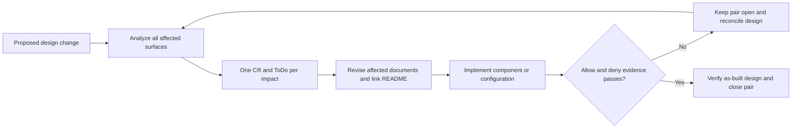
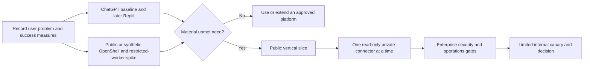
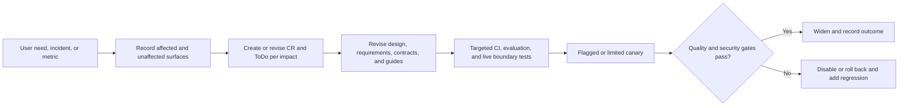

# Agent guide and software delivery process

This is the root guide for people and coding agents working on the internal Deep Research candidate. Read it before changing the project. The repository is currently a **design and contract scaffold**: it has no running dashboard, broker, worker, CI pipeline, or deployed OpenShell gateway. Do not describe a proposed control as implemented or treat `make check` as a live security test.

## Source of truth and working rules

- Start with [README.md](README.md), the numbered [requirements](docs/requirements.md), the [architecture](docs/architecture.md), and the [platform feasibility assessment](docs/feasibility-and-market-assessment.md). Read the affected design document and [contracts](contracts/README.md) before changing a boundary. The [deployment gates](docs/design/deployment-and-operations.md#10-promotion-integration-gates) define production proof.
- Check `git status` first and preserve work already in the tree. Keep changes small and reviewable. Link a work item or pull request to affected requirement IDs; record a decision in the pull request or a short ADR when a trust boundary, deployment choice, or protocol changes.
- The documented OpenShell baseline is v0.1.5, **not** proof of the installed version. Pin and test the actual gateway, supervisor/runtime, CLI/SDK, worker, Deep Agents/LangGraph, MCP client/protocol, broker adapter, model, and prompt versions together. Verify any changed upstream behavior against current official documentation and a live compatibility test.
- Use synthetic or explicitly approved data in development and evaluation. Keep source OAuth grants, refresh tokens, client secrets, and service credentials outside worker code and artifacts. Do not copy real report or source content into ordinary CI logs, issue descriptions, or external tracing.
- Each admitted job execution/source policy **snapshot** is immutable. Initial exact source/resource selectors and stage briefs stay frozen for the job; a narrowly reviewed typed correlation transfer or freshly cleared model route creates a new snapshot and fresh attempt. Adding source scope or a revised standard brief requires a new human job. A separate versioned job access policy controls visibility. The submitter and, if selected at creation, current members of **one exact approved Okta group under the owner's validated issuer** may see a job. A private report or evidence read also needs the viewer's current source and classification rights across the job's cumulative disclosure envelope. A job/evidence ID, OpenShell workspace role, or possession of a source token never replaces these checks. See [research visibility](docs/design/research-visibility.md).
- Routine private-job support uses a sanitized `support_diagnose` proxy. Raw sandbox operations require a separate incident/content proxy with current rights to the full cumulative job source/resource envelope and highest class on each operation and stream checkpoint. Native CLI has no ordinary private-job membership, even in an isolated workspace. Private incident CLI stays disabled unless a separately qualified, non-bypassable gateway edge enforces the exact job/workspace/sandbox/RPC scope and current full-envelope/class checks per RPC and stream checkpoint, with a time-bounded grant, audit, and active-session teardown.
- OpenShell network rules are a sandbox egress layer. The broker must still validate MCP tool arguments, source resource IDs, response bounds, and approved cross-partition query transfers. An attempt receiving a cross-partition key is correlation-only: its broker denies every free-form destination source tool, while ordinary same-source research uses a fresh untainted attempt. OpenShell can mint or refresh a direct source token only for a connector whose upstream RBAC already enforces the job partition, whose trusted evidence path and class-before-model route are verified, and whose live revocation/restore plan fences cached upstream tokens or quarantines old direct sandboxes. The worker graph must actually run inside its per-stage sandbox; a host-side graph that calls sandbox tools is a different design.
- From the public slice onward, every worker request to the Job API needs a current job/stage/sandbox/attempt binding. Before enterprise data, a copied raw bearer must fail at the Job API and broker ingress. Each private source partition gets its own retrieval sandbox; synthesis has no source-call tools. Trusted source handling checks classification before releasing any tool response or synthesis input to the worker/model. A public fetch service has no enterprise credentials and must enforce public-only egress and per-hop SSRF checks. OpenShell `provider:write` also permits profile RPCs; the provisioner service rejects them, while an operator-owned fail-closed gateway interceptor and authoritative trusted profile catalog must make direct writes unable to widen a private worker. Exact inspected supervisor policy separates worker routes from supervisor control/telemetry paths; outer CNI blocks direct Pod bypass. A separately governed supervisor middleware decision service is a conditional fallback if live proof fails.
- Acknowledged group, named-reader, source-connection, and typed-transfer-grant revocations use durable denial tombstones outside the application database recovery snapshot. Restores and rollbacks keep protected reads and source tools closed until the independent ledger head is verified and replayed; an external recovery generation fences old worker and broker credentials. Restored nonterminal jobs do not resume from stale database rows. See [research visibility](docs/design/research-visibility.md) and [recovery](docs/design/deployment-and-operations.md#7-backups-retention-and-restore).
- Carry out requested reversible repository work without a separate permission step. Production promotion, enterprise source enablement, and external configuration changes follow the organization's release and source-owner controls.

For an AI-agent handoff, state the outcome, requirement IDs, data class, affected trust boundaries, accepted and denied cases, pinned inputs, expected artifacts, checks that must run, and rollback or disable path. Select and read the relevant focused skills from [the skill catalog](docs/agent-skills.md). Give a delegated agent the exact `SKILL.md` paths; do not assume its tool discovers repository-local skills automatically. A skill guides the work but does not replace CI, a live boundary test, or a source owner's decision. Repository contributor skills under `.agents/skills/` are distinct from any future instructions loaded by the production research worker.

## Delivery model

Use **short, end-to-end slices with risk-based gates**. Once executable code exists, use short-lived branches, a protected main branch, automated pull-request checks, and promotion of the **same immutable build** through environments. Keep a working public/synthetic path while adding one enterprise connector at a time. Treat NIST's [Secure Software Development Framework](https://csrc.nist.gov/pubs/sp/800/218/final) as a secure-development reference, and evaluate research behavior with curated offline cases plus production monitoring as described in [LangChain evaluation guidance](https://docs.langchain.com/langsmith/evaluation-types).

### Design-change impact gate

Apply this workflow to **every change in intended behavior or design** during initial development and later enhancements, including identity, protocol, data, deployment, policy, and operational decisions. Complete the impact analysis and create its tracking records **in the design change**, before an implementation pull request starts. An ADR records a decision; a change request (CR) records an obligation to make the design real; its paired ToDo records the work and proof. Documentation alone never means a component is implemented. [ADR 0002](docs/decisions/0002-design-impact-traceability.md) records this workflow decision and its own open process-control pair.

1. **Analyze the change.** In the primary affected design or an ADR, name the decision, requirement IDs, trust/data boundaries, assumptions, accepted and denied behavior, and a threat-model delta where relevant. Sweep every surface below. Mark each **affected** with its concrete impact, impact ID, and revised-document link; for an artifact that does not yet exist, name its planned path and pre-implementation gate. Mark each **not affected** with a reason. An affected surface must map to at least one tracked impact; an omitted surface is not a decision. A surface is a place changed by an impact, not necessarily a separate impact itself.
2. **Create a pair for every identified impact.** An impact is one independently deliverable or verifiable change in a component, contract, configuration, operational control, proof gate, or documentation; it may span several surfaces and files. Give it one stable `CR-NNNN` ID, a `docs/change-requests/CR-NNNN-<slug>.md` change request, and a same-basename `docs/todos/CR-NNNN-<slug>.md` ToDo. The CR states current versus target behavior, owner, phase, requirement IDs, affected paths, dependencies, risk/disable path, and positive and negative acceptance. The paired ToDo lists executable tasks, required tests and evidence, implementation PRs, and status. Map every impact ID in the analysis to exactly one pair; do not leave a vague future-work note or create a separate CR for each edited file. Keep conditional options `Deferred` until selected or explicitly withdrawn. Before implementing an existing design slice with no pair, create one from its current primary design and requirement IDs, identify that the intended behavior is unchanged, and add the backlinks in step 3; no new ADR is needed unless the design changes.
3. **Synchronize and link.** Revise every affected **existing** normative architecture, requirements, design, Okta handoff, contract, example, and component guide in the **same design change**. A CR or ToDo cannot stand in for a stale document. A new contract or fixture that cannot be specified until a source is chosen must have a named CR/ToDo and a pre-implementation gate; write it before dependent component code. Link each CR **and** its paired ToDo directly from the impact analysis, the affected primary design, [README.md](README.md), and the [ToDo index](docs/TODO.md). The index is a register, not a second copy of task details. The design and README must make open component obligations visible beside the intended behavior.
4. **Implement and reconcile.** Each implementation pull request cites its CR/ToDo pair and requirement IDs, changes the named component or configuration, and records allow and deny evidence on pinned versions. Recheck architecture, design, contracts, and application behavior together when implementation reveals a difference; rerun this impact workflow for a changed target design. Use matching `Open`, `In progress`, `Deferred`, `Verified`, or `Withdrawn` status in both records. Mark a pair `Verified` only after its required change and proof pass and the design matches the as-built behavior. Reconcile the README and index descriptions, and retain their links for audit after closure. A documentation-only impact can close after document review and checks; a checked box or documentation edit alone cannot close an implementation CR. `Withdrawn` needs a recorded decision and removal of the abandoned behavior from the intended design.

| Surface to check | Impact record must identify |
|---|---|
| README and numbered requirements | Changed user promise, scope, phase, requirement IDs, acceptance criteria, or repository navigation |
| Architecture and affected design handoffs | Changed component responsibility, token/data flow, sequence, deployment topology, or team-facing design, including the Okta handoff where relevant |
| OpenAPI, JSON Schema, and other contracts | Changed API, event, policy, identity, error, or persistence shape and compatibility plan |
| Examples and fixtures | Changed valid and denied examples, sample claims, manifests, or research cases |
| Component documentation, code, and configuration | Changed dashboard, API, controller, broker, worker, OpenShell, identity, or source integration behavior |
| Deployment, operations, and security controls | Changed secret custody, routing, audit, recovery, migration, revocation, rollout, or disable path |
| Tests, evaluations, and release gates | New or changed positive and negative proof, version pin, source-owner/Okta review, or live qualification |

The gate is complete for a **design change** when every affected matrix row maps to a paired impact, the required CR/ToDo pairs and same-change document revisions are present, and links plus applicable design checks/reviews pass. Component CRs remain open until implementation proof passes. Highlight open component changes and pair links in the chat handoff and pull request. `make check` validates pair/link structure; design review checks whether the listed impacts and application behavior are complete. A design-only check is not live conformance proof.

### Initial development: retire unknowns before scaling the build

| Gate | Work and evidence to retain | Continue when |
|---|---|---|
| 0. Product and feasibility | Predeclare a 20–30-case rubric for correctness, citation support, completeness, abstention, latency, cost, and source permission behavior. Run approved cases in ChatGPT Enterprise; add Replit when its rollout permits. Compare a full Deep Agents graph **inside** OpenShell with a simpler restricted Kubernetes worker. Record the exact gap that justifies this service. A synthetic runtime spike may run in parallel. | The [platform-selection gate](docs/requirements.md#platform-selection-gate) shows a material unmet need and the runtime spike proves a viable boundary. Otherwise stop or simplify the custom build. |
| 1. Engineering foundation | Decide service and data owners, deployment target, retention, trace destination, and SLOs. Pin a release matrix and lock dependencies. Add CI before merging executable services: contract/static checks, lint/type/unit tests, secret scanning, **CVE scanning of resolved dependencies and final image digests**, SBOM, and build provenance. Scan deployment configuration separately for misconfiguration. Do not expose live secrets to untrusted pull-request jobs. | The team can reproduce a build from source, identify the exact code, dependencies, image, policy, and model/prompt used by a test job, and show passing or dispositioned vulnerability scan results for its immutable artifacts. |
| 2. Public vertical slice | Implement Okta PKCE/BFF session; job admission and separate visibility ACL; durable queue; controller; restricted per-attempt provider provisioner; per-attempt Job API identity; a job-bound OpenShell worker sandbox; in-sandbox Deep Agents graph; source-credential-free public search/fetch with SSRF controls; evidence capture, final report, status, cancellation, and cleanup. Build the API and broker boundary even when the first source adapter is a fixture. | The [Phase 0 requirements](docs/requirements.md#phase-0-public-source-proof-of-concept) pass end to end. Two users and two tenants prove list/detail/report/evidence denial; exact-group admission and per-job group revocation work; wrong-job/stage/attempt identity, provisioner/controller privilege separation, public-fetch SSRF, budgets, citations, and no direct worker egress pass in a live sandbox. |
| 3. Enterprise connector slices | Add **one** approved read-only Slack, GitHub, GCP Logs, or OAuth MCP connector at a time. Document user versus app identity, source owner, exact OAuth issuer/resource/audience/scopes, refresh and revocation, resource selectors, rate limits, retention, and source ACL checks. Start with fakes, then a nonproduction real issuer/server, then approved enterprise data. Keep public, each private source partition, and source-free synthesis separate; use typed, reviewed transfer grants for joins. | Before private data, copied raw bearer replay fails at Job API and broker ingress; the independent denial-ledger and recovery-generation restore drill and stage egress shared-host probe pass. Connector cases include wrong audience, out-of-scope arguments, another user/tenant/job, expired or revoked source/transfer grant, another source's canary in a query, denial of untemplated B search/read after a valid A→B join, B-only denial on A-derived B evidence, A→B→C laundering denial, over-class response or discovery snippet quarantine before model release, a valid approved typed join, unavailable entitlement, and unsupported protocol/grant. A pre-revocation backup cannot revive a transfer grant. Direct source mode stays disabled until live grant revocation and cached upstream tokens are fenced during restore. The broker never passes a dashboard or gateway token upstream as a source token. |
| 4. Enterprise hardening | Qualify OpenShift or GKE nodes, OpenShell kernel/runtime probes, a CNI that **actually enforces** ingress and egress NetworkPolicy, workspace/namespace isolation, effective policy and provider attachment, secrets, audit, tracing, HA, full backup/restore SLOs, retention, and incident runbooks. Exercise source and group revocation while jobs and SSE streams are active. | All applicable [promotion integration gates](docs/design/deployment-and-operations.md#10-promotion-integration-gates) have an owner, artifact version, expected outcome, observed evidence, and disposition. The production restore drill covers group, reader, source-connection, and transfer-grant revocations, stale worker tokens, and pending sandbox cleanup; old snapshots do not reopen them. |
| 5. Internal pilot and release | Re-run the preregistered matched research evaluation and adversarial cases on the candidate build. Obtain an independent read-only review of material design, implementation, and release deltas using the [principal engineer review skill](.agents/skills/principal-engineer-review/SKILL.md); resolve Blockers and record other finding dispositions. Promote immutable artifacts to a small authorized employee cohort, observe quality, denial decisions, cost, cleanup, and SLOs, then widen gradually. | The product owner and relevant platform/security/source owners have reviewed the recorded gates, measured value, and rollback plan. |

Do not use the first public-source success as proof that private connector auth, Kubernetes isolation, or source-result sharing works. NVIDIA requires a CNI that enforces both NetworkPolicy directions; merely creating the policy object is insufficient. OpenShell's MCP inspection covers method/tool name, not tool arguments or responses. [Kubernetes setup](https://docs.nvidia.com/openshell/v0.1.5/kubernetes/setup), [network rules](https://docs.nvidia.com/openshell/v0.1.5/how-it-works/policies/network-rules).

### Loop for every implementation slice

1. Write the intended user outcome, requirement IDs, data class, affected trust boundaries, measurable acceptance criteria, **denial cases**, and rollback or disable path. For agent behavior, identify the evaluation cases before tuning the prompt or model.
2. Apply the [design-change impact gate](#design-change-impact-gate) whenever the intended design changes. Record the impact analysis, create or revise one CR and paired ToDo for every identified impact, and link both from the design and README before implementation. Update all impacted documents and OpenAPI/JSON Schema contracts in the same change, keep examples valid, and record a threat-model delta for identity, source, sandbox, egress, result visibility, or data retention.
3. Implement the smallest end-to-end behavior with deterministic fixtures first. Put authorization in the API/broker, not in prompts or disabled UI controls. Add meaningful unit and component tests for policy decisions, failure and retry semantics, and evidence integrity. Avoid tests that merely repeat an implementation line.
4. Run local/static checks, then relevant staged integration on the exact pinned versions. A live authorization or network claim needs a live negative test. For a connector, prove MCP discovery, resource indicator, audience validation, refresh/revocation, read-only scope, and argument-level denial. [MCP authorization specification](https://modelcontextprotocol.io/specification/2026-07-28/basic/authorization).
5. Open a small pull request using the [review template](.github/pull_request_template.md) with requirement IDs, the impact analysis and every open CR/ToDo pair, contract/policy diff, positive and negative evidence, evaluation delta where relevant, observed limitations, and deployment/rollback notes. Reconcile the pair status and architecture/design with the component diff; highlight still-open component work in the chat handoff. For a material cross-component or trust-boundary change, give the full diff and evidence to a separate read-only agent using the [principal engineer review skill](.agents/skills/principal-engineer-review/SKILL.md); resolve Blockers before merge and record other finding dispositions. Get a domain review when the change affects Okta, a source's permissions, OpenShell policy, or data governance.
6. Promote the tested immutable artifact through staging and an authorized canary. Watch audit denials, group/source revocation, citation quality, token/tool failures, latency, cost, and sandbox cleanup. Disable or roll back if a release threshold is crossed; add any escaped failure to regression cases.

## Verification and release evidence

**Current repository check:** `make check` validates JSON Schemas, examples, local Markdown links, CR/ToDo pairing and backlinks, and Mermaid fence structure. It does **not** render diagrams, determine whether an impact was omitted, or prove OAuth, MCP, OpenShell policy, CNI, or runtime behavior. There is currently no CI pipeline or executable service suite. Add those gates as their components are implemented; report exactly which checks actually ran.

The intended layered checks are:

1. **Every pull request:** `make check`, formatting/lint/type checks for changed code, deterministic unit/contract tests, secret scanning, CVE scanning of resolved dependency locks, and review of the relevant requirement IDs. Test a changed authorization rule with at least one allow and one deny case.
2. **Boundary integration in staging:** Okta and source OAuth/MCP flows with real nonproduction issuers; two-user/two-tenant ACL matrix; source authorization and revocation; exact OpenShell effective policy, provider receipt, denied direct egress, worker location, cancellation, evidence persistence, and restore. Never infer success from a valid token alone.
3. **Research evaluation:** versioned, human-reviewed offline cases for factual support, citation spans, completeness, abstention, prompt injection, latency, and cost; compare against the last accepted version and the incumbent baseline when a material workflow changes. Use approved, redacted production feedback for online monitoring, not unchecked raw traces.
4. **Release record:** source commit, build and image digests, SBOM/provenance, CVE scan coverage and scanner/database timestamps, finding dispositions and exceptions, database migration, OpenShell gateway/supervisor/runtime/CLI/SDK, Deep Agents/LangGraph, MCP revision and adapter, model/prompt, evaluation-set version, policy/profile digests, gate results, canary cohort, and rollback steps. [SLSA provenance](https://slsa.dev/spec/v1.2/provenance) is a useful artifact model.

### CVE gate in the build process

Implement **OPS-10** with the first executable build. This design-only repository has no CI, resolved application dependency locks, Dockerfiles, or final images yet; the current ranged `requirements-dev.txt` is not an exact dependency inventory. A passing `make check` is not a CVE scan.

1. Resolve and lock Python and future UI dependencies. On each pull request scan direct, transitive, development, and build dependencies; compare new findings with the accepted baseline. Scan changed Docker/Helm/Terraform/Kubernetes files for **misconfiguration** in a separate check, because that is not a CVE scan.
2. Build the candidate artifacts, then scan the **exact final immutable digests** for the worker, API, broker, dashboard, and the qualified OpenShell gateway, supervisor, runtime, and controller images. Include OS and language packages. Generate a CycloneDX or SPDX SBOM tied to each digest; retain scanner version, advisory-database timestamp, coverage, and scan output. [Trivy vulnerability and image scanning](https://trivy.dev/docs/latest/scanner/vulnerability/), [Trivy SBOM](https://trivy.dev/docs/latest/guide/supply-chain/sbom/).
3. Fail promotion if a scan is missing, incomplete, or stale, or if an applicable CISA Known Exploited Vulnerability or critical/high finding is unresolved without a scoped, time-limited security-owner exception. Triage lower severities with an owner and due date. Validate `not affected` and false-positive claims against the installed package/version and vendor fix or backport evidence; do not use blanket ignores. These thresholds and the daily cadence are **project policy proposals**, to be approved by the enterprise security owner. [CISA KEV data](https://github.com/cisagov/kev-data), [Trivy finding filters](https://trivy.dev/docs/latest/configuration/filtering/).
4. Rescan released digests or their retained SBOMs at least daily and promptly after urgent advisory updates. For a new applicable finding, patch or replace the dependency/base image, rebuild, rescan, rerun affected tests, and promote the new immutable digest. The [deployment design](docs/design/deployment-and-operations.md#build-security-and-cve-gate) owns the CI ordering and release evidence. The [vulnerability-triage skill](.agents/skills/vulnerability-triage/SKILL.md) guides an agent through findings; it is not the automated gate.

## Enhancements after the first release

Initial development proves that the product and trust boundaries work at all. An enhancement starts from a **measured gap or incident** and tests the changed behavior plus the invariants it could disturb. Every enhancement that changes intended design repeats the [design-change impact gate](#design-change-impact-gate), revises affected documents in that change, and creates or updates the CR/ToDo pair for **every** identified impact. It does not repeat the full build-versus-buy pilot for a routine fix. Revisit feasibility when a platform, source, model, or enterprise policy change undermines the original build decision.

Apply the **union** of relevant rows below. A routine change needs the smaller path; a new trust boundary needs the broader path.

| Change impact | Required additional proof |
|---|---|
| Documentation or UI presentation only | `make check`, relevant UI/accessibility review, and a normal pull-request review. Do not claim a live gate was rerun. |
| Prompt, model, planner, retrieval, verifier, or ranking | Affected offline cases plus a stable sentinel set; human review of factual support, citation spans, abstention, prompt-injection behavior, latency, and cost; canary with approved trace handling. Pin model/prompt per admitted job. |
| Okta, session, job ACL, broker policy, connector, OAuth, MCP, or source scope | Threat-boundary and permission diff; two-user/two-tenant and exact-group tests; wrong-audience, copied-bearer, cross-partition canary, and out-of-scope argument denial; approved typed-join success; current source-rights and revocation tests; relevant live issuer/MCP and OpenShell effective-policy tests. Coordinate with the IdP or source owner when their configuration changes. |
| OpenShell, Kubernetes, image, runtime, or egress upgrade | Version compatibility and node/CNI probes; live allowed/denied policy tests; canary sandbox; active-job drain/restart behavior; rollback rehearsal. Running sandboxes may retain prior supervisor/runtime images during an upgrade. [OpenShell Kubernetes upgrade behavior](https://docs.nvidia.com/openshell/v0.1.5/kubernetes/setup). |
| Dependency, base image, or scanner-policy change | Refresh locks and SBOM; rerun dependency and final-digest CVE scans; review newly introduced and newly disclosed findings; rerun tests covering the changed component and retain the disposition or exception. |
| API, database, report/evidence schema, classification, or retention | Contract versioning and migration plan; old/new reader compatibility during rollout; backfill and restore test; replay and verify the external denial-ledger head; verify revoked ACL/source grants, legal holds, and retained evidence do not become readable after rollback. |

For compatible data changes, use **expand → backfill → contract** across releases. Do not silently widen an existing job's execution policy or visibility audience. Pin active attempts to their admitted policy snapshot and worker/model versions. A reviewed typed correlation transfer or newly cleared model route creates a new immutable snapshot and attempt; a new source/resource selector or revised standard brief requires a new human job. A feature flag may disable a connector or route, but must never bypass authorization. Preserve revocation state across deploy, rollback, and restore.

For an urgent security fix, disable the affected connector/route or revoke the grant, use an expedited peer review and focused negative test, deploy to a limited cohort when time permits, and follow with a complete regression and incident review. Do not wait for the next feature cycle to stop a known unauthorized read.
