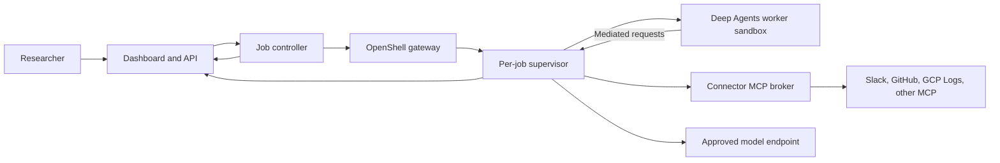

# OpenShell Deep Research

Design-first scaffold for a **candidate internal research service**. If a custom service is justified, a LangChain Deep Agents worker performs research inside a per-job NVIDIA OpenShell sandbox; its dashboard, controller, durable state, and connector broker stay outside the sandbox.

> **Status:** architecture and contracts only. This repository does not yet deploy a gateway, authenticate users, call enterprise sources, or run a research worker. The documents distinguish verified OpenShell features from proposed application behavior.

All employees already have ChatGPT Enterprise, with source connectors moving through review, and a Replit rollout is planned in about three months. The [feasibility and market assessment](docs/feasibility-and-market-assessment.md) therefore starts with ChatGPT Enterprise as the research baseline, adds Replit Chat when available, and runs a bounded OpenShell feasibility spike in parallel. A full dashboard and worker build follows only a measured gap in execution, authorization, job control, or evidence. The four candidate controls remain a server-held job policy, a credential and connector broker, separate public/private research lanes, and durable claim-to-source evidence.

**Candidate custom architecture, conditional on the pilot:**

## Candidate design baseline

- Interactive users authenticate through Okta Authorization Code with PKCE to the dashboard. Operator CLI access to the gateway is conditional on a tested Okta browser callback or approved device grant. The job controller uses a service identity for OpenShell RPCs.
- A server-held job policy binds the submitting user, tenant, approved sources and resources, tool permissions, model route, expiry, and budgets. A worker receives only a narrow stage manifest and cannot enlarge that policy.
- The connector broker holds downstream OAuth grants or application credentials and exposes only approved research tools. The worker receives a short-lived job identity, not upstream Slack, GitHub, or GCP credentials.
- Research jobs start read-only. Public web and private enterprise source access use separate sandboxes. A mixed job requires a reviewed public-safe brief; only curated public evidence passes into the private synthesis stage.
- Results carry structured evidence IDs, source links, timestamps, and sensitivity labels. The dashboard applies access checks when displaying reports and evidence.
- Qualify OpenShift 4.19+ first for enterprise Kubernetes, then GKE Standard as an alternative. Both require live OpenShell kernel, runtime, and network probes. Start with fixed worker capacity, a durable queue, and per-tenant concurrency caps; node autoscaling is optional.

The target OpenShell documentation baseline is **v0.1.5**. The local CLI checked on 2026-10-23 reports **0.0.44**. Upgrade the CLI and gateway to a matching supported release before implementing or validating provider profiles, MCP policies, and SDK integration. [OpenShell documentation](https://docs.nvidia.com/openshell/home) · [Gateway authentication](https://docs.nvidia.com/openshell/how-it-works/gateways/authentication).

## Repository map

| Path | Responsibility |
| --- | --- |
| [docs/requirements.md](docs/requirements.md) | Scope, requirements, acceptance criteria, and rollout gates. |
| [docs/architecture.md](docs/architecture.md) | Components, trust boundaries, flows, deployment, and decisions. |
| [docs/feasibility-and-market-assessment.md](docs/feasibility-and-market-assessment.md) | Build-versus-buy assessment, competitor comparison, feasibility gates, and matched pilot. |
| [docs/design/identity-and-access.md](docs/design/identity-and-access.md) | Okta, OpenShell, OAuth/MCP support matrix, and identity flows. |
| [docs/okta/requirements-and-design.md](docs/okta/requirements-and-design.md) | Standalone Okta team implementation handoff and acceptance tests. |
| [docs/design/job-lifecycle.md](docs/design/job-lifecycle.md) | Job state machine, provisioning, events, cancellation, and recovery. |
| [docs/design/research-and-evidence.md](docs/design/research-and-evidence.md) | Deep Agents workflow, tools, provenance, and report quality. |
| [docs/design/mcp-connector-broker.md](docs/design/mcp-connector-broker.md) | Connector policy, OAuth handling, and source-specific behavior. |
| [docs/design/deployment-and-operations.md](docs/design/deployment-and-operations.md) | OpenShell and Kubernetes deployment, observability, retention, and tests. |
| [docs/design/deployment-topology.md](docs/design/deployment-topology.md) | GCP VM, OpenShift, and GKE topology decision and qualification gates. |
| [docs/design/chatgpt-enterprise-integration.md](docs/design/chatgpt-enterprise-integration.md) | ChatGPT-first research baseline and optional read-only MCP integration. |
| [docs/design/replit-rollout-fit.md](docs/design/replit-rollout-fit.md) | Replit research comparison, UI build use, and conditional hosting gates. |
| [contracts/](contracts/) | OpenAPI and JSON Schema contracts for jobs, per-stage manifests, events, evidence, and reports. |
| [examples/](examples/) | Fake payloads that validate against the contracts and exercise public/private stage isolation. |
| [apps/](apps/) | API, dashboard, and sandbox worker component boundaries. |
| [services/controller/](services/controller/) | Job dispatch, sandbox lifecycle, and recovery boundary. |
| [services/connector-broker/](services/connector-broker/) | MCP broker component boundary. |
| [infra/openshell/](infra/openshell/) | OpenShell deployment and policy integration notes. |

## Review and validation

Run `make check` to parse the JSON schemas, validate example payloads, check local Markdown links, and inspect Mermaid fence balance. This check cannot prove that a diagram renders or that an OpenShell policy works against a gateway. Those are deployment gates in [deployment and operations](docs/design/deployment-and-operations.md).

## Implementation sequence

1. Define 20–30 representative research cases and baseline approved public/synthetic cases in ChatGPT Enterprise. Add reviewed native connectors as they are enabled; defer private cases until source approval. Run the same cases in Replit Chat after its rollout.
2. In parallel, prove a pinned Deep Agents graph can run inside an OpenShell sandbox with denied direct egress and a bounded lifecycle. Compare it with a restricted Kubernetes worker using the same broker and evidence contract.
3. If the incumbent leaves a material gap, test a read-only `search`/`fetch` MCP for ChatGPT and decide whether a separate dashboard or ChatGPT plugin job interface is needed. Use Okta user PKCE for ChatGPT-to-MCP; reserve client credentials for the controller gateway or supported broker-to-source flows.
4. Build only the missing custom components, adding one approved read-only source at a time. Complete tenant isolation, identity, recovery, evidence, observability, and adversarial gates before enterprise promotion.

The [NVIDIA community deep-research-worker recipe](https://github.com/NVIDIA/nemoclaw-community/tree/main/examples/recipes/community/deep-research-worker) is a reference for bounded job lifecycle behavior. Its Deep Agents graph runs on the host, so this scaffold uses a different execution boundary.

