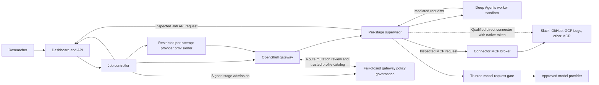

# OpenShell Deep Research

Design-first scaffold and active feasibility build for a **candidate internal research service**. If a custom service is justified, LangChain Deep Agents workers perform research inside job-bound NVIDIA OpenShell sandboxes for each authorized stage; the dashboard, controller, durable state, and connector broker stay outside the sandboxes.

> **Status:** Milestone 0 implementation is underway; there is no qualified running research service. The [progress report](docs/progress-report.md) distinguishes code, tests, and live gates as they are completed.

Design changes follow the [impact-analysis and CR workflow](AGENTS.md#design-change-impact-gate): every identified impact gets a change request and paired ToDo, linked from its design and this README through implementation and closure. The [workflow decision](docs/decisions/0002-design-impact-traceability.md) and [outbound MCP token impact analysis](docs/decisions/0001-outbound-mcp-source-tokens.md#impact-analysis-and-document-disposition) show that traceability; the [CR/ToDo index](docs/TODO.md) lists every pair. The components below remain proposed, not implemented.

All employees already have ChatGPT Enterprise, with source connectors moving through review, and a Replit rollout is planned in about three months. The [feasibility and market assessment](docs/feasibility-and-market-assessment.md) therefore starts with ChatGPT Enterprise as the research baseline, adds Replit Chat and General Agent when available, and runs a bounded OpenShell feasibility spike in parallel. A full dashboard and worker build follows only a measured gap in execution, authorization, job control, or evidence. The four candidate controls remain a server-held job policy, a credential and connector broker for sources needing task-level checks, separate public/private and per-source research lanes, and durable claim-to-source evidence. A qualified direct connector can use OpenShell's native endpoint-bound token minting or refresh instead of broker-held source credentials.

**Candidate custom architecture, conditional on the pilot:**

## Build plan and inputs

The [reviewable checkpoint and protected-CI handoff](docs/handoffs/milestone0-protected-ci-checkpoint.md) preserves the Milestone 0 implementation, records local checks and secret review, and names the remaining CR-0009/0013 owner gates.

The user will run the 24 ChatGPT cases and has administrator control of the app on their Mac, but that local control does not grant Enterprise workspace or OpenAI Platform tunnel administration. The [ChatGPT baseline CR-0018](docs/change-requests/CR-0018-chatgpt-synthetic-mcp-baseline.md) / [ToDo](docs/todos/CR-0018-chatgpt-synthetic-mcp-baseline.md) therefore labels any approved-input Mac-local MCP test as a separate compatibility trial. Hosted Enterprise Deep Research connector and permission evidence waits for workspace/Platform owner access, approved synthetic bytes, and actual tenant tool calls; no connector is approved. The [connectivity impact analysis](docs/feasibility-and-market-assessment.md#chatgpt-baseline-connectivity-impact), [owner handoff](docs/handoffs/chatgpt-mcp-admin-request.md), and [tester runbook](eval/mcp_fixture/README.md#authorized-tunnel-and-tenant-handoff) give the two paths.

The [approved staged implementation plan](docs/design/implementation-plan.md) starts with a bounded full-graph OpenShell spike and a matched ChatGPT Enterprise/restricted-worker comparison. The SEL-01/02/04/05 decision comes **before** the dashboard/control-plane build; a measured gap then unlocks the fixture-backed public slice, live Okta integration, sources, and deployment gates. Track each assignment, TDD result, independent review, and unrun gate in the [progress report](docs/progress-report.md). Copy the tracked [`.env.example`](.env.example) to the ignored `.env` and fill only the section needed for the current milestone. No external credentials are needed to start coding the synthetic spike harness; raw secrets belong in an approved secret manager or ignored local secret files, never in `.env`. [OPS-13](docs/requirements.md#55-operations-and-governance) requires fixture providers to be absent from signed release images and network-accessible deployments. The post-selection input/configuration work remains [CR-0010](docs/change-requests/CR-0010-build-configuration-contract.md) and its [ToDo](docs/todos/CR-0010-build-configuration-contract.md).

The [matched evaluation CR-0011](docs/change-requests/CR-0011-matched-feasibility-evaluation.md) / [ToDo](docs/todos/CR-0011-matched-feasibility-evaluation.md) requires anonymized answer/source packets, a separate concealed candidate map, and independently witnessed frozen reviews. The local [signed scorer-binding v2 pipeline](eval/README.md#signed-scorer-binding-v2) has TDD corrections for the first [independent review](docs/evidence/CR-0011-scorer-binding-independent-review-2026-10-26.md). A [later review](docs/evidence/CR-0011-signed-partial-re-review-2026-10-26.md) found a mutable catalog race; its fix passed focused tests, but the [next review](docs/evidence/CR-0011-catalog-race-final-review-2026-10-26.md) reproduced an intermediate-symlink output-path Blocker. Its FD-bound correction passed local gates; the [output-FD re-review](docs/evidence/CR-0011-output-parent-fd-independent-review-2026-10-26.md) confirmed the original attack denies but found a signed packet-directory A→B→A split-view Blocker. The verifier-FD correction denies that split view locally. A later FD audit reproduced a lexical private ancestor resolving to a public writable physical output parent; its red-first correction passed focused tests. The final reviewer then reproduced a new **stdout label-custody Blocker**: a signed run without --output printed a labeled ready report. The red-first CLI correction now passes 167 focused tests and full local gates; [final independent recheck](docs/evidence/CR-0011-0024-final-custody-independent-review-2026-10-26.md) found no remaining scoped Blocker/Important. The reviewer also reproduced post-exit replacement of a successful lexical output path through a symlink or by renaming a private 0700 directory under a writable nonsticky parent; the scorer's rename-resistant ancestor check now denies both locally. A malformed candidate field name also leaked to stderr; CLI errors are now content-free in local tests. No packet or scorecard is approved for selection. The [v3 design review](docs/evidence/CR-0021-0022-v3-design-independent-review-2026-10-26.md) also found that an edited blind packet answer can differ from the raw candidate answer; exact-byte equality passed local code review under still-open [CR-0024](docs/change-requests/CR-0024-blind-packet-answer-integrity.md) / [ToDo](docs/todos/CR-0024-blind-packet-answer-integrity.md) after [independent code review](docs/evidence/CR-0011-0024-final-custody-independent-review-2026-10-26.md). Original-run truth and packet release remain open under CR-0011/0025. Three other selection-input corrections remain open: supported alternative citation spans [CR-0021](docs/change-requests/CR-0021-citation-support-fairness.md) / [ToDo](docs/todos/CR-0021-citation-support-fairness.md), honest unknown cost and report-export observations [CR-0022](docs/change-requests/CR-0022-observed-cost-and-report-export.md) / [ToDo](docs/todos/CR-0022-observed-cost-and-report-export.md), and draft corpus ambiguity/coverage [CR-0023](docs/change-requests/CR-0023-corpus-fairness-and-coverage.md) / [ToDo](docs/todos/CR-0023-corpus-fairness-and-coverage.md). CR-0022 now has an isolated cost/export observation and coverage helper with 24 focused tests and [independent local review](docs/evidence/CR-0022-local-cost-export-independent-review-2026-10-26.md); the signed scorer migration and real export/cost proof remain open. The [proposed v3 evaluator contract](docs/design/matched-evaluation-contract-v3.md) describes the coordinated target; it is not implemented. Witness/key custody, raw-run and control-event truth, product/security case approval, a ChatGPT connector, and observed matched runs remain open. See the [feasibility impact analysis](docs/feasibility-and-market-assessment.md#matched-evaluation-proof-implementation-impact). No scorecard or packet is approved for selection and no selection decision has been made.

The current evaluator also cannot prove that a citation in a blind packet came from the candidate's original run. [CR-0025](docs/change-requests/CR-0025-candidate-citation-provenance.md) / [ToDo](docs/todos/CR-0025-candidate-citation-provenance.md) tracks independently checked native-citation extraction and a **pre-distribution** control signature over the exact packet and complete manifest, later frozen with control/witness proof. A source-exact quote or a manifest witnessed only after blind review cannot pass this gate. Product-specific native-reference accounting, a qualified control-key register, a complete-matrix decision ledger, and independent packet/target delivery order are still open component obligations; the isolated verifier only binds citation count/digest and exact packet/manifest inputs. The proposed [v3 contract](docs/design/matched-evaluation-contract-v3.md#candidate-citation-provenance-precondition) remains unintegrated; a strict isolated preliminary-attestation verifier/schema has 23 local synthetic tests green under CR-0025, with [independent code review](docs/evidence/CR-0025-isolated-attestation-code-independent-review-2026-10-26.md) finding no scoped Blocker/Important, and no packet-distribution authority. An [isolated reviewer-target projection helper](eval/target_projection.py) under [CR-0021](docs/change-requests/CR-0021-citation-support-fairness.md) / [ToDo](docs/todos/CR-0021-citation-support-fairness.md) is in progress and unused; observed citation scoring stays disabled.

The disposable spike's stage header is copyable and proves only fixed stage/manifest consistency. After a positive selection decision, [CR-0015](docs/change-requests/CR-0015-phase0-attempt-identity-readiness.md) / [ToDo](docs/todos/CR-0015-phase0-attempt-identity-readiness.md) must implement Phase 0 per-attempt Job API and model-gate readiness binding. That public fallback still has a stolen raw static-bearer replay limit. Before private traffic, [CR-0016](docs/change-requests/CR-0016-phase1-sender-origin-proof.md) / [ToDo](docs/todos/CR-0016-phase1-sender-origin-proof.md) must prove receiver-verified sandbox sender origin and copied-raw-bearer denial. Neither pair is implemented by the local OpenShell run; see the [impact analysis](docs/design/implementation-plan.md#8-proof-boundary-reconciliation-and-identity-intake).

The requested future provider switch applies to the application as well as the disposable spike. [CR-0017](docs/change-requests/CR-0017-production-model-route-adapters.md) / [ToDo](docs/todos/CR-0017-production-model-route-adapters.md) tracks a reviewed production model-route catalog and provider adapters after selection. The worker keeps a stable internal alias; changing vendors requires a new approved route revision and fresh attempt. The local OpenAI relay under CR-0014 does not implement that production gate. See the [model-route impact analysis](docs/design/research-and-evidence.md#production-provider-adapter-and-route-catalog-impact).

For the ChatGPT Enterprise baseline, the **hosted** workspace does not reach the local OpenShell gateway. The user can configure the Mac app, but a local Work MCP trial still needs actual Work Local entitlement, effective enterprise/device MCP allowance, approved exact case bytes, and an observed Work-mode tool call; it is separate from hosted Deep Research. The user will run the synthetic cases, but no connector is approved yet; MCP and permission outcomes stay deferred until approval and live evidence. The local fixture's [initial tester-packet review](docs/evidence/CR-0018-tester-packet-independent-review-2026-10-26.md) found missing approval pins and safe question export. A [targeted correction re-review](docs/evidence/CR-0018-packet-correction-re-review-2026-10-26.md) found no remaining local Blocker/Important under an operator-only packet directory; approved mode now publishes one-case `question.txt` and `projection.json` together under fresh `--packet-dir`. Packet distribution remains closed until human approval and an externally registered, independently held manifest pin. [CR-0018](docs/change-requests/CR-0018-chatgpt-synthetic-mcp-baseline.md) / [ToDo](docs/todos/CR-0018-chatgpt-synthetic-mcp-baseline.md) track a **separate**, case-filtered synthetic `search`/`fetch` MCP fixture through an approved [Secure MCP Tunnel](https://developers.openai.com/api/docs/guides/secure-mcp-tunnels). The local fixture pins legacy MCP `2025-06-18` and `2025-11-25` stdio, exact projection/response bounds, and a required v0.0.18 initialized-notification shim. A [local in-memory tunnel-client probe](docs/evidence/CR-0018-local-tunnel-client-proxy-2026-10-26.md) passed tool discovery, allowed/denied fetch, and write denial; hosted tunnel/modern fallback, tenant Deep Research eligibility, and source-permission parity still need observed tests. Each matched case needs a fresh conversation, selected-source state, and raw tool transcript. The inspected v0.0.18 binary has an [unresolved high vulnerability finding](docs/evidence/CR-0018-tunnel-client-vulnerability-preflight-2026-10-26.md) before credential-bearing use. The tunnel is an outbound transport for the benchmark. File upload can supply a quality baseline while MCP cases remain deferred. See the [connectivity impact analysis](docs/feasibility-and-market-assessment.md#chatgpt-baseline-connectivity-impact).

## Platform comparison and potential edge

This is an **internal build-versus-buy decision** for a design-stage service. The table summarizes published capabilities as of 2026-10-23; tenant entitlements, connector permissions, and the proposed advantages need a matched pilot. See the [full feasibility and market assessment](docs/feasibility-and-market-assessment.md) for sources, qualification gates, and the decision method.

| Platform | Documented overlap | What to test before building this service |
| --- | --- | --- |
| [ChatGPT Enterprise Deep Research](https://learn.chatgpt.com/docs/web-search) | The ChatGPT Enterprise workspace is already available to employees; Deep Research can produce cited reports using web, files, and connected apps. Admins can [govern app access](https://learn.chatgpt.com/docs/enterprise/apps-and-connectors), and an approved [read-only MCP source](https://developers.openai.com/api/docs/mcp) is an integration candidate. | Confirm Deep Research entitlement. Can approved connectors or a broker MCP satisfy the exact source grants, result export, and evidence-review requirements without another employee UI? |
| [Replit Chat and General Agent](https://docs.replit.com/features/agent/general-agent) | Replit documents connected-source research and report/code output, including Slack and BigQuery connectors. [Full BYOC](https://replit.com/blog/bring-your-own-cloud) includes the Agent harness in customer cloud and is in private preview. | At rollout, compare the contracted deployment mode, source permissions, job controls, and evidence export on the same cases. Customer-cloud execution is also a Replit option. |
| [Glean Deep Research](https://docs.glean.com/user-guide/assistant/deep-research) | Cited company and web research respects source permissions; Glean also documents an [OAuth-capable remote MCP host](https://docs.glean.com/administration/actions/connect-remote-mcp-servers-to-glean). | Can its research workflow apply the required per-job resource and time-window limits and export evidence in the needed form? |
| [Microsoft 365 Copilot Researcher](https://learn.microsoft.com/en-us/microsoft-365/copilot/faq-researcher) | Multi-step, cited research over Microsoft data and the web; Microsoft 365 Copilot has [federated MCP connectors](https://learn.microsoft.com/en-us/microsoft-365/copilot/connectors/overview). | Test the selected Slack, GitHub, and GCP Logs investigation with equivalent source access and permissions. |
| [Gemini Enterprise Deep Research](https://docs.cloud.google.com/gemini/enterprise/docs/research-assistant) | Plans multi-step research over selected enterprise and web sources and returns a cited report. | Compare its available connectors, source permissions, and evidence export on the same cases. |
| [LangSmith Managed Deep Agents](https://docs.langchain.com/langsmith/python/managed-deep-agents-overview) | Managed Deep Agents runs, OAuth connections, and an auxiliary sandbox. Its graph runs in Agent Server. | A proven full graph inside each authorized OpenShell stage sandbox on the organization's cluster would provide a different execution boundary. |
| [Azure Foundry Hosted Agents](https://learn.microsoft.com/en-us/azure/foundry/agents/concepts/hosted-agents) and [AWS Bedrock AgentCore](https://docs.aws.amazon.com/bedrock-agentcore/latest/devguide/what-is-bedrock-agentcore.html) | Azure runs custom agents in isolated session sandboxes. AWS offers isolated agent execution, [OAuth/token exchange](https://docs.aws.amazon.com/bedrock-agentcore/latest/devguide/gateway-outbound-auth.html), and [input-aware tool policy](https://docs.aws.amazon.com/bedrock-agentcore/latest/devguide/policy-authoring-guide.html). | Compare organization-operated OpenShift/GKE placement and the end-to-end evidence contract. Isolation, token brokerage, and argument policy each have managed alternatives. |
| [Google Managed Agents sandbox](https://docs.cloud.google.com/gemini-enterprise-agent-platform/build/managed-agents/sandbox-environment) | Runs the planning agent in a managed sandbox; its current Pre-GA terms exclude sensitive and production workloads. | Revisit as a future benchmark when its terms and the organization's data policy permit the same enterprise cases. |
| [Okta Agent Gateway](https://help.okta.com/OIE/en-us/content/topics/ai-agents/agent-gateway.htm) | Mediates MCP tools, enforces identity policy, and injects downstream credentials. | Test whether it can provide the connector-broker function, then add only missing job-level checks and evidence capture. |

### Where this design could have an edge

1. **Organization-operated, full-graph execution.** The planner, tool client, verifier, and synthesis process would run in fresh, job-bound stage sandboxes on a qualified OpenShift or GKE cluster, with supervised egress and teardown. This requires a custom worker: the [current LangChain OpenShell adapter](https://github.com/langchain-ai/langchain-nvidia/blob/main/libs/openshell/README.md) keeps the graph on the host and sends sandbox operations into OpenShell.
2. **Enforced job-specific source grants.** The API would bind the user, tenant, approved Slack channels, GitHub repositories, GCP log views, time range, tools, expiry, and budget to one job. The broker would check every tool call's arguments against that record and honor revocation. [OpenShell MCP network rules](https://docs.nvidia.com/openshell/v0.1.5/how-it-works/policies/network-rules) filter method and tool name, so application-level resource checks remain necessary.
3. **Credential custody and separated research lanes.** The broker holds upstream grants on the default enterprise path; OpenShell can hold and inject them for a qualified direct connector. The worker uses a short-lived job/stage/attempt identity from the public prototype onward. Public research, ordinary and correlation-only private retrieval, and source-free synthesis run in separate sandboxes. A correlation-only destination receives an approved key ID and cannot call a free-form source tool. Only a reviewed public-safe brief, approved typed correlation keys, and curated evidence cross the corresponding boundaries.
4. **Replayable claim-level evidence.** The broker would retain authorized source snapshots with timestamps, hashes, source identity, and policy decisions. Report claims would point to evidence IDs that an authorized reviewer could inspect after sandbox deletion, subject to retention and access checks.

The most plausible first use case is a cross-system incident investigation that ties a Slack decision to a GitHub change and a GCP Logs event under one job's narrow source grants, then preserves the evidence for review. [Cloud Logging already has an MCP server](https://docs.cloud.google.com/logging/docs/use-logging-mcp); the proposed value comes from the combined authorization and evidence workflow. Validate that value on 20–30 matched cases against the available ChatGPT Enterprise features and, after rollout, Replit Chat and General Agent. Compare the OpenShell worker with an ordinary restricted Kubernetes worker using the same broker and evidence contract; proceed with the extra runtime only if it supplies a needed, measurable benefit. The [pilot gates](docs/feasibility-and-market-assessment.md#5-matched-pilot-and-decision-gates) cover authorization, research quality, evidence, reliability, and total cost.

## Candidate design baseline

- Interactive users authenticate through Okta Authorization Code with PKCE to the dashboard. Ordinary direct operator CLI access is disabled for private jobs, including isolated workspaces. Routine `support_diagnose` returns sanitized diagnostics through a proxy; raw shell, download, or scratch access needs a separate content-authorized proxy that rechecks the full job disclosure envelope and class on each operation and stream. Direct CLI is limited to synthetic diagnostics; private incident CLI stays disabled unless a time-bounded, audited grant is enforced by a separately qualified, non-bypassable gateway edge that binds the exact job, workspace, sandbox, and allowed RPCs, rechecks the full envelope and class per RPC and stream checkpoint, and tears down active sessions on revocation. A tested Okta callback or approved device grant is also required. The job controller and per-attempt provider provisioner use separate service identities and gateway scopes.
- A server-held job policy binds the submitting user, tenant, approved source partitions and resources, reviewed per-partition briefs and typed transfer grants, tool permissions, model-route alias, expiry, and budgets. Each admitted snapshot is immutable; initial exact source selectors and briefs stay frozen, while a narrowly reviewed transfer or model-route change creates a new snapshot and attempt. New source scope or a revised standard brief requires a new human job. A worker receives only its narrow stage manifest. OpenShell v0.1.5 supplies endpoint-bound model credential delivery; a trusted model gate enforces the ready attempt, exact model ID, request shape, classification, and independent cumulative job request/token/cost budgets.
- The connector broker holds downstream OAuth grants or application credentials and exposes approved research tools by default. A qualified direct connector may use OpenShell's native endpoint-bound token minting or refresh only when upstream RBAC enforces the exact job scope, the upstream rejects copied raw vendor-token replay outside the original sandbox/attempt, and issuer policy or a qualified interceptor prevents provider reuse. It also needs trusted evidence capture, class-before-model release, and live revocation/restore fencing of cached tokens and active connections. Every external credential or refresh-config update to an attached direct provider is denied; only pinned automatic refresh with independent issuer/upstream proof of unchanged scope may continue. A scope change requires a fresh attempt. The worker receives a short-lived job identity from Phase 0; before enterprise data, Job API and broker ingress must also reject replay of a copied raw bearer from another origin.
- For an outbound OAuth-protected MCP, the broker selects a verified user connection or source-approved app identity. Standard Okta OBO and Okta for AI Agents STS/XAA are conditional, distinct options; neither is automatic OpenShell token exchange. A user source login must match the dashboard user before its grant is stored, and the chosen flow must pass exact MCP resource/audience, renewal, and revocation tests. See the [Okta handoff](docs/okta/requirements-and-design.md#6-outbound-source-token-choices-and-oktas-conditional-role) and [tracked CR/ToDo pairs](#tracked-change-requests).
- Research jobs start read-only. Public web, ordinary private retrieval, correlation-only cross-source joins, and source-free synthesis use separate sandboxes. A mixed job requires a reviewed public-safe brief. Cross-source queries use only approved typed keys and broker-built templates; a joined destination has no free-form source search/read/fetch tools. Synthesis receives curated evidence without source-call tools. Trusted capture checks classification before source bytes or synthesis evidence reach a worker/model. The public fetch service holds no enterprise source or control-plane credential, uses a narrow service identity for its own authenticated traffic, and has restricted egress and per-hop SSRF checks.
- Each research job has a server-held visibility audience: its submitter and, when selected and authorized at creation, one approved Okta group bound to the owner's validated issuer and tenant. Current group membership controls group access, and the job's group audience can be revoked; even a public-source job is not automatically visible to everyone. The dashboard filters job lists and checks each status, event, report, and evidence read. Full reports require current rights to the cumulative union of exact source scopes admitted across all revisions and its highest class; each evidence read uses its trusted transitive source closure and effective class. An independent authorization ledger preserves revocations, scope admissions, and cumulative source/model usage across database restore; an external recovery generation fences old worker credentials. Results carry structured evidence IDs, source links, timestamps, and sensitivity labels. See the [research visibility design](docs/design/research-visibility.md).
- Qualify OpenShift 4.19+ first for enterprise Kubernetes, then GKE Standard as an alternative. Both require live OpenShell kernel, runtime, CNI, stage-route, complete sandbox-create-spec, service-exposure, and scratch-volume cleanup probes. A fail-closed gateway interceptor, authoritative trusted profile catalog, inspected supervisor policy, and outer CNI are the preferred private-stage candidate. Its signed create intent permits only a bounded identical retry of one uncertain logical create on the same current attempt and `request_id`; changed or stale replay and a second sandbox deny. This remains **open** [CR-0019](docs/change-requests/CR-0019-private-stage-route-governance.md) / [ToDo](docs/todos/CR-0019-private-stage-route-governance.md). A direct profile mutation must be denied or inert, and a worker must still fail to reach an unapproved path on a supervisor-reachable host. The separately governed supervisor middleware request gate is **deferred** [CR-0020](docs/change-requests/CR-0020-supervisor-middleware-route-gate.md) / [ToDo](docs/todos/CR-0020-supervisor-middleware-route-gate.md); if the preferred proof fails, that fallback or an OpenShell fix must pass before private stages are enabled. Start with fixed worker capacity, a durable queue, and per-tenant concurrency caps; node autoscaling is optional.

The target OpenShell documentation baseline is **v0.1.5**. The machine's existing CLI registration still reports **0.0.44**; an isolated local v0.1.5 CLI/gateway completed a [synthetic full graph and active cancellation on the corrected development image](docs/evidence/CR-0012-corrected-image-graph-and-cancel-2026-10-26.md). An [initial pip-only candidate](docs/evidence/CR-0013-pip-removal-candidate-2026-10-26.md) missed a bundled `ensurepip` wheel. The [corrected image](docs/evidence/CR-0013-pip-ensurepip-removal-candidate-2026-10-26.md) removes both build tools from its effective runtime filesystem and reports **44 unresolved Debian high findings**; targeted independent image and runtime reviews found no remaining local code Blocker/Important after document reconciliation. A stricter [archive-gate review](docs/evidence/CR-0013-archive-inventory-independent-review-2026-10-26.md) exposed cleanup and scan-identity defects, and a v2 inventory now detects **21 retained vendored files** on that image pending reviewed coverage/disposition. Inherited OCI layers retain bytes hidden by whiteouts, and the gateway did not retain a resolved image-ID receipt. All digests remain blocked for promotion. The actual enterprise gateway, supervisor, runtime, provider, and cluster combination still needs qualification. [OpenShell documentation](https://docs.nvidia.com/openshell/home) · [Gateway authentication](https://docs.nvidia.com/openshell/how-it-works/gateways/authentication).

## Tracked change requests

The [source-authentication impact analysis](docs/decisions/0001-outbound-mcp-source-tokens.md#impact-analysis-and-document-disposition) and [workflow impact analysis](docs/decisions/0002-design-impact-traceability.md#impact-analysis) map these distinct obligations to their primary designs. Each CR states the required behavior and its paired ToDo lists the work and proof. Their matching status fields are authoritative; a design revision does not close a component CR. The [index](docs/TODO.md) records the complete pair list without duplicating task details.

| Impact | Application, contract, or platform obligation | Change request | Paired ToDo |
|---|---|---|---|
| DR-AUTH-001 | Source-connection API and internal handoff contract | [CR-0001](docs/change-requests/CR-0001-source-connection-contract.md) | [ToDo](docs/todos/CR-0001-source-connection-contract.md) |
| DR-AUTH-002 | Same-person source identity binding | [CR-0002](docs/change-requests/CR-0002-source-identity-binding.md) | [ToDo](docs/todos/CR-0002-source-identity-binding.md) |
| DR-AUTH-003 | Dashboard source-connection UX | [CR-0003](docs/change-requests/CR-0003-source-connection-dashboard.md) | [ToDo](docs/todos/CR-0003-source-connection-dashboard.md) |
| DR-AUTH-004 | One approved read-only OAuth/MCP adapter | [CR-0004](docs/change-requests/CR-0004-oauth-mcp-adapter.md) | [ToDo](docs/todos/CR-0004-oauth-mcp-adapter.md) |
| DR-AUTH-005 | Grant custody, renewal, and revocation | [CR-0005](docs/change-requests/CR-0005-grant-custody-revocation.md) | [ToDo](docs/todos/CR-0005-grant-custody-revocation.md) |
| DR-AUTH-006 | Conditional standard Okta OBO | [CR-0006](docs/change-requests/CR-0006-okta-standard-obo.md) | [ToDo](docs/todos/CR-0006-okta-standard-obo.md) |
| DR-AUTH-007 | Conditional Okta for AI Agents | [CR-0007](docs/change-requests/CR-0007-okta-ai-agents.md) | [ToDo](docs/todos/CR-0007-okta-ai-agents.md) |
| DR-AUTH-008 | Conditional direct OpenShell source access | [CR-0008](docs/change-requests/CR-0008-direct-openshell-source.md) | [ToDo](docs/todos/CR-0008-direct-openshell-source.md) |
| DR-PROC-001 | Design impact and implementation traceability; protected CI remains open | [CR-0009](docs/change-requests/CR-0009-design-impact-traceability.md) | [ToDo](docs/todos/CR-0009-design-impact-traceability.md) |
| DR-BUILD-001 | Safe build inputs, profile validation, and development-artifact exclusion | [CR-0010](docs/change-requests/CR-0010-build-configuration-contract.md) | [ToDo](docs/todos/CR-0010-build-configuration-contract.md) |
| DR-FEAS-001 | Matched 20–30-case evaluation with private artifact custody; approved observed runs and SEL decision remain open | [CR-0011](docs/change-requests/CR-0011-matched-feasibility-evaluation.md) | [ToDo](docs/todos/CR-0011-matched-feasibility-evaluation.md) |
| DR-FEAS-002 | Full graph inside OpenShell and restricted-worker comparison | [CR-0012](docs/change-requests/CR-0012-full-graph-runtime-spike.md) | [ToDo](docs/todos/CR-0012-full-graph-runtime-spike.md) |
| DR-BUILD-002 | Protected build and CVE/SBOM gate | [CR-0013](docs/change-requests/CR-0013-build-security-pipeline.md) | [ToDo](docs/todos/CR-0013-build-security-pipeline.md) |
| DR-MODEL-001 | Host-side provider router and OpenAI `gpt-5.6-sol` synthetic route; real call pending | [CR-0014](docs/change-requests/CR-0014-local-model-provider-router.md) | [ToDo](docs/todos/CR-0014-local-model-provider-router.md) |
| DR-ID-001 | Phase 0 Job API and model-gate per-attempt readiness binding after selection | [CR-0015](docs/change-requests/CR-0015-phase0-attempt-identity-readiness.md) | [ToDo](docs/todos/CR-0015-phase0-attempt-identity-readiness.md) |
| DR-ID-002 | Phase 1 receiver-verified sender origin and copied-raw-bearer denial | [CR-0016](docs/change-requests/CR-0016-phase1-sender-origin-proof.md) | [ToDo](docs/todos/CR-0016-phase1-sender-origin-proof.md) |
| DR-MODEL-002 | Production reviewed route catalog and provider adapters after selection | [CR-0017](docs/change-requests/CR-0017-production-model-route-adapters.md) | [ToDo](docs/todos/CR-0017-production-model-route-adapters.md) |
| DR-FEAS-003 | ChatGPT synthetic `search`/`fetch`: Mac-local trial distinct from conditional hosted tunnel baseline | [CR-0018](docs/change-requests/CR-0018-chatgpt-synthetic-mcp-baseline.md) | [ToDo](docs/todos/CR-0018-chatgpt-synthetic-mcp-baseline.md) |
| DR-RUNTIME-001 | Private-stage gateway interceptor, trusted profile catalog, full-create and mutation gate before enterprise data | [CR-0019](docs/change-requests/CR-0019-private-stage-route-governance.md) | [ToDo](docs/todos/CR-0019-private-stage-route-governance.md) |
| DR-RUNTIME-002 | Conditional supervisor middleware request gate, deferred until selected | [CR-0020](docs/change-requests/CR-0020-supervisor-middleware-route-gate.md) | [ToDo](docs/todos/CR-0020-supervisor-middleware-route-gate.md) |
| DR-FEAS-004 | Blindly reviewed support for alternative citation spans | [CR-0021](docs/change-requests/CR-0021-citation-support-fairness.md) | [ToDo](docs/todos/CR-0021-citation-support-fairness.md) |
| DR-FEAS-005 | Honest unknown cost and measured report export | [CR-0022](docs/change-requests/CR-0022-observed-cost-and-report-export.md) | [ToDo](docs/todos/CR-0022-observed-cost-and-report-export.md) |
| DR-FEAS-006 | Draft corpus fairness and coverage before distribution | [CR-0023](docs/change-requests/CR-0023-corpus-fairness-and-coverage.md) | [ToDo](docs/todos/CR-0023-corpus-fairness-and-coverage.md) |
| DR-FEAS-007 | Exact raw-to-blind-packet answer integrity before review | [CR-0024](docs/change-requests/CR-0024-blind-packet-answer-integrity.md) | [ToDo](docs/todos/CR-0024-blind-packet-answer-integrity.md) |
| DR-FEAS-008 | Independently prove candidate-native citation provenance before blind scoring | [CR-0025](docs/change-requests/CR-0025-candidate-citation-provenance.md) | [ToDo](docs/todos/CR-0025-candidate-citation-provenance.md) |

## Repository map

| Path | Responsibility |
| --- | --- |
| [AGENTS.md](AGENTS.md) | Development and enhancement SDLC, AI-agent handoff rules, and build/release CVE gates. |
| [.github/pull_request_template.md](.github/pull_request_template.md) | Review checklist for design impact, document revisions, deferred component work, and proof. |
| [docs/decisions/0001-outbound-mcp-source-tokens.md](docs/decisions/0001-outbound-mcp-source-tokens.md) | Impact analysis and decision record for brokered outbound MCP source tokens and optional Okta flows. |
| [docs/decisions/0002-design-impact-traceability.md](docs/decisions/0002-design-impact-traceability.md) | Decision and impact analysis for per-impact CR/ToDo traceability and implementation closure. |
| [docs/design/implementation-plan.md](docs/design/implementation-plan.md) and [.env.example](.env.example) | Proposed build sequence and nonsecret input worksheet. |
| [docs/progress-report.md](docs/progress-report.md) | Current build stage, agent assignments, test evidence, and outstanding gates. |
| [docs/TODO.md](docs/TODO.md) | Index of per-impact CR/ToDo pairs; each pair carries its own work and status. |
| [docs/change-requests/](docs/change-requests/) and [docs/todos/](docs/todos/) | Change obligations and paired implementation checklists with evidence and closure gates. |
| [docs/agent-skills.md](docs/agent-skills.md) | Focused repository-local agent skills and NVIDIA OpenShell reuse guidance. |
| [.agents/skills/](.agents/skills/) | Task-specific contributor skills and independent principal engineer review. |
| [docs/requirements.md](docs/requirements.md) | Scope, requirements, acceptance criteria, and rollout gates. |
| [docs/architecture.md](docs/architecture.md) | Components, trust boundaries, flows, deployment, and decisions. |
| [docs/feasibility-and-market-assessment.md](docs/feasibility-and-market-assessment.md) | Build-versus-buy assessment, competitor comparison, feasibility gates, and matched pilot. |
| [docs/design/identity-and-access.md](docs/design/identity-and-access.md) | Okta, OpenShell, OAuth/MCP support matrix, and identity flows. |
| [docs/design/research-visibility.md](docs/design/research-visibility.md) | Individual and Okta group job audiences, report/evidence authorization, and revocation. |
| [docs/okta/requirements-and-design.md](docs/okta/requirements-and-design.md) | Standalone Okta team implementation handoff and acceptance tests. |
| [docs/design/job-lifecycle.md](docs/design/job-lifecycle.md) | Job state machine, provisioning, events, cancellation, and recovery. |
| [docs/design/research-and-evidence.md](docs/design/research-and-evidence.md) | Deep Agents workflow, tools, provenance, and report quality. |
| [docs/design/mcp-connector-broker.md](docs/design/mcp-connector-broker.md) | Connector policy, OAuth handling, and source-specific behavior. |
| [docs/design/deployment-and-operations.md](docs/design/deployment-and-operations.md) | OpenShell and Kubernetes deployment, observability, retention, and tests. |
| [docs/design/deployment-topology.md](docs/design/deployment-topology.md) | GCP VM, OpenShift, and GKE topology decision and qualification gates. |
| [docs/design/chatgpt-enterprise-integration.md](docs/design/chatgpt-enterprise-integration.md) | ChatGPT-first research baseline and optional read-only MCP integration. |
| [docs/design/replit-rollout-fit.md](docs/design/replit-rollout-fit.md) | Replit research comparison, UI build use, and conditional hosting gates. |
| [contracts/](contracts/) | OpenAPI and JSON Schema contracts for jobs, per-stage manifests, events, evidence, and reports. |
| [examples/](examples/) | Fake payloads that validate against the contracts and exercise public/private stage isolation. |
| [apps/](apps/) | API, dashboard, and sandbox worker component boundaries. |
| [services/controller/](services/controller/) | Job dispatch, sandbox lifecycle, and recovery boundary. |
| [services/connector-broker/](services/connector-broker/) | MCP broker component boundary. |
| [infra/openshell/](infra/openshell/) | OpenShell deployment and policy integration notes. |

## Review and validation

Run `make check` to parse the JSON schemas, validate example payloads, check local Markdown links and CR/ToDo traceability, and inspect Mermaid fence balance. This check cannot prove that a diagram renders, scan for CVEs, or show that an OpenShell policy works against a gateway. Local CVE scanner code and draft workflows now exist under [CR-0013](docs/change-requests/CR-0013-build-security-pipeline.md) and its [ToDo](docs/todos/CR-0013-build-security-pipeline.md). The [SBOM identity correction](docs/evidence/CR-0013-sbom-root-identity-correction-2026-10-26.md) passed [independent local re-review](docs/evidence/CR-0013-sbom-root-identity-independent-review-2026-10-26.md); protected CI, complete final digest/platform scans, vendor-code disposition, security-owner CVE decisions, and release qualification remain open in the [deployment design](docs/design/deployment-and-operations.md#build-security-and-cve-gate).

## Implementation sequence

1. Freeze 20–30 approved representative cases and run the available ChatGPT Enterprise baseline under [CR-0011](docs/change-requests/CR-0011-matched-feasibility-evaluation.md) / [ToDo](docs/todos/CR-0011-matched-feasibility-evaluation.md). Add reviewed native connectors as they are enabled; defer private cases until source approval. Run the same cases in Replit after its rollout where the tenant permits them.
2. In parallel, prove a pinned full Deep Agents graph runs **inside** a disposable OpenShell sandbox with fixed synthetic stage/fixture scope, denied direct egress, wrong-stage denial, active cancellation, and observed cleanup under [CR-0012](docs/change-requests/CR-0012-full-graph-runtime-spike.md) / [ToDo](docs/todos/CR-0012-full-graph-runtime-spike.md). Compare it with a restricted worker on the same fixture and result shape; a rendered Kubernetes policy still needs live CNI proof. This spike does not implement an application Job API identity or public fetch service.
3. Before the SEL decision, check whether an approved ChatGPT read-only `search`/`fetch` MCP or plugin path removes the material gap. The separate synthetic MCP fixture and tunnel are [CR-0018](docs/change-requests/CR-0018-chatgpt-synthetic-mcp-baseline.md) / [ToDo](docs/todos/CR-0018-chatgpt-synthetic-mcp-baseline.md); actual tenant discovery, source selection, and matched results remain required. A later authenticated production ChatGPT MCP would use Okta user PKCE; supported broker-to-source app grants may use client credentials.
4. Only after a positive SEL-01/02/04/05 decision, build the narrow missing application components, including [per-attempt Job API/model-gate readiness identity](docs/change-requests/CR-0015-phase0-attempt-identity-readiness.md) / [ToDo](docs/todos/CR-0015-phase0-attempt-identity-readiness.md), a source-credential-free public fetch gate, and the [production model route catalog](docs/change-requests/CR-0017-production-model-route-adapters.md) / [ToDo](docs/todos/CR-0017-production-model-route-adapters.md). Add one approved read-only enterprise source at a time. Before private data, prove [sender origin](docs/change-requests/CR-0016-phase1-sender-origin-proof.md) / [ToDo](docs/todos/CR-0016-phase1-sender-origin-proof.md), source-partition isolation and typed joins, tenant and revocation-safe recovery, evidence, observability, and adversarial gates.

The [NVIDIA community deep-research-worker recipe](https://github.com/NVIDIA/nemoclaw-community/tree/main/examples/recipes/community/deep-research-worker) is a reference for bounded job lifecycle behavior. Its Deep Agents graph runs on the host, so this scaffold uses a different execution boundary.

