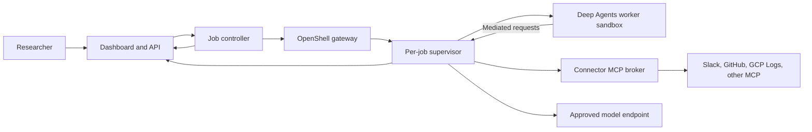

# OpenShell Deep Research

Design-first scaffold for a **candidate internal research service**. If a custom service is justified, a LangChain Deep Agents worker performs research inside a per-job NVIDIA OpenShell sandbox; its dashboard, controller, durable state, and connector broker stay outside the sandbox.

> **Status:** architecture and contracts only. This repository does not yet deploy a gateway, authenticate users, call enterprise sources, or run a research worker. The documents distinguish verified OpenShell features from proposed application behavior.

All employees already have ChatGPT Enterprise, with source connectors moving through review, and a Replit rollout is planned in about three months. The [feasibility and market assessment](docs/feasibility-and-market-assessment.md) therefore starts with ChatGPT Enterprise as the research baseline, adds Replit Chat and General Agent when available, and runs a bounded OpenShell feasibility spike in parallel. A full dashboard and worker build follows only a measured gap in execution, authorization, job control, or evidence. The four candidate controls remain a server-held job policy, a credential and connector broker, separate public/private research lanes, and durable claim-to-source evidence.

**Candidate custom architecture, conditional on the pilot:**

## Platform comparison and potential edge

This is an **internal build-versus-buy decision** for a design-stage service. The table summarizes published capabilities as of 2026-10-23; tenant entitlements, connector permissions, and the proposed advantages need a matched pilot. See the [full feasibility and market assessment](docs/feasibility-and-market-assessment.md) for sources, qualification gates, and the decision method.

| Platform | Documented overlap | What to test before building this service |
| --- | --- | --- |
| [ChatGPT Enterprise Deep Research](https://learn.chatgpt.com/docs/web-search) | The ChatGPT Enterprise workspace is already available to employees; Deep Research can produce cited reports using web, files, and connected apps. Admins can [govern app access](https://learn.chatgpt.com/docs/enterprise/apps-and-connectors), and an approved [read-only MCP source](https://developers.openai.com/api/docs/mcp) is an integration candidate. | Confirm Deep Research entitlement. Can approved connectors or a broker MCP satisfy the exact source grants, result export, and evidence-review requirements without another employee UI? |
| [Replit Chat and General Agent](https://docs.replit.com/features/agent/general-agent) | Replit documents connected-source research and report/code output, including Slack and BigQuery connectors. [Full BYOC](https://replit.com/blog/bring-your-own-cloud) includes the Agent harness in customer cloud and is in private preview. | At rollout, compare the contracted deployment mode, source permissions, job controls, and evidence export on the same cases. Customer-cloud execution is also a Replit option. |
| [Glean Deep Research](https://docs.glean.com/user-guide/assistant/deep-research) | Cited company and web research respects source permissions; Glean also documents an [OAuth-capable remote MCP host](https://docs.glean.com/administration/actions/connect-remote-mcp-servers-to-glean). | Can its research workflow apply the required per-job resource and time-window limits and export evidence in the needed form? |
| [Microsoft 365 Copilot Researcher](https://learn.microsoft.com/en-us/microsoft-365/copilot/faq-researcher) | Multi-step, cited research over Microsoft data and the web; Microsoft 365 Copilot has [federated MCP connectors](https://learn.microsoft.com/en-us/microsoft-365/copilot/connectors/overview). | Test the selected Slack, GitHub, and GCP Logs investigation with equivalent source access and permissions. |
| [Gemini Enterprise Deep Research](https://docs.cloud.google.com/gemini/enterprise/docs/research-assistant) | Plans multi-step research over selected enterprise and web sources and returns a cited report. | Compare its available connectors, source permissions, and evidence export on the same cases. |
| [LangSmith Managed Deep Agents](https://docs.langchain.com/langsmith/python/managed-deep-agents-overview) | Managed Deep Agents runs, OAuth connections, and an auxiliary sandbox. Its graph runs in Agent Server. | A proven full graph inside a per-job OpenShell sandbox on the organization's cluster would provide a different execution boundary. |
| [Azure Foundry Hosted Agents](https://learn.microsoft.com/en-us/azure/foundry/agents/concepts/hosted-agents) and [AWS Bedrock AgentCore](https://docs.aws.amazon.com/bedrock-agentcore/latest/devguide/what-is-bedrock-agentcore.html) | Azure runs custom agents in isolated session sandboxes. AWS offers isolated agent execution, [OAuth/token exchange](https://docs.aws.amazon.com/bedrock-agentcore/latest/devguide/gateway-outbound-auth.html), and [input-aware tool policy](https://docs.aws.amazon.com/bedrock-agentcore/latest/devguide/policy-authoring-guide.html). | Compare organization-operated OpenShift/GKE placement and the end-to-end evidence contract. Isolation, token brokerage, and argument policy each have managed alternatives. |
| [Google Managed Agents sandbox](https://docs.cloud.google.com/gemini-enterprise-agent-platform/build/managed-agents/sandbox-environment) | Runs the planning agent in a managed sandbox; its current Pre-GA terms exclude sensitive and production workloads. | Revisit as a future benchmark when its terms and the organization's data policy permit the same enterprise cases. |
| [Okta Agent Gateway](https://help.okta.com/OIE/en-us/content/topics/ai-agents/agent-gateway.htm) | Mediates MCP tools, enforces identity policy, and injects downstream credentials. | Test whether it can provide the connector-broker function, then add only missing job-level checks and evidence capture. |

### Where this design could have an edge

1. **Organization-operated, full-graph execution.** The planner, tool client, verifier, and synthesis process would run in a fresh OpenShell sandbox on a qualified OpenShift or GKE cluster, with supervised egress and per-job teardown. This requires a custom worker: the [current LangChain OpenShell adapter](https://github.com/langchain-ai/langchain-nvidia/blob/main/libs/openshell/README.md) keeps the graph on the host and sends sandbox operations into OpenShell.
2. **Enforced job-specific source grants.** The API would bind the user, tenant, approved Slack channels, GitHub repositories, GCP log views, time range, tools, expiry, and budget to one job. The broker would check every tool call's arguments against that record and honor revocation. [OpenShell MCP network rules](https://docs.nvidia.com/openshell/v0.1.5/how-it-works/policies/network-rules) filter method and tool name, so application-level resource checks remain necessary.
3. **Credential custody and separated research lanes.** The broker or gateway would hold upstream grants while the worker uses a short-lived job identity. Public-web research and private-source research would use separate sandboxes; only a reviewed public-safe brief and curated evidence would cross into private synthesis.
4. **Replayable claim-level evidence.** The broker would retain authorized source snapshots with timestamps, hashes, source identity, and policy decisions. Report claims would point to evidence IDs that an authorized reviewer could inspect after sandbox deletion, subject to retention and access checks.

The most plausible first use case is a cross-system incident investigation that ties a Slack decision to a GitHub change and a GCP Logs event under one job's narrow source grants, then preserves the evidence for review. [Cloud Logging already has an MCP server](https://docs.cloud.google.com/logging/docs/use-logging-mcp); the proposed value comes from the combined authorization and evidence workflow. Validate that value on 20–30 matched cases against the available ChatGPT Enterprise features and, after rollout, Replit Chat and General Agent. Compare the OpenShell worker with an ordinary restricted Kubernetes worker using the same broker and evidence contract; proceed with the extra runtime only if it supplies a needed, measurable benefit. The [pilot gates](docs/feasibility-and-market-assessment.md#5-matched-pilot-and-decision-gates) cover authorization, research quality, evidence, reliability, and total cost.

## Candidate design baseline

- Interactive users authenticate through Okta Authorization Code with PKCE to the dashboard. Operator CLI access to the gateway is conditional on a tested Okta browser callback or approved device grant. The job controller uses a service identity for OpenShell RPCs.
- A server-held job policy binds the submitting user, tenant, approved sources and resources, tool permissions, model route, expiry, and budgets. A worker receives only a narrow stage manifest and cannot enlarge that policy.
- The connector broker holds downstream OAuth grants or application credentials and exposes only approved research tools. The worker receives a short-lived job identity, not upstream Slack, GitHub, or GCP credentials.
- Research jobs start read-only. Public web and private enterprise source access use separate sandboxes. A mixed job requires a reviewed public-safe brief; only curated public evidence passes into the private synthesis stage.
- Each research job has a server-held visibility audience: its submitter and, when selected and authorized at creation, one approved Okta group in the same tenant. Current group membership controls group access, and the job's group audience can be revoked; even a public-source job is not automatically visible to everyone. The dashboard filters job lists and checks each status, event, report, and evidence read. Enterprise reports also require current source entitlement. A group reader cannot cancel or reshare the job. Results carry structured evidence IDs, source links, timestamps, and sensitivity labels. See the [research visibility design](docs/design/research-visibility.md).
- Qualify OpenShift 4.19+ first for enterprise Kubernetes, then GKE Standard as an alternative. Both require live OpenShell kernel, runtime, and network probes. Start with fixed worker capacity, a durable queue, and per-tenant concurrency caps; node autoscaling is optional.

The target OpenShell documentation baseline is **v0.1.5**. The local CLI checked on 2026-10-23 reports **0.0.44**. Upgrade the CLI and gateway to a matching supported release before implementing or validating provider profiles, MCP policies, and SDK integration. [OpenShell documentation](https://docs.nvidia.com/openshell/home) · [Gateway authentication](https://docs.nvidia.com/openshell/how-it-works/gateways/authentication).

## Repository map

| Path | Responsibility |
| --- | --- |
| [AGENTS.md](AGENTS.md) | Development and enhancement SDLC, AI-agent handoff rules, and build/release CVE gates. |
| [docs/agent-skills.md](docs/agent-skills.md) | Focused repository-local agent skills and NVIDIA OpenShell reuse guidance. |
| [.agents/skills/](.agents/skills/) | Task-specific contributor skills and independent principal engineer review. |
| [docs/requirements.md](docs/requirements.md) | Scope, requirements, acceptance criteria, and rollout gates. |
| [docs/architecture.md](docs/architecture.md) | Components, trust boundaries, flows, deployment, and decisions. |
| [docs/feasibility-and-market-assessment.md](docs/feasibility-and-market-assessment.md) | Build-versus-buy assessment, competitor comparison, feasibility gates, and matched pilot. |
| [docs/design/identity-and-access.md](docs/design/identity-and-access.md) | Okta, OpenShell, OAuth/MCP support matrix, and identity flows. |
| [docs/design/research-visibility.md](docs/design/research-visibility.md) | Individual and Okta group job audiences, report/evidence authorization, and revocation. |
| [docs/okta/requirements-and-design.md](docs/okta/requirements-and-design.md) | Standalone Okta team implementation handoff and acceptance tests. |
| [docs/design/job-lifecycle.md](docs/design/job-lifecycle.md) | Job state machine, provisioning, events, cancellation, and recovery. |
| [docs/design/research-and-evidence.md](docs/design/research-and-evidence.md) | Deep Agents workflow, tools, provenance, and report quality. |
| [docs/design/mcp-connector-broker.md](docs/design/mcp-connector-broker.md) | Connector policy, OAuth handling, and source-specific behavior. |
| [docs/design/deployment-and-operations.md](docs/design/deployment-and-operations.md) | OpenShell and Kubernetes deployment, observability, retention, and tests. |
| [docs/design/deployment-topology.md](docs/design/deployment-topology.md) | GCP VM, OpenShift, and GKE topology decision and qualification gates. |
| [docs/design/chatgpt-enterprise-integration.md](docs/design/chatgpt-enterprise-integration.md) | ChatGPT-first research baseline and optional read-only MCP integration. |
| [docs/design/replit-rollout-fit.md](docs/design/replit-rollout-fit.md) | Replit research comparison, UI build use, and conditional hosting gates. |
| [contracts/](contracts/) | OpenAPI and JSON Schema contracts for jobs, per-stage manifests, events, evidence, and reports. |
| [examples/](examples/) | Fake payloads that validate against the contracts and exercise public/private stage isolation. |
| [apps/](apps/) | API, dashboard, and sandbox worker component boundaries. |
| [services/controller/](services/controller/) | Job dispatch, sandbox lifecycle, and recovery boundary. |
| [services/connector-broker/](services/connector-broker/) | MCP broker component boundary. |
| [infra/openshell/](infra/openshell/) | OpenShell deployment and policy integration notes. |

## Review and validation

Run `make check` to parse the JSON schemas, validate example payloads, check local Markdown links, and inspect Mermaid fence balance. This check cannot prove that a diagram renders, scan for CVEs, or show that an OpenShell policy works against a gateway. CVE scanning of locked dependencies and final image digests is a required gate in the [build and deployment design](docs/design/deployment-and-operations.md#build-security-and-cve-gate), to be implemented with the first executable build.

## Implementation sequence

1. Define 20–30 representative research cases and baseline approved public/synthetic cases in ChatGPT Enterprise. Add reviewed native connectors as they are enabled; defer private cases until source approval. Run the same cases in Replit Chat and General Agent after their rollout, where the tenant enables them.
2. In parallel, prove a pinned Deep Agents graph can run inside an OpenShell sandbox with denied direct egress and a bounded lifecycle. Compare it with a restricted Kubernetes worker using the same broker and evidence contract.
3. If the incumbent leaves a material gap, test a read-only `search`/`fetch` MCP for ChatGPT and decide whether a separate dashboard or ChatGPT plugin job interface is needed. Use Okta user PKCE for ChatGPT-to-MCP; reserve client credentials for the controller gateway or supported broker-to-source flows.
4. Build only the missing custom components, adding one approved read-only source at a time. Complete tenant isolation, identity, recovery, evidence, observability, and adversarial gates before enterprise promotion.

The [NVIDIA community deep-research-worker recipe](https://github.com/NVIDIA/nemoclaw-community/tree/main/examples/recipes/community/deep-research-worker) is a reference for bounded job lifecycle behavior. Its Deep Agents graph runs on the host, so this scaffold uses a different execution boundary.

