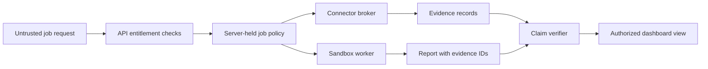

# Version 1 contracts

These JSON Schemas define the boundary between the dashboard API, controller, sandbox worker, connector broker, and evidence store. They are **design contracts**, not an implemented API. The API derives user and tenant identity from a validated Okta session, never from a browser-supplied field.

The [OpenAPI 3.1 sketch](openapi.yaml) defines the proposed browser-facing, versioned job endpoints. It uses a BFF session cookie after Okta PKCE and a CSRF header for mutations. Internal worker and broker protocols are deliberately separate trust boundaries.

| Contract | Producer | Consumer | Trust rule |
| --- | --- | --- | --- |
| [Job request](job-request.schema.json) | Dashboard | API | Treat every field as untrusted input. |
| [Source selection](source-selection.schema.json) | Shared definition | API and broker | Resolve `connection_ref` server-side and validate `resource_ids` against grants. |
| [Job policy](job-policy.schema.json) | Controller | Controller and broker | Authoritative server-held policy; sandboxes receive only stage projections. |
| [Stage manifest](stage-manifest.schema.json) | Controller | One sandbox worker and broker | Narrow projection for one public or enterprise stage; no full mixed-job policy in the public sandbox. |
| [Job event](job-event.schema.json) | Worker/controller | API and dashboard | Status only; never put tokens or raw source content in events. |
| [Evidence](evidence.schema.json) | Broker/worker | Evidence store and verifier | Immutable reference plus digest, provenance, and access label. |
| [Report](report.schema.json) | Worker/verifier | API and dashboard | Every material finding references evidence IDs. |

The schemas enforce shape and basic bounds. They do **not** prove that a user may read a resource, a connector supports the requested OAuth flow, a URL is safe to fetch, or the selected model may receive the source data. The API and broker must enforce those policies at runtime. For a combined public/enterprise job, the controller approves a public-safe brief and creates separate stage manifests from one job policy; it does not grant both network profiles or the private question to the public sandbox. The full policy stays in the control plane and broker; a worker receives only its stage manifest.

Run `make check` from the repository root to validate the included examples. Install the dependency with `python3 -m pip install -r requirements-dev.txt` if it is not already available.

