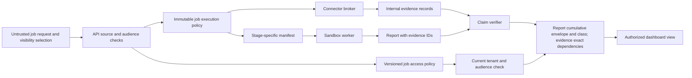

# Version 1 contracts

These JSON Schemas define the boundary between the dashboard API, controller, sandbox worker, connector broker, and evidence store. They are **design contracts**, not an implemented API. The API derives the canonical user subject and selected tenant from a validated Okta session and trusted tenant mapping, never from browser-supplied owner or tenant fields. Every application human owner, reader, grantor, and approval actor uses the [issuer-qualified subject](human-subject.schema.json) object `{ "iss": "<exact verified issuer>", "sub": "<exact opaque subject>" }`. Compare the pair exactly: a matching `sub` from another issuer is a different person, and OpenShell gateway `whoami.subject` is a separate principal namespace. Do not derive these values from email, display name, group name, or an unverified browser claim.

The [OpenAPI 3.1 sketch](openapi.yaml) defines the proposed browser-facing, versioned job endpoints. It uses a BFF session cookie after Okta PKCE and a CSRF header for mutations. Internal worker and broker protocols are separate trust boundaries.

The existing job contracts deliberately carry only an opaque source `connection_ref`; they do not expose OAuth grants. Browser-facing source-connection start, callback, status, reauthorization, and disconnect operations are **not yet specified** in OpenAPI. The authenticated API-to-broker start/callback handoff also needs a versioned internal contract: relay one-use code/state with verified session binding, keep PKCE and code exchange in the broker, and return no source token to the API. The [contract change request](../docs/change-requests/CR-0001-source-connection-contract.md) and [paired ToDo](../docs/todos/CR-0001-source-connection-contract.md) require these contracts and same-person source identity denial tests before the first protected connector is built. [Outbound source-token decision](../docs/decisions/0001-outbound-mcp-source-tokens.md).

The mandatory private-stage OpenShell route control also needs a **new internal** signed full-create request intent, expected provider name→immutable ID/version mapping, one-logical-create ledger and bounded identical same-`request_id` retry rule under the pinned controller identity-provider registration/issuer/subject, and mutation/receipt contract at planned `contracts/internal/private-stage-route-intent.schema.json`, before its component code. It is [CR-0019](../docs/change-requests/CR-0019-private-stage-route-governance.md) / [ToDo](../docs/todos/CR-0019-private-stage-route-governance.md), after a positive SEL decision and before private data. The conditional supervisor request-decision contract at planned `contracts/internal/supervisor-route-decision.schema.json` is [deferred CR-0020](../docs/change-requests/CR-0020-supervisor-middleware-route-gate.md) / [ToDo](../docs/todos/CR-0020-supervisor-middleware-route-gate.md) until selected. Neither existing browser OpenAPI nor `stage-manifest.schema.json` authenticates an OpenShell create or prevents a privileged direct profile RPC. See the [impact matrix](../docs/design/deployment-and-operations.md#private-stage-route-governance-implementation-impact).

| Contract | Producer | Consumer | Trust rule |
| --- | --- | --- | --- |
| [Job request](job-request.schema.json) | Dashboard | API | Treat every field as untrusted input; no owner, tenant, or arbitrary ACL. |
| [Visibility selection](visibility-selection.schema.json) | Dashboard | API | Select `submitter` or one approved stable `okta_group_id`; revalidate current membership, tenant mapping, and group publishing policy at admission. |
| [Human subject](human-subject.schema.json) | Verified dashboard/approval identity | API and approval service | Exact `{iss, sub}` pair; no bare subject string, issuer normalization, or gateway subject substitution. |
| [Source selection](source-selection.schema.json) | Shared definition | API and broker | Resolve `connection_ref` server-side and validate `resource_ids` against grants. |
| [Job policy](job-policy.schema.json) | Controller | Controller and broker | Authoritative server-held policy with private source partitions and default-deny typed transfer grants; A-side export and B-side destination decisions are both required. Each grant bounds key bytes and total destination dispatches. Sandboxes receive only stage projections. |
| [Transfer grant creation](transfer-grant-created.schema.json) | Approval service into independent authorization ledger | Admission, controller, and broker | Durable pre-acknowledgment grant-ID reservation uses a global unique index and binds tenant/job/policy revision, full scope, two authenticated decisions, exact query-template bytes, and pinned renderer/extractor/verifier artifacts. A later PITR cannot reuse the ID for another transaction or scope; an exact idempotent retry returns the original event. No grant is usable without its matching creation event and current ledger head. |
| [Job access policy](job-access.schema.json) | API/controller | API | Separate server-held ACL, atomically created at version 1. It binds owner and base audience; the group can only be narrowed to submitter through the dedicated revocation API. |
| [Reader grant request](reader-grant-request.schema.json) and [stored grant](reader-grant.schema.json) | Authorized owner/steward, then API | API | P1 named same-tenant subjects receive only selected read actions until a bounded expiry. Server assigns grant IDs and audit metadata. |
| [Reader-grant update](job-access-update.schema.json) | Dashboard | API | P1 conditional replacement of `reader_subjects` only; cannot change owner, tenant, or `base_visibility`. |
| [Group revocation request](job-group-revocation.schema.json) | Dashboard | API | P0 owner/steward emergency narrowing with required bounded audit reason; no widening or group substitution. |
| [Stage manifest](stage-manifest.schema.json) | Controller | One sandbox worker, job API, and broker | `public`, one-partition `enterprise_retrieval` in `standard` or `correlation_only` mode, or no-source `enterprise_synthesis`; only synthesis receives the full private question and cross-partition evidence. A correlation-only attempt accepts opaque key IDs and has no worker-controlled destination source query/path/filter tool. |
| [Job event](job-event.schema.json) | Worker/controller through API projection | Dashboard | Trusted neutral message templates and a coarse `retrieval`/`synthesis`/`verification` phase only; warning/error `issue_code` values map to fixed messages and never carry source or resource identities. Only an authorized `type=evidence` event carries `evidence_id`; status, progress, evidence, warning, and error fields have constrained combinations. |
| [Internal evidence](evidence.schema.json) | Trusted broker or capture service | Evidence store and verifier | Immutable snapshot/digest plus broker-owned producing attempt, transitive dependency IDs, exact primary-plus-inherited source/resource authorization closure, classification floor, and internal derivation/context references. The worker may propose citations but cannot assert or erase canonical provenance. Never serialize this shape to the browser. |
| [Evidence view](evidence-view.schema.json) | API | Dashboard | Bounded authorized projection after full dependency and class checks; excludes artifact/context references, dependency IDs, source-resource closure, and correlation-key provenance. |
| [Report](report.schema.json) | Worker/verifier | API and dashboard | Every material finding references evidence IDs. A separate server-held report record pins the cumulative disclosure-envelope digest and highest policy revision; the JSON report is not itself an authorization grant. |



## Visibility and read authorization

At job creation, the API verifies the untrusted `visibility_selection` against stable, allowlisted Okta group IDs, the submitter's **current** exact-group membership, selected tenant, and group publishing rules for the job's sources and classification. The initial ACL has `reader_subjects: []`. The selected group ID is bound to `owner_subject.iss`; a v1 group reader must authenticate under that same validated issuer and currently belong to the exact group there. Effective job read permission requires current selected-tenant eligibility **and** one of: the exact `(iss, sub)` pair equals `owner_subject`; that same-issuer group membership; or an active, unexpired P1 reader grant for that exact pair contains the requested read action. The owner retains individual access in group mode. Tenant membership, an Okta or OpenShell admin role, a public evidence label, and possession of a job ID never create result access on their own. An outage in an authorization dependency fails closed.

The P0 [group revocation operation](openapi.yaml) uses CSRF, a strong `If-Match` ETag, and a required bounded audit reason. After locking and validating the current ACL, the API durably appends a group-denial tombstone to the **independent authorization ledger** and verifies its advanced tenant head **before** the recoverable ACL transaction narrows `base_visibility` from `okta_group` to `submitter`. The local transaction increments the ACL version and records audit; success is acknowledged only after that commit, cursor invalidation, and affected stream fences. If the local update fails, the tombstone still denies group reads while an idempotent retry repairs the projection; a stale or unavailable ledger head closes reads. The untrusted reason is escaped and stays out of status/events. This is the only v1 change to the base audience: there is no group substitution, widening, or restoration. P1 reader updates replace only the active `reader_subjects` list; each grant is tied to a canonical subject, selected read actions, a bounded expiry, a server-generated ID, and grantor/time audit metadata. Revoked grants likewise get independent denial tombstones before local update and acknowledgement. Readers cannot cancel, manage visibility, approve review, or inherit source permissions. The owner or a job-specific authorized steward needs separate `manage_visibility` permission and tenant/source sharing-policy approval before granting readers.

The API checks `list_job`, `read_status`, or `read_events` for the corresponding endpoints. It filters authorized rows before pagination; cursors are opaque, bound to subject/tenant/query, and never authorize access. It rechecks live and replayed SSE delivery. It suppresses evidence events unless the viewer also passes `read_evidence`, effective-classification clearance, and current rights to **every** primary and transitive source/resource in the trusted evidence closure. The event `message` is a fixed API-owned template, not free-form worker output. Inaccessible resource lookups return the same 404 as unknown IDs.

The full report is one content boundary. Before returning **any** report fields, including the question and summary, the API checks `read_report`, classification, and the viewer's current entitlement to the **monotonic union of every approved private source and exact resource selector across all policy revisions**, whether cited or uncited. It verifies the current independent `job_source_scope_admitted` ledger head and the server-held report/envelope digest; a missing or older projection denies the entire report. The same cumulative class floor includes the original question, frozen admitted briefs, attachments, source results, transferred dependencies, and accepted report. `report_available` is viewer-specific: `true` only after this complete check, `false` if denied, or omitted when not evaluated. Evidence metadata, event IDs, excerpts, and retained snapshot bytes require `read_evidence`, the record's effective `classification`, and current rights to every exact source/resource in its trusted transitive `authorization_sources` closure. A B-only viewer is denied an A-derived B result; an A+B viewer with sufficient clearance may read it. The [browser evidence view](evidence-view.schema.json) excludes internal artifact, access-context, dependency, and derivation references. The [content endpoint](openapi.yaml) proxies bounded authorized bytes through the BFF after sandbox deletion, with no direct object-store URL or redirect.

The schemas enforce shape and basic bounds. They do **not** prove current group membership, source authorization, partition coverage, transitive dependency closure, classification floors, correlation-key provenance, a connector's OAuth support, URL safety, classification clearance, model eligibility, ledger uniqueness, or approval signatures. The API and broker enforce these at runtime. Admission normalizes private resource selections into one partition per connector, connection, and resource unless a source owner approves a shared authorization domain. For a combined job, the controller approves a public-safe brief and creates separate stage manifests from one job policy. Public fetch/search responses, including URLs, titles, metadata, and errors, are classified before worker release; sensitive or uncertain content is quarantined rather than forced into a `public_web` record. Each private retrieval sandbox receives one source partition and its approved brief. A `standard` retrieval stage can read reviewed public and **independent** same-partition evidence only; a `correlation_only` stage can read reviewed public and evidence produced in its own tainted attempt only. Its inbound key IDs are capped at 40, and admission verifies the complete trusted evidence/grant/source closure fits the internal evidence schema before projection; lineage is never truncated. The Job API enforces producing-attempt, mode, and dependency checks even for guessed same-partition IDs, and rejects a correlation checkpoint in a standard retry. A fresh synthesis sandbox receives the full private question and curated evidence only after a pre-projection class/route check and after all source endpoints and tools are absent. The full policy and any typed transfer grant stay in the control plane and broker; a worker receives only its stage manifest. [The default-deny and reviewed-transfer examples](../examples/README.md) illustrate both contract shapes without proving live enforcement.

```mermaid
sequenceDiagram
    actor Owner
    participant API as Dashboard API
    participant Ledger as Independent denial ledger
    participant ACL as Access policy store
    participant Stream as Active SSE stream
    Owner->>API: POST revoke-group, CSRF, If-Match, reason
    API->>ACL: Verify owner or steward and current version
    API->>Ledger: Durably append group tombstone; advance tenant head
    Ledger-->>API: Verified committed head
    API->>ACL: Commit group to submitter and audit under lock
    ACL-->>API: Atomic group to submitter, version plus audit
    API->>Stream: Close affected group-reader streams
    API-->>Owner: 200 narrowed ACL and new ETag
    Note over Ledger,ACL: If ACL commit fails, tombstone still denies group reads
    Note over API,Ledger: Stale or unavailable head blocks protected reads
```

Run `make check` from the repository root to validate the included examples. Install the dependency with `python3 -m pip install -r requirements-dev.txt` if it is not already available.

