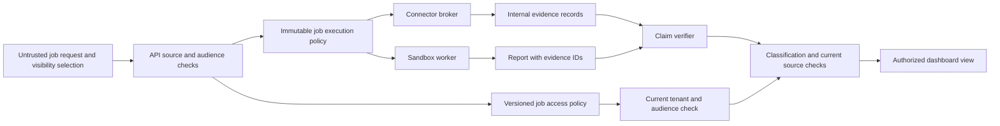
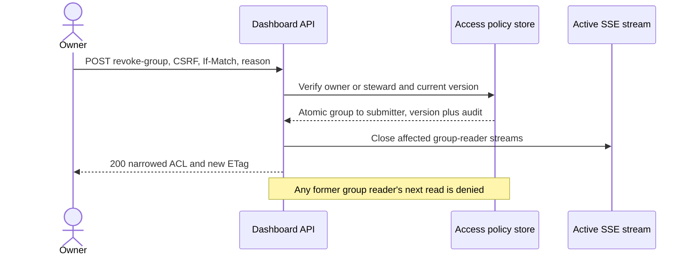

# Version 1 contracts

These JSON Schemas define the boundary between the dashboard API, controller, sandbox worker, connector broker, and evidence store. They are **design contracts**, not an implemented API. The API derives the canonical user subject and selected tenant from a validated Okta session and trusted tenant mapping, never from browser-supplied owner or tenant fields.

The [OpenAPI 3.1 sketch](openapi.yaml) defines the proposed browser-facing, versioned job endpoints. It uses a BFF session cookie after Okta PKCE and a CSRF header for mutations. Internal worker and broker protocols are separate trust boundaries.

| Contract | Producer | Consumer | Trust rule |
| --- | --- | --- | --- |
| [Job request](job-request.schema.json) | Dashboard | API | Treat every field as untrusted input; no owner, tenant, or arbitrary ACL. |
| [Visibility selection](visibility-selection.schema.json) | Dashboard | API | Select `submitter` or one approved stable `okta_group_id`; revalidate current membership, tenant mapping, and group publishing policy at admission. |
| [Source selection](source-selection.schema.json) | Shared definition | API and broker | Resolve `connection_ref` server-side and validate `resource_ids` against grants. |
| [Job policy](job-policy.schema.json) | Controller | Controller and broker | Authoritative server-held policy; sandboxes receive only stage projections. |
| [Job access policy](job-access.schema.json) | API/controller | API | Separate server-held ACL, atomically created at version 1. It binds owner and base audience; the group can only be narrowed to submitter through the dedicated revocation API. |
| [Reader grant request](reader-grant-request.schema.json) and [stored grant](reader-grant.schema.json) | Authorized owner/steward, then API | API | P1 named same-tenant subjects receive only selected read actions until a bounded expiry. Server assigns grant IDs and audit metadata. |
| [Reader-grant update](job-access-update.schema.json) | Dashboard | API | P1 conditional replacement of `reader_subjects` only; cannot change owner, tenant, or `base_visibility`. |
| [Group revocation request](job-group-revocation.schema.json) | Dashboard | API | P0 owner/steward emergency narrowing with required bounded audit reason; no widening or group substitution. |
| [Stage manifest](stage-manifest.schema.json) | Controller | One sandbox worker and broker | Narrow projection for one public or enterprise stage; no full mixed-job policy in the public sandbox. |
| [Job event](job-event.schema.json) | Worker/controller through API projection | Dashboard | Trusted neutral message templates only; never stream worker prose, tokens, or raw source content. Evidence events require current evidence authorization. |
| [Internal evidence](evidence.schema.json) | Broker/worker | Evidence store and verifier | Immutable reference plus digest, provenance, access label, and internal artifact/context references. Never serialize this shape to the browser. |
| [Evidence view](evidence-view.schema.json) | API | Dashboard | Bounded authorized projection; excludes `artifact_ref` and `access_context_ref`. |
| [Report](report.schema.json) | Worker/verifier | API and dashboard | Every material finding references evidence IDs. |

## Visibility and read authorization

At job creation, the API verifies the untrusted `visibility_selection` against stable, allowlisted Okta group IDs, the submitter's **current** exact-group membership, selected tenant, and group publishing rules for the job's sources and classification. The initial ACL has `reader_subjects: []`. Effective job read permission requires current selected-tenant eligibility **and** one of: subject equals `owner_subject`; `base_visibility.mode` is `okta_group` and the subject is currently in that exact group; or an active, unexpired P1 reader grant contains the requested read action. The owner retains individual access in group mode. Tenant membership, an Okta or OpenShell admin role, a public evidence label, and possession of a job ID never create result access on their own. An outage in an authorization dependency fails closed.

The P0 [group revocation operation](openapi.yaml) uses CSRF, a strong `If-Match` ETag, and a required bounded audit reason to atomically narrow `base_visibility` from `okta_group` to `submitter`, increments the ACL version, records audit, invalidates cursors, and closes affected event streams. The untrusted reason is escaped and stays out of status/events. This is the only v1 change to the base audience: there is no group substitution, widening, or restoration. P1 reader updates replace only the active `reader_subjects` list; each grant is tied to a canonical subject, selected read actions, a bounded expiry, a server-generated ID, and grantor/time audit metadata. Revoked grants leave the active ACL and remain in append-only audit. Readers cannot cancel, manage visibility, approve review, or inherit source permissions. The owner or a job-specific authorized steward needs separate `manage_visibility` permission and tenant/source sharing-policy approval before granting readers.

The API checks `list_job`, `read_status`, or `read_events` for the corresponding endpoints. It filters authorized rows before pagination; cursors are opaque, bound to subject/tenant/query, and never authorize access. It rechecks live and replayed SSE delivery. It suppresses evidence events unless the viewer also passes `read_evidence` and current exact-source authorization. The event `message` is a fixed API-owned template, not free-form worker output. Inaccessible resource lookups return the same 404 as unknown IDs.

The full report is one content boundary. Before returning **any** report fields, including the question and summary, the API checks `read_report`, classification, and the viewer's current entitlement to **every approved private source and resource in the immutable job policy**, whether cited or uncited. If any check fails or cannot be completed, the entire report is unavailable. `report_available` is viewer-specific: `true` only after this complete check, `false` if denied, or omitted when not evaluated. Evidence metadata, excerpts, and retained snapshots require `read_evidence` plus that exact evidence object's classification and source entitlement. The [browser evidence view](evidence-view.schema.json) excludes internal artifact and access-context references. The [content endpoint](openapi.yaml) proxies bounded authorized bytes through the BFF after sandbox deletion, with no direct object-store URL or redirect.

The schemas enforce shape and basic bounds. They do **not** prove current group membership, source authorization, a connector's OAuth support, URL safety, classification clearance, or model eligibility. The API and broker enforce these at runtime. For a combined public/enterprise job, the controller approves a public-safe brief and creates separate stage manifests from one job policy. The public sandbox receives only the approved public brief and public sources/tools; the private question and enterprise resource selectors remain out of that lane. The full policy stays in the control plane and broker; a worker receives only its stage manifest.

Run `make check` from the repository root to validate the included examples. Install the dependency with `python3 -m pip install -r requirements-dev.txt` if it is not already available.

