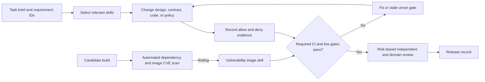

# Agent skills and task handoff

This catalog is for **coding and operations agents working on this repository**. [AGENTS.md](../AGENTS.md) carries the rules that apply to every task; each `.agents/skills/*/SKILL.md` carries a repeatable specialist procedure. The repository is still a design and contract scaffold, so a skill can produce a reviewable plan and static evidence today, but it must label live OpenShell, Okta, MCP, CVE, and Kubernetes checks as unrun until those environments and artifacts exist. Skills guide agent behavior; CI checks, server-side authorization, and operator approvals enforce decisions.

## Repository-local skills

| Skill | Use for | Required result |
| --- | --- | --- |
| [Platform feasibility](../.agents/skills/platform-feasibility/SKILL.md) | Initial build decision or a material platform/workflow change | Predeclared matched scorecard against approved ChatGPT Enterprise and, when available, Replit cases; restricted-worker versus in-sandbox OpenShell comparison; a scoped go/no-go decision. |
| [Principal engineer review](../.agents/skills/principal-engineer-review/SKILL.md) | Independent review of a material design, cross-component or trust-boundary change, or release candidate | Read-only, severity-ranked findings with file locations and concrete fixes; required unrun gates and a scoped next-stage disposition. |
| [Job authorization review](../.agents/skills/job-authorization-review/SKILL.md) | Job API, group visibility, reader grants, report/evidence, or revocation changes | Contract and allow/deny matrix across users and tenants; exact Okta group and current source-rights tests. |
| [OpenShell runtime conformance](../.agents/skills/openshell-runtime-conformance/SKILL.md) | OpenShell, worker image, sandbox policy/provider, cluster, or CNI changes | Pinned release evidence; graph placement, effective policy, provider receipt, network allow/deny, and cleanup results from an approved live environment. |
| [OAuth MCP connector onboarding](../.agents/skills/oauth-mcp-connector-onboarding/SKILL.md) | One new or changed Slack, GitHub, GCP, or other protected source | Source-specific identity/grant contract, broker argument controls, bounded responses, and nonproduction positive/negative auth evidence. |
| [Research worker evaluation](../.agents/skills/research-worker-evaluation/SKILL.md) | Planner, retrieval, synthesis, verifier, model, prompt, or evidence changes | Versioned matched cases and measured citation support, abstention, injection resistance, latency, and cost. |
| [Vulnerability triage](../.agents/skills/vulnerability-triage/SKILL.md) | A finding from the automated build or deployed-digest rescan | Applicability decision, patch and rescan evidence, or scoped time-limited security-owner exception. **The skill does not perform or replace the CI gate.** |

Give an agent a task brief with: outcome, requirement IDs, data class and approved test data, affected trust boundaries, pinned source/dependency/runtime versions, allowed and denied cases, expected files or artifacts, checks to run, evidence to return, and rollback or disable path. Include the exact `SKILL.md` paths so the receiving agent can read them even when its tool does not auto-discover repository skills. For example, a connector task should name its source owner, acting user or app identity, issuer, OAuth resource/audience and scopes, exact resource selectors, and required wrong-audience, out-of-scope, and revoked-grant denials. The [delivery loop](../AGENTS.md#loop-for-every-implementation-slice) describes the common review path, so it is not repeated in every skill.

## What to reuse from NVIDIA OpenShell

NVIDIA distinguishes [public operator skills under `skills/` from internal contributor skills under `.agents/skills/`](https://github.com/NVIDIA/OpenShell/blob/main/CONTRIBUTING.md#agent-skills). The internal discovery flag is not an access control. These files are useful workflow examples, but the OpenShell repository's issue labels, `mise` commands, chart paths, and release process do not map directly to this application.

| NVIDIA example | Adaptation here |
| --- | --- |
| [Principal engineer reviewer](https://github.com/NVIDIA/OpenShell/blob/main/.opencode/agents/principal-engineer-reviewer.md) | Use its independent, pragmatic review pattern in the local `principal-engineer-review` skill. Review this application's Okta, broker, job/result access, sandbox, evidence, and CVE boundaries instead of NVIDIA's Rust monorepo. |
| [Create spike](https://github.com/NVIDIA/OpenShell/blob/main/.agents/skills/create-spike/SKILL.md), [create RFC](https://github.com/NVIDIA/OpenShell/blob/main/.agents/skills/create-rfc/SKILL.md) | Use the experiment and decision-record pattern in `platform-feasibility` and the trust-boundary/ADR rule in `AGENTS.md`. Include matched incumbent cases and requirement IDs. |
| [Generate sandbox policy](https://github.com/NVIDIA/OpenShell/blob/main/skills/generate-sandbox-policy/SKILL.md), [debug OpenShell cluster](https://github.com/NVIDIA/OpenShell/blob/main/skills/debug-openshell-cluster/SKILL.md), [OpenShell CLI](https://github.com/NVIDIA/OpenShell/blob/main/skills/openshell-cli/SKILL.md) | Use as operator references for `openshell-runtime-conformance`. Check the pinned installed version and full effective policy; independently prove CNI ingress and egress enforcement. OpenShell's MCP rules do not inspect tool arguments or responses, so broker resource authorization remains a separate test. [Policy schema](https://docs.nvidia.com/openshell/v0.1.5/how-it-works/policies/schema). |
| [Build from issue](https://github.com/NVIDIA/OpenShell/blob/main/.agents/skills/build-from-issue/SKILL.md), [review security issue](https://github.com/NVIDIA/OpenShell/blob/main/.agents/skills/review-security-issue/SKILL.md), [fix security issue](https://github.com/NVIDIA/OpenShell/blob/main/.agents/skills/fix-security-issue/SKILL.md) | Borrow issue-to-evidence and finding-to-fix habits. This repo's handoff fields and CVE triage skill add source authorization, group visibility, and release-specific evidence. |
| [SBOM](https://github.com/NVIDIA/OpenShell/blob/main/.agents/skills/sbom/SKILL.md), [test release canary](https://github.com/NVIDIA/OpenShell/blob/main/.agents/skills/test-release-canary/SKILL.md) | Borrow inventory and canary patterns. NVIDIA's SBOM skill does **not** provide a blocking CVE scan; the separate [build CVE gate](design/deployment-and-operations.md#build-security-and-cve-gate) must scan the resolved dependencies and final image digests. |

The [OpenShell repository license](https://github.com/NVIDIA/OpenShell/blob/main/LICENSE) is Apache-2.0. The local skills below are original, project-specific instructions inspired by the cited workflows; they contain no copied NVIDIA skill text. If the team later vendors an upstream skill, pin an upstream commit, review its commands and privileges against the installed release, retain applicable license/notice material, and mark modified files.

NVIDIA's reviewer file is an [OpenCode subagent profile](https://opencode.ai/docs/agents/), while `.agents/skills/` contains portable `SKILL.md` instructions. [OpenCode discovers this project's skill path](https://opencode.ai/docs/skills/). If the team uses a named OpenCode reviewer, its thin `.opencode/agents/` profile can invoke this local skill and apply current read-only tool permissions, including shell restrictions. A skill instruction alone does not enforce read-only access.

## Production research-agent instructions are a separate surface

The future Deep Agents worker may need versioned instructions for source-specific retrieval, citation checks, abstention, and safe summarization. Keep those with the worker implementation and evaluate them on the approved corpus. Do not load this repository's contributor skills into a job sandbox. A worker instruction cannot grant source access, hold a reusable source token, expand an admitted job policy, or make a report visible; the API, broker, and OpenShell controls enforce those boundaries. See the [research worker design](design/research-and-evidence.md) and [research visibility design](design/research-visibility.md).
