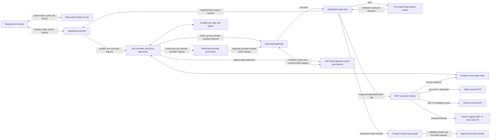
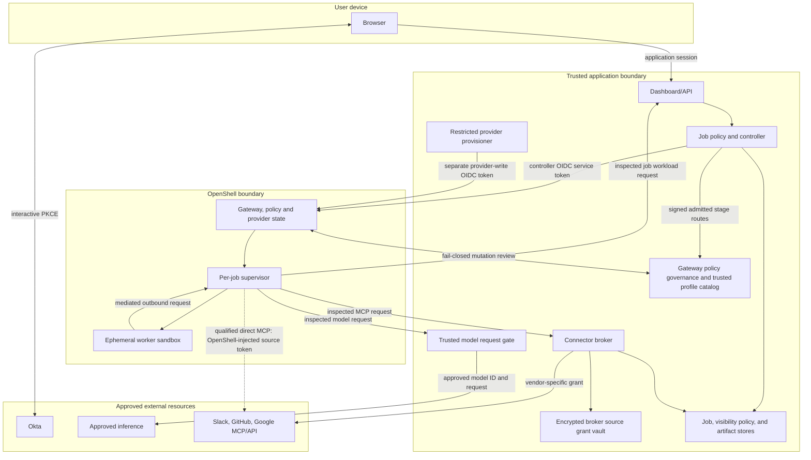
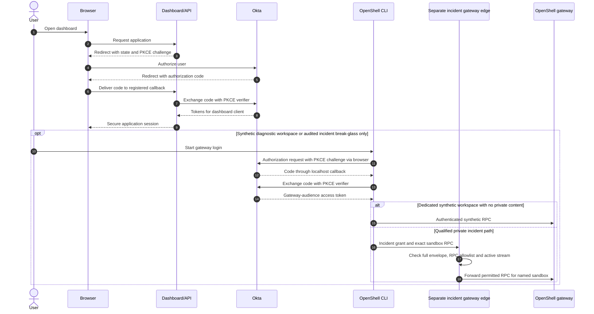
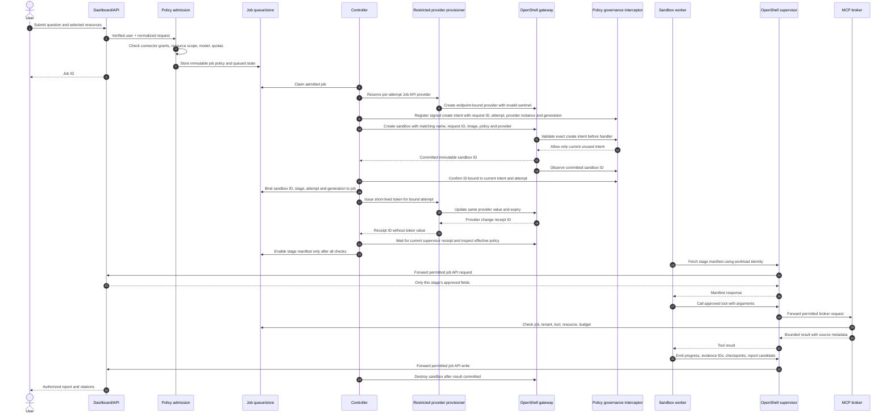
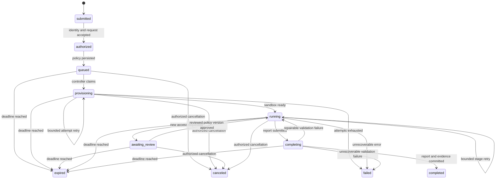
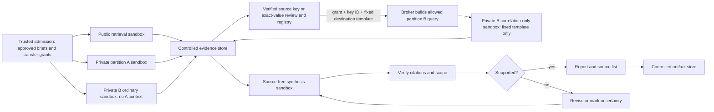
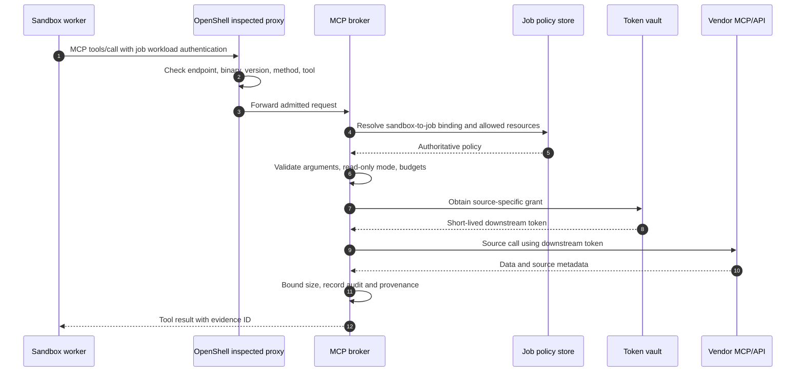
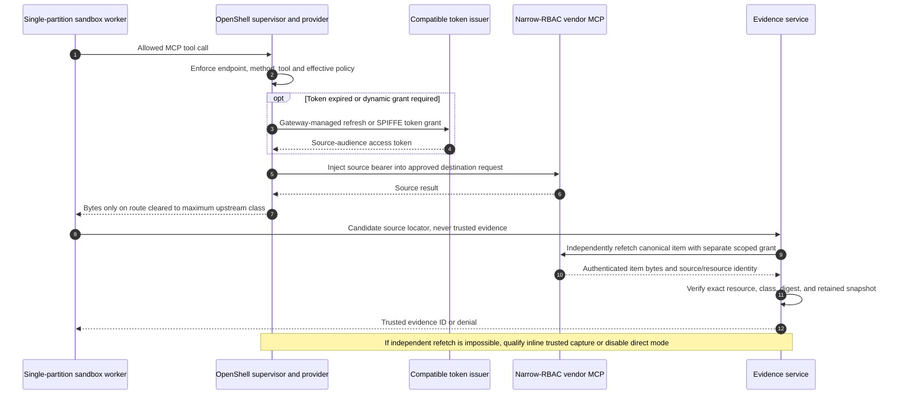
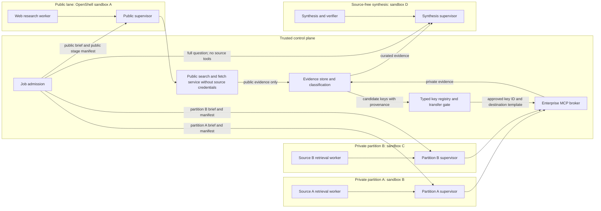
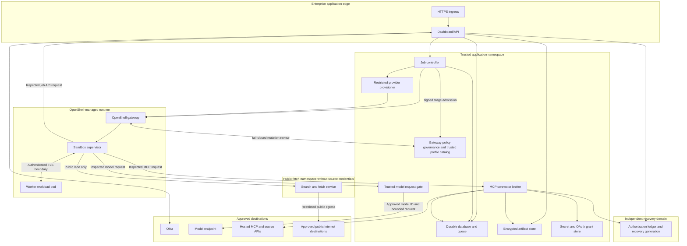

# Target architecture

**Status:** proposed design, 2026-10-23  
**Target baseline:** NVIDIA OpenShell v0.1.5, Python Deep Agents worker  
**Related documents:** [requirements](requirements.md), [feasibility and market assessment](feasibility-and-market-assessment.md), [ChatGPT Enterprise integration option](design/chatgpt-enterprise-integration.md), [Replit rollout fit](design/replit-rollout-fit.md), [identity and access](design/identity-and-access.md), [research visibility](design/research-visibility.md), [Okta implementation handoff](okta/requirements-and-design.md), [job lifecycle](design/job-lifecycle.md), [research and evidence](design/research-and-evidence.md), [MCP connector broker](design/mcp-connector-broker.md), [deployment topology](design/deployment-topology.md), [deployment and operations](design/deployment-and-operations.md).

This document specifies the **candidate custom system**: a dashboard outside OpenShell and a research process inside OpenShell. The organization already provides ChatGPT Enterprise to all employees and plans a Replit rollout, so the [platform selection gate](requirements.md) tests those research paths before a full dashboard build. The four candidate controls remain a server-held job policy, credential broker for sources that need task-level checks, separate public/private lanes, and durable evidence. OpenShell can itself mint or refresh and inject endpoint-bound tokens on a qualified direct connector path; the broker handles downstream tokens on the default enterprise path. This document separates interactive user authentication, controller authentication, sandbox workload identity, and the credentials used to call research sources. Statements about current product capabilities are cited.

## 1. Decisions and boundaries

| Decision | Target design | Reason |
|---|---|---|
| Product selection | Benchmark installed ChatGPT Enterprise first and Replit Chat when its rollout permits; approve the custom build only for a measured gap | A duplicate employee research interface and runtime need a specific quality, control, or evidence benefit. |
| User entry point, if custom build proceeds | Dashboard and API using Okta Authorization Code with PKCE; separately test whether ChatGPT plugin tools can serve as a job front end | Users can submit jobs, grant source access, follow progress, and read results through one governed interface. The job API and authorization stay server-side regardless of front end. |
| Direct sandbox access | Disabled for ordinary private jobs; sanitized job diagnostics through an application proxy; direct CLI only for synthetic/no-private-content diagnostics or separately approved incident break-glass | A sanitized `support_diagnose` grant permits only approved status/log projections, never raw shell/exec/download or private scratch. Private-content shell or transfer through a mediated proxy needs separate incident/content authorization and current rights to the full job disclosure envelope at each operation and stream checkpoint. Private incident CLI remains disabled unless a separately qualified mediating gateway edge binds the named job, exact sandbox and allowed RPCs, checks the full job envelope/class and incident grant per RPC and stream checkpoint, audits, and tears down active streams. OpenShell CLI login can use Okta PKCE after its callback is tested, but Workspace User membership is broad. No unauthenticated sandbox service is exposed. |
| Research execution | One short-lived OpenShell sandbox per authorized stage: public research, each private source partition, and source-free synthesis when needed | The Deep Agents graph and its tools run inside each stage sandbox; no worker receives multiple private source connectors. |
| Control plane | Dashboard/API, job controller, restricted provider provisioner, policy admission, durable queue, results store, and connector broker outside sandboxes | These services hold tenant identity and application authorization policy; the broker holds grants for brokered sources, while OpenShell's provider store may hold grant material for a separately approved direct connector. |
| Research visibility | The submitter and, if selected at admission, current members of one approved same-tenant Okta group may see a job; later named readers need an explicit expiring grant | The application binds each job to its exact audience and applies source-derived checks before private content is served. Okta login or OpenShell workspace membership alone does not grant result access. |
| Source access | Read-only, typed MCP tools through a task-aware connector broker by default; direct OpenShell provider attachment only after a connector-specific gate | The broker checks tool arguments and task resource bounds that OpenShell MCP policy cannot inspect. Direct access needs equivalent limits from upstream RBAC, source-isolated retrieval, evidence capture, upstream sender binding of the raw token **and** a separate issuer/interceptor attachment guard, plus live/restore fencing of cached upstream tokens and active connections. |
| Model access | A trusted model request gate outside the sandbox, reached through an OpenShell provider attachment and exact inspected endpoint policy | OpenShell v0.1.5 grants native endpoint/credential access but does not select or rewrite the model. The gate binds each request to the job/stage/attempt, enforces the approved model ID, body shape, class, and budget, then sends it to the enterprise-approved provider. |
| Job state | Durable outside the worker | Sandbox deletion and worker failure cannot be the only record of a job. |
| Write actions | Disabled in the initial research product | Any later write capability requires a distinct grant and approval path. |

OpenShell workspaces isolate gateway resources, but a Workspace User can create, use, and delete **every** sandbox and service in its workspace and use its provider attachments. A dashboard user therefore receives no direct OpenShell membership merely by signing in. For routine job-specific diagnosis, a trusted proxy exposes only sanitized status and operational logs after checking the current support grant; that grant does **not** authorize raw `ExecSandbox`, download, private scratch, or unredacted worker logs. A separate content-authorized incident proxy may permit interactive operations only after checking the caller's current rights to the **entire cumulative job source/resource envelope and highest class** before each call and during long streams, filtering the response and ending the stream on revocation. Isolating the workspace does not make native CLI enforce that check. Direct CLI is limited to synthetic/no-private-content diagnostics. Private incident CLI is conditional on a separately qualified mediating gateway edge that binds the named job, exact workspace/sandbox and allowed RPCs, checks the current full envelope/class and incident grant at each RPC and stream checkpoint, audits, and tears down active sessions/streams on expiry or revocation; otherwise it stays disabled. Native OpenShell workspace membership remains broad and is not a job ACL. [OpenShell workspaces](https://docs.nvidia.com/openshell/v0.1.5/how-it-works/workspaces).

The [NVIDIA community deep-research-worker recipe](https://github.com/NVIDIA/nemoclaw-community/tree/main/examples/recipes/community/deep-research-worker) informs the asynchronous job API and budgeted research behavior. Its Deep Agents graph runs in a trusted host-side service, while the sandbox contains a client. This architecture places the graph inside the sandbox.

## 2. System context



The gateway policy governance box makes control-plane decisions; it is not a forwarding hop for worker traffic. The supervisor forwards an approved inspected request to its destination. The box labeled “MCP connector broker” is a narrow, trusted tool service. It performs authentication, authorization, argument validation, source retrieval, and audit recording. The trusted model gate independently checks the native model request body and usage against the server-held stage policy before reaching the provider. Neither service executes the research agent graph or arbitrary code supplied by a job. Direct vendor MCP access remains possible for a connector that passes the criteria in [Section 7](#7-direct-mcp-versus-the-broker).

OpenShell sandbox service routes bypass its control-plane RPC authorization and do not use the gateway's OIDC/CLI login. The default job path therefore has **no externally exposed sandbox service**. Worker-to-dashboard traffic is outbound to a job API, or the controller uses authenticated OpenShell file transfer for simple early prototypes. [OpenShell sandbox services](https://docs.nvidia.com/openshell/how-it-works/sandboxes/overview).

## 3. Trust and identity boundaries



There are five distinct credential domains:

1. **Human principal:** Okta subject associated with a dashboard session. The dashboard authorizes jobs and result access from verified claims and tenant membership.
2. **Controller principal:** a dedicated noninteractive Okta client with only the OpenShell role and workspace membership needed to create, observe, and delete project sandboxes. OpenShell's official SDK supports renewable OIDC client-credentials authentication. [Gateway authentication](https://docs.nvidia.com/openshell/how-it-works/gateways/authentication).
3. **Provider provisioner principal:** a separate Okta service client and OpenShell Workspace Admin membership in its assigned workspace, with only provider-management scopes proven necessary. It creates and rotates per-attempt Job API providers; the controller's Workspace User identity cannot write them. OpenShell's workspace-wide `provider:write` also permits provider-profile import/update, including profiles attached to running sandboxes. The provisioner application refuses those operations, but its gateway token retains native direct-RPC authority. The preferred private-stage boundary uses an operator-owned, fail-closed gateway interceptor over all interceptor-eligible route-affecting writes, an interceptor-vended authoritative profile catalog excluding user-imported profiles, inspected supervisor policy, and outer CNI. These are design candidates until the pinned deployment proves a direct profile mutation is denied or inert and cannot widen a live worker route; otherwise a separately governed request gate or OpenShell fix must qualify before private data. [OpenShell workspaces](https://docs.nvidia.com/openshell/v0.1.5/how-it-works/workspaces), [v0.1.5 RPC authorization](https://github.com/NVIDIA/OpenShell/blob/v0.1.5/proto/openshell.proto).

The mandatory private-stage gateway interceptor, trusted profile catalog, and whole-create/mutation proof are **unimplemented** [CR-0019](change-requests/CR-0019-private-stage-route-governance.md) / [ToDo](todos/CR-0019-private-stage-route-governance.md). The separately deployable supervisor middleware decision service is conditional and **deferred** [CR-0020](change-requests/CR-0020-supervisor-middleware-route-gate.md) / [ToDo](todos/CR-0020-supervisor-middleware-route-gate.md). [The deployment impact matrix](design/deployment-and-operations.md#private-stage-route-governance-implementation-impact) assigns their contract, configuration, live denial, and disable gates; a public synthetic spike is no private-route qualification.
4. **Sandbox principal:** one job/stage/sandbox/attempt-bound identity is required from Phase 0 for the job API, and for the broker when enabled. The public prototype may use a short-lived app-issued bearer held in a per-attempt OpenShell provider and injected only at the job API endpoint; [CR-0015](change-requests/CR-0015-phase0-attempt-identity-readiness.md) / [ToDo](todos/CR-0015-phase0-attempt-identity-readiness.md) track that unbuilt binding and model-gate readiness. A stolen raw static bearer remains a public-prototype replay risk. Before enterprise source data, the job API, broker, and private model gate require an independently verified sender constraint, tracked by [CR-0016](change-requests/CR-0016-phase1-sender-origin-proof.md) / [ToDo](todos/CR-0016-phase1-sender-origin-proof.md); a copied raw bearer alone must fail. OpenShell's SPIFFE dynamic grant can mint an endpoint-bound bearer if the issuer accepts it, but that grant alone does not prove the HTTP caller owns the SVID after a bearer is copied. [Provider profiles](https://docs.nvidia.com/openshell/v0.1.5/how-it-works/providers/profiles).
5. **Source principal:** the user grant, GitHub installation, or Google workload identity actually accepted by the source. The broker records this principal on the default path; a qualified direct connector records equivalent provenance through the trusted evidence path. A user-delegated connection is not admitted until the source-authenticated person is matched to the dashboard's verified user through an approved immutable, issuer-qualified account link. OAuth state and PKCE do not prove the same person completed both logins.

The current MCP authorization specification requires an OAuth resource indicator for the target MCP server, and the server must validate that a token was issued for it. A token for the dashboard, OpenShell gateway, job API, or broker is not automatically a vendor MCP token. On the **brokered** path, OpenShell supplies only the worker-to-broker token and the external broker obtains the downstream source token. On the **direct** path, OpenShell's provider layer may obtain and inject the actual source token into a worker-to-source request after compatibility and source-RBAC checks. OpenShell cannot transparently inject a token into the broker's separate outbound source call. [MCP authorization, 2026-07-28](https://modelcontextprotocol.io/specification/2026-07-28/basic/authorization), [OpenShell provider profiles](https://docs.nvidia.com/openshell/v0.1.5/how-it-works/providers/profiles).

For model traffic, the worker reaches only the trusted internal model gate. The post-selection gate resolves an opaque, immutable job route alias through a reviewed provider adapter catalog, then uses its own upstream credential, exact model/body/class/trace policy, and conservative budget. [CR-0017](change-requests/CR-0017-production-model-route-adapters.md) / [ToDo](todos/CR-0017-production-model-route-adapters.md) track this unbuilt production seam separately from the disposable host relay. A future vendor switch changes the approved catalog revision and fresh attempt, not the worker's credential or an active attempt's route. [Production provider impact](design/research-and-evidence.md#production-provider-adapter-and-route-catalog-impact).

For a brokered user source connection, the BFF Connection API owns the authenticated browser session and public OAuth callback. It forwards the authorization code, state, and current session binding to the broker over an authenticated internal channel, without receiving source tokens. The broker owns the one-use state, PKCE verifier, code exchange, same-person check, connection record, and vault. A mismatched or expired session, state, issuer-qualified person, or tenant closes the transaction before the grant is stored. [Connection design](design/mcp-connector-broker.md#3-source-connection-and-consent).

For an Okta-secured outbound MCP, the broker selects a source-specific user grant or approved app-only grant. Standard Okta OBO is a **conditional** exchange of a separately obtained eligible user access token for an Okta-custom-server MCP token; the dashboard org-server token is not that subject, and the exchange does not provide durable refresh. Okta for AI Agents STS/XAA is a separate licensed option with different agent-client, consent, token-custody, and revocation rules. Neither path is automatically implemented by OpenShell's v0.1.5 SPIFFE token-exchange provider. The chosen grant must pass a live canonical MCP `resource`/audience test. The [design impact register](decisions/0001-outbound-mcp-source-tokens.md#actionable-impact-register) links a CR and paired ToDo for each unimplemented application, contract, or platform obligation; the [index](TODO.md) is a second navigation path.

### Token custody by hop

| Hop | Token issuance and custody | What OpenShell does | Job-level decision |
|---|---|---|---|
| Browser → dashboard | Okta PKCE code exchange stays in the BFF; browser holds an application session cookie | No role in dashboard sign-in | API checks current user, tenant, job audience, and source rights at read time. |
| Controller → OpenShell gateway | Controller's Okta client-credentials secret stays in its secret manager; SDK renews gateway-audience token | Gateway validates issuer, audience, role, scope, and workspace membership | Controller authorizes the job before requesting a sandbox. |
| Provider provisioner → OpenShell gateway | A distinct Okta client-credentials secret and gateway-audience token stay in the provisioner's secret manager and memory | Gateway checks provider scopes and Workspace Admin membership in the assigned workspace; `provider:write` also permits profile import/update | Provisioner accepts only controller-authorized per-attempt provider-instance operations and refuses profile mutation. A fail-closed gateway interceptor and authoritative trusted profile catalog must reject or render ineffective a direct profile mutation; inspected supervisor policy and CNI must still deny unapproved worker destinations and paths in the live test. |
| Worker → job API | P0 app issuer mints a short-lived per-attempt token held by a per-attempt provider; the supervisor resolves its opaque placeholder only for the job API. P1 sender proof is separate. | Endpoint-bound injection protects the stored value from the worker; provider activation and expiry must be checked | Job API checks `job_id`, `stage`, `sandbox_id`, `attempt_id`, policy version, fencing generation, and the current external recovery generation before manifest or write access. |
| Worker → broker | An OpenShell dynamic SPIFFE grant can obtain a broker-audience token after an issuer test; a similarly scoped static provider is a conditional fallback. P1 sender proof is separate. | Supervisor injects the broker token only for the inspected broker endpoint | Broker checks the same attempt and recovery-generation binding, source partition, tool arguments, transfer-grant tombstones, and revocation on every call. |
| Worker → trusted model gate | An OpenShell provider may hold a short-lived model-gate-audience credential for one stage; P1 sender proof is required before private prompts | Supervisor injects it only for the inspected internal model-gate endpoint | Gate checks the current job/stage/attempt/sandbox, policy `model_route`, exact upstream model ID and request shape, classification, and remaining reserved budget before forwarding. |
| Trusted model gate → model provider | Gate holds the upstream model credential outside the sandbox | No OpenShell supervisor on this outbound hop | Gate uses the approved provider/model and enforces response and usage limits; a worker cannot choose another model on the same host. |
| Broker → vendor MCP/API | Broker holds source consent, client secret, refresh grant, or workload identity in its vault and obtains a source-specific token; a qualified Okta OBO or AI Agents integration may issue or broker that token under its own grant contract | No OpenShell supervisor on this outbound hop | Broker verifies the source principal matches the approved job connection, then enforces resource selectors, read-only mode, response bounds, revocation, and provenance. |
| Worker → qualified direct vendor MCP | OpenShell provider store holds approved source grant material; gateway-managed `oauth2_client_credentials` or `oauth2_refresh_token`, or SPIFFE `token_grant`, may mint/refresh the endpoint-bound source token | Supervisor injects the source token on the inspected worker request; this hop bypasses broker recovery-generation checks and an ordinary controller can attach a workspace provider to another sandbox | Only allowed where upstream source RBAC enforces exact job scope **and** issuer/upstream sender binding rejects raw vendor-token replay outside the original sandbox/attempt. Separately, issuer grant policy or a qualified gateway interceptor denies reuse of the exact provider instance/grant in another attempt; pre-ready egress/mint denial, trusted capture, class-before-model, and live/restore connection fencing also pass. |

OpenShell v0.1.5 supports gateway-managed client-credentials and refresh-token strategies, plus SPIFFE-backed dynamic `client_credentials` and a constrained `token_exchange` grant. These are token transport and minting mechanisms, not a generic dashboard-user-to-SaaS on-behalf-of service. Its token-exchange subject credential is a stored current OIDC access token that must be updated after expiry; it does not store that login's refresh token. Direct MCP also needs the protected resource's expected audience and registration flow to work with the profile. [OpenShell provider profiles](https://docs.nvidia.com/openshell/v0.1.5/how-it-works/providers/profiles).

### Interactive Okta access



The first flow is an application design choice with a registered, stable dashboard callback. OpenShell documents Authorization Code with PKCE for interactive **CLI-to-gateway** login with OIDC providers including Okta, plus client credentials for noninteractive CLI/SDK use. Its CLI currently binds an ephemeral localhost callback port; [NVIDIA issue #3300](https://github.com/NVIDIA/OpenShell/issues/3300) requests a fixed-port option, while [Okta documents matching the configured redirect URI](https://developer.okta.com/docs/guides/authorization/). Browser CLI access is conditional on a successful Okta/OpenShell callback test or a compatible fixed-port release; an Okta device grant is a separate optional test. Any enabled path also requires an access token with the gateway's configured audience and an appropriate workspace role; a dashboard token must not be reused by changing headers. These checks authorize **workspace RPCs**, not a particular production job. Ordinary private-job support therefore has no direct operator CLI membership, even in a per-job workspace. Private interactive support uses the content-authorized proxy. An optional private incident CLI must pass through a **separate qualified gateway edge** that is the incident principal's only gateway route and default-denies unapproved RPCs; the native token cannot be replayed directly to the gateway. The edge must cover streaming `ExecSandbox` and `ExecSandboxInteractive` if enabled, while `CreateSshSession`, `ForwardTcp`, service exposure, raw logs, and file-transfer routes stay denied unless separately qualified. It rechecks the incident grant and full job envelope during streams and tears active flows down on revocation. OpenShell v0.1.5's interceptor only handles allowlisted unary writes, so it does not supply this edge. [OpenShell gateway authentication](https://docs.nvidia.com/openshell/v0.1.5/how-it-works/gateways/authentication), [workspaces](https://docs.nvidia.com/openshell/v0.1.5/how-it-works/workspaces), [interceptor limits](https://docs.nvidia.com/openshell/v0.1.5/extensibility/gateway-interceptors), [v0.1.5 RPCs](https://github.com/NVIDIA/OpenShell/blob/v0.1.5/proto/openshell.proto).

## 4. Component responsibilities and contracts

| Component | Owns | Explicit boundary |
|---|---|---|
| Dashboard/API | Okta callback and session, task creation, connector setup UX, authorization to view results, event streaming to browser | It never trusts a user-supplied tenant or role claim without validating the session. |
| Policy admission | Authoritative job policy snapshot: tenant, submitter, initially frozen source partitions/briefs, typed transfer grants backed by A-side export and B-side template decisions, tools, model-route alias, budget, expiry, classification, and cumulative disclosure envelope | It resolves the alias to exact model ID, native request shape, class, trace/retention policy, and budget at the trusted model gate. Later revisions may narrow sources or add a typed transfer but cannot add a source or rewrite a standard destination brief in the same job. It checks actual inbound key and synthesis-input classes before release. |
| Job controller | Queue dispatch, OpenShell sandbox lifecycle through the official Python SDK, cancellation, cleanup, reconciliation | It has OpenShell control-plane credentials; the sandbox does not. |
| Restricted provider provisioner | Creates, rotates, and deletes per-attempt Job API providers using a separate gateway identity | OpenShell provider permission also permits workspace-wide profile mutation; the service refuses it, but direct use of its token remains possible. The production gateway interceptor denies direct profile mutation or its authoritative trusted catalog makes the write inert; inspected supervisor policy and CNI deny a widened private endpoint or control/telemetry path in the live probe. Controller provider writes are denied. |
| Stage route governance (candidate) | An operator-owned, fail-closed gateway interceptor validates every interceptor-eligible route-affecting write against signed sandbox/attempt admission and vends an authoritative trusted provider-profile catalog | OpenShell supervisor enforces inspected host/path/tool policy; CNI blocks direct Pod bypass. The direct profile mutation and shared-control-host path probes must pass. If not, qualify a separate supervisor middleware decision service with interceptor-protected attachment or fix OpenShell before private data. |
| Job API | Gives a verified worker only its own stage manifest; accepts bounded job events, checkpoints, evidence references, and a candidate report | It binds the credential to job, stage, sandbox, attempt, and fencing generation; enterprise calls also require sender proof. Authoritative source-evidence records come from trusted broker/capture code. A job ID is an identifier, not a credential. |
| Worker | Runs Python Deep Agents graphs for one authorized stage at a time, with source-specific retrieval or source-free synthesis and verification | It receives no Okta client secret, vendor refresh token, GitHub private key, or GCP service-account key. It cannot choose which private source partition another stage can reach. |
| MCP connector broker | Fixed tool catalog, tenant/user/resource and cross-partition authorization, input and **per-returned-item source identity/resource** validation, downstream token acquisition, vendor calls, trusted capture, cross-replica connection revocation fence, and audit | It does not treat an MCP tool name or in-scope query as proof that returned items are in scope. It denies ambiguous/mixed-scope items and classifies every response field before worker release. A correlation-only B attempt cannot call free-form B tools. OpenShell does not mint the broker's outbound vendor token. |
| Trusted model request gate | Per-attempt model ID and request-body enforcement, durable request/token/cost reservations, upstream model credential custody, active-stream cancellation, response and usage accounting, trace routing | It denies pre-ready/uncertain-create calls, accepts only authenticated current attempts and exact policy aliases, and aborts active upstream calls on cancel/retry/expiry before capacity release; direct model-provider egress from workers is denied. It can share a deployment with the broker but retains a separate model-audience authorization interface. |
| Evidence store | Source metadata, excerpts or controlled raw captures, citation IDs, sensitivity and retention | Access to results follows job and source data sensitivity. |
| OpenShell gateway | Sandboxes, policy, provider attachment, network egress, sandbox logs, supported provider token mint/refresh and endpoint-bound injection | The controller inspects effective policy after attaching providers. OpenShell v0.1.5 does not choose or rewrite a model ID in native requests; native source-token handling applies only to the qualified direct worker-to-source path. |
| Approved model provider | Inference | Source content sent through the model gate is a governed data transfer. |

The controller may combine several logical components in one process during a prototype. Their identities and authorization responsibilities remain separate interfaces.

### Model request enforcement

`model_route` in the job policy and stage manifest is a **server-held policy alias**, not an OpenShell model selector. OpenShell v0.1.5 attaches a provider and injects its credential at an approved native endpoint; the workload still controls the model ID, headers, and request body. The default worker policy therefore permits only a trusted internal model gate, with no direct model-vendor host. The gate resolves the alias to an approved upstream provider/model ID, maximum data class, retention and trace destination, permitted native request fields, and a pinned price/budget schedule. It denies every call until the immutable sandbox ID, current attempt and recovery generation, effective policy/provider receipt, and manifest readiness are committed; broad Workspace User exec during bootstrap confers no model authority. It then authenticates the current job/stage/attempt/sandbox with sender proof before private prompts, rejects or overwrites a wrong model ID, rejects unapproved tool/function declarations, external URLs, file uploads, and request modes, and forwards only the bounded request. A different model on the **same permitted host** must fail before any upstream call. OpenShell's native provider binding remains useful for the worker-to-gate credential and endpoint policy; it does not enforce this body rule. [OpenShell inference in v0.1.5](https://docs.nvidia.com/openshell/v0.1.5/how-it-works/inference).

The model gate atomically reserves each request count and an upper bound for input/output tokens and cost against the cumulative job and stage budgets **in a ledger independent of application PITR** before dispatch, including concurrent and streaming calls. It meters vendor usage and reconciles a completed call; an uncertain or unmetered call stays charged at its reserved bound, and a stream is cut off at its admitted output ceiling. It tracks active per-attempt upstream calls and, on cancel/retry/expiry or recovery fencing, stops worker-visible delivery and aborts/closes vendor requests within the configured grace before capacity is released. A crashed or ambiguous stream keeps its reservation and route quarantined until closure is proven; an older application snapshot cannot reset spend. It records sanitized usage and model decision IDs without raw private prompts in routine logs. Public-stage inputs use only the approved public brief and public-classified fetch results; private-stage inputs pass trusted source and synthesis classification gates before the worker can send them. The model gate treats the whole stage at its admitted classification floor, not a worker-supplied label. An alternative direct model provider is conditional on an upstream credential and API that prove the same exact model, request shape, class/retention policy, and per-attempt hard usage limits; otherwise it stays disabled.

```mermaid
sequenceDiagram
    participant W as Stage worker
    participant S as OpenShell supervisor
    participant M as Trusted model gate
    participant P as Job policy and budget store
    participant U as Approved model provider
    W->>S: Native model request with route alias and body
    S->>M: Inject model-gate credential on inspected endpoint
    M->>P: Verify sender, ready attempt, policy receipt, class, route and generation
    M->>M: Parse body; pin model ID and approved fields
    M->>P: Atomically reserve input/output token and cost bound
    alt Pre-ready, wrong model, shape, class or exhausted budget
        M-->>W: Deny; no upstream request
    else Approved request
        M->>U: Approved model ID and bounded native request
        U-->>M: Response stream and usage
        M->>P: Reconcile usage or retain conservative charge
        M-->>W: Bounded response
    end
```

## 5. Job admission and execution

### Complete sandbox-create boundary

A signed intent for one logical create binds a canonical digest of the **entire effective `CreateSandboxRequest`** after interceptor patches, not just its workspace/name, image, policy, and providers. Pin the v0.1.5 protobuf descriptor and normalization. For private stages the inline spec has exact command, runtime/restart mode, environment, resources, labels/annotations, and per-attempt provider names; a separate signed name→immutable provider ID/version/profile/credential map is checked against post-create receipts before source/model access. `workload_template`, caller `driver_config`, external writable/PVC/host mounts, and `service_exposures` are absent. A private create with an unrecognized or changed field denies before the gateway handler. An uncertain response may be recovered by `GetSandbox` or a bounded byte-identical same-`request_id` retry under the same pinned controller identity-provider registration/issuer/subject, current attempt, signed provider map, and proven gateway deduplication window; it must return only the original sandbox ID and still pass post-create reconciliation. `REQUEST_OUTCOME_UNCERTAIN` or `REQUEST_REPLAY_UNAVAILABLE` keeps the lane closed for operator reconciliation; unresolved admission is never bypassed with a new ID. Qualify that no protobuf secret omission hides a security-affecting field from the interceptor; otherwise enforce the missing field at the gateway/driver or keep private stages disabled. The chosen gateway/driver must independently reject caller-supplied driver config, because a foreign workspace PVC could bypass partition isolation. [v0.1.5 sandbox proto](https://github.com/NVIDIA/OpenShell/blob/v0.1.5/proto/openshell.proto), [gateway interceptors](https://docs.nvidia.com/openshell/v0.1.5/extensibility/gateway-interceptors).

After gateway commit, the controller reads the sandbox by signed workspace/name, verifies its returned immutable sandbox ID equals the create result, compares the **full persisted spec** and metadata against the intent, then checks actual Pod/PVC mounts and service inventory. Unexpected defaults, foreign volumes, service endpoints, or an uncertain create leave Job API, broker, model, and direct-source mint/egress barriers closed until deletion and observed resource cleanup. Deny later `ExposeService` through a live-qualified gateway control or separately enforced service-route block; empty create-time exposures alone do not stop that later `sandbox:write` RPC, and service routes bypass control-plane OIDC. If neither control can deny later exposure, private stages remain disabled. [OpenShell service routes](https://docs.nvidia.com/openshell/v0.1.5/how-it-works/sandboxes/overview).

```mermaid
sequenceDiagram
    participant C as Controller
    participant I as Fail-closed interceptor
    participant G as OpenShell gateway
    participant K as Pod, PVC and service inventory
    participant R as Job API, broker and model gates
    C->>I: Signed digest of full canonical create request
    C->>G: CreateSandbox with exact inline spec
    G->>I: Evaluate complete post-patch request
    I-->>G: Allow exact digest or deny mutation
    G-->>C: Created sandbox ID or uncertain result
    C->>G: Get by workspace and signed name
    G-->>C: Immutable ID and complete persisted spec
    C->>K: Verify Pod mounts, PVC owner UID and no service
    alt Exact ID/spec/resources and current policy receipts
        C->>R: Commit attempt readiness and release manifest
    else Mismatch or uncertainty
        C->>R: Keep all gates closed
        C->>G: Quarantine and delete; observe cleanup
    end
```

A job policy is created by the trusted API and stored outside the sandbox. Its minimum fields are:

| Field | Purpose |
|---|---|
| job ID, tenant ID, submitter subject | Cross-tenant and result-access binding |
| server-approved `public_research_brief` for combined jobs | Public-safe question given to the public lane without the private question or connector details |
| source partitions, connection IDs, resource selectors, and approved partition briefs | One private retrieval partition binds a connector, connection, and resource security domain; its worker receives only that partition's approved question |
| cross-partition transfer grants | Explicit source/destination, typed key, destination template, dual approval, `max_destination_calls`, expiry, and never-reused grant ID durably registered with its immutable scope and approval hash outside application PITR; absent, scope-mismatched, tombstoned, or exhausted grants mean no private source-to-source transfer |
| approved tool IDs and mode | Fixed read-only capabilities exposed to the worker |
| model/data classification | Restricts use of model and tracing endpoints |
| deadline, token/tool/source-call budgets | Cost and abuse limits |
| policy version and expiry | Reproducible decision and revocation |
| result retention and visibility | Controls access after completion |

The broker reads the authoritative policy on every sensitive call, rather than trusting resource IDs, user IDs, correlation labels, or query text supplied by the model or worker. The controller derives a **stage manifest** for each sandbox from this policy. A public sandbox receives only the approved `public_research_brief`, public source/tool choices, and its own budget and identity; it never receives the full private question, enterprise connection IDs, or private resource selectors. Each private retrieval sandbox receives one source partition and its approved brief. **Initial admission freezes every public/private retrieval brief, private partition, exact resource selector, and standard source tool.** An in-job review can narrow scope or approve a typed A→B transfer into a fresh correlation-only attempt, but cannot rewrite a standard B brief with A-derived text or add B resources; expansion needs a new human-submitted job. The private synthesis sandbox receives curated evidence and the full private question, with no source connector or public-web tool.



OpenShell supports detached worker processes, sandbox status, execution, upload, and download. For the target design, bake the worker into a pinned OCI image and pass only an opaque job/attempt locator at startup. The P0 public path pre-attaches a per-attempt provider with an invalid sentinel and `stable_placeholder: true`, then updates its value after sandbox binding; the worker's running process keeps the same opaque placeholder and the Job API stays closed until the supervisor receipt and effective-policy check pass. A separate restricted provisioner holds provider-write authority. This is a documented v0.1.5 mechanism proposed for the app, not a live integration result. A copied raw bearer remains replayable in this P0 fallback, so private data waits for the Phase 1 sender-proof gate. [OpenShell sandbox management](https://docs.nvidia.com/openshell/v0.1.5/how-it-works/sandboxes/overview), [provider stable placeholders](https://docs.nvidia.com/openshell/v0.1.5/how-it-works/providers/profiles), [job lifecycle](design/job-lifecycle.md).



State transitions are idempotent and audit logged. `completed`, `failed`, `canceled`, and `expired` are terminal; a retry after one of them creates a new job. Provisioning and worker-stage retries increment attempt records while the job remains nonterminal. The result is committed before the controller destroys a successful sandbox. A controller restart reconciles queue records against OpenShell sandbox state; a worker restart resumes from an explicitly persisted checkpoint or restarts a known stage. Retention expiry deletes artifacts according to policy without reopening the job. The project does not assume OpenShell itself supplies application-level job retries.

## 6. Research and evidence flow

Deep Agents can provide opt-in task planning, subagents, filesystem-backed context, and tool calling, but the application supplies its own evidence discipline and source policy. The controller orchestrates bounded stage graphs, each running inside its own OpenShell sandbox. Public retrieval, ordinary private retrieval, correlation-only private retrieval, and source-free synthesis have distinct manifests and effective egress policies. Admission approves the question projected into each retrieval partition. A private retrieval graph cannot see another partition's evidence, connection, or tool. A destination attempt exposed to a transferred key can call only the broker's fixed-template correlation operation; ordinary source search/read runs in a separate fresh sandbox without that key, derived evidence, or checkpoint. The manifest projection and every Job API evidence/checkpoint read enforce this exclusion by dependency closure, even for an evidence ID from the same destination partition. A correlation-only checkpoint cannot resume as an ordinary attempt after retry or policy revision. Synthesis and verification receive curated evidence and have no source-call tools. [Deep Agents overview](https://docs.langchain.com/oss/python/deepagents/overview).



An evidence record should contain a stable citation ID, connector and source URI, retrieval time, origin principal, permitted resource selector, excerpt or controlled raw object reference, content hash, sensitivity label, and trusted upstream evidence dependencies when a transferred key influenced the stage. A destination B correlation result derived from source A and all evidence in that correlation-only attempt keep A's dependency and at least A's classification. The API checks current rights to B **and** every transitive origin before releasing an affected event ID, metadata, excerpt, or bytes; a B-only viewer cannot read A-derived B evidence. Even an otherwise authorized ordinary B retrieval worker cannot read or receive A-derived B evidence or a correlation checkpoint: its free-form B tool would make the inherited A value a new, unapproved query channel. Correlation-only B can read its own derived evidence under the approved grant and fixed tool; source-free synthesis can read authorized curated evidence. Before source bytes reach a worker, trusted capture checks their actual class and dependency floor against that stage's pinned model and trace route; an over-class result is quarantined. Before synthesis input release, admission checks the full question and curated evidence against its own pinned route. Report claims point to evidence IDs. [Research and evidence design](design/research-and-evidence.md) defines the format.

Source content is untrusted input. A Slack message, repository file, public page, or log line cannot authorize new tools, widen a resource selector, change the job's model, or choose text to submit to another private connector. Even an allowed tool name and resource selector can exfiltrate data through a search string or read path. The trusted transfer path accepts only approved typed correlation keys with provenance, bounded value and count, destination query template, and a current, non-tombstoned grant backed by authenticated A-side export/declassification and B-side template acceptance. A regex or type-shaped string in arbitrary source prose is insufficient: automatic issue requires a provider-generated, non-user-authored structured value with bounded semantics or independent verification of the claimed source object. User-authored titles, labels, IDs, metadata, and free-text candidates need explicit A-side exact-value declassification review. Approval durably compare-and-creates `transfer_grant_created` under a global unique grant-ID index with the never-reused grant ID and exact scope/decision hash in the independent authorization ledger before acknowledging the grant; the binding includes the reviewed declarative destination argument expression and renderer artifact digest plus the source extractor/verification artifact digests. A restored policy cannot rebind that ID, and a mixed-version broker cannot issue a key or dispatch when its active adapter/template digests differ from the approved binding. The broker checks the registered scope and current grant denial, then atomically reserves each new key ID and byte charge against reviewed `max_keys` and `max_total_bytes` in the independent ledger before issuance. Before each destination dispatch, it atomically reserves one of the reviewed `max_destination_calls` in monotonic grant state outside recoverable broker snapshots, in the same serialized decision as the final tombstone check; retries and ambiguous dispatches consume calls without refund. It then constructs the query from the registry entry; model-generated labels and raw search text do not establish transfer permission. The B correlation-only attempt has no ordinary `search`, `read`, or `fetch` tool whose worker-controlled strings could repeat the A value outside the template or use count. A source canary, including one encoded as a valid-looking key, must never appear in a different source's outbound call without that approval. V1 permits automatic key issuance only through trusted source-specific extraction of an independently captured, untainted source object with source-attempt provenance. A correlation-only or otherwise tainted worker/checkpoint and mixed-source synthesis have no key-nomination authority, even if they point to a preexisting B-only record; explicit origin-to-destination exact-value review is required for any other proposal. This closes A→B→C laundering through either derived evidence or tainted selection. [Research and evidence design](design/research-and-evidence.md) defines this path.

## 7. Direct MCP versus the broker

OpenShell's inspected MCP policy can allow or deny an MCP method or tool name. It does **not** match tool arguments or parse server responses. Inspected rule enforcement defaults to audit unless configured as enforce, and its default MCP version allowlist is 2025-11-25. Each connector needs an exact protocol-version and enforcement test. [OpenShell network rules](https://docs.nvidia.com/openshell/how-it-works/policies/network-rules).

| Pattern | Appropriate when | Limitation | Decision |
|---|---|---|---|
| Worker directly calls hosted MCP through OpenShell | The source token and upstream RBAC already enforce the exact job resource boundary; OAuth `resource`/audience, provider mint or refresh, MCP revision, partition isolation, and equivalent evidence capture all pass | OpenShell does not check tool arguments or responses, so the source must enforce the missing task limits; no broad user or app token may be attached to a sandbox | Conditional per-connector exception after a documented conformance test |
| Worker calls task-aware MCP broker; broker calls hosted MCP or API | Multiple users or tenants, per-task resources, delegated grants, vendor-specific token refresh, cross-partition transfers, central audit | Adds a security-critical service and operational cost | **Default for enterprise connectors** |
| Worker calls a local MCP server in the same sandbox | Tool only handles sandbox-local data and has no vendor secret or authority beyond the job | Local server code remains inside agent trust boundary; it is not an authorization broker | Allowed for pure local processing |

The broker exposes a small **pinned, typed catalog** such as search authorized Slack channels, read authorized repository content, and query authorized log views. It validates arguments and the source partition, limits result size and time range, constructs approved cross-partition queries from a trusted key registry, uses the source's proper token, and records provenance. It does not blindly expose every tool returned by a vendor's tools/list method. This matters because Slack's hosted MCP server offers write tools as well as search/read tools. [Slack MCP server](https://docs.slack.dev/ai/slack-mcp-server/).



That sequence is the **brokered mode**. OpenShell mints or injects only the worker-to-broker credential; the broker's call to the vendor originates outside the OpenShell supervisor and uses a separate vendor token. The qualified **direct mode** has a different custody path:



The diagram shows the **independent source-verification variant**: the worker submits only a locator, while the trusted evidence service uses a separate scoped grant to refetch and verify the canonical item and its exact source identity before issuing an evidence ID. Search results or streams that cannot be independently verified need a qualified inline trusted response-capture/classification path instead; otherwise direct mode stays disabled. Direct mode is disabled until a source-specific integration test proves the token issuer accepts the required grant and MCP resource, upstream RBAC limits **every** resource reachable with that token to the job partition, a source result cannot be used to query another partition, evidence capture has the same review and retention controls, and the upstream rejects a copied raw vendor token unless the caller proves the **original immutable sandbox/attempt** as sender. A gateway attachment interceptor cannot prevent external replay of a copied bearer. From `CreateSandbox` until immutable ID/attempt registration, effective-policy/provider receipt, and manifest readiness are committed, an independent direct-source egress and token-mint barrier denies all calls, even from broad Workspace User exec; an uncertain create stays closed. Separately, issuer grant policy or a qualified fail-closed gateway interceptor must deny provider/grant reuse outside that original sandbox/attempt. The signed intent and attachment guard bind the **exact per-attempt provider instance ID/name, immutable profile digest, and approved credential/grant generation**; two instances with the same profile digest are not interchangeable. All external `UpdateProvider` and `ConfigureProviderRefresh` calls on an attached direct provider are denied; the gateway interceptor does not receive secret values and OpenShell does not infer token scope. Only automatic short-lived refresh under a pinned immutable gateway configuration is eligible, with issuer/upstream proof of unchanged sandbox/attempt grant lineage and resource scope. Any scope change requires deletion and a new admitted attempt. OpenShell's workspace-wide controller `sandbox:write` alone does not prevent reattaching an existing direct source provider to another sandbox; a per-job workspace only reduces cross-job impact. Live revocation must fence the direct sandbox or upstream token **and tear down or deny already established source connections** before acknowledgement. Restore must not leave a cached source token or established flow usable in an old sandbox. That restore gate requires upstream enforcement of the independently current recovery generation **or** immediate source-egress quarantine with observed active-flow teardown followed by observed deletion of every pre-restore direct sandbox or upstream revocation of its token before source traffic reopens. Because OpenShell's direct response path can deliver bytes to the worker before evidence verification, the pinned model and trace route must be approved for the **highest class the upstream token can return**, or an inline trusted capture/classification gate must quarantine an over-class response before delivery. A worker-submitted excerpt and digest do not independently prove what the source returned. OpenShell's documented MCP inspection does not provide response attestation, so the connector must add a trusted response-capture or independent source-verification path; if that path needs another trusted proxy, compare it with keeping the broker. OpenShell's documented `token_exchange` uses a stored current OIDC access token as its subject credential and requires update after that token expires; it does not provide general dashboard-user delegation to Slack, GitHub, or Google. [OpenShell provider profiles](https://docs.nvidia.com/openshell/v0.1.5/how-it-works/providers/profiles), [network rules](https://docs.nvidia.com/openshell/v0.1.5/how-it-works/policies/network-rules).

The source access modes are deliberately different:

| Source | Default research identity | Alternative |
|---|---|---|
| Slack hosted MCP | Per-user OAuth token authorized by the submitter; enterprise-managed authorization when the Slack organization and IdP support it | Explicitly approved bot/app corpus with separate policy |
| GitHub hosted MCP/API | GitHub App user token for user-specific access | Installation token limited to selected repositories and read permissions for shared service research |
| Cloud Logging MCP/API | Dedicated, least-privilege Google workload or agent identity, preferably keyless | User credential if the organization requires user-attributed access |

Slack's hosted MCP is an OAuth-protected Streamable HTTP endpoint and does not support Dynamic Client Registration. GitHub's hosted MCP also requires a preregistered OAuth client for interactive access and does not support Dynamic Client Registration. Google's Cloud Logging MCP supports user and workload identity, while its current guide illustrates broader Logging Admin permissions than a read-only research worker should receive. Validate exact tools and IAM before adoption; a narrow wrapper around the read-only entries.list API is the fallback. [Slack MCP](https://docs.slack.dev/ai/slack-mcp-server/), [GitHub MCP host guide](https://github.com/github/github-mcp-server/blob/main/docs/host-integration.md), [Cloud Logging MCP](https://docs.cloud.google.com/logging/docs/use-logging-mcp), [entries.list](https://docs.cloud.google.com/logging/docs/reference/v2/rest/v2/entries/list).

## 8. Public and private research lanes

A model that reads private enterprise data and can send arbitrary queries to any other permitted endpoint can leak information through that endpoint. OpenShell explicitly treats each permitted endpoint as a possible exfiltration path. For a mixed job, the public sandbox receives a server-approved `public_research_brief` and a minimal manifest; it never receives the original private question or enterprise connector identifiers. Each private source security partition gets a separate retrieval sandbox, approved brief, one connector/connection/resource domain, and no other source evidence or source endpoint. A source-free synthesis sandbox receives curated evidence and the full question. The approved model endpoint remains a deliberate data destination under the job's data-class policy. [OpenShell security best practices](https://docs.nvidia.com/openshell/security/best-practices).



The brokers, transfer gate, and evidence store remain outside the sandboxes; worker requests pass through their OpenShell supervisors. A public-only first prototype needs one sandbox. A private-only job with one partition also needs only retrieval and source-free synthesis stages as required by its report flow. A multi-source job never places all private connectors in one worker. Its policy lists source partitions and any reviewed transfer grants; an empty transfer-grant list means no source-to-source query data may flow. The public fetch service carries **no** enterprise source, Okta, gateway, or vault credentials; it may use a narrow short-lived workload identity for its own authenticated broker traffic. It has its own restricted outbound network path and validates URL scheme, port, DNS answer, connected IP, and every redirect against public-only destinations with byte/time/content limits. [Research and evidence design](design/research-and-evidence.md) specifies the fetch gate.

## 9. Logical data model


The actual database schema may differ. This model states ownership and authorization invariants: every job and source connection belongs to one tenant; every evidence object belongs to one job; every report citation resolves to retained evidence; source grants are referenced by secure vault IDs, never copied into a job row. The versioned job access policy is separate from the immutable execution policy. Its `base_visibility` is chosen at admission as submitter-only or an exact approved Okta group; the submitter retains individual access in either mode. An owner or authorized steward can later narrow group visibility to submitter-only through an audited, write-ahead denial protocol; v1 cannot widen or switch groups after admission. Later `reader_subjects` grants are explicit and expiring. Authorization joins the job's tenant and owner to the current access policy and active denial tombstones before returning even a job-list row; report and evidence reads also check source-derived rights. Source operations additionally check connection and typed-transfer-grant tombstones. The authorization ledger, including grant-creation bindings, key-issue and call reservations, and denial tombstones, and the current recovery generation live outside the database PITR recovery domain. See [research visibility](design/research-visibility.md).

## 10. Deployment topology



A Kubernetes deployment must use a CNI that actually enforces ingress and egress NetworkPolicy in sandbox namespaces; otherwise sandbox traffic can bypass supervisor policy. OpenShell logical workspaces should be mapped to the intended Kubernetes namespace isolation, rather than assuming the default mapping supplies it. [Kubernetes setup](https://docs.nvidia.com/openshell/kubernetes/setup), [Kubernetes workspaces](https://docs.nvidia.com/openshell/kubernetes/workspaces).

The [deployment topology decision](design/deployment-topology.md) compares GCP VMs, OpenShift, and GKE. Kubernetes version alone is insufficient: OpenShell also requires a working Landlock ABI 3 and nested seccomp user-notification path in the sandbox runtime, so each proposed node image and runtime must pass OpenShell's startup probes. [OpenShell v0.1.5 support matrix](https://docs.nvidia.com/openshell/v0.1.5/about/support-matrix).

Each private retrieval sandbox admits only the job API, its approved source-partition broker endpoint, and the approved inference endpoint; a separately qualified direct connector may replace that broker route with one exact source route. A synthesis sandbox has no source or public-web endpoint. The public lane admits the job API, bounded search/fetch service, and approved inference endpoint. The fetch service has no enterprise source or control-plane credentials, apart from a narrow short-lived identity for its own service traffic, and its egress is restricted independently of sandbox policy.

The preferred **stage route governance candidate** receives a signed one-logical-create digest of the **entire canonical effective `CreateSandboxRequest`**, including workspace/name/request ID, metadata, full inline spec and exact provider names, and empty service exposures/driver config. The same signed intent envelope separately binds the trusted pre-create name→immutable provider ID/resource-version/profile-digest/approved credential-generation map; post-create desired-identity receipts must match before source/model activation. It permits only a bounded identical same-`request_id` retry for an uncertain current attempt under the same pinned controller identity-provider registration/issuer/subject within the proven gateway deduplication window; changed, stale, terminal, or second-create replay denies. It rejects a changed environment, command, restart/runtime/resource setting, foreign PVC mount, or other field before create, then verifies the persisted full spec and actual Pod/PVC/service inventory against the returned immutable sandbox ID before any readiness commit. An operator-owned, fail-closed gateway interceptor validates every interceptor-eligible route-affecting create, attachment, profile, and policy write against that admission; its authoritative provider-profile catalog excludes user-imported profile sources if the pinned version proves that exclusion effective. The interceptor denies every external `UpdateProvider` and `ConfigureProviderRefresh` request for an attached direct source provider; it cannot inspect a secret token to determine whether its scope widened. A pinned automatic refresh still needs independent issuer/upstream same-scope grant-lineage proof. The OpenShell supervisor then enforces exact inspected worker host/path/tool rules. Outer CNI blocks direct workload Pod bypass. Supervisor gateway, DNS, issuer, and telemetry traffic is a separate control path, so the live test must show a worker cannot reach an unapproved path on one of those already reachable hosts. A direct profile RPC must be denied by the interceptor or inert in the effective catalog, and a config mutation must not widen a running worker. Policy and provider rules compose, so the controller also checks the **effective** policy after attachments and treats unexpected additional endpoints as an admission failure. This is a qualification target, not a claim about an untested cluster. [Gateway interceptors](https://docs.nvidia.com/openshell/v0.1.5/extensibility/gateway-interceptors), [provider profiles](https://docs.nvidia.com/openshell/v0.1.5/how-it-works/providers/profiles), [network rules](https://docs.nvidia.com/openshell/v0.1.5/how-it-works/policies/network-rules).

OpenShell v0.1.5 does not intercept `StartSandbox` or `StopSandbox`; `CreateSandboxTemplate` is also outside this interceptor allowlist. A later `ExposeService` must be denied by a live-qualified gateway binding or separate service-route control; create-time empty `service_exposures` is insufficient and private traffic stays disabled if the later route remains open. Private creates use a pinned inline spec with no reusable `workload_template`, and the controller has no Workspace Admin template authority. Stopping a private sandbox retains state and is not containment. Before a widening change, every affected existing sandbox, including a stopped one, is observed deleted; after restore, an independent quarantine blocks old sandbox source **and model** egress until reconciliation and deletion. The live test tries to restart an old stopped private sandbox after a planned change and after restore; it must find the sandbox absent or prove that no old route can carry data. [v0.1.5 RPC authorization](https://github.com/NVIDIA/OpenShell/blob/v0.1.5/proto/openshell.proto), [gateway interceptor scope](https://docs.nvidia.com/openshell/v0.1.5/extensibility/gateway-interceptors).

If that full negative proof fails, a separate supervisor middleware service is a candidate **request decision callback**: the supervisor sends inspected HTTP request context and receives allow/deny before forwarding to the destination. It is not an inline network proxy. Its `network_middlewares` attachment is itself mutable, so the interceptor must preserve it on all relevant writes; `tls: skip`, raw TCP, and uninspected WebSocket binary routes cannot carry private data under this option. If neither composition covers the live route, private stages stay disabled until OpenShell is fixed or another fully enforced path is qualified. [Supervisor middleware and limits](https://docs.nvidia.com/openshell/v0.1.5/extensibility/supervisor-middleware), [middleware operations](https://docs.nvidia.com/openshell/v0.1.5/extensibility/supervisor-middleware/operations).

## 11. Failure, expiry, and revocation

```mermaid
sequenceDiagram
    autonumber
    participant W as Worker
    participant B as Broker
    participant V as Token vault
    participant S as Source
    participant C as Controller
    participant Q as Job store
    participant O as OpenShell

    W->>B: Read-only tool call
    B->>V: Get source grant
    alt Grant refreshable and authorized
        V-->>B: Fresh short-lived token
        B->>S: Call source
        S-->>B: Result
        B-->>W: Result and evidence ID
    else Grant expired, revoked, or insufficient
        B-->>W: Typed access failure; no source call
        W->>Q: Record blocked source and partial progress
        Q-->>C: Requires reconnect or narrower plan
    end
    opt Worker deadline or cancellation
        C->>O: Terminate and delete sandbox
        C->>Q: Commit terminal status and audit
    end
```

A failed OAuth exchange, denied MCP tool, revoked source connection, failed policy reconciliation, or unavailable model endpoint fails closed for that operation. The dashboard can show a reconnect or access-review action. Retries are bounded and idempotent; the broker does not silently replace a user grant with a broader service grant. A qualified partial report may identify a temporarily unavailable source **only when the viewer still has current entitlement to every source in the job's cumulative disclosure envelope**. If source A entitlement is revoked in an A+B job, B-only continuation is internal salvage; no full or partial report is user-readable or marked available until exact A rights are restored. Otherwise the job awaits review/fails and a narrower result requires a new human-submitted job.

Visibility and source-grant revocations also survive application database point-in-time restore. Before acknowledging a group-audience, named-reader, source-connection, or typed-transfer-grant revocation, the service durably writes a denial tombstone to a monotonic authorization ledger in an independent recovery domain, commits the local policy change, and fences active streams, **ordinary and typed source dispatches, and worker-visible returns** across replicas; crashed or orphaned calls need observed closure or upstream token denial before acknowledgement. Before acknowledging each policy revision, it durably advances the job disclosure envelope there with exact encrypted source/resource selectors, class floor, and linked digests. Before transfer-grant approval, it registers the never-reused grant ID and exact approved scope/decision/adapter binding; correlation-key issuance and destination dispatch reserve reviewed key/byte or call capacity there. Ordinary source/tool/output and model request/token/cost work also reserve cumulative usage in that independent domain before dispatch or artifact acceptance. These steps are a **fail-safe protocol**, not one transaction spanning the two stores: if the later DB update fails, a tombstone still denies access and an unused grant ID remains reserved until reconciled. The broker checks the grant-creation binding, tombstone, reserved key/byte count, and call count at key issuance and destination dispatch. After restoring an older database snapshot, protected reads, source tools, and model calls stay closed until the ledger has been replayed through an externally verifiable high watermark, cumulative usage has been reconciled, the report/envelope digest matches, and current Okta/source entitlements have been rechecked. Recovery advances a generation held outside the snapshot; API sessions, cursors, ETags, and **every** worker Job API and broker credential/token bind to it. An old sandbox cannot regain access merely because its attempt row and credential hash reappear in the restored database. All pre-restore nonterminal jobs enter recovery hold; no credential is reissued or job rescheduled from that row alone. Actual OpenShell sandboxes and their owned PVC/backing volumes are reconciled; resumption needs independent durable proof of the latest job intent **and every cumulative ordinary/model budget**, otherwise the job fails safely and the user can submit again. Optional direct source traffic has a separate recovery guard because cached upstream tokens bypass the broker: source egress is quarantined until old direct sandboxes are observed deleted or their tokens are revoked upstream, unless the upstream validates the current external generation on every request. An unavailable or unverifiable ledger keeps protected reads and source tools closed. [Recovery design](design/deployment-and-operations.md), [research visibility](design/research-visibility.md).

```mermaid
sequenceDiagram
    autonumber
    actor Steward
    participant API as Dashboard/API
    participant R as Independent revocation journal
    participant DB as Job access and grant DB
    participant Stream as Active readers and workers
    Steward->>API: Revoke group audience, reader, source, or transfer grant
    API->>R: Append durable denial tombstone
    R-->>API: Sequence and durable receipt
    API->>DB: Commit versioned local policy change and audit
    API->>Stream: Fence existing reads, key issuance, or source calls
    API-->>Steward: Acknowledge revocation
    Note over API,DB: After PITR, reads and tools stay closed; old worker generations cannot resume
```

## 12. Security and production gates

| Boundary or risk | Required control and verification |
|---|---|
| Direct user access to OpenShell | Keep ordinary direct CLI membership out of private job workspaces. Routine support uses a sanitized diagnostic proxy. A separate incident/content proxy checks current rights to the full cumulative job envelope and class on every raw operation and long stream; an isolated workspace alone cannot provide that check. Direct CLI is limited to synthetic diagnostics; optional private incident CLI needs a time-bounded approval and a separately qualified mediating gateway edge that binds exact job/workspace/sandbox/RPC scope, checks the current full envelope/class at each RPC and stream checkpoint, audits, and tears down active sessions/streams on expiry or revocation. Without that edge, private CLI stays disabled. If CLI is used, also prove Okta PKCE callback or device-grant compatibility, gateway audience, role, scope, and workspace membership; these alone do not enforce per-job or current source authorization. |
| Cross-user and cross-tenant job access | Every dashboard job list, status, event, report, evidence, and artifact request resolves a verified subject and selected tenant to the submitter, current member of the exact selected Okta group, or an active named reader grant. Same-tenant and admin roles grant no implicit read. The broker separately resolves sandbox identity to one job. |
| Worker identity | In Phase 0, deny manifest, event, evidence-reference, checkpoint, and report-candidate access for a wrong job, stage, sandbox placeholder, attempt, fencing generation, expiry, or revoked credential. A worker cannot create canonical source evidence. Before enterprise data, prove a sender-constrained or equivalent authenticated origin so a copied raw bearer alone cannot call the job API or broker. OpenShell endpoint binding is not that sender proof. |
| Overbroad provider attachment or live policy drift | Controller inspects full effective OpenShell policy after provider attachment; denies any unexpected endpoint, method, or tool. Attached private profiles are immutable by version. The signed intent envelope binds provider names to exact immutable provider IDs/resource versions, profile digests, and approved credential/grant generations, then checks post-create desired-identity receipts; same-profile different-instance attachment is denied. A controlled change gate fences and observes deletion of every affected private sandbox, including stopped ones, before provider-profile, gateway-global, or workspace rule widening; this includes changes available to the provisioner `provider:write` token. A fresh stage is admitted under the new digest. A fail-closed gateway interceptor and authoritative profile catalog protect signed stage admission from route-affecting writes; inspected supervisor rules enforce its worker host/path/tool boundary while outer CNI blocks Pod bypass. If this composition fails the live shared-host proof, separately governed supervisor middleware or an OpenShell fix is required. Drift detection triggers containment. Prove a direct-RPC mid-job mutation cannot reach either a new host or an unapproved path on an already permitted control/telemetry host; failure blocks private data. |
| MCP tool arguments and responses | Broker validates repo/channel/project/log-view selectors, time windows, result sizes, and approved destination query templates **before dispatch**; it also checks every returned item's authenticated tenant/resource identity against the exact selected partition before evidence capture or worker release. An in-scope query returning an out-of-scope or ambiguous item fails closed. OpenShell tool-name filtering remains a second layer. A direct connector needs upstream RBAC covering the full job partition. |
| Cross-source query flow | Put each private source security partition in a distinct retrieval sandbox and put an A→B join in its own correlation-only B attempt. Freeze all standard destination briefs and exact resource scopes at initial admission; a worker-proposed A canary in a revised B brief or added B resource is denied even with B-only review. Broker builds a destination query only from a key registry entry with verified source-object provenance or explicit exact-value review, authenticated A-side export and B-side template approvals, a current non-tombstoned grant, and use limits. Deny a prose canary even when it looks like a valid commit SHA; prove one approved typed join succeeds. After the join, ordinary B search/read/fetch with worker-controlled strings deny; independent B search needs a fresh untainted attempt. Test that this ordinary attempt cannot receive, guess-read, or checkpoint-resume a derived B record carrying A dependencies even though its local partition is B. Mark destination evidence and checkpoints with origin dependencies. Deny key nomination from a tainted B attempt or synthesis, including a pointer to old B-only evidence; automatic issuance requires a trusted untainted source-specific extraction and its attempt proof. Synthesis has no source tool or endpoint. |
| Classification before model | Trusted capture quarantines a public or private source result above the stage's model/trace clearance before worker release. Check an inbound key's inherited class before destination-manifest projection and the full question plus curated evidence before synthesis-manifest release. Direct mode either gates responses inline or uses a route cleared for the highest class its upstream token can return. A report-only label check is too late. |
| OAuth and MCP compatibility | For brokered mode, test worker-to-broker audience separately from broker-to-vendor audience. For direct mode, prove OpenShell's provider grant/refresh, vendor protected-resource metadata, registration method, `resource`/audience, protocol revision, upstream scope, trusted evidence capture, upstream denial of copied raw vendor-token replay, denied same-job second-attempt and cross-job reattachment, same-profile different-instance denial, denial of every external attached direct-provider credential/refresh update, including a broader same-profile token, and independent proof for pinned automatic same-scope refresh, and source revocation/restore fencing of an established connection. A generic token exchange or dashboard token cannot stand in for vendor delegation. LangChain's current MCPAdapter is beta. [LangChain MCP](https://docs.langchain.com/oss/python/langchain/mcp). |
| Prompt injection | Source content is untrusted; read-only tool catalogs, partition-isolated retrieval, immutable policy, and source-free synthesis prevent source text from granting capabilities or crossing into another query. |
| Public fetch and SSRF | Fetch deployment without enterprise source or control-plane credentials and with network egress limited to public destinations; validate URL scheme/port, all DNS answers, connected IP, redirects, byte/time/content limits, and DNS rebinding defenses. Deny metadata, loopback, link-local, private/internal, redirect-to-private, and rebind fixtures. |
| Model and tracing egress | Sandbox egress reaches only the trusted model gate. It denies pre-ready calls, a different model ID on the same allowed host, unapproved request fields, and calls above the stage's class or atomically reserved token/cost budget before forwarding. The gate owns upstream credential and safe trace/retention routing; ambiguous usage stays conservatively charged. An exact-model-scoped direct credential is a conditional alternative only with equivalent body/class/budget proof. |
| Long-running jobs | Durable queue/checkpoints, per-job deadlines and budgets, idempotent cancellation, reconciliation after controller restart. |
| Result confidentiality | Full-report and evidence authorization at read time includes job visibility, active denial tombstones, classification, retention, and current source rights. The API denies the whole report if any source/resource in the **monotonic union across all approved job-policy revisions** is unauthorized, including uncited or later removed inputs; an independent ledger envelope digest prevents PITR from shrinking it. Derived evidence requires rights to its own source and every transitive origin before releasing an event ID, excerpt, or bytes; its classification is at least the strictest dependency. No browser-accessible object-store URL bypasses these checks, and event streams close on revocation. |
| Restore after authorization change | Journal every group-audience, named-reader, source-connection, and typed-transfer-grant denial, each immutable grant-creation binding, and every key-issue and destination-call reservation outside the DB PITR snapshot before acknowledging it. Restore remains read/tool-closed until replay and watermark verification; external recovery generation rejects all old worker/broker credentials. An enabled direct connector additionally quarantines source egress, proves established source flows are denied or torn down, and deletes old direct sandboxes or revokes their upstream tokens, unless upstream checks the current generation. Drill grant-only revocation with both sources still valid, post-backup approval of an unused grant whose ID cannot be reused with changed scope, exhausted-key/byte and call restore, and canceled/retried attempts whose cleanup was pending. |
| Kubernetes network bypass | Test denied egress at Pod level under the actual CNI before handling private sources. Separately prove the effective inspected supervisor policy denies worker-proxied traffic to control/telemetry hosts despite supervisor reachability, under direct profile/config mutation; if it cannot, qualify the separate request gate or fix OpenShell. |

## 13. Integration gates and open decisions

The design can start with a public-only job before enterprise connectors exist. Before the first private-source release, answer and test these decisions:

1. **Submitter or app identity per source?** Default Slack to user identity, GitHub to user identity unless the task explicitly uses an approved repository installation, and Cloud Logging to a dedicated least-privilege workload identity.
2. **Direct hosted MCP or broker wrapper per source?** Use direct only when upstream RBAC already enforces the entire source partition, OpenShell's native token grant or refresh meets the MCP audience/resource contract, and evidence capture passes the same standard. Otherwise use the broker's typed tool.
3. **Which data may reach which model and trace service?** This is a per-tenant classification policy, not an agent preference.
4. **How are approvals represented if write tools are later enabled?** A future design must distinguish preview, human approval, and execution tokens.
5. **Which sender-constrained worker identity can the deployed OpenShell network path prove?** The Phase 0 endpoint-bound bearer is suitable for the public prototype. Before private sources, prove an authenticated origin at the job API and broker, such as a deployed SPIFFE/mTLS ingress with token binding or equivalent; a copied raw bearer must fail even when its claims are otherwise valid.
6. **Can Okta complete the current OpenShell CLI callback flow?** Test browser PKCE before any optional synthetic diagnostic or incident break-glass CLI path. If it fails, test a separately approved device grant. Neither successful login nor workspace membership grants job-specific or current source access, including in an isolated private-job workspace.

The result-viewer rule is settled for this candidate design: jobs start with the submitter plus an optional approved Okta group selected at admission; that group audience can be revoked for the job, and later named reader grants are a separate feature. Every group or named reader must also pass classification and source-derived checks before seeing a report or evidence. The [research visibility design](design/research-visibility.md) specifies list, event, share, and revocation behavior.

The initial scaffold should preserve these contracts without pretending that a selected framework provides them automatically. The [identity design](design/identity-and-access.md), [job lifecycle](design/job-lifecycle.md), [broker design](design/mcp-connector-broker.md), and [research/evidence design](design/research-and-evidence.md) specify their implementations.

To keep this architecture, detailed designs, and application logic aligned, every design change and baseline implementation slice follows the [impact-analysis workflow](../AGENTS.md#design-change-impact-gate) and [traceability decision](decisions/0002-design-impact-traceability.md). Each impact has a linked CR and paired ToDo; implementation evidence and the as-built design must agree before closure. The remaining repository control is [CR-0009](change-requests/CR-0009-design-impact-traceability.md) and its [ToDo](todos/CR-0009-design-impact-traceability.md), including protected CI enforcement before executable code is merged.

The [proposed build plan](design/implementation-plan.md) puts a bounded OpenShell/restricted-worker/ChatGPT selection gate before the full local fixture dashboard, followed by live public research, one brokered enterprise source, and a qualified pilot. [OPS-13](requirements.md#55-operations-and-governance) requires an independently guarded release artifact: fixture/spike providers stay in a development image, the release image rejects those profiles regardless of env target, a network-accessible public VM verifies the signed release digest before start, and staging/production cluster admission accepts only approved signed release digests. The environment/configuration obligation is [CR-0010](change-requests/CR-0010-build-configuration-contract.md) with a paired [ToDo](todos/CR-0010-build-configuration-contract.md); the example env file is not yet read by application code.
