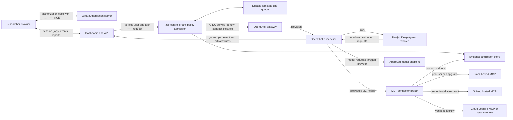
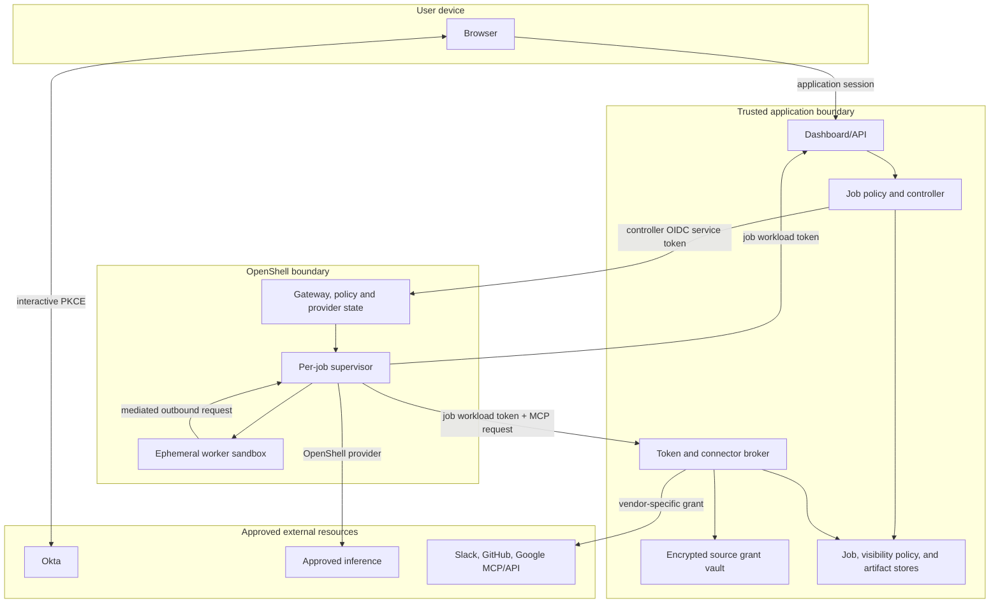
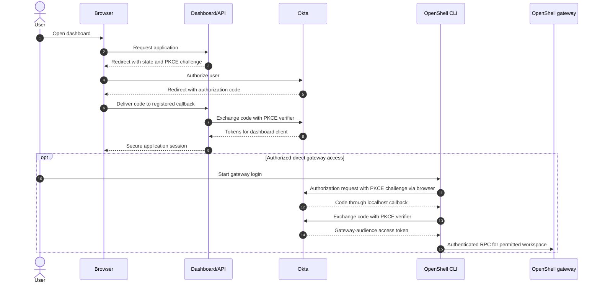
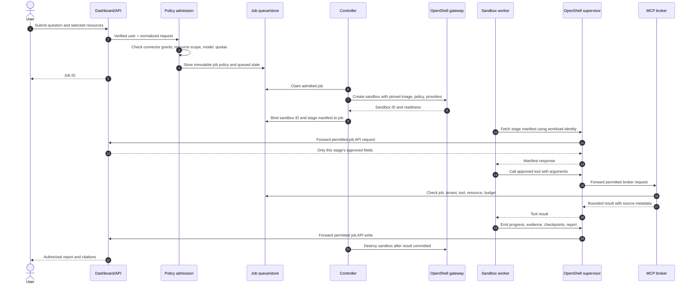
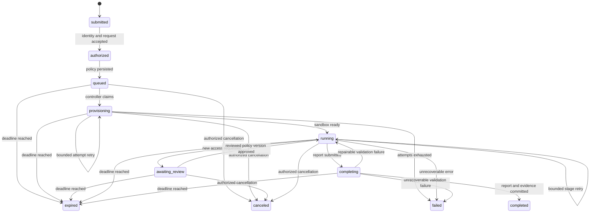
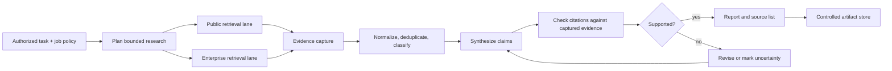
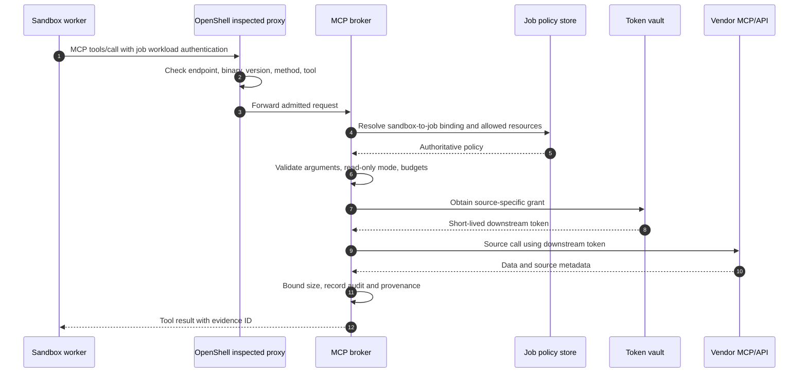
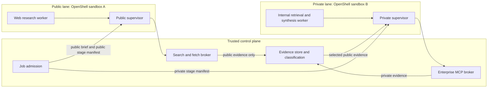
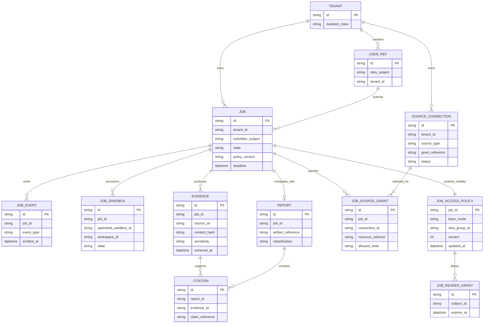
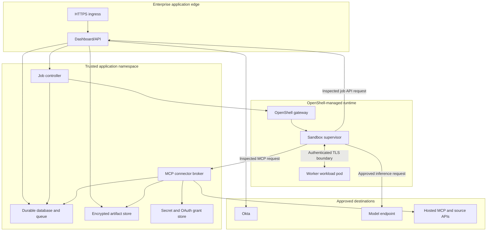

# Target architecture

**Status:** proposed design, 2026-10-23  
**Target baseline:** NVIDIA OpenShell v0.1.5, Python Deep Agents worker  
**Related documents:** [requirements](requirements.md), [feasibility and market assessment](feasibility-and-market-assessment.md), [ChatGPT Enterprise integration option](design/chatgpt-enterprise-integration.md), [Replit rollout fit](design/replit-rollout-fit.md), [identity and access](design/identity-and-access.md), [research visibility](design/research-visibility.md), [Okta implementation handoff](okta/requirements-and-design.md), [job lifecycle](design/job-lifecycle.md), [research and evidence](design/research-and-evidence.md), [MCP connector broker](design/mcp-connector-broker.md), [deployment topology](design/deployment-topology.md), [deployment and operations](design/deployment-and-operations.md).

This document specifies the **candidate custom system**: a dashboard outside OpenShell and a research process inside OpenShell. The organization already provides ChatGPT Enterprise to all employees and plans a Replit rollout, so the [platform selection gate](requirements.md) tests those research paths before a full dashboard build. The four candidate controls remain a server-held job policy, credential broker, separate public/private lanes, and durable evidence. This document separates interactive user authentication, controller authentication, sandbox workload identity, and the credentials used to call research sources. Statements about current product capabilities are cited.

## 1. Decisions and boundaries

| Decision | Target design | Reason |
|---|---|---|
| Product selection | Benchmark installed ChatGPT Enterprise first and Replit Chat when its rollout permits; approve the custom build only for a measured gap | A duplicate employee research interface and runtime need a specific quality, control, or evidence benefit. |
| User entry point, if custom build proceeds | Dashboard and API using Okta Authorization Code with PKCE; separately test whether ChatGPT plugin tools can serve as a job front end | Users can submit jobs, grant source access, follow progress, and read results through one governed interface. The job API and authorization stay server-side regardless of front end. |
| Direct sandbox access | Optional for authorized operators in the initial design; gated on an Okta/OpenShell CLI login test | OpenShell documents OIDC browser login with PKCE for its CLI, while workspace membership controls access. Its current ephemeral localhost callback may conflict with Okta redirect registration; a device grant needs a separate test. The application will not expose an unauthenticated sandbox web service. |
| Research execution | One short-lived OpenShell sandbox per job or per independently authorized research lane | The Deep Agents graph, tool selection, scratch work, and synthesis execute in the sandbox. |
| Control plane | Dashboard/API, job controller, policy admission, durable queue, results store, and credential broker outside sandboxes | These services hold tenant identity, source grants, and authorization policy. |
| Research visibility | The submitter and, if selected at admission, current members of one approved same-tenant Okta group may see a job; later named readers need an explicit expiring grant | The application binds each job to its exact audience and applies source-derived checks before private content is served. Okta login or OpenShell workspace membership alone does not grant result access. |
| Source access | Read-only, typed MCP tools through a task-aware connector broker by default | The broker checks tool arguments and task resource bounds that OpenShell MCP policy cannot inspect. |
| Model access | An enterprise-approved model endpoint through an OpenShell inference/provider binding | Model requests may contain source material; the endpoint must be approved for the job's data class. |
| Job state | Durable outside the worker | Sandbox deletion and worker failure cannot be the only record of a job. |
| Write actions | Disabled in the initial research product | Any later write capability requires a distinct grant and approval path. |

OpenShell workspaces isolate gateway resources, and a Workspace User can create and use sandboxes and provider attachments in that workspace. A dashboard user therefore does not automatically receive direct OpenShell Workspace User membership. The controller mediates normal jobs; direct gateway access is a separately approved path. [OpenShell workspaces](https://docs.nvidia.com/openshell/how-it-works/workspaces).

The [NVIDIA community deep-research-worker recipe](https://github.com/NVIDIA/nemoclaw-community/tree/main/examples/recipes/community/deep-research-worker) informs the asynchronous job API and budgeted research behavior. Its Deep Agents graph runs in a trusted host-side service, while the sandbox contains a client. This architecture places the graph inside the sandbox.

## 2. System context



The box labeled “MCP connector broker” is a narrow, trusted tool service. It performs authentication, authorization, argument validation, source retrieval, and audit recording. It does not execute the research agent graph or arbitrary code supplied by a job. Direct vendor MCP access remains possible for a connector that passes the criteria in [Section 7](#7-direct-mcp-versus-the-broker).

OpenShell sandbox service routes bypass its control-plane RPC authorization and do not use the gateway's OIDC/CLI login. The default job path therefore has **no externally exposed sandbox service**. Worker-to-dashboard traffic is outbound to a job API, or the controller uses authenticated OpenShell file transfer for simple early prototypes. [OpenShell sandbox services](https://docs.nvidia.com/openshell/how-it-works/sandboxes/overview).

## 3. Trust and identity boundaries



There are four distinct principals:

1. **Human principal:** Okta subject associated with a dashboard session. The dashboard authorizes jobs and result access from verified claims and tenant membership.
2. **Controller principal:** a dedicated noninteractive Okta client with only the OpenShell role and workspace membership needed to create, observe, and delete project sandboxes. OpenShell's official SDK supports renewable OIDC client-credentials authentication. [Gateway authentication](https://docs.nvidia.com/openshell/how-it-works/gateways/authentication).
3. **Sandbox principal:** one job-bound workload identity used to reach the job API and broker. OpenShell's dynamic token grant can use the sandbox supervisor's SPIFFE JWT-SVID if the issuer accepts it; otherwise a gateway-managed, endpoint-bound short-lived credential is a fallback. Neither path grants source access merely by asserting a dashboard user ID. [Provider profiles](https://docs.nvidia.com/openshell/how-it-works/providers/profiles).
4. **Source principal:** the user grant, GitHub installation, or Google workload identity actually accepted by the source. The broker records which principal was used on each retrieval.

The current MCP authorization specification requires an OAuth resource indicator for the target MCP server, and the server must validate that a token was issued for it. A token for the dashboard, OpenShell gateway, or broker is not a vendor MCP token. The broker uses separate downstream credentials or an explicit exchange. [MCP authorization, 2026-07-28](https://modelcontextprotocol.io/specification/2026-07-28/basic/authorization).

### Interactive Okta access



The first flow is an application design choice with a registered, stable dashboard callback. OpenShell documents Authorization Code with PKCE for interactive **CLI-to-gateway** login with OIDC providers including Okta, plus client credentials for noninteractive CLI/SDK use. Its CLI currently binds an ephemeral localhost callback port; [NVIDIA issue #3300](https://github.com/NVIDIA/OpenShell/issues/3300) requests a fixed-port option, while [Okta documents matching the configured redirect URI](https://developer.okta.com/docs/guides/authorization/). Browser CLI access is conditional on a successful Okta/OpenShell callback test or a compatible fixed-port release; an Okta device grant is a separate optional test. Any enabled path also requires an access token with the gateway's configured audience and an appropriate workspace role; a dashboard token must not be reused by changing headers. [OpenShell gateway authentication](https://docs.nvidia.com/openshell/how-it-works/gateways/authentication).

## 4. Component responsibilities and contracts

| Component | Owns | Explicit boundary |
|---|---|---|
| Dashboard/API | Okta callback and session, task creation, connector setup UX, authorization to view results, event streaming to browser | It never trusts a user-supplied tenant or role claim without validating the session. |
| Policy admission | Authoritative job policy snapshot: tenant, submitter, allowed source IDs, allowed tool names, model, budget, expiry, classification | It rejects model or connector requests outside a configured catalog. |
| Job controller | Queue dispatch, OpenShell sandbox lifecycle through the official Python SDK, cancellation, cleanup, reconciliation | It has OpenShell control-plane credentials; the sandbox does not. |
| Job API | Gives a verified sandbox only its own manifest; accepts bounded job events, checkpoints, and artifacts | It binds sandbox identity to job ID server-side. A job ID is an identifier, not a credential. |
| Worker | Runs Python Deep Agents, source-specific retrieval tasks, synthesis, verifier, scratch files | It receives no Okta client secret, vendor refresh token, GitHub private key, or GCP service-account key. |
| MCP connector broker | Fixed tool catalog, tenant/user/resource authorization, input validation, token refresh, vendor calls, audit | It does not treat an MCP tool name allowlist as sufficient resource authorization. |
| Evidence store | Source metadata, excerpts or controlled raw captures, citation IDs, sensitivity and retention | Access to results follows job and source data sensitivity. |
| OpenShell gateway | Sandboxes, policy, provider attachment, network egress, sandbox logs | The controller inspects effective policy after attaching providers. |
| Approved model provider | Inference | Source content sent to a model is a governed data transfer. |

The controller may combine several logical components in one process during a prototype. Their identities and authorization responsibilities remain separate interfaces.

## 5. Job admission and execution

A job policy is created by the trusted API and stored outside the sandbox. Its minimum fields are:

| Field | Purpose |
|---|---|
| job ID, tenant ID, submitter subject | Cross-tenant and result-access binding |
| server-approved `public_research_brief` for combined jobs | Public-safe question given to the public lane without the private question or connector details |
| source connection IDs and resource selectors | Allowed Slack workspaces/channels, GitHub installations/repos, GCP projects/log views |
| approved tool IDs and mode | Fixed read-only capabilities exposed to the worker |
| model/data classification | Restricts use of model and tracing endpoints |
| deadline, token/tool/source-call budgets | Cost and abuse limits |
| policy version and expiry | Reproducible decision and revocation |
| result retention and visibility | Controls access after completion |

The broker reads the authoritative policy on every sensitive call, rather than trusting resource IDs or user IDs supplied by the model or worker. The controller derives a **stage manifest** for each sandbox from this policy. A public sandbox receives only the approved `public_research_brief`, public source/tool choices, and its own budget and identity; it never receives the full private question, enterprise connection IDs, or private resource selectors.



OpenShell supports detached worker processes, sandbox status, execution, upload, and download. For the target design, bake the worker into a pinned OCI image and pass a small job ID at startup. Avoid handing it a controller credential or a full source-token bundle. [OpenShell sandbox management](https://docs.nvidia.com/openshell/how-it-works/sandboxes/overview).



State transitions are idempotent and audit logged. `completed`, `failed`, `canceled`, and `expired` are terminal; a retry after one of them creates a new job. Provisioning and worker-stage retries increment attempt records while the job remains nonterminal. The result is committed before the controller destroys a successful sandbox. A controller restart reconciles queue records against OpenShell sandbox state; a worker restart resumes from an explicitly persisted checkpoint or restarts a known stage. Retention expiry deletes artifacts according to policy without reopening the job. The project does not assume OpenShell itself supplies application-level job retries.

## 6. Research and evidence flow

Deep Agents can provide opt-in task planning, subagents, filesystem-backed context, and tool calling, but the application supplies its own evidence discipline and source policy. A useful initial graph is a planner, bounded retrieval tasks, synthesis, and a verifier. Retrieval tasks receive only the tools needed for their source. The synthesis and verifier stages can run without source write tools. [Deep Agents overview](https://docs.langchain.com/oss/python/deepagents/overview).



An evidence record should contain a stable citation ID, connector and source URI, retrieval time, origin principal, permitted resource selector, excerpt or controlled raw object reference, content hash, and sensitivity label. Report claims point to evidence IDs. The dashboard rechecks the viewer's authorization before serving a private report or raw evidence. [Research and evidence design](design/research-and-evidence.md) defines the format.

Source content is untrusted input. A Slack message, repository file, public page, or log line cannot authorize new tools, widen a resource selector, or change the job's model. Tool calls remain subject to the broker and OpenShell policies even when source text contains instructions.

## 7. Direct MCP versus the broker

OpenShell's inspected MCP policy can allow or deny an MCP method or tool name. It does **not** match tool arguments or parse server responses. Inspected rule enforcement defaults to audit unless configured as enforce, and its default MCP version allowlist is 2025-11-25. Each connector needs an exact protocol-version and enforcement test. [OpenShell network rules](https://docs.nvidia.com/openshell/how-it-works/policies/network-rules).

| Pattern | Appropriate when | Limitation | Decision |
|---|---|---|---|
| Worker directly calls hosted MCP through OpenShell | One approved identity has already been narrowed sufficiently by source RBAC and OAuth scope; direct token refresh and MCP revision work in an integration test | Task-level repo/channel/project argument bounds and cross-source audit are harder; user grants must be provisioned per sandbox | Allowed for simple, reviewed connectors or early proof of concept |
| Worker calls task-aware MCP broker; broker calls hosted MCP or API | Multiple users or tenants, per-task resources, delegated grants, vendor-specific token refresh, central audit | Adds a security-critical service and operational cost | **Default for enterprise connectors** |
| Worker calls a local MCP server in the same sandbox | Tool only handles sandbox-local data and has no vendor secret or authority beyond the job | Local server code remains inside agent trust boundary; it is not an authorization broker | Allowed for pure local processing |

The broker exposes a small **pinned, typed catalog** such as search authorized Slack channels, read authorized repository content, and query authorized log views. It validates arguments, limits result size and time range, uses the source's proper token, and records provenance. It does not blindly expose every tool returned by a vendor's tools/list method. This matters because Slack's hosted MCP server offers write tools as well as search/read tools. [Slack MCP server](https://docs.slack.dev/ai/slack-mcp-server/).



The source access modes are deliberately different:

| Source | Default research identity | Alternative |
|---|---|---|
| Slack hosted MCP | Per-user OAuth token authorized by the submitter; enterprise-managed authorization when the Slack organization and IdP support it | Explicitly approved bot/app corpus with separate policy |
| GitHub hosted MCP/API | GitHub App user token for user-specific access | Installation token limited to selected repositories and read permissions for shared service research |
| Cloud Logging MCP/API | Dedicated, least-privilege Google workload or agent identity, preferably keyless | User credential if the organization requires user-attributed access |

Slack's hosted MCP is an OAuth-protected Streamable HTTP endpoint and does not support Dynamic Client Registration. GitHub's hosted MCP also requires a preregistered OAuth client for interactive access and does not support Dynamic Client Registration. Google's Cloud Logging MCP supports user and workload identity, while its current guide illustrates broader Logging Admin permissions than a read-only research worker should receive. Validate exact tools and IAM before adoption; a narrow wrapper around the read-only entries.list API is the fallback. [Slack MCP](https://docs.slack.dev/ai/slack-mcp-server/), [GitHub MCP host guide](https://github.com/github/github-mcp-server/blob/main/docs/host-integration.md), [Cloud Logging MCP](https://docs.cloud.google.com/logging/docs/use-logging-mcp), [entries.list](https://docs.cloud.google.com/logging/docs/reference/v2/rest/v2/entries/list).

## 8. Public and private research lanes

A model that reads private enterprise data and can also send arbitrary public-web queries can leak information through an allowed public endpoint. OpenShell explicitly treats each permitted endpoint as a possible exfiltration path. For a job mixing sources, use separate sandboxes or separately authorized stages. The public sandbox receives a server-approved `public_research_brief` and a minimal stage manifest; it never receives the original private question or enterprise connector identifiers. A public worker may search and fetch public sites; the private synthesis worker receives selected public evidence through the controlled store but has no public-web egress. The approved model endpoint remains a deliberate data destination. [OpenShell security best practices](https://docs.nvidia.com/openshell/security/best-practices).



This split is a high-assurance deployment mode. The brokers and evidence store remain outside both sandboxes; worker requests pass through their OpenShell supervisors. A public-only first prototype needs one sandbox. A private-only job also needs one sandbox. The job policy records the chosen lane and prohibits a private worker from acquiring public-web tools later through prompt instructions.

## 9. Logical data model



The actual database schema may differ. This model states ownership and authorization invariants: every job and source connection belongs to one tenant; every evidence object belongs to one job; every report citation resolves to retained evidence; source grants are referenced by secure vault IDs, never copied into a job row. The versioned job access policy is separate from the immutable execution policy. Its `base_visibility` is chosen at admission as submitter-only or an exact approved Okta group; the submitter retains individual access in either mode. An owner or authorized steward can later narrow group visibility to submitter-only through an audited, atomic revocation; v1 cannot widen or switch groups after admission. Later `reader_subjects` grants are explicit and expiring. Authorization joins the job's tenant and owner to the current access policy before returning even a job-list row; report and evidence reads also check source-derived rights. See [research visibility](design/research-visibility.md).

## 10. Deployment topology



A Kubernetes deployment must use a CNI that actually enforces ingress and egress NetworkPolicy in sandbox namespaces; otherwise sandbox traffic can bypass supervisor policy. OpenShell logical workspaces should be mapped to the intended Kubernetes namespace isolation, rather than assuming the default mapping supplies it. [Kubernetes setup](https://docs.nvidia.com/openshell/kubernetes/setup), [Kubernetes workspaces](https://docs.nvidia.com/openshell/kubernetes/workspaces).

The [deployment topology decision](design/deployment-topology.md) compares GCP VMs, OpenShift, and GKE. Kubernetes version alone is insufficient: OpenShell also requires a working Landlock ABI 3 and nested seccomp user-notification path in the sandbox runtime, so each proposed node image and runtime must pass OpenShell's startup probes. [OpenShell v0.1.5 support matrix](https://docs.nvidia.com/openshell/v0.1.5/about/support-matrix).

The sandbox policy admits only the job API, broker, and approved inference endpoint for a private research job. The public lane additionally admits its bounded search/fetch service. Policy and provider rules compose, so the controller checks the **effective** policy after attachments and treats unexpected additional endpoints as an admission failure. [OpenShell provider profiles](https://docs.nvidia.com/openshell/how-it-works/providers/profiles), [OpenShell network rules](https://docs.nvidia.com/openshell/how-it-works/policies/network-rules).

## 11. Failure, expiry, and revocation

```mermaid
sequenceDiagram
    autonumber
    participant W as Worker
    participant B as Broker
    participant V as Token vault
    participant S as Source
    participant C as Controller
    participant Q as Job store
    participant O as OpenShell

    W->>B: Read-only tool call
    B->>V: Get source grant
    alt Grant refreshable and authorized
        V-->>B: Fresh short-lived token
        B->>S: Call source
        S-->>B: Result
        B-->>W: Result and evidence ID
    else Grant expired, revoked, or insufficient
        B-->>W: Typed access failure; no source call
        W->>Q: Record blocked source and partial progress
        Q-->>C: Requires reconnect or narrower plan
    end
    opt Worker deadline or cancellation
        C->>O: Terminate and delete sandbox
        C->>Q: Commit terminal status and audit
    end
```

A failed OAuth exchange, denied MCP tool, revoked source connection, failed policy reconciliation, or unavailable model endpoint fails closed for that operation. The dashboard can show a reconnect or access-review action. Retries are bounded and idempotent; the broker does not silently replace a user grant with a broader service grant. A worker may complete a partial report only when the result explicitly identifies missing sources.

## 12. Security and production gates

| Boundary or risk | Required control and verification |
|---|---|
| Direct user access to OpenShell | Prove the CLI's PKCE localhost redirect works with Okta, or separately approve and prove device grant; then require the OpenShell gateway audience, user role, and intended workspace membership. Direct CLI access is separately granted. |
| Cross-user and cross-tenant job access | Every dashboard job list, status, event, report, evidence, and artifact request resolves a verified subject and selected tenant to the submitter, current member of the exact selected Okta group, or an active named reader grant. Same-tenant and admin roles grant no implicit read. The broker separately resolves sandbox identity to one job. |
| Overbroad provider attachment | Controller inspects full effective OpenShell policy after provider attachment; denies any unexpected endpoint, method, or tool. |
| MCP tool arguments | Broker validates repo/channel/project/log-view selectors, time windows, and result sizes. OpenShell tool-name filtering remains a second enforcement layer. |
| OAuth and MCP compatibility | Test each vendor's protected-resource metadata, client registration method, token audience/resource parameter, token refresh, protocol revision, and 401 recovery. LangChain's current MCPAdapter is beta. [LangChain MCP](https://docs.langchain.com/oss/python/langchain/mcp). |
| Prompt injection | Source content is untrusted; read-only tool catalogs, source-specific retrieval subagents, and immutable job policy prevent source text from granting capabilities. |
| Model and tracing egress | Explicit allowlist by data classification; retain prompt/tracing metadata only under the selected enterprise policy. |
| Long-running jobs | Durable queue/checkpoints, per-job deadlines and budgets, idempotent cancellation, reconciliation after controller restart. |
| Result confidentiality | Full-report and evidence authorization at read time includes job visibility, classification, retention, and current source rights. The API denies the whole report if any approved private job source/resource is unauthorized, including uncited inputs, uses no browser-accessible object-store URLs, and closes event streams on revocation. |
| Kubernetes network bypass | Test denied egress at pod level under the actual CNI before handling private sources. |

## 13. Integration gates and open decisions

The design can start with a public-only job before enterprise connectors exist. Before the first private-source release, answer and test these decisions:

1. **Submitter or app identity per source?** Default Slack to user identity, GitHub to user identity unless the task explicitly uses an approved repository installation, and Cloud Logging to a dedicated least-privilege workload identity.
2. **Direct hosted MCP or broker wrapper per source?** Use direct only when upstream RBAC already enforces the entire task scope and the OAuth/MCP handshake works headlessly. Otherwise use the broker's typed tool.
3. **Which data may reach which model and trace service?** This is a per-tenant classification policy, not an agent preference.
4. **How are approvals represented if write tools are later enabled?** A future design must distinguish preview, human approval, and execution tokens.
5. **Can Okta complete the current OpenShell CLI callback flow?** Test browser PKCE before enabling that login path. If it fails, test a separately approved device grant before granting direct operator access.

The result-viewer rule is settled for this candidate design: jobs start with the submitter plus an optional approved Okta group selected at admission; that group audience can be revoked for the job, and later named reader grants are a separate feature. Every group or named reader must also pass classification and source-derived checks before seeing a report or evidence. The [research visibility design](design/research-visibility.md) specifies list, event, share, and revocation behavior.

The initial scaffold should preserve these contracts without pretending that a selected framework provides them automatically. The [identity design](design/identity-and-access.md), [job lifecycle](design/job-lifecycle.md), [broker design](design/mcp-connector-broker.md), and [research/evidence design](design/research-and-evidence.md) specify their implementations.
