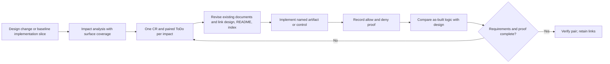

# ADR 0002: Design impact and implementation traceability

- **Status:** Adopted as a repository workflow; protected CI enforcement remains open
- **Date:** 2026-10-23
- **Requirement ID:** OPS-12
- **Scope:** Design decisions, existing-design implementation slices, repository documents, contracts, configuration, and application logic
- **Assumption:** This repository is still a design scaffold; `make check` is local and no protected CI or executable service exists yet.

## Decision

Every design change starts with an impact analysis in its primary design or ADR. The analysis covers the surfaces in [AGENTS.md](../../AGENTS.md#design-change-impact-gate), records affected and unaffected decisions, and maps **every identified impact** to one stable change request (CR) and a same-ID paired ToDo. An impact is a distinct deliverable or proof obligation, not each file it touches. An affected surface can map to several impacts, and each impact can span several surfaces.

The CR states the required behavior and ownership; its ToDo tracks executable work, proof, and implementation pull requests. The primary design, [README](../../README.md#tracked-change-requests), and [ToDo index](../TODO.md) link directly to **both** records. Existing normative documents change with the design decision. A new source-dependent contract or fixture can remain pending only when its pair names the artifact and a gate before dependent code. Implementing an already documented baseline slice also starts with a pair when none exists, with its impact ID tied to the existing requirement and primary design. A new ADR is needed only if the intended design changes.

The pair's matching status is `Open`, `In progress`, `Deferred`, `Verified`, or `Withdrawn`. Implementation changes become `Verified` only after the named code or configuration, required acceptance and denial evidence, and as-built design reconciliation are recorded. A documentation-only pair can close after review and document checks. `Withdrawn` requires a recorded decision and removal of abandoned target behavior. Closed pairs remain linked for audit.

`make check` enforces pair IDs, statuses, reciprocal links, and direct backlinks from the README, index, and declared primary design. Human review must still judge whether the analysis found every real impact and whether the application matches the design. Protected CI enforcement is required before the first executable build is merged.

## Impact analysis

| Surface | Disposition | Revision or reason | Mapped impact ID |
|---|---|---|---|
| README and numbered requirements | **Affected** | The [README](../../README.md#tracked-change-requests) lists every pair, and [OPS-12](../requirements.md#55-operations-and-governance) states the traceability gate. | DR-PROC-001 |
| Delivery workflow and pull requests | **Affected** | [AGENTS.md](../../AGENTS.md#design-change-impact-gate) defines intake, analysis, pairs, synchronization, and closure; the [pull request template](../../.github/pull_request_template.md) asks for the matrix and links. | DR-PROC-001 |
| Architecture and integration handoff | **Affected for traceability** | The [architecture](../architecture.md#13-integration-gates-and-open-decisions) links the workflow and its CR/ToDo; this decision changes no component, token, or data flow. | DR-PROC-001 |
| Existing design handoffs | **Affected for traceability** | [ADR 0001](0001-outbound-mcp-source-tokens.md#impact-analysis-and-document-disposition) maps source-authentication surfaces to their pairs; affected component designs link their open obligations. | DR-PROC-001 |
| OpenAPI, JSON Schemas, and source fixtures | **Not affected** | This process decision changes no application payload or protocol. ADR 0001 separately tracks new source-connection contracts and fixtures. | None |
| Component documentation, code, and configuration | **Affected for process validation** | [Repository validation](../../scripts/validate_repo.py) checks pair structure and backlinks. No research-service runtime code or deployment configuration exists to change. | DR-PROC-001 |
| Deployment, operations, and security controls | **Affected for future CI** | The [delivery gates](../../AGENTS.md#verification-and-release-evidence) require `make check`; [CR-0009](../change-requests/CR-0009-design-impact-traceability.md) tracks protected CI enforcement before executable code. No cluster policy changes. | DR-PROC-001 |
| Tests, evaluations, and release gates | **Affected** | Static pair and link checks are present; missing-impact and application-behavior completeness remain manual review duties. Live security and research gates are unaffected and unrun in this scaffold. | DR-PROC-001 |

## Tracked impact

| Impact | Required change | Change request | Paired ToDo |
|---|---|---|---|
| DR-PROC-001 | Enforce analysis, one pair per impact, durable design/README links, and reviewed implementation closure | [CR-0009](../change-requests/CR-0009-design-impact-traceability.md) | [ToDo](../todos/CR-0009-design-impact-traceability.md) |

## Decision limits

Static validation cannot discover a missing semantic impact or prove a live component. The pull request reviewer compares the analysis against the actual design and code diff; an independent principal engineer review covers material cross-component or trust-boundary changes. [AGENTS.md](../../AGENTS.md#design-change-impact-gate) is the operational workflow, and the CR/ToDo pair stays open until its remaining CI and proof work is complete.
