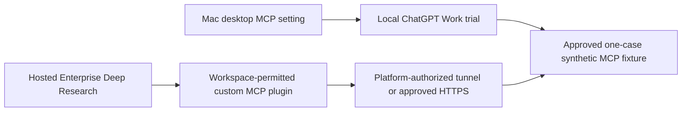
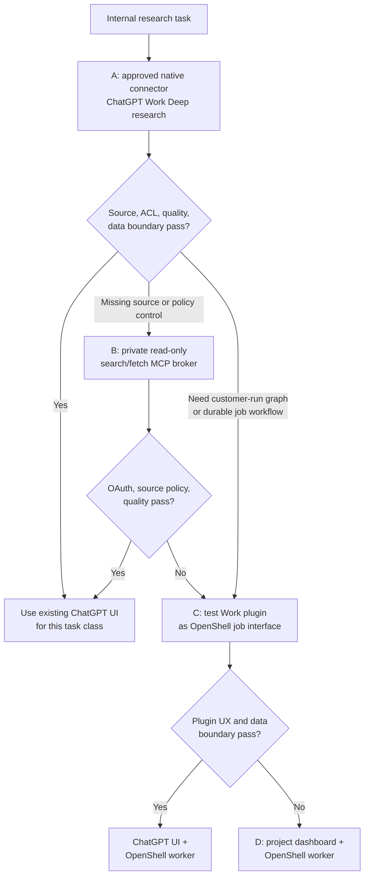
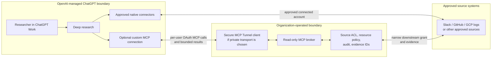
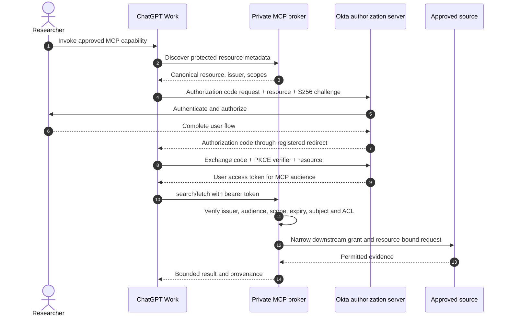
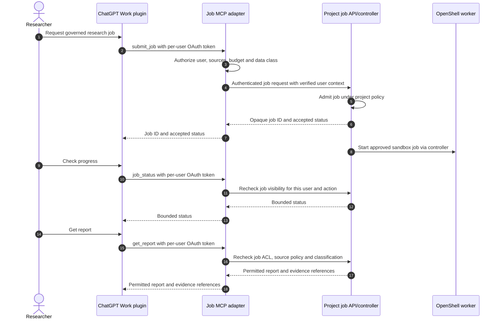

# ChatGPT Enterprise integration option

**Status:** conditional evaluation option, 2026-10-23  
**Context:** employees already have ChatGPT Enterprise; enterprise connectors are being enabled after review.  
**Related design:** [target architecture](../architecture.md), [market assessment](../feasibility-and-market-assessment.md), [MCP broker](mcp-connector-broker.md), [identity and access](identity-and-access.md), [Okta handoff](../okta/requirements-and-design.md).

This document tests whether the existing ChatGPT workspace can be the first research interface and benchmark for this **internal** service. It does not change the proposed OpenShell architecture or commit to a ChatGPT integration. Availability of ChatGPT Work, Deep research, custom plugins, specific connectors, action controls, and Secure MCP Tunnel must be verified in the organization's tenant and approved for the intended data.

The [owner handoff](../handoffs/chatgpt-mcp-admin-request.md) names the separate Enterprise workspace, Platform tunnel, product/security, and tester actions. The Milestone 0 synthetic benchmark has a separate, disposable [CR-0018](../change-requests/CR-0018-chatgpt-synthetic-mcp-baseline.md) / [ToDo](../todos/CR-0018-chatgpt-synthetic-mcp-baseline.md) source. It projects one approved invented case into a read-only `search`/`fetch` MCP over an outbound Secure MCP Tunnel, without user OAuth or production source rights. Before any tester packet or tunnel exposure, the one-case question and allowed projection must match a versioned product/security-approved corpus/source/rubric manifest whose exact SHA-256 is supplied from a separate trusted register; a local self-rehash or draft-mode output cannot establish approval. The [independent packet review](../evidence/CR-0018-tester-packet-independent-review-2026-10-26.md) found this gate missing in the initial fixture, so distribution remains disabled. Its local stdio server pins legacy MCP 2025-06-18 and 2025-11-25; the inspected v0.0.18 tunnel client needs its initialized-notification shim enabled, and current-protocol fallback plus actual ChatGPT Deep Research discovery remain unproved. Each matched case needs a fresh conversation, exact selected-source state, and raw tool transcript; otherwise connector and permission behavior is deferred. The [selected client's unresolved high finding](../evidence/CR-0018-tunnel-client-vulnerability-preflight-2026-10-26.md) also needs disposition before credential-bearing use. This fixture can measure synthetic research behavior but cannot validate this document's authenticated broker or source ACL path. See the [baseline connectivity impact](../feasibility-and-market-assessment.md#chatgpt-baseline-connectivity-impact).

## 1. Decision path and product boundaries

**Mac control versus hosted source.** The tester can configure the ChatGPT app on their Mac but has no server-side workspace or OpenAI Platform tunnel administration. [Local desktop MCP settings](https://learn.chatgpt.com/docs/extend/mcp) can connect a local STDIO or Streamable HTTP fixture only when this account's Work Local entitlement and effective enterprise/device MCP policy permit that server, and after exact-byte synthetic approval. The shared local Codex host seeing a server is not proof that Work used it. This is a distinct observation from a hosted Enterprise Deep Research plugin. The hosted path needs effective permission for a designated creator to add a custom MCP plugin (or admin creation) and separate tester install/use permission in the workspace, a reachable MCP endpoint, and, for the private tunnel option, [Platform tunnel role grants and association with that ChatGPT workspace](https://developers.openai.com/api/docs/guides/secure-mcp-tunnels). A local Work-mode tool call must be observed before even recording fixture compatibility, and whether the user's local Deep research experience can select the server must be observed in that exact workflow before it is scored; a desktop settings screen is not that proof. No custom connector is approved or live-tested yet; [CR-0018](../change-requests/CR-0018-chatgpt-synthetic-mcp-baseline.md) / [ToDo](../todos/CR-0018-chatgpt-synthetic-mcp-baseline.md) track both trial paths and their separate evidence.

Start with an approved native ChatGPT connector and a representative research task. ChatGPT Work's Deep research can use connected app context and produce a report with sources when enabled for the account and workspace. If that experience meets the source, quality, authorization, and data requirements, the organization may not need a new researcher dashboard for those tasks. [ChatGPT Work research](https://learn.chatgpt.com/docs/web-search).

| Option | What it tests | Condition to add it |
| --- | --- | --- |
| A. ChatGPT Work Deep research + approved native connectors | Existing research UI and connected-source baseline | Workspace feature and each connector pass the organization's review. |
| B. Private read-only MCP broker | Access to a missing or more tightly scoped evidence source from ChatGPT | Option A has a material source or policy gap; the MCP, Okta, and tunnel conformance gates below pass. |
| C. ChatGPT Work plugin as an OpenShell job interface | `submit_job`, `job_status`, and `get_report` without a full new researcher dashboard | Full graph execution in OpenShell is required, and the tenant supports a usable, governable plugin workflow. |
| D. Project dashboard and OpenShell worker | Dedicated job control, evidence review, or a customer-operated research boundary | The other options cannot meet a documented requirement. |

These are distinct product paths. The [ChatGPT Work Deep research experience](https://learn.chatgpt.com/docs/web-search) and its custom MCP integration are not the [API Deep Research model](https://developers.openai.com/api/docs/guides/deep-research) or the [Agents API](https://developers.openai.com/api/docs/guides/agents-api/overview). API tool support, API authentication, hosting, and approvals do not establish what this ChatGPT tenant will expose. In particular, a `submit_job` plugin is a **separate ChatGPT Work test**, not an assumed tool inside Deep research.

## 2. Conditional integration layout

The native connector path uses the connector's approved account and ChatGPT workspace controls. If a source needs a narrower interface, expose the project's broker as an MCP **resource server** with only the read-only `search` and `fetch` tools and the [company-knowledge compatibility schemas](https://developers.openai.com/api/docs/mcp). The broker can reuse the project's source adapters, resource policy, and evidence IDs. The ChatGPT research loop itself remains on the ChatGPT side; no OpenShell sandbox is launched by options A or B.

The private MCP may use [Secure MCP Tunnel](https://developers.openai.com/api/docs/guides/secure-mcp-tunnels): its client makes an outbound connection from the organization network, so the MCP server need not have public ingress. Keep the tunnel client's OpenAI runtime key and any optional mTLS material in a controlled secret store outside the research sandbox. The tunnel does **not** automatically tunnel the authorization server; the browser and OAuth token exchange still need a reachable authorization path. Verify actual Okta discovery and endpoints, tunnel workspace association, and the permitted distribution of a private custom connection in this tenant. Public plugin submission has a different endpoint requirement. [Tunnel networking and OAuth](https://developers.openai.com/api/docs/guides/secure-mcp-tunnels), [custom MCP connection test](https://developers.openai.com/plugins/deploy/connect-chatgpt).

### Tool contract

- `search(query)` returns only source records the authenticated user and current policy may read, with stable IDs, titles, canonical URLs, and enough metadata to explain provenance. `fetch(id)` reauthorizes the same user against the selected record and returns bounded content with its canonical URL. A non-empty `url` is required for ChatGPT citation metadata; use an access-controlled evidence URL if a direct source URL cannot be exposed. Both tools implement OpenAI's **read-only** Deep research/company-knowledge compatibility contract; schemas and tool annotations are validated in the tenant. [MCP compatibility guide](https://developers.openai.com/api/docs/mcp).
- Every call applies the broker's source allowlist, resource selectors, permitted acting identity, rate and size limits, and audit record. Search result IDs and MCP tool descriptions are not authorization. A denial must not expose a document merely because another user saw its ID.
- ChatGPT `search`/`fetch` calls do not automatically carry the project's per-job manifest. Start with a server-side standing policy bound to the verified user. If a task needs a narrower source selection, prove a separate authenticated session or policy-binding mechanism that the broker can enforce across both calls; never accept a model-supplied resource selector as the authorization decision. If that binding cannot be implemented, option B does not meet the per-job policy requirement.
- The broker treats retrieved content as untrusted data. It limits snippets and avoids returning source secrets, raw credentials, or unrelated records. The research UI's citations are evaluated against source records; if immutable claim-level replay is required, retain the project's own evidence contract rather than assuming ChatGPT citations provide it.

## 3. Identity and OAuth contract

ChatGPT authenticates to the custom MCP on behalf of the **user** with OAuth authorization code plus `S256` PKCE. ChatGPT does **not** support machine-to-machine OAuth grants, including `client_credentials`, as the MCP client. A client secret or `private_key_jwt` used to authenticate an authorization-code token exchange is not a client-credentials grant. [OpenAI plugin authentication](https://developers.openai.com/plugins/build/auth).

**Do not reuse** the dashboard token, OpenShell gateway token, or a source token as the ChatGPT-to-MCP token. The broker validates the bearer token on every call and maps its verified subject to the allowed tenant, source account, records, and server-side policy. `_meta["openai/subject"]` is an anonymized identifier useful for correlation or rate limiting; it is not a source authorization proof. [Token verification](https://developers.openai.com/plugins/build/auth), [plugin metadata reference](https://developers.openai.com/plugins/reference).

Broker-to-source credentials are a **different hop**. Use a delegated user grant when source permissions must follow the researcher. Use an installation or application grant, including client credentials where that particular source supports them, only when the source owner approves its broader identity and the broker enforces explicit user and resource policy. A shared or agent-owned connection can expose the connected account's permissions rather than the requester's personal permissions, so it needs a deliberate ACL test. [ChatGPT Work connection security](https://learn.chatgpt.com/docs/enterprise/chatgpt-work-cloud-security).

### Okta and MCP conformance gate

Before production data, prove the following with the **actual** ChatGPT connection and Okta authorization server, not just a generic OAuth client test:

1. The MCP serves protected-resource metadata at its canonical HTTPS resource URL, advertises the exact Okta issuer, and returns a proper `WWW-Authenticate` challenge when needed. Okta publishes discoverable authorization-server or OIDC metadata, including `S256` support. [Required metadata](https://developers.openai.com/plugins/build/auth).
2. Select a ChatGPT-compatible OAuth client method—provided client, dynamic client registration, or Client ID Metadata Document—based on what the Okta tenant is actually configured to support. Register the **exact** redirect URI shown in ChatGPT. The stable redirect URI requires compliant issuer identification in authorization responses; otherwise use the callback-specific URI. Do not assume CIMD entitlement or issuer-response behavior. [Client registration and callback rules](https://developers.openai.com/plugins/build/auth).
3. Observe ChatGPT's `resource` value in both authorization and token requests. Confirm the issued token is bound to that canonical MCP resource, normally through `aud`, and that the broker rejects a wrong audience. A static Okta authorization-server audience that happens to look similar is **not evidence** that the required resource-indicator flow works. If Okta cannot produce conformant tokens, block this option until an approved standards-conformant authorization path exists. [Resource and audience requirements](https://developers.openai.com/plugins/build/auth).
4. Verify signature and key rotation, `iss`, `aud` or resource claim, `exp`/`nbf`, required scopes, user identity, revoked/expired grants, and a wrong-user record request on every tool call. If company account linking must be restricted to the enterprise workspace, also test verified-domain and UserInfo `email_verified` behavior. [Verification and workspace-domain requirements](https://developers.openai.com/plugins/build/auth).

## 4. Separate OpenShell job bridge experiment

If full Deep Agents execution inside OpenShell remains mandatory, test a custom **ChatGPT Work plugin** exposing `submit_job`, `job_status`, and `get_report`. OpenAI documents connecting custom MCP servers in ChatGPT and invoking their tools in Work; account and workspace policies apply. This does not establish the quality of a long-running job UI, and it does not make arbitrary job tools part of ChatGPT Deep research. [Connect and test a plugin](https://developers.openai.com/plugins/deploy/connect-chatgpt).

`submit_job` creates durable state and must declare `readOnlyHint: false`; `job_status` and `get_report` can use `readOnlyHint: true` only if they make no state changes. Every tool also needs explicit `destructiveHint` and `openWorldHint` boolean annotations with values matching its actual effects and destination scope. These hints do not replace authorization. Configure workspace action permissions and test confirmation behavior, duplicate submissions, the same per-job owner/group/reader access policy used by the dashboard, revocation, timeouts, and follow-up tool selection. The plugin must never forward the ChatGPT bearer token to the OpenShell gateway or place source refresh tokens in a sandbox. [Tool annotation rules](https://developers.openai.com/plugins/plugin-guidelines), [workspace action controls](https://learn.chatgpt.com/docs/enterprise/apps-and-connectors).

If report contents are not approved for the ChatGPT boundary, `get_report` must return only permitted metadata and an access-controlled project link. That result may still require a thin project report viewer. An optional plugin UI can be evaluated, but neither it nor a full dashboard is assumed necessary until the user workflow is tested. [Plugin connection testing](https://developers.openai.com/plugins/deploy/connect-chatgpt).

## 5. Data, governance, and pilot gates

ChatGPT-hosted research and Work Cloud operate in an OpenAI-managed boundary. A private MCP tunnel changes ingress, **not** where a returned excerpt or report is processed. For connected services, non-synced mode processes retrieved content without pre-indexing it, while synced mode indexes selected connected content; normal conversation retention still applies and the conversations remain available through the Compliance API. Keep broker-side access and evidence audit because conversation records and tunnel transport logs are different records. [Work cloud security](https://learn.chatgpt.com/docs/enterprise/chatgpt-work-cloud-security), [connection data handling](https://learn.chatgpt.com/docs/enterprise/apps-and-connectors), [tunnel logging boundary](https://developers.openai.com/api/docs/guides/secure-mcp-tunnels).

ChatGPT Enterprise workspace controls can restrict plugin/MCP availability by role, permitted actions, confirmations, and connected-account permissions. Verify these controls in this tenant for each connector. Approval of a connector does not itself grant a researcher access to every connected record; the source account and broker still enforce their own permissions. [Plugin controls](https://learn.chatgpt.com/docs/enterprise/apps-and-connectors).

| Pilot stage | Evidence required before the next stage |
| --- | --- |
| 0. Tenant and data review | Confirm Work/Deep research/plugin/tunnel entitlements and roles; approved source list; native connector sync mode; retention and report classification; test accounts with different source access. |
| 1. Native connector baseline | Run the same 20–30 representative cases used in the [market assessment](../feasibility-and-market-assessment.md). Human-review answer accuracy, citation support, cross-source synthesis, abstention, latency, and cost. Test denied records, shared-account permissions, grant revocation, and prompt-injection content. |
| 2. Optional read-only MCP | With synthetic data first, prove `search`/`fetch` schemas, Okta metadata and audience, tunnel reachability, least-privilege source calls, user A/user B isolation, source revocation, and broker audit. Repeat only cases with a measured native-connector gap. |
| 3. Optional job bridge | Test state-changing submission and confirmation, idempotency, status/report polling, access after conversation changes, cancellation or failure messaging, report data classification, and whether users actually need a dedicated reviewer UI. |

**Decision:** adopt option A or B for task classes that meet pre-agreed research quality, authorization, data, and total-cost gates. Use option C only if OpenShell's customer-operated execution is required **and** ChatGPT is an acceptable job interface and report boundary. Use the [project dashboard architecture](../architecture.md) for requirements such as dedicated evidence review, retained claim-level snapshots, strict job governance, or data placement that these paths do not satisfy. Document the observed tenant configuration and remaining gap before choosing the production route.
