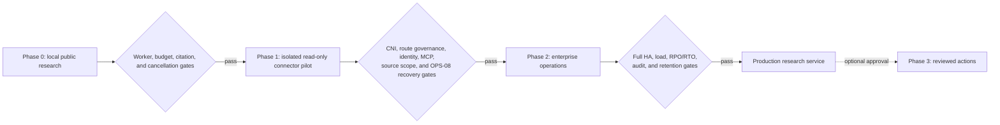
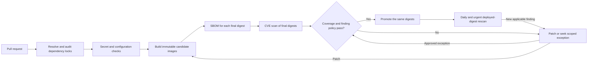
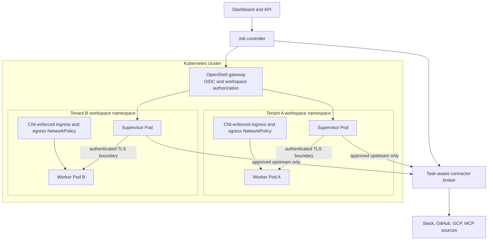
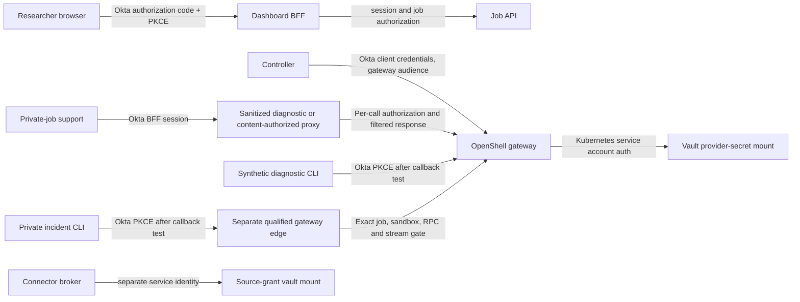
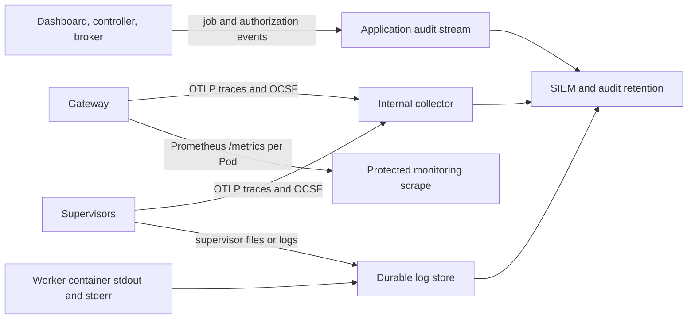
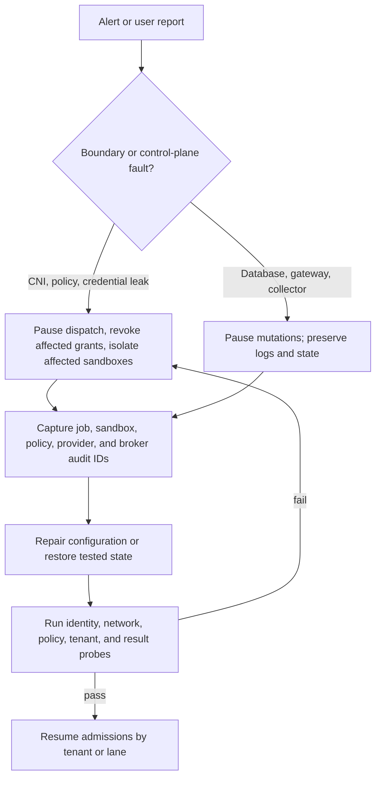

# Deployment and operations design

**Target baseline:** NVIDIA OpenShell v0.1.5 with a version-pinned Deep Agents worker.  
**Scope:** local proof of concept through an isolated, observable Kubernetes deployment.  
**Related designs:** [architecture](../architecture.md), [requirements](../requirements.md), [deployment topology](deployment-topology.md), [Okta implementation handoff](../okta/requirements-and-design.md), [identity and access](identity-and-access.md), [connector broker](mcp-connector-broker.md), and [research and evidence](research-and-evidence.md).

This is an operating design for the application described in those documents. The dashboard, job controller, broker, durable queue, evidence store, and their credentials run outside OpenShell sandboxes. Each job or separately authorized research lane gets a short-lived worker sandbox. OpenShell supplies the sandbox boundary and gateway controls; the application supplies job ownership, source authorization, durable state, and retention.

The first production qualification uses a **stable** OpenShell release. NVIDIA identifies stable builds as intended for production within its support matrix, maintains the newest patch of the current and prior minor lines, and allows experimental interfaces to change even within a patch line. Record the exact installed artifacts and qualify any later patch before rollout. [OpenShell v0.1.5 support matrix](https://docs.nvidia.com/openshell/v0.1.5/about/support-matrix).

## 1. Rollout and promotion



| Stage | Deployment shape | Data and promotion rule |
| --- | --- | --- |
| Phase 0 | Single developer gateway or disposable test cluster, external dashboard/API, one public worker sandbox per job | Public or synthetic data only. Prove that the full Deep Agents graph runs in the sandbox and that budgets, evidence capture, cancellation, and terminal cleanup work. |
| Phase 1 | Kubernetes staging with the intended CNI, operator-owned fail-closed gateway policy interceptor, reviewed provider-profile catalog, namespace mode, Okta issuer, Vault path, broker, trusted model request gate, and approved upstream model route | Use source fixtures until network and stage-route governance, identity, class-before-model, and **OPS-08 restore/rollback denial and recovery-generation fencing** pass. Before any real private pilot data, drill group, reader, source-connection, transfer-grant-only, post-backup unused transfer-grant creation, and stale worker attempt cases on the pinned stack; drill direct-token containment only if optional direct mode is enabled. Then use one approved read-only tenant and constrained Slack/GitHub/GCP or OAuth MCP connections. No broad production source token in a local developer gateway. |
| Phase 2 | Enterprise Kubernetes service with per-tenant workspaces/namespaces, two or more gateway replicas, external PostgreSQL, durable telemetry, backup/restore, and incident ownership | Production traffic starts only after the integration gates in §10 pass with the installed artifact set and the agreed load, recovery, and retention targets. |
| Phase 3 | Separately approved write capability, if ever required | Keep read-only research as the default; each action needs distinct grants and review. |

These stages follow the project [delivery phases](../requirements.md). A Phase 1 pilot with real enterprise data **inherits network isolation and OPS-08 authorization recovery proof early**. Phase 2 still qualifies full HA, load, measured RPO/RTO, audit operations, and retention for production; the phase order does not waive the private-data boundary during a pilot.

## 2. Release lock and compatibility

Maintain a deployment release manifest in source control. It records the chart version and digest, gateway image digest, supervisor image digest, trusted sandbox-runtime image digest, default and custom workload image digests, CLI and SDK versions, Agent Sandbox controller manifest/image digest, policy/profile revision hashes, Deep Agents and MCP client versions, the broker's source extractor, independent verifier, destination renderer, and exact template artifact digests, and the tested Kubernetes/CNI combination. Sign or protect the manifest through the organization’s release process; sign application release images and retain their build-profile attestations for admission. Do not use floating `latest`, `dev`, or `main` references in a promoted environment. The OpenShell chart documents `global.image.tag` for its trusted artifact set and separate image overrides; a digest takes precedence for individual images. [Kubernetes setup](https://docs.nvidia.com/openshell/v0.1.5/kubernetes/setup), [gateway configuration](https://docs.nvidia.com/openshell/v0.1.5/how-it-works/gateways/configuration).

| Component | v0.1.5 qualification rule | Verification |
| --- | --- | --- |
| Helm chart and gateway | Pin chart `0.1.5`; pin gateway image to the qualified release tag and digest | Compare rendered Pod image and running gateway version with the release manifest. |
| Supervisor and trusted sandbox runtime | Pin both to the **same** OpenShell release; qualify them with the gateway | Start a new sandbox and inspect its actual image digests. NVIDIA states an incompatible supervisor/runtime pair fails at sandbox start. |
| CLI and official SDK used by the controller | Pin exact tested package builds and test protected RPCs against the gateway | Exercise authentication, sandbox lifecycle, policy, provider readiness, logs, and cancellation before promotion. |
| Agent Sandbox controller and CRDs | Pin a separately qualified controller release and image digest | Keep the chart's supported-API preflight enabled; verify the served CRD/API. Restart the gateway after a controller/CRD upgrade because it caches the discovered API. |
| Worker, Deep Agents, MCP client, and policy/profile files | Pin image digest, dependency lock, and content hashes | Run the complete in-sandbox and connector conformance suite against those hashes. |
| Broker typed-transfer extractor, independent verifier, destination renderer, and template | Keep each approved byte-exact artifact bundle immutable and addressable by the `transfer_grant_created` digests for the lifetime of every dependent active job | During mixed-replica rollout and rollback, route each grant to its pinned bundle and verify measured digests before key issuance or destination dispatch; an unavailable bundle fails that grant closed. |

The chart and gateway must be treated as one tested release bundle with the supervisor and trusted runtime. NVIDIA explicitly says running sandboxes retain their old supervisor/runtime images during a Helm upgrade; a stopped sandbox uses the upgraded pair when it restarts. This permits a temporary old/new runtime overlap, so the controller must record each sandbox's actual release and refuse to attach an unqualified provider/profile combination. For dynamic token grants, upgrade the **gateway before a new supervisor** because a newer supervisor rejects inspected grant requests that lack gateway ownership metadata. [Kubernetes upgrade behavior](https://docs.nvidia.com/openshell/v0.1.5/kubernetes/setup), [provider profile grant behavior](https://docs.nvidia.com/openshell/v0.1.5/how-it-works/providers/profiles).

NVIDIA's quickstart installs the latest Agent Sandbox manifest and the chart may default to a `latest` gateway image. Replace those moving references with the tested controller manifest and image digest and the release-locked OpenShell images before promotion. Kubernetes 1.29+, RBAC, Helm 3, and the Agent Sandbox controller/CRDs are documented prerequisites. [Kubernetes setup, v0.1.5](https://docs.nvidia.com/openshell/v0.1.5/kubernetes/setup).

Qualify the **node image and runtime profile** as well as the Kubernetes API. OpenShell requires Landlock ABI 3 or newer, nested seccomp user-notification and atomic add-fd behavior, task-memory read access, and loopback socket binding under the container's existing restrictions. Its sandbox startup probes fail closed when these are unavailable. In particular, do not assume that GKE's managed Agent Sandbox add-on is interchangeable with the upstream controller: Google's add-on requires gVisor for sandbox Pods, while OpenShell's documented runtime probes must still pass inside that guest. The [topology decision](deployment-topology.md) states platform-specific gates. [OpenShell support matrix](https://docs.nvidia.com/openshell/v0.1.5/about/support-matrix), [Agent Sandbox on GKE](https://docs.cloud.google.com/kubernetes-engine/docs/how-to/how-install-agent-sandbox).

An illustrative HA values **excerpt** for a qualified cluster is below. It is not a complete release file: Okta, TLS, Vault CA, policy, quotas, namespace prerequisites, and image digests still need their reviewed configuration. [HA values](https://docs.nvidia.com/openshell/v0.1.5/kubernetes/high-availability), [chart values](https://docs.nvidia.com/openshell/v0.1.5/kubernetes/setup), [managed workspaces](https://docs.nvidia.com/openshell/v0.1.5/kubernetes/workspaces).

```yaml
global:
  image:
    tag: "0.1.5"
replicaCount: 2
workload:
  kind: deployment
server:
  externalDbSecret: openshell-postgres
gatewayConfig:
  openshell.drivers.kubernetes:
    workspace_mode: managed
```

The PostgreSQL Secret contains a `uri` key and must stay in the gateway release namespace. The default StatefulSet with per-Pod SQLite is a **single-replica** option; two or more replicas require a Deployment and shared PostgreSQL. Place replicas on different failure domains, add a separately managed PodDisruptionBudget, and size PostgreSQL connections for rollout overlap. Gateway peer routing handles supervisor ownership; a killed gateway can still interrupt an in-flight stream, so callers must reconnect or retry safely. [OpenShell high availability](https://docs.nvidia.com/openshell/v0.1.5/kubernetes/high-availability).

### Build security and CVE gate

The first implementation intake for this existing gate is impact **DR-BUILD-002**, tracked by [CR-0013](../change-requests/CR-0013-build-security-pipeline.md) and its paired [ToDo](../todos/CR-0013-build-security-pipeline.md). Its CI work also advances [CR-0009](../change-requests/CR-0009-design-impact-traceability.md) and its [ToDo](../todos/CR-0009-design-impact-traceability.md); neither is verified by a local document check.

The Milestone 0 spike now has hash-locked worker dependencies, a development Dockerfile/image, local Trivy scan scripts, and draft GitHub Actions workflows under [CR-0013](../change-requests/CR-0013-build-security-pipeline.md) and its [ToDo](../todos/CR-0013-build-security-pipeline.md). A protected CI run, complete qualified final-image evidence, security-owner finding policy, and deployed-digest rescan are **not** established. `make check` remains a structural design check; ranged `requirements-dev.txt` entries alone are not an exact dependency inventory. Later application images and UI dependencies need their own locks, scans, and admission evidence before promotion.



| Checkpoint | Required evidence |
| --- | --- |
| Pull request | Audit the resolved and locked direct, transitive, build, and development packages for each Python and UI component. Compare introduced findings with the accepted baseline. Run secret scanning and changed Docker/Helm/Terraform/Kubernetes **misconfiguration** checks as separate jobs; a configuration finding is not a package CVE. [Trivy misconfiguration scanning](https://trivy.dev/docs/latest/scanner/misconfiguration/). |
| Candidate build | Scan every final API, dashboard, controller, broker, and worker image **by immutable digest and deployed OS/architecture** for OS and language packages. A multi-platform index may select a different child manifest on the CI runner, so require an explicit per-role platform and match the observed image configuration. Scan every qualified third-party image that the release deploys, including OpenShell gateway, supervisor, sandbox runtime, and Agent Sandbox controller. Generate a CycloneDX or SPDX SBOM whose root identifies that exact digest/platform and whose package inventory reconciles with the vulnerability report; the worker's scan **and SBOM** must contain each exact package/version from its reviewed hash lock. Record scanner version, advisory-database timestamp, coverage, and scan artifact. A source-tree scan cannot substitute for a final-image scan. [Trivy image scanning](https://trivy.dev/docs/latest/guide/target/container_image/), [SBOM generation](https://trivy.dev/docs/latest/guide/supply-chain/sbom/). |
| Promotion | Fail closed on missing, incomplete, or stale scans or a truncated/mismatched KEV catalog. Block an applicable [CISA KEV](https://github.com/cisagov/kev-data) finding at any severity, or an applicable critical/high finding, until fixed or covered by a scoped, time-limited exception approved by the security owner. Track medium/low findings with owner and due date. Record installed package/version, affectedness, vendor advisory or backport evidence, mitigation, exact digest/platform scope, owner, and expiry for `not affected` or exception decisions. Do not accept blanket suppressions. These thresholds and the daily cadence below are proposed project policy, subject to enterprise security approval. [Trivy finding filters](https://trivy.dev/docs/latest/configuration/filtering/). |
| After release | Rescan deployed digests or retained SBOMs at least daily and promptly after urgent advisory updates; create an owned remediation item for new applicable CVEs. Fix by updating a dependency or base image, rebuilding and rescanning a new digest, rerunning affected tests, and promoting that digest. Keep the old artifact and its decision record for audit. |

**Embedded-archive and vendored-code coverage.** The [CR-0013 pip-removal candidate review](../evidence/CR-0013-pip-removal-candidate-2026-10-26.md) found that Trivy's exact-image report and SBOM omitted a remaining `ensurepip` wheel whose bundled vendor code could be restored offline. Package-list reconciliation therefore did not cover every executable library in that digest. A later [archive-gate review](../evidence/CR-0013-archive-inventory-independent-review-2026-10-26.md) showed that a manifest-only inventory also missed unpacked vendored code; the stricter [v2 blocked inventory](../evidence/CR-0013-final-rootfs-archive-inventory-v2-2026-10-26.json) detects 21 such files in the corrected worker image. Before promotion, inventory installable wheel/zip archives, vendor manifests, and unpacked vendor trees on every deployed platform; bind the inventory's observed child/config/rootfs identities to **both** the vulnerability scan and the CycloneDX root image/layer properties. The [latest re-review](../evidence/CR-0013-archive-gate-final-review-2026-10-26.md) found the SBOM property comparison open despite a correct scan/inventory match; [local TDD evidence](../evidence/CR-0013-sbom-root-identity-correction-2026-10-26.md) now checks the SBOM ImageID and DiffID multiset; [independent re-review](../evidence/CR-0013-sbom-root-identity-independent-review-2026-10-26.md) found no remaining scoped local issue. Keep the scan-to-Docker DiffID equality in layer order; Trivy 0.76.1 sorts its SBOM properties. Remove build-only copies, or independently identify, scan, and obtain security-owner disposition for exact retained contents under the same image digest. An unexamined archive or vendor tree fails the gate. Test nested wheels, unpacked vendor code, mismatched scan/inventory/SBOM identities, and a truly clean image; Docker cleanup must never delete an unattested container. This remains [CR-0013](../change-requests/CR-0013-build-security-pipeline.md) / [ToDo](../todos/CR-0013-build-security-pipeline.md) work, not a release exception for the observed digest.

The optional GCP ADC host relay is **disabled** in the Milestone 0 release manifest until its independently resolved host dependency set is locked, scanned, and reviewed; a transitive `google-auth` copy in the worker image is not host-relay coverage. The observed v0.1.5 sandbox runtime image has language packages but no OS package result in the current Trivy format. The gate keeps that digest blocked until a reviewed digest/platform-specific absence proof exists; no blanket skip or empty-class assumption qualifies it. These unresolved controls remain [CR-0013](../change-requests/CR-0013-build-security-pipeline.md) and its [ToDo](../todos/CR-0013-build-security-pipeline.md).

The disposable ChatGPT synthetic MCP fixture under [CR-0018](../change-requests/CR-0018-chatgpt-synthetic-mcp-baseline.md) / [ToDo](../todos/CR-0018-chatgpt-synthetic-mcp-baseline.md) is a development artifact. If its protocol server adds an SDK or build tool, its exact direct/transitive lock and CVE scan join CR-0013's pull-request coverage before a live tenant claim. It is excluded from application release images; its tunnel runtime key remains outside the repository and OpenShell worker.

**Development artifact containment.** [OPS-13](../requirements.md#55-operations-and-governance) is a separate release gate from CVE scanning. Build fixture identity, source, and model providers only into a development artifact. A release image omits those providers and rejects `fixture` and `sandbox_spike` at startup regardless of `RESEARCH_DEPLOYMENT_TARGET`. Test the signed-digest admission policy as code and in a disposable cluster before live Phase 0; repeat its allow/deny probes on each selected staging/production cluster before first deployment. A network-accessible live public VM instead uses a release script/controller that verifies the approved signed digest against the reviewed release manifest before starting containers. Both deployment paths reject a development image even if its env claims a live profile. Record build-profile composition evidence, image signatures/digests, and both denial tests. Treat the env target as advisory, not a runtime attestation. This obligation remains [CR-0010](../change-requests/CR-0010-build-configuration-contract.md) with its [ToDo](../todos/CR-0010-build-configuration-contract.md) until implemented and proven.

**Disposable model route custody.** The user's OpenAI `gpt-5.6-sol` choice is a local synthetic-spike route under impact DR-MODEL-001, [CR-0014](../change-requests/CR-0014-local-model-provider-router.md) and its [ToDo](../todos/CR-0014-local-model-provider-router.md). Only an explicitly selected host-side relay adapter may read `RESEARCH_OPENAI_API_KEY` from its process environment. The launcher must pass a minimal nonsecret environment to every OpenShell CLI child so an operator-exported key is not inherited; a synthetic canary test is required before any real key. Do not place the value in `.env`, a worker, image, CI job, manifest, or log. No real-model call is authorized by the nonsecret worksheet alone. The production model gate retains reviewed secret-manager/workload-identity custody, exact route and data-class approval, sender binding, and cumulative budget controls; the spike relay is not evidence that those controls are implemented.

Preserve the scan and SBOM results alongside build provenance in the release record. A green CVE result does not prove that Okta, broker authorization, OpenShell policy, CNI enforcement, or research prompt-injection behavior is safe; those have separate live gates below. Trivy's OS-package results also require vendor-advisory review because distributions may backport fixes, and its package detection has coverage limits. [Vulnerability scanner behavior](https://trivy.dev/docs/latest/scanner/vulnerability/).

## 3. Workspace, namespace, and network boundary



OpenShell's Kubernetes driver creates a `Sandbox` resource, a separate supervisor Pod and worker Pod, a TLS boundary Service, NetworkPolicy, and a workspace PVC. The worker's new outbound connections are blocked at the Pod network layer; the supervisor opens upstream connections allowed by OpenShell policy. The cluster **must** use a CNI that enforces **both ingress and egress** NetworkPolicy in every sandbox namespace. Kubernetes may accept a NetworkPolicy object even when its CNI does not enforce it, which can let the worker bypass supervisor policy. [OpenShell Kubernetes setup](https://docs.nvidia.com/openshell/v0.1.5/kubernetes/setup).

OpenShell Kubernetes workspace mapping has three modes: `shared` (the default, one sandbox namespace for all workspaces), `managed` (one driver-created namespace per workspace), and `operator` (pre-provisioned, allowlisted namespaces). Use `managed` for a controlled pilot with one workspace per tenant. Prefer `operator` where enterprise platform teams own namespace creation, labels, quotas, baseline policies, and RBAC; install the `openshell-workspace` chart in each allowlisted namespace. Keep `gateway_id` stable because it determines managed namespace names. Changing workspace mode does **not** move existing sandbox resources. OpenShell workspace membership is distinct from Kubernetes namespace access, and a Workspace User has broad access to resources in that workspace; dashboard job ACLs remain application controls. [Kubernetes workspaces](https://docs.nvidia.com/openshell/v0.1.5/kubernetes/workspaces), [OpenShell workspaces](https://docs.nvidia.com/openshell/v0.1.5/how-it-works/workspaces).

**Network acceptance gate, repeated for every cluster, CNI upgrade, and namespace template change:**

1. Create the target workspace namespace and a test sandbox, then inspect the generated NetworkPolicy and its Pod selectors.
2. In that namespace, run independent probe Pods under deny-egress and deny-ingress policies. Prove a new outbound connection and a second Pod's inbound connection both fail. This tests actual CNI enforcement rather than API object creation.
3. From the worker, prove an approved request succeeds through OpenShell and a disallowed destination fails with an OpenShell policy denial. Confirm no direct Pod-network route reaches that destination.
4. Test supervisor reachability to the gateway, approved broker/model-gate route, DNS where required, and OTLP collector; the worker must not gain those direct routes.
5. Repeat for a second tenant namespace and prove there is no cross-tenant service, PVC, workspace, provider, or job access.
6. Before private data, pass the live [stage-route governance](#5-policy-and-provider-admission) probes: a valid but unauthorized gateway profile/configuration mutation cannot widen an active worker's effective route, and the worker cannot reach an unapproved path on a supervisor-reachable gateway, issuer, or telemetry host. The native inspected policy and outer CNI are separate controls; if this cannot be proven on the deployed stack, private stages remain disabled.

Fail the deployment if the CNI canary or generated-policy selector test fails. Pause admissions and quarantine affected sandboxes after a CNI regression; a gateway policy test alone cannot prove Pod network isolation. [OpenShell Kubernetes setup](https://docs.nvidia.com/openshell/v0.1.5/kubernetes/setup).

## 4. Okta, service identities, and Vault



Use a separate Okta OIDC application for the dashboard's browser PKCE flow and a confidential service client for the controller's gateway calls. Configure the gateway to validate the intended issuer, audience, role claim, scopes, and workspace membership; prove an actual controller client-credentials token has these claims. The official OpenShell SDKs can obtain and renew such tokens. A dashboard ID token or session is not a gateway token. Routine private-job support uses the application proxy: `support_diagnose` returns sanitized operational fields only; a separate content-authorized incident proxy checks current rights to the full cumulative job source/resource envelope and highest class before each raw operation and at stream checkpoints, filters the response, and ends active streams on revocation. An isolated workspace does not add those checks. Direct CLI is limited to synthetic/no-private-content diagnostics. Optional private incident CLI needs a separately qualified gateway edge that binds the exact job/workspace/sandbox and allowed RPCs, checks the current full envelope/class and incident grant on every RPC and stream checkpoint, audits, and tears down active CLI/exec streams. The incident principal has no alternate direct gateway network route, and its bearer cannot bypass that edge. OpenShell v0.1.5 interceptor allowlisting does not cover streaming `ExecSandbox`, `ExecSandboxInteractive`, or `ForwardTcp`; the separate edge governs any enabled stream and denies SSH/file-transfer routes by default. If this optional direct CLI path is enabled, run its own Okta PKCE integration test: v0.1.5 opens an ephemeral localhost callback, which may conflict with Okta redirect registration. See the [identity design](identity-and-access.md) for the full flow and gate. [OpenShell gateway authentication](https://docs.nvidia.com/openshell/v0.1.5/how-it-works/gateways/authentication), [Okta PKCE](https://developer.okta.com/docs/guides/implement-grant-type/authcodepkce/main/), [OpenShell callback issue](https://github.com/NVIDIA/OpenShell/issues/3300).

OpenShell v0.1.5 has a built-in Vault credential driver for its **provider credentials**. Its documented configuration uses Vault KV v2 over HTTPS and the gateway Pod's Kubernetes service account token; a private CA can be supplied through the chart's `credentialDrivers.vault.caConfigMapName`. Bind the Vault role to the exact gateway service account and namespace, and grant only the OpenShell provider-secret paths. Keep the broker's user/vendor OAuth grants in a different Vault mount or policy boundary under a different service identity. The driver is not a substitute for broker job authorization or an encrypted job/evidence store. [OpenShell credential drivers](https://docs.nvidia.com/openshell/v0.1.5/how-it-works/gateways/configuration), [Vault Kubernetes auth role bounds](https://developer.hashicorp.com/vault/api-docs/auth/kubernetes).

The following is the documented gateway TOML shape. The Vault endpoint and CA path are environment-specific; no Vault token belongs in this file. [OpenShell gateway configuration](https://docs.nvidia.com/openshell/v0.1.5/how-it-works/gateways/configuration).

```toml
[openshell.gateway]
credential_drivers = ["vault"]

[openshell.credential_drivers.vault]
address = "https://vault.vault.svc.cluster.local:8200"
ca_bundle = "/etc/openshell-tls/vault-ca/ca.crt"
mount = "secret"
kv_version = "2"
auth_method = "kubernetes"
role = "openshell-gateway"
service_account_token_path = "/var/run/secrets/kubernetes.io/serviceaccount/token"
```

Keep Okta client secrets, PostgreSQL URIs, private keys, and source grants in the appropriate secret manager or Kubernetes Secret, not in Helm `gatewayConfig`. The chart rejects some obvious secret-bearing values there but is not a general secret scanner. Record the OIDC issuer/audience and role-claim mapping as reviewed nonsecret config; test discovery/JWKS reachability, login, scope enforcement, expired JWTs, and revocation behavior. For package-managed gateways, `openshell-gateway config preflight --path ...` validates the effective config without modifying it; for Helm, render and inspect the chart and run live startup/readiness checks. [Kubernetes chart values](https://docs.nvidia.com/openshell/v0.1.5/kubernetes/setup), [gateway preflight](https://docs.nvidia.com/openshell/v0.1.5/how-it-works/gateways/configuration), [gateway authentication](https://docs.nvidia.com/openshell/v0.1.5/how-it-works/gateways/authentication).

Changing OpenShell credential drivers does not automatically migrate every credential or refresh record. Remove/recreate affected credentials while the old driver remains available, validate provider readiness on the new driver, and avoid mixed gateway versions sharing refresh records. Do not rotate or lose chart-managed signing/TLS material or the default credential-store encryption key during a rollout; back them up with the database. [Credential driver migration](https://docs.nvidia.com/openshell/v0.1.5/how-it-works/gateways/configuration), [HA shared secrets](https://docs.nvidia.com/openshell/v0.1.5/kubernetes/high-availability).

## 5. Policy and provider admission

```mermaid
sequenceDiagram
    participant C as Controller
    participant G as OpenShell gateway
    participant S as Sandbox supervisor
    participant W as Bootstrap worker
    participant A as Job API
    participant B as Broker
    C->>G: Create sandbox with reviewed base policy and provider attachments
    G->>S: Validate effective config before workload activation
    S-->>G: Applied receipt and policy revision
    S->>W: Start bootstrap with opaque attempt locator
    C->>G: Read provider status and full effective policy
    alt revision Loaded and within job boundary
        C->>G: Run allowed and denied endpoint/tool probes
        C->>B: Probe out-of-scope resource arguments
        B-->>C: Denied, audited
        C->>A: Mark current attempt ready; release stage manifest
        W->>A: Fetch narrow manifest and start Deep Agents graph
    else missing receipt, policy widening, or failed probe
        C->>A: Keep manifest withheld; fence attempt
        C->>G: Stop or delete sandbox
        C-->>C: Mark admission failed with evidence
    end
```

The controller stores a reviewed base policy and the expected **effective** policy boundary for every lane. Attach the approved providers at sandbox creation where possible; OpenShell validates effective policy and provider configuration before activating the workload. The worker's canonical process then waits for a stage manifest, which the job API withholds until the controller has checked receipts, policy, and probes. Provider profiles add rules when attached, so `openshell policy get <sandbox> --full` is the relevant view for admission; `--base` remains useful for editing. Check `openshell policy list` for a `Loaded` revision and wait for each provider attachment receipt via `openshell sandbox provider status`. A timed-out wait does not prove that a mutation was rolled back: reconcile actual state before retrying. [Sandbox lifecycle](https://docs.nvidia.com/openshell/v0.1.5/how-it-works/sandboxes/overview), [policy management](https://docs.nvidia.com/openshell/v0.1.5/how-it-works/policies/manage-policies), [provider readiness](https://docs.nvidia.com/openshell/v0.1.5/how-it-works/providers/profiles).

Lint every provider profile from a pinned reviewed source, including its binaries, endpoints, and refresh behavior; require exact broker and model destinations. For private stages, qualify an interceptor-vended authoritative catalog whose `provider_profile_sources` omits `{ type = "user" }`, so an imported profile cannot become effective merely through a broad provider-write credential. Use `enforcement: enforce` for inspected REST/MCP rules and a named MCP tool allowlist. A policy that allows `search` still does not constrain that tool's `repo`, `channel`, `project`, or query arguments; the broker enforces those against the immutable job policy on every call. Test an allowed request and at least one rejected endpoint, tool name, and resource argument from a live sandbox. OpenShell's policy prover covers filesystem, process, Landlock, L4, and REST, but **does not model MCP or GraphQL rules**; its result cannot replace the MCP live test. [Provider profiles](https://docs.nvidia.com/openshell/v0.1.5/how-it-works/providers/profiles), [gateway interceptors](https://docs.nvidia.com/openshell/v0.1.5/extensibility/gateway-interceptors), [network rules](https://docs.nvidia.com/openshell/v0.1.5/how-it-works/policies/network-rules), [policy prover](https://docs.nvidia.com/openshell/v0.1.5/how-it-works/policies/prover).

For combined public/private jobs, verify the controller's stage-manifest projection before provisioning: the public lane receives only the server-approved `public_research_brief`, its public tools, budget, and identity. Its manifest and sandbox files contain **no** private question, enterprise connection ID, private resource selector, or private evidence. The private lane has enterprise tools and selected public evidence, with no public-web egress. Treat any projection or routing mismatch as an admission failure. This is an application gate described in the [research design](research-and-evidence.md), not an OpenShell built-in.

Keep OpenShell's policy validation in its default `fail_closed` mode. If a revision fails to load, network traffic is blocked until a valid policy loads. Live network policy changes close existing connections; filesystem/Landlock/process changes require a new sandbox. A gateway-global policy replaces per-sandbox and provider rules, so emergency global changes need a reviewed complete policy and a live confirmation rather than an assumption that provider restrictions still compose. [Policy management, v0.1.5](https://docs.nvidia.com/openshell/v0.1.5/how-it-works/policies/manage-policies).

**Pre-change mutation gate for private stages.** A provider-profile update can change an attached sandbox's credential binding at its next provider-environment sync, and a global-policy set/delete changes running sandboxes at their next configuration check. Treat updates to an attached profile ID, workspace-scoped profile override, gateway-global rule, or sandbox policy that might widen private egress as a controlled release operation. For a **direct source provider**, a new credential identity, issuer, audience, resource scope, grant lineage, or refresh configuration can widen source access without changing its profile or endpoint; prohibit that in place and delete/re-admit under a new attempt for any scope change. Only an automatic short-lived refresh under a pinned, immutable gateway refresh configuration may advance its credential generation, and only when the issuer/upstream independently proves the same sandbox/attempt grant lineage and resource scope. This gate includes the restricted provider provisioner's Workspace Admin/`provider:write` path: its ability to call `ImportProviderProfiles`, `UpdateProviderProfiles`, `UpdateProvider`, or `ConfigureProviderRefresh` must never bypass release approval merely because it also rotates per-attempt providers. Restrict all profile and policy writers to the release path, inventory every affected existing sandbox, including stopped ones, pause admissions and provider writes, then **drain or stop and observe deletion** of every affected private stage before applying the change. Quarantine source egress while cleanup is pending; an accepted delete request alone is insufficient. Never update an attached private profile ID in place: publish a new immutable profile ID and content hash through the trusted catalog, create a new provider, then re-admit work in a fresh sandbox after full effective-policy, provider-receipt, allow/deny endpoint, MCP-tool, and broker-argument probes. For a global or workspace-wide mutation, include all affected private sandboxes across that scope. A separately reviewed deny-only emergency policy may stop traffic earlier, but does not authorize a later widening without this gate. [Workspace provider permissions](https://docs.nvidia.com/openshell/v0.1.5/how-it-works/workspaces), [profile sync and binding](https://docs.nvidia.com/openshell/v0.1.5/how-it-works/providers/profiles), [global and running policy changes](https://docs.nvidia.com/openshell/v0.1.5/how-it-works/policies/manage-policies).

### Private-stage route governance implementation impact

**Decision and status.** The private-stage route boundary below was already required by OPS-11; the design review found that its gateway interceptor, trusted profile catalog, and full-create proof had no implementation pair. This is a tracking and handoff correction, not a wider route or a claim that OpenShell currently enforces it. Mandatory impact **DR-RUNTIME-001** is [CR-0019](../change-requests/CR-0019-private-stage-route-governance.md) / [ToDo](../todos/CR-0019-private-stage-route-governance.md), `Open` after a positive SEL decision and before private data. The separately deployable supervisor middleware option is conditional impact **DR-RUNTIME-002**, [CR-0020](../change-requests/CR-0020-supervisor-middleware-route-gate.md) / [ToDo](../todos/CR-0020-supervisor-middleware-route-gate.md), `Deferred` until a recorded failed preferred-route probe and owner selection. The preferred path remains the default; selecting a fallback repeats this impact gate.

**Boundary and threat delta.** A provisioner token with `provider:write` can call native profile RPCs beyond its application API; a valid sandbox create can also carry a changed spec, mount, or service exposure. In the pinned v0.1.5 protobuf, `SandboxSpec.providers` contains **provider names**, not immutable provider IDs; names alone permit a provider-instance swap. `CreateSandboxRequest.request_id` permits replay of a successful result for 24 hours, so the signed-intent ledger must distinguish an identical transport retry for **one logical create** from an unauthorized second create. A reviewer must be able to deny unsafe writes **at the gateway and driver** before an active private worker route widens. The accepted case is one signed, exact full-create intent plus a separate signed expected name→immutable provider ID/resource-version/profile-digest/credential-generation map, followed by immutable sandbox ID, persisted spec, actual Pod/PVC/service, loaded policy, and matching post-create desired-identity receipts before readiness. After an uncertain response, a bounded identical retry with the same current attempt, `request_id`, request digest, and signed provider map may retrieve only that first create's result inside the qualified deduplication window; readiness remains closed until independent reconciliation. Denied cases include changed-payload or stale/terminal replay, a second sandbox, same-profile provider ID substitution, direct valid-token profile mutation, attached direct-provider value/refresh mutation, later service exposure, old stopped-sandbox restart, shared-host path escape, and CNI bypass. The conditional middleware only governs covered supervisor requests; it cannot replace create/profile/mount/service or CNI controls. The current public/synthetic spike is unaffected because it admits no private stage. [OpenShell v0.1.5 proto](https://github.com/NVIDIA/OpenShell/blob/v0.1.5/proto/openshell.proto#L1172-L1196).

| Surface | Disposition and pre-implementation gate | Impact |
|---|---|---|
| README and numbered requirements | **Affected:** the [README private route promise](../../README.md#where-the-proposed-solution-has-an-edge) and [tracked pairs](../../README.md#tracked-change-requests) show the unimplemented owner; [OPS-11](../requirements.md#55-operations-and-governance) now says the request contains provider names and a separate signed expected-ID map. Its acceptance boundary is unchanged. IAM-13, JOB-02, RES-11, and OPS-04/06 are not affected because their behavior does not change. | DR-RUNTIME-001/002 |
| Architecture and design handoffs | **Affected:** [architecture](../architecture.md), [identity](identity-and-access.md), [job lifecycle](job-lifecycle.md), [deployment topology](deployment-topology.md), this deployment design, the [Okta handoff](../okta/requirements-and-design.md), and the [implementation plan](implementation-plan.md) now state owner, phase, and provider-name/ID receipt separation. Okta registration and token flows do not change. Optional direct-source [CR-0008](../change-requests/CR-0008-direct-openshell-source.md) remains separate. | DR-RUNTIME-001/002 |
| OpenAPI, JSON Schema, and other contracts | **Application OpenAPI not affected:** no browser/job API shape changes in this intake. **Internal contracts affected:** before component code, specify the full-create digest with request `spec.providers` names, separate signed expected name→immutable-ID map, one logical-create ledger state, stable interceptor transformation, and narrow same-controller/same-`request_id` retry and typed error rule, and post-create receipt match at planned `contracts/internal/private-stage-route-intent.schema.json`; if selected, define middleware request/decision at planned `contracts/internal/supervisor-route-decision.schema.json`. [Contract guide](../../contracts/README.md) names the pre-code gate. | DR-RUNTIME-001/002 |
| Examples and fixtures | **Affected:** before dependent code, add valid/denied full-create, identical uncertain-response retry, mutation, and receipt examples under planned `examples/private-stage-route-intent-{allow,deny}.json`, including a changed/stale replay and same-profile provider-name reuse with a different immutable ID; if middleware is selected, add request/decision allow/deny examples. [Example guide](../../examples/README.md) names the future fixtures. | DR-RUNTIME-001/002 |
| Component documentation, code, and configuration | **Affected:** planned `services/route-governor/`, `infra/openshell/gateway-interceptor/`, trusted profile catalog and policy configuration; conditional `services/supervisor-route-gate/` and middleware attachment configuration remain deferred. Exact pinned paths and protobuf/extension versions are selected before code. No existing application component implements this. | DR-RUNTIME-001/002 |
| Deployment, operations, and security controls | **Affected:** extension/catalog startup validation, signed-intent custody, privileged-writer change gate, active/stopped sandbox drain, immutable route rollout, actual Pod/PVC/service receipt, CNI, restore quarantine, and disable path in this section. Conditional middleware must be mandatory and fail closed if selected. | DR-RUNTIME-001/002 |
| Tests, evaluations, and release gates | **Affected:** red/green contract/component tests and live allow/deny on exact gateway/supervisor/node/CNI versions, including one-result identical `request_id` retry after uncertainty, changed/stale/terminal replay and second-create denial, typed uncertain/replay-unavailable/payload-mismatch quarantine and no bypass with a new ID, direct valid-token mutation, whole-create drift, same-profile provider-name reuse with a different ID, shared-host path, service exposure, old restart, restore, and rollback. A rendered policy or current Docker spike is not proof. | DR-RUNTIME-001/002 |

| Impact | Independently verifiable obligation | Change request | Paired ToDo |
|---|---|---|---|
| DR-RUNTIME-001 | Implement and qualify mandatory private-stage gateway interceptor, trusted profile catalog, full-create and mutation boundary | [CR-0019](../change-requests/CR-0019-private-stage-route-governance.md) | [ToDo](../todos/CR-0019-private-stage-route-governance.md) |
| DR-RUNTIME-002 | If selected, qualify a separate fail-closed supervisor request decision service for covered routes | [CR-0020](../change-requests/CR-0020-supervisor-middleware-route-gate.md) | [ToDo](../todos/CR-0020-supervisor-middleware-route-gate.md) |

### Private-stage route governance candidate

The preferred v0.1.5 candidate is an **operator-owned, fail-closed gateway interceptor** with `binding_policy = "exact"` (or a verified equivalent allowlist), an authoritative interceptor-vended provider-profile catalog with no user-imported profile source, OpenShell's `enforcement: enforce` inspected worker policy, and CNI enforcement. The interceptor consumes a signed intent for **one logical create** covering the entire canonical effective `CreateSandboxRequest` after patches: workspace, request ID, unique sandbox name, job/stage/attempt, metadata, every inline `spec` field, image and policy digests, and the exact provider **names** in `spec.providers`. The signed intent envelope separately binds a trusted pre-create name→immutable provider ID/resource-version/profile-digest/approved credential-generation map; post-create desired-identity receipts must match while source/model credentials and egress remain closed. Its durable ledger accepts the first matching create and a bounded, byte-identical same-`request_id` retry only while that same current attempt's result is uncertain and the pinned gateway proves durable at-most-once admission. It rejects changed, expired, stale-attempt, terminal, or second-create replay. Private creates require empty `workload_template`, caller `driver_config`, and `service_exposures`, with driver-level mount denial and post-commit full-spec/Pod/PVC/service verification as detailed below. After successful gateway commit, the controller binds the returned immutable sandbox ID and those provider instances to that intent before releasing a valid per-attempt provider token or worker manifest. A timeout or uncertain binding stays closed until actual gateway state is reconciled. Every later interceptor-eligible `AttachSandboxProvider`, provider/profile write, or `UpdateConfig` at sandbox, workspace, or global scope is checked against this binding; equal profile digests cannot substitute for a different provider instance. For an attached direct source provider, the interceptor denies **every external `UpdateProvider` and `ConfigureProviderRefresh`** request. It cannot inspect secret credential fields or infer token scopes. Any automatic gateway-managed refresh uses the immutable pre-attachment configuration and is eligible only when the issuer/upstream independently proves the same sandbox/attempt grant lineage and resource scope; a changed or unprovable scope requires deletion and fresh admission. Private `CreateSandbox` uses a pinned inline spec and forbids `workload_template`, whose create RPC is not interceptable and requires Workspace Admin. `StartSandbox` and `StopSandbox` are not interceptable in v0.1.5: stopping preserves state and never satisfies the widening gate; all affected stopped and running sandboxes must be observed deleted before a widening change. After restore, independently quarantine old source and model routes until reconciliation/deletion, and probe an attempted restart of an old stopped private sandbox. The interceptor denies a new provider, policy, host, path, tool, uninspected route, or profile version that was not admitted; a controlled widening waits until every affected private sandbox, including stopped ones, is observed deleted. Bind every interceptor-eligible route-affecting unary RPC in the pinned gateway, including `CreateProvider`, `UpdateProvider`, `ImportProviderProfiles`, `UpdateProviderProfiles`, `ConfigureProviderRefresh`, and profile deletion. An uncovered provider or policy mutation route fails qualification; the non-interceptable lifecycle and template routes follow the explicit no-template, delete-before-change, and restore-quarantine rules above. OpenShell does not currently populate method-specific `current_state` for interceptor validation, so the service uses its own durable active-attempt inventory and denies mutations when that inventory is uncertain. The profile-catalog setting and the direct-RPC ineffectiveness claim require a live test; they are **not** established by this design. Gateway extension registration or binding changes require a drained, reviewed operator rollout and startup snapshot check. [Gateway interceptors](https://docs.nvidia.com/openshell/v0.1.5/extensibility/gateway-interceptors), [network rules](https://docs.nvidia.com/openshell/v0.1.5/how-it-works/policies/network-rules).

**Whole-request sandbox admission.** The signed intent includes a canonical digest of the entire effective post-patch `CreateSandboxRequest`, not only image, policy and provider fields. Private creates pin every `spec`/metadata field: exact command, environment, resources, runtime/restart mode, labels/annotations, provider **names** in `spec.providers`, and an inline template with empty `driver_config`, no external writable/PVC/host mount, no reusable `workload_template`, and no `service_exposures`. The separately signed expected name→ID/version/profile/credential map and post-create provider desired-identity receipts cover instance identity; a reused name or same-profile different ID denies readiness. Qualify that the pinned protobuf/interceptor view exposes every security-affecting field; if secret omission or a new field prevents this proof, the gateway/driver must reject it independently or private admission stays closed. Verify the selected driver disables caller driver config. After create, `GetSandbox` by signed workspace/name must return the same immutable ID and full persisted spec, and actual Pod/PVC mounts plus service inventory must match before any worker, model, broker, or direct-source activation. An uncertain create or mismatched default remains quarantined through observed sandbox/resource deletion. A later `ExposeService` with valid `sandbox:write` must be denied by a live-qualified control or independently blocked at the service route, whose traffic bypasses control-plane OIDC; create-time empty exposures alone do not qualify. [v0.1.5 proto](https://github.com/NVIDIA/OpenShell/blob/v0.1.5/proto/openshell.proto), [sandbox service routes](https://docs.nvidia.com/openshell/v0.1.5/how-it-works/sandboxes/overview).

**Uncertain-create recovery.** First inspect `GetSandbox` by signed workspace/name and the ledger's current attempt/intent state. If the original response was lost and no conflicting sandbox exists, one or more policy-bounded retransmissions may use only the **same authenticated controller identity-provider registration, issuer, and subject**, RPC/workspace/name, nonzero UUID `request_id`, original client and canonical post-patch payload bytes, stable interceptor transformation, intent signature, signed provider map, and current attempt inside the gateway's qualified 24-hour successful-result replay window. The signed intent envelope and durable ledger pin the authenticated controller identity-provider registration separately from the issuer and subject; the interceptor must atomically recognize this as the same logical create on each validation; the gateway must return the one original sandbox ID with replay metadata and never create a second workload. A controller identity-provider registration change makes even equal issuer/subject claims a new gateway admission, so retry denies until independent reconciliation. A replay does not redeliver best-effort `post_commit`, so the controller independently reads current gateway and runtime state. A different request ID or any payload drift is a new create and needs a fresh admitted attempt after observed cleanup. An expired replay window, terminal or superseded attempt, mismatched returned ID, second Pod/PVC, missing ledger state, or `REQUEST_ID_PAYLOAD_MISMATCH`, `REQUEST_OUTCOME_UNCERTAIN`, or `REQUEST_REPLAY_UNAVAILABLE` leaves source/model access closed and triggers quarantine/operator reconciliation. An unresolved gateway admission never expires and is not bypassed with a fresh request ID; absence on one `GetSandbox` read is insufficient to authorize a new attempt. Even a successful replayed response requires the complete persisted-spec, Pod/PVC/service, effective-policy, provider-receipt, and current-attempt checks before readiness. [v0.1.5 request ID contract](https://github.com/NVIDIA/OpenShell/blob/v0.1.5/proto/openshell.proto#L1172-L1196), [API error and replay semantics](https://docs.nvidia.com/openshell/v0.1.5/sdk/api-errors#durable-request-admission).


```mermaid
sequenceDiagram
    participant A as Admission and controller
    participant I as Fail-closed gateway interceptor
    participant G as OpenShell gateway
    participant W as Worker Pod
    participant S as OpenShell supervisor
    participant M as Optional HTTP middleware
    participant D as Approved Job API, broker, or model
    A->>I: Sign one logical create and expected provider IDs
    A->>G: Create with UUID; identical retry only if uncertain
    G->>I: Validate first create or exact current-attempt replay
    I-->>G: Allow qualified request or deny drift and stale replay
    G->>S: Start approved policy with inert credential
    G-->>A: Return original sandbox ID or typed uncertainty
    A->>I: Bind sandbox ID before token or manifest release
    W->>S: Outbound request
    S->>S: Enforce host, path, and tool policy
    opt Separate middleware needed after live test
        S->>M: EvaluateHttpRequest(sandbox ID, target)
        M-->>S: Allow or deny
    end
    S->>D: Forward approved request
    Note over W,S: CNI denies direct worker Pod bypass
```

The diagram is a **candidate**, not a deployed result. The middleware branch is an allow/deny callback from the supervisor, never an inline forwarding hop. Use it only if the interceptor, authoritative catalog, native policy, and CNI combination cannot pass the complete route proof. Its signed route service must validate the OpenShell extension JWT's issuer, audience, `caller_kind=supervisor`, and sandbox ID, then check the admitted attempt and recovery generation; the interceptor must preserve `network_middlewares` attachment, host coverage, `on_error: fail_closed`, and inspected TLS. Middleware is selected only for configured HTTP/WebSocket hosts and cannot inspect `tls: skip`, raw TCP, or WebSocket binary payloads. Exclude such routes from private stages unless a separate qualified control covers them. HTTP response middleware cannot inspect every compressed, partial, or `no-transform` body and does not by itself qualify the optional direct connector's response-capture gate. [Supervisor middleware](https://docs.nvidia.com/openshell/v0.1.5/extensibility/supervisor-middleware), [middleware configuration](https://docs.nvidia.com/openshell/v0.1.5/extensibility/supervisor-middleware/configure), [supported operations](https://docs.nvidia.com/openshell/v0.1.5/extensibility/supervisor-middleware/operations), [extension authentication](https://docs.nvidia.com/openshell/v0.1.5/extensibility/overview).

Continuously compare each live sandbox's full effective policy revision and attached profile digests with the admitted job boundary. Unexpected drift immediately fences its Job API/broker identity, quarantines its source egress, stops the sandbox, and opens an incident; detection after a sync is **containment**, not the preventive gate. In a staged mid-job negative test, a valid provisioner `provider:write` token attempts direct profile import/update, and a privileged operator attempts workspace/global policy widening. The production interceptor must deny the change or the authoritative profile catalog must make the profile write ineffective in the active effective policy. The worker must still fail to reach a new endpoint and an unapproved path on an already supervisor-reachable gateway, issuer, or telemetry host, including through an existing connection. Outer CNI denies direct Pod bypass but cannot distinguish paths on one allowed host. If that full proof fails, qualify the conditional middleware composition or patch OpenShell; admit no private stage until one path passes. Only a newly admitted stage may use a reviewed route. Reconcile a timed-out mutation from actual gateway and sandbox state before release. [Gateway interceptors](https://docs.nvidia.com/openshell/v0.1.5/extensibility/gateway-interceptors), [effective policy verification](https://docs.nvidia.com/openshell/v0.1.5/how-it-works/policies/manage-policies).

Leave the Policy Advisor disabled on production research workers. If it is enabled during a controlled diagnostic run, require manual review and repeat effective-policy admission before continuing the job; automatic network-rule approval would defeat the job's immutable endpoint boundary. NVIDIA documents the advisor as off by default and describes manual and optional automatic approval modes. [Policy Advisor, v0.1.5](https://docs.nvidia.com/openshell/v0.1.5/how-it-works/policies/advisor).

## 6. Telemetry, audit, and alerting



OpenShell exports traces from the gateway, compute drivers, and supervisors to an OTLP collector; gateway metrics through Prometheus; and OCSF security events from the gateway and supervisors. Supervisors connect to the OTLP collector **directly**, so collector access must be allowed from their namespaces. Shorthand OCSF is on by default; full JSONL and OTLP OCSF export require separate enablement. The application adds job admission, source-scope decisions, broker arguments/result bounds, evidence access, cancellation, and token-connection lifecycle events. [Observability overview](https://docs.nvidia.com/openshell/v0.1.5/observability/overview).

The chart's gateway metrics port defaults to `9090`, and `/metrics` is plaintext and **unauthenticated** on a separate listener. Keep the Service internal, restrict that port to monitoring, and scrape every gateway Pod with its `namespace` and `pod` labels rather than only the Service. Alert on gateway/database readiness, API errors and latency, relay rejections or expired claims, supervisor-session skew, policy/OCSF export failures, and source/broker authorization failures. Add application alerts for queue age, sandbox admission failures, stale provider receipts, missed deadlines, cost/budget stops, and evidence-store write failures. [Gateway metrics](https://docs.nvidia.com/openshell/v0.1.5/observability/gateway-metrics), [HA capacity metrics](https://docs.nvidia.com/openshell/v0.1.5/kubernetes/high-availability).

`openshell logs` is a recent operational stream, not a durable archive. The gateway keeps at most **2,000 lines per sandbox in memory**, loses them on restart, and may drop lines during load/disconnection. Main worker stdout/stderr is separate container output and is not included in that stream. Collect supervisor output/OCSF and worker container output independently into a secured durable store; test loss reporting and collector outages. [Accessing logs](https://docs.nvidia.com/openshell/v0.1.5/observability/accessing-logs).

Every event should carry or be joinable by `tenant_id`, `job_id`, `attempt_id`, `lane`, `sandbox_id`, workspace/namespace, policy revision/hash, provider/profile ID and receipt, broker connection ID, trace ID, and evidence ID. Keep token values, prompt bodies, private source text, and raw tool results out of routine metrics and operational logs. Store sensitive evidence in the classified evidence store with its own access checks. Define alert thresholds from the Phase 0 load profile, then record the numerical SLO, RPO, and RTO before Phase 2 production promotion. These fields and thresholds are **application requirements**, not OpenShell defaults.

## 7. Backups, retention, and restore

| State | Durable owner and backup method | Retention and deletion rule |
| --- | --- | --- |
| Job policy, ownership, visibility ACL, cumulative disclosure-envelope and transfer-grant projections, queue, attempt history, usage projection, result metadata | Application database with transaction-consistent backup/PITR | Tenant and data-class policy; restored ACL, envelope, transfer, usage, and attempt rows are **not** authorization-ready until independent ledger replay and sandbox reconciliation. Completed jobs are never inferred from sandbox presence. |
| Group, reader, source-connection, and transfer-grant denial tombstones; cumulative `job_source_scope_admitted` bindings; immutable transfer-grant creations; typed-key/call and ordinary source/tool/output/model budget reservations and settlements; tenant heads, recovery generations, and active-call fences | Dedicated serializable authorization/usage ledger with synchronous durability, replication, and backups in a recovery domain independent of application/connection database and Vault PITR | No acknowledged denial, source-envelope advance, grant creation, or usage reservation may be lost across the declared DR failure model. Sensitive exact selectors are encrypted in this domain; tokens and source content are excluded. Retain while any older snapshot or result can be restored, including legal holds. Gate reads/tools/model spend when the current head or usage projection cannot be proved. |
| Reports, evidence snapshots, citations, selected checkpoints | Encrypted object store with versioning/integrity hashes and restore test | Classification-aware TTL and legal hold. Deleting a report also removes or tombstones its retained evidence according to policy. |
| OpenShell control state | Managed PostgreSQL with its own HA, backups, and failover; local only: SQLite `.backup` API | Preserve gateway/workspace identity and reconcile sandboxes after restore. |
| OpenShell provider credentials and refresh material | Vault KV backup/snapshot **or** the configured credential-driver store | Revoke/expire through provider lifecycle; restore only with the matching driver and gateway state. |
| Broker user/source OAuth grants and typed-key registry | Separate broker Vault mount and connection/key database; independent authorization ledger for source/transfer denials, immutable transfer-grant creation bindings, and monotonic typed-transfer key/byte and destination-call reservations | Revoke on disconnect or access loss. A restored credential or key ID is unusable if its connection or transfer grant is expired, tombstoned, or no longer authorized by the current source entitlement check. |
| Gateway JWT signing, TLS, and default credential encryption key | Versioned secret backup under restricted recovery custody | Restore together with the gateway database; rotate through a tested procedure. |
| Sandbox PVC, backing volume, scratch, and worker container output | Per-sandbox ownership inventory: tenant/job/stage/attempt, sandbox ID, namespace, PVC UID, PV UID/storage handle. Copy only approved evidence/checkpoints to the classified store before teardown. | After sandbox/Pod deletion, observe PVC deletion **and** storage reclaim or approved cryptographic erase; prevent an orphan from mounting in another job and alert until reconciled. A retained/legal-hold artifact belongs in the controlled evidence store, not a reusable scratch PVC. |
| OCSF, broker, dashboard, and access audit | Durable collector/SIEM with immutable or protected retention as required | Security retention and legal hold independent of research result expiry. Audit export is not the authorization ledger unless it separately meets the ledger's durable ordering, replay, and current-head read contract. |

NVIDIA states that the chart shares retained JWT signing/TLS material and the default credential encryption key across gateway replicas. For a local SQLite gateway, it uses WAL and requires `sqlite3 openshell.db ".backup <copy>"` rather than copying only the database file. An external PostgreSQL deployment still needs its own failover and backup plan. The specific retention durations, RPO, RTO, and legal-hold rules must be set by the tenant/data owner before production; the table defines deletion ownership rather than claiming OpenShell supplies those policies. [HA requirements](https://docs.nvidia.com/openshell/v0.1.5/kubernetes/high-availability), [gateway database and key storage](https://docs.nvidia.com/openshell/v0.1.5/how-it-works/gateways/configuration).

**Scratch-volume lifecycle.** The pinned Kubernetes driver creates a per-sandbox workspace PVC. Maintain the exact owner/UID mapping when the sandbox appears; neither a delete request nor observed Pod absence proves its PVC or backing volume was destroyed. Qualify the StorageClass reclaim behavior and CSI deletion/erase evidence on the installed cluster. `Retain` is not an acceptable default for ordinary private scratch without a separately proven erase workflow; the proposed ephemeral-workspace alternative is not assumed to exist in v0.1.5. Quarantine and alert on any orphaned PVC/PV/storage handle and deny attachment by a later sandbox until deletion or approved cryptographic erasure is observed. Run success, failure, cancellation, and restore drills with a private marker written to scratch; after teardown, a new job cannot mount or recover it. NVIDIA's [workspace isolation discussion](https://github.com/NVIDIA/OpenShell/issues/1879) reports an orphaned PVC marker on one teardown path, and its [ephemeral workspace proposal](https://github.com/NVIDIA/OpenShell/issues/2787) describes the default PVC and lifecycle risk; qualify the actual pinned release rather than assuming those issue proposals are implemented.

**Authorization recovery domain.** Application PostgreSQL PITR can restore an ACL, a transfer-grant status, or a broker key registry from before a revocation while an immutable job policy still lists the old transfer grant. It can also forget an approved post-snapshot grant that has no key, call, or revocation record, allowing accidental reuse of its ID for a different scope. The independent [authorization ledger](research-visibility.md#revocation-durability-across-restore) is therefore an authorization dependency, not a copy of ordinary audit logs. A concrete backing-store contract is a dedicated strongly consistent log/database outside application PITR: one serializable ledger transaction performs a **global unique-index compare-and-create** for a never-reused `transfer_grant_created` ID with tenant/job/policy-version, immutable scope (including reviewed destination argument expression, renderer artifact, and source extractor/verification artifact digests) and authenticated A/B approval-set digest **before approval acknowledgement**, appends a batch of group, reader, source-connection, or transfer-grant tombstones, advances a job disclosure envelope, or atomically reserves typed-key, destination-call, ordinary tool/source/output, or model usage within its reviewed cap; each transaction advances that tenant's contiguous head, with append-only privileges and synchronous replication to the failure domains covered by the DR plan before acknowledgement. Creation allows only an exact idempotent retry of the same approval intent; changed scope, decisions, or job/policy binding with that ID fails even after restore. Approval is acknowledged only after the creation append and immutable policy commit. The API or broker first locks and validates its current ACL/connection/transfer-status row, establishes the affected stream or **per-connection/per-grant dispatch-and-return** fence, then durably appends a denial before changing the recoverable projection. It acknowledges a revocation only after the local row, audit, and affected stream, key-issuance, dispatch, and response fence are committed; a crashed replica or orphaned source stream needs observed closure or upstream token denial before success. If the local update fails, the tombstone still denies; the recovery worker retries by idempotency key. The ledger's replication and backup plan must achieve zero loss of **acknowledged** revocations, source-envelope advances, grant creations, and usage reservations for the declared disaster scenario. If a recovered replica or quorum cannot prove the latest acknowledged head, protected reads, source tools, and model calls stay closed; a lagging replica or immutable SIEM feed is insufficient. A broker PITR cannot reset a spent transfer-call cap: replay its `transfer_grant_created`, `correlation_key_reserved`, and `destination_call_reserved` events with tombstones before destination tools reopen, compare the running extractor/verifier/renderer/template digests with each active grant binding, and do not refund uncertain upstream dispatches. [PostgreSQL point-in-time recovery](https://www.postgresql.org/docs/current/continuous-archiving.html).

**Cumulative disclosure and usage.** The same independent domain appends `job_source_scope_admitted` with the exact encrypted private resource selectors, class floor, policy revision, and linked prior/new envelope digests **before** each policy-revision acknowledgement. A later narrowed B-only revision cannot erase A from an A+B job's report gate. Broker source dispatch first reserves an upper bound for ordinary tool count and response bytes; source count is charged at source admission, and Job API output bytes are reserved before accepting a bounded artifact. The model gate reserves request count, maximum input/output tokens, and cost before upstream dispatch. Serializable per-job decisions compare each cumulative counter with its cap across stages, retries, replicas, and streams. Trusted actual usage may settle a reservation; an uncertain or crashed request keeps the conservative bound charged. A reservation that would exceed a remaining cap denies **before** upstream source/model I/O or output acceptance. Recovery replays all reservations and settlements and verifies the envelope and usage heads before a new attempt can start; if any ordinary source/tool/output or model counter is missing or ambiguous beyond its safe reserved bound, the old job remains held or fails for new submission. A report record whose envelope digest is older than the current independently verified head is not served.

Every application and broker-connection/key-registry backup records its own last applied ledger sequence for each tenant. The ledger allocates a monotonic recovery generation **before restored state can receive traffic**, separate from the restored databases and tenant authorization sequence. BFF sessions, strong ACL ETags, list cursors, SSE subscriptions, and every worker Job API/broker credential or server-side token binding carry that generation. The Job API, broker, and model gate compare it with the externally anchored current generation **on every worker request**, before using a restored job or attempt row; an old-generation token fails even if unexpired, sender-constrained, or still present in a restored provider. The API gates every job list/detail/events/report/evidence route and evidence-byte proxy, every worker manifest/event/checkpoint/evidence/report endpoint, and the broker gates source/evidence calls, typed-key registration, key-ID release, and destination calls on a verified authorization projection caught up to the ledger head, including source-envelope advances, creation bindings, denials, typed-key/call charges, and ordinary source/tool/output/model usage reservations. A stale or unavailable ledger/projection denies those reads, source tools, model calls, and new sharing, connection, or transfer approvals. Retention of the ledger and its independent backups must exceed the oldest recoverable application or broker-connection snapshot and every associated retained result or legal hold. An audit sink can assist investigation, but is not the recovery source unless it independently satisfies ordered, complete, authorization-readable replay with a provable current head.

```mermaid
sequenceDiagram
    participant O as On-call operator
    participant X as Browser, Job API, and broker gate
    participant K as Independent egress quarantine
    participant L as Independent authorization ledger
    participant A as Application database and objects
    participant B as Broker connection and key database
    participant V as Vault and key backup
    participant S as Current source and IdP authority
    participant G as OpenShell gateway and sandbox API
    participant C as Job controller
    O->>X: Close protected reads and all worker/tool ingress
    O->>C: Pause admissions, dispatch, provider issuance; hold old jobs
    O->>K: Quarantine source and model egress of old sandboxes
    O->>L: Verify heads and advance external recovery generation
    L-->>O: Current heads and new generation or remain closed
    O->>A: Restore consistent job and evidence point
    O->>B: Restore connection and key state at chosen point
    O->>V: Restore secret references, grants, signing material
    O->>G: Restore control state with matching release
    O->>X: Replay source envelopes, grants, denials and all usage while closed
    X->>L: Read from each snapshot watermark through proven head
    L-->>X: Ordered envelope, grant, denial and usage records
    X->>A: Apply ACL, envelope, transfer and usage projections; advance watermark
    X->>B: Apply source/key denials and cumulative source/tool/call counts; advance watermark
    X->>V: Reject restored expired or tombstoned grant material
    X->>X: Expire old sessions, ETags, cursors, streams, worker tokens
    O->>C: Start reconciliation in no-dispatch mode
    C->>G: List actual sandboxes; stop and delete old attempts
    G-->>C: Observe absence or keep quarantine and ingress closed
    C->>A: Compare records and cumulative usage; hold old jobs until proven safe
    X->>S: Recheck current source rights before private reads
    O->>L: Verify heads again; replay any new authorization events
    O->>X: Evaluate isolated allow and deny decisions
    O->>X: Reopen reads only after ledger and sandbox gates pass
    O->>K: Release quarantine for newly admitted stages
    O->>C: Resume new admissions; no stale attempt reissue
```

The **no-read/no-tools** gate closes before an older snapshot is mounted for traffic. It covers list pagination, detail, SSE/replay, report, evidence metadata and bytes, every worker Job API request, broker source/evidence/typed-key/destination calls, and every model-gate request or active stream. The gate is enforced at API, broker, and model-gate ingress against the independent ledger head and recovery generation, never by a `ready` flag or attempt row recovered from that snapshot. Pause admissions, dispatch, provider issuance, ACL/source/transfer mutations, and old worker egress. A network quarantine independent of restored OpenShell control state blocks source and model egress from affected old sandboxes, including **qualified direct MCP paths carrying OpenShell-injected vendor tokens** and any gateway/proxy hop that actually originates those requests. Verify that quarantine tears down or denies **established keep-alive and stream connections**, not only new connects, on the real route; a Pod-only CNI rule can be insufficient because traffic may leave through another component and connection tracking may preserve an old flow. Advance the external generation before restoring credentials or allowing any traffic; all old worker tokens and server-held bindings fail at Job API and broker ingress even if the restored database calls their attempt active. That generation does **not** invalidate a vendor token already injected by OpenShell unless the upstream resource itself enforces the generation. Keep direct-source egress quarantined until each pre-restore direct sandbox is observed deleted, or the actual upstream grant and refresh path are revoked and vendor denial is proven, or upstream validates the current generation on every call. Do not treat an accepted sandbox deletion request as containment proof.

Replay is idempotent and ordered. For every restored tenant and **each** recovered application, broker connection/key, and model-usage projection, compare its snapshot watermark with the ledger's proven head; reject a watermark ahead of that head or any sequence gap. Apply later group and named-reader tombstones to the ACL, source-connection tombstones to the broker grant projection, and transfer-grant tombstones to both the application status and broker key registry. Replay every `job_source_scope_admitted` event into a monotonic per-job exact-selector/class envelope, verifying its linked prior/new digests against the report record; a pre-revision database row cannot narrow it. Rebuild the globally never-reused grant-ID index from `transfer_grant_created` events, verify any restored grant against its immutable job/policy/scope/decision/template/adapter binding, and reconstruct per-grant key/byte usage from `correlation_key_reserved` and spent-call counts from `destination_call_reserved` events. Reconstruct ordinary tool-count, source-count/byte, output-byte, and model request/token/cost reservations and settlements; uncertain work keeps its conservative charge. A creation event with no matching restored policy reserves the ID but does not make a grant active; only an exact idempotent approval reconciliation may finish its original policy commit. Advance each database's applied watermark in the same local transaction as its authorization/usage projection. Every projection must reach the verified current head. If a watermark is absent or untrusted, rebuild the full projection from the retained ledger rather than assuming no post-snapshot events. A group tombstone overrides a restored `okta_group` row; a named-reader tombstone denies the exact never-reused `grant_id` even when its old expiry is in the future. A source-connection tombstone overrides restored Vault and connection records; later approved reconnection gets a new `connection_ref`. A transfer-grant tombstone overrides every restored policy revision, status row, key ID, and destination manifest for that never-reused grant ID. Expired grants remain expired under the current clock. Verify the head again immediately before reopening and replay any new envelope, creation, denial, or reservation events. A missing sequence, lagging replica, mismatched report envelope, incomplete usage counter, or unverifiable head keeps **all** protected reads, source tools, and model calls closed.

Treat every pre-restore nonterminal job and attempt as **recovery held** even if a restored row says queued or running. Reconcile the actual OpenShell sandboxes and provider attachments, stop and delete old attempts, and observe their absence while the independent egress quarantine and all three ingress gates remain active. Do not reissue worker Job API or broker credentials, redispatch, or reschedule from a stale row. A job may resume only if an independent durable latest-intent record proves its current cancel/retry/terminal decision and authorized stage through its current head, every cumulative ordinary source/tool/output and model budget is reconciled from independent reservations/settlements, and a fresh attempt is admitted after old-sandbox reconciliation; otherwise fail the held job safely and require a new submission. A terminal result is never revived into a worker. Direct-source egress stays quarantined for a still-live old direct attempt unless its upstream grant and refresh path have been revoked with a demonstrated vendor denial, or the upstream enforces the current recovery generation; old Job API/broker denial by itself does not authorize release. Current Okta membership and private source/resource/classification rights are rechecked against their authorities before protected reads reopen; outage or uncertainty denies the affected path. Retention deletion remains paused until current legal holds are reconciled, and retained objects do not imply read permission. A provider mutation whose wait timed out may already have committed, so use observed gateway and sandbox state before retries. [Provider receipt semantics](https://docs.nvidia.com/openshell/v0.1.5/how-it-works/providers/profiles), [Kubernetes workspaces](https://docs.nvidia.com/openshell/v0.1.5/kubernetes/workspaces).

Restore drills must start from backups taken **before** a successful P0 group narrowing, P1 named-reader revocation, broker source disconnect, a **transfer-grant-only** revocation, post-backup approval of an unused transfer grant, and exhaustion of a transfer grant's reviewed key-count, total-key-byte, and destination-call caps. An exhausted grant remains exhausted after PITR even if the old broker snapshot showed unused keys, bytes, or calls. A grant approved after the snapshot but never used or revoked retains its unique ID and original scope/decision/adapter binding in the independent ledger; after restore, changed-scope or new-transaction reuse fails. In the transfer revocation drill, keep both source connections valid, restore an old immutable policy and typed-key registry, and prove that the old grant/key cannot issue another key ID, enter a destination manifest, dispatch a destination call, or release a pending response; the upstream recorder sees no post-revocation request. A former group member and a revoked named reader with no alternate path fail list, detail, stream/replay, report, and evidence reads; a disconnected source cannot call upstream; an authorized owner reads only with current tenant, classification, and source rights. Test expired grants, stale ETags/cursors/sessions, a missing ledger sequence, and a lagging ledger replica. Restore a snapshot in which a **canceled or retried attempt** appears active while its old sandbox still exists and cleanup is pending: its old-generation Job API and broker tokens fail every endpoint, and an independently enforced quarantine blocks a qualified direct MCP sandbox's OpenShell-injected vendor token on the actual source route, including an already-open keep-alive or stream. Keep direct egress closed until sandbox absence or proven upstream grant/refresh revocation or generation enforcement; never reissue the restored attempt. Show that a restored queued job stays held and fails for new submission absent independent latest-intent proof; a completed job stays terminal; tenant A cannot read tenant B; result/evidence hashes match; workspace namespace mapping remains correct; and provider credentials work only after matching Vault/key restoration. Reconcile actual OpenShell state rather than replaying create or attach commands blindly.

Separate drills spend an **ordinary** source/tool/output budget and a model request/token/cost reservation after the application backup, then restore the older job row and request resume. Independent usage still counts every call, source byte, source selection, output byte, and model reservation; a lost or uncertain counter holds or fails that job rather than granting a fresh budget. Admit A+B under v1, capture uncited A, narrow future tools to B in v2, and retain a B-citing report. A B-only viewer remains denied after restore; the independently replayed disclosure envelope still contains A. Cancel an active model stream during restore and prove the model gate closes the upstream path within grace, with no resumed old stream or post-grace vendor traffic. Put a private marker on the old sandbox PVC, restore during pending teardown, and verify the PVC/backing volume is deleted or approved-erased and cannot be mounted by a new attempt.

## 8. Incident response and recovery



| Incident | Immediate action | Recovery proof |
| --- | --- | --- |
| CNI stops enforcing egress or ingress NetworkPolicy | Pause admissions, isolate/terminate affected sandboxes, block egress at the cluster/network perimeter as available, and preserve policy/Pod evidence | Independent CNI canary and OpenShell allow/deny probes pass in every affected namespace before restart. |
| Unexpected endpoint, provider attachment, profile drift, global policy, or MCP tool becomes reachable | Pause the tenant/lane, fence Job API/broker identities, quarantine source egress, stop affected sandboxes, and review policy and interceptor decisions | Verify the exact fail-closed interceptor bindings, trusted catalog source, full effective policy, immutable profile digest, provider receipt, endpoint/path/tool probes, and argument-boundary probes in a fresh admitted sandbox; repeat the shared-host mutation test before reopening private traffic. |
| Source token or client secret exposure | Revoke at the actual issuer/vendor, disable the broker connection, cancel active jobs using it, rotate secret, and search access logs | Old credential fails; replacement has intended scope and no artifact/log contains the value. |
| Okta or Vault outage | Stop new admissions and secret-dependent changes; let active work continue only while its authorization and expiry remain provable | OIDC discovery/JWKS, controller token, Vault service-account login, provider readiness, and denied-expired-token tests pass. |
| Denial-ledger outage, stale projection, or sequence gap | Close protected job reads, worker Job API/broker ingress, key issuance, and sharing/source/transfer mutations; preserve ledger replicas, acknowledged heads, and audit evidence. Do not fall back to an ACL snapshot or SIEM export. | A linearizable current head is proven, missing sequences are recovered, projections catch up, and group, reader, source-connection, and transfer-grant denial probes pass before reads or tools reopen. |
| Gateway/DB fault | Let HA take over if possible; pause state mutations when consistency is uncertain, preserve PostgreSQL and gateway logs | Gateway health and protected `status`, supervisor reconnect, queue reconciliation, and idempotent retries pass. |
| Telemetry/evidence-store failure | Pause jobs if required audit or evidence capture cannot be committed | Collector delivery, object integrity, and citation retrieval pass; document any lost in-memory OpenShell log window. |

For an overbroad policy, do not assume a global policy is a narrow patch: OpenShell's global policy replaces sandbox and provider rules. A reviewed emergency global deny policy can be an operator tool, but it changes **every** sandbox and must be confirmed with live traffic. For gateway HA faults, established streams do not migrate across replicas; clients reconnect and the controller reconciles before retrying. [Policy management](https://docs.nvidia.com/openshell/v0.1.5/how-it-works/policies/manage-policies), [HA failure behavior](https://docs.nvidia.com/openshell/v0.1.5/kubernetes/high-availability).

## 9. Upgrades and rollback

```mermaid
sequenceDiagram
    participant R as Release operator
    participant Q as Queue/controller
    participant B as Backup system
    participant K as Agent Sandbox controller
    participant G as OpenShell gateway
    participant S as New sandbox supervisor/runtime
    R->>R: Qualify stable artifact set and migration notes
    R->>Q: Pause new admissions; drain or checkpoint jobs
    R->>B: Back up DB, Vault, application state, and keys
    opt Agent Sandbox API upgrade
        R->>K: Roll out pinned controller and CRDs
        R->>G: Restart gateway after served API changes
    end
    R->>G: Roll out pinned OpenShell chart/gateway
    G-->>R: Ready, DB and peer-routing checks pass
    R->>S: Start canary sandbox with matching images
    S-->>R: Policy, provider, token-grant, network checks pass
    R->>Q: Resume by tenant; watch error and relay metrics
```

Before upgrading, compare the new stable release's support matrix, migration guide, chart values, provider/profile semantics, and policy schema with the locked release. Scan the exact new image digests and resolve the CVE gate above. Run the full integration gates in a production-like staging environment, then pause admissions. Delete all affected private sandboxes, including stopped ones, and observe their absence **before any bundled profile, global, workspace, or effective-policy change that could widen egress**; drain other active jobs where practical, then take restorable backups. Upgrade the Agent Sandbox controller/CRDs separately if required and restart OpenShell gateways afterward. Roll out the gateway first, then launch canary sandboxes using the matching supervisor/runtime pair. Existing sandboxes can keep old images until stopped; record and drain that overlap. [OpenShell support matrix](https://docs.nvidia.com/openshell/v0.1.5/about/support-matrix), [Kubernetes upgrade instructions](https://docs.nvidia.com/openshell/v0.1.5/kubernetes/setup), [dynamic token grant ordering](https://docs.nvidia.com/openshell/v0.1.5/how-it-works/providers/profiles).

**Broker typed-transfer artifact compatibility.** Each active `transfer_grant_created` event pins exact source-extractor, independent-verifier, destination-renderer, and complete template digests. Before rolling a broker replica, inventory active grants and ensure every serving replica can run the corresponding immutable, signed or content-addressed bundle, or routes that grant consistently to a versioned broker service that can. Resolve the grant through the current independent ledger head and verify the bytes actually executing before key issuance or query construction; a template ID or version label is not a substitute. Keep each old bundle available until dependent jobs finish and the approved restore/resume window closes. If a bundle cannot remain available, pause admissions for affected grants, fence and drain or safely fail their attempts, and require fresh A-side/B-side approval, a **new never-reused grant ID**, immutable policy revision, and sandbox attempt for a newer bundle. Never silently fall back to a different extractor, verifier, renderer, or query expression. During rollback, preserve any newer bundle needed by still-active grants; otherwise hold or fail those jobs before source I/O. A database rollback cannot erase the independent creation binding or make an old grant ID reusable.

Verify gateway replica readiness and its exact fail-closed interceptor bindings/profile sources, PostgreSQL capacity, peer endpoints, supervisor reconnection, policy revisions, provider receipts, Okta claims, Vault login, CNI canary, mid-job route-widening negative cases, broker MCP calls, and evidence writes before raising private traffic. Rollback is a tested release procedure, **not** an automatic Helm image reversal after a database or credential migration. Determine schema compatibility first; if incompatible, restore the matched database/secret snapshot and prior artifact set in the rehearsed order. Any rollback that replaces application or broker connection/key state follows the same [no-read/no-tools ledger replay, external recovery-generation fence, sandbox reconciliation, and nonterminal-job hold](#7-backups-retention-and-restore) as PITR; rolling back an image must not bypass the current ledger overlay. Never run mixed gateway versions against the same provider refresh records during a driver migration. [High availability](https://docs.nvidia.com/openshell/v0.1.5/kubernetes/high-availability), [credential-driver migration](https://docs.nvidia.com/openshell/v0.1.5/how-it-works/gateways/configuration).

## 10. Promotion integration gates

Each gate has a recorded owner, exact artifact versions/hashes, expected outcome, actual evidence link, and sign-off. Record a test job ID for runtime gates and build digests/scan IDs for the build gate. A gate fails on missing evidence as well as on an observed violation. These are application promotion rules; OpenShell does not run the entire checklist for us.

The post-selection production model-route catalog/provider adapter has a distinct [CR-0017](../change-requests/CR-0017-production-model-route-adapters.md) / [ToDo](../todos/CR-0017-production-model-route-adapters.md). Its exact provider/model/body/class/trace/budget and route-disable proof is required by the **Model request gate** row below. The disposable CR-0014 relay cannot satisfy that promotion gate.

| Gate | Required proof |
| --- | --- |
| Release and runtime | Chart, gateway, supervisor, runtime, controller, CLI/SDK, worker, Deep Agents, and MCP client match the release manifest; newly created sandbox reports the expected images; chart API preflight passes. |
| Build and CVE | Resolved dependency locks, exact final-digest/**deployed-platform** OS/language scans, digest/platform and package-reconciled SBOMs, worker-lock inventory match, scanner and advisory-database timestamps, complete KEV catalog, complete coverage of application and deployed OpenShell/controller images, and a security-owned disposition for policy-blocking findings are recorded. Medium/low findings have an owner and due date. No artifact is promoted on a missing/stale/incomplete scan or unresolved applicable KEV, critical, or high finding without a scoped, expiring exception. |
| Development artifact exclusion | Release-image composition proves fixture identity/source/model providers absent, and release startup denies fixture/spike profiles even when the env target says `local`. Policy-as-code and disposable-cluster denial passed before live Phase 0. A network-accessible live public VM verifies the approved signed release digest before start; each selected cluster's live admission probe denies a development image claiming a live profile and admits only approved signed release digests before deployment. See [OPS-13](../requirements.md#55-operations-and-governance) and [CR-0010](../change-requests/CR-0010-build-configuration-contract.md). |
| Sandbox host compatibility | The selected node image and runtime pass OpenShell's active Landlock, seccomp, task-memory, and socket probes; unsupported pools are excluded from scheduling. On OpenShift, use 4.19+ and verify restricted SCC/runtime behavior; on GKE, separately qualify the chosen Standard node pool and upstream Agent Sandbox controller. [OpenShell support matrix](https://docs.nvidia.com/openshell/v0.1.5/about/support-matrix), [OpenShift guide](https://docs.nvidia.com/openshell/v0.1.5/kubernetes/openshift). |
| Kubernetes boundary | Independent ingress/egress CNI canary passes in every workspace namespace; generated NetworkPolicy selectors match workload Pods; unauthorized direct worker egress fails. [Kubernetes setup](https://docs.nvidia.com/openshell/v0.1.5/kubernetes/setup). |
| Tenant isolation | Two tenants have separate workspaces and intended namespaces; user, controller, broker, result, PVC, provider, and audit access cannot cross tenant boundaries. [Kubernetes workspaces](https://docs.nvidia.com/openshell/v0.1.5/kubernetes/workspaces). |
| Scratch volume cleanup | Map every private sandbox to exact Pod/PVC/PV UIDs and backing storage handle. Write a marker, then test success, failure, cancel, and restore teardown: sandbox, Pod, PVC and backing volume are observed deleted/reclaimed or approved-erased, and a later job cannot mount or read the marker. `Retain` without a proven erase path and an orphan alert fail promotion. [OpenShell workspace discussion](https://github.com/NVIDIA/OpenShell/issues/1879). |
| Research visibility | Within one tenant, only the submitter and current members of the job's exact approved Okta group can list/status/stream the job; unrelated users and ungranted administrators cannot. Exercise per-job group-audience revocation, Okta member removal, application reader-grant revocation, stale sessions, SSE replay, guessed job/evidence IDs, and group reader cancellation denial. Admit A+B in v1, retrieve uncited A, narrow future tools to B in v2, then prove a B-only viewer cannot read the B-citing full report or see `report_available`, including after PITR; an A+B viewer with clearance can. A missing ledger head or mismatched envelope digest denies. A revoked A source cannot be waived by a B-only limitation note. See [research visibility](research-visibility.md). |
| Okta and gateway | Dashboard PKCE/session works; controller client-credentials token has exact gateway audience, roles, scopes, and stable subject; unauthorized token fails. Optional direct operator CLI is limited to synthetic/no-private-content diagnostics after its Okta callback or separately approved device-grant test. Private incident CLI also requires the separately qualified, non-bypassable gateway edge and passing the support-content gate below; Okta login and workspace membership alone never qualify private-job support. [Gateway auth](https://docs.nvidia.com/openshell/v0.1.5/how-it-works/gateways/authentication). |
| Worker attempt and sender origin | Phase 0 proves the per-attempt Job API and model-gate provider/receipt/readiness sequence and denies wrong, stale, expired, revoked, or pre-ready calls under [CR-0015](../change-requests/CR-0015-phase0-attempt-identity-readiness.md) / [ToDo](../todos/CR-0015-phase0-attempt-identity-readiness.md). The public static raw-bearer replay limit is recorded. Before private traffic, replay a copied valid raw bearer from another sandbox and client at Job API, broker, and model gate; receiver-verified sender origin must deny each under [CR-0016](../change-requests/CR-0016-phase1-sender-origin-proof.md) / [ToDo](../todos/CR-0016-phase1-sender-origin-proof.md). The disposable spike's stage string supplies neither proof. |
| Vault and secrets | Gateway SA can read/write only its OpenShell provider-secret path; broker identity only its source-grant path; broker rejects revoked/expired source grants on every call; no reusable source token appears in worker files, logs, traces, or reports. [Credential drivers](https://docs.nvidia.com/openshell/v0.1.5/how-it-works/gateways/configuration). |
| Policy and provider | Linted immutable versioned profiles; attachment receipt applied; newest effective policy revision `Loaded`; approved endpoint succeeds while disallowed endpoint, path, tool, and resource argument fail. Before private data, qualify the operator-owned fail-closed gateway interceptor on every interceptor-eligible route-affecting RPC, an authoritative trusted profile catalog without user-imported profiles, native inspected `enforcement: enforce` worker policy, and outer CNI. A controlled mid-job profile or global/workspace widening deletes and observes absence of affected private sandboxes, including stopped ones, first. With the valid provisioner `provider:write` token, attempt a direct `ImportProviderProfiles`/`UpdateProviderProfiles` RPC: the interceptor denies it or the authoritative catalog renders it ineffective in the active effective policy. Attempt to remove the interceptor-governed policy, attach a same-profile different provider instance, or add an uninspected route through each relevant RPC; fail closed. For an optional direct source provider, attempt any external `UpdateProvider` or `ConfigureProviderRefresh` with valid `provider:write`, including a broader same-profile vendor token: every such attached-provider mutation is denied because the interceptor cannot inspect secret values or token scope. A pinned automatic refresh needs independent issuer/upstream proof of unchanged grant lineage and source scope, and copied raw vendor-token replay at the upstream must fail. For a non-interceptable `StartSandbox`, restart a stopped old private sandbox after a planned change and after restore; it must be absent or independently quarantined from source and model egress. Reject private `workload_template` references. During and after these attempts, the worker cannot reach a new host or an unapproved path on an already supervisor-reachable gateway/issuer/telemetry host, even over an existing connection. Direct Pod bypass and supervisor DNS as worker DNS bypass fail. If this complete proof fails, qualify the separately authenticated supervisor HTTP middleware callback with mandatory attachment and coverage protected by the interceptor, or patch OpenShell; otherwise keep private stages disabled. Unexpected drift fences identity and triggers quarantine, stop, and incident review. Repeat after gateway, interceptor, catalog, policy, CNI, or node change. [Gateway interceptors](https://docs.nvidia.com/openshell/v0.1.5/extensibility/gateway-interceptors), [supervisor middleware](https://docs.nvidia.com/openshell/v0.1.5/extensibility/supervisor-middleware), [policy verification](https://docs.nvidia.com/openshell/v0.1.5/how-it-works/policies/manage-policies). |
| Complete sandbox create and service route | With valid Workspace User access, keep workspace/name/request ID/image/policy/providers unchanged but mutate one other create field: foreign-PVC `driver_config`, external mount, `service_exposures`, env, command, restart/runtime/resources, labels/annotations, or template. Every mutation denies before Pod creation. Qualify driver-config rejection and verify the exact immutable ID, full persisted spec, Pod/PVC mount owner, and empty service inventory before readiness; uncertain create remains source/model closed. Attempt later `ExposeService`; a live-qualified control denies it or the service route is independently blocked. Service traffic bypasses gateway control-plane OIDC. [v0.1.5 proto](https://github.com/NVIDIA/OpenShell/blob/v0.1.5/proto/openshell.proto), [service routes](https://docs.nvidia.com/openshell/v0.1.5/how-it-works/sandboxes/overview). |
| Model request gate | OpenShell v0.1.5 native provider attachment is limited to endpoint/credential; it does not pin model ID or native body. From each live stage, deny a model call before immutable sandbox/attempt binding, current recovery generation, effective policy/provider receipt, and manifest readiness, including through Workspace User exec. On the same permitted internal host, submit a different model ID, an unapproved request field/tool/function/upload, a copied/stale attempt credential, and concurrent/streaming calls beyond the reviewed request/token/cost cap: the upstream recorder sees no denied call. An approved request reaches only its configured model, class and trace/retention route. The gate atomically reserves conservative usage, meters upstream responses, and retains the charge for ambiguous or unmetered calls. Direct model-vendor egress is denied unless an alternative upstream exact-model/body/class/budget proof is separately qualified. [OpenShell inference](https://docs.nvidia.com/openshell/v0.1.5/how-it-works/inference). |
| Active model cancellation | Cancel, retry, expire, and recovery-fence a live job during a long vendor stream. The model gate immediately stops worker-visible bytes, aborts/closes active upstream requests within grace, and the recorder sees no gate-originated vendor traffic after grace. Crashed/orphaned streams stay quarantined and conservatively charged until actual closure; no capacity is released on lease expiry alone. |
| Typed-transfer adapter rollout and rollback | Admit an old grant with the old extractor/verifier/renderer/template digests, then roll broker replicas with a new bundle while the job remains active. Every replica either runs or consistently routes the old grant to its measured pinned bundle; authorized key issuance and destination calls continue within the existing cap. A new grant approved under new digests uses only the new bundle. Deliberately remove one pinned bundle or inject a new renderer/verifier under an old ID: the affected grant is held or fails **before** source I/O, with no fallback to another digest. Roll back the broker while a new grant remains active: retain/routably serve its new bundle or hold/fail its job, never reinterpret it with old code. A fresh A-side/B-side approval, new grant ID, policy revision, and attempt are required before migrating a failed job to the new bundle; PITR cannot reuse the old ID. |
| MCP and source authorization | For each Slack/GitHub/GCP/other connection, prove actual OAuth/MCP discovery, issuer and resource audience, refresh/revocation, read-only permission, protocol revision, and out-of-scope argument **and returned-item** denial before worker release/evidence capture. An in-scope query yielding a mixed or identity-ambiguous resource page fails closed. A raw or cross-scope/expired pagination cursor denies before source I/O; only broker-bound handles can continue a matching query. Race source-connection revocation with an ordinary call paused before dispatch and before response/stream return, including a crashed broker replica: no upstream request or worker byte occurs after acknowledgement. Direct source mode separately denies mint and real egress before readiness, even through Workspace User exec or uncertain create. The broker contract provides the detailed [source-specific matrix](mcp-connector-broker.md). [MCP authorization specification](https://modelcontextprotocol.io/specification/2026-07-28/basic/authorization). |
| Source identity and optional Okta exchange | Before vaulting a brokered user source grant, a dashboard-A/source-B OAuth completion with valid state/PKCE is rejected by a stable grant-bound source user ID and immutable, issuer-qualified account match; same-user control succeeds. A direct user grant passes equivalent proof before its provider is created. For each selected Okta-protected MCP, prove the actual user or approved app grant's canonical `resource`, target audience, read scopes, issuer, principal, renewal, and wrong-resource denial. Standard OBO additionally proves a separate eligible custom-AS user access-token subject, broker service client, actor attribution or approved source-policy-compatible fallback, and original-grant renewal or reauthorization over a long job; the service exchange has no refresh token. If Okta for AI Agents STS/XAA is selected, prove registered agent-client/delegation, consent, target binding, and full underlying external-grant disconnect. This is a connector-specific nonproduction gate, not evidence that OpenShell v0.1.5 performs OBO. [Okta handoff](../okta/requirements-and-design.md#6-outbound-source-token-choices-and-oktas-conditional-role), [impact register with each CR/ToDo pair](../decisions/0001-outbound-mcp-source-tokens.md#actionable-impact-register). |
| Support content boundary | A support-only principal receives sanitized status/logs but cannot `ExecSandbox`, download, or read a private marker in scratch, a file, or an unsanitized log, even with an isolated-workspace identity. A separate content-authorized proxy checks the caller's current rights to **every source/resource in the cumulative job envelope and its highest class** before each raw operation and during long streams, filters the response, and closes an active stream when the incident grant or a source right is revoked. Direct private CLI is unavailable without a time-bounded incident grant and a separately qualified gateway edge enforcing exact job/workspace/sandbox/RPC scope plus current full-envelope/class checks at every RPC and stream checkpoint. Attempt to bypass the edge with the same native gateway token or a direct gateway route; deny. Default-deny `CreateSshSession`, `ForwardTcp`, `ExposeService`, raw `GetSandboxLogs`, file-transfer routes, and every unapproved gateway RPC. Revoke the incident grant, remove a source right, or let approval expire during active `ExecSandbox` and `ExecSandboxInteractive` streams; the live paths close within grace. A download/SSH or TCP-forward path is never admitted by the initial incident allowlist. An isolated workspace and denial of only the next login fail the gate. The v0.1.5 unary interceptor is not credited for those streaming RPCs. Audit actor, job, approval, scope, and denial without private content. |
| Combined-job projection | Public stage manifest contains only the approved `public_research_brief`, public tools, identity, and budget; private prompt/source IDs cannot be found in public sandbox state or outbound requests. Private stage has no public-web route. |
| Research and evidence | Plan/retrieval/synthesis/verifier run inside the sandbox; source claims have immutable evidence IDs; report commit precedes sandbox deletion; failed evidence writes prevent a false success. |
| Observability | Gateway and supervisor OTLP/OCSF, each gateway Pod's protected metrics, worker stdout, broker decisions, and application audit join by job/sandbox ID; collector outage behavior is known. [Observability overview](https://docs.nvidia.com/openshell/v0.1.5/observability/overview). |
| HA, cancellation, and restore | One gateway Pod failure and a rolling update preserve control-plane availability; interrupted streams retry; cancel revokes job access. A pre-revocation PITR/rollback drill replays the independently retained ledger through its proven head **before protected reads or tools reopen**. Deny the old exact group and named reader across result paths, the old source connection at broker and content gates, and an old **transfer grant alone** while both source connections remain valid. A post-backup approved but unused grant ID remains bound to its original scope and A/B approvals after restore; changed-scope reuse fails. Reserved keys, key bytes, and destination calls remain spent, and changed extractor/verifier/renderer/template digests deny key issuance or dispatch. Advance the external recovery generation before restoring traffic so stale sessions, cursors, ETags, worker Job API and broker credentials fail. A canceled or retried old attempt with cleanup pending stays fenced and quarantined; a qualified direct MCP attempt with an OpenShell-injected vendor token also fails the real source-route egress probe, including an established keep-alive/stream, until its sandbox is observed absent or upstream revocation/generation enforcement is proven. Restored nonterminal jobs stay held without independent latest-intent proof, and terminal sandboxes are not revived. Missing ledger sequences keep reads and tools closed; record RPO/RTO. [High availability](https://docs.nvidia.com/openshell/v0.1.5/kubernetes/high-availability). |
| Retention and legal hold | Tenant/data-class TTL expires scratch, evidence, report, checkpoint, and connection records correctly; a legal hold blocks deletion and remains auditable; audit-retention policy is independently enforced. |

Do not promote a connector because its OAuth token works once. Re-run its negative authorization, expiry/revocation, and source-resource tests after IdP, vendor MCP, policy/profile, broker, or worker changes. An MCP server's grant support and protocol behavior must be demonstrated for that specific server, as detailed in [identity and access](identity-and-access.md) and the [connector broker design](mcp-connector-broker.md).
