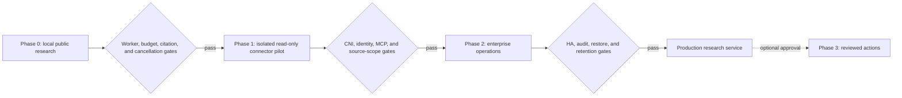
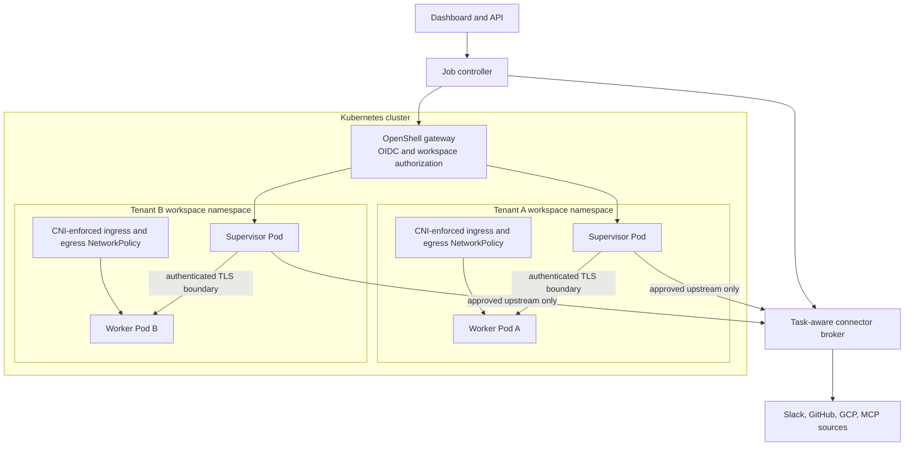
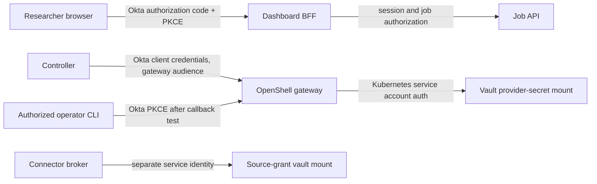
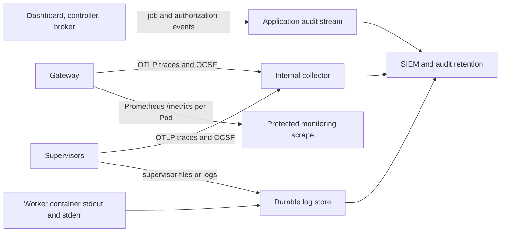
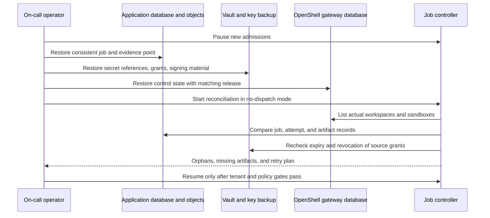
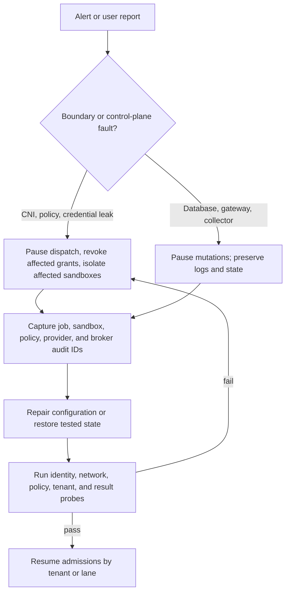

# Deployment and operations design

**Target baseline:** NVIDIA OpenShell v0.1.5 with a version-pinned Deep Agents worker.  
**Scope:** local proof of concept through an isolated, observable Kubernetes deployment.  
**Related designs:** [architecture](../architecture.md), [requirements](../requirements.md), [deployment topology](deployment-topology.md), [Okta implementation handoff](../okta/requirements-and-design.md), [identity and access](identity-and-access.md), [connector broker](mcp-connector-broker.md), and [research and evidence](research-and-evidence.md).

This is an operating design for the application described in those documents. The dashboard, job controller, broker, durable queue, evidence store, and their credentials run outside OpenShell sandboxes. Each job or separately authorized research lane gets a short-lived worker sandbox. OpenShell supplies the sandbox boundary and gateway controls; the application supplies job ownership, source authorization, durable state, and retention.

The first production qualification uses a **stable** OpenShell release. NVIDIA identifies stable builds as intended for production within its support matrix, maintains the newest patch of the current and prior minor lines, and allows experimental interfaces to change even within a patch line. Record the exact installed artifacts and qualify any later patch before rollout. [OpenShell v0.1.5 support matrix](https://docs.nvidia.com/openshell/v0.1.5/about/support-matrix).

## 1. Rollout and promotion



| Stage | Deployment shape | Data and promotion rule |
| --- | --- | --- |
| Phase 0 | Single developer gateway or disposable test cluster, external dashboard/API, one public worker sandbox per job | Public or synthetic data only. Prove that the full Deep Agents graph runs in the sandbox and that budgets, evidence capture, cancellation, and terminal cleanup work. |
| Phase 1 | Kubernetes staging with the intended CNI, namespace mode, Okta issuer, Vault path, broker, and approved model route | Use source fixtures until the network and identity gates pass. Then use one approved read-only tenant and constrained Slack/GitHub/GCP or OAuth MCP connections. No broad production source token in a local developer gateway. |
| Phase 2 | Enterprise Kubernetes service with per-tenant workspaces/namespaces, two or more gateway replicas, external PostgreSQL, durable telemetry, backup/restore, and incident ownership | Production traffic starts only after the integration gates in §10 pass with the installed artifact set and the agreed load, recovery, and retention targets. |
| Phase 3 | Separately approved write capability, if ever required | Keep read-only research as the default; each action needs distinct grants and review. |

These stages follow the project [delivery phases](../requirements.md). A Phase 1 pilot with real enterprise data **inherits the Phase 2 network isolation prerequisites early**; the delivery order does not authorize weaker isolation for sensitive pilot data.

## 2. Release lock and compatibility

Maintain a deployment release manifest in source control. It records the chart version and digest, gateway image digest, supervisor image digest, trusted sandbox-runtime image digest, default and custom workload image digests, CLI and SDK versions, Agent Sandbox controller manifest/image digest, policy/profile revision hashes, Deep Agents and MCP client versions, and the tested Kubernetes/CNI combination. Sign or protect the manifest through the organization’s release process. Do not use floating `latest`, `dev`, or `main` references in a promoted environment. The OpenShell chart documents `global.image.tag` for its trusted artifact set and separate image overrides; a digest takes precedence for individual images. [Kubernetes setup](https://docs.nvidia.com/openshell/v0.1.5/kubernetes/setup), [gateway configuration](https://docs.nvidia.com/openshell/v0.1.5/how-it-works/gateways/configuration).

| Component | v0.1.5 qualification rule | Verification |
| --- | --- | --- |
| Helm chart and gateway | Pin chart `0.1.5`; pin gateway image to the qualified release tag and digest | Compare rendered Pod image and running gateway version with the release manifest. |
| Supervisor and trusted sandbox runtime | Pin both to the **same** OpenShell release; qualify them with the gateway | Start a new sandbox and inspect its actual image digests. NVIDIA states an incompatible supervisor/runtime pair fails at sandbox start. |
| CLI and official SDK used by the controller | Pin exact tested package builds and test protected RPCs against the gateway | Exercise authentication, sandbox lifecycle, policy, provider readiness, logs, and cancellation before promotion. |
| Agent Sandbox controller and CRDs | Pin a separately qualified controller release and image digest | Keep the chart's supported-API preflight enabled; verify the served CRD/API. Restart the gateway after a controller/CRD upgrade because it caches the discovered API. |
| Worker, Deep Agents, MCP client, and policy/profile files | Pin image digest, dependency lock, and content hashes | Run the complete in-sandbox and connector conformance suite against those hashes. |

The chart and gateway must be treated as one tested release bundle with the supervisor and trusted runtime. NVIDIA explicitly says running sandboxes retain their old supervisor/runtime images during a Helm upgrade; a stopped sandbox uses the upgraded pair when it restarts. This permits a temporary old/new runtime overlap, so the controller must record each sandbox's actual release and refuse to attach an unqualified provider/profile combination. For dynamic token grants, upgrade the **gateway before a new supervisor** because a newer supervisor rejects inspected grant requests that lack gateway ownership metadata. [Kubernetes upgrade behavior](https://docs.nvidia.com/openshell/v0.1.5/kubernetes/setup), [provider profile grant behavior](https://docs.nvidia.com/openshell/v0.1.5/how-it-works/providers/profiles).

NVIDIA's quickstart installs the latest Agent Sandbox manifest and the chart may default to a `latest` gateway image. Replace those moving references with the tested controller manifest and image digest and the release-locked OpenShell images before promotion. Kubernetes 1.29+, RBAC, Helm 3, and the Agent Sandbox controller/CRDs are documented prerequisites. [Kubernetes setup, v0.1.5](https://docs.nvidia.com/openshell/v0.1.5/kubernetes/setup).

Qualify the **node image and runtime profile** as well as the Kubernetes API. OpenShell requires Landlock ABI 3 or newer, nested seccomp user-notification and atomic add-fd behavior, task-memory read access, and loopback socket binding under the container's existing restrictions. Its sandbox startup probes fail closed when these are unavailable. In particular, do not assume that GKE's managed Agent Sandbox add-on is interchangeable with the upstream controller: Google's add-on requires gVisor for sandbox Pods, while OpenShell's documented runtime probes must still pass inside that guest. The [topology decision](deployment-topology.md) states platform-specific gates. [OpenShell support matrix](https://docs.nvidia.com/openshell/v0.1.5/about/support-matrix), [Agent Sandbox on GKE](https://docs.cloud.google.com/kubernetes-engine/docs/how-to/how-install-agent-sandbox).

An illustrative HA values **excerpt** for a qualified cluster is below. It is not a complete release file: Okta, TLS, Vault CA, policy, quotas, namespace prerequisites, and image digests still need their reviewed configuration. [HA values](https://docs.nvidia.com/openshell/v0.1.5/kubernetes/high-availability), [chart values](https://docs.nvidia.com/openshell/v0.1.5/kubernetes/setup), [managed workspaces](https://docs.nvidia.com/openshell/v0.1.5/kubernetes/workspaces).

```yaml
global:
  image:
    tag: "0.1.5"
replicaCount: 2
workload:
  kind: deployment
server:
  externalDbSecret: openshell-postgres
gatewayConfig:
  openshell.drivers.kubernetes:
    workspace_mode: managed
```

The PostgreSQL Secret contains a `uri` key and must stay in the gateway release namespace. The default StatefulSet with per-Pod SQLite is a **single-replica** option; two or more replicas require a Deployment and shared PostgreSQL. Place replicas on different failure domains, add a separately managed PodDisruptionBudget, and size PostgreSQL connections for rollout overlap. Gateway peer routing handles supervisor ownership; a killed gateway can still interrupt an in-flight stream, so callers must reconnect or retry safely. [OpenShell high availability](https://docs.nvidia.com/openshell/v0.1.5/kubernetes/high-availability).

## 3. Workspace, namespace, and network boundary



OpenShell's Kubernetes driver creates a `Sandbox` resource, a separate supervisor Pod and worker Pod, a TLS boundary Service, NetworkPolicy, and a workspace PVC. The worker's new outbound connections are blocked at the Pod network layer; the supervisor opens upstream connections allowed by OpenShell policy. The cluster **must** use a CNI that enforces **both ingress and egress** NetworkPolicy in every sandbox namespace. Kubernetes may accept a NetworkPolicy object even when its CNI does not enforce it, which can let the worker bypass supervisor policy. [OpenShell Kubernetes setup](https://docs.nvidia.com/openshell/v0.1.5/kubernetes/setup).

OpenShell Kubernetes workspace mapping has three modes: `shared` (the default, one sandbox namespace for all workspaces), `managed` (one driver-created namespace per workspace), and `operator` (pre-provisioned, allowlisted namespaces). Use `managed` for a controlled pilot with one workspace per tenant. Prefer `operator` where enterprise platform teams own namespace creation, labels, quotas, baseline policies, and RBAC; install the `openshell-workspace` chart in each allowlisted namespace. Keep `gateway_id` stable because it determines managed namespace names. Changing workspace mode does **not** move existing sandbox resources. OpenShell workspace membership is distinct from Kubernetes namespace access, and a Workspace User has broad access to resources in that workspace; dashboard job ACLs remain application controls. [Kubernetes workspaces](https://docs.nvidia.com/openshell/v0.1.5/kubernetes/workspaces), [OpenShell workspaces](https://docs.nvidia.com/openshell/v0.1.5/how-it-works/workspaces).

**Network acceptance gate, repeated for every cluster, CNI upgrade, and namespace template change:**

1. Create the target workspace namespace and a test sandbox, then inspect the generated NetworkPolicy and its Pod selectors.
2. In that namespace, run independent probe Pods under deny-egress and deny-ingress policies. Prove a new outbound connection and a second Pod's inbound connection both fail. This tests actual CNI enforcement rather than API object creation.
3. From the worker, prove an approved request succeeds through OpenShell and a disallowed destination fails with an OpenShell policy denial. Confirm no direct Pod-network route reaches that destination.
4. Test supervisor reachability to the gateway, approved broker/model route, DNS where required, and OTLP collector; the worker must not gain those direct routes.
5. Repeat for a second tenant namespace and prove there is no cross-tenant service, PVC, workspace, provider, or job access.

Fail the deployment if the CNI canary or generated-policy selector test fails. Pause admissions and quarantine affected sandboxes after a CNI regression; a gateway policy test alone cannot prove Pod network isolation. [OpenShell Kubernetes setup](https://docs.nvidia.com/openshell/v0.1.5/kubernetes/setup).

## 4. Okta, service identities, and Vault



Use a separate Okta OIDC application for the dashboard's browser PKCE flow and a confidential service client for the controller's gateway calls. Configure the gateway to validate the intended issuer, audience, role claim, scopes, and workspace membership; prove an actual controller client-credentials token has these claims. The official OpenShell SDKs can obtain and renew such tokens. A dashboard ID token or session is not a gateway token. If direct user/operator CLI access is enabled, run its own Okta PKCE integration test: v0.1.5 opens an ephemeral localhost callback, which may conflict with Okta redirect registration. Restrict direct gateway membership to workspaces where its broad Workspace User capabilities are acceptable. See the [identity design](identity-and-access.md) for the full flow and gate. [OpenShell gateway authentication](https://docs.nvidia.com/openshell/v0.1.5/how-it-works/gateways/authentication), [Okta PKCE](https://developer.okta.com/docs/guides/implement-grant-type/authcodepkce/main/), [OpenShell callback issue](https://github.com/NVIDIA/OpenShell/issues/3300).

OpenShell v0.1.5 has a built-in Vault credential driver for its **provider credentials**. Its documented configuration uses Vault KV v2 over HTTPS and the gateway Pod's Kubernetes service account token; a private CA can be supplied through the chart's `credentialDrivers.vault.caConfigMapName`. Bind the Vault role to the exact gateway service account and namespace, and grant only the OpenShell provider-secret paths. Keep the broker's user/vendor OAuth grants in a different Vault mount or policy boundary under a different service identity. The driver is not a substitute for broker job authorization or an encrypted job/evidence store. [OpenShell credential drivers](https://docs.nvidia.com/openshell/v0.1.5/how-it-works/gateways/configuration), [Vault Kubernetes auth role bounds](https://developer.hashicorp.com/vault/api-docs/auth/kubernetes).

The following is the documented gateway TOML shape. The Vault endpoint and CA path are environment-specific; no Vault token belongs in this file. [OpenShell gateway configuration](https://docs.nvidia.com/openshell/v0.1.5/how-it-works/gateways/configuration).

```toml
[openshell.gateway]
credential_drivers = ["vault"]

[openshell.credential_drivers.vault]
address = "https://vault.vault.svc.cluster.local:8200"
ca_bundle = "/etc/openshell-tls/vault-ca/ca.crt"
mount = "secret"
kv_version = "2"
auth_method = "kubernetes"
role = "openshell-gateway"
service_account_token_path = "/var/run/secrets/kubernetes.io/serviceaccount/token"
```

Keep Okta client secrets, PostgreSQL URIs, private keys, and source grants in the appropriate secret manager or Kubernetes Secret, not in Helm `gatewayConfig`. The chart rejects some obvious secret-bearing values there but is not a general secret scanner. Record the OIDC issuer/audience and role-claim mapping as reviewed nonsecret config; test discovery/JWKS reachability, login, scope enforcement, expired JWTs, and revocation behavior. For package-managed gateways, `openshell-gateway config preflight --path ...` validates the effective config without modifying it; for Helm, render and inspect the chart and run live startup/readiness checks. [Kubernetes chart values](https://docs.nvidia.com/openshell/v0.1.5/kubernetes/setup), [gateway preflight](https://docs.nvidia.com/openshell/v0.1.5/how-it-works/gateways/configuration), [gateway authentication](https://docs.nvidia.com/openshell/v0.1.5/how-it-works/gateways/authentication).

Changing OpenShell credential drivers does not automatically migrate every credential or refresh record. Remove/recreate affected credentials while the old driver remains available, validate provider readiness on the new driver, and avoid mixed gateway versions sharing refresh records. Do not rotate or lose chart-managed signing/TLS material or the default credential-store encryption key during a rollout; back them up with the database. [Credential driver migration](https://docs.nvidia.com/openshell/v0.1.5/how-it-works/gateways/configuration), [HA shared secrets](https://docs.nvidia.com/openshell/v0.1.5/kubernetes/high-availability).

## 5. Policy and provider admission

```mermaid
sequenceDiagram
    participant C as Controller
    participant G as OpenShell gateway
    participant S as Sandbox supervisor
    participant W as Bootstrap worker
    participant A as Job API
    participant B as Broker
    C->>G: Create sandbox with reviewed base policy and provider attachments
    G->>S: Validate effective config before workload activation
    S-->>G: Applied receipt and policy revision
    S->>W: Start bootstrap with opaque attempt locator
    C->>G: Read provider status and full effective policy
    alt revision Loaded and within job boundary
        C->>G: Run allowed and denied endpoint/tool probes
        C->>B: Probe out-of-scope resource arguments
        B-->>C: Denied, audited
        C->>A: Mark current attempt ready; release stage manifest
        W->>A: Fetch narrow manifest and start Deep Agents graph
    else missing receipt, policy widening, or failed probe
        C->>A: Keep manifest withheld; fence attempt
        C->>G: Stop or delete sandbox
        C-->>C: Mark admission failed with evidence
    end
```

The controller stores a reviewed base policy and the expected **effective** policy boundary for every lane. Attach the approved providers at sandbox creation where possible; OpenShell validates effective policy and provider configuration before activating the workload. The worker's canonical process then waits for a stage manifest, which the job API withholds until the controller has checked receipts, policy, and probes. Provider profiles add rules when attached, so `openshell policy get <sandbox> --full` is the relevant view for admission; `--base` remains useful for editing. Check `openshell policy list` for a `Loaded` revision and wait for each provider attachment receipt via `openshell sandbox provider status`. A timed-out wait does not prove that a mutation was rolled back: reconcile actual state before retrying. [Sandbox lifecycle](https://docs.nvidia.com/openshell/v0.1.5/how-it-works/sandboxes/overview), [policy management](https://docs.nvidia.com/openshell/v0.1.5/how-it-works/policies/manage-policies), [provider readiness](https://docs.nvidia.com/openshell/v0.1.5/how-it-works/providers/profiles).

Lint every imported provider profile from a pinned local file, review its binaries/endpoints/refresh behavior, and require exact broker and model destinations. Use `enforcement: enforce` for inspected REST/MCP rules and a named MCP tool allowlist. A policy that allows `search` still does not constrain that tool's `repo`, `channel`, `project`, or query arguments; the broker enforces those against the immutable job policy on every call. Test an allowed request and at least one rejected endpoint, tool name, and resource argument from a live sandbox. OpenShell's policy prover covers filesystem, process, Landlock, L4, and REST, but **does not model MCP or GraphQL rules**; its result cannot replace the MCP live test. [Provider profiles](https://docs.nvidia.com/openshell/v0.1.5/how-it-works/providers/profiles), [network rules](https://docs.nvidia.com/openshell/v0.1.5/how-it-works/policies/network-rules), [policy prover](https://docs.nvidia.com/openshell/v0.1.5/how-it-works/policies/prover).

For combined public/private jobs, verify the controller's stage-manifest projection before provisioning: the public lane receives only the server-approved `public_research_brief`, its public tools, budget, and identity. Its manifest and sandbox files contain **no** private question, enterprise connection ID, private resource selector, or private evidence. The private lane has enterprise tools and selected public evidence, with no public-web egress. Treat any projection or routing mismatch as an admission failure. This is an application gate described in the [research design](research-and-evidence.md), not an OpenShell built-in.

Keep OpenShell's policy validation in its default `fail_closed` mode. If a revision fails to load, network traffic is blocked until a valid policy loads. Live network policy changes close existing connections; filesystem/Landlock/process changes require a new sandbox. A gateway-global policy replaces per-sandbox and provider rules, so emergency global changes need a reviewed complete policy and a live confirmation rather than an assumption that provider restrictions still compose. [Policy management, v0.1.5](https://docs.nvidia.com/openshell/v0.1.5/how-it-works/policies/manage-policies).

Leave the Policy Advisor disabled on production research workers. If it is enabled during a controlled diagnostic run, require manual review and repeat effective-policy admission before continuing the job; automatic network-rule approval would defeat the job's immutable endpoint boundary. NVIDIA documents the advisor as off by default and describes manual and optional automatic approval modes. [Policy Advisor, v0.1.5](https://docs.nvidia.com/openshell/v0.1.5/how-it-works/policies/advisor).

## 6. Telemetry, audit, and alerting



OpenShell exports traces from the gateway, compute drivers, and supervisors to an OTLP collector; gateway metrics through Prometheus; and OCSF security events from the gateway and supervisors. Supervisors connect to the OTLP collector **directly**, so collector access must be allowed from their namespaces. Shorthand OCSF is on by default; full JSONL and OTLP OCSF export require separate enablement. The application adds job admission, source-scope decisions, broker arguments/result bounds, evidence access, cancellation, and token-connection lifecycle events. [Observability overview](https://docs.nvidia.com/openshell/v0.1.5/observability/overview).

The chart's gateway metrics port defaults to `9090`, and `/metrics` is plaintext and **unauthenticated** on a separate listener. Keep the Service internal, restrict that port to monitoring, and scrape every gateway Pod with its `namespace` and `pod` labels rather than only the Service. Alert on gateway/database readiness, API errors and latency, relay rejections or expired claims, supervisor-session skew, policy/OCSF export failures, and source/broker authorization failures. Add application alerts for queue age, sandbox admission failures, stale provider receipts, missed deadlines, cost/budget stops, and evidence-store write failures. [Gateway metrics](https://docs.nvidia.com/openshell/v0.1.5/observability/gateway-metrics), [HA capacity metrics](https://docs.nvidia.com/openshell/v0.1.5/kubernetes/high-availability).

`openshell logs` is a recent operational stream, not a durable archive. The gateway keeps at most **2,000 lines per sandbox in memory**, loses them on restart, and may drop lines during load/disconnection. Main worker stdout/stderr is separate container output and is not included in that stream. Collect supervisor output/OCSF and worker container output independently into a secured durable store; test loss reporting and collector outages. [Accessing logs](https://docs.nvidia.com/openshell/v0.1.5/observability/accessing-logs).

Every event should carry or be joinable by `tenant_id`, `job_id`, `attempt_id`, `lane`, `sandbox_id`, workspace/namespace, policy revision/hash, provider/profile ID and receipt, broker connection ID, trace ID, and evidence ID. Keep token values, prompt bodies, private source text, and raw tool results out of routine metrics and operational logs. Store sensitive evidence in the classified evidence store with its own access checks. Define alert thresholds from the Phase 0 load profile, then record the numerical SLO, RPO, and RTO before Phase 2 production promotion. These fields and thresholds are **application requirements**, not OpenShell defaults.

## 7. Backups, retention, and restore

| State | Durable owner and backup method | Retention and deletion rule |
| --- | --- | --- |
| Job policy, ownership, queue, attempt history, result metadata | Application database with transaction-consistent backup/PITR | Tenant and data-class policy; completed jobs are never inferred from sandbox presence. |
| Reports, evidence snapshots, citations, selected checkpoints | Encrypted object store with versioning/integrity hashes and restore test | Classification-aware TTL and legal hold. Deleting a report also removes or tombstones its retained evidence according to policy. |
| OpenShell control state | Managed PostgreSQL with its own HA, backups, and failover; local only: SQLite `.backup` API | Preserve gateway/workspace identity and reconcile sandboxes after restore. |
| OpenShell provider credentials and refresh material | Vault KV backup/snapshot **or** the configured credential-driver store | Revoke/expire through provider lifecycle; restore only with the matching driver and gateway state. |
| Broker user/source OAuth grants | Separate broker Vault mount and connection database | Revoke on disconnect or access loss; never revive an expired/revoked grant from backup. |
| Gateway JWT signing, TLS, and default credential encryption key | Versioned secret backup under restricted recovery custody | Restore together with the gateway database; rotate through a tested procedure. |
| Sandbox PVC/scratch and worker container output | Disposable sandbox state; copy any required evidence/checkpoint before deletion | Delete terminal scratch and sandbox after result commit or failure capture. No cross-job persistent memory by default. |
| OCSF, broker, dashboard, and access audit | Durable collector/SIEM with immutable or protected retention as required | Security retention and legal hold independent of research result expiry. |

NVIDIA states that the chart shares retained JWT signing/TLS material and the default credential encryption key across gateway replicas. For a local SQLite gateway, it uses WAL and requires `sqlite3 openshell.db ".backup <copy>"` rather than copying only the database file. An external PostgreSQL deployment still needs its own failover and backup plan. The specific retention durations, RPO, RTO, and legal-hold rules must be set by the tenant/data owner before production; the table defines deletion ownership rather than claiming OpenShell supplies those policies. [HA requirements](https://docs.nvidia.com/openshell/v0.1.5/kubernetes/high-availability), [gateway database and key storage](https://docs.nvidia.com/openshell/v0.1.5/how-it-works/gateways/configuration).



Restore drills must show: one queued job is safely rescheduled; a completed job remains completed and its sandbox is not resurrected; a revoked/expired source grant stays unusable; tenant A cannot read tenant B data; result/evidence hashes match; a workspace retains its intended namespace mapping; and provider credentials work only after the correct Vault/key material is restored. Reconciliation should use observed OpenShell state, not blindly replay create or attach commands. A policy/provider mutation whose wait timed out may already have committed. [Provider receipt semantics](https://docs.nvidia.com/openshell/v0.1.5/how-it-works/providers/profiles), [Kubernetes workspaces](https://docs.nvidia.com/openshell/v0.1.5/kubernetes/workspaces).

## 8. Incident response and recovery



| Incident | Immediate action | Recovery proof |
| --- | --- | --- |
| CNI stops enforcing egress or ingress NetworkPolicy | Pause admissions, isolate/terminate affected sandboxes, block egress at the cluster/network perimeter as available, and preserve policy/Pod evidence | Independent CNI canary and OpenShell allow/deny probes pass in every affected namespace before restart. |
| Unexpected endpoint, provider attachment, or MCP tool becomes reachable | Pause the tenant/lane, detach or revoke the provider, stop affected sandboxes, review policy history and broker audit | Full effective policy, provider receipt, endpoint/tool probes, and argument-boundary probes match the reviewed job policy. |
| Source token or client secret exposure | Revoke at the actual issuer/vendor, disable the broker connection, cancel active jobs using it, rotate secret, and search access logs | Old credential fails; replacement has intended scope and no artifact/log contains the value. |
| Okta or Vault outage | Stop new admissions and secret-dependent changes; let active work continue only while its authorization and expiry remain provable | OIDC discovery/JWKS, controller token, Vault service-account login, provider readiness, and denied-expired-token tests pass. |
| Gateway/DB fault | Let HA take over if possible; pause state mutations when consistency is uncertain, preserve PostgreSQL and gateway logs | Gateway health and protected `status`, supervisor reconnect, queue reconciliation, and idempotent retries pass. |
| Telemetry/evidence-store failure | Pause jobs if required audit or evidence capture cannot be committed | Collector delivery, object integrity, and citation retrieval pass; document any lost in-memory OpenShell log window. |

For an overbroad policy, do not assume a global policy is a narrow patch: OpenShell's global policy replaces sandbox and provider rules. A reviewed emergency global deny policy can be an operator tool, but it changes **every** sandbox and must be confirmed with live traffic. For gateway HA faults, established streams do not migrate across replicas; clients reconnect and the controller reconciles before retrying. [Policy management](https://docs.nvidia.com/openshell/v0.1.5/how-it-works/policies/manage-policies), [HA failure behavior](https://docs.nvidia.com/openshell/v0.1.5/kubernetes/high-availability).

## 9. Upgrades and rollback

```mermaid
sequenceDiagram
    participant R as Release operator
    participant Q as Queue/controller
    participant B as Backup system
    participant K as Agent Sandbox controller
    participant G as OpenShell gateway
    participant S as New sandbox supervisor/runtime
    R->>R: Qualify stable artifact set and migration notes
    R->>Q: Pause new admissions; drain or checkpoint jobs
    R->>B: Back up DB, Vault, application state, and keys
    opt Agent Sandbox API upgrade
        R->>K: Roll out pinned controller and CRDs
        R->>G: Restart gateway after served API changes
    end
    R->>G: Roll out pinned OpenShell chart/gateway
    G-->>R: Ready, DB and peer-routing checks pass
    R->>S: Start canary sandbox with matching images
    S-->>R: Policy, provider, token-grant, network checks pass
    R->>Q: Resume by tenant; watch error and relay metrics
```

Before upgrading, compare the new stable release's support matrix, migration guide, chart values, provider/profile semantics, and policy schema with the locked release. Run the full integration gates in a production-like staging environment, then pause admissions, drain active jobs where practical, and take restorable backups. Upgrade the Agent Sandbox controller/CRDs separately if required and restart OpenShell gateways afterward. Roll out the gateway first, then launch canary sandboxes using the matching supervisor/runtime pair. Existing sandboxes can keep old images until stopped; record and drain that overlap. [OpenShell support matrix](https://docs.nvidia.com/openshell/v0.1.5/about/support-matrix), [Kubernetes upgrade instructions](https://docs.nvidia.com/openshell/v0.1.5/kubernetes/setup), [dynamic token grant ordering](https://docs.nvidia.com/openshell/v0.1.5/how-it-works/providers/profiles).

Verify gateway replica readiness, PostgreSQL capacity, peer endpoints, supervisor reconnection, policy revisions, provider receipts, Okta claims, Vault login, CNI canary, broker MCP calls, and evidence writes before raising traffic. Rollback is a tested release procedure, **not** an automatic Helm image reversal after a database or credential migration. Determine schema compatibility first; if incompatible, restore the matched database/secret snapshot and prior artifact set in the rehearsed order. Never run mixed gateway versions against the same provider refresh records during a driver migration. [High availability](https://docs.nvidia.com/openshell/v0.1.5/kubernetes/high-availability), [credential-driver migration](https://docs.nvidia.com/openshell/v0.1.5/how-it-works/gateways/configuration).

## 10. Promotion integration gates

Each gate has a recorded owner, exact artifact versions/hashes, test job ID, expected outcome, actual evidence link, and sign-off. A gate fails on missing evidence as well as on an observed violation. These are application promotion rules; OpenShell does not run the entire checklist for us.

| Gate | Required proof |
| --- | --- |
| Release and runtime | Chart, gateway, supervisor, runtime, controller, CLI/SDK, worker, Deep Agents, and MCP client match the release manifest; newly created sandbox reports the expected images; chart API preflight passes. |
| Sandbox host compatibility | The selected node image and runtime pass OpenShell's active Landlock, seccomp, task-memory, and socket probes; unsupported pools are excluded from scheduling. On OpenShift, use 4.19+ and verify restricted SCC/runtime behavior; on GKE, separately qualify the chosen Standard node pool and upstream Agent Sandbox controller. [OpenShell support matrix](https://docs.nvidia.com/openshell/v0.1.5/about/support-matrix), [OpenShift guide](https://docs.nvidia.com/openshell/v0.1.5/kubernetes/openshift). |
| Kubernetes boundary | Independent ingress/egress CNI canary passes in every workspace namespace; generated NetworkPolicy selectors match workload Pods; unauthorized direct worker egress fails. [Kubernetes setup](https://docs.nvidia.com/openshell/v0.1.5/kubernetes/setup). |
| Tenant isolation | Two tenants have separate workspaces and intended namespaces; user, controller, broker, result, PVC, provider, and audit access cannot cross tenant boundaries. [Kubernetes workspaces](https://docs.nvidia.com/openshell/v0.1.5/kubernetes/workspaces). |
| Okta and gateway | Dashboard PKCE/session works; controller client-credentials token has exact gateway audience, roles, scopes, and stable subject; unauthorized token fails. Direct operator CLI PKCE is enabled only after its Okta callback test passes. [Gateway auth](https://docs.nvidia.com/openshell/v0.1.5/how-it-works/gateways/authentication). |
| Vault and secrets | Gateway SA can read/write only its OpenShell provider-secret path; broker identity only its source-grant path; broker rejects revoked/expired source grants on every call; no reusable source token appears in worker files, logs, traces, or reports. [Credential drivers](https://docs.nvidia.com/openshell/v0.1.5/how-it-works/gateways/configuration). |
| Policy and provider | Linted pinned profiles; attachment receipt applied; newest effective policy revision `Loaded`; approved endpoint succeeds, disallowed endpoint/tool fails, and provider attachment does not widen the job boundary. [Policy verification](https://docs.nvidia.com/openshell/v0.1.5/how-it-works/policies/manage-policies). |
| MCP and source authorization | For each Slack/GitHub/GCP/other connection, prove actual OAuth/MCP discovery, issuer and resource audience, refresh/revocation, read-only permission, protocol revision, and an out-of-scope argument denial. The broker contract provides the detailed [source-specific matrix](mcp-connector-broker.md). [MCP authorization specification](https://modelcontextprotocol.io/specification/2026-07-28/basic/authorization). |
| Combined-job projection | Public stage manifest contains only the approved `public_research_brief`, public tools, identity, and budget; private prompt/source IDs cannot be found in public sandbox state or outbound requests. Private stage has no public-web route. |
| Research and evidence | Plan/retrieval/synthesis/verifier run inside the sandbox; source claims have immutable evidence IDs; report commit precedes sandbox deletion; failed evidence writes prevent a false success. |
| Observability | Gateway and supervisor OTLP/OCSF, each gateway Pod's protected metrics, worker stdout, broker decisions, and application audit join by job/sandbox ID; collector outage behavior is known. [Observability overview](https://docs.nvidia.com/openshell/v0.1.5/observability/overview). |
| HA, cancellation, and restore | One gateway Pod failure and a rolling update preserve control-plane availability; interrupted streams retry; cancel revokes job access; restore drill meets agreed RPO/RTO without reviving revoked grants or terminal sandboxes. [High availability](https://docs.nvidia.com/openshell/v0.1.5/kubernetes/high-availability). |
| Retention and legal hold | Tenant/data-class TTL expires scratch, evidence, report, checkpoint, and connection records correctly; a legal hold blocks deletion and remains auditable; audit-retention policy is independently enforced. |

Do not promote a connector because its OAuth token works once. Re-run its negative authorization, expiry/revocation, and source-resource tests after IdP, vendor MCP, policy/profile, broker, or worker changes. An MCP server's grant support and protocol behavior must be demonstrated for that specific server, as detailed in [identity and access](identity-and-access.md) and the [connector broker design](mcp-connector-broker.md).
