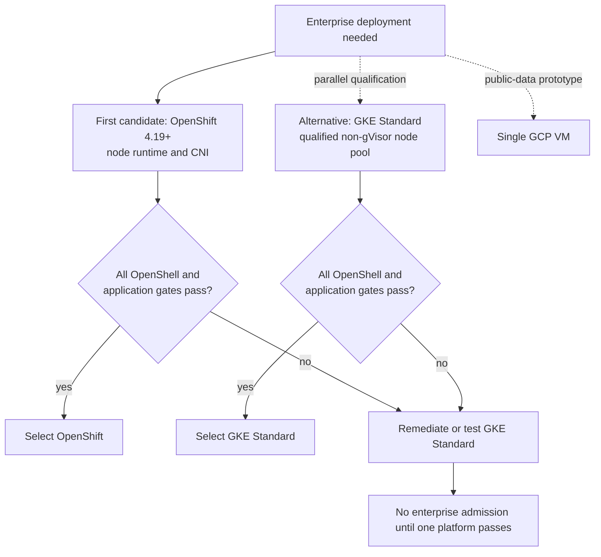
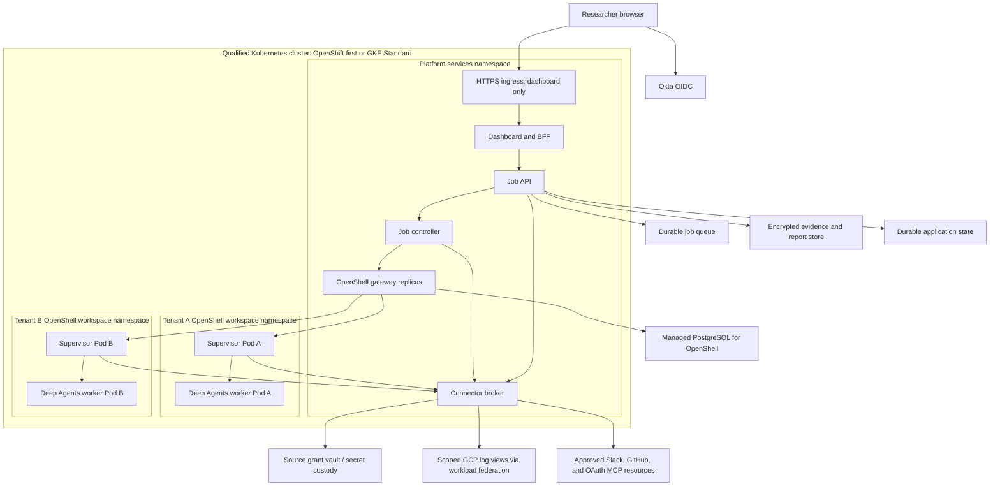
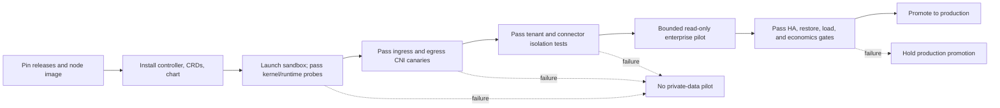

# Deployment topology decision

**Status:** proposed; production qualification is still required.  
**Date:** 2026-10-23.  
**Baseline:** OpenShell v0.1.5 and the separately pinned Agent Sandbox controller release.  
**Related designs:** [architecture](../architecture.md), [deployment and operations](deployment-and-operations.md), [identity and access](identity-and-access.md), [MCP connector broker](mcp-connector-broker.md), and [Replit rollout fit](replit-rollout-fit.md).

## 1. Decision

This is the **worker-runtime choice if the custom OpenShell service passes the platform selection gate**. The existing ChatGPT Enterprise research path needs no OpenShell cluster. Replit's planned rollout may help build a dashboard or, after a separate review, host part of the application; its documented Chat/Agent integrations and published-app deployment modes do not establish support for this OpenShell per-job worker runtime. Keep the worker topology decision on the qualified VM, OpenShift, and GKE paths below. [Replit deployment types](https://docs.replit.com/features/publishing/deployment-types), [Replit BYOC](https://docs.replit.com/teams/bring-your-own-cloud).

Because **both OpenShift and GKE are available**, test **OpenShift 4.19 or newer as the first production candidate**. NVIDIA publishes a dedicated OpenShift path with non-root, capability-free workloads and no requirement for a privileged SCC. That reduces platform uncertainty, but its runtime still must pass nested seccomp user-notification and Landlock probes, and its CNI must enforce ingress and egress `NetworkPolicy`. Run OpenShell through its Kubernetes/Helm driver on OpenShift; the OpenShift node engine is **CRI-O**, not Docker Engine. [OpenShell on OpenShift](https://docs.nvidia.com/openshell/v0.1.5/kubernetes/openshift), [Red Hat OpenShift nodes](https://docs.redhat.com/en/documentation/openshift_container_platform/4.19/html/nodes/overview-of-nodes).

Keep **GKE Standard** as a parallel or fallback candidate, with a separately qualified non-gVisor node pool and the upstream Agent Sandbox controller. GKE brings a regional managed control plane, Dataplane V2 `NetworkPolicy`, and native Workload Identity Federation for Google sources. Its exact node image, kernel, container runtime, seccomp profile, CNI behavior, and controller/CRD combination still require active OpenShell tests before enterprise admission. Standard allows choosing a node image such as Ubuntu for the test; neither the image name nor a recent kernel version proves Landlock is enabled. [OpenShell kernel requirements](https://docs.nvidia.com/openshell/v0.1.5/about/support-matrix), [GKE node images](https://docs.cloud.google.com/kubernetes-engine/docs/concepts/node-images), [GKE Dataplane V2](https://docs.cloud.google.com/kubernetes-engine/docs/concepts/dataplane-v2), [GKE workload identity](https://docs.cloud.google.com/kubernetes-engine/docs/concepts/workload-identity).

Use a **single GCP VM** with OpenShell's Docker or Podman compute driver for Phase 0 public/synthetic research or a tightly bounded one-tenant pilot. Its MicroVM driver additionally needs Linux KVM; on a GCP VM this means enabling supported nested virtualization and verifying KVM access. OpenShell documents Docker for local and single-machine gateways; a VM would require this project to design its own multi-host scheduling, tenant isolation, and availability. A VM is therefore a useful integration proving ground, with a separate enterprise promotion decision. [OpenShell support matrix](https://docs.nvidia.com/openshell/v0.1.5/about/support-matrix), [installation and local runtimes](https://docs.nvidia.com/openshell/v0.1.5/about/installation), [GCP nested virtualization](https://docs.cloud.google.com/compute/docs/instances/nested-virtualization/enabling).

Use **fixed initial worker capacity, a bounded durable queue, and a per-tenant concurrency cap**. Turn on cluster/node autoscaling only after measured job arrival, runtime, Pod startup, and cost show it is useful. Autoscaling does not decide the initial platform choice. The OpenShift choice remains conditional on its live gates; a documented installation path is not proof that this enterprise's node profile and CNI qualify. NVIDIA's v0.1.5 guidance also does not establish that an arbitrary GKE image, Autopilot profile, or Google's managed Agent Sandbox add-on passes its probes. [OpenShell OpenShift guide](https://docs.nvidia.com/openshell/v0.1.5/kubernetes/openshift), [OpenShell Kubernetes setup](https://docs.nvidia.com/openshell/v0.1.5/kubernetes/setup), [OpenShell support matrix](https://docs.nvidia.com/openshell/v0.1.5/about/support-matrix).



## 2. The OpenShell constraints that drive the choice

| Constraint | Consequence for any enterprise target |
| --- | --- |
| Kubernetes 1.29+, Helm 3, and Agent Sandbox controller/CRDs | Install a **qualified, pinned** upstream controller and CRDs before the OpenShell chart; verify the served API and an actual sandbox start. A Kubernetes version check alone is insufficient. [Kubernetes setup](https://docs.nvidia.com/openshell/v0.1.5/kubernetes/setup). |
| CNI enforces **both ingress and egress** `NetworkPolicy` in each sandbox namespace | OpenShell relies on this to prevent the worker from reaching the network around the supervisor. Prove enforcement with independent allow/deny probes, including after CNI and node upgrades. [Kubernetes setup](https://docs.nvidia.com/openshell/v0.1.5/kubernetes/setup). |
| Landlock LSM ABI 3 or newer and nested seccomp user-notification support, plus task-memory and socket-binding behavior | Select node images and runtime profiles through **active OpenShell sandbox probes**. Linux kernel `uname` and Pod admission cannot prove these capabilities. An upstream kernel 6.2+ has the required Landlock ABI; backports may qualify if the probes pass. [OpenShell support matrix](https://docs.nvidia.com/openshell/v0.1.5/about/support-matrix). |
| Short-lived workloads and tenant isolation | Use one OpenShell workspace and Kubernetes namespace per tenant or approved isolation unit. `managed` namespace mode suits a controlled pilot; `operator` suits platform-owned namespace provisioning. The default `shared` mode puts all workspaces in one namespace. [Kubernetes workspaces](https://docs.nvidia.com/openshell/v0.1.5/kubernetes/workspaces). |
| Control-plane availability | Use at least two gateway replicas in a Deployment, a shared external PostgreSQL database, sufficient database connections, and separate failure domains. Gateway replicas do not make PostgreSQL highly available. [OpenShell HA](https://docs.nvidia.com/openshell/v0.1.5/kubernetes/high-availability). |

### GKE Agent Sandbox is a separate compatibility decision

Google's managed **Agent Sandbox on GKE** add-on currently documents a `v1beta1` API and a **gVisor** `RuntimeClass` for its sandbox Pods. OpenShell v0.1.5 documents installing the upstream Agent Sandbox controller/CRDs and requires its in-workload Landlock and nested-seccomp runtime probes to pass. A September 2026 NVIDIA issue reports that the tested gVisor build lacked both Landlock and seccomp `NEW_LISTENER`; the issue was closed after a generic isolation-backend interface change, which does not establish that OpenShell's v0.1.5 built-in sandbox runtime works under gVisor. **Inference:** the managed GKE add-on is likely incompatible as a drop-in OpenShell controller/runtime. The first GKE test should use a pinned upstream controller and a non-gVisor worker node pool. **Do not enable the managed add-on and install the upstream controller against the same Sandbox CRDs in one cluster**; choose one qualified controller/CRD owner. Evaluate the managed add-on only as a separate compatibility project with explicit vendor guidance and a complete live sandbox proof. [Google managed Agent Sandbox setup](https://docs.cloud.google.com/kubernetes-engine/docs/how-to/how-install-agent-sandbox), [OpenShell Kubernetes setup](https://docs.nvidia.com/openshell/v0.1.5/kubernetes/setup), [OpenShell kernel requirements](https://docs.nvidia.com/openshell/v0.1.5/about/support-matrix), [NVIDIA gVisor probe report and follow-up](https://github.com/NVIDIA/OpenShell/issues/3361).

GKE **Autopilot** has additional admission and seccomp constraints: it applies the containerd default seccomp profile and does not permit custom seccomp profiles. Its Dataplane V2 network policy is attractive, but the required inner OpenShell probes and upstream controller installation have not been qualified here. Keep Autopilot as a later candidate only after a clean proof with the exact release and a documented support path. GKE Standard gives the platform team node-image and seccomp-profile control for the first qualification. [GKE seccomp](https://docs.cloud.google.com/kubernetes-engine/docs/concepts/seccomp-in-gke), [GKE node images](https://docs.cloud.google.com/kubernetes-engine/docs/concepts/node-images), [GKE Dataplane V2](https://docs.cloud.google.com/kubernetes-engine/docs/concepts/dataplane-v2).

## 3. Option comparison

| Decision factor | One GCP VM | OpenShift Kubernetes | GKE Standard |
| --- | --- | --- | --- |
| Best fit | Public/synthetic prototype; one-tenant bounded pilot | First enterprise candidate where the existing platform team can qualify OpenShift 4.19+ | Alternative enterprise candidate if a GKE Standard node/runtime passes all probes |
| OpenShell execution | Local gateway with Docker Engine 28+, Podman 5.x, or Linux KVM MicroVM; release-pinned runtime [installation](https://docs.nvidia.com/openshell/v0.1.5/about/installation) | OpenShell Helm Kubernetes driver; OpenShift 4.19+ documented [guide](https://docs.nvidia.com/openshell/v0.1.5/kubernetes/openshift) | OpenShell Helm Kubernetes driver; **GKE-specific runtime qualification remains open** [setup](https://docs.nvidia.com/openshell/v0.1.5/kubernetes/setup) |
| Node container engine | Docker/Podman; MicroVM only after GCP nested virtualization and KVM qualification [GCP guide](https://docs.cloud.google.com/compute/docs/instances/nested-virtualization/enabling) | CRI-O; OCI images still work [Red Hat nodes](https://docs.redhat.com/en/documentation/openshift_container_platform/4.19/html/nodes/overview-of-nodes) | containerd on GKE node images [GKE node images](https://docs.cloud.google.com/kubernetes-engine/docs/concepts/node-images) |
| Network isolation | Host firewall and OpenShell local driver policy; project must prove single-host egress boundary | Cluster CNI must enforce ingress and egress `NetworkPolicy` in every workspace namespace | Dataplane V2 enforces Kubernetes `NetworkPolicy`; still run OpenShell's ingress/egress canary [GKE Dataplane V2](https://docs.cloud.google.com/kubernetes-engine/docs/concepts/dataplane-v2) |
| Tenant scale | Capacity, maintenance, and blast radius tied to one host | Workspace namespaces and cluster scheduling | Workspace namespaces and cluster scheduling |
| Availability | Host is one failure domain; bespoke recovery and multi-host design | Multi-node gateway Deployment with external PostgreSQL | Regional control plane and multi-zone nodes; multi-node gateway Deployment with external PostgreSQL [regional clusters](https://docs.cloud.google.com/kubernetes-engine/docs/concepts/regional-clusters), [OpenShell HA](https://docs.nvidia.com/openshell/v0.1.5/kubernetes/high-availability) |
| GCP source identity | VM service account can authenticate, but permissions must be isolated from untrusted jobs | Configure external Kubernetes Workload Identity Federation for the broker and Google IAM [Google federation guide](https://docs.cloud.google.com/iam/docs/workload-identity-federation-with-kubernetes) | Native Workload Identity Federation for GKE on the broker's Kubernetes service account [GKE workload identity](https://docs.cloud.google.com/kubernetes-engine/docs/concepts/workload-identity) |
| Operations and cost drivers | Lowest starting infrastructure footprint; host patching, service restart, backup, scheduling, and HA are owned here | Uses existing cluster/SRE investment; cluster, SCC/runtime, CNI, routes, storage, and licensing remain platform costs | Managed Kubernetes control plane; node pools, regional spread, Cloud SQL, queue, evidence store, telemetry, and egress remain billed/operated |
| Initial capacity | Fixed host limit and queue cap | Fixed qualified worker capacity and queue cap; autoscale after measurement | Fixed qualified node pool and queue cap; autoscale after measurement |

There is no defensible numerical cost ranking without an expected job arrival rate, run duration, model usage, supervisor/worker Pod footprint, evidence retention, and existing OpenShift chargeback. Run a representative load profile and price the same service targets on each candidate, including idle capacity and disaster recovery. The production comparison should use the measured **peak concurrent sandbox attempts**, because each Kubernetes sandbox creates a supervisor Pod and a worker Pod plus a workspace PVC. [OpenShell Kubernetes resource model](https://docs.nvidia.com/openshell/v0.1.5/kubernetes/setup).

### When to add autoscaling

Start on either enterprise platform with a **fixed, qualified worker node pool**, a durable job queue, an admission limit, and per-tenant concurrency caps. Size the pool from the measured resource envelope of **one worker Pod plus its supervisor Pod and PVC**, platform overhead, and the desired failure reserve. Record sandbox startup time, concurrent attempts, CPU/memory/storage use, node saturation, and **p95 queue wait** against an agreed job-start SLO. Increase fixed capacity first if demand is predictable.

Enable node autoscaling when sustained p95 queue wait exceeds the SLO **because qualified worker capacity is exhausted**, demand varies enough to justify elastic nodes, and a load test shows node provisioning improves wait time within the cost ceiling. A slow model or connector will not be fixed by adding nodes. GKE Standard scales node pools for **unschedulable Pods**; where the OpenShift installation supports Machine API autoscaling, its ClusterAutoscaler and MachineAutoscaler scale compute machine sets. A controller that keeps every job solely in the application queue creates no pending Pod signal for either node autoscaler: when adopting autoscaling, release a **bounded** number of sandbox requests into Kubernetes and set tested minimum/maximum node counts. Keep all scaled nodes on the same qualified image/runtime profile and rerun OpenShell probes after upgrades. [GKE cluster autoscaler](https://docs.cloud.google.com/kubernetes-engine/docs/concepts/cluster-autoscaler), [OpenShift machine management](https://docs.redhat.com/en/documentation/openshift_container_platform/4.19/html/machine_management/index), [OpenShell support matrix](https://docs.nvidia.com/openshell/v0.1.5/about/support-matrix).

Scale long-running dashboard, API, and broker Deployments with HPA only when their own CPU/request metrics justify it; **HPA does not dispatch queued research jobs or add nodes**. OpenShell gateway HPA is another separate decision: keep at least two ready replicas for HA, size PostgreSQL for the maximum, and avoid supervisor-session count as a scale metric because existing sessions stay with their owner. [Kubernetes HPA](https://kubernetes.io/docs/concepts/workloads/autoscaling/horizontal-pod-autoscale/), [OpenShell gateway scaling](https://docs.nvidia.com/openshell/v0.1.5/kubernetes/high-availability).

## 4. Target enterprise Kubernetes deployment



This diagram is a **logical topology**. The selected queue, evidence store, and application database can be GCP-managed services or approved enterprise equivalents. OpenShell's PostgreSQL database and the application's job/evidence metadata need separate ownership and backups. The gateway is private to the controller and approved operators; researchers submit through the dashboard/API. A private load balancer or controlled operator route may expose gateway administration without making it a browser-facing research API. The [application architecture](../architecture.md) remains the source of truth for job, public/private research lanes, and evidence boundaries.

### Cluster and namespace layout

1. Provide at least two schedulable nodes or failure domains for gateway HA and distribute the platform replicas. Start with a fixed, qualified sandbox worker capacity and bounded queue/concurrency limits. Measure Pod and job arrival before enabling node autoscaling. On GKE, prefer a regional Standard cluster with multi-zone nodes; its regional control plane improves availability, while application replicas and node distribution still determine workload resilience. [OpenShell HA](https://docs.nvidia.com/openshell/v0.1.5/kubernetes/high-availability), [GKE regional clusters](https://docs.cloud.google.com/kubernetes-engine/docs/concepts/regional-clusters).
2. Apply baseline namespace policies and run independent ingress/egress probes in each newly created workspace namespace, plus an attempted direct worker connection that OpenShell must deny. Network policy object creation without traffic probes is not an acceptance test. Use an OpenShift CNI proven on the deployed cluster; use GKE Dataplane V2 on the GKE candidate. [OpenShell Kubernetes setup](https://docs.nvidia.com/openshell/v0.1.5/kubernetes/setup), [GKE Dataplane V2](https://docs.cloud.google.com/kubernetes-engine/docs/concepts/dataplane-v2).
3. Install the exact qualified upstream Agent Sandbox controller/CRDs and OpenShell v0.1.5 chart/images. Keep chart, gateway, supervisor, trusted sandbox runtime, and worker image digests in a release manifest. Verify generated Pods and the chart's API preflight before source access. [OpenShell Kubernetes setup](https://docs.nvidia.com/openshell/v0.1.5/kubernetes/setup), [support matrix](https://docs.nvidia.com/openshell/v0.1.5/about/support-matrix).
4. Place platform services in a controlled namespace; map each tenant to one OpenShell workspace/namespace. In a pilot, `managed` mode can create namespaces. In production, `operator` mode is appropriate when platform administrators must pre-provision namespaces, quotas, labels, policies, and the workspace chart. Retain application job ACLs even when OpenShell workspace membership exists. [Kubernetes workspaces](https://docs.nvidia.com/openshell/v0.1.5/kubernetes/workspaces).
5. Run at least two OpenShell gateway replicas as a Deployment against separately managed, highly available PostgreSQL. Spread replicas across zones; test gateway failure, stream reconnection, reconciliation, database failover, and restore. Use a separate durable queue and encrypted evidence store for application state. [OpenShell HA](https://docs.nvidia.com/openshell/v0.1.5/kubernetes/high-availability).

### Identities and source access

```mermaid
sequenceDiagram
    participant U as Researcher browser
    participant O as Okta
    participant B as Dashboard BFF
    participant C as Job controller
    participant G as OpenShell gateway
    participant W as Sandbox worker
    participant S as OpenShell supervisor
    participant R as Connector broker
    participant I as Kubernetes workload federation
    participant L as Google Cloud Logging
    U->>B: Open dashboard
    B->>O: Authorization code + PKCE
    O-->>B: User identity; BFF creates secure session
    U->>B: Submit authorized job
    B->>C: Queue immutable job policy
    C->>O: Client credentials for gateway audience
    O-->>C: Controller access token
    C->>G: Create short-lived tenant sandbox
    G->>S: Start supervisor and worker boundary
    S->>W: Run bounded research graph
    W->>S: Request approved connector operation
    S->>R: Mediated internal broker call
    R->>I: Obtain broker workload credential
    I-->>R: Scoped Google access token
    R->>L: Read approved log view and time window
    L-->>R: Bounded log entries
    R-->>S: Redacted, bounded tool result
```

Okta PKCE authenticates the researcher to the dashboard/BFF. The controller uses a separate Okta client-credentials identity for the OpenShell gateway. Neither token grants Google Cloud Logging access by itself. On OpenShift, configure Google **external Kubernetes Workload Identity Federation** for the broker's projected service-account token and approved IAM principal; on GKE, use **Workload Identity Federation for GKE**. Use tenant-specific broker identities or a reviewed tenant-specific impersonation route. Grant only required read operations on explicit log views. A project-level `roles/logging.viewAccessor` grant without a condition can expose all views in that project; a binding on the specific log view or a condition is narrower. The sandbox receives a job-scoped broker capability and no reusable GCP, Slack, GitHub, or MCP source grant. [Google external Kubernetes federation](https://docs.cloud.google.com/iam/docs/workload-identity-federation-with-kubernetes), [GKE workload identity](https://docs.cloud.google.com/kubernetes-engine/docs/concepts/workload-identity), [Cloud Logging log views](https://docs.cloud.google.com/logging/docs/logs-views), [identity design](identity-and-access.md), [broker design](mcp-connector-broker.md).

## 5. Platform-specific deployment notes

### GCP VM: public-data proving ground

Choose a supported Linux image and Docker Engine 28+ or Podman 5.x, pin the OpenShell release, and run its active sandbox probes before using the VM for public or synthetic jobs. If evaluating MicroVM isolation, use a machine and organization policy that allow nested virtualization, enable it on the GCP VM, and verify KVM access. Keep the dashboard/API and durable results outside the disposable worker gateway, even in this phase, so job contracts carry forward to Kubernetes. Do not place shared enterprise source credentials on the VM merely because a local sandbox starts. [OpenShell installation](https://docs.nvidia.com/openshell/v0.1.5/about/installation), [GCP nested virtualization](https://docs.cloud.google.com/compute/docs/instances/nested-virtualization/enabling).

### OpenShift: first production candidate

An enterprise OpenShift deployment keeps the same logical application and workspace topology. Use a supported OpenShift 4.19+ release, the OpenShell Kubernetes Helm chart, the Agent Sandbox controller/CRDs, and a CNI proven to enforce both policy directions. OpenShell renders the sandbox and supervisor with a UID from each namespace's allocated range, drops capabilities, and keeps `allowPrivilegeEscalation: false`; do not add a privileged SCC as a workaround. First run the active Landlock and nested seccomp probes with the exact node/runtime profile. OpenShift 4.16–4.18 RHCOS kernels are explicitly disqualified by NVIDIA for lack of Landlock. [OpenShell OpenShift guide](https://docs.nvidia.com/openshell/v0.1.5/kubernetes/openshift).

Prefer platform-owned `operator` workspace namespaces if the OpenShift team centrally manages namespace quotas, MCS/SCC posture, and network templates. If using `managed` mode, verify OpenShift allocates namespace UID/GID and MCS annotations before creating sandbox resources. Use a private, end-to-end TLS route or the OpenShift Gateway API procedure in NVIDIA's guide for authorized gateway clients. Broker access to Google Cloud can use general Kubernetes Workload Identity Federation with configured OIDC issuer and IAM trust; GKE's native workload identity setup does not apply to OpenShift. [OpenShell OpenShift guide](https://docs.nvidia.com/openshell/v0.1.5/kubernetes/openshift), [OpenShell workspaces](https://docs.nvidia.com/openshell/v0.1.5/kubernetes/workspaces), [Google external Kubernetes federation](https://docs.cloud.google.com/iam/docs/workload-identity-federation-with-kubernetes).

### GKE Standard: alternative after runtime qualification

Create a regional Standard staging cluster with Dataplane V2, a normal containerd worker node pool, and the pinned **upstream** Agent Sandbox controller. Standard permits choosing COS or Ubuntu node images; begin the qualification on an Ubuntu pool if the available COS image does not pass Landlock, then confirm nested seccomp and every other OpenShell probe with a real sandbox. This is a candidate procedure, not an assertion that Ubuntu will pass. Keep the managed Agent Sandbox on GKE add-on disabled in this test cluster to avoid a second controller for the same CRDs and its gVisor-only sandbox admission path. GKE's native Workload Identity Federation can serve the broker after the node/runtime boundary passes. [GKE node images](https://docs.cloud.google.com/kubernetes-engine/docs/concepts/node-images), [GKE Dataplane V2](https://docs.cloud.google.com/kubernetes-engine/docs/concepts/dataplane-v2), [Google managed Agent Sandbox setup](https://docs.cloud.google.com/kubernetes-engine/docs/how-to/how-install-agent-sandbox), [OpenShell support matrix](https://docs.nvidia.com/openshell/v0.1.5/about/support-matrix).

## 6. Qualification and promotion gates



| Gate | Required evidence at the applicable promotion stage |
| --- | --- |
| T-01 Runtime | Record exact OpenShell/chart/controller/worker image digests, Kubernetes/OpenShift version, node image/kernel, seccomp profile, and runtime. Start a real Deep Agents worker sandbox on every intended node pool; the mandatory Landlock ABI 3, nested seccomp, task-memory, and socket-binding probes pass. [Support matrix](https://docs.nvidia.com/openshell/v0.1.5/about/support-matrix). |
| T-02 Kubernetes API | Agent Sandbox controller and served CRD API match the OpenShell chart; chart preflight and sandbox create/stop/delete pass. Validate after controller upgrades. [Kubernetes setup](https://docs.nvidia.com/openshell/v0.1.5/kubernetes/setup). |
| T-03 Network | From each workspace template, deny unapproved worker egress and non-supervisor ingress with independent probe Pods. Demonstrate permitted supervisor-to-broker/model traffic and rejected direct worker traffic. Repeat after CNI/node upgrades. [Kubernetes setup](https://docs.nvidia.com/openshell/v0.1.5/kubernetes/setup). |
| T-04 Identity and tenancy | Two tenants have separate workspaces/namespaces and no cross-tenant PVC, provider, job, report, log, or source access; tenant gateway principals fail cross-workspace list, use, and attach tests. Two dashboard users in one workspace fail cross-job API and broker access tests. Dashboard PKCE, controller Okta audience/scope, broker workload identity, and source-grant revocation pass negative tests. Researchers have no direct gateway membership; use separate workspaces or gateways for mutually untrusted direct gateway users. [Workspaces](https://docs.nvidia.com/openshell/v0.1.5/kubernetes/workspaces), [Kubernetes access control](https://docs.nvidia.com/openshell/kubernetes/access-control), [identity design](identity-and-access.md). |
| T-05 Reliability | Gateway Pod failure, node drain, PostgreSQL failover, queue retry, evidence durability, sandbox cancellation, and restore meet the agreed SLO/RPO/RTO. Test with the expected concurrent worker/supervisor count. [OpenShell HA](https://docs.nvidia.com/openshell/v0.1.5/kubernetes/high-availability). |
| T-06 Economics | Record measured sandbox startup, job duration, Pod and PVC usage, inference spend, connector calls, queue age, telemetry volume, and retention. Compare enterprise GKE and OpenShift chargeback with the same workload and availability target. |

Phase 0 can use a VM and public/synthetic sources while these gates are built. Phase 1 with real private data requires T-01 through T-04 and explicit pilot limits. Production promotion requires all six gates plus the release, retention, incident, and backup controls in the [deployment and operations design](deployment-and-operations.md). Re-run the affected gates whenever an OpenShell patch, Agent Sandbox controller, GKE/OpenShift node image, CNI, seccomp profile, workspace template, or identity binding changes.

## 7. Migration path

1. Develop the dashboard/API, controller, broker, worker OCI image, source policy, and evidence contracts against a **public-data VM or disposable cluster**. Keep jobs and evidence outside the sandbox from day one so the worker image and API contract migrate intact.
2. Provision or use an OpenShift 4.19+ staging cluster as the first production-platform test. Install pinned Agent Sandbox and OpenShell artifacts, then pass T-01 through T-04 using synthetic connectors and two test tenants. Qualify a separate GKE Standard staging cluster as the alternative path if OpenShift fails or GKE's operating advantages justify the effort; keep its managed Agent Sandbox add-on disabled while testing the upstream controller.
3. Add one approved read-only enterprise source at a time. Grant the broker's scoped identity, prove argument-level denial and token revocation, and monitor cost/latency before increasing admission limits.
4. Qualify HA and restore with the intended queue, PostgreSQL, evidence store, secret manager, and gateway replicas. Move production traffic only after T-05/T-06 and operational acceptance pass. A VM-era local gateway/database is not assumed to become a Kubernetes HA gateway by image replacement; reconcile or recreate workspaces, provider grants, and in-flight jobs under a migration runbook. [OpenShell HA](https://docs.nvidia.com/openshell/v0.1.5/kubernetes/high-availability), [OpenShell workspace mapping](https://docs.nvidia.com/openshell/v0.1.5/kubernetes/workspaces).
