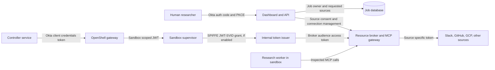
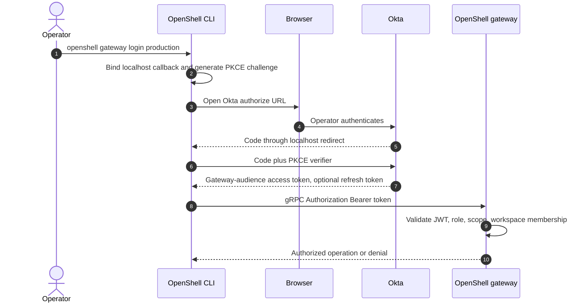
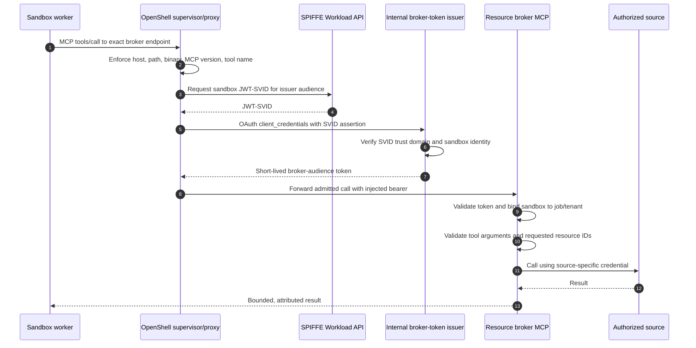
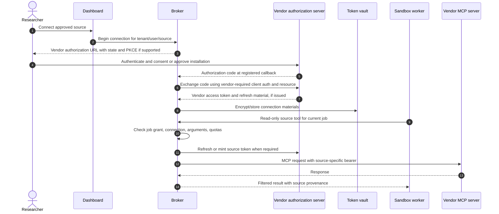

# Identity and access design

**Status:** proposed architecture, with integration gates called out below  
**Product baseline:** NVIDIA OpenShell v0.1.5 documentation, reviewed 2026-10-23  
**Scope:** human sign-in, OpenShell gateway access, sandbox workload identity, OAuth and MCP source access, and tenant isolation

For Okta administrator implementation details and acceptance evidence, use the standalone [Okta requirements and design handoff](../okta/requirements-and-design.md).

## Decision in one page

1. Researchers sign in to the **external dashboard** with Okta Authorization Code + PKCE. The dashboard API creates jobs; researchers do not receive an OpenShell workspace membership merely by signing in.
2. The **controller**, outside the sandbox, authenticates to the OpenShell gateway with a dedicated Okta service client using client credentials. OpenShell's Python, TypeScript, and Go SDKs document renewable client-credentials authentication for this path. The service token still needs the gateway's expected audience, role claim, scopes, and workspace membership. [OpenShell gateway authentication](https://docs.nvidia.com/openshell/v0.1.5/how-it-works/gateways/authentication)
3. **Operator CLI access** can use OpenShell's native browser Authorization Code + PKCE against Okta. It is conditional for production until its ephemeral localhost callback is proven compatible with the Okta app registration; a validated, open [OpenShell issue](https://github.com/NVIDIA/OpenShell/issues/3300) describes exact-redirect providers failing with the current dynamic port. OpenShell's device authorization flow with S256 PKCE is a possible headless alternative if enabled in Okta. [OpenShell gateway authentication](https://docs.nvidia.com/openshell/v0.1.5/how-it-works/gateways/authentication)
4. A research worker in a sandbox has a **workload identity**, not the researcher's Okta browser session. The sandbox supervisor uses a gateway-minted, sandbox-scoped token for gateway RPCs. For a protected internal resource broker, prefer a short-lived broker-audience token obtained through OpenShell's SPIFFE-based dynamic token grant after a compatibility test. [OpenShell gateway authentication](https://docs.nvidia.com/openshell/v0.1.5/how-it-works/gateways/authentication), [provider profiles](https://docs.nvidia.com/openshell/v0.1.5/how-it-works/providers/profiles)
5. A **resource broker / MCP gateway** outside the sandbox owns source OAuth consent, token storage, refresh, vendor-specific grants, per-job authorization, and audit. The worker receives source results through narrow, read-only broker tools. A generic Okta token or generic client-credentials grant does not by itself authorize Slack, GitHub, or Google Cloud.
6. OpenShell's inspected egress policy still applies to the worker-to-broker MCP endpoint: exact host and path, `protocol: mcp`, `enforcement: enforce`, narrow tool allowlist, and pinned MCP version. The broker checks tool **arguments** and source resource IDs because OpenShell currently checks MCP method/tool name but not tool arguments or server responses. [OpenShell network rules](https://docs.nvidia.com/openshell/v0.1.5/how-it-works/policies/network-rules)
7. Never put an externally reachable worker dashboard behind `openshell service expose` and assume gateway OIDC protects it. Service routes bypass gateway control-plane RPC authorization; application authentication is required. [OpenShell sandbox services](https://docs.nvidia.com/openshell/v0.1.5/how-it-works/sandboxes/overview)

## The four identity domains



The worker-to-broker arrow shows a logical tool call. OpenShell mediates Kubernetes workload egress through its supervisor, and the CNI must block direct workload connections. [OpenShell Kubernetes setup](https://docs.nvidia.com/openshell/v0.1.5/kubernetes/setup).

| Principal | Credential and audience | Authority | Holder |
|---|---|---|---|
| Researcher | Okta ID token for login; dashboard session cookie; optional dashboard API access token | Own jobs, approved source connections, result visibility | Browser/BFF, outside sandbox |
| Controller service | Okta client-credentials access token for the **OpenShell gateway** | Create and manage sandboxes in assigned workspace; no inherent SaaS rights | Controller memory/secret manager |
| Sandbox supervisor | Gateway-minted, sandbox-scoped JWT for gateway RPCs; optionally SPIFFE JWT-SVID for dynamic token grants | Sandbox-specific control-plane operations and proof of workload identity | Supervisor, not the worker process |
| Resource broker | Broker-audience workload token at its inbound edge; vendor-specific tokens at its outbound edge | Authorize one job's requested source operations and invoke vendor APIs/MCP | Broker token vault and short-lived cache |

These are separate audiences and authorization decisions. An Okta **ID token** authenticates the dashboard user; it is not an OpenShell gateway access token or a Slack/GitHub/Google bearer. An Okta access token for the dashboard API must not be forwarded to the OpenShell gateway unless it was separately issued for that gateway audience. The [MCP authorization specification](https://modelcontextprotocol.io/specification/2026-07-28/basic/authorization) requires protected MCP servers to validate tokens intended for themselves and clients to send their bearer on every HTTP request.

## Where Okta PKCE actually applies

| Entry point | Proposed use | OpenShell behavior | Decision |
|---|---|---|---|
| Browser → dashboard | Researcher submits jobs and reads results | Outside OpenShell | Implement Okta Authorization Code + PKCE in the dashboard. Prefer a backend-for-frontend (BFF) that stores tokens server-side and issues a secure, HttpOnly, SameSite session cookie. This is an application design choice based on [Okta's PKCE guide](https://developer.okta.com/docs/guides/implement-grant-type/authcodepkce/main/). |
| Human CLI → OpenShell gateway | Platform and workspace operators only | OpenShell CLI launches browser, receives localhost code, exchanges with PKCE, refreshes the token, then sends bearer metadata to gateway gRPC. Gateway validates JWT issuer, audience, signature, expiry, roles, scopes, and workspace membership. | Native OpenShell mechanism, but Okta redirect compatibility is an acceptance gate. [Gateway docs](https://docs.nvidia.com/openshell/v0.1.5/how-it-works/gateways/authentication) and [callback issue](https://github.com/NVIDIA/OpenShell/issues/3300). |
| Human CLI on headless host → gateway | Operator fallback | `OPENSHELL_NO_BROWSER=1` selects Device Authorization Grant with S256 PKCE when the IdP client permits the grant. | Conditional; validate Okta app grant settings and actual CLI login. [Gateway docs](https://docs.nvidia.com/openshell/v0.1.5/how-it-works/gateways/authentication). |
| Browser → exposed sandbox service | Avoid for research workers | Exposed service URLs bypass gateway control-plane OIDC/CLI RPC authorization. `Authorization` is stripped by default; `bearer-passthrough` delivers one application bearer to the sandbox, which must validate it. | No direct worker UI exposure. If a future sandbox service is required, put application authentication and authorization in that service or a trusted edge. [Sandbox service docs](https://docs.nvidia.com/openshell/v0.1.5/how-it-works/sandboxes/overview). |
| Sandbox worker → vendor | Automated source reads | Worker has no browser callback or automatic user delegation from gateway OIDC. | Use workload identity and broker-managed vendor grants. |

The phrase **“user access to sandbox through Okta PKCE”** therefore has two precise meanings: dashboard user access to a job that runs in a sandbox, and optional CLI operator access to OpenShell's gateway RPCs. PKCE does not confer a user session on the sandbox process. Direct OpenShell workspace membership is powerful: a Workspace User may create, use, and delete **all** sandboxes and services in that workspace and use provider attachments there. The dashboard should enforce per-job ownership itself; operators get workspace membership only where this breadth is acceptable. [OpenShell workspaces](https://docs.nvidia.com/openshell/v0.1.5/how-it-works/workspaces)

For enterprise tenancy, assign separate OpenShell workspaces to distinct tenant or policy trust boundaries and create a fresh sandbox per job. Avoid sharing a provider-bearing workspace across unrelated tenants. Use a controller service principal scoped to each workspace where practical; if one controller can manage several workspaces, enforce the tenant-to-workspace mapping in its API before every OpenShell call. OpenShell workspace membership is not a per-job ACL, so the dashboard and broker both check the job owner and selected source connection. [OpenShell workspaces](https://docs.nvidia.com/openshell/v0.1.5/how-it-works/workspaces)

### Dashboard sign-in and job submission

```mermaid
sequenceDiagram
    autonumber
    actor User as Researcher
    participant Browser
    participant BFF as Dashboard BFF/API
    participant Okta
    participant DB as Job database
    participant Controller
    participant Gateway as OpenShell gateway
    User->>Browser: Open dashboard
    Browser->>BFF: GET /login
    BFF->>BFF: Create state, nonce, verifier, challenge
    BFF-->>Browser: Redirect to Okta authorize with PKCE challenge
    Browser->>Okta: Sign in and satisfy Okta policy
    Okta-->>Browser: Redirect with authorization code
    Browser->>BFF: Callback with code and state
    BFF->>Okta: Exchange code with verifier
    Okta-->>BFF: ID token and API access token
    BFF->>BFF: Validate issuer, audience, nonce, state; create session
    BFF-->>Browser: Secure HttpOnly session cookie
    Browser->>BFF: POST job request with session and CSRF protection
    BFF->>DB: Persist owner, tenant, selected source connections
    BFF->>Controller: Queue authorized job
    Controller->>Okta: Client credentials for gateway audience
    Okta-->>Controller: Short-lived access token
    Controller->>Gateway: Create sandbox using access token
    Gateway-->>Controller: Sandbox ID
```

The BFF/session details are **proposed application design**, not an OpenShell built-in. Use an Okta **custom authorization server** for tokens the dashboard API or gateway validates: Okta's org authorization server issues access tokens for Okta and does not let applications customize the audience/claims for their own resource servers. A production custom server may require Okta API Access Management licensing. [Okta authorization servers](https://developer.okta.com/docs/concepts/auth-servers/)

Use distinct resource audiences, for example `api://deep-research-api` and `api://openshell-gateway`; register scopes and access policies deliberately. Okta assigns an Audience to each custom authorization server, so if both the dashboard API and gateway validate Okta access tokens, plan separate custom-server configurations for those audiences unless a tested Okta design proves otherwise. A BFF that uses only its own session cookie for dashboard API calls does not need a dashboard-API bearer audience; it still validates the Okta ID token for login. A browser session never carries vendor tokens to the worker. [Okta custom-server setup](https://developer.okta.com/docs/guides/customize-authz-server/main/)

### Optional operator CLI login



The following registration syntax is documented by OpenShell; replace the values with the actual gateway URL, Okta custom-server issuer, public CLI client ID, and gateway audience. It does not resolve the redirect compatibility gate. [Gateway authentication](https://docs.nvidia.com/openshell/v0.1.5/how-it-works/gateways/authentication)

```sh
openshell gateway add https://gateway.example.com \
  --name production \
  --oidc-issuer https://example.okta.com/oauth2/yourAuthorizationServerId \
  --oidc-client-id yourPublicCliClientId \
  --oidc-audience api://openshell-gateway
openshell gateway login production
openshell whoami --output json
```

**Redirect compatibility gate:** the CLI currently chooses an ephemeral localhost port. Okta's [app-registration guidance](https://help.okta.com/en-us/Content/topics/apps/apps_app_integration_wizard_oidc.htm) requires sign-in redirect URIs to be registered; NVIDIA's [open issue #3300](https://github.com/NVIDIA/OpenShell/issues/3300) documents trouble with IdPs that demand an exact callback port. Register a native/public Okta app for CLI use, inspect the actual callback URI, and run an end-to-end login before promising this path. Do not assume a proposed fixed-port environment variable exists in v0.1.5. If the callback is rejected, use the documented device grant only if the Okta app supports it, or wait for a verified OpenShell fix. Dashboard PKCE does not depend on this CLI integration.

### Gateway OIDC and machine claim contract

OpenShell's v0.1.5 docs verify the following **gateway configuration shape** for Helm's `gatewayConfig`. The issuer form is Okta's custom authorization-server form; all hostnames, server IDs, audiences, and role names below are illustrative and must be replaced. [OpenShell gateway config](https://docs.nvidia.com/openshell/v0.1.5/how-it-works/gateways/authentication), [Okta issuer format](https://developer.okta.com/docs/concepts/auth-servers/)

```yaml
gatewayConfig:
  openshell.gateway.oidc:
    issuer: https://example.okta.com/oauth2/yourAuthorizationServerId
    audience: api://openshell-gateway
    roles_claim: openshell_roles
    admin_role: openshell-platform-admin
    user_role: openshell-operator
    scopes_claim: scp
```

`openshell_roles` is a **design claim**, not an Okta default. The gateway can read one configured roles claim path; a human's group-derived role and the controller service's role must therefore appear in that same claim path if both use the same gateway. Okta's custom authorization server can add custom access-token claims and can derive app-specific values from an app profile, including service-app tokens; its client-credentials access policy also needs a rule for **No user**. [Okta custom-server setup](https://developer.okta.com/docs/guides/customize-authz-server/main/) The exact claim expression and resulting array must be tested with real user and client-credentials JWTs. A user `groups` claim alone should not be assumed to appear on a client-credentials token, which has no user context. [Okta custom claims](https://developer.okta.com/docs/guides/customize-tokens-returned-from-okta/main/), [Okta client credentials](https://developer.okta.com/docs/guides/implement-grant-type/clientcreds/main/)

For each Okta token presented to the gateway, verify `iss`, `aud`, `exp`, stable `sub`, the configured role array, and (if `scopes_claim: scp` is set) the exact OpenShell scopes needed. OpenShell requires the user role plus workspace membership for workspace operations. Use `openshell whoami --output json` to obtain the stable subject to add as a member; never guess it from email. Keep the job controller as a Workspace User in its assigned workspace with the sandbox scopes it needs. If deployment must change providers, policies, or workspace membership, use a separate, tightly controlled provisioner identity because those are Workspace Admin or Platform Admin actions. [Gateway authentication](https://docs.nvidia.com/openshell/v0.1.5/how-it-works/gateways/authentication), [workspaces](https://docs.nvidia.com/openshell/v0.1.5/how-it-works/workspaces)

## Can OpenShell handle the token flows?

“Native” means the named OpenShell v0.1.5 mechanism is documented. “Conditional” means OpenShell has a relevant mechanism but issuer/resource compatibility or a prerequisite must be demonstrated. “External” means this application, its broker, or another service must implement the flow; OpenShell may still enforce egress and carry a resulting bearer.

| Flow / purpose | Classification | Exact boundary and condition |
|---|---|---|
| Okta Authorization Code + PKCE for dashboard users | **External** | Implement in dashboard; OpenShell is not the dashboard IdP client. [Okta PKCE](https://developer.okta.com/docs/guides/implement-grant-type/authcodepkce/main/) |
| Okta Authorization Code + PKCE for OpenShell CLI | **Conditional** | Native CLI flow and gateway JWT validation; exact Okta localhost redirect compatibility remains unproven in v0.1.5. [Gateway authentication](https://docs.nvidia.com/openshell/v0.1.5/how-it-works/gateways/authentication), [issue #3300](https://github.com/NVIDIA/OpenShell/issues/3300) |
| Device Authorization Grant + S256 PKCE for headless CLI | **Conditional** | Native CLI behavior under `OPENSHELL_NO_BROWSER=1`; Okta client must enable device grant. [Gateway authentication](https://docs.nvidia.com/openshell/v0.1.5/how-it-works/gateways/authentication) |
| Okta access-token validation at OpenShell gateway | **Native** | Gateway verifies JWT/JWKS, issuer, audience, expiry, role claim, optional scopes, and workspace membership. Okta custom AS token construction is separate. [Gateway authentication](https://docs.nvidia.com/openshell/v0.1.5/how-it-works/gateways/authentication) |
| Controller → gateway client credentials | **Conditional** | OpenShell CLI and official SDKs natively obtain and renew client-credentials tokens. Okta must issue gateway audience, role, scopes, and stable service subject. [Gateway authentication](https://docs.nvidia.com/openshell/v0.1.5/how-it-works/gateways/authentication) |
| Supervisor → gateway sandbox-scoped JWT | **Native** | Gateway mints a sandbox-restricted token; this is independent of user Okta tokens. [Gateway authentication](https://docs.nvidia.com/openshell/v0.1.5/how-it-works/gateways/authentication) |
| Gateway-managed source OAuth client credentials | **Conditional** | Provider profile `refresh.strategy: oauth2_client_credentials` stores client material at gateway and rotates a source token. Source must accept that grant, endpoint/auth method, scopes, audience/resource conventions. [Provider profiles](https://docs.nvidia.com/openshell/v0.1.5/how-it-works/providers/profiles) |
| Gateway-managed source refresh token | **Conditional** | `oauth2_refresh_token` rotates an already obtained vendor token; user consent, connection ownership, and initial grant remain external. [Provider profiles](https://docs.nvidia.com/openshell/v0.1.5/how-it-works/providers/profiles) |
| Gateway-managed Google service-account key JWT | **Native mechanism; conditional deployment** | `google_service_account_jwt` is documented, but requires a private key; enterprise design prefers keyless workload federation where possible. [Provider profiles](https://docs.nvidia.com/openshell/v0.1.5/how-it-works/providers/profiles), [Google provider](https://docs.nvidia.com/openshell/v0.1.5/how-it-works/providers/google) |
| Sandbox SPIFFE-based `token_grant: client_credentials` | **Conditional** | OpenShell obtains a JWT-SVID and sends it as an OAuth client assertion to a token issuer; requires SPIFFE Workload API and issuer acceptance of that SVID. Direct Okta acceptance is **not established** by the OpenShell or Okta docs reviewed. [Provider profiles](https://docs.nvidia.com/openshell/v0.1.5/how-it-works/providers/profiles) |
| OpenShell `token_grant: token_exchange` | **Conditional, limited** | OpenShell stores a current CLI OIDC **access** token as subject credential and performs its documented SPIFFE-backed intermediate/final exchange. It does **not** store the CLI refresh token in that provider; exchange stops when the subject token expires until updated. It is unsuitable as the only durable delegated SaaS connection flow. [Provider profiles](https://docs.nvidia.com/openshell/v0.1.5/how-it-works/providers/profiles) |
| Full protected MCP OAuth discovery, source consent, dynamic registration, step-up, rotation | **External** | An MCP client/broker must implement source-specific OAuth and `resource` handling. OpenShell's `protocol: mcp` policy is traffic inspection and tool filtering, not a complete OAuth client. [MCP authorization](https://modelcontextprotocol.io/specification/2026-07-28/basic/authorization), [OpenShell policy](https://docs.nvidia.com/openshell/v0.1.5/how-it-works/policies/network-rules) |
| Generic client credentials to arbitrary remote MCP | **Conditional** | MCP's client-credentials extension is [draft and optional](https://github.com/modelcontextprotocol/ext-auth/blob/main/specification/draft/oauth-client-credentials.mdx); each server must opt in and pre-register the client. It yields application identity, not user's vendor ACL. |
| GCP Workload Identity Federation from off-GCP workloads | **External integration** | Google recommends WIF for off-GCP agents; current OpenShell Google provider documents ADC refresh/service-account key flows, not an automatic direct WIF exchange for every sandbox. Implement and test WIF in broker/Google auth library. [Google MCP auth](https://docs.cloud.google.com/mcp/authenticate-mcp), [OpenShell Google provider](https://docs.nvidia.com/openshell/v0.1.5/how-it-works/providers/google) |
| Application auth for an exposed sandbox service | **External** | OpenShell service routes bypass control-plane OIDC. Application must authenticate its own requests. [Sandbox service docs](https://docs.nvidia.com/openshell/v0.1.5/how-it-works/sandboxes/overview) |

### Two different OpenShell client-credentials mechanisms

Do not conflate them:

- **Controller → gateway:** OpenShell's official SDK obtains an ordinary OAuth client-credentials token from Okta (or another configured IdP), and the gateway validates it. The controller's client secret stays outside the sandbox. This is the simplest client-credentials path for job orchestration. [Gateway authentication](https://docs.nvidia.com/openshell/v0.1.5/how-it-works/gateways/authentication)
- **Sandbox → protected endpoint:** a profile's *gateway-managed refresh* can obtain a source token using stored client ID/secret, then resolve an opaque sandbox placeholder only on profile-bound destinations; alternatively a *dynamic token grant* asks an issuer for a token using the supervisor's SPIFFE JWT-SVID assertion. The dynamic grant is not a generic `client_id`/`client_secret` exchange performed by the worker. [Provider profiles](https://docs.nvidia.com/openshell/v0.1.5/how-it-works/providers/profiles)

The latter is useful for **our internal broker** if we control the issuer and verify it accepts SPIFFE assertions. It is not proof that Okta, Slack, GitHub, or Google's token endpoints will accept a SPIFFE JWT-SVID as a `client_assertion`. Okta's documented client-credentials example uses a registered client ID/secret; its documented custom claims can support service-app tokens, but direct SPIFFE assertion compatibility needs a dedicated integration test. [Okta client credentials](https://developer.okta.com/docs/guides/implement-grant-type/clientcreds/main/), [OpenShell token grants](https://docs.nvidia.com/openshell/v0.1.5/how-it-works/providers/profiles)

### Broker-bound workload token



The sequence uses OpenShell's documented dynamic grant **only after** SPIFFE is deployed and the internal issuer accepts the JWT-SVID. The broker must receive a job binding from the controller through a trusted control channel; a sandbox token alone identifies a workload, not what a human approved that workload to read. Reject calls whose sandbox ID, job ID, tenant, source connection, resource identifier, method, or requested time window does not match the binding. Keep broker-audience tokens short lived and source tokens out of sandbox environment variables and prompts. [OpenShell token grants](https://docs.nvidia.com/openshell/v0.1.5/how-it-works/providers/profiles)

## OAuth-protected MCP design

A protected HTTP MCP server is an OAuth resource server. The MCP client must discover its authorization server from protected-resource metadata, obtain a token for the MCP server's canonical URI, include `resource` in both authorization and token requests, and send `Authorization: Bearer` on every request. Client registration may be a published client-ID metadata document, a pre-registered client, or optional dynamic registration; vendors may support only a subset. [MCP authorization specification](https://modelcontextprotocol.io/specification/2026-07-28/basic/authorization)

The broker is the OAuth/MCP client for external servers. It stores a **connection record** keyed by tenant + source + user or service identity + resource boundary. The record contains source scopes, allowed organizations/projects/channels/repositories, consent/installation status, expiry, and an encrypted token reference. It does not put vendor refresh tokens, app private keys, or API secrets into the research worker. The broker uses the vendor's actual grant and refresh semantics; it does not exchange an Okta dashboard token as if vendors accepted it.



The diagram illustrates **user-consent sources**; GitHub App installation tokens and GCP workload identity use different minting paths. For machine-to-machine sources, a client-credentials grant is allowed only when the resource server actually supports it and its permissions are acceptable for the requested job. The [MCP client-credentials extension](https://github.com/modelcontextprotocol/ext-auth/blob/main/specification/draft/oauth-client-credentials.mdx) is optional and draft, so support must be established per server.

OpenShell's provider profiles can bind a static placeholder or dynamically injected token to a precise endpoint. However, the documented gateway-managed refresh schema lists token URL and scopes; it does not document end-to-end MCP OAuth metadata discovery/consent or a general `resource` parameter. A direct OpenShell-provider-to-vendor-MCP connection is therefore an **integration spike**, not the default enterprise path. Even where bearer injection works, OpenShell only filters MCP method and tool name; broker-side argument authorization remains necessary. [Provider profiles](https://docs.nvidia.com/openshell/v0.1.5/how-it-works/providers/profiles), [network rules](https://docs.nvidia.com/openshell/v0.1.5/how-it-works/policies/network-rules)

### Vendor-specific contract

| Source | Documented identity/grant | Proposed integration | Critical caveat |
|---|---|---|---|
| **Slack hosted MCP**, `https://mcp.slack.com/mcp` | Slack supports confidential OAuth for registered internal or Marketplace apps, with user consent and user scopes. Its hosted MCP currently has no SSE transport or Dynamic Client Registration. [Slack MCP](https://docs.slack.dev/ai/slack-mcp-server/) | Broker holds registered Slack app secret and per-user connection; request only research read scopes, then call Slack MCP with that user's token. Consider Slack [Enterprise-managed authorization](https://docs.slack.dev/authentication/enterprise-managed-authorization/) as a later enterprise option: IdP identity → ID-JAG → short-lived Slack user MCP token. | A generic client-credentials token does not grant a user's private Slack visibility. Slack MCP also exposes write tools; never allow them to this research worker. EMA requires enterprise and IdP setup; it is not native OpenShell token exchange. |
| **GitHub remote MCP** | GitHub documents registered GitHub App or OAuth App user authorization; no Dynamic Client Registration for its remote MCP. GitHub App user tokens are constrained by both user access and app permissions. [GitHub remote MCP](https://github.com/github/github-mcp-server/blob/main/docs/host-integration.md), [GitHub user tokens](https://docs.github.com/en/apps/creating-github-apps/authenticating-with-a-github-app/authenticating-with-a-github-app-on-behalf-of-a-user) | Prefer a GitHub App. Use user-to-server tokens when queries must reflect a researcher's own access. Use installation tokens for explicitly approved organization/repository service access; mint them from the app JWT and constrain repositories and permissions. | GitHub installation tokens are app identity, expire after one hour, and are not an ordinary OAuth client-credentials grant. App install/org approval and SSO policies can block access. [GitHub installation auth](https://docs.github.com/en/apps/creating-github-apps/authenticating-with-a-github-app/authenticating-as-a-github-app-installation) |
| **Google Cloud Logging MCP**, `https://logging.googleapis.com/mcp` | Google accepts user, workload, or agent identities and documents OAuth bearer use. For an agent outside Google Cloud it recommends Workload Identity Federation. Google remote MCP currently lacks Dynamic Client Registration and Client ID Metadata Documents. [Google MCP auth](https://docs.cloud.google.com/mcp/authenticate-mcp), [Logging MCP](https://docs.cloud.google.com/logging/docs/use-logging-mcp) | Prefer a dedicated workload identity per tenant/project via WIF in the broker or Google auth libraries. Restrict project/log view and time range at broker. | Google's Logging MCP quickstart asks for `roles/mcp.toolUser` plus broad `roles/logging.admin`, while mentioning custom roles may work. Prove a minimal read-only custom role before production, or wrap the Logging read API as a narrow internal MCP tool. [Logging MCP roles](https://docs.cloud.google.com/logging/docs/use-logging-mcp) |
| **Enterprise OAuth-secured MCP** | MCP spec allows pre-registration and optional dynamic registration; auth is per resource server. [MCP authorization](https://modelcontextprotocol.io/specification/2026-07-28/basic/authorization) | Broker integration contract records issuer, protected-resource metadata, canonical resource URI, client registration method, consent or machine grant, scopes, token expiry, and refresh behavior. | Validate each server's actual grant, `resource` support, audience behavior, protocol revision, and tool schemas. Do not infer full compatibility from “OAuth-secured MCP.” |

### MCP network and protocol gate

Set the sandbox egress policy to the **internal broker only** for enterprise source reads. OpenShell's verified MCP policy model supports exact host, port, path, binary, `protocol: mcp`, `enforcement: enforce`, `mcp.versions`, and allowlisted methods/tool names. The default MCP revision when `mcp.versions` is absent is `2025-11-25`; Google's current managed MCP docs describe sessionless `2026-07-28`. Pin the version required by the actual client/server. OpenShell does not inspect MCP tool arguments, responses, or SSE messages. [OpenShell MCP network rules](https://docs.nvidia.com/openshell/v0.1.5/how-it-works/policies/network-rules), [Google Logging MCP protocol](https://docs.cloud.google.com/logging/docs/use-logging-mcp)

A policy allowlist for a tool such as `search_github` authorizes the **tool name**, not arbitrary repositories passed as arguments. The broker must enforce repository IDs, Slack workspaces/channels, GCP projects/log views, read-only operations, result limits, and query time windows. It must also strip or annotate untrusted retrieved text so source content cannot redefine system instructions or request credentials. The controller records these constraints in a signed or database-backed job grant; the worker cannot widen them.

## Token custody and lifecycle

| Material | Custodian | Rotation / expiry | Worker exposure |
|---|---|---|---|
| Okta dashboard code verifier, ID/access/refresh tokens | Dashboard BFF | Session and token lifecycle; logout/revocation | None |
| Okta controller client secret and gateway token | Controller secret manager and memory | Rotate secret; SDK renews short-lived token | None |
| OpenShell gateway OIDC token from operator CLI | Operator's local OpenShell credential directory | CLI refreshes if possible; `gateway logout` clears local session | None |
| Sandbox-scoped gateway JWT | OpenShell gateway/supervisor | Gateway-managed sandbox lifetime | None to worker |
| SPIFFE JWT-SVID and broker token | Supervisor/SPIFFE/token issuer | Short-lived, broker-audience, cache bounded | Broker bearer injected on approved request; no long-lived secret |
| Slack/GitHub/Google grant and refresh material | Broker vault or provider control plane for an approved direct integration | Vendor-specific; revoke on disconnect or job policy change | None |
| Model-provider credential | OpenShell model provider profile or inference control plane | Provider rotation | Opaque placeholder or proxied call, subject to OpenShell policy |

For all source connections, encrypt persisted credentials, segregate by tenant and source, avoid token values in logs/traces/results, refresh only when needed, and invalidate the job's source grant on disconnect or changed access. Record token **metadata** and the principal/resource decision, never the token itself, in audit events. These are application requirements; OpenShell provider storage does not implement the dashboard's per-job authorization model.

## Enterprise acceptance gates

1. **Okta dashboard:** prove PKCE login, state/nonce validation, session expiry, cross-site request protection, custom-AS `aud`/`scp`, and tenant group mapping. Confirm licensing for the required custom authorization server. [Okta PKCE](https://developer.okta.com/docs/guides/implement-grant-type/authcodepkce/main/), [authorization servers](https://developer.okta.com/docs/concepts/auth-servers/)
2. **Okta gateway controller:** obtain an actual Okta client-credentials JWT and prove OpenShell accepts its issuer, gateway audience, configured role claim, scopes, and stable subject with a non-admin workspace membership. Test both permitted sandbox operations and a denied provider/platform operation. [OpenShell gateway authentication](https://docs.nvidia.com/openshell/v0.1.5/how-it-works/gateways/authentication), [workspaces](https://docs.nvidia.com/openshell/v0.1.5/how-it-works/workspaces)
3. **Okta operator CLI:** run real browser PKCE with the v0.1.5 CLI and confirm the localhost redirect is accepted. If it fails, test device grant only after explicitly enabling it in Okta; track [OpenShell callback issue #3300](https://github.com/NVIDIA/OpenShell/issues/3300).
4. **SPIFFE broker grant:** configure SPIFFE Workload API for gateway/supervisor, prove the internal issuer validates the JWT-SVID subject/audience and returns a broker-audience token, then prove an agent-supplied `Authorization` header is replaced only on an admitted inspected request. [OpenShell dynamic grants](https://docs.nvidia.com/openshell/v0.1.5/how-it-works/providers/profiles)
5. **MCP policy:** deny an unlisted tool, wrong host/path, unsupported protocol revision, and an unapproved binary. At the broker, deny a permitted tool whose arguments reference another tenant's repository, channel, or project. [OpenShell MCP rules](https://docs.nvidia.com/openshell/v0.1.5/how-it-works/policies/network-rules)
6. **Vendor connections:** test each source's OAuth discovery/registration behavior, required scopes, source audience/resource parameter, refresh and revocation, organization approval, and expired-token recovery. Slack/GitHub/Google all have vendor-specific restrictions as listed above.
7. **GCP least privilege:** prove the Logging MCP works with a reviewed custom read-only role or use a narrow internal Logging API wrapper before enterprise rollout. [Google Logging MCP roles](https://docs.cloud.google.com/logging/docs/use-logging-mcp)
8. **Exposed service denial:** verify no worker service exposure is created by the controller and that only the dashboard/API can return job results. If a service is introduced later, perform an explicit application-auth review because OpenShell gateway OIDC does not protect its service route. [OpenShell service routes](https://docs.nvidia.com/openshell/v0.1.5/how-it-works/sandboxes/overview)

## Primary references

- [NVIDIA OpenShell v0.1.5 gateway authentication](https://docs.nvidia.com/openshell/v0.1.5/how-it-works/gateways/authentication)
- [NVIDIA OpenShell v0.1.5 provider profiles and token grants](https://docs.nvidia.com/openshell/v0.1.5/how-it-works/providers/profiles)
- [NVIDIA OpenShell v0.1.5 workspaces](https://docs.nvidia.com/openshell/v0.1.5/how-it-works/workspaces)
- [NVIDIA OpenShell v0.1.5 sandbox service routes](https://docs.nvidia.com/openshell/v0.1.5/how-it-works/sandboxes/overview)
- [NVIDIA OpenShell v0.1.5 MCP network policy](https://docs.nvidia.com/openshell/v0.1.5/how-it-works/policies/network-rules)
- [Okta Authorization Code + PKCE](https://developer.okta.com/docs/guides/implement-grant-type/authcodepkce/main/), [client credentials](https://developer.okta.com/docs/guides/implement-grant-type/clientcreds/main/), [custom authorization servers](https://developer.okta.com/docs/concepts/auth-servers/), and [custom claims](https://developer.okta.com/docs/guides/customize-tokens-returned-from-okta/main/)
- [MCP 2026-07-28 HTTP authorization](https://modelcontextprotocol.io/specification/2026-07-28/basic/authorization) and [draft client-credentials extension](https://github.com/modelcontextprotocol/ext-auth/blob/main/specification/draft/oauth-client-credentials.mdx)
- [Slack hosted MCP](https://docs.slack.dev/ai/slack-mcp-server/), [GitHub remote MCP](https://github.com/github/github-mcp-server/blob/main/docs/host-integration.md), [Google Cloud MCP authentication](https://docs.cloud.google.com/mcp/authenticate-mcp), and [Cloud Logging MCP](https://docs.cloud.google.com/logging/docs/use-logging-mcp)
