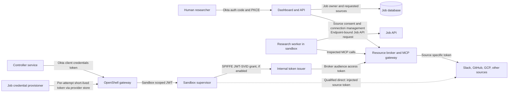
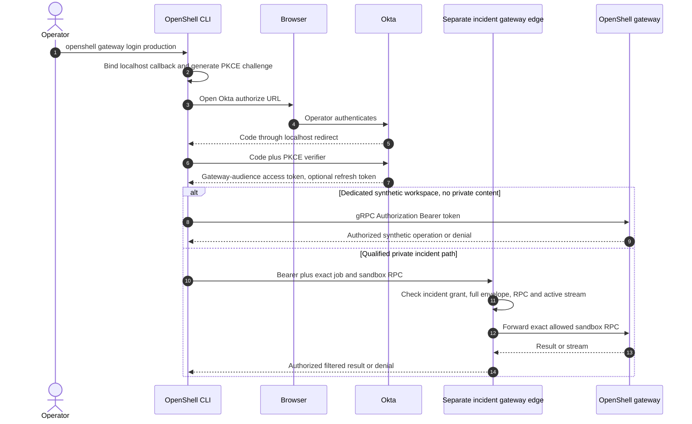
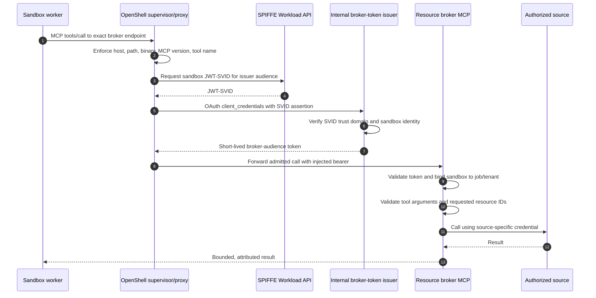

# Identity and access design

**Status:** proposed architecture, with integration gates called out below  
**Product baseline:** NVIDIA OpenShell v0.1.5 documentation, reviewed 2026-10-23  
**Scope:** human sign-in, OpenShell gateway access, sandbox workload identity, OAuth and MCP source access, and tenant isolation

For Okta administrator implementation details and acceptance evidence, use the standalone [Okta requirements and design handoff](../okta/requirements-and-design.md).

## Decision in one page

1. Researchers sign in to the **external dashboard** with Okta Authorization Code + PKCE. The dashboard API creates jobs; researchers do not receive an OpenShell workspace membership merely by signing in.
2. The **controller**, outside the sandbox, authenticates to the OpenShell gateway with a dedicated Okta service client using client credentials. A **separate provisioner** with its own Okta client and workspace-scoped provider permissions creates and rotates per-attempt Job API providers. OpenShell's `provider:write` permission also permits provider-profile mutation throughout that workspace; the provisioner service forbids it, and an independent guard enforces signed stage-specific worker routes separately from supervisor control/telemetry traffic if the token is used directly. OpenShell's SDKs document renewable client-credentials authentication; each service token still needs the gateway's expected audience, role claim, scopes, and workspace membership. [OpenShell gateway authentication](https://docs.nvidia.com/openshell/v0.1.5/how-it-works/gateways/authentication), [workspaces](https://docs.nvidia.com/openshell/v0.1.5/how-it-works/workspaces), [RPC authorization](https://github.com/NVIDIA/OpenShell/blob/v0.1.5/proto/openshell.proto)
3. **Operator CLI access** can use OpenShell's native browser Authorization Code + PKCE against Okta, after an actual localhost callback test; a validated [OpenShell issue](https://github.com/NVIDIA/OpenShell/issues/3300) describes the dynamic-port problem for exact-redirect providers. A separately tested device grant is an option. Ordinary direct CLI membership is disabled for private jobs, including isolated per-job workspaces, because a Workspace User can run shell/download without a current source-rights check. Routine support uses a proxy returning sanitized diagnostics only; a separate incident/content proxy can check the full job disclosure envelope on each raw operation and stream. Direct CLI is limited to synthetic/no-private-content diagnostics. Private incident CLI requires a separately qualified mediating gateway edge with exact job/workspace/sandbox/RPC scope, current full-envelope checks, audit, and active-session teardown; otherwise it stays disabled. [OpenShell gateway authentication](https://docs.nvidia.com/openshell/v0.1.5/how-it-works/gateways/authentication), [workspaces](https://docs.nvidia.com/openshell/v0.1.5/how-it-works/workspaces)
4. A research worker has a **job/stage/sandbox/attempt identity** from Phase 0, not the researcher's Okta browser session. The P0 public path uses a short-lived, endpoint-bound OpenShell provider placeholder for an app-issued Job API credential. Before enterprise sources, the Job API and broker also require a sender-constrained or equivalent authenticated origin; a copied raw bearer must fail. OpenShell's SPIFFE-based dynamic token grant can mint an endpoint-bound broker token after an issuer test, but the resulting bearer by itself is not sender proof. [Job lifecycle](job-lifecycle.md), [provider profiles](https://docs.nvidia.com/openshell/v0.1.5/how-it-works/providers/profiles)
5. A **resource broker / MCP gateway** outside the sandbox owns source OAuth consent, token storage, refresh, vendor-specific grants, per-job argument and cross-partition authorization, and audit on the default enterprise path. OpenShell can itself mint/refresh and inject a source token on a qualified **direct** worker-to-source path; that path requires upstream RBAC to enforce the full partition, equivalent evidence capture, issuer/upstream sender binding that denies raw vendor-token replay outside the original immutable sandbox/attempt **and** a separate issuer grant-policy or qualified gateway interceptor guard against provider reuse in another attempt, live revocation fencing including established connections, and recovery-generation fencing at the source or source-egress quarantine until every old sandbox is deleted or its token is revoked. Its model/trace route must accept the highest class the source token can return, or an inline trusted response classifier must block over-class bytes before worker delivery. Direct mode stays disabled without those proofs. OpenShell cannot supply the broker's downstream token for a separate broker-to-vendor call. A generic Okta token or generic client-credentials grant does not by itself authorize Slack, GitHub, or Google Cloud.
6. OpenShell's inspected egress policy applies to worker-to-broker and qualified direct MCP endpoints: exact host and path, `protocol: mcp`, `enforcement: enforce`, narrow tool allowlist, and pinned MCP version. OpenShell checks MCP method/tool name, not tool arguments or server responses. The broker checks resource IDs, arguments, and whether source content may enter another partition's query. Direct mode requires upstream enforcement of those limits. [OpenShell network rules](https://docs.nvidia.com/openshell/v0.1.5/how-it-works/policies/network-rules)
7. Never put an externally reachable worker dashboard behind `openshell service expose` and assume gateway OIDC protects it. Service routes bypass gateway control-plane RPC authorization; application authentication is required. [OpenShell sandbox services](https://docs.nvidia.com/openshell/v0.1.5/how-it-works/sandboxes/overview)
8. Every job has an application-held [research visibility policy](research-visibility.md): the submitter plus, if selected and approved at admission, one exact Okta group. The dashboard applies it to job lists, status, events, reports, and evidence. Okta can supply a filtered [groups claim](https://developer.okta.com/docs/guides/customize-tokens-groups-claim/) with [stable group IDs](https://developer.okta.com/docs/guides/customize-tokens-static/main/), but the application binds that identity signal to each job's chosen group ID. Membership in a tenant group alone does not make all tenant jobs visible. A group or named reader entitlement never confers a source OAuth grant or cancellation rights.

## Identity domains and custody



The worker-to-broker arrow shows a logical tool call. OpenShell mediates Kubernetes workload egress through its supervisor, and the CNI must block direct workload connections. [OpenShell Kubernetes setup](https://docs.nvidia.com/openshell/v0.1.5/kubernetes/setup).

| Principal | Credential and audience | Authority | Holder |
|---|---|---|---|
| Researcher | Okta ID token for login; dashboard session cookie; optional dashboard API access token | Own jobs, approved source connections, result visibility | Browser/BFF, outside sandbox |
| Controller service | Okta client-credentials access token for the **OpenShell gateway** | Create and manage sandboxes in assigned workspace; no inherent SaaS rights | Controller memory/secret manager |
| Provider provisioner | Separate Okta client-credentials access token for the **OpenShell gateway** | Workspace-wide provider and provider-profile RPCs; application permits only reviewed per-attempt Job API provider instances and refuses profile mutation | Provisioner memory/secret manager; never worker |
| Sandbox supervisor | Gateway-minted, sandbox-scoped JWT for gateway RPCs; job-API provider credential or SPIFFE JWT-SVID for protected endpoint calls | Sandbox-specific control-plane operations and endpoint-bound token delivery | Supervisor; worker sees only an opaque placeholder where the profile provides one |
| Job API | Short-lived app-issued job/stage/sandbox/attempt credential in Phase 0; sender proof also required before enterprise sources | Manifest, event, checkpoint, evidence, and report operations for the exact current attempt | Job API issuer/verification state and OpenShell per-attempt provider |
| Resource broker | Broker-audience workload token at its inbound edge; vendor-specific tokens at its outbound edge | Authorize one job's requested source operations and invoke vendor APIs/MCP | Broker token vault and short-lived cache |
| Qualified direct connector | Source-audience token from the OpenShell provider store and compatible issuer | One source partition whose whole resource scope is already limited upstream; raw token sender binding and exact provider-instance/credential-generation attachment guard for the original sandbox attempt | OpenShell gateway/provider and sandbox supervisor; worker gets a reference, not the raw source grant |

These are separate audiences and authorization decisions. An Okta **ID token** authenticates the dashboard user; it is not an OpenShell gateway access token or a Slack/GitHub/Google bearer. An Okta access token for the dashboard API must not be forwarded to the OpenShell gateway unless it was separately issued for that gateway audience. The [MCP authorization specification](https://modelcontextprotocol.io/specification/2026-07-28/basic/authorization) requires protected MCP servers to validate tokens intended for themselves and clients to send their bearer on every HTTP request.

## Where Okta PKCE actually applies

| Entry point | Proposed use | OpenShell behavior | Decision |
|---|---|---|---|
| Browser → dashboard | Researcher submits jobs and reads results | Outside OpenShell | Implement Okta Authorization Code + PKCE in the dashboard. Prefer a backend-for-frontend (BFF) that stores tokens server-side and issues a secure, HttpOnly, SameSite session cookie. This is an application design choice based on [Okta's PKCE guide](https://developer.okta.com/docs/guides/implement-grant-type/authcodepkce/main/). |
| Provisioner → OpenShell gateway | Automated per-attempt Job API provider create, rotate, and delete | Separate noninteractive Okta client-credentials token; gateway checks Workspace Admin membership and provider scopes | P0 service path; no browser PKCE and no reuse of controller client. [OpenShell workspaces](https://docs.nvidia.com/openshell/v0.1.5/how-it-works/workspaces). |
| Human CLI → OpenShell gateway | Synthetic/no-private-content diagnostics or separately audited incident break-glass only | OpenShell CLI launches browser, receives localhost code, exchanges with PKCE, refreshes the token, then sends bearer metadata to gateway gRPC. Gateway validates JWT issuer, audience, signature, expiry, roles, scopes, and workspace membership. | Native login mechanism, conditional on Okta redirect compatibility. Workspace membership is broad and cannot enforce current job source/class rights, even in an isolated private-job workspace. [Gateway docs](https://docs.nvidia.com/openshell/v0.1.5/how-it-works/gateways/authentication), [workspaces](https://docs.nvidia.com/openshell/v0.1.5/how-it-works/workspaces), and [callback issue](https://github.com/NVIDIA/OpenShell/issues/3300). |
| Human CLI on headless host → gateway | Operator fallback | `OPENSHELL_NO_BROWSER=1` selects Device Authorization Grant with S256 PKCE when the IdP client permits the grant. | Conditional; validate Okta app grant settings and actual CLI login. [Gateway docs](https://docs.nvidia.com/openshell/v0.1.5/how-it-works/gateways/authentication). |
| Browser → exposed sandbox service | Avoid for research workers | Exposed service URLs bypass gateway control-plane OIDC/CLI RPC authorization. `Authorization` is stripped by default; `bearer-passthrough` delivers one application bearer to the sandbox, which must validate it. | No direct worker UI exposure. If a future sandbox service is required, put application authentication and authorization in that service or a trusted edge. [Sandbox service docs](https://docs.nvidia.com/openshell/v0.1.5/how-it-works/sandboxes/overview). |
| Sandbox worker → vendor | Automated source reads | Worker has no browser callback or automatic user delegation from gateway OIDC. OpenShell can mint/refresh and inject a source token only through a compatible, endpoint-bound provider profile. | Default to workload identity and broker-managed vendor grants; allow a reviewed direct connector only when upstream RBAC covers the exact job partition, MCP audience works, trusted capture and pre-worker classification pass, copied raw vendor-token replay is denied by the upstream, the original or a same-profile different provider instance cannot attach to another sandbox/attempt, every external in-place token or refresh update is denied, including a broader same-profile token, and source revocation/restore fences cached tokens and active connections. |

The phrase **“user access to sandbox through Okta PKCE”** therefore has two precise meanings: dashboard user access to a job that runs in a sandbox, and optional CLI operator access to OpenShell's gateway RPCs. PKCE does not confer a user session on the sandbox process. Direct OpenShell workspace membership is powerful: a Workspace User may create, use, and delete **all** sandboxes and services in that workspace and use provider attachments there. The dashboard API enforces each job's owner-or-approved-group visibility policy itself. Ordinary support operators receive no direct membership in any private-job workspace. A `support_diagnose` grant permits only sanitized status, attempt IDs, policy digests, and separately scrubbed and classified operational logs. A diagnostic proxy checks this grant for each request and never exposes arbitrary shell/exec, file download, raw log, or scratch-volume access through that grant. A separate incident/content proxy may allow raw operations only after it checks the investigator's current rights to the **entire cumulative job source/resource envelope and highest class** before each call and while streaming, filters output, and tears down active streams on revocation. An isolated workspace does not make native CLI enforce those checks. Private incident CLI is disabled unless a separately qualified mediating gateway edge binds a time-bounded incident grant to the exact job/workspace/sandbox and allowed RPCs, checks current full-envelope rights at every RPC and stream checkpoint, audits, and tears down active sessions/exec on revocation. [OpenShell workspaces](https://docs.nvidia.com/openshell/v0.1.5/how-it-works/workspaces)

For enterprise tenancy, assign separate OpenShell workspaces to distinct tenant or policy trust boundaries and create a fresh sandbox per job. Avoid sharing a provider-bearing workspace across unrelated tenants. Use a controller service principal scoped to each workspace where practical; if one controller can manage several workspaces, enforce the tenant-to-workspace mapping in its API before every OpenShell call. OpenShell workspace membership is not a per-job ACL, so the dashboard enforces the job's submitter, selected Okta group, or later explicit reader grant and the broker checks the job's selected source connections. Connector and platform administrators have no blanket dashboard result access. [OpenShell workspaces](https://docs.nvidia.com/openshell/v0.1.5/how-it-works/workspaces)

### Dashboard sign-in and job submission

```mermaid
sequenceDiagram
    autonumber
    actor User as Researcher
    participant Browser
    participant BFF as Dashboard BFF/API
    participant Okta
    participant DB as Job database
    participant Controller
    participant Gateway as OpenShell gateway
    User->>Browser: Open dashboard
    Browser->>BFF: GET /login
    BFF->>BFF: Create state, nonce, verifier, challenge
    BFF-->>Browser: Redirect to Okta authorize with PKCE challenge
    Browser->>Okta: Sign in and satisfy Okta policy
    Okta-->>Browser: Redirect with authorization code
    Browser->>BFF: Callback with code and state
    BFF->>Okta: Exchange code with verifier
    Okta-->>BFF: ID token and API access token
    BFF->>BFF: Validate issuer, audience, nonce, state; create session
    BFF-->>Browser: Secure HttpOnly session cookie
    Browser->>BFF: POST job request with session and CSRF protection
    BFF->>DB: Persist owner, tenant, selected sources, approved visibility audience
    BFF->>Controller: Queue authorized job
    Controller->>Okta: Client credentials for gateway audience
    Okta-->>Controller: Short-lived access token
    Controller->>Gateway: Create sandbox using access token
    Gateway-->>Controller: Sandbox ID
```

The BFF/session details are **proposed application design**, not an OpenShell built-in. Use an Okta **custom authorization server** for tokens the dashboard API or gateway validates: Okta's org authorization server issues access tokens for Okta and does not let applications customize the audience/claims for their own resource servers. A production custom server may require Okta API Access Management licensing. [Okta authorization servers](https://developer.okta.com/docs/concepts/auth-servers/)

Use distinct resource audiences, for example `api://deep-research-api` and `api://openshell-gateway`; register scopes and access policies deliberately. Okta assigns an Audience to each custom authorization server, so if both the dashboard API and gateway validate Okta access tokens, plan separate custom-server configurations for those audiences unless a tested Okta design proves otherwise. A BFF that uses only its own session cookie for dashboard API calls does not need a dashboard-API bearer audience; it still validates the Okta ID token for login. A browser session never carries vendor tokens to the worker. [Okta custom-server setup](https://developer.okta.com/docs/guides/customize-authz-server/main/)

### Optional operator CLI login

The flow below is available only for synthetic/no-private-content diagnostics or a separately approved, time-bounded private incident break-glass role. An isolated private-job workspace is still not a current source/class authorization boundary: CLI shell, exec, download, and raw scratch or log reads may reveal the question, source text, and credentials after a grant is revoked. Routine support uses a mediating diagnostic proxy with its own restricted service identity, checks the current support grant on every request, and returns only sanitized operational fields. A distinct incident/content proxy checks the full cumulative job envelope on every raw operation and during streams. The operator receives no direct workspace membership through either proxy. A private CLI break-glass path requires a separately qualified mediating gateway edge that binds exact job/workspace/sandbox/RPC scope, checks the current full envelope/class and incident grant on every RPC and stream checkpoint, and tears down active CLI/exec sessions on revocation or expiry. A raw native token must not bypass that edge; short JWT lifetime alone does not close an already running exec.

For a private incident principal, the edge is the **only** network route to the gateway and default-denies every RPC. The initial candidate may allow only exact-sandbox `ExecSandbox` and `ExecSandboxInteractive` after a live stream-control test; `CreateSshSession`, `ForwardTcp`, `ExposeService`, raw `GetSandboxLogs`, file transfer, and all other gateway operations stay denied unless separately designed and qualified. A reused gateway bearer sent directly to the gateway must fail. OpenShell v0.1.5 interceptors cover only allowlisted unary writes, so their `CreateSandbox` governance does not enforce these streaming incident checks. [Gateway interceptor limits](https://docs.nvidia.com/openshell/v0.1.5/extensibility/gateway-interceptors), [v0.1.5 gateway RPCs](https://github.com/NVIDIA/OpenShell/blob/v0.1.5/proto/openshell.proto).



The following registration syntax is documented by OpenShell; replace the values with the actual gateway URL, Okta custom-server issuer, public CLI client ID, and gateway audience. It does not resolve the redirect compatibility gate. [Gateway authentication](https://docs.nvidia.com/openshell/v0.1.5/how-it-works/gateways/authentication)

```sh
openshell gateway add https://gateway.example.com \
  --name production \
  --oidc-issuer https://example.okta.com/oauth2/yourAuthorizationServerId \
  --oidc-client-id yourPublicCliClientId \
  --oidc-audience api://openshell-gateway
openshell gateway login production
openshell whoami --output json
```

**Redirect compatibility gate:** the CLI currently chooses an ephemeral localhost port. Okta's [app-registration guidance](https://help.okta.com/en-us/Content/topics/apps/apps_app_integration_wizard_oidc.htm) requires sign-in redirect URIs to be registered; NVIDIA's [open issue #3300](https://github.com/NVIDIA/OpenShell/issues/3300) documents trouble with IdPs that demand an exact callback port. Register a native/public Okta app for CLI use, inspect the actual callback URI, and run an end-to-end login before promising this path. Do not assume a proposed fixed-port environment variable exists in v0.1.5. If the callback is rejected, use the documented device grant only if the Okta app supports it, or wait for a verified OpenShell fix. Dashboard PKCE does not depend on this CLI integration.

### Gateway OIDC and machine claim contract

OpenShell's v0.1.5 docs verify the following **gateway configuration shape** for Helm's `gatewayConfig`. The issuer form is Okta's custom authorization-server form; all hostnames, server IDs, audiences, and role names below are illustrative and must be replaced. [OpenShell gateway config](https://docs.nvidia.com/openshell/v0.1.5/how-it-works/gateways/authentication), [Okta issuer format](https://developer.okta.com/docs/concepts/auth-servers/)

```yaml
gatewayConfig:
  openshell.gateway.oidc:
    issuer: https://example.okta.com/oauth2/yourAuthorizationServerId
    audience: api://openshell-gateway
    roles_claim: openshell_roles
    admin_role: openshell-platform-admin
    user_role: openshell-operator
    scopes_claim: scp
```

`openshell_roles` is a **design claim**, not an Okta default. The gateway can read one configured roles claim path; a human's group-derived role and the controller service's role must therefore appear in that same claim path if both use the same gateway. Okta's custom authorization server can add custom access-token claims and can derive app-specific values from an app profile, including service-app tokens; its client-credentials access policy also needs a rule for **No user**. [Okta custom-server setup](https://developer.okta.com/docs/guides/customize-authz-server/main/) The exact claim expression and resulting array must be tested with real user and client-credentials JWTs. A user `groups` claim alone should not be assumed to appear on a client-credentials token, which has no user context. [Okta custom claims](https://developer.okta.com/docs/guides/customize-tokens-returned-from-okta/main/), [Okta client credentials](https://developer.okta.com/docs/guides/implement-grant-type/clientcreds/main/)

For each Okta token presented to the gateway, verify `iss`, `aud`, `exp`, stable `sub`, the configured role array, and (if `scopes_claim: scp` is set) the exact OpenShell scopes needed. OpenShell requires the user role plus workspace membership for workspace operations. Use `openshell whoami --output json` to obtain each stable service subject; never guess it from email. Keep the job controller as a Workspace User in its assigned workspace with sandbox scopes. P0 Job API provider creation/rotation requires a separate Workspace Admin provisioner with `provider:read`/`provider:write` but no sandbox, separate workspace-policy, or platform scopes. The same `provider:write` scope permits `ImportProviderProfiles` and `UpdateProviderProfiles`, including an attached profile; Okta cannot narrow that token to one provider instance in v0.1.5. The provisioner service refuses profile mutation and restricts the reviewed instance, destination, attempt, and requester. Signed private-stage admission names the exact provider instance ID/name, immutable profile digest, and application-held credential/grant generation; a same-profile different instance cannot inherit the attempt binding. The interceptor rejects every external value or refresh-configuration update to an attached direct source provider, which could widen upstream resource access on the same endpoint without a visible route change. Before private data, an operator-owned fail-closed gateway interceptor and authoritative trusted profile catalog must preserve signed sandbox/attempt routes against direct profile/config writes; inspected supervisor policy must deny worker requests to unapproved paths even on supervisor-reachable gateway/DNS/issuer/telemetry hosts. Outer CNI and a pre-change gate for all privileged writers remain required. A separate supervisor middleware decision callback is a conditional fallback if this live proof fails. Workspace and membership creation remain a separately controlled platform path. [Gateway authentication](https://docs.nvidia.com/openshell/v0.1.5/how-it-works/gateways/authentication), [workspaces](https://docs.nvidia.com/openshell/v0.1.5/how-it-works/workspaces), [RPC authorization](https://github.com/NVIDIA/OpenShell/blob/v0.1.5/proto/openshell.proto)

### Complete sandbox-create intent

The one-time, signed private-stage intent binds a canonical digest of the **entire effective `CreateSandboxRequest`**, not only the image, policy, provider names, and job labels. Pin the protobuf descriptor/version and deterministic normalization used for this digest. The interceptor validates the complete post-patch request before the gateway handler runs: named `workspace_scope`, unique `name`, nonzero `request_id`, all top-level labels/annotations, `await_main_process_attachment`, empty `workload_template`, empty `service_exposures`, and every field under `spec`. That includes log level, both environment maps, inline template image and runtime class, agent socket, template labels/annotations/resources, `user_namespaces`, `driver_config`, policy, exact provider instance names, resource requirements, explicit command, TTY, restart policy, and any caller-set attachment field. Reject a missing, extra, altered, or uncanonical field; an unexpected new field in a later OpenShell descriptor requires a reviewed intent-schema update before private admission. The live qualification must prove that protobuf decoding and interceptor secret-field omission cannot hide any security-affecting create field from this decision; otherwise a separate gateway/driver rejection is required or private stages remain disabled. `post_commit` is observation only and cannot repair an unsafe create. [OpenShell v0.1.5 `CreateSandboxRequest` and `SandboxSpec`](https://github.com/NVIDIA/OpenShell/blob/v0.1.5/proto/openshell.proto), [gateway interceptor ordering](https://docs.nvidia.com/openshell/v0.1.5/extensibility/gateway-interceptors).

For the first private release, use an inline, fully specified spec: the reviewed image digest and policy, exact per-attempt provider instances, fixed canonical worker command, `tty=false`, `restart_policy=Never`, bounded resource requirements, and an approved runtime class or no override. Empty top-level and inline-template environment maps are the default; any required constant must be individually approved and digest-bound. Reject unapproved agent socket, labels, annotations, user-namespace override, GPU/resource override, or launch/attachment mode. Set `template.driver_config` to empty and verify the selected gateway/driver configuration rejects caller-supplied driver config; no existing PVC, host path, external writable volume, or another job's workspace may be mounted through a create request. A later exception would need a distinct, exact resource-owner admission decision and matching observed Pod volume inventory. Reject `service_exposures` at create and independently deny later `ExposeService` for private jobs unless that route is governed by a separately qualified control; a zero-exposure create alone does not close the later RPC. OpenShell's Kubernetes driver can otherwise mount an existing PVC through caller driver config, so a matching image/policy/provider list is insufficient. [OpenShell sandbox runtimes](https://docs.nvidia.com/openshell/v0.1.5/how-it-works/sandboxes/runtimes), [OpenShell v0.1.5 proto](https://github.com/NVIDIA/OpenShell/blob/v0.1.5/proto/openshell.proto).

After a successful gateway commit, the controller re-reads the sandbox by its signed workspace/name (the v0.1.5 `GetSandbox` lookup), verifies the returned **immutable sandbox ID** equals the `CreateSandbox` result and has not been replaced by name reuse, compares the full normalized persisted `Sandbox.spec` and request metadata with the signed intent (allowing only documented gateway-owned defaults/fields), and inspects the effective Pod/PVC mount and exposed-service inventory. An uncertain create result, unexpected normalized default, mismatched runtime field, foreign mount, or service endpoint keeps Job API/model/source credentials, manifest release, and direct-source token mint/egress closed; reconcile by `request_id`, quarantine and delete the sandbox, then observe sandbox and owned resource absence before a fresh attempt. The gateway's valid workspace role alone does not establish this job-specific spec boundary.

```mermaid
sequenceDiagram
    autonumber
    participant A as Policy admission
    participant C as Sandbox controller
    participant I as Fail-closed gateway interceptor
    participant G as OpenShell gateway
    participant K as Pod, PVC and service inventory
    A->>C: One-time signed full request digest and job/attempt binding
    C->>G: CreateSandbox with exact inline spec and request ID
    G->>I: Validate complete post-patch protobuf request
    I-->>G: Allow exact digest or deny before create
    G-->>C: Immutable sandbox ID and persisted spec
    C->>G: Read signed workspace/name; verify immutable ID
    C->>K: Inspect effective mounts and exposed services
    alt Full request, persisted spec and runtime resources match
        C->>A: Commit ID, receipts and manifest readiness
    else Unknown or mismatched state
        C->>K: Keep source/model routes closed; quarantine and delete
    end
```

## Can OpenShell handle the token flows?

“Native” means the named OpenShell v0.1.5 mechanism is documented. “Conditional” means OpenShell has a relevant mechanism but issuer/resource compatibility or a prerequisite must be demonstrated. “External” means this application, its broker, or another service must implement the flow; OpenShell may still enforce egress and carry a resulting bearer.

**Yes, for specific hops.** OpenShell's SDK can acquire a client-credentials token for the controller-to-gateway hop. Provider profiles can use gateway-managed `oauth2_client_credentials` or `oauth2_refresh_token` refresh, and SPIFFE-backed dynamic `client_credentials` or limited `token_exchange`, then inject the resulting token only on matching worker requests. This can keep raw credentials out of the agent process. The brokered vendor hop is different: the broker makes that outbound call outside OpenShell, so the broker obtains the vendor token itself. OpenShell does not implement general dashboard-user-to-vendor delegation, upstream consent, or per-job MCP argument authorization. [Provider profiles](https://docs.nvidia.com/openshell/v0.1.5/how-it-works/providers/profiles), [network rules](https://docs.nvidia.com/openshell/v0.1.5/how-it-works/policies/network-rules).

| Flow / purpose | Classification | Exact boundary and condition |
|---|---|---|
| Okta Authorization Code + PKCE for dashboard users | **External** | Implement in dashboard; OpenShell is not the dashboard IdP client. [Okta PKCE](https://developer.okta.com/docs/guides/implement-grant-type/authcodepkce/main/) |
| Okta Authorization Code + PKCE for OpenShell CLI | **Conditional** | Native CLI flow and gateway JWT validation; exact Okta localhost redirect compatibility remains unproven in v0.1.5. [Gateway authentication](https://docs.nvidia.com/openshell/v0.1.5/how-it-works/gateways/authentication), [issue #3300](https://github.com/NVIDIA/OpenShell/issues/3300) |
| Device Authorization Grant + S256 PKCE for headless CLI | **Conditional** | Native CLI behavior under `OPENSHELL_NO_BROWSER=1`; Okta client must enable device grant. [Gateway authentication](https://docs.nvidia.com/openshell/v0.1.5/how-it-works/gateways/authentication) |
| Okta access-token validation at OpenShell gateway | **Native** | Gateway verifies JWT/JWKS, issuer, audience, expiry, role claim, optional scopes, and workspace membership. Okta custom AS token construction is separate. [Gateway authentication](https://docs.nvidia.com/openshell/v0.1.5/how-it-works/gateways/authentication) |
| Controller → gateway client credentials | **Conditional** | OpenShell CLI and official SDKs natively obtain and renew client-credentials tokens. Okta must issue gateway audience, role, scopes, and stable service subject. [Gateway authentication](https://docs.nvidia.com/openshell/v0.1.5/how-it-works/gateways/authentication) |
| Provider provisioner → gateway client credentials | **Conditional** | Same native SDK login mechanism, but a separate Okta client and Workspace Admin membership with narrow provider scopes. Provider rights are workspace-wide, so the application restricts operations to the reviewed per-attempt profile and audits them. [OpenShell workspaces](https://docs.nvidia.com/openshell/v0.1.5/how-it-works/workspaces) |
| Supervisor → gateway sandbox-scoped JWT | **Native** | Gateway mints a sandbox-restricted token; this is independent of user Okta tokens. [Gateway authentication](https://docs.nvidia.com/openshell/v0.1.5/how-it-works/gateways/authentication) |
| Phase 0 worker → Job API identity | **Proposed use of native static provider** | The app issuer creates a short-lived job/stage/sandbox/attempt credential; a per-attempt provider attached at sandbox creation starts with an invalid sentinel and `stable_placeholder: true`. After sandbox ID binding, a restricted provisioner updates its value and returns the change receipt; the controller waits for supervisor activation before the Job API permits the manifest. OpenShell resolves the placeholder only for the job API endpoint. The app still checks each request. [Job lifecycle](job-lifecycle.md), [provider profiles](https://docs.nvidia.com/openshell/v0.1.5/how-it-works/providers/profiles) |
| Enterprise worker sender proof | **External integration gate** | A copied raw bearer must fail at the Job API and broker. SPIFFE-backed minting binds issuance to a supervisor but still returns a bearer, so an independently verified mTLS/SPIFFE origin or equivalent sender constraint is required before private data. |
| Gateway-managed source OAuth client credentials | **Conditional** | Provider profile `refresh.strategy: oauth2_client_credentials` stores client material at gateway and rotates a source token. Source must accept that grant, endpoint/auth method, scopes, audience/resource conventions. [Provider profiles](https://docs.nvidia.com/openshell/v0.1.5/how-it-works/providers/profiles) |
| Gateway-managed source refresh token | **Conditional** | `oauth2_refresh_token` rotates an already obtained vendor token; user consent, connection ownership, and initial grant remain external. [Provider profiles](https://docs.nvidia.com/openshell/v0.1.5/how-it-works/providers/profiles) |
| Gateway-managed Google service-account key JWT | **Native mechanism; conditional deployment** | `google_service_account_jwt` is documented, but requires a private key; enterprise design prefers keyless workload federation where possible. [Provider profiles](https://docs.nvidia.com/openshell/v0.1.5/how-it-works/providers/profiles), [Google provider](https://docs.nvidia.com/openshell/v0.1.5/how-it-works/providers/google) |
| Sandbox SPIFFE-based `token_grant: client_credentials` | **Conditional** | OpenShell obtains a JWT-SVID and sends it as an OAuth client assertion to a token issuer; requires SPIFFE Workload API and issuer acceptance of that SVID. Direct Okta acceptance is **not established** by the OpenShell or Okta docs reviewed. [Provider profiles](https://docs.nvidia.com/openshell/v0.1.5/how-it-works/providers/profiles) |
| OpenShell `token_grant: token_exchange` | **Conditional, limited** | OpenShell stores a current CLI OIDC **access** token as subject credential and performs its documented SPIFFE-backed intermediate/final exchange. It does **not** store the CLI refresh token in that provider; exchange stops when the subject token expires until updated. Its documented fields do not prove MCP `resource` handling, standard Okta OBO, or Okta for AI Agents STS/XAA compatibility. It is unsuitable as the only durable delegated SaaS connection flow. [Provider profiles](https://docs.nvidia.com/openshell/v0.1.5/how-it-works/providers/profiles) |
| Broker → vendor MCP/API token | **External to OpenShell** | The broker is an outbound OAuth/MCP client outside the sandbox supervisor. It obtains and stores its own vendor grant, or invokes a separate issuer; OpenShell cannot transparently inject a token into this call. |
| Broker → Okta-protected MCP user grant or app grant | **External to OpenShell; connector-specific** | The broker uses a separately registered source client. User access requires a verified same-person source connection; Client Credentials is eligible only for a source-approved app-readable corpus. Both need a live MCP `resource` and audience test. [Okta handoff](../okta/requirements-and-design.md#6-outbound-source-token-choices-and-oktas-conditional-role) |
| Broker → Okta standard OBO | **Conditional external exchange** | A separate broker service client exchanges an eligible Okta **user access token** from a custom server for a target MCP token under same/trusted custom-server policy. The dashboard org-server ID/access token does not qualify; the exchange supplies no refresh token. Verify the actual grant accepts canonical MCP `resource` and yields the target audience. [Okta standard OBO](https://developer.okta.com/docs/guides/set-up-token-exchange/main/) |
| Broker → Okta for AI Agents STS/XAA | **Separate conditional product path** | Requires subscription, registered agent/resource connection, the correct agent-client subject/delegation, consent and full-grant revocation. STS may hold an external provider refresh grant; XAA may target an Okta custom-server MCP. Broker job policy remains unless a separately reviewed replacement proves equivalent. [Okta AI Agents STS](https://developer.okta.com/docs/guides/ai-agent-token-exchange/resourceserver/main/), [XAA](https://developer.okta.com/docs/guides/ai-agent-token-exchange/authserver/main/) |
| Full protected MCP OAuth discovery, source consent, dynamic registration, step-up, rotation | **External** | An MCP client/broker must implement source-specific OAuth and `resource` handling. OpenShell's `protocol: mcp` policy is traffic inspection and tool filtering, not a complete OAuth client. [MCP authorization](https://modelcontextprotocol.io/specification/2026-07-28/basic/authorization), [OpenShell policy](https://docs.nvidia.com/openshell/v0.1.5/how-it-works/policies/network-rules) |
| Generic client credentials to arbitrary remote MCP | **Conditional** | MCP's [client-credentials extension](https://github.com/modelcontextprotocol/ext-auth/blob/main/specification/draft/oauth-client-credentials.mdx) is optional for a given server; each server must opt in and register the client. It yields application identity, not the user's vendor ACL. |
| GCP Workload Identity Federation from off-GCP workloads | **External integration** | Google recommends WIF for off-GCP agents; current OpenShell Google provider documents ADC refresh/service-account key flows, not an automatic direct WIF exchange for every sandbox. Implement and test WIF in broker/Google auth library. [Google MCP auth](https://docs.cloud.google.com/mcp/authenticate-mcp), [OpenShell Google provider](https://docs.nvidia.com/openshell/v0.1.5/how-it-works/providers/google) |
| Application auth for an exposed sandbox service | **External** | OpenShell service routes bypass control-plane OIDC. Application must authenticate its own requests. [Sandbox service docs](https://docs.nvidia.com/openshell/v0.1.5/how-it-works/sandboxes/overview) |

### Two different OpenShell client-credentials mechanisms

Do not conflate them:

- **Controller and provisioner → gateway:** OpenShell's official SDK obtains an ordinary OAuth client-credentials token from Okta (or another configured IdP), and the gateway validates it. These are separate clients and secrets: the controller gets sandbox operations, while the provisioner gets provider operations in its assigned workspace. Both secrets stay outside the sandbox. [Gateway authentication](https://docs.nvidia.com/openshell/v0.1.5/how-it-works/gateways/authentication)
- **Sandbox → protected endpoint:** a profile's *gateway-managed refresh* can obtain a source token using stored client ID/secret, then resolve an opaque sandbox placeholder only on profile-bound destinations; alternatively a *dynamic token grant* asks an issuer for a token using the supervisor's SPIFFE JWT-SVID assertion. The dynamic grant is not a generic `client_id`/`client_secret` exchange performed by the worker. [Provider profiles](https://docs.nvidia.com/openshell/v0.1.5/how-it-works/providers/profiles)

The latter is useful for **our internal broker** if we control the issuer and verify it accepts SPIFFE assertions. It is not proof that Okta, Slack, GitHub, or Google's token endpoints will accept a SPIFFE JWT-SVID as a `client_assertion`. Okta's documented client-credentials example uses a registered client ID/secret; its documented custom claims can support service-app tokens, but direct SPIFFE assertion compatibility needs a dedicated integration test. [Okta client credentials](https://developer.okta.com/docs/guides/implement-grant-type/clientcreds/main/), [OpenShell token grants](https://docs.nvidia.com/openshell/v0.1.5/how-it-works/providers/profiles)

### Broker-bound workload token



The sequence uses OpenShell's documented dynamic grant **only after** SPIFFE is deployed and the internal issuer accepts the JWT-SVID. The broker must receive a job binding from the controller through a trusted control channel; a sandbox token alone identifies a workload, not what a human approved that workload to read. Reject calls whose sandbox ID, job ID, stage, attempt, tenant, source partition, resource identifier, method, or requested time window does not match the binding. The injected bearer can still be replayed if its raw value is stolen; for enterprise data, the broker ingress must independently verify a sender-bound proof before accepting it. Keep broker-audience tokens short lived and source tokens out of sandbox environment variables and prompts. [OpenShell token grants](https://docs.nvidia.com/openshell/v0.1.5/how-it-works/providers/profiles)

## OAuth-protected MCP design

A protected HTTP MCP server is an OAuth resource server. The MCP client discovers its authorization server from protected-resource metadata and obtains a token intended for the server's canonical URI. A direct Authorization Code flow sends that MCP `resource` in its authorization **and** token requests; a machine or OBO flow has an MCP-token request whose `resource` handling must pass a grant-specific live test. An OBO subject-token authorization is a separate flow with its own audience. The client sends `Authorization: Bearer` on every protected MCP HTTP request. Client registration may be a published client-ID metadata document, a pre-registered client, or optional dynamic registration; vendors may support only a subset. [MCP authorization specification](https://modelcontextprotocol.io/specification/2026-07-28/basic/authorization), [Okta handoff](../okta/requirements-and-design.md#6-outbound-source-token-choices-and-oktas-conditional-role)

For the default enterprise mode, the broker is the OAuth/MCP client for external servers. The BFF Connection API owns the browser session and registered public callback; it relays the authorization code and one-use state over an authenticated internal channel without receiving source tokens. The broker owns the source OAuth transaction and PKCE verifier, exchanges the code, validates source identity, and stores the **connection record and grant** keyed by tenant + source + user or service identity + resource boundary. The record contains the validated source principal, issuer-qualified link to the dashboard user where delegated, source scopes, allowed organizations/projects/channels/repositories, consent/installation status, expiry, and an encrypted token reference. OAuth `state` and PKCE bind the source transaction but cannot prove the source login belongs to the dashboard user. Before vaulting a user grant, the broker validates a stable source user ID from an ID token, UserInfo, issuer-approved introspection, or a connector-approved authenticated identity endpoint bound to the exchanged grant, then compares it through a source-owner-approved immutable account link. An app/bot identity cannot satisfy a user-grant check; deny a dashboard-A/source-B completion. The broker does not put vendor refresh tokens, app private keys, or API secrets into the worker. It uses the source's actual grant and refresh semantics; it does not exchange an Okta dashboard token as if vendors accepted it. A qualified direct connector uses OpenShell's provider store for the source grant and is eligible only when the upstream source narrows the token to the exact job partition and the evidence path is equivalent.

For an **Okta-protected** MCP, the broker may use direct user Authorization Code + S256 PKCE, approved app-only Client Credentials, or separately qualified standard Okta OBO. OBO needs a renewable eligible user access-token grant from a custom authorization server and a distinct broker service client; the exchange itself provides no refresh token. Its token must retain the verified source user's `sub`; test actor attribution, exact MCP resource/audience, user mismatch, and renewal over a long job. Okta for AI Agents STS/XAA is a different optional entitlement and agent-client flow, not a synonym for standard OBO. The [Okta handoff](../okta/requirements-and-design.md#6-outbound-source-token-choices-and-oktas-conditional-role) and [impact register](../decisions/0001-outbound-mcp-source-tokens.md#actionable-impact-register) describe the choice. Implementation is tracked by [source-identity CR-0002](../change-requests/CR-0002-source-identity-binding.md) and its [ToDo](../todos/CR-0002-source-identity-binding.md); the optional Okta paths have separate [OBO CR-0006](../change-requests/CR-0006-okta-standard-obo.md)/[ToDo](../todos/CR-0006-okta-standard-obo.md) and [AI Agents CR-0007](../change-requests/CR-0007-okta-ai-agents.md)/[ToDo](../todos/CR-0007-okta-ai-agents.md).

```mermaid
sequenceDiagram
    autonumber
    actor Researcher
    participant Dashboard
    participant API as Connection API
    participant Broker
    participant VendorAS as Vendor authorization server
    participant VendorIdentity as Source identity endpoint
    participant Vault as Token vault
    participant Worker as Sandbox worker
    participant VendorMCP as Vendor MCP server
    Researcher->>Dashboard: Connect approved source
    Dashboard->>API: Begin with verified session and CSRF
    API->>Broker: Authenticated start with user, tenant, and session binding
    Broker->>Broker: Store one-use state and PKCE verifier
    Broker-->>API: Vendor authorization URL with state and S256 challenge
    API-->>Researcher: Redirect to vendor authorization URL
    Researcher->>VendorAS: Authenticate and consent or approve installation
    VendorAS-->>API: Authorization code and state at registered callback
    API->>API: Verify same live dashboard session
    API->>Broker: Authenticated relay of code, state, and session binding
    Broker->>Broker: Consume state; verify user, tenant, session binding
    Broker->>VendorAS: Exchange code using vendor-required client auth and resource
    VendorAS-->>Broker: Vendor access token and refresh material, if issued
    Broker->>VendorIdentity: Verify stable user identity with this grant
    VendorIdentity-->>Broker: Issuer-qualified source principal
    Broker->>Broker: Match immutable account link to dashboard user and tenant
    alt Same verified person
        Broker->>Vault: Encrypt/store connection materials
        Broker-->>API: Opaque connection ref and acting identity only
    else Dashboard A, source B or unknown mapping
        Broker-->>API: Reject connection; store no grant
    end
    opt Verified connection exists
        Worker->>Broker: Read-only source tool for current job
        Broker->>Broker: Check job grant, connection, arguments, quotas
        Broker->>VendorAS: Refresh or mint source token when required
        Broker->>VendorMCP: MCP request with source-specific bearer
        VendorMCP-->>Broker: Response
        Broker-->>Worker: Filtered result with source provenance
    end
```

The diagram illustrates **user-consent sources**; GitHub App installation tokens and GCP workload identity use different minting paths. For machine-to-machine sources, a client-credentials grant is allowed only when the resource server actually supports it and its permissions are acceptable for the requested job. The [MCP client-credentials extension](https://github.com/modelcontextprotocol/ext-auth/blob/main/specification/draft/oauth-client-credentials.mdx) is optional for servers, so support must be established per server.

OpenShell's provider profiles can bind a static placeholder or dynamically injected token to a precise endpoint. However, the documented gateway-managed refresh schema lists token URL and scopes; it does not document end-to-end MCP OAuth metadata discovery/consent or a general `resource` parameter. A direct OpenShell-provider-to-vendor-MCP connection is therefore an **integration spike**, not the default enterprise path. Even where bearer injection works, OpenShell only filters MCP method and tool name; it does not apply job resource selectors or cross-partition query policy. Direct access is approved only if the upstream token's RBAC narrows the *entire* accessible corpus to the job partition, its issuer/upstream verifies sender proof for the original immutable sandbox/attempt on every call, and the retrieval stage has no other private connector or evidence input. A gateway attachment interceptor alone cannot deny external replay of a copied bearer. An independent token-mint and real source-egress activation barrier stays closed from `CreateSandbox` through full request/spec and runtime-resource verification, immutable sandbox/attempt binding, effective policy/provider receipts, and manifest readiness; a canonical worker or broad Workspace User `exec` before that point gets no upstream call, and uncertain create remains closed. Signed admission and attachment checks bind the exact per-attempt provider instance ID/name, immutable profile digest, and approved credential/grant generation; an equal profile digest cannot substitute for another instance. The interceptor denies all external `UpdateProvider` and `ConfigureProviderRefresh` calls on an attached direct source provider because it cannot inspect secret token values and OpenShell does not infer token scopes. Pinned automatic gateway-managed refresh may continue only with independent issuer/upstream proof of unchanged sandbox/attempt grant lineage and resource scope. A scope change deletes the old sandbox and requires fresh admission. [Provider profiles](https://docs.nvidia.com/openshell/v0.1.5/how-it-works/providers/profiles), [network rules](https://docs.nvidia.com/openshell/v0.1.5/how-it-works/policies/network-rules)

### Vendor-specific contract

| Source | Documented identity/grant | Proposed integration | Critical caveat |
|---|---|---|---|
| **Slack hosted MCP**, `https://mcp.slack.com/mcp` | Slack supports confidential OAuth for registered internal or Marketplace apps, with user consent and user scopes. Its hosted MCP currently has no SSE transport or Dynamic Client Registration. [Slack MCP](https://docs.slack.dev/ai/slack-mcp-server/) | Broker holds registered Slack app secret and per-user connection; request only research read scopes, then call Slack MCP with that user's token. Consider Slack [Enterprise-managed authorization](https://docs.slack.dev/authentication/enterprise-managed-authorization/) as a later enterprise option: IdP identity → ID-JAG → short-lived Slack user MCP token. | A generic client-credentials token does not grant a user's private Slack visibility. Slack MCP also exposes write tools; never allow them to this research worker. EMA requires enterprise and IdP setup; it is not native OpenShell token exchange. |
| **GitHub remote MCP** | GitHub documents registered GitHub App or OAuth App user authorization; no Dynamic Client Registration for its remote MCP. GitHub App user tokens are constrained by both user access and app permissions. [GitHub remote MCP](https://github.com/github/github-mcp-server/blob/main/docs/host-integration.md), [GitHub user tokens](https://docs.github.com/en/apps/creating-github-apps/authenticating-with-a-github-app/authenticating-with-a-github-app-on-behalf-of-a-user) | Prefer a GitHub App. Use user-to-server tokens when queries must reflect a researcher's own access. Use installation tokens for explicitly approved organization/repository service access; mint them from the app JWT and constrain repositories and permissions. | GitHub installation tokens are app identity, expire after one hour, and are not an ordinary OAuth client-credentials grant. App install/org approval and SSO policies can block access. [GitHub installation auth](https://docs.github.com/en/apps/creating-github-apps/authenticating-with-a-github-app/authenticating-as-a-github-app-installation) |
| **Google Cloud Logging MCP**, `https://logging.googleapis.com/mcp` | Google accepts user, workload, or agent identities and documents OAuth bearer use. For an agent outside Google Cloud it recommends Workload Identity Federation. Google remote MCP currently lacks Dynamic Client Registration and Client ID Metadata Documents. [Google MCP auth](https://docs.cloud.google.com/mcp/authenticate-mcp), [Logging MCP](https://docs.cloud.google.com/logging/docs/use-logging-mcp) | Prefer a dedicated workload identity per tenant/project via WIF in the broker or Google auth libraries. Restrict project/log view and time range at broker. | Google's Logging MCP quickstart asks for `roles/mcp.toolUser` plus broad `roles/logging.admin`, while mentioning custom roles may work. Prove a minimal read-only custom role before production, or wrap the Logging read API as a narrow internal MCP tool. [Logging MCP roles](https://docs.cloud.google.com/logging/docs/use-logging-mcp) |
| **Enterprise OAuth-secured MCP** | MCP spec allows pre-registration and optional dynamic registration; auth is per resource server. [MCP authorization](https://modelcontextprotocol.io/specification/2026-07-28/basic/authorization) | Broker integration contract records issuer, protected-resource metadata, canonical resource URI, client registration method, consent or machine grant, scopes, token expiry, and refresh behavior. | Validate each server's actual grant, `resource` support, audience behavior, protocol revision, and tool schemas. Do not infer full compatibility from “OAuth-secured MCP.” |

### MCP network and protocol gate

Set the sandbox egress policy to the **internal broker only** for default enterprise source reads. A qualified direct connector gets only its exact source endpoint and one source partition in its stage. OpenShell's verified MCP policy model supports exact host, port, path, binary, `protocol: mcp`, `enforcement: enforce`, `mcp.versions`, and allowlisted methods/tool names. The default MCP revision when `mcp.versions` is absent is `2025-11-25`; Google's current managed MCP docs describe sessionless `2026-07-28`. Pin the version required by the actual client/server. OpenShell does not inspect MCP tool arguments, responses, or SSE messages. [OpenShell MCP network rules](https://docs.nvidia.com/openshell/v0.1.5/how-it-works/policies/network-rules), [Google Logging MCP protocol](https://docs.cloud.google.com/logging/docs/use-logging-mcp)

A policy allowlist for a tool such as `search_github` authorizes the **tool name**, not arbitrary repositories passed as arguments or source content embedded in search text. The broker must enforce repository IDs, Slack workspaces/channels, GCP projects/log views, read-only operations, result limits, query time windows, and typed cross-partition transfer grants. It builds destination queries from reviewed templates and a trusted key registry; the worker cannot pass raw text from another source as a new query. It also annotates untrusted retrieved text so source content cannot redefine instructions or request credentials. The controller records constraints in a database-backed job grant; the worker cannot widen them.

## Token custody and lifecycle

| Material | Custodian | Rotation / expiry | Worker exposure |
|---|---|---|---|
| Okta dashboard code verifier, ID/access/refresh tokens | Dashboard BFF | Session and token lifecycle; logout/revocation | None |
| Okta controller client secret and gateway token | Controller secret manager and memory | Rotate secret; SDK renews short-lived token | None |
| Okta provider-provisioner client secret and gateway token | Separate provisioner secret manager and memory | Rotate secret; SDK renews short-lived token | None |
| OpenShell gateway OIDC token from operator CLI | Operator's local OpenShell credential directory | CLI refreshes if possible; `gateway logout` clears local session | None |
| Sandbox-scoped gateway JWT | OpenShell gateway/supervisor | Gateway-managed sandbox lifetime | None to worker |
| P0 Job API credential | App issuer plus a per-attempt OpenShell static provider with `stable_placeholder: true` | Proposed 15-minute lifetime; value-only rotation after supervisor receipt; bind to independently current recovery generation; revoke on attempt change or cancel | Opaque endpoint-bound placeholder, never raw bearer |
| SPIFFE JWT-SVID and broker token | Supervisor/SPIFFE/token issuer | Short-lived, broker-audience, cache bounded; issuer and broker bind/check independently current recovery generation | Broker bearer injected on approved request; no long-lived secret |
| Enterprise sender proof | Trusted ingress and workload identity system selected in the Phase 1 integration gate | Bound to current sandbox/attempt and revoked with that attempt | Worker must not be able to present another sandbox's proof |
| Slack/GitHub/Google grant and refresh material | Broker vault in brokered mode; OpenShell provider control plane only for an approved direct integration | Vendor-specific; revoke on disconnect or job policy change | None; direct-mode provider sends opaque reference or proxied request |
| Model-gate and upstream model credentials | OpenShell provider store holds only a per-attempt credential for the trusted internal model gate; the gate holds the upstream model-provider credential | Per-attempt gate credential rotates after full spec/receipt/readiness binding; gate rotates upstream credential separately | Opaque endpoint-bound gate placeholder only; no upstream model credential |

For all source connections, encrypt persisted credentials, segregate by tenant and source, avoid token values in logs/traces/results, refresh only when needed, and invalidate the job's source grant on disconnect or changed access. Record token **metadata** and the principal/resource decision, never the token itself, in audit events. These are application requirements; OpenShell provider storage does not implement the dashboard's per-job authorization model. Its endpoint-bound placeholder prevents routine raw-token exposure to the worker, but it does not make a stolen raw bearer unusable at the receiving API; the Phase 1 sender-proof gate addresses that residual risk.

## Enterprise acceptance gates

1. **Phase 0 worker credential:** prove the per-attempt provider is attached before the canonical worker starts, begins with an invalid sentinel whose expiry outlasts the bounded provisioning timeout, produces a bootstrap probe, updates only its credential value after sandbox ID binding, and reports current-supervisor readiness before the Job API releases a manifest. Deny a copied placeholder, cross-job/stage use, stale attempt or recovery generation, expired token, and revoked token. If the placeholder was omitted or startup timed out, delete the sandbox and retry with a fresh attempt. A stolen raw bearer remains a documented public-prototype limitation. [Job lifecycle](job-lifecycle.md), [OpenShell stable placeholders](https://docs.nvidia.com/openshell/v0.1.5/how-it-works/providers/profiles)
2. **Okta dashboard:** prove PKCE login, state/nonce validation, session expiry, cross-site request protection, custom-AS `aud`/`scp`, and tenant group mapping. Confirm licensing for the required custom authorization server. [Okta PKCE](https://developer.okta.com/docs/guides/implement-grant-type/authcodepkce/main/), [authorization servers](https://developer.okta.com/docs/concepts/auth-servers/)
3. **Okta gateway controller:** obtain an actual Okta client-credentials JWT and prove OpenShell accepts its issuer, gateway audience, configured role claim, scopes, and stable subject with a non-admin workspace membership. Test both permitted sandbox operations and a denied provider/platform operation. A distinct provisioner identity performs provider writes. [OpenShell gateway authentication](https://docs.nvidia.com/openshell/v0.1.5/how-it-works/gateways/authentication), [workspaces](https://docs.nvidia.com/openshell/v0.1.5/how-it-works/workspaces)
4. **Okta provider provisioner:** obtain a second real client-credentials JWT for a separate Workspace Admin subject with only provider-management scopes. Prove provider create/update in its workspace, sandbox and separate workspace-policy RPC denial, and cross-workspace denial. In a disposable native-RBAC probe, prove a direct `UpdateProviderProfiles` RPC is authorized by this token, documenting residual gateway authority; the provisioner service itself rejects that request and any unreviewed instance or endpoint. In the production candidate, a fail-closed gateway interceptor rejects that direct RPC or its authoritative trusted catalog renders the imported profile inert. Before private data, prove the worker cannot reach either a new endpoint or an unapproved path on a supervisor-reachable control/telemetry host, even during a profile/config mutation attempt. A separate request gate is required if inspected supervisor policy and mutation control cannot pass this proof; CNI alone is insufficient for the shared-host case. OpenShell alone does not give per-profile provider RBAC. [OpenShell workspaces](https://docs.nvidia.com/openshell/v0.1.5/how-it-works/workspaces), [RPC authorization](https://github.com/NVIDIA/OpenShell/blob/v0.1.5/proto/openshell.proto)
5. **Complete sandbox-create spec:** with a valid controller Workspace User credential and the same approved workspace/name/request ID, image, policy and providers, alter one other `CreateSandboxRequest` field at a time. Try `template.driver_config` mounting another job's PVC read/write, a host/external volume, nonempty `service_exposures`, an environment secret or endpoint, a different command/restart/TTY/runtime class, resource/GPU override, agent socket, labels/annotations, and `workload_template`. The interceptor denies each before a sandbox/Pod exists; the selected driver's `allow_driver_config` posture and actual Pod/PVC mounts are independently verified. Try later `ExposeService`; it is denied by the qualified control. An approved exact create succeeds only after the returned immutable ID, complete persisted spec, effective mounts, no service endpoint, policy and provider receipts match; an uncertain or normalized mismatch leaves model/source calls and manifest closed, deletes the sandbox, and observes cleanup. [OpenShell v0.1.5 proto](https://github.com/NVIDIA/OpenShell/blob/v0.1.5/proto/openshell.proto), [Kubernetes PVC mounts](https://docs.nvidia.com/openshell/v0.1.5/how-it-works/sandboxes/runtimes).
6. **Enterprise sender proof:** before private data, deploy and test a receiver-verified sandbox/attempt origin or sender constraint at both Job API and broker ingress. Replay a copied raw bearer from a different client and sandbox and verify denial; an OpenShell dynamic grant alone does not satisfy this test.
7. **SPIFFE broker grant, if selected:** configure SPIFFE Workload API for gateway/supervisor, prove the internal issuer validates JWT-SVID subject/audience and returns a broker-audience token, then prove an agent-supplied `Authorization` header is replaced only on an admitted inspected request. Test the independent sender proof as well. [OpenShell dynamic grants](https://docs.nvidia.com/openshell/v0.1.5/how-it-works/providers/profiles)
8. **MCP and partition policy:** deny an unlisted tool, wrong host/path, unsupported protocol revision, and unapproved binary. At the broker, deny permitted tools with another tenant's resource, another source partition's raw text or canary, or an unapproved key/template; prove an approved typed join succeeds. [OpenShell MCP rules](https://docs.nvidia.com/openshell/v0.1.5/how-it-works/policies/network-rules)
9. **Vendor connections:** test each source's OAuth discovery/registration behavior, required scopes, source audience/resource parameter, refresh and revocation, organization approval, and expired-token recovery. For any direct OpenShell path, prove provider mint/refresh, exact upstream RBAC, one-partition stage isolation, equivalent evidence capture, pre-ready token-mint/real-source-egress denial from canonical main and Workspace User `exec` even after uncertain create, upstream denial of copied raw vendor-token replay, and second-sandbox denial for the original or a same-profile different provider instance. With valid `provider:write`, try `UpdateProvider` and `ConfigureProviderRefresh` to install a broader same-profile grant; only a pinned automatic short-lived refresh with independent issuer/upstream proof of unchanged lineage and scope may continue. Slack/GitHub/Google have vendor-specific restrictions as listed above.
10. **GCP least privilege:** prove the Logging MCP works with a reviewed custom read-only role or use a narrow internal Logging API wrapper before enterprise rollout. [Google Logging MCP roles](https://docs.cloud.google.com/logging/docs/use-logging-mcp)
11. **Optional operator CLI and support boundary:** only for synthetic/no-private-content diagnostics or a separately approved, time-bounded private incident break-glass path, run real browser PKCE and confirm the localhost redirect is accepted; if it fails, test device grant after enabling it in Okta. Verify no ordinary private-job workspace membership, including isolated workspaces. Give a support-only operator a valid `support_diagnose` grant and plant a private marker in sandbox scratch, a file, and an unsanitized log: the diagnostic proxy returns only sanitized fields and denies shell/exec, download, and raw log access. An isolated private workspace does not make native CLI job-scoped: only a separate incident/content proxy may serve the marker after current full-envelope source/resource and class checks on every operation and stream checkpoint. A private CLI incident path passes only through a qualified mediating gateway edge that checks the exact job/workspace/sandbox/RPC and current full-envelope class on each call and stream checkpoint; the same native bearer fails on a direct gateway route. By default, `CreateSshSession`, `ForwardTcp`, `ExposeService`, raw `GetSandboxLogs`, file-transfer paths, and all unapproved RPCs deny. Expiry, source-rights loss, or incident-grant revocation terminates active `ExecSandbox` and `ExecSandboxInteractive` streams within the approved grace and is audited. [OpenShell callback issue #3300](https://github.com/NVIDIA/OpenShell/issues/3300)
12. **Exposed service denial:** verify no worker service exposure is created by the controller and that only the dashboard/API can return job results. If a service is introduced later, perform an explicit application-auth review because OpenShell gateway OIDC does not protect its service route. [OpenShell service routes](https://docs.nvidia.com/openshell/v0.1.5/how-it-works/sandboxes/overview)

## Primary references

- [NVIDIA OpenShell v0.1.5 gateway authentication](https://docs.nvidia.com/openshell/v0.1.5/how-it-works/gateways/authentication)
- [NVIDIA OpenShell v0.1.5 provider profiles and token grants](https://docs.nvidia.com/openshell/v0.1.5/how-it-works/providers/profiles)
- [NVIDIA OpenShell v0.1.5 workspaces](https://docs.nvidia.com/openshell/v0.1.5/how-it-works/workspaces)
- [NVIDIA OpenShell v0.1.5 sandbox service routes](https://docs.nvidia.com/openshell/v0.1.5/how-it-works/sandboxes/overview)
- [NVIDIA OpenShell v0.1.5 MCP network policy](https://docs.nvidia.com/openshell/v0.1.5/how-it-works/policies/network-rules)
- [Okta Authorization Code + PKCE](https://developer.okta.com/docs/guides/implement-grant-type/authcodepkce/main/), [client credentials](https://developer.okta.com/docs/guides/implement-grant-type/clientcreds/main/), [custom authorization servers](https://developer.okta.com/docs/concepts/auth-servers/), and [custom claims](https://developer.okta.com/docs/guides/customize-tokens-returned-from-okta/main/)
- [MCP 2026-07-28 HTTP authorization](https://modelcontextprotocol.io/specification/2026-07-28/basic/authorization) and [draft client-credentials extension](https://github.com/modelcontextprotocol/ext-auth/blob/main/specification/draft/oauth-client-credentials.mdx)
- [Slack hosted MCP](https://docs.slack.dev/ai/slack-mcp-server/), [GitHub remote MCP](https://github.com/github/github-mcp-server/blob/main/docs/host-integration.md), [Google Cloud MCP authentication](https://docs.cloud.google.com/mcp/authenticate-mcp), and [Cloud Logging MCP](https://docs.cloud.google.com/logging/docs/use-logging-mcp)
