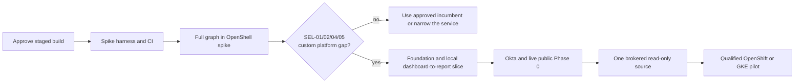

# Proposed application implementation plan

- **Status:** Approved by the user on 2026-10-26; Milestone 0 in progress. No employee-facing application is running.
- **Scope:** Bounded public/synthetic feasibility spike, then—only if the selection gate passes—a fixture-backed application, live public research, one brokered read-only enterprise connector, and a qualified internal pilot.
- **Data boundary:** Synthetic/public data until the Phase 1 source, identity, runtime, and recovery gates pass.
- **Basis:** [Requirements](../requirements.md), [architecture](../architecture.md), [feasibility gate](../feasibility-and-market-assessment.md), [deployment topology](deployment-topology.md), and [delivery workflow](../../AGENTS.md#design-change-impact-gate).

## 1. Approval and first deliverable

The first deliverable is a **bounded feasibility decision**: a disposable, full-graph OpenShell runtime spike and a matched comparison against the available ChatGPT Enterprise path and a restricted worker. It uses public/synthetic cases and a small fixed source/evidence fixture; it does not build the dashboard, durable job system, broker, or production authorization controls. An approved real model is needed to complete the research-quality comparison. If the selection gate passes, the first application deliverable is a **local, fixture-backed dashboard-to-report path**: submit a question, see status, run the complete Deep Agents graph inside a job-bound OpenShell sandbox, and inspect a report with stored evidence after the sandbox is deleted.

For the ChatGPT arm, [CR-0018](../change-requests/CR-0018-chatgpt-synthetic-mcp-baseline.md) / [ToDo](../todos/CR-0018-chatgpt-synthetic-mcp-baseline.md) track a separate case-filtered synthetic MCP fixture, an optional Mac-local compatibility trial, and the conditional hosted path over an approved Secure MCP Tunnel. The user can configure the Mac app but has no server-side workspace or Platform tunnel administration; neither a local tool call nor a tunnel capability report is a hosted connector approval. ChatGPT never needs access to the local OpenShell gateway. The [feasibility impact analysis](../feasibility-and-market-assessment.md#chatgpt-baseline-connectivity-impact) distinguishes file-upload quality comparison from observed MCP/permission parity.

Approval of this plan authorizes the staged application build, beginning with the bounded spike and its build hygiene. The dashboard/control-plane work proceeds under the same approval **when** the documented **SEL-01, SEL-02, SEL-04, and SEL-05** go/no-go decision shows a measured gap and narrow custom scope. Before that decision, compare the same cases in ChatGPT Enterprise and a restricted worker, and check whether an approved ChatGPT `search`/`fetch` MCP or plugin path closes the gap. Replit joins when its rollout permits under SEL-03. A failed or inconclusive gate stops the broad build until the gap is evidenced. Production promotion, enterprise-source access, and conditional Okta OBO, Okta for AI Agents, or direct OpenShell source paths remain subject to their separately documented owner and qualification gates.

## 2. Proposed implementation choices

Use a Python API/BFF, controller, model gate, broker, and in-sandbox Deep Agents worker; a TypeScript/React dashboard; PostgreSQL for job state, events, evidence metadata, and an initially bounded durable queue; and an object-store adapter for immutable evidence bytes. The local stack may use containerized PostgreSQL and a fixture object store. The queue must prove leasing, retry idempotency, cancellation, and crash recovery before live jobs; the authorization/revocation ledger for private work remains a separate recovery domain. Keep the browser on an opaque BFF cookie, with all Okta and source credentials server-side. The worker image contains the full planner, retriever, synthesizer, and verifier graph, not merely sandbox shell tools.

After a positive selection decision, the production model gate uses a reviewed provider adapter catalog rather than embedding the first OpenAI choice in worker code. [CR-0017](../change-requests/CR-0017-production-model-route-adapters.md) / [ToDo](../todos/CR-0017-production-model-route-adapters.md) track that implementation and proof; the [research design impact analysis](research-and-evidence.md#production-provider-adapter-and-route-catalog-impact) keeps it distinct from the synthetic CR-0014 host relay.

Before private data, the selected gateway must also implement and prove the mandatory signed full-create, privileged route-mutation, and trusted profile-catalog boundary: **open** [CR-0019](../change-requests/CR-0019-private-stage-route-governance.md) / [ToDo](../todos/CR-0019-private-stage-route-governance.md). A separate supervisor request decision service is a **deferred** fallback [CR-0020](../change-requests/CR-0020-supervisor-middleware-route-gate.md) / [ToDo](../todos/CR-0020-supervisor-middleware-route-gate.md), selected only after a failed preferred-route probe and review. The [deployment impact matrix](deployment-and-operations.md#private-stage-route-governance-implementation-impact) separates both from Phase 0 attempt identity, Phase 1 sender proof, and optional direct-source access.

These are post-selection implementation choices, not claims of framework conformance. Milestone 0 records pinned spike versions and any changed choice in a reviewed design decision. Check the exact [OpenShell release](https://github.com/NVIDIA/OpenShell/releases), [Deep Agents release](https://github.com/langchain-ai/deepagents/releases), MCP client, and upstream APIs together; the repository's v0.1.5 design baseline and a previously observed 0.0.44 local CLI are not a compatibility result. The [delivery workflow](../../AGENTS.md#design-change-impact-gate) requires a new CR/ToDo intake pair for each baseline implementation slice that lacks one.

## 3. Milestones and exit evidence

| Milestone | Build work | Exit evidence |
|---|---|---|
| **0. Spike preparation** | Predeclare the 20–30-case public/synthetic rubric, create required baseline CR/ToDo pairs, pin the OpenShell/Deep Agents/model-client set for the spike, and build only a disposable full-graph harness with a fixed source/evidence fixture. The separate harness validates its required gateway/model fields and auth-reference mode fail-closed; only its host-side model relay resolves an approved secret or workload identity, never the worker. Add protected CI before merging executable spike code: `make check`, lint/type/unit checks, secret scan, resolved-dependency CVE scan, and SBOM/final-digest scan for every spike and OpenShell gateway/supervisor/runtime image actually used; include the controller image if Kubernetes is used. Keep [CR-0009](../change-requests/CR-0009-design-impact-traceability.md) and [CR-0010](../change-requests/CR-0010-build-configuration-contract.md) open until their implementation proof exists. | Reproducible, pinned, scanned spike artifacts and a predeclared comparison. No dashboard, database, private connector, or real source credential is needed. |
| **1. Runtime and selection gate** | Run the complete planner, retriever, synthesizer, and verifier graph **inside** a disposable OpenShell worker with a tiny spike harness for fixed stage IDs, a host-side isolated OpenShell CLI profile, a narrow approved-model relay that pins the model and caps spending, policy inspection, and cancellation/cleanup. Compare the same approved cases in a conventional restricted worker using the same fixture/evidence shape and in the available ChatGPT Enterprise workflow. Record whether an approved ChatGPT `search`/`fetch` MCP or plugin path suffices, and map any unmet four-control requirement to the narrowest custom scope. | Process-location, effective-policy, denied-direct-egress, and cleanup evidence; matched research quality, permission, latency, and cost scores; then an explicit **SEL-01/02/04/05 go/no-go before Milestone 2**. The harness does not claim production job identity, durable budgets, broker custody, or model-gate conformance. An approved real model is required to finish the value comparison. |
| **2. Engineering foundation and local public slice** | Only after the selection decision, implement [CR-0010](../change-requests/CR-0010-build-configuration-contract.md), pinned Python/UI locks, PostgreSQL and fixture object storage, dashboard, BFF/API, server-held job and visibility policy, durable queue, controller, restricted provisioner, worker, fixture broker boundary, model gate, progress/events, evidence capture, verifier, report store, and report/evidence reads. Use two synthetic users and tenants. Build a development image with fixture providers and a release image that excludes them; test signed-digest admission policy in a disposable Kubernetes cluster before the selected environment exists. Expand CI/SBOM/CVE scans to the exact final digests of all application images and the qualified OpenShell gateway/supervisor/runtime/controller images. | Local dashboard-to-cited-report path after sandbox deletion; wrong-user/tenant/job/attempt, stale-event, budget, cancellation, and cleanup denial tests. The release image rejects fixture/spike even if the env target claims `local`; policy-as-code and disposable-cluster tests deny the development digest even when its env claims a live profile. Repeat admission denial on the selected cluster before its first staging/production deployment. Missing live inputs fail closed. |
| **3. Live public Phase 0** | Integrate nonproduction Okta Web PKCE, current group membership and per-job selected-group access, separate controller/provisioner gateway clients, [per-attempt Job API/model-gate readiness](../change-requests/CR-0015-phase0-attempt-identity-readiness.md), an approved model route, and approved public search/fetch. Qualify actual OpenShell gateway/supervisor policy and direct-egress denial. On Kubernetes, prove CNI ingress and egress enforcement; on a network-accessible VM, deploy only the verified signed release digest and prove the host firewall and OpenShell driver boundary. | [Phase 0](../requirements.md#phase-0-public-source-proof-of-concept) acceptance passes with two users and two tenants, exact group removal, source-free public research, citation replay, copied-placeholder/wrong-bound/stale-attempt and network denial, and controlled cleanup. A stolen raw static bearer remains an explicit public-prototype limit; no sender-proof claim is made. |
| **4. First enterprise connector** | Choose one source with its owner. Implement [CR-0001 through CR-0005](../decisions/0001-outbound-mcp-source-tokens.md#actionable-impact-register): versioned connection API, same-person binding, dashboard UX, read-only broker adapter, grant custody and revocation. Add a **second synthetic source partition** to prove private isolation and reviewed typed transfers before real data. Complete trusted evidence classification, [receiver-verified sender-origin proof](../change-requests/CR-0016-phase1-sender-origin-proof.md), independent denial/usage recovery, and private egress control. | Before any real private source data, the **complete [Phase 1 gate](../requirements.md#phase-1-read-only-enterprise-connectors)** passes, including copied-raw-bearer denial at Job API/broker/model-gate ingress, source rights, B-only denial on A-derived B evidence, A→B→C laundering denial, transfer caps, and wrong-model/class cases. In particular, prove OAuth/MCP issuer/resource/audience, scope/argument and wrong-user/tenant denial, renewal and revocation; allowed and denied A→B transfers and foreign-source canary denial; over-class result quarantine before model release; old-backup revocation-ledger replay and stale worker/broker credential denial after restore; and a private shared-host egress bypass probe. Conditional OBO, AI Agents, and direct OpenShell source work stays deferred unless separately selected. |
| **5. Staging and limited pilot** | Qualify OpenShift first and GKE Standard as fallback on exact node/runtime/CNI/controller versions. Use fixed qualified worker capacity, bounded queue, and tenant concurrency limits; add autoscaling only after measured queue and node pressure. Run CVE/SBOM, backup/restore, observability, cost, and canary gates. | [Deployment promotion gates](deployment-and-operations.md#10-promotion-integration-gates) pass for the chosen environment, including a **live** signed-digest admission allow/deny probe before its first staging/production deployment; security/source/Okta owners approve actual enterprise access and retention. |

## 4. Inputs and when they are needed

The tracked [`.env.example`](../../.env.example) and ignored local `.env` are an **input worksheet**, not code-consumed configuration yet. They contain nonsecret endpoints, client IDs, and references to credentials. The disposable preselection harness will validate only its own required gateway/model inputs and keep the model credential in its host-side relay. The post-selection application loader will validate one profile at a time: `fixture` uses synthetic identity, source, and model; `sandbox_spike` permits only synthetic identity/source with an approved real model on a local disposable runtime; `live_public` requires Okta and qualified public routes; `enterprise` adds reviewed private sources. Build development fixture/spike providers into a separate artifact. The release image excludes those providers and rejects both profiles even if `RESEARCH_DEPLOYMENT_TARGET=local`; staging/production admission accepts only signed release digests, even if a development image declares a live profile. A network-accessible live public VM also runs a verified signed release digest. The env target is advisory, never proof of where code runs. The model gate must bind any env-supplied model values to a reviewed, release-pinned route catalog with exact endpoint, model ID, credential or workload-identity reference, maximum data class, and trace/retention policy. Tenant/group authorization maps, connector policy, source selectors, deployment choices, and version pins also belong in reviewed manifests rather than free-form env switches.

| When | Information needed from the user or owning team | Blocking now? |
|---|---|---|
| Start synthetic spike harness implementation | Approval of this staged plan. No external credentials or enterprise access. | **No** external values needed to start coding. |
| Complete live sandbox/model comparison | A disposable OpenShell runtime or permission to provision one, an isolated host-side gateway CLI profile, approved model provider/endpoint/ID/data class and credential or workload-identity reference, and an authorized employee/test owner able to run the same cases in the organization's ChatGPT Enterprise tenant and provide scored results. A public-search provider is needed for live web search, not fixed fixture cases. | Needed to finish the selection gate, not to start synthetic harness code. |
| Connect a synthetic MCP baseline in ChatGPT | Nonsecret Platform tunnel ID and organization/workspace association, a secure runtime-key reference, ChatGPT custom-MCP app permission and named authorized tester, plus an approved case/source pack and real citation mirror if link parity is scored. The local fixture can be built without these inputs; the tunnel must point to it, **not** the OpenShell gateway. | Needed for live ChatGPT MCP and Deep Research eligibility proof; file-upload research-quality tests can proceed separately. |
| Start full dashboard/control-plane build | A passing SEL-01/02/04/05 decision record identifying a measured gap and narrow custom scope. | **Yes** before Milestone 2. |
| Live Phase 0 | The [nonproduction Okta packet](../okta/requirements-and-design.md#8-responsibilities-and-delivery-packet): dashboard issuer/client/sign-in and sign-out redirects, gateway issuer/audience, separate controller and provisioner client IDs and secret references, test users and stable group IDs, and an approved current-membership source. | Needed before Okta conformance. |
| First private connector | Name the first approved source and owner; provide its data class, canonical MCP resource, issuer, acting user/app principal, read scopes, OAuth client registration/secret reference, resource selectors, renewal and revocation contract. | Needed before source implementation is finalized and before enterprise data. |
| Enterprise pilot | Select a qualified OpenShift or GKE environment and reviewed per-environment deployment manifest (cluster/namespace/project/region and image policy), cluster/registry access, retention and recovery targets, evidence store, secret manager, and security-owner finding/exception policy. | Needed before staging and promotion. |

Raw client secrets, API keys, OAuth grants, refresh tokens, service-account JSON, and worker bearers must not be supplied in `.env`, pull requests, or chat. Use the approved secret manager or an ignored local secret file reference for development.

## 5. Impact analysis for this planning change

This plan preserves the job, source, and model runtime boundaries. It introduces one independently verifiable configuration and release-artifact obligation, [DR-BUILD-001](#tracked-impact), including [OPS-13](../requirements.md#55-operations-and-governance), and puts the existing platform-selection gate before the broad implementation. Later component implementation creates its own intake pairs before code.

| Surface | Disposition | Revision or reason | Mapped impact ID |
|---|---|---|---|
| README | **Affected for navigation** | The [README](../../README.md#build-plan-and-inputs) links this plan and pair. | DR-BUILD-001 |
| Numbered requirements | **Affected for release safety** | [OPS-13](../requirements.md#55-operations-and-governance) makes fixture/spike artifact exclusion and independent staging/production admission testable. Existing SEL gates still precede the broad build. | DR-BUILD-001 |
| Architecture and detailed design | **Affected for build handoff** | The revised [architecture](../architecture.md#13-integration-gates-and-open-decisions) links the selection sequence and pair; [deployment operations](deployment-and-operations.md#build-security-and-cve-gate) adds the artifact/admission gate; the [Okta handoff](../okta/requirements-and-design.md#5-configuration-contract-handed-to-platform-team) names the sign-out input; [deployment topology](deployment-topology.md) retains its proposed platform choice and runtime boundaries. | DR-BUILD-001 |
| OpenAPI, JSON Schemas, and examples | **Not affected** | No runtime API or payload exists or changes in this planning step; later implementation uses the current contracts and creates change pairs if they evolve. | None |
| Component documentation, code, and configuration | **Affected** | [`.env.example`](../../.env.example) and an ignored `.env` record future nonsecret inputs; [CR-0010](../change-requests/CR-0010-build-configuration-contract.md) tracks the typed loader and validation. No service code reads these variables yet. | DR-BUILD-001 |
| Deployment, operations, and security controls | **Affected for configuration safety** | [`.gitignore`](../../.gitignore) excludes `.env` and `.secrets/`. [CR-0010](../change-requests/CR-0010-build-configuration-contract.md) requires independent release-image and admission guards; the [delivery workflow](../../AGENTS.md#initial-development-retire-unknowns-before-scaling-the-build) and deployment design now name this proof. Existing CVE and runtime proof gates remain in force. | DR-BUILD-001 |
| Tests, evaluations, and release gates | **Affected for planned proof** | The [paired ToDo](../todos/CR-0010-build-configuration-contract.md) names configuration allow/deny cases; [CR-0009](../change-requests/CR-0009-design-impact-traceability.md) already tracks protected CI. No live gate has run. | DR-BUILD-001 |

## Tracked impact

| Impact | Required change | Change request | Paired ToDo |
|---|---|---|---|
| DR-BUILD-001 | Make the development input contract safe and implement profile-specific validation and independent development-artifact exclusion after the selection gate | [CR-0010](../change-requests/CR-0010-build-configuration-contract.md) | [ToDo](../todos/CR-0010-build-configuration-contract.md) |

## 6. Milestone 0 implementation intake

The user authorized the staged build on 2026-10-26. These are **implementation intakes from the existing design**, with no change to the intended selection or runtime boundaries. The [progress report](../progress-report.md) records assignments, red/green test evidence, reviews, and gates still unrun. Each pair stays open until the named behavior is observed. The DR-BUILD-002 implementation review refined its proof: scan each deployed child platform of a multi-platform digest, reconcile image, inventory, and SBOM child/config/rootfs/platform/package identities with the worker lock, verify a complete KEV catalog, own lower-severity findings, and detect embedded installable archives **and unpacked vendored code** that an ordinary image SBOM/scan can omit. The [v2 local inventory](../evidence/CR-0013-final-rootfs-archive-inventory-v2-2026-10-26.json) blocks the corrected worker on 21 retained vendored files; the earlier zero-recognized-archive result was narrower. These are concrete checks for the existing OPS-10 intent under [CR-0013](../change-requests/CR-0013-build-security-pipeline.md) and its [ToDo](../todos/CR-0013-build-security-pipeline.md), not a new release promise.

| Impact | Baseline behavior and component outcome | Change request | Paired ToDo |
|---|---|---|---|
| DR-FEAS-001 | Freeze and score a matched public/synthetic corpus before SEL; bind witnessed blind quality scores and independently corroborated control observations to candidate-run v2 and scorecard v4; keep candidate labels in private files on stable rename-resistant output routes, never CLI stdout or data-bearing stderr | [CR-0011](../change-requests/CR-0011-matched-feasibility-evaluation.md) | [ToDo](../todos/CR-0011-matched-feasibility-evaluation.md) |
| DR-FEAS-002 | Prove complete in-sandbox graph execution, wrong-stage/fixture scope denial, active cancellation, and a restricted-worker comparator on the same fixtures; implement `spikes/full_graph/` | [CR-0012](../change-requests/CR-0012-full-graph-runtime-spike.md) | [ToDo](../todos/CR-0012-full-graph-runtime-spike.md) |
| DR-BUILD-002 | Enforce protected checks and fail-closed dependency/image CVE and SBOM coverage by exact digest, deployed platform, and reconciled package plus embedded-archive inventory in `.github/workflows/` and build scripts | [CR-0013](../change-requests/CR-0013-build-security-pipeline.md) | [ToDo](../todos/CR-0013-build-security-pipeline.md) |
| DR-FEAS-004 | Correct citation support scoring so signed blind human findings can accept valid alternative source spans without accepting unrelated text; isolated target projection locally reviewed, signed scoring open | [CR-0021](../change-requests/CR-0021-citation-support-fairness.md) | [ToDo](../todos/CR-0021-citation-support-fairness.md) |
| DR-FEAS-005 | Record unavailable cost and actual report export without fabricated zero or implied parity; implementation open | [CR-0022](../change-requests/CR-0022-observed-cost-and-report-export.md) | [ToDo](../todos/CR-0022-observed-cost-and-report-export.md) |
| DR-FEAS-006 | Correct ambiguous and cued draft synthetic cases before human approval or tester distribution; in progress | [CR-0023](../change-requests/CR-0023-corpus-fairness-and-coverage.md) | [ToDo](../todos/CR-0023-corpus-fairness-and-coverage.md) |
| DR-FEAS-007 | Require exact raw-to-packet answer equality in preparation and signed verification before blinded scoring; local TDD and independent code review passed; implementation PR/protected CI pending, external CR-0011/0025 gates open | [CR-0024](../change-requests/CR-0024-blind-packet-answer-integrity.md) | [ToDo](../todos/CR-0024-blind-packet-answer-integrity.md) |
| DR-FEAS-008 | Account for every candidate-native reference; bind exact packet/complete manifest and citation count/digest in a pre-delivery control attestation, then freeze exact preliminary bytes in final control/witness. Isolated binding-only v1 helper has 23 local synthetic tests green and [independent code review](../evidence/CR-0025-isolated-attestation-code-independent-review-2026-10-26.md) passed; qualified key, full-matrix decision ledger, delivery order, product extraction, and integration remain open | [CR-0025](../change-requests/CR-0025-candidate-citation-provenance.md) | [ToDo](../todos/CR-0025-candidate-citation-provenance.md) |

| Surface | Disposition for this implementation intake |
|---|---|
| README and numbered requirements | **README affected:** link all pairs and the progress report, and distinguish draft scanner code from release proof. **Requirements not affected:** SEL-01/02/04/05, RES-01/09, OPS-10/12, and NFR-01 retain their existing acceptance criteria. Impacts DR-FEAS-001/002 and DR-BUILD-002. |
| Architecture and design handoffs | **Affected for implementation handoff:** this plan, the [feasibility assessment](../feasibility-and-market-assessment.md#5-matched-pilot-and-decision-gates), and the [deployment build gate](deployment-and-operations.md#build-security-and-cve-gate) link the pairs. Runtime, token, and data boundaries are unchanged. Impacts DR-FEAS-001/002 and DR-BUILD-002. |
| OpenAPI, JSON Schema, and other contracts | **Application contracts not affected:** the disposable spike and evaluator do not alter browser or Job APIs. **Evaluator contracts affected:** candidate-run v2, scorecard v4, raw/packet/map/binding v2, control review v2, witness receipt v3, and unblinded assembly v3 currently implement the local CR-0011 signed-partial protocol; the [feasibility impact matrix](../feasibility-and-market-assessment.md#matched-evaluation-proof-implementation-impact) owns the detail, including the private scorecard output route and missing-output denial. CR-0021/0022 require versioned support and cost/export shapes; CR-0023 changes draft input values and digests; CR-0024 adds a required raw/packet cross-field equality check without changing the current schema fields; [CR-0025](../change-requests/CR-0025-candidate-citation-provenance.md) / [ToDo](../todos/CR-0025-candidate-citation-provenance.md) adds a separately signed preliminary native-citation attestation carrying count and digest of the full ordered packet array, with exact bounded bytes inside final control review v3 and bound by witness v4 while path-catalog v2 stays unchanged. Before distributor code, its native extraction, qualified control-key, full-matrix decision-ledger, and append-only delivery-record contracts must be specified. The proposed migration and pre-implementation gate are in the [v3 contract](matched-evaluation-contract-v3.md#proposed-version-migration). **Build evidence shape affected:** the internal release manifest and scanner evidence require image platform, observed package and embedded-archive inventory, and digest/platform-linked SBOM fields under DR-BUILD-002. |
| Examples and fixtures | **Affected:** versioned synthetic/public cases and fixed spike source/evidence fixtures; the [release manifest example](../../scripts/build_security/release-manifest.example.json) now names a platform per image and negative scanner fixtures prove mismatch denial. Impacts DR-FEAS-001/002 and DR-BUILD-002. |
| Component documentation, code, and configuration | **Affected:** `eval/`, `spikes/full_graph/`, and `infra/openshell/` for the spike; `.github/workflows/`, exact locks, `scripts/build_security/`, and its guide for the platform/package gate. Impacts DR-FEAS-001/002 and DR-BUILD-002. |
| Deployment, operations, and security controls | **Affected for executable proof:** private scorer output custody under DR-FEAS-001, pinned runtime/image manifest, credential-free worker, exact digest/deployed-platform scans and embedded-archive coverage, complete KEV feed, owner/due for lower findings, protected CI, and visible pending live gates; [deployment design](deployment-and-operations.md#build-security-and-cve-gate) is revised. No production deployment is authorized by the spike. Impacts DR-FEAS-001/002 and DR-BUILD-002. |
| Tests, evaluations, and release gates | **Affected:** preregistered matched scorer, TDD red/green including missing-output stdout, malformed-input stderr, and post-exit symlink/parent-rename denial, OpenShell process/policy/egress proof, missing/wrong-platform/SBOM-package/nested-wheel/KEV/OS-Python-scan deny cases, and independent review. Impacts DR-FEAS-001/002 and DR-BUILD-002. |

## 7. Local model route impact analysis

The user selected OpenAI `gpt-5.6-sol` for the disposable synthetic comparison and asked for a provider-neutral router. [OpenAI documents this exact model ID and Chat Completions support](https://developers.openai.com/api/docs/models/gpt-5.6-sol); its [API reference](https://developers.openai.com/api/reference/resources/chat/subresources/completions/methods/create) shows `https://api.openai.com/v1/chat/completions`. This decision narrows only the Milestone 0–1 **host-side** relay: a reviewed OpenAI adapter may read `RESEARCH_OPENAI_API_KEY` from its local process environment, and the worker still receives only a placeholder. A provider switch requires a new approved adapter and pinned route/body/price/class decision. No application, private source, or production model route is enabled by this choice. [CR-0014](../change-requests/CR-0014-local-model-provider-router.md) and its paired [ToDo](../todos/CR-0014-local-model-provider-router.md) track implementation and real-model proof alongside [CR-0012](../change-requests/CR-0012-full-graph-runtime-spike.md) and its [ToDo](../todos/CR-0012-full-graph-runtime-spike.md).

The credential threat delta is confined to the host relay process: an environment value must not be inherited by worker/CLI, printed, copied into `.env`, packaged, or exposed in CI. The host launcher must pass an explicit nonsecret environment allowlist to each OpenShell CLI child; an exported synthetic key canary must be absent there. The relay denies an unknown provider, a different endpoint/model, missing key, unexpected top-level or nested body/tool field, multimodal content, or a call exceeding its reservation before upstream contact; it constructs only the approved text-only upstream body. Synthetic-only tests use a fake upstream; a real comparison still needs approved data class, route, price/budget, key availability, and observable usage. Unsetting the host key and selecting the fixture stub disables this path.

| Surface | Disposition and concrete revision | Impact |
|---|---|---|
| README and numbered requirements | **README affected:** [tracked row](../../README.md#tracked-change-requests) exposes the new open obligation. **Requirements not affected:** [RES-11](../requirements.md#53-research-quality-and-evidence) already requires a server-held model gate and exact route; this is a local spike implementation choice. | DR-MODEL-001 |
| Architecture and affected design handoffs | **Implementation plan affected:** this section names the host-only route and selection gate. **Deployment operations affected:** [local credential custody](deployment-and-operations.md#build-security-and-cve-gate) defines the spike-only exception. **Architecture, production research design, and Okta handoff not affected:** model-gate responsibility, job token flow, and issuer configuration do not change. | DR-MODEL-001 |
| OpenAPI, JSON Schema, and other contracts | **Not affected:** the application model-route policy and API shapes stay unchanged. The disposable relay's local route JSON is not a normative application contract; a production adapter contract requires its own pre-implementation impact analysis. | None |
| Examples and fixtures | **Affected:** `spikes/full_graph/relay-route.example.json` must pin provider, exact OpenAI endpoint/model, synthetic class, and nonsecret credential mode without a real key. | DR-MODEL-001 |
| Component documentation, code, and configuration | **Affected:** [`.env.example`](../../.env.example) records nonsecret choice and host env variable name; `spikes/full_graph/spike/relay.py`, provider helper, launcher child-env handling, tests, and spike README gain explicit adapter selection and fail-closed routing. | DR-MODEL-001 |
| Deployment, operations, and security controls | **Affected:** local relay only may read the host process environment; the launcher strips it from CLI children. No key is written to `.env`, worker, images, logs, or CI. Managed releases retain secret-manager/workload-identity custody. Disable by unsetting the key and using the fixture stub. | DR-MODEL-001 |
| Tests, evaluations, and release gates | **Affected:** fake-upstream allow/deny, exported-key child-env denial, and no-leak tests plus an approved real-model/usage observation before matched scoring. Existing OpenShell, budget, and CVE gates still apply. | DR-MODEL-001 |

| Impact | Independently verifiable change | Change request | Paired ToDo |
|---|---|---|---|
| DR-MODEL-001 | Explicit host provider adapter and local OpenAI `gpt-5.6-sol` route | [CR-0014](../change-requests/CR-0014-local-model-provider-router.md) | [ToDo](../todos/CR-0014-local-model-provider-router.md) |

## 8. Proof-boundary reconciliation and identity intake

The independent [CR-0012/0014 re-review](../evidence/CR-0012-0014-re-review-2026-10-26.md) found that a matching stage header in the disposable harness is copyable. The **decision** is to measure only fixed stage/manifest/fixture consistency and active sandbox cancellation in the spike under existing impact DR-FEAS-002. The Phase 0 and Phase 1 identity targets in [IAM-05, IAM-12, and RES-11](../requirements.md#51-identity-and-tenancy) are unchanged. They now have explicit implementation-intake pairs: DR-ID-001 for the public per-attempt Job API/model-gate readiness boundary, and DR-ID-002 for receiver-verified sender origin before private traffic. Both are post-selection obligations; neither is a current capability. The public static-bearer replay limitation remains explicit.

The threat-model delta is a **proof gap**, not a newly permitted trust path: treating a copyable stage string or endpoint-bound placeholder as sender authentication could falsely approve private worker access. A copied same-stage string may pass the synthetic harness; a wrong stage, manifest, or fixture scope must fail there. A current Phase 0 attempt with the right provider/ready binding may use only its Job API and model route; a wrong/stale/pre-ready attempt fails. Before enterprise data, a valid raw bearer replayed from another sandbox or client must fail at Job API, broker, and model-gate ingress. Exact issuer/audience, trust-root and internal protocol details are specified in versioned contracts before the relevant component code. The OpenAI [CR-0014](../change-requests/CR-0014-local-model-provider-router.md) host relay remains disposable and supplies no production sender proof.

| Surface | Disposition, revision, and pre-implementation gate | Impact |
|---|---|---|
| README and numbered requirements | **README affected:** the [tracked register](../../README.md#tracked-change-requests) names all three open pairs and the static-bearer limit. **Requirements not affected:** IAM-05 already documents Phase 0 binding and raw-bearer limit, IAM-12 requires Phase 1 origin, and RES-11 requires model-gate readiness. | DR-FEAS-002, DR-ID-001, DR-ID-002 |
| Architecture and affected design handoffs | **Affected:** this plan, [architecture trust boundary](../architecture.md#3-trust-and-identity-boundaries), [identity handoff](identity-and-access.md#phase-specific-implementation-intake), and [deployment gates](deployment-and-operations.md#10-promotion-integration-gates) link the correct phase proof and pairs. **Not affected:** job lifecycle and research/model-gate target semantics already distinguish Phase 0 bearer from private sender proof; the Okta team handoff already identifies the app-issued P0 credential and separate P1 sender proof, with no new Okta registration or token flow. | DR-FEAS-002, DR-ID-001, DR-ID-002 |
| OpenAPI, JSON Schema, and other contracts | **Existing browser contracts not affected:** their payloads and audience are unchanged. **Planned internal contracts affected:** the CR-0015 [ToDo](../todos/CR-0015-phase0-attempt-identity-readiness.md) and CR-0016 [ToDo](../todos/CR-0016-phase1-sender-origin-proof.md) require versioned `contracts/internal/` attempt/readiness and sender-origin shapes with fixtures **before** dependent code. The deployed origin mechanism is not selected yet. | DR-ID-001, DR-ID-002 |
| Examples and fixtures | **Affected:** spike wrong-stage/fixture-scope and active-cancel cases under CR-0012; future valid/denied attempt and sender-origin fixtures in the pre-implementation internal contracts. Existing browser examples do not change. | DR-FEAS-002, DR-ID-001, DR-ID-002 |
| Component documentation, code, and configuration | **Affected:** the disposable spike guide/harness/tests state the stage-header limit and add active cancellation; future Job API, controller/provisioner, model gate, ingress, and broker changes are tracked in the two pairs. No current application component implements them. | DR-FEAS-002, DR-ID-001, DR-ID-002 |
| Deployment, operations, and security controls | **Affected for proof:** the deployment gate now points to the Phase 0 receipt/readiness and Phase 1 copied-raw-bearer receiver tests. No enterprise source or model route is enabled by this intake; existing rollback keeps protected endpoints closed. | DR-ID-001, DR-ID-002 |
| Tests, evaluations, and release gates | **Affected:** observed active cancellation and stage/scope denial replace the impossible spike sender claim; later live wrong-attempt/pre-ready and cross-origin replay tests run on pinned deployed versions. The 20–30-case product comparison still requires the same approved candidate runs. | DR-FEAS-002, DR-ID-001, DR-ID-002 |

| Impact | Independently verifiable obligation | Change request | Paired ToDo |
|---|---|---|---|
| DR-FEAS-002 | Bound the disposable spike's stage claim and prove active cancellation plus matched runtime behavior | [CR-0012](../change-requests/CR-0012-full-graph-runtime-spike.md) | [ToDo](../todos/CR-0012-full-graph-runtime-spike.md) |
| DR-ID-001 | Implement current Phase 0 per-attempt Job API and model-gate readiness binding after selection | [CR-0015](../change-requests/CR-0015-phase0-attempt-identity-readiness.md) | [ToDo](../todos/CR-0015-phase0-attempt-identity-readiness.md) |
| DR-ID-002 | Implement receiver-verified sender origin and copied-raw-bearer denial before private traffic | [CR-0016](../change-requests/CR-0016-phase1-sender-origin-proof.md) | [ToDo](../todos/CR-0016-phase1-sender-origin-proof.md) |

## 9. ChatGPT baseline connectivity handoff

The [owner handoff](../handoffs/chatgpt-mcp-admin-request.md) gives the exact nonsecret workspace/Platform request. The [Mac desktop MCP settings](https://learn.chatgpt.com/docs/extend/mcp) can be used for an **optional, separately labeled local compatibility trial** only after the exact synthetic pack is approved, this account's Work Local entitlement is observed, and the effective enterprise/device MCP policy permits this specific server. Record desktop version, selected Enterprise workspace, policy/entitlement, and an actual Work-mode MCP handshake and tool allow/deny transcript. A Codex-host-only call is a separate protocol observation. [OpenAI's custom MCP access](https://developers.openai.com/api/docs/guides/custom-mcp-server) remains subject to workspace permissions, and a [Secure MCP Tunnel](https://developers.openai.com/api/docs/guides/secure-mcp-tunnels) needs separate Platform roles and target-workspace association. A local test never upgrades a hosted Deep Research connector or source-permission case to passed.

The user's hosted ChatGPT Enterprise workspace cannot reach the local OpenShell gateway and does not need to. The user will run the 24 synthetic cases and has Mac app administrator controls, but cannot configure the server-side Enterprise workspace or Platform tunnel; custom MCP/tunnel capability was reported, while actual role grants and association remain unverified and **no connector is approved yet**. Existing SEL-01/02/05 comparison intent is unchanged; impact DR-FEAS-003 introduces a **separate**, case-filtered, synthetic `search`/`fetch` MCP fixture reached through outbound-only tunnel transport once approved. Its normative [feasibility impact analysis and surface matrix](../feasibility-and-market-assessment.md#chatgpt-baseline-connectivity-impact) name accepted and denied cases, dependencies, and unavailable/deferred behavior. [CR-0018](../change-requests/CR-0018-chatgpt-synthetic-mcp-baseline.md) and its paired [ToDo](../todos/CR-0018-chatgpt-synthetic-mcp-baseline.md) track the fixture, tunnel, tenant, and matched-run proof.

The local fixture can be built without a tunnel key. A live tenant test needs a nonsecret tunnel ID and Platform organization/ChatGPT workspace association, a restricted runtime-key reference, a named authorized tester, app approval, and confirmed Deep Research source eligibility. For each case, start a fresh ChatGPT conversation with no prior uploads or case material, capture the exact selected app/source settings and raw allowed/denied tool transcript, and defer connector or permission scoring when those observations are unavailable. A tunnel is transport only; a no-auth synthetic demonstration cannot prove per-user source authorization. If its source access or citation links are not comparable, score the ChatGPT file-upload quality arm separately and mark connector/permission cases deferred. The tunnel must never target the OpenShell gateway or carry its worker/model credential. [OpenAI tunnel setup](https://developers.openai.com/api/docs/guides/secure-mcp-tunnels), [ChatGPT Deep Research source availability](https://help.openai.com/en/articles/10500283-deep-research-in-chatgpt).

The first local fixture pins stdio framing and the legacy `initialize`/tool lifecycle for both [MCP 2025-06-18](https://modelcontextprotocol.io/specification/2025-06-18/basic/lifecycle) and [2025-11-25](https://modelcontextprotocol.io/specification/2025-11-25/basic/lifecycle) with Python standard-library JSON-RPC, so it adds no runtime SDK lock. The second version supports a local MCP SDK 1.22.0 client; that ad hoc client is supplemental compatibility evidence. The fixture is strictly read-only and one-case scoped: projection generation and server startup enforce the same source-ID grammar, encoded 64 KiB projection limit, and worst-case 32 KiB `search`/`fetch` response limit. Invalid JSON, duplicate keys, malformed Unicode, oversized responses, and unadmitted IDs must fail without exposing records or terminating the stdio process. [Initial independent distribution review](../evidence/CR-0018-tester-packet-independent-review-2026-10-26.md) found missing approval pins and safe-question export; [targeted correction review](../evidence/CR-0018-packet-correction-re-review-2026-10-26.md) found no remaining local Blocker/Important within the operator-only, no-concurrent-writer packet-parent assumption. Approved mode requires `--packet-dir` and atomically publishes the selected `question.txt` and `projection.json` after staged byte verification. Before sharing a packet or starting a tenant tunnel, a versioned approval manifest with a **separately registered, unchanged SHA-256** must bind exact approved corpus/source/rubric bytes, data-use destination, every `case-01` through `case-24` exactly once, and each question and allowed projection; projector and server reject pending, changed, wrong-case, or self-rehashed material under that pin. A newly self-computed pin is not approval. Draft-local mode is visibly non-distributable. Its URLs remain empty and linked-citation parity unproved until a reviewed synthetic mirror exists. The [current MCP versioning rules](https://modelcontextprotocol.io/specification/2026-07-28/basic/versioning) describe a `server/discover` probe and legacy fallback. The [local v0.0.18 in-memory tunnel-client probe](../evidence/CR-0018-local-tunnel-client-proxy-2026-10-26.md) observed the legacy `2025-11-25` allow/deny path and reproduced a tool-list failure without `mcp.stdio_send_initialized_notification: true`; set the shim for both `doctor` and `run`. Hosted modern-discovery fallback and ChatGPT compatibility still need live observation. The client [vendor scan preflight](../evidence/CR-0018-tunnel-client-vulnerability-preflight-2026-10-26.md) contains an unresolved high finding, so credential-bearing use waits for a patched exact artifact or a security-owner disposition and fresh scan. A production OAuth-protected broker MCP remains a separate design under the [ChatGPT integration option](chatgpt-enterprise-integration.md) and is not implemented by this fixture.
