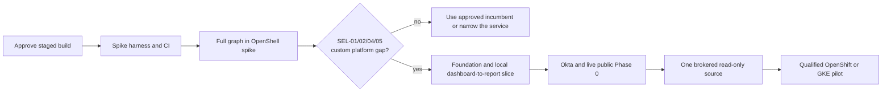

# Proposed application implementation plan

- **Status:** Awaiting user approval; no application code is running.
- **Scope:** Bounded public/synthetic feasibility spike, then—only if the selection gate passes—a fixture-backed application, live public research, one brokered read-only enterprise connector, and a qualified internal pilot.
- **Data boundary:** Synthetic/public data until the Phase 1 source, identity, runtime, and recovery gates pass.
- **Basis:** [Requirements](../requirements.md), [architecture](../architecture.md), [feasibility gate](../feasibility-and-market-assessment.md), [deployment topology](deployment-topology.md), and [delivery workflow](../../AGENTS.md#design-change-impact-gate).

## 1. Approval and first deliverable

The first deliverable is a **bounded feasibility decision**: a disposable, full-graph OpenShell runtime spike and a matched comparison against the available ChatGPT Enterprise path and a restricted worker. It uses public/synthetic cases and a small fixed source/evidence fixture; it does not build the dashboard, durable job system, broker, or production authorization controls. An approved real model is needed to complete the research-quality comparison. If the selection gate passes, the first application deliverable is a **local, fixture-backed dashboard-to-report path**: submit a question, see status, run the complete Deep Agents graph inside a job-bound OpenShell sandbox, and inspect a report with stored evidence after the sandbox is deleted.

Approval of this plan authorizes the staged application build, beginning with the bounded spike and its build hygiene. The dashboard/control-plane work proceeds under the same approval **when** the documented **SEL-01, SEL-02, SEL-04, and SEL-05** go/no-go decision shows a measured gap and narrow custom scope. Before that decision, compare the same cases in ChatGPT Enterprise and a restricted worker, and check whether an approved ChatGPT `search`/`fetch` MCP or plugin path closes the gap. Replit joins when its rollout permits under SEL-03. A failed or inconclusive gate stops the broad build until the gap is evidenced. Production promotion, enterprise-source access, and conditional Okta OBO, Okta for AI Agents, or direct OpenShell source paths remain subject to their separately documented owner and qualification gates.

## 2. Proposed implementation choices

Use a Python API/BFF, controller, model gate, broker, and in-sandbox Deep Agents worker; a TypeScript/React dashboard; PostgreSQL for job state, events, evidence metadata, and an initially bounded durable queue; and an object-store adapter for immutable evidence bytes. The local stack may use containerized PostgreSQL and a fixture object store. The queue must prove leasing, retry idempotency, cancellation, and crash recovery before live jobs; the authorization/revocation ledger for private work remains a separate recovery domain. Keep the browser on an opaque BFF cookie, with all Okta and source credentials server-side. The worker image contains the full planner, retriever, synthesizer, and verifier graph, not merely sandbox shell tools.

These are post-selection implementation choices, not claims of framework conformance. Milestone 0 records pinned spike versions and any changed choice in a reviewed design decision. Check the exact [OpenShell release](https://github.com/NVIDIA/OpenShell/releases), [Deep Agents release](https://github.com/langchain-ai/deepagents/releases), MCP client, and upstream APIs together; the repository's v0.1.5 design baseline and a previously observed 0.0.44 local CLI are not a compatibility result. The [delivery workflow](../../AGENTS.md#design-change-impact-gate) requires a new CR/ToDo intake pair for each baseline implementation slice that lacks one.

## 3. Milestones and exit evidence

| Milestone | Build work | Exit evidence |
|---|---|---|
| **0. Spike preparation** | Predeclare the 20–30-case public/synthetic rubric, create required baseline CR/ToDo pairs, pin the OpenShell/Deep Agents/model-client set for the spike, and build only a disposable full-graph harness with a fixed source/evidence fixture. The separate harness validates its required gateway/model fields and auth-reference mode fail-closed; only its host-side model relay resolves an approved secret or workload identity, never the worker. Add protected CI before merging executable spike code: `make check`, lint/type/unit checks, secret scan, resolved-dependency CVE scan, and SBOM/final-digest scan for every spike and OpenShell gateway/supervisor/runtime image actually used; include the controller image if Kubernetes is used. Keep [CR-0009](../change-requests/CR-0009-design-impact-traceability.md) and [CR-0010](../change-requests/CR-0010-build-configuration-contract.md) open until their implementation proof exists. | Reproducible, pinned, scanned spike artifacts and a predeclared comparison. No dashboard, database, private connector, or real source credential is needed. |
| **1. Runtime and selection gate** | Run the complete planner, retriever, synthesizer, and verifier graph **inside** a disposable OpenShell worker with a tiny spike harness for fixed stage IDs, a host-side isolated OpenShell CLI profile, a narrow approved-model relay that pins the model and caps spending, policy inspection, and cancellation/cleanup. Compare the same approved cases in a conventional restricted worker using the same fixture/evidence shape and in the available ChatGPT Enterprise workflow. Record whether an approved ChatGPT `search`/`fetch` MCP or plugin path suffices, and map any unmet four-control requirement to the narrowest custom scope. | Process-location, effective-policy, denied-direct-egress, and cleanup evidence; matched research quality, permission, latency, and cost scores; then an explicit **SEL-01/02/04/05 go/no-go before Milestone 2**. The harness does not claim production job identity, durable budgets, broker custody, or model-gate conformance. An approved real model is required to finish the value comparison. |
| **2. Engineering foundation and local public slice** | Only after the selection decision, implement [CR-0010](../change-requests/CR-0010-build-configuration-contract.md), pinned Python/UI locks, PostgreSQL and fixture object storage, dashboard, BFF/API, server-held job and visibility policy, durable queue, controller, restricted provisioner, worker, fixture broker boundary, model gate, progress/events, evidence capture, verifier, report store, and report/evidence reads. Use two synthetic users and tenants. Build a development image with fixture providers and a release image that excludes them; test signed-digest admission policy in a disposable Kubernetes cluster before the selected environment exists. Expand CI/SBOM/CVE scans to the exact final digests of all application images and the qualified OpenShell gateway/supervisor/runtime/controller images. | Local dashboard-to-cited-report path after sandbox deletion; wrong-user/tenant/job/attempt, stale-event, budget, cancellation, and cleanup denial tests. The release image rejects fixture/spike even if the env target claims `local`; policy-as-code and disposable-cluster tests deny the development digest even when its env claims a live profile. Repeat admission denial on the selected cluster before its first staging/production deployment. Missing live inputs fail closed. |
| **3. Live public Phase 0** | Integrate nonproduction Okta Web PKCE, current group membership and per-job selected-group access, separate controller/provisioner gateway clients, an approved model route, and approved public search/fetch. Qualify actual OpenShell gateway/supervisor policy and direct-egress denial. On Kubernetes, prove CNI ingress and egress enforcement; on a network-accessible VM, deploy only the verified signed release digest and prove the host firewall and OpenShell driver boundary. | [Phase 0](../requirements.md#phase-0-public-source-proof-of-concept) acceptance passes with two users and two tenants, exact group removal, source-free public research, citation replay, copied-bearer and network denial, and controlled cleanup. |
| **4. First enterprise connector** | Choose one source with its owner. Implement [CR-0001 through CR-0005](../decisions/0001-outbound-mcp-source-tokens.md#actionable-impact-register): versioned connection API, same-person binding, dashboard UX, read-only broker adapter, grant custody and revocation. Add a **second synthetic source partition** to prove private isolation and reviewed typed transfers before real data. Complete trusted evidence classification, sender-origin proof, independent denial/usage recovery, and private egress control. | Before any real private source data, the **complete [Phase 1 gate](../requirements.md#phase-1-read-only-enterprise-connectors)** passes, including source rights, B-only denial on A-derived B evidence, A→B→C laundering denial, transfer caps, and wrong-model/class cases. In particular, prove OAuth/MCP issuer/resource/audience, scope/argument and wrong-user/tenant denial, renewal and revocation; allowed and denied A→B transfers and foreign-source canary denial; over-class result quarantine before model release; old-backup revocation-ledger replay and stale worker/broker credential denial after restore; and a private shared-host egress bypass probe. Conditional OBO, AI Agents, and direct OpenShell source work stays deferred unless separately selected. |
| **5. Staging and limited pilot** | Qualify OpenShift first and GKE Standard as fallback on exact node/runtime/CNI/controller versions. Use fixed qualified worker capacity, bounded queue, and tenant concurrency limits; add autoscaling only after measured queue and node pressure. Run CVE/SBOM, backup/restore, observability, cost, and canary gates. | [Deployment promotion gates](deployment-and-operations.md#10-promotion-integration-gates) pass for the chosen environment, including a **live** signed-digest admission allow/deny probe before its first staging/production deployment; security/source/Okta owners approve actual enterprise access and retention. |

## 4. Inputs and when they are needed

The tracked [`.env.example`](../../.env.example) and ignored local `.env` are an **input worksheet**, not code-consumed configuration yet. They contain nonsecret endpoints, client IDs, and references to credentials. The disposable preselection harness will validate only its own required gateway/model inputs and keep the model credential in its host-side relay. The post-selection application loader will validate one profile at a time: `fixture` uses synthetic identity, source, and model; `sandbox_spike` permits only synthetic identity/source with an approved real model on a local disposable runtime; `live_public` requires Okta and qualified public routes; `enterprise` adds reviewed private sources. Build development fixture/spike providers into a separate artifact. The release image excludes those providers and rejects both profiles even if `RESEARCH_DEPLOYMENT_TARGET=local`; staging/production admission accepts only signed release digests, even if a development image declares a live profile. A network-accessible live public VM also runs a verified signed release digest. The env target is advisory, never proof of where code runs. The model gate must bind any env-supplied model values to a reviewed, release-pinned route catalog with exact endpoint, model ID, credential or workload-identity reference, maximum data class, and trace/retention policy. Tenant/group authorization maps, connector policy, source selectors, deployment choices, and version pins also belong in reviewed manifests rather than free-form env switches.

| When | Information needed from the user or owning team | Blocking now? |
|---|---|---|
| Start synthetic spike harness implementation | Approval of this staged plan. No external credentials or enterprise access. | **No** external values needed to start coding. |
| Complete live sandbox/model comparison | A disposable OpenShell runtime or permission to provision one, an isolated host-side gateway CLI profile, approved model provider/endpoint/ID/data class and credential or workload-identity reference, and an authorized employee/test owner able to run the same cases in the organization's ChatGPT Enterprise tenant and provide scored results. A public-search provider is needed for live web search, not fixed fixture cases. | Needed to finish the selection gate, not to start synthetic harness code. |
| Start full dashboard/control-plane build | A passing SEL-01/02/04/05 decision record identifying a measured gap and narrow custom scope. | **Yes** before Milestone 2. |
| Live Phase 0 | The [nonproduction Okta packet](../okta/requirements-and-design.md#8-responsibilities-and-delivery-packet): dashboard issuer/client/sign-in and sign-out redirects, gateway issuer/audience, separate controller and provisioner client IDs and secret references, test users and stable group IDs, and an approved current-membership source. | Needed before Okta conformance. |
| First private connector | Name the first approved source and owner; provide its data class, canonical MCP resource, issuer, acting user/app principal, read scopes, OAuth client registration/secret reference, resource selectors, renewal and revocation contract. | Needed before source implementation is finalized and before enterprise data. |
| Enterprise pilot | Select a qualified OpenShift or GKE environment and reviewed per-environment deployment manifest (cluster/namespace/project/region and image policy), cluster/registry access, retention and recovery targets, evidence store, secret manager, and security-owner finding/exception policy. | Needed before staging and promotion. |

Raw client secrets, API keys, OAuth grants, refresh tokens, service-account JSON, and worker bearers must not be supplied in `.env`, pull requests, or chat. Use the approved secret manager or an ignored local secret file reference for development.

## 5. Impact analysis for this planning change

This plan preserves the job, source, and model runtime boundaries. It introduces one independently verifiable configuration and release-artifact obligation, [DR-BUILD-001](#tracked-impact), including [OPS-13](../requirements.md#55-operations-and-governance), and puts the existing platform-selection gate before the broad implementation. Later component implementation creates its own intake pairs before code.

| Surface | Disposition | Revision or reason | Mapped impact ID |
|---|---|---|---|
| README | **Affected for navigation** | The [README](../../README.md#build-plan-and-inputs) links this plan and pair. | DR-BUILD-001 |
| Numbered requirements | **Affected for release safety** | [OPS-13](../requirements.md#55-operations-and-governance) makes fixture/spike artifact exclusion and independent staging/production admission testable. Existing SEL gates still precede the broad build. | DR-BUILD-001 |
| Architecture and detailed design | **Affected for build handoff** | The revised [architecture](../architecture.md#13-integration-gates-and-open-decisions) links the selection sequence and pair; [deployment operations](deployment-and-operations.md#build-security-and-cve-gate) adds the artifact/admission gate; the [Okta handoff](../okta/requirements-and-design.md#5-configuration-contract-handed-to-platform-team) names the sign-out input; [deployment topology](deployment-topology.md) retains its proposed platform choice and runtime boundaries. | DR-BUILD-001 |
| OpenAPI, JSON Schemas, and examples | **Not affected** | No runtime API or payload exists or changes in this planning step; later implementation uses the current contracts and creates change pairs if they evolve. | None |
| Component documentation, code, and configuration | **Affected** | [`.env.example`](../../.env.example) and an ignored `.env` record future nonsecret inputs; [CR-0010](../change-requests/CR-0010-build-configuration-contract.md) tracks the typed loader and validation. No service code reads these variables yet. | DR-BUILD-001 |
| Deployment, operations, and security controls | **Affected for configuration safety** | [`.gitignore`](../../.gitignore) excludes `.env` and `.secrets/`. [CR-0010](../change-requests/CR-0010-build-configuration-contract.md) requires independent release-image and admission guards; the [delivery workflow](../../AGENTS.md#initial-development-retire-unknowns-before-scaling-the-build) and deployment design now name this proof. Existing CVE and runtime proof gates remain in force. | DR-BUILD-001 |
| Tests, evaluations, and release gates | **Affected for planned proof** | The [paired ToDo](../todos/CR-0010-build-configuration-contract.md) names configuration allow/deny cases; [CR-0009](../change-requests/CR-0009-design-impact-traceability.md) already tracks protected CI. No live gate has run. | DR-BUILD-001 |

## Tracked impact

| Impact | Required change | Change request | Paired ToDo |
|---|---|---|---|
| DR-BUILD-001 | Make the development input contract safe and implement profile-specific validation and independent development-artifact exclusion after the selection gate | [CR-0010](../change-requests/CR-0010-build-configuration-contract.md) | [ToDo](../todos/CR-0010-build-configuration-contract.md) |
