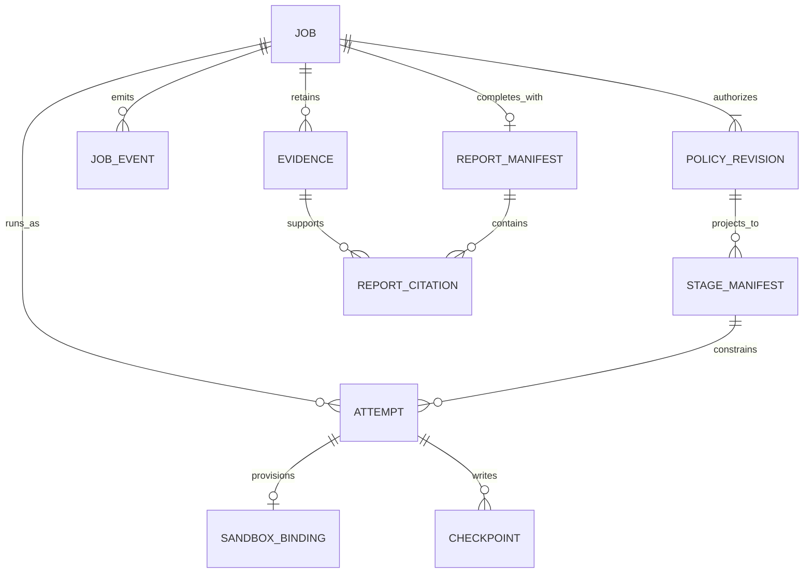
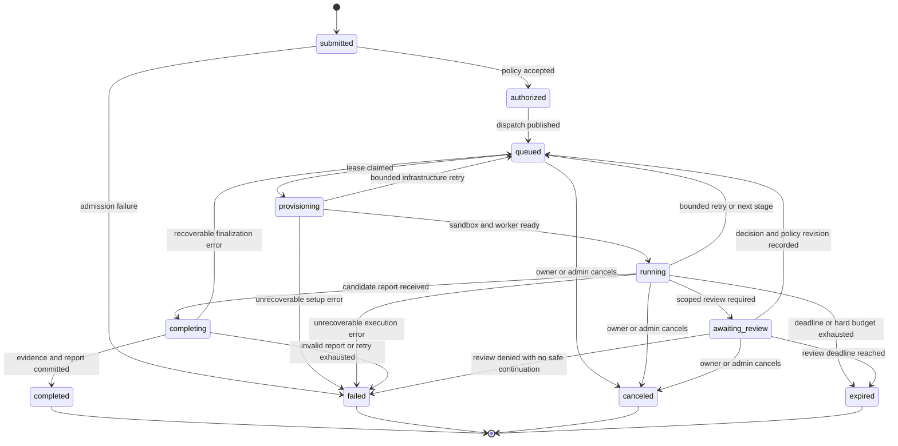
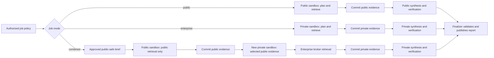

# Job lifecycle and controller design

**Status:** proposed design, 2026-10-23  
**Applies to:** one research job from admission through result retention  
**Related:** [requirements](../requirements.md), [target architecture](../architecture.md), [identity and access](identity-and-access.md), [research and evidence](research-and-evidence.md), [MCP connector broker](mcp-connector-broker.md), [deployment and operations](deployment-and-operations.md), [version 1 contracts](../../contracts/README.md).

This design puts the dashboard, API, job controller, queue, policy store, and artifacts outside OpenShell. Each research attempt runs the Deep Agents graph in an OpenShell sandbox. The API accepts a user request; only trusted admission code creates the policy used by the controller, worker, and broker. The [job request](../../contracts/job-request.schema.json), [policy](../../contracts/job-policy.schema.json), [stage manifest](../../contracts/stage-manifest.schema.json), [event](../../contracts/job-event.schema.json), [evidence](../../contracts/evidence.schema.json), and [report](../../contracts/report.schema.json) schemas are design contracts, not claims that an API already exists.

OpenShell supplies sandbox creation, inspection, process status, and deletion. The application supplies job admission, leases, retries, evidence commit, and authorization. OpenShell documents a trailing command as the sandbox's canonical main process, with `Completed` for exit code zero and `Error` for nonzero exits; these **sandbox phases are distinct from application job states**. Its `--detach` mode can run a background worker, and its default restart policy is `never`. [OpenShell sandbox management](https://docs.nvidia.com/openshell/how-it-works/sandboxes/overview).

## 1. Records and authority

| Record | Owner | Required meaning |
|---|---|---|
| Job | API/controller | Tenant, submitter, current application status, optimistic version, deadline, current attempt, terminal reason, retention policy. |
| Policy revision | Admission service | Immutable, server-held `job-policy` document and digest. A new revision never edits an old one. |
| Stage manifest | Controller | A bounded projection of one policy revision for one sandbox lane: `stage`, `research_brief`, sources, tools, model route, classification, limits, and optional evidence IDs. The controller records the image digest and OpenShell network/provider profile alongside its sandbox binding. A combined public manifest contains the approved public brief and public source/tool subset; the private manifest contains the full task and selected public evidence references. |
| Attempt and lease | Controller | Attempt ID, monotonically increasing fencing generation, OpenShell workspace and sandbox ID, lease deadline, heartbeat, cleanup state. |
| Event | API/controller | Append-only, per-job sequence following the `job-event` schema. The event log is the durable source for dashboard replay. |
| Evidence and checkpoint | Broker/worker via job API | Immutable evidence metadata and controlled source captures or graph state, bound to job, stage, attempt, digest, classification, and retention. |
| Report manifest | Finalizer | One committed report reference and verified citation set, visible only after finalization. |

The attempt ID, lease generation, policy revision, and cleanup state are internal storage metadata; they are not fields in the version 1 public event schema. A job ID is an identifier and never grants access. The API derives tenant and submitter from a verified Okta dashboard session. The worker must prove a short-lived identity bound to its job and current sandbox attempt before it can read its stage manifest or write an artifact. The broker checks that binding and the server-held policy on every protected tool call.



## 2. Application state machine

The only public status values are `submitted`, `authorized`, `queued`, `provisioning`, `running`, `awaiting_review`, `completing`, `completed`, `failed`, `canceled`, and `expired`, exactly as in the [event contract](../../contracts/job-event.schema.json). The state belongs to the job, while each retry creates a new attempt. `completed`, `failed`, `canceled`, and `expired` are terminal: no event or worker retry can move the job out of them.



The diagram shows the common paths. A valid cancel or expiry can win from **any nonterminal state**, including `completing`; a transaction compares the current state and version before setting a terminal status. If report commit wins first, a later cancel observes `completed` and does not delete or alter the report. If cancel wins first, finalization rejects the worker's commit. No transition from terminal `failed` back to `queued` is allowed; an operator retry of a terminal job creates a new job linked to the original for audit.

| Status | Entry condition | Exit condition or invariant |
|---|---|---|
| `submitted` | A well-formed request and idempotency reservation are durable. | Entitlement checks either create a policy or record a sanitized admission failure. Malformed payloads can be rejected before a job exists. |
| `authorized` | Source grants, resource selectors, model route, quotas, classification, and deadline are resolved into an immutable policy snapshot. | The transactional outbox dispatches the job; a publisher retry cannot create a second job. |
| `queued` | Job is eligible for a capacity slot or a bounded retry. | Controller claims a generation-fenced lease; absolute deadline and remaining budget still apply. |
| `provisioning` | Attempt exists with a stage manifest and deterministic sandbox binding. | Effective OpenShell policy and provider attachments pass validation; the canonical worker starts and authenticates. |
| `running` | Current worker has reported readiness under a valid lease. | Trusted stage events, tool calls, checkpoints, and evidence writes may proceed within policy. |
| `awaiting_review` | A bounded decision or reconnect request is durable; the worker is paused and its active sandbox is reclaimed. | Approved continuation creates a new immutable policy revision if access changes, then queues a fresh attempt. Denial, cancel, or deadline ends the job. |
| `completing` | Worker has submitted a candidate report and stopped new retrieval. | Finalizer validates citations, classification, and artifacts, then atomically publishes the report pointer. |
| `completed` | Verified report manifest is committed. | Cleanup may still be pending internally; authorized viewers can read the report. |
| `failed` | A permanent error or exhausted retry budget is recorded. | No further worker or broker access. Sanitized reason remains for the dashboard and full reason for audit. |
| `canceled` | Authorized cancellation wins the terminal compare-and-swap. | Broker access is revoked, sandbox deletion is requested, and cleanup is reconciled. |
| `expired` | Absolute deadline or hard work budget wins the terminal compare-and-swap. | Same revocation and cleanup as cancellation; remaining budget is not refreshed. |

The dashboard reads the current snapshot and an append-only event stream. A status event is written in the same database transaction as the corresponding state change, with a unique `event_id` and strictly increasing per-job `sequence`. Progress, warning, error, and evidence events use the same schema but do not change the authoritative status. The API can provide Server-Sent Events with a replay cursor such as `Last-Event-ID`; each stream and artifact request is reauthorized by tenant and user. The browser never opens an inbound connection to the sandbox. Events contain stage names, counts, sanitized messages, and evidence IDs, not raw source text, bearer tokens, or model chain-of-thought.

## 3. Admission, dispatch, and normal execution

`POST /v1/jobs` accepts an untrusted request plus an `Idempotency-Key`. With the backend-for-frontend cookie session, the API also requires `X-CSRF-Token` and validates `Origin` for this mutation, as specified in [OpenAPI](../../contracts/openapi.yaml). The API keys deduplication by tenant, verified user subject, and key; a repeated key with the same normalized request returns the original job ID, while a different request with that key is rejected. Admission resolves `connection_ref` and resource IDs server-side, checks source and model entitlements, selects a budget preset, determines data classification, and freezes the [policy](../../contracts/job-policy.schema.json). A public-bound question or brief passes a data-classification and DLP screen before dispatch; a combined job additionally requires explicit review of the exact `public_research_brief` that will reach public search and the public model route. An ambiguous or sensitive brief is rejected for public dispatch. Browser-provided tenant IDs, scopes, token strings, and tool authority are ignored or rejected.

The job row, policy revision, first status events, and dispatch outbox record are committed transactionally. An outbox publisher places a queue message and advances `authorized` to `queued` idempotently. If publishing fails, the outbox remains pending; if delivery repeats, only one controller can claim the current lease. The queue is an at-least-once notification mechanism, not the authoritative state store.

```mermaid
sequenceDiagram
    autonumber
    actor User as Researcher
    participant API as Dashboard API
    participant Admit as Policy admission
    participant DB as Job store and outbox
    participant Q as Durable queue
    participant C as Controller
    participant G as OpenShell gateway
    participant W as Sandbox worker
    participant B as MCP broker
    participant F as Finalizer and artifact store

    User->>API: Submit request and idempotency key
    API->>API: Validate Okta session and request shape
    API->>Admit: Verified tenant and user, selected sources
    Admit->>Admit: Resolve grants, limits, class, model, expiry
    Admit->>DB: Commit job, policy snapshot, events, outbox
    API-->>User: Job ID and current status
    DB->>Q: Publish dispatch from outbox
    Q->>C: Deliver job ID, possibly more than once
    C->>DB: Claim lease and fencing generation
    C->>DB: Mark provisioning and bind intended sandbox name
    C->>G: Create pinned worker sandbox with stage policy
    G-->>C: Sandbox ID and status
    C->>DB: Record sandbox ID and matching policy digest; enable manifest
    W->>API: Authenticate, fetch own stage manifest
    API-->>W: Bounded manifest and checkpoint pointer
    C->>DB: Mark running after worker readiness
    W->>B: Read-only tool call under job identity
    B->>DB: Check current attempt and policy
    B-->>W: Bounded result and evidence ID
    W->>API: Progress, checkpoint, evidence, candidate report
    API->>F: Verify and commit report
    F->>DB: Set completing then completed with report pointer
    C->>G: Delete sandbox after commit
    API-->>User: Replay events and serve authorized result
```

The controller creates the sandbox from an image digest containing the worker code and starts a small canonical command with only an opaque job/attempt locator. It does not put a source token, controller secret, or full prompt on the command line. OpenShell notes that `--upload` cannot be combined with a trailing main command because upload finishes after the process starts; baking the worker into the image avoids that race. [OpenShell sandbox management](https://docs.nvidia.com/openshell/how-it-works/sandboxes/overview). The initial design retains the sandbox until the report or failure record is committed, then explicitly deletes it. `--no-keep` is suitable later only if all required artifacts have reached the external store before process exit and no post-exit sandbox transfer is needed.

The controller checks the sandbox's effective policy after provider attachment and before marking the job `running`. Because a canonical process may start before that post-create inspection, the job API withholds the stage manifest and the broker denies tools until the controller records a matching effective policy digest and marks the attempt ready. The bootstrap worker initially knows only an opaque locator. OpenShell may hold a sandbox in `Provisioning` with `ConfigurationInvalid` if policy or provider admission fails, and an existing sandbox may temporarily return to `Provisioning` while its supervisor reconnects after a gateway restart. The controller must inspect conditions and apply a bounded timeout instead of treating a transient phase as immediate job failure. [OpenShell sandbox lifecycle](https://docs.nvidia.com/openshell/how-it-works/sandboxes/overview).

## 4. Leases, attempts, retries, and reconciliation

Every queue claim creates or renews a controller lease with a monotonically increasing **fencing generation**. Each worker attempt receives a distinct identity bound to the job, stage, sandbox, and generation. The job API and broker reject writes and calls from an older generation, even if its process is still running. Heartbeats update the lease; a lost heartbeat starts a grace period and reconciliation, not an immediate second live worker. The controller records a deterministic sandbox name or idempotency key based on job, stage, and attempt before calling OpenShell, so a crash after creation can adopt the matching sandbox only after validating its image digest, workspace, policy digest, and labels.

```mermaid
sequenceDiagram
    autonumber
    participant Q as At-least-once queue
    participant C1 as Controller A
    participant DB as Job and lease store
    participant G as OpenShell gateway
    participant W1 as Attempt 1 worker
    participant R as Reconciler or Controller B
    participant W2 as Attempt 2 worker
    participant B as Job API and broker

    Q->>C1: Deliver job twice
    C1->>DB: Claim current lease, generation 1
    DB-->>C1: Lease granted
    C1->>G: Create sandbox for attempt 1
    G-->>C1: Sandbox created
    W1->>B: Event and tool call, generation 1
    B-->>W1: Accepted while lease current
    Note over C1,DB: Controller crashes or stops heartbeating
    R->>DB: Observe expired lease and reconcile sandbox
    R->>G: Inspect and stop or delete attempt 1
    R->>DB: Fence generation 1; claim generation 2
    R->>G: Create sandbox for attempt 2
    W1->>B: Late event or tool call, generation 1
    B-->>W1: Reject stale attempt
    W2->>B: Resume at durable stage, generation 2
    B-->>W2: Accepted under remaining policy budget
```

OpenShell's own restart policy stays `never` for these workers. If the gateway restarted a canonical process automatically, the controller could lose the one-to-one relation between an application attempt and its process execution. The controller handles bounded retries from external state. The application does not assume in-sandbox scratch files survive deletion or a driver restart. LangGraph checkpoints graph state at node boundaries, but a failed node can run again from its beginning. Its in-memory checkpointer does not survive process restarts; enterprise recovery therefore needs a persistent checkpointer or exported stage artifacts. [LangGraph persistence](https://docs.langchain.com/oss/python/langgraph/persistence), [Thinking in LangGraph](https://docs.langchain.com/oss/python/langgraph/thinking-in-langgraph).

| Case | Controller behavior | Budget and side-effect rule |
|---|---|---|
| Duplicate queue delivery | Existing lease holder proceeds; duplicate message is acknowledged. | No second sandbox is created. |
| Controller crash after OpenShell create | Reconciler finds the deterministic sandbox binding and adopts it only if labels and digests match; otherwise delete and retry. | A different sandbox with the same name is never trusted. |
| Worker crash or nonzero main exit | Inspect OpenShell condition and last durable checkpoint; delete old sandbox, then requeue if retryable. | No `failed` status until retries are exhausted. |
| Worker exit zero without committed report | Treat as incomplete; attempt a bounded recovery or fail. | OpenShell `Completed` is not job `completed`. |
| Transient source or model error | Use connector-specific retry limits, backoff with jitter, and `Retry-After` where supplied. | Every attempt counts toward deadline, tool, token, and source budgets. |
| Denied grant, invalid policy, unsupported MCP flow | Stop affected call and do not silently switch identity or tool. | Usually requires review or permanent failure, not blind retry. |
| Report already committed, cleanup fails | Keep job `completed`; alert and retry deletion through the reconciler. | Report stays immutable and accessible to authorized viewers. |

Tool calls are reads in the initial product, but repeated reads can still cost money, consume rate limits, and produce different data. Assign a stable logical call ID for replay and deduplicate evidence writes by job, source locator, and content digest where appropriate. The broker charges attempted calls at the trusted boundary before forwarding them; the job API accepts one event per event ID and one artifact per content digest. Final report publication uses a transaction that checks the current fencing generation and nonterminal status. This gives idempotent *effects at the project boundary*, not a claim of exactly-once execution by OpenShell, the queue, or LangGraph.

The reconciler periodically compares nonterminal jobs, leases, and OpenShell sandbox listings. It requeues eligible orphaned jobs, fences stale attempts, deletes unbound sandboxes carrying this project's labels, and records cleanup failures. OpenShell deletion can return while cleanup is pending; an accepted deletion is followed by inspection until the sandbox is absent. An already absent sandbox is a successful cleanup outcome. [OpenShell deletion semantics](https://docs.nvidia.com/openshell/how-it-works/sandboxes/overview).

## 5. Research stage and trust boundaries

For a public-only job, one sandbox performs plan, bounded public retrieval, synthesis, citation verification, and report submission. For a private-only job, one sandbox has only the enterprise broker, job API, and approved model route. For a combined job, the controller uses **separate stage manifests and separate sandboxes**. The public lane receives only the reviewed `public_research_brief`, public source selectors, public tools, and a public-approved model route; it receives no full question, private evidence, private source IDs, or enterprise connector capability. Its evidence is committed to the controlled store. A private lane then reads selected public evidence from that store, receives the full question and authorized enterprise source selectors, performs enterprise retrieval, synthesis, and verification, and has no public-web egress. The model endpoint is approved for the resulting classification. [OpenShell security best practices](https://docs.nvidia.com/openshell/security/best-practices).



The [job request contract](../../contracts/job-request.schema.json) requires a `public_research_brief` for combined mode; the trusted admission path records the reviewed copy and `public_brief_approval_ref` in the [job policy](../../contracts/job-policy.schema.json). Schema presence alone does not make the text safe: the dashboard must show the exact public-bound text and destination, record explicit submitter approval, and run the tenant's data-classification/DLP checks. Admission rejects the combined job if approval is missing, the brief is ambiguous or sensitive, or the stage projection cannot be proven. A private worker cannot construct arbitrary public web queries from private evidence. This is an application implementation gate, not a capability OpenShell supplies.

Stage boundaries are durable commits, not just log messages. The controller derives a [stage manifest](../../contracts/stage-manifest.schema.json) from the current policy revision and stored task request; request text supplies research data, never authority. The worker cannot supply or widen the manifest. For combined mode, the public `research_brief` is the approved `public_research_brief`, its sources are `public_web` only, its classification is `public`, and it has no `context_evidence_ids`. The enterprise `research_brief` is the full question, its sources exclude `public_web`, and `context_evidence_ids` can contain only reviewed public evidence. Each stage's limits must fit within the remaining cumulative job budget; changing stages never resets usage. A completed stage writes an output manifest containing its policy digest, image digest, checkpoint reference, evidence IDs, classification, and remaining budget. The controller then deletes the completed stage sandbox and moves the same job from `running` to `queued` for the next authorized stage. The next sandbox receives only the inputs its stage manifest permits. Every stage repeats authorization against the current job and source grants before it starts. The external artifact store holds the authoritative checkpoints; ephemeral sandbox scratch is disposable. Public and private stages use distinct OpenShell network and provider profiles, and neither may broaden the original job policy. [Research and evidence design](research-and-evidence.md) specifies the evidence verifier.

## 6. Review, cancellation, expiry, and revocation

`awaiting_review` is a durable application pause for a named decision such as a requested source expansion or a connection that needs user reauthorization. The worker records an interrupt/checkpoint, the controller revokes its attempt identity and deletes its sandbox, and the dashboard presents the exact proposed source, resource, tool, and data destination. An authorized human can approve a **new immutable policy revision** or decline. Approval creates a new stage manifest and queued attempt; the old sandbox and policy revision never gain new capabilities. If the original scope supports a useful partial result, the reviewer may explicitly choose continuation under the original revision. The absolute job deadline continues during review. LangGraph/Deep Agents require a checkpointer for human-in-the-loop resume, and an interrupted node can rerun code before the interrupt; place the review operation in a separate node and make any earlier effects idempotent. [Deep Agents human review](https://docs.langchain.com/oss/python/deepagents/human-in-the-loop), [LangGraph interrupts](https://docs.langchain.com/oss/python/langgraph/interrupts).

```mermaid
sequenceDiagram
    autonumber
    participant W as Current sandbox worker
    participant API as Job API and store
    participant C as Controller
    participant G as OpenShell gateway
    actor U as Authorized reviewer
    participant A as Admission service
    participant Q as Queue

    W->>API: Checkpoint and request specific review
    API->>API: Set awaiting_review; record exact proposal
    API->>C: Revoke current attempt
    C->>G: Delete paused sandbox
    API-->>U: Show proposed access and consequence
    U->>API: Approve, decline, or continue within old scope
    API->>A: Recheck reviewer, grants, class, limits, deadline
    alt Approved expansion
        A->>API: Store immutable successor policy revision
        API->>Q: Queue new stage and attempt
    else Continue with old scope
        API->>Q: Queue new attempt under old revision
    else Declined without safe continuation
        API->>API: Set failed with sanitized reason
    end
```

Cancellation is an authenticated, idempotent API operation for the owner or an authorized administrator. The API first performs a terminal compare-and-swap, appends a status/audit event, and revokes the job's worker and broker grants. The controller then stops and deletes the sandbox and releases capacity after verifying removal. Expiry follows the same path when `expires_at` or a hard budget is reached. Neither a retry nor human review extends `expires_at`; only a new job can receive a new budget and deadline. Cleanup status is internal so a delayed OpenShell delete cannot make a terminal job runnable again.

```mermaid
sequenceDiagram
    autonumber
    actor U as User or expiry timer
    participant API as Job API
    participant DB as Job store
    participant B as MCP broker
    participant W as Worker
    participant C as Controller
    participant G as OpenShell gateway

    U->>API: Cancel job or enforce deadline
    API->>DB: Terminal compare-and-swap plus event
    alt Terminal transition wins
        DB-->>API: canceled or expired
        API->>B: Revoke job and attempt authority
        API->>C: Enqueue sandbox cleanup
        W->>API: Late report finalization
        API-->>W: Reject terminal job
        C->>G: Delete sandbox
        C->>G: Inspect until absent
    else Report commit already won
        DB-->>API: completed
        API-->>U: Already completed; result unchanged
    end
```

When a source grant is revoked while a job runs, the broker denies the **next** protected call and emits a typed, sanitized access failure. An upstream read already in flight may have occurred; the broker checks the grant again before returning its response, discards results if it is revoked, and records the race in audit. The controller also invalidates current attempt authority and closes the sandbox if that source is essential. A reconnect can enter `awaiting_review` only after the old worker is fenced; otherwise the job fails with a source-specific reason or completes an explicitly marked partial result under the original policy. The broker never switches from a revoked user grant to a broader app grant. A user's loss of source access after completion also affects report and evidence reads: the dashboard rechecks access when serving them.

## 7. Progress, artifacts, and finalization

The job API accepts worker progress only from the current attempt. Progress percentages come from trusted stage completion and bounded counters; a model-generated percentage or free-form tool text is never treated as authority. The API coalesces high-volume token/tool updates, stores a useful durable event history, and streams sanitized events to the dashboard. The dashboard can reconnect and replay from a sequence number, then fetch the authoritative job snapshot to resolve gaps.

Evidence objects are written to a tenant-scoped staging area with content digests and access labels. The finalizer validates that every report citation points to a retained evidence ID from the same job, that the report classification is at least as restrictive as its evidence, and that the report conforms to the [report schema](../../contracts/report.schema.json). Its final transaction also checks the current attempt, nonterminal status, remaining budget, and `now < expires_at`; a delayed expiry timer cannot let a late report bypass the deadline. It then commits the report manifest and `completed` status; object storage blobs are already durable before their manifest is published. Unreferenced staging objects are garbage-collected later. A worker exiting zero without this commit does not produce a completed job. A report that cannot pass validation is corrected within remaining budget or ends as `failed`/`expired` with a clear limitation.

## 8. Verification gates

| Gate | Required proof |
|---|---|
| Admission and idempotency | Duplicate `POST /v1/jobs` and duplicate queue deliveries create one job, one active lease, and at most one live sandbox attempt. Unauthorized source IDs never reach OpenShell. |
| State integrity | Every emitted status validates against the event schema. Competing cancel, expiry, retry, and report commit produce exactly one terminal outcome. |
| Fencing | A stale worker after lease loss cannot call the broker, append progress/evidence, or commit a report. |
| Recovery | Kill the controller after sandbox create, the worker during retrieval, and the finalizer before report-pointer commit. Reconciliation leaves no unbound live sandbox and follows the documented retry rule. |
| Cleanup | Successful, failed, canceled, expired, and review-paused attempts all request deletion; the controller observes deletion to completion and raises an alert on persistent failure. |
| Review | No new source, model, tool, or endpoint is usable until reviewer authorization creates a successor policy revision and a fresh sandbox attempt. |
| Combined lanes | Public worker receives only an approved public-safe brief; private evidence cannot flow to a public-web tool; the private sandbox has no public-web egress. Combined admission stays disabled until this is demonstrated. |
| Artifacts and privacy | Report citations resolve to retained evidence; artifact access is tenant and source authorized at read time; events and logs contain no reusable credential or raw restricted source text. |
| Limits | Absolute deadline and cumulative budgets survive retry and review. A hard model-token budget is claimed only after a trusted meter/proxy or provider-side enforcement proves it, rather than relying solely on worker self-report. |

## Primary documentation

- [NVIDIA OpenShell: manage sandboxes, canonical process, lifecycle, and deletion](https://docs.nvidia.com/openshell/how-it-works/sandboxes/overview).
- [NVIDIA OpenShell: security best practices and permitted endpoint risk](https://docs.nvidia.com/openshell/security/best-practices).
- [LangGraph persistence and production checkpointers](https://docs.langchain.com/oss/python/langgraph/persistence).
- [LangGraph node checkpoints and retry behavior](https://docs.langchain.com/oss/python/langgraph/thinking-in-langgraph).
- [LangGraph interrupt replay and idempotent side effects](https://docs.langchain.com/oss/python/langgraph/interrupts).
- [Deep Agents human-in-the-loop behavior](https://docs.langchain.com/oss/python/deepagents/human-in-the-loop).
