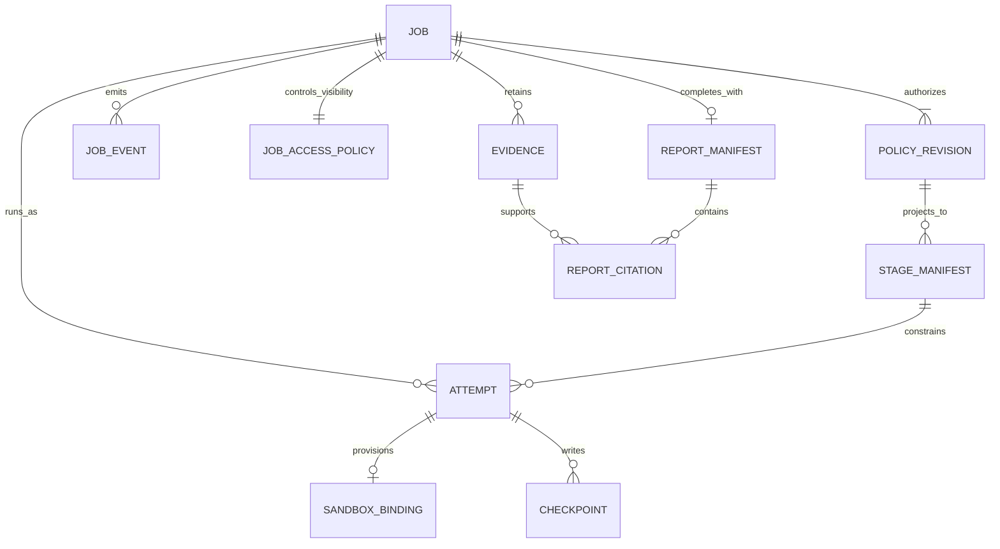
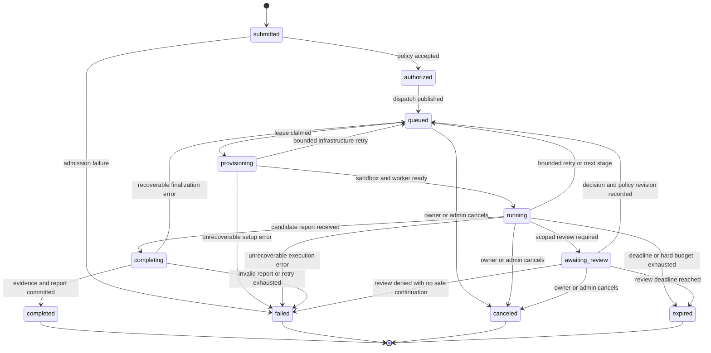
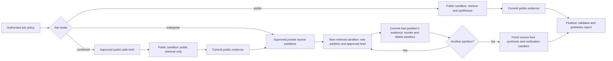

# Job lifecycle and controller design

**Status:** proposed design, 2026-10-23  
**Applies to:** one research job from admission through result retention  
**Related:** [requirements](../requirements.md), [target architecture](../architecture.md), [identity and access](identity-and-access.md), [research visibility](research-visibility.md), [research and evidence](research-and-evidence.md), [MCP connector broker](mcp-connector-broker.md), [deployment and operations](deployment-and-operations.md), [version 1 contracts](../../contracts/README.md).

This design puts the dashboard, API, job controller, queue, policy store, and artifacts outside OpenShell. Each research attempt runs the Deep Agents graph in an OpenShell sandbox. The API accepts a user request; only trusted admission code creates the policy used by the controller, worker, and broker. The [job request](../../contracts/job-request.schema.json), [policy](../../contracts/job-policy.schema.json), [stage manifest](../../contracts/stage-manifest.schema.json), [event](../../contracts/job-event.schema.json), [evidence](../../contracts/evidence.schema.json), and [report](../../contracts/report.schema.json) schemas are design contracts, not claims that an API already exists.

OpenShell supplies sandbox creation, inspection, process status, and deletion. The application supplies job admission, leases, retries, evidence commit, and authorization. OpenShell documents a trailing command as the sandbox's canonical main process, with `Completed` for exit code zero and `Error` for nonzero exits; these **sandbox phases are distinct from application job states**. Its `--detach` mode can run a background worker, and its default restart policy is `never`. [OpenShell sandbox management](https://docs.nvidia.com/openshell/how-it-works/sandboxes/overview).

## 1. Records and authority

| Record | Owner | Required meaning |
|---|---|---|
| Job | API/controller | Tenant, submitter, current application status, optimistic version, deadline, current attempt, terminal reason, retention policy. |
| Policy revision | Admission service | Immutable, server-held `job-policy` document and digest. A new revision never edits an old one. |
| Job access policy | Dashboard API | Separate server-held, versioned result audience: submitter plus optional approved Okta group selected at admission. Group access can be narrowed to submitter-only through an audited revocation; later named reader grants are audited. This policy changes result visibility and never changes worker/source authority. |
| Stage manifest | Controller | A bounded projection of one policy revision for one sandbox stage: `stage`, `research_brief`, sources, tools, `model_route` **policy alias**, classification, limits, and optional evidence IDs. The alias is resolved and enforced per request by the trusted model gate; the manifest alone cannot select a vendor model. The controller records the image digest and OpenShell network/provider profile alongside its sandbox binding. A combined public manifest contains only the approved public brief and public source/tool subset. Each private retrieval manifest contains one approved source partition and its brief; the source-free synthesis manifest contains the full question and curated evidence references. |
| Attempt and lease | Controller | Attempt ID, monotonically increasing job fencing generation, independently monotonic recovery generation, OpenShell workspace and sandbox ID, lease deadline, heartbeat, cleanup state. The recovery generation's current value lives outside application PITR. |
| Model usage ledger | Trusted model gate | Serializable per-job, per-stage, and per-attempt request, token, and estimated-cost reservations and verified settlements. It is independently recovered across application PITR, or affected jobs remain unable to spend or resume until complete usage is reconciled. |
| Job disclosure envelope | Policy service and independent authorization ledger | Monotonic union of exact private source/resource scopes admitted across all policy revisions and highest classification of question, attachments, stage context, trusted results, transferred dependencies, and report. A narrower successor policy never shrinks the full-report authorization floor. |
| Event | API/controller | Append-only, per-job sequence following the `job-event` schema. The event log is the durable source for dashboard replay. |
| Source evidence and checkpoint | Trusted broker/capture service for source evidence; worker for its bounded graph checkpoint | Source snapshots and provenance are created outside the worker from observed source bytes. Checkpoints carry only stage-scoped state and evidence IDs; both records bind to job, stage, attempt, classification, and retention. |
| Report manifest | Finalizer | One committed report reference and verified citation set, visible only after finalization. |

The attempt ID, lease generation, policy revision, and cleanup state are internal storage metadata; they are not fields in the version 1 public event schema. A job ID is an identifier and never grants access. The API derives tenant and submitter from a verified Okta dashboard session, then validates any requested group against current membership, tenant mapping, and group publishing policy before recording access-policy version 1. The worker must prove a short-lived identity bound to its job and current sandbox attempt before it can read its stage manifest or write an artifact. The broker checks that binding and the server-held execution policy on every protected tool call.



## 2. Application state machine

The only public status values are `submitted`, `authorized`, `queued`, `provisioning`, `running`, `awaiting_review`, `completing`, `completed`, `failed`, `canceled`, and `expired`, exactly as in the [event contract](../../contracts/job-event.schema.json). The state belongs to the job, while each retry creates a new attempt. `completed`, `failed`, `canceled`, and `expired` are terminal: no event or worker retry can move the job out of them.



The diagram shows the common paths. A valid cancel or expiry can win from **any nonterminal state**, including `completing`; a transaction compares the current state and version before setting a terminal status. If report commit wins first, a later cancel observes `completed` and does not delete or alter the report. If cancel wins first, finalization rejects the worker's commit. No transition from terminal `failed` back to `queued` is allowed; an operator retry of a terminal job creates a new job linked to the original for audit.

| Status | Entry condition | Exit condition or invariant |
|---|---|---|
| `submitted` | A well-formed request and idempotency reservation are durable. | Entitlement checks either create a policy or record a sanitized admission failure. Malformed payloads can be rejected before a job exists. |
| `authorized` | Source grants, resource selectors, model route, quotas, classification, and deadline are resolved into an immutable policy snapshot. | The transactional outbox dispatches the job; a publisher retry cannot create a second job. |
| `queued` | Job is eligible for a capacity slot or a bounded retry. | Controller claims a generation-fenced lease; absolute deadline and remaining budget still apply. |
| `provisioning` | Attempt exists with a stage manifest and deterministic sandbox binding. | Effective OpenShell policy and provider attachments pass validation; the canonical worker starts and authenticates. |
| `running` | Current worker has reported readiness under a valid lease. | Stage events, tool calls, and checkpoints may proceed within policy; only the trusted capture path can commit canonical source evidence. |
| `awaiting_review` | A bounded decision or reconnect request is durable; the worker is paused and its active sandbox is reclaimed. | Approved continuation creates a new immutable policy revision if access changes, then queues a fresh attempt. Denial, cancel, or deadline ends the job. |
| `completing` | Worker has submitted a candidate report and stopped new retrieval. | Finalizer validates citations, classification, and artifacts, then atomically publishes the report pointer. |
| `completed` | Verified report manifest is committed. | Cleanup may still be pending internally; authorized viewers can read the report. |
| `failed` | A permanent error or exhausted retry budget is recorded. | No further worker or broker access. Sanitized reason remains for the dashboard and full reason for audit. |
| `canceled` | Authorized cancellation wins the terminal compare-and-swap. | Broker access is revoked, sandbox deletion is requested, and cleanup is reconciled. |
| `expired` | Absolute deadline or hard work budget wins the terminal compare-and-swap. | Same revocation and cleanup as cancellation; remaining budget is not refreshed. |

The dashboard reads the current snapshot and an append-only event stream. A status event is written in the same database transaction as the corresponding state change, with a unique `event_id` and strictly increasing per-job `sequence`. Progress, warning, error, and evidence events use the same schema but do not change the authoritative status. The API can provide Server-Sent Events with a replay cursor such as `Last-Event-ID`; it checks the current tenant, submitter/group/reader entitlement, and session before every replay batch and event and closes an open stream when access is revoked. The browser never opens an inbound connection to the sandbox. A trusted API maps worker progress and typed internal failures to fixed, sanitized event templates, coarse `stage` values, and finite warning/error `issue_code` values. It never forwards worker text, source snippets, source or resource names, raw vendor errors, bearer tokens, or model chain-of-thought to event viewers. Evidence IDs, when included, remain locators checked again on dereference.

## 3. Admission, dispatch, and normal execution

`POST /v1/jobs` accepts an untrusted request plus an `Idempotency-Key`. With the backend-for-frontend cookie session, the API also requires `X-CSRF-Token` and validates `Origin` for this mutation, as specified in [OpenAPI](../../contracts/openapi.yaml). The API keys deduplication by tenant, verified user subject, and key; a repeated key with the same normalized request returns the original job ID, while a different request with that key is rejected. Admission resolves `connection_ref` and resource IDs server-side, checks source and model entitlements, selects a budget preset, determines data classification, and freezes the [execution policy](../../contracts/job-policy.schema.json). It separately validates the request's `visibility_selection`: the submitter or one allowlisted Okta group ID that the submitter currently belongs to and may publish to in the selected tenant. An unapproved group or a group audience unsupported by the selected private-source authorization adapters is rejected before provisioning. A public-bound question or brief passes a data-classification and DLP screen before dispatch; a combined job additionally requires explicit review of the exact `public_research_brief` that will reach public search and the public model route. An ambiguous or sensitive brief is rejected for public dispatch. Browser-provided tenant IDs, scopes, token strings, and tool authority are ignored or rejected.

The job row, execution-policy revision, initial access-policy version, first status events, and dispatch outbox record are committed transactionally. An outbox publisher places a queue message and advances `authorized` to `queued` idempotently. If publishing fails, the outbox remains pending; if delivery repeats, only one controller can claim the current lease. The queue is an at-least-once notification mechanism, not the authoritative state store.

The sequence below shows one public-only job. Private jobs repeat provisioning for each partition-scoped retrieval stage and a later source-free synthesis stage; those stages do not share a sandbox or worker credential.

```mermaid
sequenceDiagram
    autonumber
    actor User as Researcher
    participant API as Dashboard API
    participant Admit as Policy admission
    participant DB as Job store and outbox
    participant Q as Durable queue
    participant C as Controller
    participant P as Credential provisioner
    participant G as OpenShell gateway
    participant W as Sandbox worker
    participant B as Public search/fetch broker
    participant F as Finalizer and artifact store

    User->>API: Submit request and idempotency key
    API->>API: Validate Okta session and request shape
    API->>Admit: Verified tenant and user, selected sources
    Admit->>Admit: Resolve grants, limits, class, model, expiry
    Admit->>DB: Commit job, policy snapshot, events, outbox
    API-->>User: Job ID and current status
    DB->>Q: Publish dispatch from outbox
    Q->>C: Deliver job ID, possibly more than once
    C->>DB: Claim lease and fencing generation
    C->>DB: Mark provisioning and bind intended sandbox name
    C->>P: Reserve per-attempt Job API and model-gate providers with invalid sentinels
    P->>G: Create providers for exact worker API and internal model-gate endpoints
    C->>G: Create pinned sandbox with both providers and stage policy
    G-->>C: Immutable sandbox ID and status
    C->>DB: Bind sandbox ID to job, stage, attempt, generation
    W->>API: Invalid per-attempt sentinel bootstrap probe
    API-->>C: Probe observed; no worker authority granted
    C->>P: Issue separate Job API and model-gate credentials after binding
    P->>DB: Store audience-separated credential hashes and scopes, inactive
    P->>G: Update each same provider value and expiry
    G-->>P: Mutation receipt IDs for attached sandbox
    P-->>C: Receipt IDs only; no raw credentials
    C->>G: Wait for exact sandbox/provider/receipt status for both
    G-->>C: Current supervisor reports ready
    C->>G: Inspect full effective policy and provider state
    C->>DB: Commit attempt ready; enable manifest and model gate
    W->>API: Send opaque placeholder; fetch own stage manifest
    API-->>W: Bounded manifest and checkpoint pointer
    C->>DB: Mark running after worker readiness
    W->>B: Read-only public tool call with broker audience
    B->>DB: Check current attempt and policy
    B->>B: Classify captured response before worker release
    B-->>W: Bounded result and evidence ID
    W->>API: Progress, checkpoint, evidence IDs, candidate report
    API->>F: Verify and commit report
    F->>DB: Set completing then completed with report pointer
    C->>G: Delete sandbox after commit
    API-->>User: Replay events and serve authorized result
```

### Phase 0 worker identity and bootstrap

The Phase 0 public worker uses an **application credential for the worker Job API**, separate from the dashboard session, controller's OpenShell gateway token, broker credential, model credential, and any source OAuth grant. Its credential is a cryptographically random opaque bearer of at least 256 bits. The Job API stores only its hash and a server-side record containing tenant, job, stage, attempt, OpenShell workspace and immutable sandbox ID, job fencing generation, **external recovery generation**, policy digest, `worker-job-api` audience, activation state, expiry, and revocation state. The Job API checks the current generation from the independent recovery domain, not a value restored with this record. The raw value goes only through the privileged provisioner to OpenShell's credential store. Its proposed maximum lifetime is 15 minutes and never extends past the job deadline; longer attempts rotate it ahead of expiry. The provider's expiry metadata may never outlive the application's credential expiry. A separate broker-audience credential and provider are required if this worker calls the broker; the Job API and broker reject each other's credentials.

OpenShell v0.1.5 supplies a workable static-placeholder bootstrap, but the order matters. Before sandbox creation, a Workspace Admin provisioner creates a **per-attempt provider instance** from a reviewed profile scoped to the worker API host and path, with `stable_placeholder: true` and a unique, authorization-inert sentinel value. Its provider expiry must exceed the configured maximum provisioning timeout plus clock skew, because OpenShell omits an already-expired credential when constructing the worker environment. The sentinel cannot authorize Job API operations throughout that window. The controller attaches that provider **at sandbox creation**. The canonical worker starts with the OpenShell-issued opaque environment placeholder and only an opaque job/attempt locator; it sends `Authorization: Bearer <placeholder>` to its exact Job API endpoint and polls the manifest with bounded backoff. The Job API recognizes the unique invalid sentinel's hash and records a bootstrap probe for this attempt without granting any authority; absence of that probe before the provisioning timeout causes sandbox deletion and a fresh attempt, not an update to a process missing its placeholder. After OpenShell returns the immutable sandbox ID, the controller commits the job/stage/attempt/generation/sandbox binding and confirms the bootstrap probe; only then does the provisioner mint the real credential, register its hash as inactive, and update **only the value and expiry** of the same provider. The provisioner sends the resulting target receipt ID, never the raw credential, to the controller over their authenticated internal channel. The controller waits on `GetSandboxProviderStatus` for the exact workspace, sandbox, provider, and receipt ID, verifies that the **current supervisor** reports `ready`, then inspects the full effective policy and matching provider attachment before atomically marking the attempt ready. The Job API may now accept the credential and return the stage manifest. An empty target set, persisted or timed-out update, stale/superseded receipt, or readiness for another sandbox is not sufficient. If the v0.1.5 gateway, supervisor, or profile cannot support stable placeholders, provisioning fails closed until a separately tested bootstrap is selected. Static `auth_style: bearer` metadata does not inject the header; the worker client must place the opaque placeholder in it. [OpenShell provider profiles and stable placeholders, v0.1.5](https://docs.nvidia.com/openshell/v0.1.5/how-it-works/providers/profiles), [OpenShell provider status RPC, v0.1.5](https://github.com/NVIDIA/OpenShell/blob/v0.1.5/proto/openshell.proto).

The internal model gate has its own per-attempt, model-audience provider instance, exact internal endpoint, and inert sentinel attached at sandbox creation. Its credential is minted only after the immutable sandbox binding is reconciled and is inactive until **both** its exact current-supervisor provider receipt and the Job API provider receipt, matching full effective policy, current job fence and external recovery generation, and manifest readiness are committed in one authoritative attempt-ready transition. The model gate checks this state on every call rather than trusting its attached provider, a claimed manifest, or the caller's process role. An early model request from the canonical main process or a Workspace User's broad `exec`, including after uncertain `CreateSandbox` completion, receives a denial with no upstream vendor request. Separate gate and Job API audiences cannot be substituted. Private model calls also require authenticated sender origin; a copied raw bearer does not prove its source sandbox. [OpenShell inference, v0.1.5](https://docs.nvidia.com/openshell/v0.1.5/how-it-works/inference).

These are distinct gateway principals in a named workspace with role and scope enforcement enabled. The controller is a Workspace User with `sandbox:read` and `sandbox:write`; it creates/inspects sandboxes, attaches existing providers, and reads provider readiness for its sandbox. The provisioner is a separate Workspace Admin with `provider:read` and `provider:write`, but no sandbox scopes; it creates and updates providers without reading sandbox status. `UpdateProvider` returns per-target mutation receipts, which lets the controller perform the readiness wait. OpenShell's `provider:write` is **workspace-wide** and also authorizes `ImportProviderProfiles` and `UpdateProviderProfiles`; it is not limited to a per-attempt provider. The provisioner application must accept only authenticated controller requests for reserved per-attempt Job API or internal model-gate provider names and reviewed profiles/endpoints, refuse profile mutation, and audit each operation. A stolen provisioner gateway token could bypass that application allowlist, so the preferred private-stage boundary uses a fail-closed gateway interceptor and an authoritative trusted profile catalog that excludes user-imported profiles. The interceptor checks route-affecting writes against signed sandbox/attempt admission; inspected supervisor policy enforces exact worker host/path/tool routes while outer CNI denies Pod bypass. The controlled profile-change gate covers every privileged writer. A direct RPC mutation is rejected or proven inert in the effective catalog, and the live test must deny worker requests to both a new host and an already CNI-permitted control/telemetry host. If this fails, a separately governed supervisor middleware request gate or OpenShell fix must pass before private stages are enabled. This is residual workspace-wide gateway authority, not a claim of per-profile OpenShell RBAC. [OpenShell workspace roles](https://docs.nvidia.com/openshell/v0.1.5/how-it-works/workspaces), [v0.1.5 RPC authorization](https://github.com/NVIDIA/OpenShell/blob/v0.1.5/proto/openshell.proto).

The private-stage interceptor, authoritative catalog, signed create intent, and provider name→ID receipt check are **unimplemented** under open [CR-0019](../change-requests/CR-0019-private-stage-route-governance.md) / [ToDo](../todos/CR-0019-private-stage-route-governance.md). The separate supervisor middleware request gate is **deferred** [CR-0020](../change-requests/CR-0020-supervisor-middleware-route-gate.md) / [ToDo](../todos/CR-0020-supervisor-middleware-route-gate.md) until a failed preferred-route proof and owner decision. The [deployment impact matrix](deployment-and-operations.md#private-stage-route-governance-implementation-impact) tracks the pre-code contracts and live gate; neither path currently authorizes private stages.

For a private `CreateSandbox`, the immutable sandbox ID does not exist in the request. Use a pinned inline spec with `workload_template` empty; template creation is Workspace Admin authority outside the v0.1.5 interceptor allowlist, so private admission does not depend on a mutable named template. Before that RPC, admission signs a canonical digest of the **entire effective `CreateSandboxRequest` after interceptor patches** under a pinned protobuf descriptor and normalization: controller identity-provider registration, issuer, subject, workspace, unique sandbox name, idempotency `request_id`, job/stage/attempt, metadata, every inline `spec` field, image and policy digests, and the exact **provider names** in `spec.providers`, including the internal model-gate provider. A separate signed envelope binds each name to its trusted pre-create immutable provider ID/resource version, profile digest, and application-controlled credential/grant generation; matching post-create desired-identity receipts are required while source/model credentials and egress remain closed. Private creates require empty `workload_template`, caller `driver_config`, and `service_exposures`; the selected driver independently rejects caller-supplied mounts or foreign PVCs. Equal profile digests never make two provider instances interchangeable. The gateway interceptor permits the first exact effective request or the narrowly admitted identical uncertainty retry described below; it rejects changed or stale replay, a second logical create, or a changed environment, command, runtime/restart/resources, mount, service exposure, or other field. If its view omits a security-affecting protobuf secret, the missing field needs an independently qualified gateway/driver check or private create remains disabled. After gateway commit, the controller reads the sandbox by signed workspace/name, verifies that its immutable ID equals the create result and interceptor observation, compares the complete persisted spec/metadata against intent, then inspects actual Pod/PVC mounts and service inventory before recording the authoritative attempt binding. If the pinned API cannot expose enough persisted state to prove that equality, private activation remains disabled. The valid Job API, broker, and model-gate credentials, provider updates, direct-source mint/egress, and manifest remain withheld until that complete binding is confirmed; an uncertain or conflicting post-commit observation fails closed and triggers sandbox deletion and observed resource cleanup. After an uncertain create response, first reconcile `GetSandbox` by signed workspace/name. A policy-bounded, byte-identical retransmission may use only the same `request_id`, intent signature, signed provider map, and current attempt inside the pinned gateway's proven deduplication window; it may adopt only the original immutable sandbox ID after full persisted-spec and Pod/PVC/service reconciliation. A changed request ID/payload, stale or terminal attempt, expired replay window, second workload, or `REQUEST_ID_PAYLOAD_MISMATCH`/`REQUEST_OUTCOME_UNCERTAIN`/`REQUEST_REPLAY_UNAVAILABLE` denies readiness and triggers quarantine/operator reconciliation. An unresolved gateway admission never expires; a new request ID or one absent `GetSandbox` read cannot bypass it. Replayed success must return the original ID, then pass independent state checks because `post_commit` observers are best-effort and do not rerun on replay. [v0.1.5 API errors](https://docs.nvidia.com/openshell/v0.1.5/sdk/api-errors#durable-request-admission). Later provider value updates are allowed only for the same bound instance and an approved generation transition; a direct source provider follows the stricter no-in-place-scope-change rule in the [connector design](mcp-connector-broker.md). Live negative tests deny a different provider instance with the same profile digest, a foreign PVC mount via `driver_config`, unexpected environment or command, create-time service exposure, and later `ExposeService`. The latter needs a live-qualified gateway deny or a separate service-route block because a service route bypasses control-plane OIDC. [OpenShell v0.1.5 CreateSandbox contract](https://github.com/NVIDIA/OpenShell/blob/v0.1.5/proto/openshell.proto), [gateway interceptor phases](https://docs.nvidia.com/openshell/v0.1.5/extensibility/gateway-interceptors).

For every worker request, the Job API resolves the presented credential to its server-side record and checks audience, activation, expiry, revocation, current lease and job fencing generation, the **independently current recovery generation**, the record's job/stage/attempt/sandbox binding against the authoritative current attempt, nonterminal job state, policy digest, method, path, payload identifiers, classification, and size limits. The credential permits only its own stage-manifest and approved checkpoint/evidence-input reads, plus bounded progress-event and checkpoint writes. A worker may submit existing evidence IDs in its stage output, but only a trusted broker or capture service may commit canonical source snapshots and provenance. Candidate-report writes are allowed only for a public or `enterprise_synthesis` stage; a retrieval stage can submit only its bounded stage output. It cannot list jobs, read a published report, cancel a job, call a source through the Job API, or authorize another stage. Route parameters, a claimed sandbox header, a job ID, and a manifest never supply authority. Report publication repeats the current-attempt, recovery-generation, and terminal-state checks transactionally. The controller/API fences or revokes the attempt on retry, review pause, cancel, expiry, and sandbox cleanup, and whenever source-grant loss invalidates the attempt. Rotation pre-registers the next hash for the **same** binding; the provisioner updates the provider value, the controller waits for the exact current-supervisor receipt, and the API retires the old hash within a bounded overlap. Failure to rotate before expiry stops worker requests. The worker never receives a raw credential in its command line, file, environment, manifest, logs, or traces; its environment contains only the endpoint-bound OpenShell placeholder.

The static Phase 0 bearer is **logically** bound to one sandbox through exclusive provider delivery and the Job API record. The Job API cannot cryptographically prove the caller's sandbox origin from that bearer alone: a stolen raw value remains replayable until expiry or revocation. This residual risk limits the fallback to public or synthetic data. Before private enterprise data is admitted, the Job API, broker, and model gate need a tested sender constraint or independently authenticated workload origin, such as a trusted ingress that verifies a sandbox SPIFFE mTLS identity and matches it to the same server-held binding. A copied raw bearer from a different origin, a missing or forged origin assertion, and an old sandbox must then be denied. OpenShell's SPIFFE-based dynamic `token_grant: client_credentials` can keep a newly minted token out of worker code when an internal issuer accepts its JWT-SVID, but a returned bearer is not sender-constrained by itself; this path is conditional on a live integration test, not an assumed Phase 0 feature. [OpenShell dynamic token grants, v0.1.5](https://docs.nvidia.com/openshell/v0.1.5/how-it-works/providers/profiles).

The controller creates the sandbox from an image digest containing the worker code and starts a small canonical command with only an opaque job/attempt locator. It does not put a source token, controller secret, or full prompt on the command line. OpenShell notes that `--upload` cannot be combined with a trailing main command because upload finishes after the process starts; baking the worker into the image avoids that race. [OpenShell sandbox management](https://docs.nvidia.com/openshell/how-it-works/sandboxes/overview). The initial design retains the sandbox until the report or failure record is committed, then explicitly deletes it and tracks its Pod, workspace PVC, and backing-volume UID to observed deletion/reclaim or approved cryptographic erasure. An orphaned private scratch volume stays quarantined and alerts; another job cannot mount it. `--no-keep` is suitable later only if all required artifacts have reached the external store before process exit and no post-exit sandbox transfer is needed.

The controller checks the sandbox's effective policy after the provider updates and before marking the job `running`. Because the canonical process starts before that post-create inspection, the Job API withholds the stage manifest, the broker denies tools, and the model gate denies upstream calls until the controller records a matching effective policy digest, both exact provider receipts, and the current attempt-ready binding. The bootstrap worker initially knows only an opaque locator and OpenShell placeholders with no active application authority. OpenShell may hold a sandbox in `Provisioning` with `ConfigurationInvalid` if policy or provider admission fails, and an existing sandbox may temporarily return to `Provisioning` while its supervisor reconnects after a gateway restart. The controller must inspect conditions and apply a bounded timeout instead of treating a transient phase as immediate job failure. [OpenShell sandbox lifecycle](https://docs.nvidia.com/openshell/how-it-works/sandboxes/overview).

Private-stage provider profiles are immutable by version for their lifetime. A platform change gate identifies every existing sandbox, including stopped ones, that could inherit a provider-profile, gateway-global, or workspace policy change from **any privileged writer** and fences, deletes, and observes absence of all affected private sandboxes **before** applying a widening mutation; resumed work receives a fresh stage/attempt and effective-policy review. A background effective-policy drift detector contains unauthorized out-of-band changes but cannot be relied on to close the sync-to-detection race. The proposed fail-closed gateway interceptor and authoritative catalog must prevent route-affecting profile/config writes from widening an admitted stage, while inspected supervisor policy must keep worker traffic within broker/Job API/model routes, or an exact direct-source route if separately qualified. Supervisor infrastructure reachability is not worker authority. The live gate attempts both a controlled and a direct-RPC mid-job widening and proves the active worker reaches neither a new host nor an unapproved path on a control/telemetry host. Because v0.1.5 does not intercept `StartSandbox` or `StopSandbox`, stopping is never considered containment; a live probe attempts to restart a previously stopped private sandbox after the change and after restore and must find it deleted or independently quarantined from source and model egress. If needed, a supervisor middleware decision callback adds a separately governed request check, but its attachment must be protected by that interceptor. [OpenShell provider profile synchronization](https://docs.nvidia.com/openshell/v0.1.5/how-it-works/providers/profiles).

## 4. Leases, attempts, retries, and reconciliation

A new queue claim or takeover creates a controller lease with a monotonically increasing **job fencing generation**; an ordinary heartbeat renews that lease without changing its generation. Each worker attempt receives a distinct, expiring Job API identity bound to the job, stage, immutable sandbox ID, current job fence, and independent recovery generation; broker access uses a distinct broker audience with the same two generations. The Job API and broker reject writes and calls from an older job fence or recovery generation, even if its process is still running or its record reappears after restore. A lost heartbeat starts a grace period and reconciliation, not an immediate second live worker. The controller records a deterministic sandbox name or idempotency key based on job, stage, and attempt before calling OpenShell, so a crash after creation can adopt the matching sandbox only after validating its image digest, workspace, policy digest, exact attached provider instance IDs/names and approved credential/grant generations, and labels against the committed signed intent. Ordinary crash reconciliation within the **same** recovery generation follows this path; database restore uses the stricter hold below.

```mermaid
sequenceDiagram
    autonumber
    participant Q as At-least-once queue
    participant C1 as Controller A
    participant DB as Job and lease store
    participant G as OpenShell gateway
    participant W1 as Attempt 1 worker
    participant R as Reconciler or Controller B
    participant W2 as Attempt 2 worker
    participant B as Job API and broker

    Q->>C1: Deliver job twice
    C1->>DB: Claim current lease, generation 1
    DB-->>C1: Lease granted
    C1->>G: Create sandbox for attempt 1
    G-->>C1: Sandbox created
    W1->>B: Event and tool call, generation 1
    B-->>W1: Accepted while lease current
    Note over C1,DB: Controller crashes or stops heartbeating
    R->>DB: Observe expired lease and reconcile sandbox
    R->>G: Inspect and stop or delete attempt 1
    R->>DB: Fence generation 1; claim generation 2
    R->>G: Create sandbox for attempt 2
    W1->>B: Late event or tool call, generation 1
    B-->>W1: Reject stale attempt
    W2->>B: Resume at durable stage, generation 2
    B-->>W2: Accepted under remaining policy budget
```

OpenShell's own restart policy stays `never` for these workers. If the gateway restarted a canonical process automatically, the controller could lose the one-to-one relation between an application attempt and its process execution. The controller handles bounded retries from external state. The application does not assume in-sandbox scratch files survive deletion or a driver restart. LangGraph checkpoints graph state at node boundaries, but a failed node can run again from its beginning. Its in-memory checkpointer does not survive process restarts; enterprise recovery therefore needs a persistent checkpointer or exported stage artifacts. [LangGraph persistence](https://docs.langchain.com/oss/python/langgraph/persistence), [Thinking in LangGraph](https://docs.langchain.com/oss/python/langgraph/thinking-in-langgraph).

| Case | Controller behavior | Budget and side-effect rule |
|---|---|---|
| Duplicate queue delivery | Existing lease holder proceeds; duplicate message is acknowledged. | No second sandbox is created. |
| Controller crash after OpenShell create | Reconciler finds the deterministic sandbox binding and adopts it only if labels and digests match; otherwise delete and retry. | A different sandbox with the same name is never trusted. |
| Worker crash or nonzero main exit | Inspect OpenShell condition and last durable checkpoint; delete old sandbox, then requeue if retryable. | No `failed` status until retries are exhausted. |
| Worker exit zero without committed report | Treat as incomplete; attempt a bounded recovery or fail. | OpenShell `Completed` is not job `completed`. |
| Transient source or model error | Use connector-specific retry limits, backoff with jitter, and `Retry-After` where supplied. | Every attempt counts toward deadline, tool, token, and source budgets. |
| Denied grant, invalid policy, unsupported MCP flow | Stop affected call and do not silently switch identity or tool. | Usually requires review or permanent failure, not blind retry. |
| Report already committed, cleanup fails | Keep job `completed`; alert and retry deletion through the reconciler. | Report stays immutable and accessible to authorized viewers. |

Tool calls are reads in the initial product, but repeated reads can still cost money, consume rate limits, and produce different data. Assign a stable logical call ID for replay and deduplicate evidence writes by job, source locator, and content digest where appropriate. The broker charges attempted calls at the trusted boundary before forwarding them; the job API accepts one event per event ID and one artifact per content digest. Final report publication uses a transaction that checks the current fencing generation and nonterminal status. This gives idempotent *effects at the project boundary*, not a claim of exactly-once execution by OpenShell, the queue, or LangGraph.

The reconciler periodically compares nonterminal jobs, leases, and OpenShell sandbox listings. During ordinary failures **within the same recovery generation**, it requeues eligible orphaned jobs, fences stale attempts, deletes unbound sandboxes carrying this project's labels, and records cleanup failures. OpenShell deletion can return while cleanup is pending; an accepted deletion is followed by inspection until the sandbox is absent. An already absent sandbox is a successful sandbox cleanup outcome only after its owned PVC and backing volume are also observed deleted/reclaimed or approved-erased; an orphan stays quarantined and alerts. [OpenShell deletion semantics](https://docs.nvidia.com/openshell/how-it-works/sandboxes/overview).

### Database restore is a separate recovery path

Before restored application state can authorize a worker request, the recovery coordinator advances a generation held outside the database PITR domain. The Job API, broker, and model gate compare **every** presented worker, broker, or model-gate credential, including an OpenShell-injected dynamic token, with that independently current generation. A record or token restored from before an acknowledged cancellation, retry, or expiry remains invalid even if its old attempt row again appears active. The coordinator keeps protected API reads, source tools, and model spending closed until the independent authorization ledger reaches its verified head and current source and visibility entitlements are rechecked.

The model gate's serializable request, input/output token, and estimated-cost reservations and settlements must survive or be reconciled independently of application database PITR. Recovery compares the restored job's counters with the authoritative model ledger and charges ambiguous or in-flight calls at the conservative reserved maximum. A stale database balance cannot grant new model spend. If the independent ledger is unavailable or a call cannot be safely bounded and charged, affected jobs remain on recovery hold with model egress denied; no automatic resume or budget reset is permitted. A new stage attempt can spend only after the ledger head, remaining job and stage budgets, and current recovery generation are verified.

The optional direct connector has no broker ingress for this check. If enabled, recovery immediately quarantines direct source egress, proves existing source connections are denied or torn down, and keeps the route closed until every pre-restore direct sandbox is observed deleted or its source token and refresh path are revoked upstream, unless that upstream enforces the current recovery generation on every request. The direct-mode restore drill includes a canceled or retried attempt whose sandbox cleanup was pending and a persistent source connection. Without this proof, direct mode remains disabled.

All jobs that were nonterminal in the restored snapshot enter **recovery hold**. The controller does not requeue them, adopt their sandboxes, or issue current-generation credentials merely because the snapshot says `queued` or `running`. It reconciles actual OpenShell sandboxes and owned PVC/backing volumes, revokes old providers, and observes cleanup to completion, including attempts whose deletion was pending when the backup was taken. A continuation requires independent durable proof of the latest job intent, complete cumulative ordinary-source/output and model request/token/cost accounting, and a new, policy-checked stage attempt; if that proof is unavailable, the job fails safely and the user may submit a new request. An acknowledged terminal cancel or retry must never be reversed by a stale row. [Recovery design](deployment-and-operations.md), [research visibility](research-visibility.md).

## 5. Research stage and trust boundaries

For a public-only job, one sandbox performs bounded public retrieval, synthesis, citation verification, and report submission. A private-only job runs one `enterprise_retrieval` sandbox per approved source partition, then a fresh `enterprise_synthesis` sandbox with no source tools or broker route. A combined job first runs a public sandbox using only the reviewed `public_research_brief`, public source/tool subset, and public-approved model route alias; it receives no full private question, private evidence, private source IDs, or enterprise connector capability. After its evidence is committed, the controller runs the same partition-scoped private retrieval and source-free synthesis stages. Each ordinary retrieval sandbox sees only its approved partition brief, one source connection/resource domain, reviewed public evidence, and prior same-partition evidence from clean standard attempts when resuming; the Job API and checkpoint store reject correlation-derived or otherwise cross-partition-tainted records even when their primary partition matches. A correlation-only destination attempt sees its approved key IDs and evidence captured in that same attempt, under its fixed broker tool. Neither retrieval mode sees another private partition's raw evidence or the full question. The synthesis sandbox receives the full question and curated evidence from approved stages, but no source connection, source tool, broker route, or public-web egress. Every sandbox reaches only the trusted internal model gate; that gate selects the exact approved upstream model and trace/retention route for the stage's data class. [OpenShell inference, v0.1.5](https://docs.nvidia.com/openshell/v0.1.5/how-it-works/inference), [research and evidence design](research-and-evidence.md).



The [job request contract](../../contracts/job-request.schema.json) requires a `public_research_brief` for combined mode; the trusted admission path records the reviewed copy and `public_brief_approval_ref` in the [job policy](../../contracts/job-policy.schema.json). Schema presence alone does not make the text safe: the dashboard must show the exact public-bound text and destination, record explicit submitter approval, and run the tenant's data-classification/DLP checks. Admission rejects the combined job if approval is missing, the brief is ambiguous or sensitive, or the stage projection cannot be proven. A private worker cannot construct arbitrary public web queries from private evidence. This is an application implementation gate, not a capability OpenShell supplies.

Stage boundaries are durable commits, not just log messages. The controller derives a [stage manifest](../../contracts/stage-manifest.schema.json) from the current policy revision and stored task request; request text supplies research data, never authority. The worker cannot supply or widen the manifest. For combined mode, the public `research_brief` is the approved `public_research_brief`, its sole source is `public_web`, its classification is `public`, and it has no `context_evidence_ids`. Trusted public capture quarantines a response classified above public or uncertain before the worker or public model sees its bytes. Each `enterprise_retrieval` manifest names exactly one `source_partition_id`, one matching approved source, and that partition's approved `research_brief`. An **ordinary** partition retrieval may receive reviewed public and same-partition evidence only when that evidence has no foreign source dependency, key-origin context, or inherited cross-partition taint; the Job API applies the same exclusion to every `read_evidence` request, even when a worker guesses a derived evidence ID. A separate **correlation-only** destination retrieval may receive opaque `inbound_correlation_key_ids` under a current typed transfer grant, after admission verifies the key's inherited class fits the pinned destination model/trace route. Its only destination source tool is broker-built `search_by_correlation_key`; no worker-controlled search, read, fetch, path, or filter tool can carry the A value. An independent ordinary B search requires a fresh B-only sandbox/attempt with no A-derived context or checkpoint. Correlation-only checkpoints are bound to that retrieval mode and dependency closure; they can never be resumed or promoted into an ordinary B attempt, including after retry or policy revision. The broker marks the correlation attempt's origin dependencies before projection and applies them to all its evidence regardless of parallel completion order. No other private evidence, raw correlation value, or full question is projected into retrieval. The later `enterprise_synthesis` manifest contains the full question and curated evidence from approved partitions, with `approved_sources: []`, `read_evidence`/`validate_report` only, and no source partition or broker route. Before that manifest releases evidence, admission computes the highest actual classification of the full question and all curated evidence, including inherited dependencies, and verifies the pinned model and trace route can receive it. The initial scheduler runs retrieval partitions one at a time; parallelism would need independently fenced attempts and the same isolation proof.

The stage manifest's `model_route` is a requested policy alias, not model enforcement. OpenShell v0.1.5 native provider attachment supplies endpoint and credential access while the workload still controls the request's `model` and body; managed inference routes were removed. The sandbox's OpenShell policy therefore permits only the internal model-gate endpoint and no direct vendor model egress. The gate resolves the alias from server-held job/stage policy and validates the actual model ID, body shape, input/output caps, class, trace/retention destination, and remaining budget on every current-attempt call before constructing a canonical upstream request with a gate-held vendor credential. An exact-model-scoped upstream credential is an alternative only after live proof of equivalent per-attempt controls. [OpenShell inference, v0.1.5](https://docs.nvidia.com/openshell/v0.1.5/how-it-works/inference), [research and evidence design](research-and-evidence.md#trusted-model-request-gate).

Each stage's limits must fit within the remaining cumulative job budget; changing stages never resets usage. The gate atomically reserves the maximum bounded model request, input/output token, and estimated-cost spend before dispatch and reconciles verified upstream usage, while retaining a conservative charge for uncertain calls. Concurrent or streaming calls cannot each consume the same remaining capacity. A completed stage writes an output manifest containing its policy digest, image digest, checkpoint reference, evidence IDs, classification, source partition ID when applicable, and remaining budget derived from trusted counters. The controller revokes that stage's identity, fences active source/model calls, deletes its sandbox, observes removal and owned scratch-volume cleanup, then moves the same job from `running` to `queued` for the next authorized stage. The next sandbox receives only the inputs its stage manifest permits. Every stage repeats authorization against the current job and relevant source grants before it starts; evidence reads also recheck current rights to the evidence's exact source and trusted transitive origin dependencies. The external artifact store holds the authoritative checkpoints; ephemeral sandbox scratch is disposable. Public, private retrieval, and source-free synthesis stages use distinct OpenShell network and provider profiles, and none may add initial source/resource scope or rewrite an admitted standard brief. A reviewed typed transfer or cleared model route creates a new immutable policy snapshot and fresh attempt. [Research and evidence design](research-and-evidence.md) specifies the evidence verifier.

## 6. Review, cancellation, expiry, and revocation

`awaiting_review` is a durable application pause for a named decision such as a typed transfer, exact-source reconnection, or a higher-clearance stage. The worker records an interrupt/checkpoint, the controller revokes its attempt identity and deletes its sandbox, and the dashboard displays only a trusted, authorized review projection. **All public and private retrieval briefs, private source partitions, connection/resource selectors, and standard free-form source tools are frozen at initial job admission.** A later in-job policy revision may narrow access or add an A-side/B-side approved typed transfer for a fresh correlation-only destination attempt; it cannot add a private source/resource/partition, change any destination `research_brief` bytes, or promote worker output into a standard source query. A worker request for source expansion or a rewritten brief produces only a sanitized status and requires a **new human-submitted job** with fresh source-owner, classification, DLP, and destination-brief approval. Worker-proposed text, source excerpts, and untrusted review reasons are never copied into that new job or displayed to a reviewer who lacks their source rights. Reconnecting the exact originally admitted source/resource may resume only after current entitlement is independently proven. Approval creates a new stage manifest and queued attempt; the old sandbox and policy revision never gain new capabilities. A partial report remains withheld from readers while any source in the cumulative job disclosure envelope lacks current entitlement; the job awaits exact reauthorization or fails, and a narrower report requires a new job. The absolute job deadline continues during review. LangGraph/Deep Agents require a checkpointer for human-in-the-loop resume, and an interrupted node can rerun code before the interrupt; place the review operation in a separate node and make any earlier effects idempotent. [Deep Agents human review](https://docs.langchain.com/oss/python/deepagents/human-in-the-loop), [LangGraph interrupts](https://docs.langchain.com/oss/python/langgraph/interrupts).

Admission maintains a trusted, monotonic **job disclosure envelope** containing the exact private source/resource selectors from every approved policy revision that could influence a stage, plus the highest class of the original question/brief, attachments, projected context, trusted results, transferred dependencies, and accepted report. Every approved input must fit the admitted class before worker release; a higher or unresolved private origin requires a fresh appropriately cleared stage or denial. Before acknowledging the initial policy or a narrowing/transfer revision, the policy service appends an immutable `job_source_scope_admitted` event to the **independently recovered authorization ledger** with tenant, job, revision, canonical exact selectors and class floor, and prior/new envelope digests. It then commits the matching application projection; a failed commit leaves the more restrictive ledger envelope in force until idempotent reconciliation. Removing source A from a successor revision can stop future A tool calls, but cannot subtract A from the envelope or make a report influenced by A readable with B-only rights. Full-report reads verify the current ledger head and matching envelope digest, then recheck the viewer's **current** rights to every selector and the highest class, even when the final revision or citations mention only B. An individual evidence read checks its own exact trusted source and transitive-origin closure instead. The finalizer rejects publication if the report's trusted classification exceeds the envelope's class floor; otherwise it pins the envelope digest and highest revision in the server-held report record. Restore or rollback replays all admission events before protected reads and denies a missing or older projection. [Research visibility](research-visibility.md#5-report-and-evidence-as-one-content-boundary).

```mermaid
sequenceDiagram
    autonumber
    participant W as Current sandbox worker
    participant API as Job API and store
    participant C as Controller
    participant G as OpenShell gateway
    actor U as Authorized reviewer
    participant A as Admission service
    participant Q as Queue

    W->>API: Checkpoint and request specific review
    API->>API: Set awaiting_review; record trusted sanitized proposal
    API->>C: Revoke current attempt
    C->>G: Delete paused sandbox
    API-->>U: Show only authorized source/transfer decision and consequence
    U->>API: Approve, decline, or continue within old scope
    API->>A: Recheck reviewer, grants, class, limits, deadline
    alt Approved typed transfer, narrowing, or same-scope reconnection
        A->>API: Store immutable successor policy revision with frozen briefs/selectors
        API->>Q: Queue new stage and attempt
    else Continue with old scope
        API->>Q: Queue new attempt under old revision
    else Declined without safe continuation
        API->>API: Set failed with sanitized reason
    end
```

Cancellation is an authenticated, idempotent API operation for the owner or an authorized administrator. The API first performs a terminal compare-and-swap, appends a status/audit event, and fences the job's worker, broker, and **model-gate** grants. The model gate immediately denies new calls and worker-visible stream bytes, then aborts/closes every active per-attempt upstream model request or stream within the configured grace; an ambiguous or canceled call retains its conservative budget charge. The controller stops and deletes the sandbox and releases capacity **only after** observed sandbox and owned scratch-volume cleanup plus model/source flow closure. If a gate replica crashes or a vendor stream cannot be proven closed, keep the route and capacity quarantined and alert rather than treating lease expiry as closure. Expiry and retry follow the same active-call fence. Neither a retry nor human review extends `expires_at`; only a new job can receive a new budget and deadline. Cleanup status is internal so a delayed OpenShell delete cannot make a terminal job runnable again. Independently, an owner or authorized data steward can revoke the job's selected group audience by atomically advancing the access-policy version from `okta_group` to `submitter`. That action ends group readers' list/event/report/evidence access on the next application decision and closes their open streams without canceling the research job.

```mermaid
sequenceDiagram
    autonumber
    actor U as User or expiry timer
    participant API as Job API
    participant DB as Job store
    participant B as MCP broker
    participant W as Worker
    participant C as Controller
    participant G as OpenShell gateway

    U->>API: Cancel job or enforce deadline
    API->>DB: Terminal compare-and-swap plus event
    alt Terminal transition wins
        DB-->>API: canceled or expired
        API->>B: Revoke job and attempt authority
        API->>C: Enqueue sandbox cleanup
        W->>API: Late report finalization
        API-->>W: Reject terminal job
        C->>G: Delete sandbox
        C->>G: Inspect until absent
    else Report commit already won
        DB-->>API: completed
        API-->>U: Already completed; result unchanged
    end
```

When a source grant is revoked while a job runs, the broker closes that connection's dispatch and response fence across replicas before acknowledging the tombstone. An upstream read already in flight may have occurred, but it is drained or aborted and no response byte reaches the worker after acknowledgement; a crashed replica or orphaned stream requires observed closure or upstream token denial. The broker emits a typed, sanitized access failure. The controller invalidates current attempt authority and closes the sandbox if the source is essential. Reconnection to the **same admitted resource scope** can enter `awaiting_review` only after the old worker is fenced and current entitlement is proven. Otherwise the job fails; other-source work may continue only for internal salvage, and no partial or full report is user-readable while entitlement to any cumulative admitted private source is missing. A narrower report requires a new human-submitted job. The broker never switches from a revoked user grant to a broader app grant. Source loss after completion also blocks report and affected evidence reads until current rights are proven.

An enabled direct source connector has no broker check on its vendor hop. Before acknowledging a source-connection revocation, the control plane must fence its live direct sandbox's source egress, **including an established keep-alive or stream**, drain or deny in-flight responses, and observe sandbox deletion or proven upstream token-and-refresh revocation; alternatively the upstream must reject the revoked grant on every request. A tombstone and Job API denial alone cannot stop a cached OpenShell-injected vendor token, and an ordinary controller `sandbox:write` credential can reattach a workspace provider to another sandbox. A direct connector must therefore prove **upstream sender binding** that denies copied raw vendor-token replay outside its original immutable sandbox/attempt **and** an issuer-side or qualified fail-closed gateway interceptor guard that denies reattachment or grant minting in another sandbox/attempt. The guard binds the exact per-attempt provider instance and approved credential/grant generation, so equal profile digests cannot substitute; attached direct source providers reject all external value or refresh-configuration updates, while any pinned automatic refresh requires independent issuer/upstream proof of unchanged grant lineage and scope. If the actual source route cannot satisfy those sequences, direct mode remains disabled. The same containment applies during database restore.

## 7. Progress, artifacts, and finalization

The job API accepts worker progress only from the current attempt. Progress percentages come from trusted stage completion and bounded counters; a model-generated percentage or free-form tool text is never treated as authority. The API coalesces high-volume token/tool updates, stores a useful durable event history, and streams sanitized events to the dashboard. The dashboard can reconnect and replay from a sequence number, then fetch the authoritative job snapshot to resolve gaps.

Evidence objects are written to a tenant-scoped staging area with content digests and access labels. Trusted capture classifies each result and its dependency floor **before** returning source bytes to the worker; a result above the stage model/trace clearance is quarantined and requires an approved new policy and attempt or a denial. A stored label or final report check cannot repair content already sent to a lower-clearance model. The finalizer validates that every report citation points to a retained evidence ID from the same job, that the report classification is at least as restrictive as its evidence, and that the report conforms to the [report schema](../../contracts/report.schema.json). It also verifies the current independent authorization-ledger head and pins the matching monotonic job disclosure-envelope digest and highest policy revision, so uncited private input and earlier revisions remain in the full-report authorization floor. Its final transaction checks the current attempt, nonterminal status, independently reconciled remaining budget, and `now < expires_at`; a delayed expiry timer cannot let a late report bypass the deadline. It then commits the report manifest and `completed` status; object storage blobs are already durable before their manifest is published. Unreferenced staging objects are garbage-collected later. A worker exiting zero without this commit does not produce a completed job. A report that cannot pass validation is corrected within remaining budget or ends as `failed`/`expired` with a clear limitation.

## 8. Verification gates

| Gate | Required proof |
|---|---|
| Admission and idempotency | Duplicate `POST /v1/jobs` and duplicate queue deliveries create one job, one active lease, and at most one live sandbox attempt. Unauthorized source IDs never reach OpenShell. |
| Phase 0 worker authentication | In a live sandbox on pinned OpenShell v0.1.5 components, the canonical worker starts with an invalid per-attempt sentinel whose expiry exceeds the bounded provisioning timeout, emits a denied bootstrap probe through its placeholder, then uses the same placeholder after value-only provider update and current-supervisor readiness to read its own manifest and submit one valid event, checkpoint, evidence-ID reference, and candidate report. A missing placeholder/probe causes sandbox deletion and a fresh attempt. A forged canonical source-evidence record is denied. Before activation, after expiry/revocation/fencing/cancel, or with the wrong audience, tenant, job, stage, attempt, policy digest, method, path, body object ID, or copied placeholder in another sandbox/destination, the request is denied. An empty-target, stale, superseded, uncertain, or wrong-sandbox receipt, unsupported stable-placeholder version, or failed rotation withholds the manifest or stops requests. A secret canary never appears in worker output, logs, events, artifacts, or traces. |
| Gateway principal separation | With OpenShell RBAC and scope enforcement enabled, the controller can create/inspect its sandbox and read its provider receipts but cannot write a provider; the provisioner can create/update a provider but cannot create/inspect a sandbox. The provisioner application rejects provider-profile mutation, a provider instance outside the reviewed Job API/model-gate set, an unapproved endpoint/name, or an unauthorized requester. A direct `UpdateProviderProfiles` RPC with its gateway token is documented as native-RBAC-authorized in a disposable workspace; the production fail-closed interceptor denies it or its authoritative trusted catalog makes it inert. The inspected worker policy denies both a new host and an unapproved control/telemetry path on an already permitted host; an optional separately governed middleware callback is qualified if needed. Audit records its workspace-wide gateway authority and every application mutation. |
| Enterprise workload-origin gate | Before private-source promotion, the Job API, broker, and model gate allow the current sandbox through a verified sender constraint or authenticated workload origin, and deny a copied raw bearer from another origin, missing/forged origin assertion, or stale sandbox. A token-grant bearer alone does not pass this gate. |
| Research visibility | Submitter and current member of the selected approved group can find the job; an unrelated same-tenant user, wrong-group user, or second-tenant user cannot. Unauthorized IDs return a non-enumerating denial. Narrowing the job's group audience or revoking an application reader grant closes open streams and denies the next request; Okta member removal meets its measured propagation rule. A group reader cannot cancel. |
| State integrity | Every emitted status validates against the event schema. Competing cancel, expiry, retry, and report commit produce exactly one terminal outcome. |
| Fencing | A stale worker after lease loss cannot call the broker, append progress or evidence references, or commit a report; its stale attempt cannot create trusted source evidence. An external recovery-generation change rejects previously valid Job API and broker tokens even if a restored attempt row marks them active. |
| Recovery | Kill the controller after sandbox create, the worker during retrieval, and the finalizer before report-pointer commit. Ordinary reconciliation leaves no unbound live sandbox and follows the documented retry rule. Restore a backup taken before an acknowledged cancel or retry while old-sandbox deletion is pending; the old token is rejected, the restored nonterminal row remains on hold, and no replacement credential is minted without independent latest-intent proof. Restore an application snapshot from before model usage and show that independently durable reservations, including uncertain full-charge calls, still block excess spend; a missing model-ledger head leaves model egress closed. If direct mode is enabled, its established source connection is torn down or denied and egress stays quarantined until old direct sandboxes are deleted or upstream tokens revoked, unless the source checks the current recovery generation itself. |
| Cleanup | Successful, failed, canceled, expired, and review-paused attempts all request deletion; the controller observes sandbox, Pod, PVC, and backing-volume deletion/reclaim or approved erasure to completion and raises an alert while an orphan remains quarantined. |
| Review | Initial public/private briefs and private source/resource selectors are frozen. A later review can authorize a fresh cleared model route or dual-approved typed transfer into a fresh correlation-only attempt, or recertify the exact original source connection. A worker proposal containing A text cannot create a revised standard B brief or add B source scope in this job; a new job is required. The review UI exposes no unauthorized worker/source text. |
| Combined lanes | Public worker receives only an approved public-safe brief; private evidence cannot flow to a public-web tool; the private sandbox has no public-web egress. Combined admission stays disabled until this is demonstrated. |
| Private partition stages | For a private-only or combined job, each `enterprise_retrieval` attempt has one partition/connection/resource selection and cannot fetch another partition's evidence or checkpoint. The `enterprise_synthesis` attempt receives curated evidence and the full question after retrieval identities are revoked; its effective policy has no source broker or public-web route. No private source A text reaches source B as a query without a live typed transfer grant and broker-built template. Projecting any inbound A-derived key ID marks a **correlation-only** B attempt with broker-owned, monotonic A dependency **before** its parallel calls; all its B evidence inherits that dependency regardless of call completion order. Its only B source call is fixed-template `search_by_correlation_key`; ordinary search/read/fetch with a worker-controlled string, path, or filter is denied even after a valid join. An independent ordinary B search runs in a fresh untainted attempt without A context. A B-derived record cannot supply a key for a further B→C transfer in version 1. |
| Revised brief laundering | Admit A and B with safe frozen briefs, retrieve an A canary, then let an A-tainted worker propose v2 with that canary in B's `research_brief` or an added B source/resource. Policy admission rejects it even if a B reviewer approves; no B standard sandbox or upstream request receives the canary. A reviewed typed key can reach B only through the fixed correlation-only template and dual A/B approval. A new job does not auto-import the worker's proposed text. |
| Source lost during multi-source job | Revoke A in an admitted A+B job while B remains valid; B-only internal salvage does not produce a user-readable full report or `report_available`. Exact A resource reauthorization may permit current-rights read; otherwise hold/fail and require a new narrower job. |
| Class before model | A public URL returning sensitive or uncertain content, a restricted A key or B response in an internal-only B stage, and a high-class synthesis input are withheld before source bytes or curated evidence reach a lower-clearance worker model or trace. A direct connector either classifies inline before worker delivery or uses a route cleared for the highest possible upstream class. |
| Model bootstrap and request gate | On pinned OpenShell v0.1.5 components, the canonical main process and a Workspace User's broad `exec` both attempt a model call before the immutable sandbox ID, current attempt/recovery generation, exact provider receipts, effective policy, and manifest readiness are committed; the gate denies and the upstream recorder sees no request. Repeat after uncertain create reconciliation or with a copied model credential from another origin. Once ready, a valid exact-model request passes, but a different model ID or unreviewed body field on the same allowed host/path gets no upstream request. No direct vendor model egress succeeds. |
| Model stream cancellation | Cancel, retry, expire, or recovery-fence a live attempt during a long vendor stream. The gate denies further worker bytes immediately, aborts/closes upstream within the configured grace, and the recorder observes no gate-originated traffic after grace. A crashed gate replica or ambiguous stream keeps the attempt quarantined and its full reservation charged until actual closure is proven; capacity is not released from a lease timeout. |
| Report disclosure envelope across revisions | Admit A and B, retrieve A evidence under v1, then approve v2 that removes A from future tools. The ledger contains `job_source_scope_admitted` events with linked prior/new envelope digests. A B-only group viewer may see only authorized job metadata and B-only evidence, but cannot read the full report even if v2 and its citations mention only B. A current A+B viewer with sufficient classification rights may read it. Replay a pre-v2 backup; a missing event, older database projection, or mismatched report digest fails closed rather than dropping A. |
| Artifacts and privacy | Report citations resolve to retained evidence; artifact access is tenant, exact-source, and trusted transitive-origin authorized at read time; B-only rights cannot read A-derived B evidence, metadata, events, or bytes. Events and logs contain no reusable credential or raw restricted source text. |
| Limits | Absolute deadline and cumulative budgets survive retry, review, and application PITR. Race two same-attempt subagents at the last request/token/cost capacity; only conservatively reserved work reaches an upstream recorder. Oversize input/output, exhausted cap, uncertain tokenizer bound, or unsupported request shape is denied before dispatch; streaming and ambiguous usage retain safe charges. The trusted model gate, or a live-proven equivalent exact-model upstream enforcement, supplies the hard limit rather than worker self-report. |

## Primary documentation

- [NVIDIA OpenShell: manage sandboxes, canonical process, lifecycle, and deletion](https://docs.nvidia.com/openshell/how-it-works/sandboxes/overview).
- [NVIDIA OpenShell: security best practices and permitted endpoint risk](https://docs.nvidia.com/openshell/security/best-practices).
- [LangGraph persistence and production checkpointers](https://docs.langchain.com/oss/python/langgraph/persistence).
- [LangGraph node checkpoints and retry behavior](https://docs.langchain.com/oss/python/langgraph/thinking-in-langgraph).
- [LangGraph interrupt replay and idempotent side effects](https://docs.langchain.com/oss/python/langgraph/interrupts).
- [Deep Agents human-in-the-loop behavior](https://docs.langchain.com/oss/python/deepagents/human-in-the-loop).
