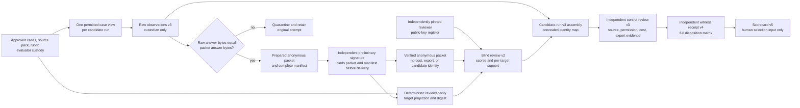
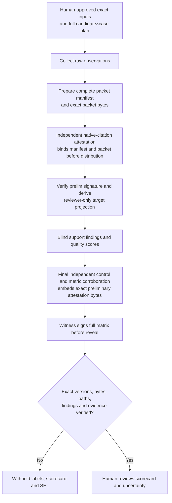

# Proposed v3 matched-evaluation observation contract

**Status:** Proposed design for citation support [CR-0021](../change-requests/CR-0021-citation-support-fairness.md) / [ToDo](../todos/CR-0021-citation-support-fairness.md) under DR-FEAS-004, cost and export [CR-0022](../change-requests/CR-0022-observed-cost-and-report-export.md) / [ToDo](../todos/CR-0022-observed-cost-and-report-export.md) under DR-FEAS-005, raw-to-packet answer integrity [CR-0024](../change-requests/CR-0024-blind-packet-answer-integrity.md) / [ToDo](../todos/CR-0024-blind-packet-answer-integrity.md) under DR-FEAS-007, and candidate-citation provenance [CR-0025](../change-requests/CR-0025-candidate-citation-provenance.md) / [ToDo](../todos/CR-0025-candidate-citation-provenance.md) under **DR-FEAS-008**, for SEL-01/05 and RES-09. The [independent design review](../evidence/CR-0021-0022-v3-design-independent-review-2026-10-26.md) identified the handoff corrections specified below. Isolated, unused reviewer-target projection v1 and pre-distribution attestation v1 helpers/schemas/tests exist, and the CR-0022 cost/export observation v1 helper has 24 focused tests and [independent local review](../evidence/CR-0022-local-cost-export-independent-review-2026-10-26.md) with no remaining scoped Blocker/Important; the [projection code review](../evidence/CR-0021-target-projection-independent-review-2026-10-26.md) found no scoped Blocker/Important, and the [attestation code review](../evidence/CR-0025-isolated-attestation-code-independent-review-2026-10-26.md) found no scoped Blocker/Important for its unused binding-only slice. No integrated v3 signed pipeline or observed scoring is implemented or approved. Current candidate-run v2 and scorecard v4 still require exact expected quote strings and numeric cost and have no report-export or candidate-citation provenance field. Local CR-0024 equality TDD and [independent code review](../evidence/CR-0011-0024-final-custody-independent-review-2026-10-26.md) passed for the exact-byte correction; the earlier [CR-0011 output-FD re-review](../evidence/CR-0011-output-parent-fd-independent-review-2026-10-26.md) found a signed-packet path A→B→A Blocker and later map/unblind publication leaks, all of which now deny in the [independently reviewed local v2 correction](../evidence/CR-0011-0024-final-custody-independent-review-2026-10-26.md). External witness, original-run, packet-distribution, and selection gates remain open. The [feasibility fairness](../feasibility-and-market-assessment.md#matched-evaluation-fairness-and-observation-impact), [packet-integrity](../feasibility-and-market-assessment.md#matched-evaluation-packet-answer-integrity-impact), and [citation-provenance](../feasibility-and-market-assessment.md#matched-evaluation-candidate-citation-provenance-impact) analyses record affected and unaffected surfaces. Data class is wholly synthetic/public.

## Custody and decision boundary



The candidate/tester sees only its approved question and allowed source projection. Full expected facts, forbidden IDs, injection sentinels, permission setup, and the anonymous-to-candidate map stay with evaluators. Blind quality reviewers see completed answers and approved visible sources plus a separately projected set of support targets; they do not see candidate name, cost, export, model version, or source/tenant control claims. Deferred and failed cells receive no answer packet or quality score. A separate control reviewer can see labeled raw observations and independently retained source/tenant/cost/export evidence. The witness freezes all completed and noncompleted dispositions before labels are revealed. Signed local artifacts do not prove the signers' organizational independence or the truth of source events; those remain external gates.

## Raw answer integrity precondition

The current [CR-0024](../change-requests/CR-0024-blind-packet-answer-integrity.md) / [ToDo](../todos/CR-0024-blind-packet-answer-integrity.md) correction passed local code review in the **v2 prepare and signed verification paths** before this migration, with implementation PR/protected CI still pending; external original-run corroboration remains an open CR-0011/0025 gate. For every completed cell, `raw_answer.encode("utf-8")` and `packet_answer.encode("utf-8")` must be identical with no Unicode normalization, redaction, or claim repair. Preparation rejects a mismatch; unblinding and scorer binding independently recheck the signed raw observation, screened packet answer, map hashes, and control-review raw-answer digest. The control reviewer still corroborates the raw answer against an independently retained candidate-run artifact. A valid signature over two different answers is insufficient.

If the raw answer itself reveals a candidate identity, retain that attempt in restricted custody and quarantine it from blind review; record an independently reviewed noncompleted disposition and rerun only under approved blind-safe inputs. Do not discard a wrong answer or reclassify a source-control violation as a harmless deferral. An unauthorized source disclosure is a blocking control observation even when blinding also fails. A reviewer cannot be shown an edited packet to save a completed case.

## Candidate citation provenance precondition

The raw/packet answer equality rule does **not** prove that the candidate supplied the packet's separate `citation_spans` array. Under [CR-0025](../change-requests/CR-0025-candidate-citation-provenance.md) / [ToDo](../todos/CR-0025-candidate-citation-provenance.md), an independent control reviewer must compare the complete ordered packet citation list with an original retained candidate-run artifact and a versioned extraction record **before packet distribution**. The record accounts for **every** native citation/reference with its original artifact digest, native locator or rendered reference, product-specific method, and one explicit disposition: `mapped` to an approved visible `evidence_id` and exact normalized `quote`/`start`/`end`; `unmappable_unsupported` when a reference in the allowed source context has no faithful normalized span; or `out_of_view_control_violation` when it points to a forbidden or invisible source. Only faithfully mapped spans enter the signed packet's ordered citation array. Normalized offsets are zero-based, end-exclusive Python string indices into the exact decoded approved source `text`, with no Unicode normalization; a product profile converts native byte or UTF-16 offsets before exact matching. A document-level native reference may map to the full linked approved document, not to a favorable sentence the product did not locate. `Corroborated` means complete faithful accounting, **not** that every native reference supports a claim. An omitted, altered, invented, or out-of-view native reference blocks distribution. Under the preregistered symmetric rubric, an otherwise completed run with an explicitly accounted but uncheckable allowed reference **stays completed** and that reference earns no citation support; do not defer a weak answer after seeing it. Deferral is allowed only for a preregistered evaluator/access/capture failure preventing a comparable run, with independent evidence applied consistently across arms. The record binds the complete packet citation-array count/digest, including an empty array when the candidate cited nothing.

After the complete packet manifest v2 and every completed packet have been prepared **and independently matched to the full approved candidate×case raw-observation, concealed-assignment, and noncompleted-disposition matrix**, the independent control reviewer first signs a **pre-distribution citation attestation v1** for each completed cell: candidate/case/run, exact `packet_id` and packet raw-byte SHA-256, complete packet-manifest raw-byte SHA-256, the manifest's canonical corpus/source/rubric digests, original artifact and extraction-record digests, count and canonical SHA-256 of the exact ordered normalized packet citation list (retained in the packet and extraction record), `corroborated` or blocking decision, reviewer ID, and trusted submission-time reference. Its extraction record identifies native locators, product-specific method, approved source mapping, and every mapped, explicitly unsupported, or control-violation disposition. The packet distributor verifies the exact preliminary attestation bytes and detached control signature against the separately pinned control key **before either packet or reviewer-only target projection is released**. It also verifies the complete manifest bytes, approved raw corpus/source/rubric pins, manifest canonical digests, and the packet bytes read through a held directory FD against the attested manifest/packet IDs and hashes; it requires `corroborated` for every completed packet and retains independent time-ordered delivery evidence. The preliminary signature is the pre-review authority for these bytes; the later witness receipt cannot retroactively authorize a previously distributed packet. After blind reviews, final control review v3 embeds the **exact preliminary JSON bytes and detached signature as strict base64** in each restricted completed-cell row, then signs full labeled candidate-run digests. It may not replace the earlier bytes with a later equivalent-looking object. The proposed bounds are at most 32 KiB of decoded preliminary attestation per completed packet, at most 128 packets, and 8 MiB for the final control review; implementation tests must enforce these before approval. Witness receipt v4 freezes the exact final control file containing the preliminary bytes/signatures before label reveal. A separately retained trusted timestamp or independent append-only distribution record must establish that the preliminary signature was accepted **before** packet and target delivery; the later witness signature alone does not establish that earlier time order. The scorer decodes and re-verifies each embedded preliminary signature and matches its manifest and packet identities, canonical input digests, and recomputed ordered packet citation count/digest with the exact raw observation, packet, labeled candidate-run list, and final control row; it rejects missing, changed, added, dropped, edited, reordered, or wrong-run citations even if all later internal artifacts are re-signed. This transport keeps the scorer-binding v2 catalog shape: no new path is trusted, and original product artifacts stay separately retained by reference and SHA-256 in restricted evaluator custody. Source-exact quote matching alone proves only that text exists in an approved snapshot; blind reviewers receive only independently corroborated normalized citations and approved visible sources. This does not make an unapproved source accessible or prove a human support judgment.

**Exact v1 encoding and signature profile.** The strict JSON object has only `schema_version: 1`, `attestation_type: "pre_distribution_citation_attestation"`, `candidate_id`, `case_id`, `run_id`, `packet_id`, `packet_sha256`, `packet_manifest_sha256`, `corpus_digest`, `source_pack_digest`, `rubric_digest`, `original_artifact_sha256`, `extraction_record_sha256`, `citation_count`, `citation_spans_sha256`, `decision`, `control_reviewer_id`, and `submission_time_ref`; `reason` is present only for a blocking decision. The exact ordered citation array remains in the signed packet and retained extraction record, so a valid v2 packet with long source-exact quotes does not overflow the 32 KiB attestation merely through duplication. The verifier recomputes `citation_count` and SHA-256 from the packet's array encoded by `json.dumps(..., ensure_ascii=False, sort_keys=True, separators=(",", ":"), allow_nan=False).encode("utf-8")`, with no Unicode normalization. The packet allows at most 32 entries; the verifier checks source ID, exact quote/start/end in the approved visible source view, and duplicate spans. `decision` is `corroborated` or `blocked`; only `corroborated` permits delivery. Duplicate keys, unknown fields, nonfinite numbers, invalid UTF-8, JSON integral-float spellings such as `1.0` for integer fields, or an attestation over 32 KiB deny. JSON Schema numeric validation is preflight only; the exact-byte runtime verifier enforces integer spelling. The detached signature covers `b"openshell-deep-research/pre-distribution-citation-attestation/v1\n" + exact_attestation_json_bytes` using the fixed qualified control `openssl dgst -sha256 -verify` profile; raw signature bytes are capped at 8 KiB.

**Binding-only local verifier.** Given exact bytes and independently supplied raw pins and expected IDs, the isolated verifier checks the detached signature against the supplied control public-key raw SHA-256; exact original-artifact and extraction-record raw hashes; packet and complete-manifest raw hashes; strict packet-manifest v2 shape, bounds and packet count with **all packet IDs distinct**; one **unique** manifest entry for `packet_id` whose `packet_sha256` equals both the attestation field and SHA-256 of the exact packet bytes; and exact approved corpus/source/rubric raw pins plus their canonical manifest digests. Parsed `packet.case_id`, attestation `case_id`, and independently expected case ID must be equal. Packet question and **ordered** visible source snapshots must equal that approved case's view in the pinned corpus/source pack. The extraction record must separately retain the complete native-to-packet mapping and the same ordered citation-array digest; its raw hash alone is a binding, not proof that a product emitted those citations. Supplying newly computed key, case, or input pins from the same local artifacts is not independent approval. The isolated helper returns no distributor capability and cannot establish honest native extraction, independently qualified signer or time, complete-matrix custody, a held-FD read, or reviewer-edge delivery. Before any distributor passes original artifact or extraction bytes into this in-memory helper, its product profile must set numeric loader bounds, enforce them before materialization, and test oversize denial without content logging.

**Pre-delivery authority gate.** Before any packet or target is released, the distributor compares the manifest to independently retained raw observations, concealed assignments, and reviewed noncompleted dispositions for **every** approved candidate×case cell, requiring its packet set to equal exactly the approved completed-assignment set; manifest self-consistency alone does not prove matrix completeness. Its independently retained decision ledger permits **one active preliminary decision per completed cell** and preserves every earlier signed blocked or corroborated decision. A correction requires documented supersession and a new frozen attempt, with distinct run/packet/manifest identities and raw-observation binding, before either delivery; an earlier blocked decision never disappears. A separately governed control-key register maps each `control_reviewer_id` to **exactly one** approved public-key raw digest, control role, algorithm, and validity window; it must qualify the actual key as RSA-3072-or-stronger with SHA-256 under the pinned verifier, distinct from blind-reviewer and witness keys, and valid and unrevoked at independently trusted submission and delivery times. Key onboarding verifies the actual algorithm/size, not a self-asserted label; every delivery checks current revocation and retained trusted time evidence. The standalone signature verifier does not perform these governance checks. The distributor then verifies the exact attestation, held-FD packet and manifest bytes, approved pins, label isolation, and reviewer-edge received packet hash/ID before display. Independently retained append-only delivery evidence binds SHA-256 of the **exact preliminary JSON bytes and detached signature**, packet and target delivery IDs, the exact bytes received at the reviewer edge, and an order proof placing signature acceptance before both deliveries; a signed `submission_time_ref` to an unrelated or preallocated record is insufficient. A missing key register, unavailable revocation/time proof, incomplete matrix, or changed packet denies delivery; a later final-control/witness signature cannot repair an early release.

## Citation support decision

The preliminary attestation contains candidate/run identity and remains in restricted control/distributor custody. The blind reviewer receives only the verified anonymous packet and derived allowlisted target projection; the workbench must not copy the preliminary attestation, labeled manifest fields, original product artifact, or distributor log into that view. A projection hash checked against caller-supplied values without prior independent signature verification is not authority to deliver a target.

**Reviewer-edge byte identity.** After verifying the preliminary signature and exact packet hash, the distributor uses one immutable packet-byte buffer read through the held packet-directory FD for **both** target derivation and packet delivery. It must not reopen a pathname, follow a new link, reconstruct, or reserialize the packet after verification. The reviewer edge hashes the **exact bytes received** before display and compares that raw SHA-256 and packet ID to the pre-distribution attestation; it records that delivered digest with the independent delivery evidence. A post-verification/pre-delivery path switch, a mismatched delivered digest, or candidate-label content at the reviewer edge denies delivery and quarantines the attempt. A correct projection for packet A cannot authorize packet B.

**Projection bounds and authority.** The deterministic reviewer-only projection v1 has at most 128 targets and at most 128 KiB of encoded sorted-key, compact UTF-8 JSON; an oversized derivation is denied. Before calling the isolated derivation or showing a target, the caller must verify the control reviewer's **pre-distribution attestation** over the exact packet ID/hash and complete manifest raw hash, verify that manifest, and supply packet bytes from its pinned directory FD. The derivation requires independently registered **raw-byte** approval SHA-256 values for corpus and source pack, and checks that its canonical corpus/source digests match the preliminarily attested manifest fields. The manifest itself is not witness-authenticated until after blind reviews; a derivation routine alone cannot approve inputs or verify the preliminary signature.

Existing `expected_citation_spans` entries become **review anchors**. Each entry's zero-based index is a required support target, including an abstention-support target. The case and source schemas stay v1, but an evaluator-owned workbench must derive a deterministic **reviewer-only target projection v1** from the independently approved exact corpus/source bytes and the preliminarily attested packet. Its allowlisted fields are `schema_version`, approved `corpus_digest` and `source_pack_digest`, `packet_id`, `packet_sha256`, `case_id`, and ordered `targets`; each target has only `target_index`, permitted `evidence_id`, and `anchor_quote`. The question and visible source snapshots remain in the packet. The projection contains no full corpus, candidate label, expected behavior, forbidden ID/text, injection sentinel, permission setup, cost, or control observation. Each target ID must be in that packet's approved visible source view and each anchor an exact substring of that source snapshot. Any extra field, stale digest, wrong case/packet, unpermitted source, or anchor absent from the approved snapshot denies delivery and scoring. For a case without required citation targets, `targets` is an empty array.

The workbench serializes this exact projection as sorted-key, compact UTF-8 JSON and presents its SHA-256 to the blind reviewer. Blind-review v2 requires **one reviewer-authenticated entry per completed packet**. Each entry contains packet ID/hash, target-projection SHA-256, reviewer ID/time, dimension scores, support findings, and notes. A bounded, strict-base64 signature covers `b"openshell-deep-research/blind-review-entry/v2\n" + canonical_json(entry_without_signature)`, where canonical JSON is sorted-key compact UTF-8 without nonfinite numbers or Unicode normalization. The proposal accepts only RSA-3072-or-stronger SHA-256 signatures under the existing pinned `openssl dgst -sha256 -verify` profile; any other algorithm is denied until separately qualified. An independently approved reviewer-key register v1 maps each reviewer ID to exactly one RSA public key, key digest, accepted algorithm, and validity window. The verifier receives exact registry bytes and an independently held registry SHA-256 **outside** the path catalog, rejects duplicate IDs, malformed/oversized signatures, unpinned or expired keys, and any key also registered for control review or witness signing. It verifies every reviewer signature with the fixed qualified signature verifier **before control review and witness freeze and again during scorer binding**. Witness receipt v4 binds the exact blind-review file bytes including signatures and the independently pinned register digest. The scorer regenerates the target projection from approved inputs and packet bytes and checks the signed digest and indices. This binds the target bytes used for scoring without putting candidate-hidden targets in the general packet or exposing the full evaluator corpus. A valid signature proves key possession and unmodified bytes, not that the reviewer saw the displayed view or judged it correctly; workbench delivery logs, organizational key custody, a trusted submission time within the key window, and independent semantic sample review remain external gates. The blind review v2 records exactly one finding per target:

```json
{
  "target_index": 0,
  "supported": true,
  "citation_index": 0,
  "rationale": "The cited full record contains the deployment time and the TTL change."
}
```

`citation_index` is the zero-based position in that completed packet's citation list. A `supported: false` finding may use `citation_index: null`; it still needs a short rationale, so a bad or uncited answer remains a scored observation. A true finding requires an in-range cited span from the target's approved evidence ID. The machine checks that every cited quote is an exact substring of its approved source snapshot and that every target has one finding matching the signed target-projection digest. The signed blind reviewer judges whether the **actual** span supports the target, including a longer whole-document span or different wording from the anchor. One actual citation may support several targets. The scorer no longer requires candidate quote equality to the anchor. A false finding, missing citation, wrong source, or wrong behavior forces effective case quality zero; an absent, duplicate, malformed, or post-freeze changed finding rejects the signed bundle. A matching source ID alone is never semantic support.

For synthetic case-12, one citation to the whole approved `github-deploy-77` record can support both required targets if the blind reviewer signs both findings. A quote to an unrelated part of the same record must be marked unsupported and get zero. Current v2 anchor equality already rejects that unrelated-quote fixture; it is a **regression guard**, while accepting the valid whole-record span is the red test for CR-0021. Local code cannot independently prove a human's semantic judgment; product/security corpus review and an independent sample of signed reviews remain selection gates.

## Cost and report-export observations

**Bounded CR-0022 implementation:** an isolated, unused `eval/cost_export.py` helper and `eval/schemas/cost-export-observations.schema.json` implement local validation and coverage arithmetic first. The helper takes a complete required-case plan, candidate observations, separately supplied corroboration rows, and retained synthetic export bytes; it binds run/object/artifact identities and applies the truth table below. It does not verify independent reviewer custody or signatures, real product/source events, or semantic export correspondence, and cannot authorize readiness or SEL. Candidate-run v2, raw/map/control/witness contracts and scorecard v4 remain unchanged until the coordinated migration below. Rubric values/digest and actual observed evidence remain pre-integration gates. The local fragment bounds a bundle to 1 MiB and 128 cases, each retained export to 1 MiB (16 MiB total), and timestamp fractions to at most six digits so ordering is exact at its declared precision. It returns Python `Decimal` amounts with no CLI or scorecard serialization; a future serializer needs its own explicit numeric contract. The same-answer-reference denial is only a local alias guard: different references and matching assertions cannot prove a product-native export or detect a copied answer.

Each **completed** raw observation and labeled candidate result replaces bare `cost_usd` with one of:

```json
{"cost": {"status": "observed", "amount_usd": 0.0, "evidence": {"ref": "approved-custody://cost/1", "sha256": "<64 lowercase hex>"}}}
```

```json
{"cost": {"status": "unavailable", "reason": "The tenant did not expose case-level usage or charge.", "evidence": {"ref": "approved-custody://cost-availability/1", "sha256": "<64 lowercase hex>"}}}
```

An observed zero has evidence and is distinct from unavailable. Numeric amounts are finite, nonnegative, and summed with decimal arithmetic; reasons are nonblank and at most 2048 characters. A separate human total-cost analysis may estimate seat and operating charges but must label estimates as estimates; it never rewrites case observations. For **each candidate**, scorecard v5 reports `required_count`, `completed_count`, `observed_cost_count`, `unavailable_cost_count`, `deferred_count`, `failed_count`, and `missing_count`. The invariants are `required = completed + deferred + failed + missing` and `completed = observed_cost + unavailable_cost`. `observed_subtotal_usd` sums only observed completed cells. `total_cost_usd` is numeric **only** when all required cells completed and every cost was observed; otherwise it is `null`, including when a required cell is deferred, failed, or missing. A subtotal is never displayed as a total.

A completed, otherwise valid full matrix can be `ready_for_human_decision` while one or more costs are unavailable, but v5 must set `cost_uncertainty_open: true` and `cost_disposition_required: true`. The final SEL record then needs a separately owned and signed cost uncertainty or estimate disposition that states missing coverage, assumptions, range or upper-bound method, and whether the decision can proceed. Unknown cost alone does not invent a failed research case. A partial candidate×case matrix remains `incomplete` regardless of a numeric subtotal. No estimate may enter an observed field, and no machine status is itself a human SEL decision.

Every **completed** cell, including a denied-source cell, carries exactly one `report_export` object. Its status is `exported`, `failed`, `unsupported`, `unavailable`, `not_attempted`, or `not_applicable` under this table:

| Completed behavior | Permitted export status and evidence | Scoring and parity consequence |
|---|---|---|
| Ordinary answer or evidence-backed abstention | Record the actual product export attempt as `exported`, `failed`, or `unsupported`; use `unavailable` only when the outcome cannot be established and `not_attempted` only when no attempt occurred, each with bounded reason and independently checkable evidence. | Abstentions are export-eligible. `failed`/`unsupported` are observed product gaps; `unavailable`/`not_attempted` leave coverage incomplete. None by itself changes citation quality. |
| Expected source denial correctly observed, with no answer or exported protected content | `not_applicable` with the expected-denial case ID, observed denial evidence, and reason. | Excluded from export-eligible denominator; the source denial still needs independent control corroboration. |
| Unexpected denial on an answerable case | `not_applicable` is forbidden; record the actual attempt state or `not_attempted` with reason. | Quality/behavior fails. No successful export or parity is implied. |
| Answer or export after an expected source denial | `not_applicable` is forbidden; record the actual export state and retain incident evidence in restricted custody. | Unauthorized disclosure is a blocking control violation, even if an export attempt failed. |

For `exported`, the observation must identify the approved product-native export method, attempt and completion time, format, exact retained artifact reference, byte count and SHA-256, and source product event. A separate independent control check extracts or inspects the retained artifact and records whether its answer and cited evidence correspond to the **same run's** reviewed raw answer/citations; a blank file, copied answer file, wrong run, or mismatched citations cannot be marked `exported`. `failed` and `unsupported` need an attempted operation or product-capability observation plus bounded reason and evidence. `unavailable` and `not_attempted` need distinct bounded reasons/evidence. A retained answer reference alone is not report-export proof. Scorecard v5 counts `export_eligible_count` and each outcome, with justified `not_applicable_count` separate; export outcome coverage is complete only when every eligible cell has an observed `exported`, `failed`, or `unsupported` outcome. Export **parity** requires every eligible cell to be `exported` with checked answer/citation correspondence. The human SEL-01 record explicitly disposes observed product gaps and incomplete coverage; it may defer a platform path rather than invent parity.

The independent control review v3 contains **one typed corroboration row per completed `(candidate_id, case_id, run_id)`**, with no extras or omissions. Its citation-provenance section binds the original candidate artifact and extraction-record digests, the exact packet citation-list digest, and a distinct `corroborated` or blocking decision under CR-0025. Its metric/export sections bind canonical SHA-256 digests of the exact raw/candidate `cost` and `report_export` objects, identify independently retained billing/usage or tenant-unavailability evidence, the measurement window and case-allocation basis, and identify the product export event plus retained artifact and answer/citation correspondence check where applicable. They record `corroborated` or a bounded blocking reason for cost **and** export separately. For an unavailable cost, corroboration establishes that case-level amount could not be obtained under the approved tenant path; it does not invent zero. For an export, corroboration checks the actual product event and artifact bytes, not a self-asserted reference. A missing original citation record, missing external metric/export record, changed amount, changed artifact bytes, wrong run, or uncorroborated section denies signed readiness. Control review v3 signs these rows together with the full candidate-run v3 digests; witness receipt v4 freezes the exact control-review bytes and detached signature. This stays within the existing independent control-review role and does not add a new signing service. Blind quality packets exclude labeled original-run, cost/export, and corroboration data.

## Proposed version migration

| Artifact | Current local contract | Proposed contract | Reason |
|---|---|---|---|
| Approved corpus and source pack | v1, pending human approval | v1, revised draft bytes and digests | Existing target index and source ID remain sufficient; approval is for exact bytes. No case/source schema-shape change. |
| Rubric | v1, pending human approval | v1, revised measurement text and digest before human approval | Describe support findings, cost coverage, and export outcome before runs; no rubric schema-shape change. |
| Candidate-run | v2 | v3 | Signed support findings and cost/export observations change completed-result shape. |
| Raw observations and concealed map | v2 | v3 | Preserve original metric/export evidence and the full cell matrix. |
| Reviewer-only target projection | absent | v1, with JSON Schema | Deterministically derive permitted anchors from approved input and packet; bind exact projection digest to every signed blind review. |
| Blind reviews and reviewer-key register | v1 reviews, manually validated; no reviewer signature | v2 review schema with per-entry signature; independently pinned reviewer-key register v1 | Bind target-projection digest and one support finding per target to the registered reviewer key, with algorithm/window and role separation. |
| Completed reviewer packet and packet manifest | packet v1 / manifest v2 | same shapes and versions | Candidate identity and cost/export stay absent; a separate derived target projection keeps evaluator-only corpus fields out of the packet. |
| Pre-distribution citation attestation | absent | v1, separately signed by the independent control reviewer | Freeze original candidate artifact and extraction digests, complete manifest raw hash and canonical input digests, exact packet ID/raw hash, and normalized citation count/canonical digest before packet or target delivery; the full ordered list stays in the packet and extraction record. |
| Control review | v2, 1 MiB local limit | v3, bounded embedded preliminary bytes/signature; proposed 8 MiB limit | Embed exact earlier signed citation attestation per completed cell, corroborate cost/export, and sign complete candidate-run v3 digests after blind reviews. |
| Witness receipt and unblinded assembly | v3 | v4 | Freeze changed raw, preliminary citation attestation, reviewer-signed blind, final control, and map bytes plus the reviewer-key-register digest before release. |
| Scorer-binding path catalog | v2 | same shape and version, immutable per invocation | Citation attestation bytes/signatures travel inside restricted control review v3; no new path is needed. Paths remain location hints, not authority pins; reject mixed/legacy referenced versions and bind actual packet directory to held output-exclusion identity under CR-0011. |
| Scorecard | v4 | v5 | Show per-target support and honest cost/export coverage. |

The version numbers are a proposed **single migration** for CR-0021/0022/0025 after the CR-0024 v2 equality correction. Keeping the corpus/rubric shapes and packet/catalog shapes does not authorize an old referenced artifact: the verifier checks the full version matrix above and independently approved input digests. No observed bundle exists to upgrade in place. Reject older signed artifacts for observed readiness and regenerate/re-sign the **entire** approved candidate×case matrix after code and human-reviewed input bytes are frozen. Do not accept a v1 blind review with a v3 run, infer missing export as success, or convert unknown cost to zero. The current [blind custody guide](../../eval/blind_review/README.md) describes the v2 signed-partial protocol; its v3 sections remain a proposal until the new schemas/code and human approval pass.

## Required proof and disable path



TDD must first reproduce a valid longer case-12 citation being unfairly zeroed, a custodian adding a source-exact citation absent from the candidate's original output while raw/packet answers remain equal, a custodian changing `supported: false` to `true` or forging a reviewer ID before witness signing, a wrong raw answer repaired in the blind packet reaching signed readiness, unknown cost forced to fabricated zero or deferred, missing export implied as success, and post-signature metric/support mutation. The unrelated same-source citation is a **zero-score regression guard** in current v2; keep it when semantic support replaces anchor equality. Add wrong-source, native source-link to wrong document, dropped/edited citation, missing/changed/oversized embedded preliminary attestation, preliminary signature after packet distribution, completed uncheckable citation versus independently evidenced evaluator failure, target-projection leak/stale digest, missing/duplicate target, wrong/unpinned/expired reviewer key or registry, duplicate reviewer identities, signer-role reuse, full-matrix partial cost aggregate, observed zero, positive abstention export, empty/wrong export artifact, unexpected denial, private-denial export, missing independent per-cell corroboration, mixed-version, and verified packet-directory output denials. Then run schema/fixture, scorer, blind/control, full repository, lint/type/format, and an independent read-only review on exact pinned inputs. The user can run approved ChatGPT cases later; no connector, approved input pack, real employee workflows, or observed tenant result exists now. Keep CR-0021/0022/0024/0025 open and withhold distribution, scored selection, and the full dashboard build while any required gate remains open.
