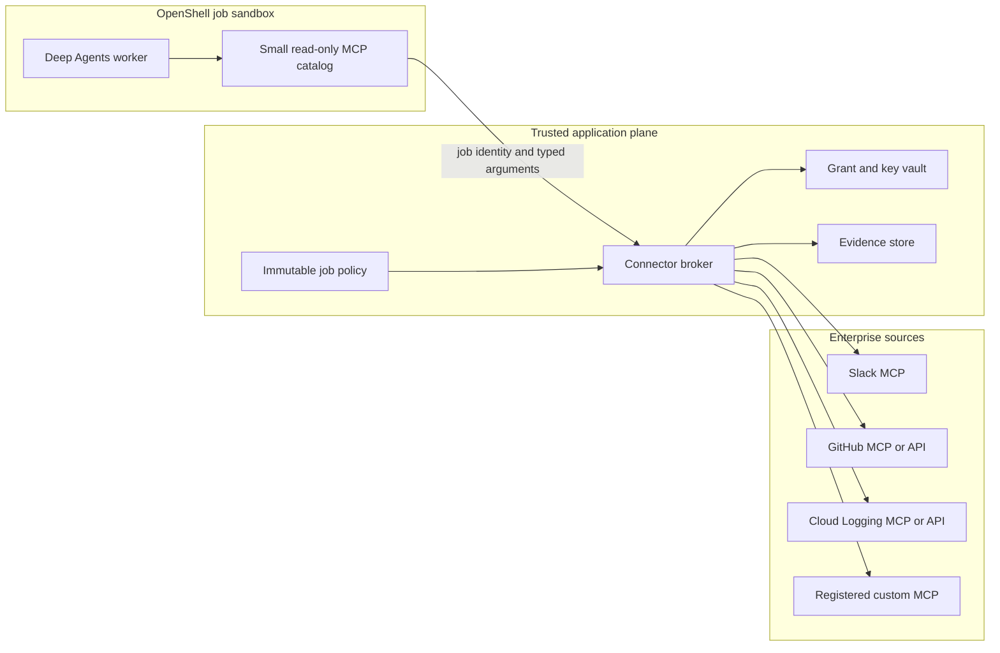
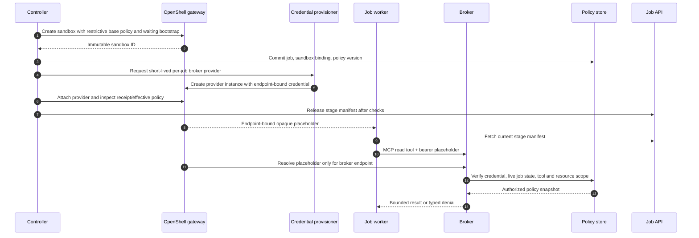
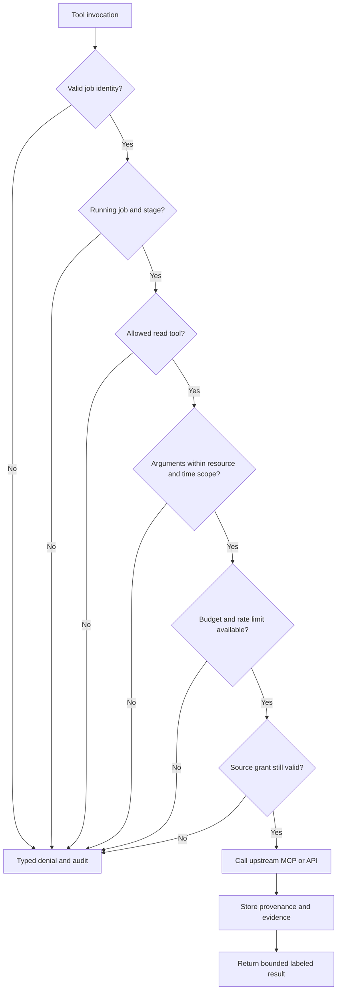
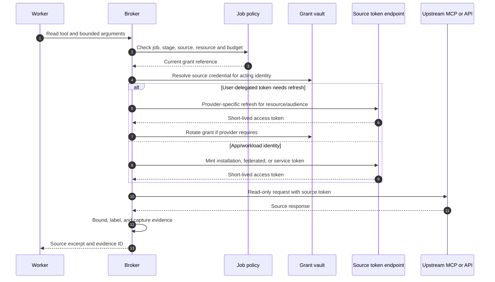
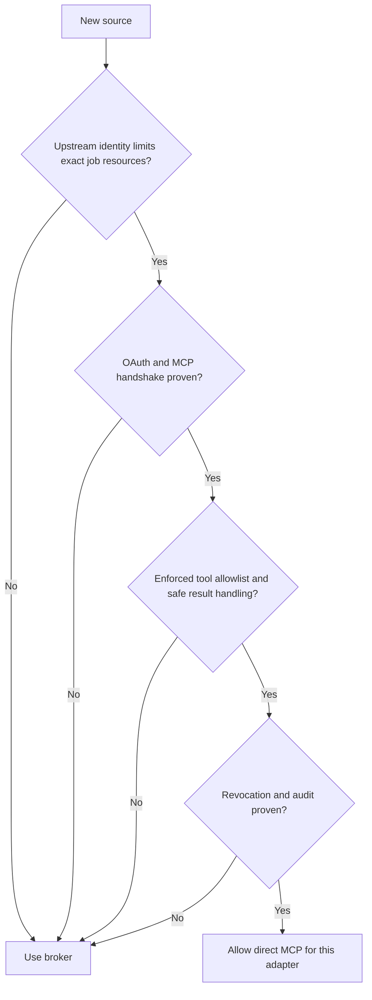
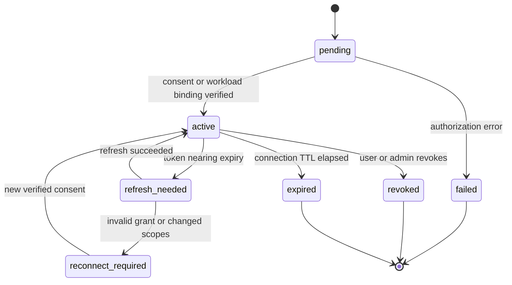

# MCP connector broker design

**Status:** Proposed design; no connector is implemented.  
**Baseline:** OpenShell v0.1.5, read-only research.  
**Related:** [architecture](../architecture.md), [identity and access](identity-and-access.md), [requirements](../requirements.md), [contracts](../../contracts/README.md).

## 1. Decision and responsibility

The connector broker is an external service that gives an OpenShell worker a small catalog of **job-scoped read tools**. It owns source OAuth grants and application credentials, validates every request against a server-held job policy, calls an upstream MCP server or API, and returns bounded source material with provenance. It does not plan research, synthesize an answer, or trust an agent-provided tenant, user, connection, or resource scope.

The broker is the default for enterprise sources because OpenShell's MCP inspection currently matches a method and tool name, but **not the tool arguments**. An allowed `search` tool might otherwise accept any channel, repository, project, or query. OpenShell also relays MCP responses without content policy parsing. The broker enforces the narrower task scope and provides one place for provider-specific OAuth handling. [OpenShell network rules, v0.1.5](https://docs.nvidia.com/openshell/v0.1.5/how-it-works/policies/network-rules).



The tool call arrow is logical: on Kubernetes, the worker's network request passes through the OpenShell supervisor before it reaches the external broker. The CNI must deny direct workload egress. [OpenShell Kubernetes setup](https://docs.nvidia.com/openshell/v0.1.5/kubernetes/setup).

The broker is an authorization boundary. A worker may ask for fewer sources or a smaller time range than its policy allows. Any attempt to expand access is denied and recorded; source documents, model text, MCP tool descriptions, and agent state cannot alter the server-held policy.

## 2. Identity layers and token custody

| Leg | Principal and grant | Token holder | Audience and purpose |
| --- | --- | --- | --- |
| Browser to dashboard | Human Okta Authorization Code + PKCE session | Dashboard session store or browser session mechanism | Dashboard API only |
| Controller to OpenShell | Controller OAuth client credentials | Controller process/secret manager | OpenShell gateway only |
| Worker to broker | Short-lived job credential or federated workload token | OpenShell provider/proxy and broker verifier | Broker tools for one job/sandbox |
| Broker to source | User-delegated source grant, app installation token, GCP workload identity, or provider-specific service grant | Broker/vault | Exact upstream MCP/API resource |
| Worker to model | Approved OpenShell model provider route | OpenShell provider/proxy | Approved inference endpoint |

**Okta sign-in does not supply source authorization.** An Okta access token for the dashboard must not be forwarded to Slack, GitHub, Google, or an arbitrary MCP server. User delegation needs a separate consent or enterprise authorization path for each source. MCP's HTTP authorization specification requires resource-specific token requests and use of bearer tokens only at the intended MCP resource. [MCP authorization specification](https://modelcontextprotocol.io/specification/2026-07-28/basic/authorization).

If a SPIFFE issuer is unavailable for a **local prototype**, a narrow fallback is a random, short-lived credential representing `{tenant, job, immutable sandbox ID, policy_version, expiry}`. Create the sandbox with a bootstrap process that waits for its manifest; after OpenShell returns the immutable sandbox ID, the controller commits that binding and a separately privileged credential provisioner creates the per-job provider instance. The controller attaches it, checks the effective policy and provider receipt, and only then releases the manifest. The broker stores only the credential hash and checks current job/revocation state. The credential expires no later than the job and is revoked on cancellation. This path has more provider lifecycle and privilege overhead, so do not treat it as a default multi-tenant production design. Static OpenShell provider metadata such as `auth_style: bearer` does **not** by itself put this header on a request: the MCP client must send the placeholder as a bearer credential. [OpenShell provider profiles, v0.1.5](https://docs.nvidia.com/openshell/v0.1.5/how-it-works/providers/profiles), [OpenShell workspace roles](https://docs.nvidia.com/openshell/v0.1.5/how-it-works/workspaces).

The preferred production path is an internal issuer that accepts OpenShell's SPIFFE JWT-SVID client assertion and returns an audience-bound broker token via `token_grant: client_credentials`. A reviewed, reusable broker provider profile can be attached when the sandbox is created. OpenShell can inject the resulting token on inspected broker HTTP/MCP requests without exposing it to worker code. This path needs an issuer integration test and a binding from the verified sandbox identity to the controller's job. It is **not** evidence that Okta accepts this assertion directly. [OpenShell dynamic token grants, v0.1.5](https://docs.nvidia.com/openshell/v0.1.5/how-it-works/providers/profiles).



The sequence above illustrates the **prototype fallback**, not an API that OpenShell implements end to end. OpenShell credential substitution and endpoint binding are documented platform capabilities; the job credential issuer, privileged provider provisioning, broker verifier, and live policy check must be implemented here. The production SPIFFE path avoids per-job provider creation but keeps the same job/sandbox binding checks.

## 3. Source connection and consent

The dashboard shows each source's **acting identity** before a user starts a job: personal Slack user, GitHub user, GitHub App installation, or GCP workload principal. An administrator registers allowed source integrations and callback URLs. A researcher can connect an eligible user-delegated source outside the sandbox. The controller stores an opaque `connection_ref`, selected resources, token owner, consent scopes, source audience, status, and refresh/revocation metadata. Raw grants stay in the vault. A source connection is never treated as a blanket approval for every resource reachable by that credential.

```mermaid
sequenceDiagram
    autonumber
    actor User
    participant UI as Dashboard
    participant API as Connection API
    participant AS as Source authorization server
    participant Vault
    participant Catalog as Resource catalog
    User->>UI: Connect a source
    UI->>API: Start connection with verified dashboard session
    API->>AS: Redirect with registered client, state, PKCE when supported
    AS-->>API: Authorization callback
    API->>AS: Exchange code; validate issuer, state, audience and scopes
    AS-->>API: Source grant and expiry
    API->>Vault: Encrypt and store grant
    API->>Catalog: Enumerate approved selectable resources
    Catalog-->>UI: Acting identity, scope, resource choices
```

The broker validates the OAuth metadata and capabilities of each MCP server at registration. A source may require a preregistered confidential client, user consent, an application installation, or a non-OAuth workload exchange. Dynamic Client Registration is optional in the current MCP spec and is unavailable for Slack and GitHub's hosted servers. The source adapter must not assume that one generic client credentials request will work everywhere. [MCP authorization](https://modelcontextprotocol.io/specification/2026-07-28/basic/authorization), [Slack MCP](https://docs.slack.dev/ai/slack-mcp-server), [GitHub host integration](https://github.com/github/github-mcp-server/blob/main/docs/host-integration.md).

## 4. Authorize each tool invocation

The broker exposes stable, typed tools, not an unrestricted `call_upstream_tool(name, arguments)` escape hatch. Every call follows these checks in order:

1. Validate the worker credential's signature or hash, expiry, audience, sandbox binding, and revocation state.
2. Load the authoritative job policy and active stage manifest. Require running state and exact policy version.
3. Require the named tool and connector in that stage, a source connection belonging to the tenant, and the intended acting identity.
4. Parse arguments against a connector-specific schema; reject extra fields, wildcards, path traversal, unbounded queries, and unsafe filters.
5. Intersect requested channel/repository/project/log view and time range with the **server-held** allowlist. The worker cannot provide a broader list.
6. Enforce per-call row/byte limits, rate limits, global job budgets, and upstream-specific read-only method choices.
7. Acquire or refresh the upstream token for the exact audience/resource, call the source, redact credentials, and store evidence metadata plus an encrypted snapshot.
8. Return a bounded, labeled result with an evidence ID and a safe source locator. Record an audit event for allow or deny.



The broker uses **server-owned selectors**. For example, a Slack call accepts only channel IDs selected at admission; a GitHub call is constrained to selected repository IDs and immutable refs; a Logging call uses an approved project or log view plus a broker-built filter. Search text can still be user-controlled within size and syntax bounds, but it must not be interpreted as a resource selector or an arbitrary URL.

### Initial read tool catalog

| Tool | Accepted controls | Server-enforced scope | Result limit |
| --- | --- | --- | --- |
| `search_slack` | Search phrase, selected channel IDs, bounded time interval, page cursor | Slack connection owner, channel list, read scopes | Top N snippets with message IDs and timestamps |
| `read_slack_thread` | Selected channel ID and parent timestamp | Same channel and source identity; no send/reaction methods | Bounded thread excerpts |
| `search_github` | Search terms, selected repository IDs | Installation/user grant and selected repositories | Top N matches with immutable ref where possible |
| `read_github_file` | Repository ID, commit SHA, normalized path | Selected repository and permitted ref; no arbitrary `git` command | Size-capped file/line span |
| `list_log_entries` | Selected project/view, bounded time interval, approved severity and service filters | GCP principal, project/view and read-only filter template | Top N redacted entries |
| `custom_mcp_*` | Explicitly reviewed adapter schema | Registered server, exact tool, argument policy, audience | Per-adapter bound |

Every result includes connector, acting identity reference, canonical source URI or locator, retrieval timestamp, classification, content digest, tool call ID, and stored artifact reference, matching the [evidence contract](../../contracts/evidence.schema.json). The broker must never return a token-bearing URL or a raw OAuth error body that may contain a secret.

## 5. Upstream identity patterns

| Source | Preferred first integration | Reason and required check |
| --- | --- | --- |
| Slack MCP | User-delegated confidential OAuth grant, obtained in dashboard connection flow; later evaluate Enterprise-Managed Authorization (EMA). | Slack's hosted MCP uses a preregistered confidential app and user scopes, with no Dynamic Client Registration. EMA can exchange an IdP-backed user assertion for a short-lived Slack MCP user token when the enterprise enables it. A generic app-only client credentials token is not a substitute for the user's channel permissions. [Slack MCP](https://docs.slack.dev/ai/slack-mcp-server), [Slack EMA](https://docs.slack.dev/authentication/enterprise-managed-authorization/). |
| GitHub | GitHub App installation token for organization-scoped research, or user OAuth when results must reflect personal access. | Installation tokens are minted from a GitHub App JWT and installation permissions; they are **not** generic OAuth client credentials. The remote MCP server accepts valid access tokens but does not supply OAuth itself or Dynamic Client Registration. Restrict repository set and read permissions in the App and broker. [GitHub host integration](https://github.com/github/github-mcp-server/blob/main/docs/host-integration.md), [GitHub governance](https://github.com/github/github-mcp-server/blob/main/docs/policies-and-governance.md). |
| GCP Logging | Broker read-only wrapper around Cloud Logging API using GCP Workload Identity Federation or GKE Workload Identity; evaluate hosted Logging MCP separately. | Google recommends keyless workload federation. Its Logging MCP example currently asks for `roles/mcp.toolUser` and `roles/logging.admin`, which is broader than a read-only research service should assume. Test a custom read-only role/deny policy; otherwise use the Logging API with `roles/logging.viewer` or a narrower log-view grant. [Google WIF](https://docs.cloud.google.com/iam/docs/workload-identity-federation), [Logging MCP](https://docs.cloud.google.com/logging/docs/use-logging-mcp), [Logging IAM](https://docs.cloud.google.com/logging/docs/access-control). |
| Custom OAuth MCP | Registered per-server adapter with protected-resource metadata, audience, scopes, client registration method, and read tool schemas. | MCP requires a `resource` parameter in authorization and token requests, and the token must be intended for that MCP resource. Validate the actual server and issuer behavior, including refresh and 401 recovery. [MCP authorization](https://modelcontextprotocol.io/specification/2026-07-28/basic/authorization). |



### Where OpenShell client credentials fit

OpenShell v0.1.5 supports gateway-managed `oauth2_client_credentials` provider refresh, using a stored client ID/secret and a profile-owned token URL. It also supports dynamic `token_grant: client_credentials` using a SPIFFE JWT-SVID client assertion, where the issuer accepts that assertion. These are useful for a service endpoint that accepts the resulting token and can enforce the required scope. Neither mechanism grants the identity of a dashboard user. The generic provider refresh documentation does not establish support for every upstream MCP server's RFC 8707 `resource` parameter; an integration test must prove token audience and handshake. [OpenShell provider profiles, v0.1.5](https://docs.nvidia.com/openshell/v0.1.5/how-it-works/providers/profiles), [MCP authorization](https://modelcontextprotocol.io/specification/2026-07-28/basic/authorization).

## 6. Direct MCP bypass of the broker

Direct sandbox-to-upstream MCP is an optimization, not the default. It is permitted only after a connector review proves **all** conditions below:

- The upstream credential is a dedicated, short-lived, least-privilege identity whose native authorization already limits the exact job resources. No broker-side argument filter is needed.
- OpenShell's effective policy has an explicit `protocol: mcp`, `enforcement: enforce`, approved endpoint/binary, and a narrow tool-name allowlist. Provider-contributed rules have been inspected for widening.
- The MCP client and server agree on an OpenShell-supported protocol revision, transport, discovery, headers, resource indicator, token audience, and renewal behavior.
- The source's results can be captured with provenance and checked for classification before they reach the report or model route.
- Cancellation or source revocation terminates access within the required time, even when a token is cached.



An OpenShell MCP rule cannot tell whether `search` is used for an allowed channel or every channel. `protocol: mcp` should therefore supplement a broker's argument validation, not replace it. Different MCP protocol revisions require explicit policy selection in OpenShell; the v0.1.5 default is `2025-11-25`, and the sessionless `2026-07-28` revision needs explicit `mcp.versions` and matching headers. [OpenShell network rules, v0.1.5](https://docs.nvidia.com/openshell/v0.1.5/how-it-works/policies/network-rules).

## 7. Connection state, failures, and revocation



The broker checks connection state **on each protected call**. `invalid_grant`, insufficient scope, revoked user membership, missing GitHub installation, IAM denial, and MCP version mismatch produce typed failures with no automatic elevation. A job may continue with other approved sources, but the report must list missing sources as limitations. Connection revocation invalidates broker token caches and rejects subsequent calls even if a worker continues running. Short token lifetimes limit the window for a direct MCP path; enterprise policy may require stopping the whole job.

The broker emits a structured audit record: tenant, job, sandbox, acting identity reference, connector, tool, normalized resource selector, decision, source status code class, byte count, and evidence ID. It never records tokens, full prompt text, sensitive query results, or raw source documents in ordinary logs. Evidence snapshots have a separate encrypted store and retention policy.

## 8. Connector conformance gates

Each adapter gets a positive and negative test suite before production:

| Gate | Required proof |
| --- | --- |
| Identity | Correct acting user or app principal, wrong-tenant and wrong-job denial, token audience isolation. |
| OAuth | Real discovery/registration path, consent or service grant, resource parameter where applicable, refresh, rotation, 401/403 handling, revocation. |
| Scope | Out-of-scope channel/repo/project/log view and wildcard/filter injection denied before upstream call. |
| Read-only | Every exposed tool and upstream method is read-only; a known write method is rejected at broker and OpenShell. |
| MCP | Client/server revision, Streamable HTTP behavior, required headers, tool discovery, response limits, error normalization. |
| Evidence | Stable locator, retrieval time, hash, tool call ID, classification, encrypted artifact, citation replay. |
| Operations | Rate limits, timeout, cancellation, retry bounds, audit redaction, connection removal. |

See [deployment and operations](deployment-and-operations.md) for environment gates and [research and evidence](research-and-evidence.md) for how source data is handled inside the worker.
