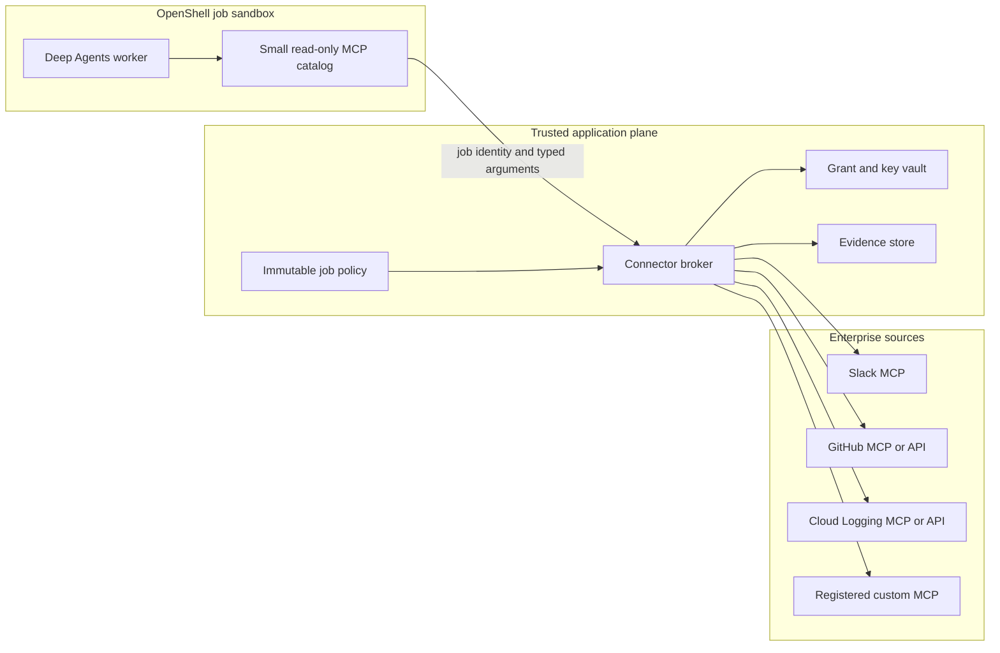
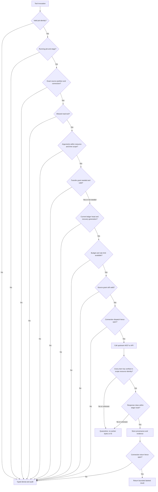
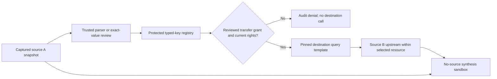
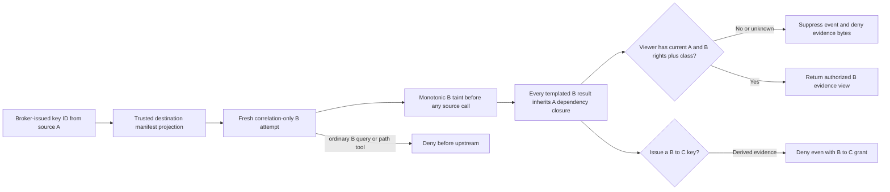
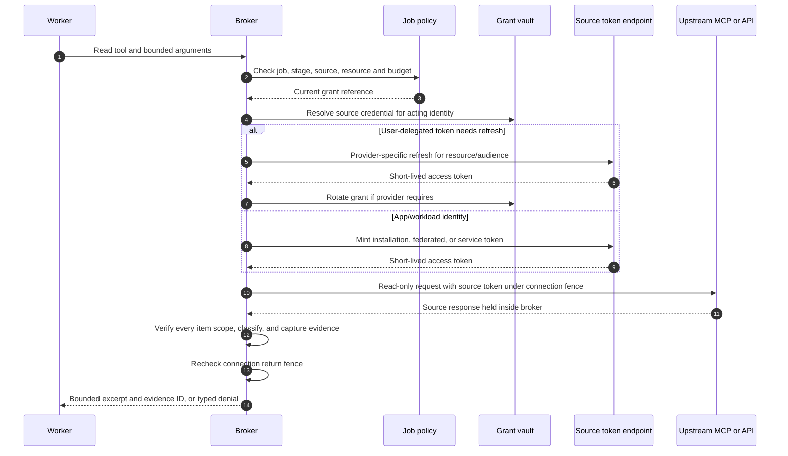
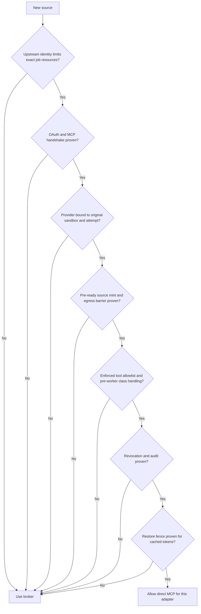
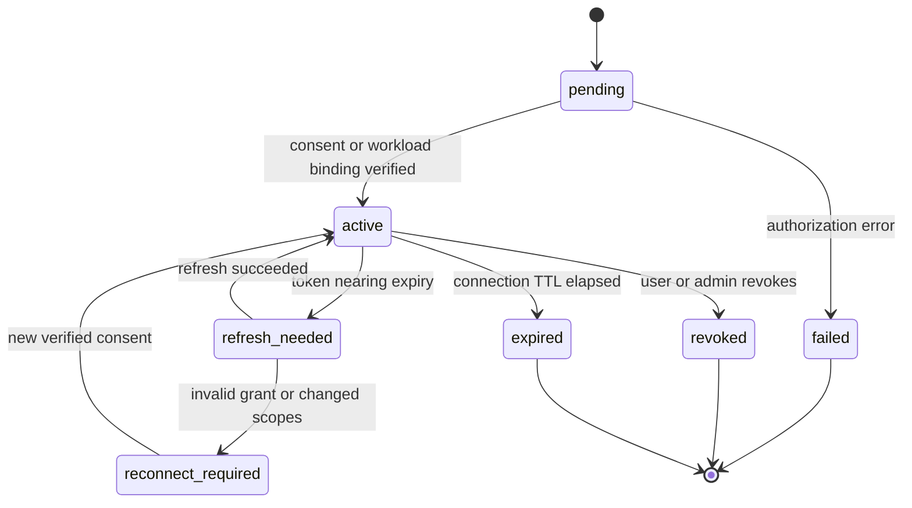
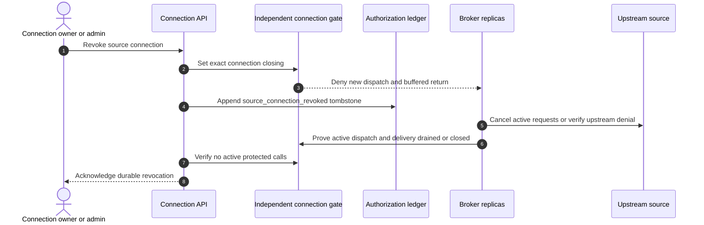
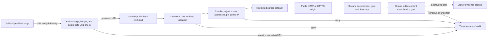

# MCP connector broker design

**Status:** Proposed design; no connector is implemented.  
**Baseline:** OpenShell v0.1.5, read-only research.  
**Boundary requirements:** IAM-05, IAM-08, IAM-12, RES-03, CON-11, CON-12.
**Related:** [architecture](../architecture.md), [identity and access](identity-and-access.md), [requirements](../requirements.md), [contracts](../../contracts/README.md).

## 1. Decision and responsibility

The connector broker is an external service that gives an OpenShell worker a small catalog of **job-scoped, stage-scoped read tools**. It owns source OAuth grants and application credentials, validates every request against a server-held job policy and one source security partition, calls an upstream MCP server or API, and returns bounded source material with provenance. It does not plan research, synthesize an answer, or trust an agent-provided tenant, user, connection, partition, or resource scope.

The broker is the default for enterprise sources because OpenShell's MCP inspection currently matches a method and tool name, but **not the tool arguments**. An allowed `search` tool might otherwise accept any channel, repository, project, or query. OpenShell also relays MCP responses without content policy parsing. The broker enforces the narrower task scope and provides one place for provider-specific OAuth handling. [OpenShell network rules, v0.1.5](https://docs.nvidia.com/openshell/v0.1.5/how-it-works/policies/network-rules).



The tool call arrow is logical: on Kubernetes, the worker's network request passes through the OpenShell supervisor before it reaches the external broker. The CNI must deny direct workload egress. [OpenShell Kubernetes setup](https://docs.nvidia.com/openshell/v0.1.5/kubernetes/setup).

The broker is an authorization boundary. A worker may ask for a smaller time range within its **current partition**. Any attempt to expand access is denied and recorded; source documents, model text, MCP tool descriptions, and agent state cannot alter the server-held policy. A private synthesis worker has no source-broker route or source tool.

## 2. Identity layers and token custody

| Leg | Principal and grant | Token holder | Audience and purpose |
| --- | --- | --- | --- |
| Browser to dashboard | Human Okta Authorization Code + PKCE session | Dashboard session store or browser session mechanism | Dashboard API only |
| Controller to OpenShell | Controller OAuth client credentials | Controller process/secret manager | OpenShell gateway only |
| Worker to broker | Short-lived job credential or federated workload token | OpenShell provider/proxy and broker verifier | Broker tools for one job/stage/attempt/sandbox and recovery generation |
| Broker to source | User-delegated source grant, app installation token, GCP workload identity, or provider-specific service grant | Broker/vault | Exact upstream MCP/API resource |
| Worker to model gate | Per-attempt model-route credential resolved by an OpenShell provider | OpenShell provider/proxy and trusted model request gate | Exact internal gate endpoint; the gate validates the native model request and owns the upstream provider credential |

**Okta sign-in does not supply source authorization.** An Okta access token for the dashboard must not be forwarded to Slack, GitHub, Google, or an arbitrary MCP server. User delegation needs a separate consent or enterprise authorization path for each source. MCP's HTTP authorization specification requires resource-specific token requests and use of bearer tokens only at the intended MCP resource. [MCP authorization specification](https://modelcontextprotocol.io/specification/2026-07-28/basic/authorization).

If a SPIFFE issuer is unavailable for a **local prototype**, a narrow fallback is a random, short-lived broker credential whose hashed server-side record binds `{tenant, job, stage, attempt, immutable sandbox ID, attempt fencing generation, policy digest, recovery generation, expiry}`. Before sandbox creation, a separately privileged provisioner creates a per-attempt broker provider with a deliberately invalid sentinel value, `stable_placeholder: true`, and binding only to the broker endpoint. The controller creates the sandbox with this provider **already attached**; its canonical bootstrap process receives an opaque placeholder at startup and waits for its manifest. After OpenShell returns the immutable sandbox ID, the controller commits that binding, the provisioner issues the real credential, and a **value-only** update of the same provider changes what the existing placeholder resolves to. The controller waits for the supervisor receipt and checks the effective policy before the job API releases the manifest. A provider attached only after canonical process startup would not supply a new placeholder to that running process. The broker stores only the credential hash and checks current job/revocation state. The credential expires no later than the job and is revoked on cancellation. Use a separate sentinel, provider, and audience from any Job API bootstrap credential. Static OpenShell provider metadata such as `auth_style: bearer` does **not** put a header on a request: the MCP client must send its OpenShell-issued placeholder as a bearer credential. Raw bearer replay is possible if that credential is copied, so this fallback is not sufficient for private production admission without an independently tested sandbox-origin or sender constraint. [OpenShell provider profiles, v0.1.5](https://docs.nvidia.com/openshell/v0.1.5/how-it-works/providers/profiles), [OpenShell workspace roles](https://docs.nvidia.com/openshell/v0.1.5/how-it-works/workspaces).

The preferred production path is an internal issuer that accepts OpenShell's SPIFFE JWT-SVID client assertion and returns an audience-bound broker token via `token_grant: client_credentials`. A reviewed, reusable broker provider profile can be attached when the sandbox is created. OpenShell can inject the resulting token on inspected broker HTTP/MCP requests without exposing it to worker code. The issuer must bind every token to the verified tenant, job, stage, attempt, immutable sandbox ID, attempt fencing generation, policy digest, and **current externally monotonic recovery generation**; the broker verifies that binding against the authoritative current attempt and the independent ledger generation on every request. This path needs an issuer integration test, a binding from the verified sandbox identity to the controller's job, and a broker-side sender or origin authentication control such as workload mTLS/SPIFFE identity binding. A bearer token's job claims alone do not prove which process presented it. It is **not** evidence that Okta accepts this assertion directly. [OpenShell dynamic token grants, v0.1.5](https://docs.nvidia.com/openshell/v0.1.5/how-it-works/providers/profiles).

**Restore and rollback fence.** The [independent authorization ledger](research-visibility.md#revocation-durability-across-restore) advances a recovery generation after any application, broker, or credential-state PITR or rollback that could revive an old attempt. The broker closes ingress while the current ledger head/generation or sandbox reconciliation is unproved. It rejects an old-generation credential immediately, even if restored application state says its hash, attempt, or sandbox is active; it checks the generation and current sandbox/attempt binding again immediately before upstream dispatch. The issuer and provisioner must stop minting credentials during that gate. After the controller reconciles and fences stale sandboxes, only an authorized current attempt receives a new-generation credential and provider receipt; a former sandbox cannot obtain a fresh token merely by presenting its still-valid SPIFFE identity. If the issuer cannot carry and verify this generation, its dynamic token path is not qualified for private production use. A restored credential cache or source connection never bypasses the gate.

```mermaid
sequenceDiagram
    autonumber
    participant C as Controller
    participant O as OpenShell gateway
    participant V as Credential provisioner
    participant W as Job worker
    participant B as Broker
    participant P as Policy store
    participant A as Job API
    C->>V: Request broker provider with invalid sentinel and stable placeholder
    V->>O: Create endpoint-bound per-attempt broker provider
    C->>O: Create sandbox with provider pre-attached and waiting canonical bootstrap
    O-->>C: Immutable sandbox ID
    O-->>W: Opaque placeholder at process startup
    C->>P: Commit job, sandbox binding, policy version
    C->>V: Request short-lived broker credential for bound sandbox
    V->>O: Value-only update of same provider; wait for supervisor receipt
    C->>O: Inspect provider receipt and effective policy
    C->>A: Release stage manifest after checks
    W->>A: Fetch current stage manifest
    W->>B: MCP read tool + bearer placeholder
    O->>B: Resolve placeholder only for broker endpoint
    B->>P: Verify credential, live job state, tool and resource scope
    P-->>B: Authorized policy snapshot
    B-->>W: Bounded result or typed denial
```

The sequence above illustrates the **prototype fallback**, not an API that OpenShell implements end to end. OpenShell stable placeholder resolution and endpoint binding are documented platform capabilities; the job credential issuer, privileged provider provisioning, broker verifier, and live policy check must be implemented here. The production SPIFFE path avoids per-job provider creation but keeps the same job/sandbox binding and sender checks.

## 3. Source connection and consent

The dashboard shows each source's **acting identity** before a user starts a job: personal Slack user, GitHub user, GitHub App installation, or GCP workload principal. An administrator registers allowed source integrations and callback URLs. A researcher can connect an eligible user-delegated source outside the sandbox. The controller stores an opaque `connection_ref`, selected resources, token owner, consent scopes, source audience, status, and refresh/revocation metadata. Raw grants stay in the vault. A source connection is never treated as a blanket approval for every resource reachable by that credential.

```mermaid
sequenceDiagram
    autonumber
    actor User
    participant UI as Dashboard
    participant API as Connection API
    participant AS as Source authorization server
    participant Vault
    participant Catalog as Resource catalog
    User->>UI: Connect a source
    UI->>API: Start connection with verified dashboard session
    API->>AS: Redirect with registered client, state, PKCE when supported
    AS-->>API: Authorization callback
    API->>AS: Exchange code; validate issuer, state, audience and scopes
    AS-->>API: Source grant and expiry
    API->>Vault: Encrypt and store grant
    API->>Catalog: Enumerate approved selectable resources
    Catalog-->>UI: Acting identity, scope, resource choices
```

The broker validates the OAuth metadata and capabilities of each MCP server at registration. A source may require a preregistered confidential client, user consent, an application installation, or a non-OAuth workload exchange. Dynamic Client Registration is optional in the current MCP spec and is unavailable for Slack and GitHub's hosted servers. The source adapter must not assume that one generic client credentials request will work everywhere. [MCP authorization](https://modelcontextprotocol.io/specification/2026-07-28/basic/authorization), [Slack MCP](https://docs.slack.dev/ai/slack-mcp-server), [GitHub host integration](https://github.com/github/github-mcp-server/blob/main/docs/host-integration.md).

## 4. Authorize each tool invocation

The broker exposes stable, typed tools, not an unrestricted `call_upstream_tool(name, arguments)` escape hatch. Every call follows these checks in order:

1. Validate the worker credential's signature or hash, expiry, audience, sandbox binding, attempt fencing generation, **current externally monotonic recovery generation**, and revocation state. Require a verified current independent-ledger head and authoritative attempt binding; a stale/unavailable ledger or old-generation bearer denies ingress.
2. Load the authoritative job policy and active stage manifest. Require running state, exact policy version, and `enterprise_retrieval` for private source calls. Resolve the **server-held** source partition and `retrieval_mode` from the verified job/attempt identity; ignore worker-supplied labels as authority.
3. Require the named tool and connector in that partition's stage, its exact connection and resource selection, a source connection belonging to the tenant, and the intended acting identity. In `correlation_only` mode, permit only the `search_by_correlation_key` wrapper and internal `read_evidence`; deny every worker-controlled query, path, filter, or fetch tool even if the broader job policy lists it. In `standard` mode, deny correlation wrapper and inbound keys. A synthesis stage or another partition is denied before any upstream call.
4. Parse arguments against a connector-specific schema; reject extra fields, wildcards, path traversal, unbounded queries, unsafe filters, and raw correlation-key values in a cross-partition query. A worker-supplied pagination value must be a broker-issued handle, never an upstream cursor. Resolve that handle and its original exact scope **before** any source I/O, as specified below.
5. Intersect requested channel/repository/project/log view and time range with the **server-held** allowlist. For a correlation call, resolve a broker-issued key ID, validate its reviewed transfer grant against a matching durable creation event at the current independent-ledger head and absence of a transfer-grant tombstone, and build the destination query from a pinned template; never forward model-composed source A text.
6. Enforce per-call row/byte limits, rate limits, global job budgets, and upstream-specific read-only method choices.
7. Enter a **cross-replica per-connection dispatch/return fence** for the exact, never-reused `connection_ref` before token refresh or source I/O. Its linearizable closing state and active-call registry live in the independently recovered authorization domain, not a broker-local lock or a restored connection row. Under that fence, recheck the current ledger head, connection-denial state, attempt/recovery generation, acting identity, and exact source grant; acquire or refresh a token only for the approved audience/resource. Hold the fence through upstream dispatch **and final worker-visible return or abort**, including retries and bounded upstream streams. A connection entering `closing` denies any not-yet-dispatched call and any buffered but not-yet-released response. An unavailable fence or uncertain head denies the call.
8. For a typed transfer, also atomically reserve and charge **one** of the grant's `max_destination_calls` in the existing **independent authorization ledger** before each upstream dispatch, across all broker replicas and retries. A serializable per-grant `destination_call_reserved` append keyed by tenant/job/never-reused grant ID checks the current head, matching immutable grant-creation binding, absence of a grant tombstone, and used-call count below the approved cap in the **same ledger transaction**. A failed, timed-out, or ambiguous call remains charged; an unavailable, stale, or exhausted ledger denies before source I/O. The ledger is outside broker/application PITR and replays reservations on restore. Hold the grant dispatch/return fence through the final recovery-generation/attempt recheck and worker-visible response completion or abort; revocation closes that fence, stops or waits for older in-flight calls, appends its tombstone, and only then acknowledges. Calls acquire the connection fence before the transfer-grant fence; neither revocation waits while holding the other grant's exclusive fence. Ordinary source calls still hold the connection fence and perform the final ledger/attempt checks before dispatch.

9. Hold **every** raw upstream response inside the trusted broker, including noncitable discovery snippets, identifiers, locators, and errors. Before evidence capture or worker release, parse every item in the bounded response page and verify its **source-authenticated** tenant/installation or acting-identity context, canonical resource ID, and exact selected resource/ref/time scope against the server-held partition. A query that was in scope does not prove each returned item is. Source prose, worker labels, a URL string, or an unverified MCP `content` field is not authority for the resource ID. If any item has an out-of-scope, missing, conflicting, or ambiguous identity, reject the entire page with zero item fields, evidence IDs, or snapshots released; an adapter may instead fetch and verify the exact item through a separately scoped source operation before a later release. A source that cannot supply or verify authoritative per-item identity is not qualified for that tool. Then classify every verified field with inherited dependencies **before any field reaches the worker**; if the effective class is unknown or exceeds the stage's pinned model/trace route, quarantine or deny with no response bytes, excerpt, source metadata, or evidence ID released. For a citable read, commit a bounded encrypted snapshot with trusted dependency metadata only after both scope and class decisions. A stored high-class label alone does not prevent exposure. Redact credentials.
10. Return a bounded, labeled result only after those gates, with a final current connection/attempt/recovery-generation check **inside the connection return fence** and, for a typed transfer, a current grant check inside its return fence. V1 buffers a complete source tool result and does not relay partial upstream frames to the worker; a result queued when either applicable grant enters `closing` is discarded. The applicable fences remain active until the broker-to-worker response is fully completed or its channel is closed. A citable result carries an evidence ID and safe source locator; an uncitable discovery lead carries no evidence ID and cannot be cited. Record an audit event for allow or deny without raw query text or key values.

If a broker holding either fence crashes, lease expiry alone does not prove its upstream request, stream, or broker-to-worker delivery ended. The revocation path must observe closure of both relevant flows or verified upstream token denial for the orphaned source call before acknowledgement; otherwise revocation stays pending and the connection or grant route remains closed. The fixture/live tests include delayed responses and a crashed replica during both connection and grant-only revocation.



The broker uses **server-owned selectors**. For example, a Slack call accepts only channel IDs selected in that stage's partition; a GitHub call is constrained to its selected repository IDs and immutable refs; a Logging call uses its approved project or log view plus a broker-built filter. Ordinary search text can be agent-controlled only in a clean `standard` attempt within the current partition's size and syntax bounds; it cannot be a resource selector or arbitrary URL. That worker sees only its approved brief, reviewed public evidence, and independent same-partition private evidence. A `correlation_only` worker has no ordinary search tool and cannot read an older B-only or A-derived B item. This context isolation and the Job API mode gate prevent private source A content from appearing in an ordinary source B search. A broker string scanner cannot reliably infer the provenance of arbitrary prose, so the design does not claim that it can.

For a paginated tool, the first approved call creates a short-lived, integrity-protected **broker pagination handle**. The broker holds the raw upstream cursor server-side and binds the handle to tenant, job, immutable sandbox/stage/attempt, recovery generation, policy and manifest digests, exact connection and grant generation, tool, canonical resource selector, normalized query/filter/time window, issued page, expiry, and remaining page/byte budget. A continuation accepts only that handle; the broker reconstructs the original source request from trusted state and rejects extra or changed query, resource, time, tool, or connection fields. It repeats current attempt, grant, entitlement, source-budget, and connection-fence checks before each page. A raw upstream cursor, handle from another job/attempt/connection or query, expired/tampered handle, restored old-generation handle, or handle whose source grant/policy changed is denied **before** an upstream call. Issue the next handle only after the entire current page passes per-item identity, scope, class, and size checks; never return or log a raw upstream cursor to the worker. Qualify a source adapter's pagination only if the upstream cursor is proven bound to the original scope or the adapter can reassert the exact original selector/filter on each continuation; otherwise disable pagination for that tool. A server holding an opaque cursor does not by itself prove that cursor cannot widen an upstream request.

### Initial read tool catalog

| Tool | Accepted controls | Server-enforced scope | Result limit |
| --- | --- | --- | --- |
| `search_slack` | Initial search phrase, selected channel IDs and bounded time interval; continuation uses a broker pagination handle only | Slack connection owner, channel list, read scopes and original query/time binding on every page | Top N verified snippets with message IDs and timestamps; broker handle only after a safe page |
| `read_slack_thread` | Selected channel ID and parent timestamp | Same channel and source identity; no send/reaction methods | Bounded thread excerpts |
| `search_github` | Search terms, selected repository IDs | Installation/user grant and selected repositories | Top N matches with immutable ref where possible |
| `read_github_file` | Repository ID, commit SHA, normalized path | Selected repository and permitted ref; no arbitrary `git` command | Size-capped file/line span |
| `list_log_entries` | Selected project/view, bounded time interval, approved severity and service filters | GCP principal, project/view and read-only filter template | Top N redacted entries |
| `search_by_correlation_key` | Broker-issued opaque key ID only | Reviewed source-to-destination transfer grant, exact destination partition, tool, and pinned query template | Bounded matches; raw key value and free-form query are not accepted from worker |
| `custom_mcp_*` | Explicitly reviewed adapter schema | Registered server, exact tool, argument policy, audience | Per-adapter bound |

Every **citable capture** includes connector, acting identity reference, canonical source URI or locator, retrieval timestamp, classification, content digest, tool call ID, and stored artifact reference, matching the [evidence contract](../../contracts/evidence.schema.json). An uncitable discovery lead has no evidence ID or artifact claim but still passes the pre-worker class gate. The trusted evidence index binds each private evidence ID to its source partition and producing attempt; the public evidence schema alone is not the stage-authorization record. The broker must never return a token-bearing URL or a raw OAuth error body that may contain a secret.

The canonical [internal evidence record](../../contracts/evidence.schema.json) is written only by the trusted broker or capture service. It carries the `producing_attempt_id`, producing `source_partition_id`, a transitive `source_dependency_evidence_ids` closure, exact `authorization_sources` for the primary and inherited source/resource selectors, `source_classification`, `dependency_classification_floor`, effective `classification`, and internal `correlation_derivation`. The broker derives these from the current policy, authenticated source response, key registry, and server-held attempt state in the same capture transaction as the snapshot and digest. A worker may cite an evidence ID but cannot create, claim, clear, or relabel attempt, dependency, or classification fields. Missing or inconsistent closure prevents evidence publication. The browser [evidence view](../../contracts/evidence-view.schema.json) excludes attempt/dependency IDs, source-resource closure, key IDs, and internal context references.

### Private cross-source query control

The [job policy](../../contracts/job-policy.schema.json) assigns every approved private source to one `source_partition`. Admission normalizes requested resource sets into one policy selection per resource unless a source owner approves a shared domain. A partition normally contains exactly one connector, connection, and resource ID. Multiple resource IDs require `shared_authorization_domain_ref` from the source owner and a verified common permission and data-flow domain. Admission checks that partition selectors exactly and nonoverlappingly cover the approved private sources, and records approval for the **exact bytes** of each destination brief. It does not project the full question, pasted private context, or another source's content into a retrieval brief. Each `enterprise_retrieval` [manifest](../../contracts/stage-manifest.schema.json) contains exactly one partition and its approved brief; the broker binds the verified attempt identity to that manifest and permits only its connector and resource selection. The Job API applies the partition **and retrieval mode** to evidence reads: a standard attempt cannot open foreign-dependent B evidence by guessing a same-partition ID. A fresh `enterprise_synthesis` sandbox can read curated evidence from all partitions but has zero source connections or source tools. For the initial release, private retrieval stages run sequentially. These are application controls on top of OpenShell's endpoint and tool-name rules.

The default policy has `cross_partition_transfer_grants: []`. A transfer requires both an A-side data export/declassification decision from the source owner or a tenant-delegated steward with A authority, and a B-side destination resource/template acceptance decision from the destination owner or a steward with B authority. One person may hold both delegated authorities, but B ownership alone cannot approve export from A. The grant names source and destination partition IDs, allowed key types, destination tool and pinned query-template ID, `max_keys`, `max_destination_calls`, key value/total byte limits, a reference to the authenticated tamper-evident decision set, and expiry. Admission verifies that the two partition IDs exist and differ, the approved source/destination connection and resources match the grant, the template supports the listed key types and read-only destination tool, the two decisions bind the **exact call cap and grant scope** and are signed or otherwise tamper-evidently authenticated with actor/authority/time, and the grant lifetime is within the job policy lifetime. It rejects any grant ID with a prior creation event except an idempotent retry of the same approval transaction with identical bindings, and always rejects a tombstoned ID; a `grant_id` is globally unique and never reused across jobs, policy revisions, rollback, or restore. It puts the `search_by_correlation_key` wrapper in a destination manifest only when a valid key ID is ready. The broker treats an agent-suggested key span as untrusted: it loads the captured source snapshot and verifies its hash and source partition. A pinned type parser only validates format; automatic key issuance additionally requires a **provider-generated, non-user-authored value with bounded semantics** or an independently verified source object in the selected resource, such as a commit object verified in the selected repository. Authentication of an API field is insufficient when a user can choose that field's value: issue titles, labels, custom metadata, incident IDs, and document fields require the same A-authorized human exact-value declassification review as prose. That review binds the exact value to the evidence digest/span and destination grant, even when its syntax is valid. Before issuing a key ID, the broker verifies the current ledger head and absence of a transfer-grant tombstone. It rejects key extraction from any evidence with a nonempty foreign-source dependency closure, then stores the canonical value, origin evidence/partition/resource, inherited dependency closure, effective classification, transfer grant, key type, and provider proof or exact-value review reference in a protected key registry. It returns only a random key ID to the trusted controller for destination-manifest projection. The destination manifest may list that ID, never the value or source A evidence. A destination call carries only the key ID; the broker checks the current grant, destination stage, source and destination rights, current connection and transfer-grant denial projections, key type/size/count, use ledger, expiry, and approved destination selector. It then builds the upstream query from the registered template with a typed parameter. No model-generated label, free-form query string, or MCP tool description can change the type or transfer destination. If the transfer requires a new approval, a new immutable policy revision and sandbox are needed before use; denial never falls back to a broader source identity.

**Grant creation before admission.** The approval service assigns a globally unique grant ID and verifies both authenticated decisions against the exact A export, B resource/template, limits, expiry, and actor authorities. It resolves the pinned destination template to its **complete declarative upstream argument expression** and immutable renderer artifact version/digest, and pins the source extractor and independent verifier artifact versions/digests. The [internal `transfer_grant_created` contract](../../contracts/transfer-grant-created.schema.json) records the tenant, job, policy revision, grant ID, approval transaction ID, grant authorization-scope digest, two-decision-set digest, completed approval time, template-byte digest, and all three artifact bindings. The scope digest covers exact source/destination selectors, the grant authorization fields including `grant_id`, `max_destination_calls`, and expiry, template digest, and artifact bindings. It excludes post-decision `approval_ref` and `approved_at` to avoid a circular signature; the creation event binds those fields separately to the authenticated decision-set hash and completion time. Both signed or equivalently authenticated decisions bind the same scope digest. The independent authorization ledger atomically rejects a previously used or tombstoned grant ID, then durably appends this creation event and advances the verified tenant head **before** the immutable policy revision is committed, admitted, or approval is acknowledged. A failed policy commit leaves the reservation in the ledger. An uncertain append can return the existing event only for the same approval idempotency transaction and identical binding, never append a duplicate; a new transaction using that ID is rejected even if its scope is identical. If the ledger head is unavailable, approval waits or fails closed.

Every admission, key issuance, key-ID projection, and destination call requires the current ledger head to contain the **matching** creation event and no later grant tombstone. A broker PITR before an approved but unused grant does not erase its ID reservation; an alternate policy revision, broader resource selector, higher call cap, changed decision set, changed query expression, or changed artifact cannot reuse it. The broker compares the measured running extractor **and verifier** artifact digests with the creation event before key extraction or registration, and compares the running destination renderer digest and exact template bytes before constructing or dispatching any destination request. A mixed-version deployment denies; an upgrade needs a new reviewed grant ID and policy revision. A template ID, adapter name, or version string alone is insufficient. Production hashes immutable release artifacts and verifies them from the build provenance; the synthetic example files only show the binding shape.

The independent authorization ledger also serializes `correlation_key_reserved` events keyed by tenant/job/grant ID. Before issuing a key ID, the broker atomically checks the matching creation event at the current head, no tombstone, `max_keys`, per-value length, and remaining `max_total_bytes`, then records the new opaque key ID and byte charge **without the raw value**. The key registry may store the value only after that reservation succeeds. Broker PITR cannot reset key count or byte usage; a restored registry that lacks a previously reserved key fails closed for that ID and needs a new grant rather than reusing a spent slot. A crashed issuance remains charged. The same grant-head/fence rules prevent a revoke from racing an issuance acknowledgment.

**Key-origin attempt fence.** The key registry joins the originating evidence's `producing_attempt_id` to the trusted stage manifest and its taint/checkpoint state. Automatic issuance and destination-key selection may occur only through a deterministic trusted connector extractor acting on a provider-generated object **captured in an untainted `standard` source attempt**, before that attempt has seen any foreign key or dependency. The extractor may later replay the trusted captured record under a current approved grant, but a tainted worker cannot trigger or select that replay. A model or worker nomination is a review hint, never authority. A candidate from a `correlation_only` worker, tainted checkpoint, or mixed-source synthesis/review process cannot auto-issue a new key merely by naming an older, apparently B-only evidence ID: the nomination or selection was influenced by A context. Such a proposal needs explicit A-origins-to-final-destination exact-value declassification review, or a separately designed chained-transfer protocol. A key independently preissued from clean B evidence retains its original attempt proof, but a later tainted worker cannot choose or retarget it; its destination and selection must already be fixed by that clean workflow or separately reviewed. The broker denies on any missing attempt, taint, or extractor provenance.



The grant authorizes only the named typed transfer. It does not authorize copying a Slack paragraph into GitHub search, copying an entire log line into Slack search, or feeding source A's raw result into B's model context. The broker keeps key values and queries out of ordinary logs and audit records; those retain grant ID, partition IDs, key ID, template version, decision, and byte/count totals. Revoke the grant or either source connection to block the next destination call. Test this with two real sandbox attempts and an upstream request recorder; a unit test of the parser alone cannot prove the egress boundary.


**Correlation-only destination attempt and trusted lineage.** A destination partition may first run a separate `standard` retrieval attempt with ordinary B tools, no inbound A key IDs, and no A-derived context. If a reviewed A→B join is needed, the controller creates a **fresh `correlation_only` sandbox/attempt**. Before projecting any inbound key ID, it verifies the current matching grant-creation event, no tombstone, and ledger head; computes the exact origin evidence ID, grant ID, and source/resource closure against every required evidence-schema cap; and proves that the highest effective class of the key, its origin evidence and dependencies is accepted by the destination stage, model, and trace routes. An over-class key is denied or held for a newly approved higher-class stage/route; its value or metadata never reaches the lower-class worker. The broker persists a monotonic attempt taint record containing the union of key-origin evidence IDs, inherited foreign-source dependency IDs, exact source/resource closure, grant/key IDs, and the highest dependency classification **before manifest release or any B call**. Adding another key requires a new manifest and attempt. A later ordinary B attempt, if authorized, starts with a clean sandbox and checkpoint and cannot import this attempt's model state, key IDs, event details, or derived evidence.

A `correlation_only` manifest and the broker admit only `search_by_correlation_key` with a broker-issued ID plus internal `read_evidence`; no ordinary `search_slack`, `read_slack_thread`, file read, URL fetch, or other worker-controlled query, path, or filter tool is available even if the job-wide policy names one. Its wrapper accepts no free-form query field. The Job API also limits `read_evidence` in this mode to reviewed public evidence and items captured by **this same correlation attempt**, matched through trusted `producing_attempt_id`; it denies an earlier independent B evidence ID, even though its primary partition is B. In `standard` mode, the Job API and controller deny projection/read of **any** evidence with foreign dependencies, correlation derivation, key-origin context, or a tainted producing attempt, including same-partition B evidence, regardless of policy revision or guessed ID. Every B response in the correlation attempt, including parallel key queries completed out of order, inherits the attempt's full A dependency closure and classification floor. The broker classifies each actual response, including discovery snippets and errors, **before** worker delivery; an over-class response is quarantined with no bytes or metadata released. Taint is control-plane-owned and cannot be cleared by a worker, retry, result-arrival order, or later call. If the taint record or dependency metadata is missing, capture and worker delivery fail closed. The broker and evidence service atomically store trusted lineage with each derived snapshot.

V1 forbids another typed-key extraction from **any** evidence with nonempty `source_dependency_evidence_ids`, even if a B→C transfer grant exists. The broker checks the trusted evidence index, not a model label or source connector field; derived B evidence cannot be relabeled as B-only or used to launder A data into C. A future chained transfer would require a separately designed origin-to-final-destination approval and full dependency authorization. A syntactically valid 40-character hex string in source A prose or a user-authored structured field is not automatically a `commit_sha`; the broker must deny auto issuance without provider-generated commit metadata, an independently verified commit object, or an explicit human exact-value declassification decision.



**Grant-only revocation and restore.** An authorized grant revoker can revoke one `grant_id` while both source connections remain active. The API/broker locks and validates the current grant binding, closes the per-grant dispatch/return fence, then appends a transfer-grant tombstone keyed by tenant, job, and never-reused grant ID to the independent, synchronously durable authorization ledger **before acknowledging** revocation or updating any recoverable policy/key-registry projection. The ledger transaction advances the tenant's contiguous head. The cross-replica fence blocks new destination dispatches, cached key use, and buffered responses; acknowledgement waits until in-flight source and worker-delivery flows are drained or demonstrably denied. Acknowledge only after the local projection, audit, and fence are committed; if a recoverable database update fails, the tombstone still denies and the update is retried idempotently before success is acknowledged. The broker verifies that its denial projection is caught up to the current durable head both **before key issuance** and **on every destination call**, including immediately before upstream dispatch and worker return. A missing head, sequence gap, stale projection, or unavailable ledger denies issuance, dispatch, and return. The tombstone overrides a restored policy, registry, or still-valid source connections. A later policy revision cannot reuse the tombstoned ID or its key IDs. A fresh approval gets a new grant ID, new key IDs, new policy revision, and new destination sandbox; the old grant remains denied. See [authorization recovery](deployment-and-operations.md#7-backups-retention-and-restore).

```mermaid
sequenceDiagram
    autonumber
    participant R as Authorized revoker
    participant B as Broker authorization gate
    participant L as Independent authorization ledger
    participant D as Recoverable policy and key registry
    participant S as Destination source
    R->>B: Revoke grant G1; connections stay active
    B->>B: Fence G1 destination dispatch across replicas
    B->>L: Durably append G1 tombstone and advance tenant head
    L-->>B: Current committed head
    B->>D: Mark G1 and its keys disabled; retry if this fails
    B-->>R: Acknowledge G1 revocation
    Note over D,L: PITR may restore G1 as active in D; L retains tombstone
    B->>L: Verify current head before K1 issuance or use
    L-->>B: G1 tombstoned
    B->>B: Deny G1 key issuance and destination request
    Note over B,S: No upstream request is sent
```

## 5. Upstream identity patterns

| Source | Preferred first integration | Reason and required check |
| --- | --- | --- |
| Slack MCP | User-delegated confidential OAuth grant, obtained in dashboard connection flow; later evaluate Enterprise-Managed Authorization (EMA). | Slack's hosted MCP uses a preregistered confidential app and user scopes, with no Dynamic Client Registration. EMA can exchange an IdP-backed user assertion for a short-lived Slack MCP user token when the enterprise enables it. A generic app-only client credentials token is not a substitute for the user's channel permissions. [Slack MCP](https://docs.slack.dev/ai/slack-mcp-server), [Slack EMA](https://docs.slack.dev/authentication/enterprise-managed-authorization/). |
| GitHub | GitHub App installation token for organization-scoped research, or user OAuth when results must reflect personal access. | Installation tokens are minted from a GitHub App JWT and installation permissions; they are **not** generic OAuth client credentials. The remote MCP server accepts valid access tokens but does not supply OAuth itself or Dynamic Client Registration. Restrict repository set and read permissions in the App and broker. [GitHub host integration](https://github.com/github/github-mcp-server/blob/main/docs/host-integration.md), [GitHub governance](https://github.com/github/github-mcp-server/blob/main/docs/policies-and-governance.md). |
| GCP Logging | Broker read-only wrapper around Cloud Logging API using GCP Workload Identity Federation or GKE Workload Identity; evaluate hosted Logging MCP separately. | Google recommends keyless workload federation. Its Logging MCP example currently asks for `roles/mcp.toolUser` and `roles/logging.admin`, which is broader than a read-only research service should assume. Test a custom read-only role/deny policy; otherwise use the Logging API with `roles/logging.viewer` or a narrower log-view grant. [Google WIF](https://docs.cloud.google.com/iam/docs/workload-identity-federation), [Logging MCP](https://docs.cloud.google.com/logging/docs/use-logging-mcp), [Logging IAM](https://docs.cloud.google.com/logging/docs/access-control). |
| Custom OAuth MCP | Registered per-server adapter with protected-resource metadata, audience, scopes, client registration method, and read tool schemas. | MCP requires a `resource` parameter in authorization and token requests, and the token must be intended for that MCP resource. Validate the actual server and issuer behavior, including refresh and 401 recovery. [MCP authorization](https://modelcontextprotocol.io/specification/2026-07-28/basic/authorization). |



### Where OpenShell client credentials fit

OpenShell v0.1.5 supports gateway-managed `oauth2_client_credentials` provider refresh, using a stored client ID/secret and a profile-owned token URL. It also supports dynamic `token_grant: client_credentials` using a SPIFFE JWT-SVID client assertion, where the issuer accepts that assertion. These are useful for a service endpoint that accepts the resulting token and can enforce the required scope. Neither mechanism grants the identity of a dashboard user. The generic provider refresh documentation does not establish support for every upstream MCP server's RFC 8707 `resource` parameter; an integration test must prove token audience and handshake. [OpenShell provider profiles, v0.1.5](https://docs.nvidia.com/openshell/v0.1.5/how-it-works/providers/profiles), [MCP authorization](https://modelcontextprotocol.io/specification/2026-07-28/basic/authorization).

## 6. Direct MCP bypass of the broker

Direct sandbox-to-upstream MCP is an optimization, not the default. It is permitted only after a connector review proves **all** conditions below. In the broker path, an OpenShell-injected worker token authenticates the worker **to this broker**; the broker obtains a distinct source token **for the vendor**. Direct mode may let OpenShell supply a source token to an upstream MCP endpoint only when that source's native RBAC already enforces the exact stage partition and evidence capture is equivalent:

- The upstream credential is a dedicated, short-lived, least-privilege identity whose native authorization already limits the exact job-stage partition, connection, and resources. No broker-side argument filter is needed. Each private retrieval sandbox has only this source endpoint; synthesis has none.
- The issuer/upstream **must sender-bind the raw vendor token to the original immutable sandbox and attempt** and deny a copied token presented from another origin. A gateway attachment interceptor cannot stop replay of a bearer sent directly to the vendor. Separately, issuer grant policy or a qualified fail-closed gateway interceptor must deny reuse or minting of that source grant in a second sandbox, **including another attempt of the same job**, by a controller holding workspace `sandbox:write`. The signed admission and attachment guard bind the exact per-attempt provider instance ID/name, immutable profile digest, and approved credential/grant generation; a different instance with the same profile cannot substitute. Per-job workspaces narrow exposure but do not prevent same-job attempt reuse. Both upstream sender denial and second-sandbox grant denial need live proof before direct mode is enabled. [OpenShell workspace roles](https://docs.nvidia.com/openshell/v0.1.5/how-it-works/workspaces).
- From `CreateSandbox` until the immutable sandbox ID/attempt registration, effective-policy and provider receipt, current recovery generation, and manifest readiness are committed, an independent source-egress **and token-mint** barrier denies direct calls. The barrier covers the real supervisor/provider-originated route and a broad Workspace User `exec` during bootstrap; a timed-out or uncertain create remains closed until reconciliation. A worker manifest alone cannot fence a process that starts before admission completes.
- An attached direct source provider is externally immutable for its attempt: the fail-closed interceptor denies **every** `UpdateProvider` and `ConfigureProviderRefresh` call against it, including a same-profile broader token or refresh configuration from a valid provisioner `provider:write` token. OpenShell's interceptor omits secret fields and the provider layer does not extract token scopes, so it cannot safely approve a value change by inspecting the RPC. Only gateway-managed automatic short-lived refresh under the pinned pre-attachment configuration is eligible, and the issuer/upstream must independently prove unchanged sandbox/attempt grant lineage and exact source resource scope. If that proof fails, disable direct mode; a scope or grant change needs deletion and a fresh admitted attempt. [Gateway interceptor secret limits](https://docs.nvidia.com/openshell/v0.1.5/extensibility/gateway-interceptors), [provider scope limitation](https://docs.nvidia.com/openshell/v0.1.5/how-it-works/providers/profiles).
- OpenShell's effective policy has an explicit `protocol: mcp`, `enforcement: enforce`, approved endpoint/binary, and a narrow tool-name allowlist. Provider-contributed rules have been inspected for widening.
- The MCP client and server agree on an OpenShell-supported protocol revision, transport, discovery, headers, resource indicator, token audience, and renewal behavior.
- The source's exact response bytes and provenance are captured or independently verified by a trusted non-worker path. Because OpenShell's direct MCP proxy can deliver upstream response bytes to the worker before later evidence validation, the stage **and pinned model/trace routes** must be approved for the maximum class the direct token can retrieve, including snippets, metadata, locators, and errors; otherwise a trusted inline classifier/capture proxy must withhold over-class fields **before** worker delivery. If the upstream corpus maximum is unknown, treat it as the highest class or disable direct mode. A worker-submitted excerpt or digest and a post-report class check are insufficient; v0.1.5 MCP tool-name inspection does not attest response content. A trusted pass-through proxy may erase much of direct mode's simplicity, so compare it with the broker before approval.
- Cancellation or source revocation terminates access within the required time, even when a token is cached.
- Restore/rollback cannot leave a pre-restore sandbox using a cached direct upstream token. Either the upstream validates the **current externally monotonic recovery generation and attempt binding on every request**, or an independently enforced source-egress quarantine remains active during recovery until every pre-restore direct sandbox has been reconciled and its deletion observed at the runtime, or its upstream token has been revoked. The quarantine must stop **existing keep-alive and streaming connections**, not just new connections; a CNI rule whose conntrack leaves established flows alive is insufficient. A restored OpenShell or application record saying cleanup completed is insufficient.
- No cross-partition correlation key or source A content is sent directly. Any reviewed typed-key transfer uses the broker template path and destination grant checks.



An OpenShell MCP rule cannot tell whether `search` is used for an allowed channel or every channel. `protocol: mcp` should therefore supplement a broker's argument validation, not replace it. Different MCP protocol revisions require explicit policy selection in OpenShell; the v0.1.5 default is `2025-11-25`, and the sessionless `2026-07-28` revision needs explicit `mcp.versions` and matching headers. [OpenShell network rules, v0.1.5](https://docs.nvidia.com/openshell/v0.1.5/how-it-works/policies/network-rules).

The direct-source quarantine must be applied and verified by the cluster egress enforcement plane **before** recovery opens any affected tenant/workspace route; it cannot depend on a restored broker, Job API, or OpenShell policy row. It must tear down or demonstrably deny **established** TCP, HTTP/2, WebSocket, and streaming requests as well as new connections. A new NetworkPolicy object or a successful new-connect denial is not proof if CNI conntrack preserves existing flows. Where an active flow cannot be fenced, stop the sandbox and observe runtime deletion/connection closure, or revoke its upstream token and verify denial before recovery proceeds. Keep the quarantine until the controller reconciles all pre-restore direct attempts, including canceled attempts awaiting cleanup, and proves observed sandbox deletion or upstream token revocation. If an old sandbox or token cannot be accounted for, direct egress stays denied. After reconciliation, admit only newly bound attempts under the current generation. The generation-aware upstream alternative needs a live negative test showing that a cached old-generation source token is rejected by the upstream itself.

The same issue exists during ordinary source-grant revocation or local disconnect: a live direct sandbox may retain an upstream token and never call the broker again. Before acknowledging the local revocation, the control plane must fence **both new and established** direct source flows through an independently enforced deny and observe it, stop the sandbox and observe deletion/connection closure, or revoke the upstream token and verify the upstream denies it. It then retains the source-connection tombstone. If the CNI cannot target one attempt, quarantine the affected direct-source route or workspace until cleanup is observed. A failed, pending, or merely requested deletion is not proof; if neither egress, deletion, nor upstream denial can be verified, direct mode is not eligible for that source. Test revocation while the old sandbox and cached token hold a persistent connection, with an upstream recorder showing zero post-ack messages or requests.

## 7. Connection state, failures, and revocation



The broker checks connection state and the current **independent-ledger head**, including connection and transfer-grant tombstones plus recovery generation, on each protected call. `invalid_grant`, insufficient scope, revoked user membership, missing GitHub installation, IAM denial, and MCP version mismatch produce typed failures with no automatic elevation. A job may continue retrieving from another approved source for **internal salvage**, but it cannot expose a full report while the viewer lacks current entitlement to any source/resource in the job's cumulative admitted private-source envelope, including the failed source. It stays `awaiting_review` or fails until exact resource entitlement is re-established through a new approved connection or the requester starts a new job with narrower scope. A limitation note on a B-only report does not waive the A read gate. Transfer-grant revocation independently blocks its key IDs while source connections remain usable for their own approved reads. Short token lifetimes limit the window for a direct MCP path; enterprise policy may require stopping the whole job. See [research visibility](research-visibility.md) and [deployment recovery](deployment-and-operations.md).

For an **ordinary brokered source-connection revocation**, the connection API first atomically marks its cross-replica gate `closing`, preventing new dispatch and return admission for that never-reused `connection_ref`. It durably appends the `source_connection_revoked` tombstone in the independently recovered ledger, invalidates cached source tokens, cancels in-flight upstream calls and queued broker results, and waits for the active-call registry to drain or for verified closure/denial of orphaned upstream and worker-delivery flows. Only then does it acknowledge the revocation. A call paused after an earlier grant check cannot cross the dispatch fence once closing begins; a result waiting in a broker queue cannot cross the return fence. A call already sent may finish before the acknowledgement, or it is aborted; the acknowledgement never overtakes an active protected dispatch or result delivery. V1 buffers whole tool results and does not forward a live source stream to the worker. Bytes delivered to a worker **before** revocation cannot be erased, but the broker emits no new protected response after acknowledgement. If the closing-state coordinator, ledger append, active-call registry, or flow-closure proof is uncertain, the connection remains closed and revocation stays pending rather than claiming success. A crash after the tombstone but before the local connection update still denies subsequent calls; reconnection uses a new `connection_ref` and never clears the old tombstone.



The broker emits a structured audit record: tenant, job, sandbox, acting identity reference, connector, tool, normalized resource selector, decision, source status code class, byte count, and evidence ID. It never records tokens, full prompt text, sensitive query results, or raw source documents in ordinary logs. Evidence snapshots have a separate encrypted store and retention policy.

## 8. Connector conformance gates

Each adapter gets a positive and negative test suite before production:

| Gate | Required proof |
| --- | --- |
| Identity | Correct acting user or app principal, wrong-tenant and wrong-job denial, token audience isolation. |
| OAuth | Real discovery/registration path, consent or service grant, resource parameter where applicable, refresh, rotation, 401/403 handling, revocation. |
| Scope | Out-of-scope channel/repo/project/log view and wildcard/filter injection denied before upstream call. Every returned item also carries source-authenticated canonical identity matching the selected tenant/installation, resource/ref, and time scope before evidence capture or worker release. A mixed in-scope/out-of-scope page or an item with missing/conflicting/ambiguous resource identity releases **zero** page fields or evidence IDs; an adapter may explicitly re-fetch and verify one exact item in a separate operation. A text-only MCP result without verifiable item identity cannot qualify the tool. |
| Pagination scope | Search an allowed Slack channel and receive a broker handle for a second page. The same attempt continues with the unchanged channel/query/time and a valid grant; the second page is scoped and bounded. Supply a raw upstream cursor, tamper with the handle, replay it from another job/attempt/connection, or use it after a policy/grant/recovery-generation change: all deny before source I/O. Try a handle from channel A with channel B, broader time, or different query; no upstream request occurs. An adapter whose upstream cursor can change scope without reasserting the original filter is not enabled for pagination. |
| Data flow | Two source partitions cannot share a retrieval sandbox or private checkpoint. A source A fixture marker cannot reach source B as a query without a current reviewed typed-key transfer; forged labels and guessed same-job evidence IDs are denied. Synthesis has no source route. |
| Transfer authority and key origin | A-side export/declassification and B-side resource/template acceptance have distinct authenticated decisions; B-only approval cannot export A. A provider-generated commit SHA or independently verified selected-repository commit object can issue a bounded key under both decisions. A 40-hex encoded canary in source prose, user-authored issue label/title, or custom API metadata labeled `commit_sha` is denied automatic issuance; a user-controlled value requires A-authorized human exact-value review. |
| Transfer creation and restore | Approve G1 after a broker snapshot, then leave it unused and unrevoked. Verify that a durable `transfer_grant_created` event with the exact scope, two-decision, template, and adapter digests precedes the policy commit/approval acknowledgment. Restore broker/application state to before approval and try G1 under a changed resource, call cap, template, policy revision, or approval transaction, including an identical-scope new transaction: all deny against the independent ledger. An exact retry of the original approval transaction returns the old event without appending another; a newly approved G2 ID succeeds. A missing or stale ledger head denies admission, key issuance, and dispatch. |
| Pinned transfer artifacts | Change only the destination argument expression or its renderer artifact while keeping the same template ID; key-ID projection and B dispatch deny. Change only the source extractor or independent verifier artifact while keeping its version label; automatic key issuance denies. The running artifact digest must match the creation event at the relevant boundary; a new release cannot reinterpret the old approval. |
| Transfer call cap | Under a grant with `max_destination_calls: 1`, reserve one dispatch from broker replica A and concurrently retry from replica B. Exactly one upstream call occurs, including when the first call times out; the second is denied by the independent ledger's atomic reservation. Restore a pre-call broker snapshot and repeat: replayed ledger reservations still deny. Unavailable or stale ledger state denies all destination dispatches. Race revocation with a dispatch and prove zero post-ack source calls. |
| Correlation-only destination | Run ordinary Slack research in an earlier `standard` sandbox with no GitHub key or derived context. Project a GitHub key into a fresh `correlation_only` Slack sandbox. Its effective policy and broker allow only `search_by_correlation_key` plus internal evidence reads. After one approved templated join, try `search_slack`, `read_slack_thread`, a worker-chosen path/filter, and an untemplated Slack search repeating the echoed A key; all are denied before any upstream request, even if those tools are allowed job-wide. Parallel typed calls remain template/count bounded. |
| Provenance capacity | A 41-key correlation manifest is rejected by schema. For any accepted 1–40-key attempt, admission computes the complete union of origin evidence IDs, source/resource selectors, and grant IDs from trusted key registry records before projection, including worst-case parallel results. If any field would exceed the internal evidence schema's ID or closure cap, admission denies or splits into independently reviewed attempts; capture never drops a dependency to fit. |
| Same-partition replay and checkpoint | After A→B, guess a known A-derived B evidence ID from a new B `standard` sandbox. Both context projection and Job API `read_evidence` deny it despite B primary partition; ordinary B search cannot receive A content. A correlation-only B worker cannot read earlier independent B evidence. Try to reuse a tainted correlation checkpoint for a standard retry or new policy revision; its mode/taint binding denies release. |
| Derived evidence and chain denial | Every result captured in the correlation-only Slack attempt, regardless of typed-call completion order, records trusted GitHub dependency IDs, exact GitHub-plus-Slack source/resource closure, and a class at least as high as GitHub. A Slack-only viewer sees no derived evidence metadata, event ID, excerpt, or content bytes; a current GitHub-and-Slack-authorized viewer with sufficient classification can read it. The browser view contains no dependency IDs. A Slack→Logging key from derived Slack evidence is denied even with a Slack→Logging grant. |
| Tainted-worker key nomination | After A→B, have correlation B and mixed-source synthesis nominate an older independent B evidence ID as a new B→C key. The broker denies automatic issuance/selection despite the evidence's empty dependency list. Only deterministic extraction from a clean standard B capture with fixed destination/selection or explicit origin-to-C exact-value review can proceed. |
| Class before worker release | A restricted A key with an internal-only B model/trace route is rejected before manifest projection; no key metadata or source call reaches that route. An over-class B discovery snippet or error is quarantined before any worker-visible response, even without an evidence ID. A higher-class actual B result is not released merely because its stored evidence label was raised; a newly approved stage/route or denial is required. |
| Transfer-grant revocation and PITR | Complete an approved source A to B typed join under G1/K1, then revoke only G1 while both source connections remain active. New G1 key issuance and K1 destination calls must fail with zero upstream requests. Restore policy/registry state from before revocation; G1 remains denied after replay to the independent ledger head, and any missing/stale head fails closed. Reject an alternative policy revision that reuses G1. A separately approved G2 with a new key ID, policy revision, and destination sandbox can join; G1 remains denied. |
| Ordinary source-connection revocation race | Pause an ordinary broker call just before upstream dispatch on replica A, then revoke the connection on replica B. The independent connection gate closes, the paused call aborts or completes **before** acknowledgement, and the upstream recorder sees zero post-ack dispatches. Repeat with a complete upstream response paused before broker-to-worker return: the buffered result and evidence ID are discarded if closing won the fence, with zero post-ack worker-visible fields. Repeat with a bounded upstream stream, a crashed broker replica, and a queued response; revocation acknowledgement waits for verified source and worker-flow closure or upstream denial, not merely lease expiry or cache invalidation. A failed ledger/registry check leaves the connection closed and revocation pending. |
| Partial source failure and report gate | In an A+B job, revoke A's source connection after admission, then allow a B-only retrieval attempt for internal salvage. The candidate B-only report is not user-readable and `report_available` stays false until the viewer's current entitlement to the exact admitted A and B resources is proven; a B-only limitation note does not waive A. If A remains unavailable, the job waits for review or fails; a new A-free question needs a new admitted job and source envelope. |
| Broker credential restore | Back up an active broker attempt, clean it up or cancel it, then restore application and broker credential state to before cleanup. Advance the independent recovery generation, prove the old raw bearer and old sandbox/SPIFFE identity cannot enter the broker or trigger an upstream call, and deny all calls while reconciliation or ledger head verification is incomplete. Only a newly reconciled current attempt with a newly issued generation-bound credential can call its approved partition. |
| Direct bootstrap source gate | Start the canonical worker and a broad Workspace User `exec` during sandbox create, before the immutable sandbox/attempt binding, provider/effective-policy receipt, and manifest are ready; both direct-source token mint and established/new source egress deny. Repeat after a timed-out uncertain create; only a reconciled admitted attempt can open its exact route. A worker manifest waiting loop alone fails this gate. |
| Direct vendor-token replay and provider reattachment | Copy a raw vendor token from the original sandbox and call the upstream from another origin: the upstream denies it through sender binding. With a controller identity holding `sandbox:write`, try to attach the original provider to a second sandbox in **the same job** and then another job; issuer grant policy or the qualified gateway interceptor denies the reattachment or mint. Try a different provider instance with the same profile digest: it also denies. Per-job workspace isolation alone does not pass. Any successful replay or reuse keeps direct mode disabled. |
| Direct attached-provider credential mutation | With valid provisioner `provider:write`, try `UpdateProvider` with a broader token on the same profile and `ConfigureProviderRefresh` with broader source scope while the direct sandbox is active: the interceptor denies every external mutation without inspecting secret fields. Exercise pinned automatic gateway-managed refresh and prove issuer/upstream grant lineage, sender, and exact resource scope remain unchanged; otherwise direct mode stays disabled. |
| Direct response class | Make an internal-only stage request an upstream item, discovery snippet, metadata field, or error classified confidential. Direct mode is denied unless the stage/model/trace route was preapproved for the upstream token's maximum class or an inline trusted gate withholds the over-class field before worker delivery. No bytes reach a lower-class worker or model; later evidence/report classification is insufficient. |
| Direct-mode source revocation | Revoke a source grant while its direct sandbox and cached vendor token remain live over an established keep-alive or streaming connection. Do not acknowledge local revocation until independent egress denial tears down/blocks that flow, runtime sandbox deletion closes it, or verified upstream token denial is active; the upstream recorder sees zero post-ack messages and requests, including during pending cleanup. A CNI rule that blocks new connects only fails. |
| Direct-mode restore | Back up a direct-source attempt, cancel it while sandbox deletion is pending, then restore the earlier application/OpenShell snapshot while its cached upstream token and established stream are still valid. The independently verified egress quarantine blocks or tears down the old flow until deletion is observed or the token is revoked; alternatively the upstream rejects the old recovery generation. New direct attempts remain closed until reconciliation completes. |
| Read-only | Every exposed tool and upstream method is read-only; a known write method is rejected at broker and OpenShell. |
| MCP | Client/server revision, Streamable HTTP behavior, required headers, tool discovery, response limits, error normalization. |
| Evidence | Stable locator, retrieval time, hash, tool call ID, broker-owned transitive dependency closure, effective classification floor, exact source/resource read checks, encrypted artifact, citation replay. |
| Operations | Rate limits, timeout, cancellation, retry bounds, audit redaction, connection removal. |

See [deployment and operations](deployment-and-operations.md) for environment gates and [research and evidence](research-and-evidence.md) for how source data is handled inside the worker.

## 9. Public fetch isolation

`fetch_public_page` is a **public-stage-only** broker wrapper. The broker authenticates the stage and budget and rejects a candidate URL whose query/path or host contains a secret or uncertain private value **before any outbound fetch**; the same public-safe preflight applies to `search_public_web` queries before contacting the search provider. It then sends one approved URL to a dedicated public fetch workload. Here **source-credential-free** means that workload has no enterprise source OAuth grant, Okta session material, OpenShell gateway credential, vault permission, or reusable application secret/token. It may use only its own short-lived workload identity for authenticated broker traffic. A separate service account and network profile enforce that scope. The private retrieval and synthesis profiles have no route to it. The fetcher returns bounded bytes and redirect metadata to the broker for evidence capture; it is not an open HTTP proxy and does not accept worker-supplied headers, methods, cookies, request bodies, or proxy settings.



The fetch workload and its egress gateway both enforce the following proposed defaults. The deployment pins a reviewed fetch-profile version; a job may receive narrower limits, never silent widening:

1. **Parse and normalize once.** Accept an absolute HTTP(S) URL only. Use one standards-based URL parser for validation and request construction; reject malformed or ambiguous authority, userinfo, control characters, backslashes, encoded authority tricks, fragments, IP literals and alternate numeric IP encodings. Normalize the IDNA hostname, path, and port before checks. Require a fully qualified public hostname; reject single-label and internal suffixes such as `.localhost`, `.local`, and `.internal`. HTTPS on port 443 is the default; HTTP on port 80 requires explicit approval in the versioned fetch profile. Reject every other scheme and port.
2. **Resolve and bind the connection.** Use a controlled resolver, inspect the complete CNAME chain and every A/AAAA answer, and reject the URL if any answer is loopback, private, link-local, unique-local, multicast, reserved, carrier-grade NAT, cloud metadata, cluster, or otherwise not globally routable. The HTTP client connects to one **validated pinned IP** without a second DNS lookup, verifies the actual connected peer IP, and retains the original hostname for HTTP `Host`, TLS SNI, and certificate validation. A terminating egress proxy must use that validated address rather than re-resolving the hostname itself. Re-resolving just before an ordinary hostname-based client connects does not close DNS rebinding. The egress gateway separately blocks those denied address ranges, including metadata endpoints, even if the application check fails. [OWASP SSRF prevention](https://cheatsheetseries.owasp.org/cheatsheets/Server_Side_Request_Forgery_Prevention_Cheat_Sheet.html).
3. **Handle redirects manually.** Disable automatic redirects. Allow at most three hops, resolve relative locations with the same parser, and repeat all URL, DNS, IP, port, and policy checks for each hop, including the public-safe secret/content preflight on every `Location` **before opening the next connection**. Reject HTTPS-to-HTTP downgrade. Never forward credentials or worker headers to any hop; the fetcher sends only fixed `GET` headers and no cookies. A redirect to a private or metadata address fails before opening that connection. [OWASP SSRF prevention](https://cheatsheetseries.owasp.org/cheatsheets/Server_Side_Request_Forgery_Prevention_Cheat_Sheet.html).
4. **Bound work and content.** Permit `GET` only, no scripts, browser execution, automatic subresource loads, or recursive crawling. Initial accepted types are `text/html` and `text/plain`; PDF needs a separately reviewed offline parser profile. Enforce a 3-second connect timeout, 10-second total deadline, 2 MiB wire-byte cap, 8 MiB decompressed-byte cap, 20:1 decompression-ratio cap, and the smaller remaining job budget. Check `Content-Length` when present and enforce limits while streaming even when it lies or is absent. Parse HTML as data in a network-disabled parser with CPU/memory limits. Store only bounded normalized text and safe metadata; reject binary, unsupported encodings, and parser failures with typed errors.
5. **Keep the network boundary independent.** A default-deny CNI policy allows only broker ingress, approved DNS, and the restricted egress gateway; the gateway/firewall denies internal and metadata ranges. The fetcher has no raw socket path around it. Audit decision, normalized host, redirect count, IP class, bytes, and limit reason without storing full URL query strings in ordinary logs. Keep the original URL and redirect chain only with access-controlled evidence metadata. A valid OpenShell public-stage rule alone does not make a user-supplied URL safe. [OpenShell network rules](https://docs.nvidia.com/openshell/v0.1.5/how-it-works/policies/network-rules).
6. **Classify before worker release.** The broker checks each worker-proposed search query or fetch URL for public-safe content **before outbound dispatch**, then holds **every worker-visible response field** from public search and fetch in a non-worker-visible quarantine until a trusted content/DLP decision permits public-stage use: candidate and final URLs, redirect locations, titles, identifiers, snippets, response metadata, body bytes, and errors. A safe page body can still have a secret in its URL or title. The `public_web` evidence contract accepts only material classified `public`. Sensitive or uncertain material stays restricted pending authorized review or is discarded, and is never silently downgraded, labeled public, sent to the public model, or returned to the public worker. The classifier does not use the public model route or emit raw content to ordinary logs/traces.

The live negative suite must show **no outbound connection** for loopback (`127.0.0.1`, `::1`), RFC1918/ULA, link-local and cloud metadata (`169.254.169.254`), cluster service names, carrier-grade NAT, IPv4-mapped IPv6, decimal/octal/hex IP forms, mixed public/private DNS answers, CNAME to private space, a DNS answer changed between validation and connect, an unsafe redirect, userinfo or parser ambiguity, a non-HTTP(S) scheme, and ports such as 2375. A synthetic private canary in a proposed public search query, fetch URL query, or redirect `Location` must be denied **before** any corresponding search-provider, initial-fetch, or next-hop request. The fetcher must also deny a decompression bomb, oversize/chunked body, slow response, unsupported content type, and HTML subresource request. A reachable public fixture with a synthetic secret in its URL, redirect location, search title, snippet, body, or error must be quarantined with **zero fields or bytes** reaching the public worker, public model, or ordinary traces. Positive fixtures must prove ordinary HTTPS pages, bounded safe redirects, public-content classification, and captured evidence hashes. Run the network cases through the real fetch workload and egress gateway, not only a URL-validator unit test.
