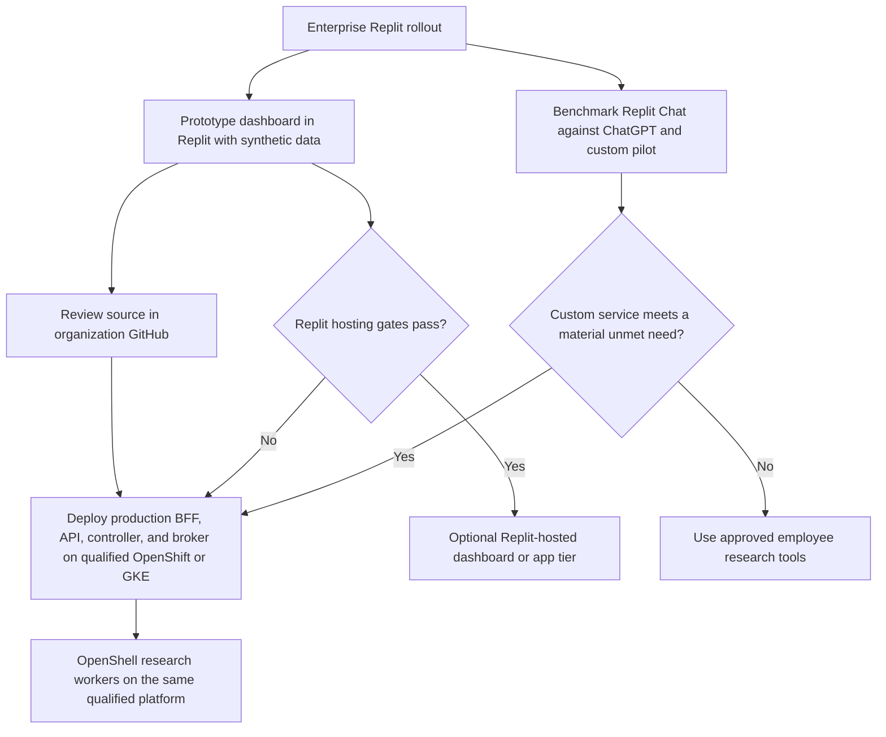
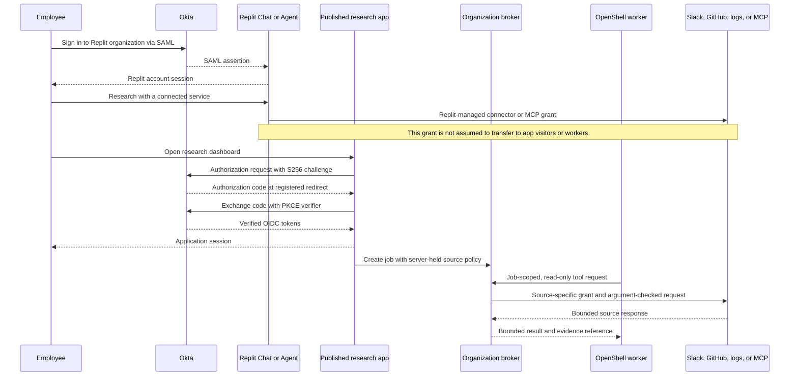
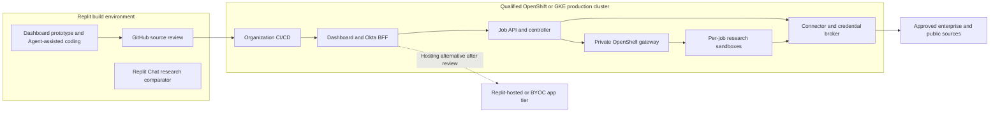

# Replit rollout fit for the internal research platform

**Status:** Design and product-fit assessment; no Replit tenant, contract, or deployment has been tested  
**Reviewed:** 2026-10-23  
**Decision context:** Employees already have enterprise ChatGPT; Replit is planned for rollout in about three months. The proposed research service remains an internal platform.  
**Related designs:** [Architecture](../architecture.md), [deployment topology](deployment-topology.md), [identity and access](identity-and-access.md), and [connector broker](mcp-connector-broker.md)

## 1. Recommendation

Treat Replit as **two separate candidates** when it arrives: an employee-facing research baseline and a way to build the research dashboard quickly. Replit documents a Chat workflow that investigates a question across Salesforce, Slack, and Google Drive, compares sources, and asks the user to inspect supporting records. That overlaps the proposed service's general research value. The rollout should therefore trigger a matched evaluation against enterprise ChatGPT and the custom pilot, not an assumption that a new dashboard will be useful merely because it can search several systems. [Replit research example](https://docs.replit.com/use-cases/prepare-for-a-customer-call).

Use Replit to prototype the dashboard with public or synthetic data if its development terms permit that use. Its documented Git workflow can push source to GitHub, allowing the production dashboard, BFF, controller, and credential broker to follow the organization's normal review and deployment process on a **qualified OpenShift or GKE cluster**. Replit-hosted production remains an option after the gates below. Replit's published-app and BYOC documentation does not establish support for running an NVIDIA OpenShell worker or its gateway/controller stack inside a Replit deployment. [Replit version control](https://docs.replit.com/learn/projects-and-artifacts/version-control), [Replit deployment types](https://docs.replit.com/features/publishing/deployment-types), [Replit BYOC](https://docs.replit.com/teams/bring-your-own-cloud).

This is the recommended decision path, not a claim that either Replit or ChatGPT lacks job isolation or source controls. Those capabilities must be tested in the actual tenants and plans against the same tasks. The reason to build the custom path is an observed, material requirement for job-scoped authorization, customer-operated execution, replayable evidence, or a specialized cross-system workflow that the approved products do not satisfy at acceptable cost.

## 2. Replit's fit by component

| Component or use | Documented Replit capability | Fit and open question |
| --- | --- | --- |
| Employee research baseline | Replit Chat can investigate across connected services and files; the documented example uses Salesforce, Slack, and Drive with a source-review step. [Research example](https://docs.replit.com/use-cases/prepare-for-a-customer-call). | **Benchmark directly.** Confirm the organization's actual connectors, source permissions, citation behavior, data handling, and task limits after rollout. Do not infer a particular “deep research” mode or GCP Logs connector from the example. |
| UI design and prototype | Replit documents a live API dashboard workflow; its Git tooling imports, modifies, and pushes code to GitHub. [Dashboard example](https://docs.replit.com/use-cases/live-api-dashboard), [version control](https://docs.replit.com/learn/projects-and-artifacts/version-control). | **Good initial fit** with public or synthetic fixtures and a reviewed Git handoff. Generated code still requires application security review, tests, and ownership. |
| Published dashboard and BFF | Replit publishes web apps and APIs using Autoscale or Reserved VM deployments; private published apps can restrict visitors to a Workspace or invitation list. [Deployment types](https://docs.replit.com/features/publishing/deployment-types), [private deployments](https://docs.replit.com/features/publishing/private-deployments). | **Conditional fit.** Prove Okta app login, job ACLs, session behavior, a supported path to the private job API, and operations. Private Replit access is an outer gate, not the application's job authorization model. |
| Job controller | Reserved VM is documented for always-on APIs and background work. [Deployment types](https://docs.replit.com/features/publishing/deployment-types). | **Possible app runtime, unproven service fit.** Confirm private OpenShell gateway connectivity, durable queue behavior, controller identity, deployment controls, and incident operations. Keep on the qualified cluster by default. |
| Credential and MCP broker | Replit projects have encrypted secrets exposed to project code as environment variables; Agent/Chat have managed connector and MCP integrations. [Secrets](https://docs.replit.com/core-concepts/project-editor/app-setup/secrets), [connectors](https://docs.replit.com/replitai/managing-connectors). | **Keep separately controlled by default.** Replit's Agent/Chat connection does not demonstrate end-user delegated grants for a published app or a job-scoped OpenShell broker. A production broker needs credential custody, argument-level policy, audit, and controlled private networking. |
| OpenShell research worker | No reviewed Replit publication or BYOC document describes the NVIDIA OpenShell gateway, supervisor, or per-job worker runtime as a supported deployment target. [BYOC options](https://docs.replit.com/teams/bring-your-own-cloud), [deployment types](https://docs.replit.com/features/publishing/deployment-types). | **No support claim.** Run the OpenShell worker only on a separately qualified OpenShift or GKE path described in the [deployment topology](deployment-topology.md). |

## 3. Identity, connectors, and secrets are different boundaries

Replit's enterprise **organization SAML SSO** lets staff sign in to `replit.com`; its setup supports Okta as the identity provider. That does not create a PKCE session or job identity in a published research application. Replit's separate **app-level SSO** guide describes Okta or Entra ID via OIDC or SAML through a Clerk-managed app configuration. The organization's desired Okta Authorization Code + PKCE/BFF, application roles, job ownership, and session controls must still be implemented and verified for the research service. A private Replit deployment prompts its visitors to sign in through Replit, so combining it with a separate app-level Okta flow may introduce two session gates; test the actual user journey before choosing that hosting mode. [Organization SSO](https://docs.replit.com/teams/identity-and-access-management/saml), [app-level SSO](https://docs.replit.com/features/auth-and-identity/single-sign-on), [private deployment access](https://docs.replit.com/features/publishing/private-deployments).

There is a documentation discrepancy to resolve: Replit's dedicated [app-level SSO guide](https://docs.replit.com/features/auth-and-identity/single-sign-on) describes Okta enterprise SSO through the Clerk dashboard, while the general [Clerk Auth page](https://docs.replit.com/features/auth-and-identity/clerk-auth) still says full SSO-provider coverage is unsupported and lists only social providers. Verify the contracted capability, configuration, pricing, and production login behavior with Replit and Okta. An independently implemented Okta PKCE/BFF remains the portable default until that test passes.

Replit Agent can connect to a custom HTTPS MCP server and follow its OAuth sign-in flow. Replit also documents personal and Workspace MCP connections, Enterprise connector administration, organization-owned OAuth clients and scopes, and per-app consent/revocation. Those are capabilities of **Replit's Agent/Chat integration surface**. They do not, by themselves, establish that each visitor to a published research app has a delegated source token, that such a token may be exported to OpenShell, or that a tool call enforces the job's approved Slack channel, GitHub repository, or log view. The proposed broker must authorize each operation and its arguments against server-held job policy, then use a source-specific grant whose scope and acting identity are recorded. [Connect via MCP](https://docs.replit.com/build/connect-via-mcp), [manage connectors](https://docs.replit.com/replitai/managing-connectors), [Agent integrations](https://docs.replit.com/features/integrations/overview), [broker design](mcp-connector-broker.md).

Replit's project secrets are encrypted at rest and injected as environment variables into running code. Its documentation also states that a non-owner organization member who can run code may print those environment variables even if the UI hides the values. Accordingly, do not place a shared, powerful Slack/GitHub/MCP client secret or refresh token in a broadly editable dashboard project. If production hosting is considered, test project access, production-secret visibility, rotation, runtime logs, and a dedicated secret manager or credential-broker integration. [Replit secrets](https://docs.replit.com/core-concepts/project-editor/app-setup/secrets).

A private published app's Replit login gate also changes machine-to-machine calls. Replit documents **external access tokens** as bearer credentials for CI, webhooks, and backend callers to bypass a private deployment's outer access gate. They are project-level access credentials, not a substitute for per-user authorization, job ownership, or broker capabilities. Keep such tokens server-side and prove rotation/revocation if a Replit-hosted app must receive callbacks. [External access tokens](https://docs.replit.com/features/deployment-customization/external-access-tokens).

## 4. Production hosting choices

The future Replit contract and rollout configuration are **unknown**. An announcement or feature page is not an entitlement statement. Obtain the actual plan, deployment mode, region, network features, connector policy, data-processing terms, and support commitments before committing production architecture to Replit. Replit's own BYOC page says availability and onboarding vary by cloud, configuration, and customer. [Replit BYOC](https://docs.replit.com/teams/bring-your-own-cloud).

| Mode | Where development and production run | Operational/security consequence | Availability stated by Replit |
| --- | --- | --- | --- |
| Standard Replit publishing | Development and published app run on Replit-managed infrastructure; Replit says standard published apps run on its GCP-backed infrastructure in dedicated single-tenant customer projects. [Publishing](https://docs.replit.com/learn/projects-and-artifacts/replit-deployments). | Suitable to evaluate for a standalone UI/API, subject to data, network, identity, and secret review. A Replit-managed GCP project is not the organization's operated GKE or OpenShift cluster. | Verify the contracted plan and the actual publishing geography. Replit documents separate development and publishing geographies and notes that the latter cannot be changed after first publication. [Geography](https://docs.replit.com/features/security/geography). |
| Full BYOC | Replit platform, Agent harness, development resources, and published apps in the customer's cloud tenant; an external Replit control plane remains. [BYOC](https://docs.replit.com/teams/bring-your-own-cloud). | Potential private-source access and customer cloud controls; Replit still operates the platform. Full BYOC is **not air-gapped or fully self-hosted**, and model inference remains part of Replit's managed Agent offering. Require a complete data-flow review. | **Private preview**; tenant-specific availability must be confirmed. |
| BYOC for Published Apps | Published apps in the customer's tenant; development and previews remain Replit-managed. [BYOC](https://docs.replit.com/teams/bring-your-own-cloud). | Published apps may reach private data sources through configured network/VPN access. Replit retains operational permissions in the customer's tenant. Verify connectivity to the private research API and exact operational access. | **Early access**; confirm supported cloud, region, and network pattern. |
| Image Exports | Replit supplies a Docker image, Terraform file, and SBOM; the organization deploys and operates the app. [BYOC](https://docs.replit.com/teams/bring-your-own-cloud). | Maximum control over production placement, but the organization supplies authentication and connectors that Replit-managed hosting would provide. The exported app need not connect back to Replit for operation. | **Early access**; confirm actual artifact and dependency contract. |
| Git source handoff | Replit is used for building; source is reviewed in GitHub and deployed through normal organizational CI/CD. [Version control](https://docs.replit.com/learn/projects-and-artifacts/version-control). | Recommended default because it does not depend on the early-access BYOC options and keeps the production application, broker, and OpenShell integration under existing platform controls. Validate generated code and any Replit-specific service dependencies before deployment. | GitHub synchronization is documented; organization repository policy still applies. |

The optional hosting arrow represents a **future alternative placement of the app tier**, not a second active production dashboard. It does not move the OpenShell worker into Replit. If a Replit-hosted UI/BFF is chosen, verify a secure private service path and clear responsibility for job authorization, credential custody, evidence retention, logging, incident response, and recovery before changing the topology. [BYOC](https://docs.replit.com/teams/bring-your-own-cloud), [deployment topology](deployment-topology.md).

## 5. Rollout and promotion gates

Run the research comparison when Replit is available to employees and the relevant connectors have passed the organization's review. Public/synthetic tasks can run earlier; enterprise-source tasks require source-owner approval and equivalent source access for a fair comparison. Record the tested Replit feature set and plan because documentation alone cannot establish what the tenant actually enables.

| Gate | Concrete check | Decision rule |
| --- | --- | --- |
| R-01 Contract and deployment | Inventory the actual Replit plan, SSO/SCIM, connector entitlements, hosting mode, BYOC or Image Export access, cloud/region, private networking, data processing, audit export, and support terms. Ask Replit to confirm availability for this organization's tenant. [BYOC](https://docs.replit.com/teams/bring-your-own-cloud), [organization SSO](https://docs.replit.com/teams/identity-and-access-management/saml). | Do not design a production dependency on an uncontracted preview or early-access feature. |
| R-02 Matched research tasks | Run the same approved research questions in enterprise ChatGPT, Replit Chat, and a bounded custom pilot: a public multi-source synthesis, a policy/document question, and a Slack–GitHub–GCP incident investigation where each product has approved access. Use blind reviewers to score factual accuracy, source traceability, permission handling, actionable value, elapsed time, and cost. [Replit research example](https://docs.replit.com/use-cases/prepare-for-a-customer-call). | Proceed with a custom employee-facing product only for an agreed material gap in baseline products or a mandatory control they fail to meet. Document unavailable connectors separately from answer quality. |
| R-03 Source identity | Test one user-only source, one app-only source, and one OAuth-secured MCP server with a narrowly scoped read grant. Inspect acting identity, OAuth audience, scope, revocation, and cross-user/source denial. Replit custom MCP OAuth is documented for Agent, while the published-app transfer path is unproven. [Connect via MCP](https://docs.replit.com/build/connect-via-mcp), [manage connectors](https://docs.replit.com/replitai/managing-connectors). | Retain the organization's broker unless published-app and job-specific grant behavior is demonstrated with the exact source. |
| R-04 Okta and app access | Test organization SAML login separately from dashboard Okta Authorization Code + PKCE, app session, roles, and cross-job denial. If using Replit's Clerk path, resolve the documentation discrepancy, user experience, session claims, and pricing. Test private deployment with and without Replit accounts. [Organization SSO](https://docs.replit.com/teams/identity-and-access-management/saml), [app SSO](https://docs.replit.com/features/auth-and-identity/single-sign-on), [Clerk Auth](https://docs.replit.com/features/auth-and-identity/clerk-auth). | A user must access only their authorized jobs and source evidence; the outer Replit login alone does not pass. |
| R-05 Network and runtime | From the proposed hosting mode, prove the exact authenticated route to private job API/gateway and broker, outbound controls, callbacks, failure handling, and DNS/TLS. For BYOC, enumerate Replit's operational permissions and managed control-plane/inference paths. [BYOC](https://docs.replit.com/teams/bring-your-own-cloud). | Host the app tier in Replit only if all required private paths and data-flow boundaries pass. Keep OpenShell workers on the qualified Kubernetes platform. |
| R-06 Secrets and operations | Inspect project collaborator rights, production secret injection, log redaction, rotation, audit events, deployment controls, regional placement, backup/restore, and incident support. Prove a non-owner developer cannot obtain a production source secret or report through permitted project access. [Secrets](https://docs.replit.com/core-concepts/project-editor/app-setup/secrets), [observability](https://docs.replit.com/teams/observability), [geography](https://docs.replit.com/features/security/geography). | A Replit-hosted BFF or broker is deferred if credential exposure or operations cannot meet the existing security design. |
| R-07 Integration and economics | Prototype the dashboard against the real API contract with synthetic data, push reviewed source to GitHub, then deploy that source on the target platform. Measure implementation effort, Replit/Clerk/hosting charges, maintenance, and migration friction. [Version control](https://docs.replit.com/learn/projects-and-artifacts/version-control), [deployment types](https://docs.replit.com/features/publishing/deployment-types). | Keep the approach that meets security and user-value gates at the lower total operating cost; do not count prototype speed as production readiness. |

Until those gates are complete, the architectural default is: **Replit for rapid UI exploration and as a research comparator; organization-operated app services and OpenShell workers on a qualified OpenShift or GKE cluster; a separate job-scoped connector broker; explicit Okta application login and authorization.**
