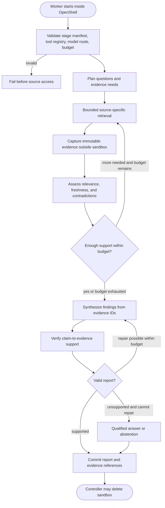
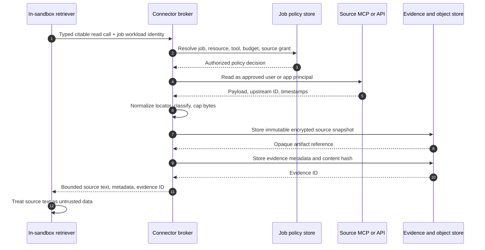
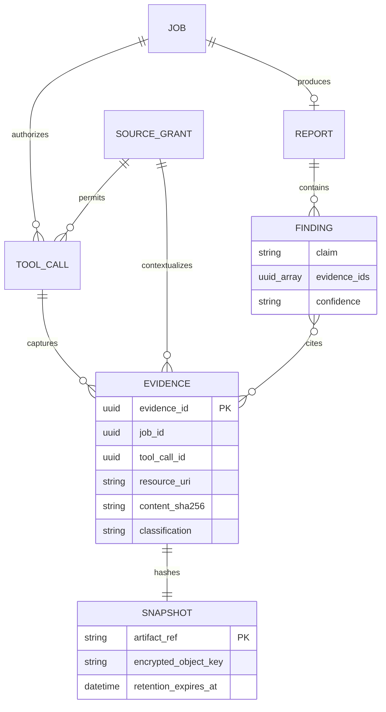
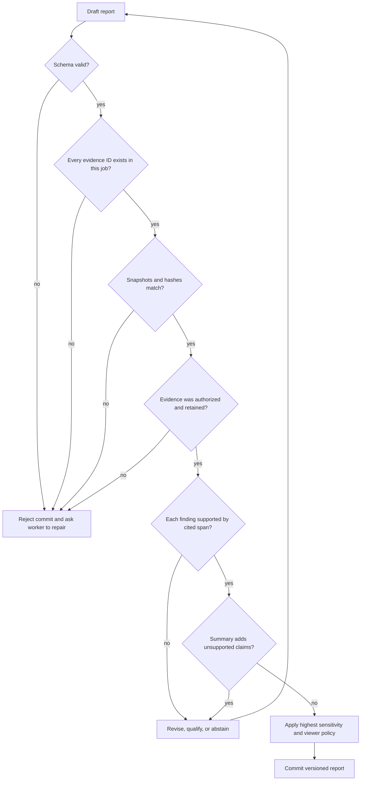
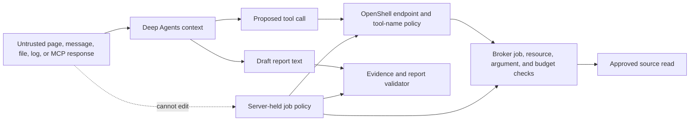
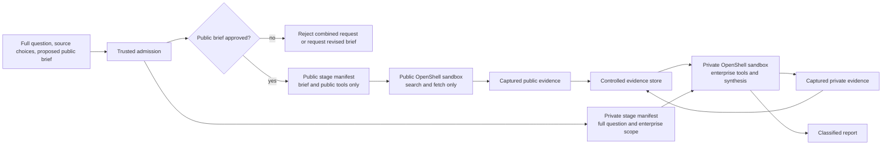
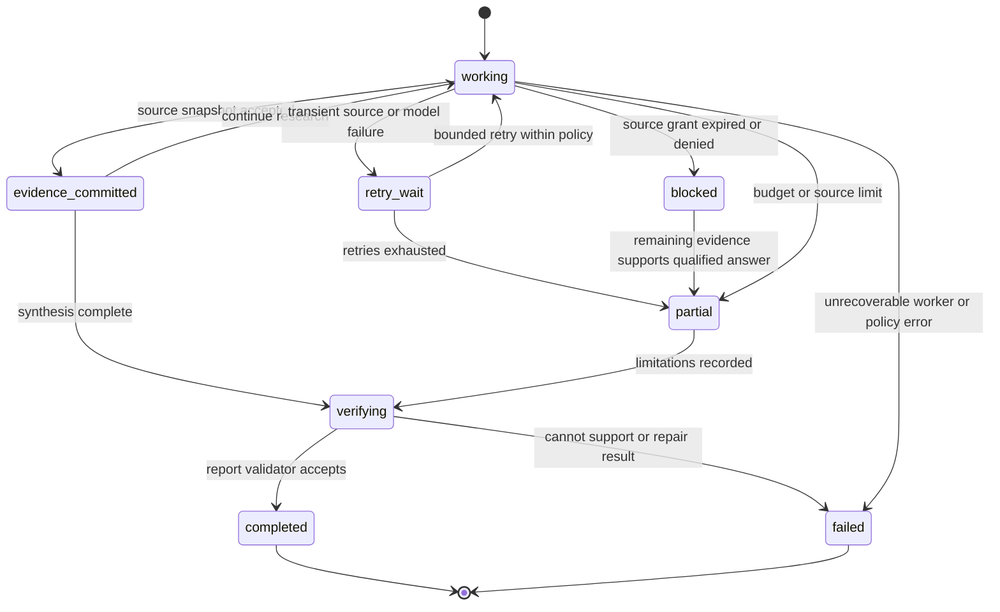

# Research execution and evidence design

**Status:** proposed design, 2026-10-23  
**Scope:** research worker behavior, evidence capture, citations, and research quality  
**Parent design:** [target architecture](../architecture.md)  
**Contracts:** [job policy](../../contracts/job-policy.schema.json), [stage manifest](../../contracts/stage-manifest.schema.json), [evidence](../../contracts/evidence.schema.json), [report](../../contracts/report.schema.json), [job events](../../contracts/job-event.schema.json)

The Python Deep Agents process runs **inside an OpenShell sandbox** for every research job. The dashboard and controller admit the job and persist its results, but never run the planner, retrieval subagents, synthesis, or verifier. Source access passes through a task-aware broker by default. The worker receives source material and opaque evidence IDs, not reusable source credentials. A completed report is a set of claims linked to retained source snapshots, with limits and gaps stated plainly.

This is an application design. Deep Agents supplies an agent harness with tools, subagents, context management, and a LangGraph runtime; it does not by itself supply this application's source authorization, evidence model, or citation policy. OpenShell supplies sandbox controls, but its MCP inspection cannot inspect tool arguments or server responses. [Deep Agents overview](https://docs.langchain.com/oss/python/deepagents/overview), [OpenShell network rules](https://docs.nvidia.com/openshell/how-it-works/policies/network-rules).

## 1. Research invariants

| Invariant | Enforcement point |
|---|---|
| The agent graph executes in the job sandbox. | Worker image and process attestation during acceptance tests; controller only starts and observes it. |
| A job's question cannot widen its approved sources, resources, tools, model route, data class, or budget. | Server-held job policy, broker authorization on every tool call, OpenShell policy. |
| Every factual finding references evidence captured before report completion. | Evidence service and report validator. |
| Search snippets and model recollection are leads, not report evidence. | Retrieval and verifier stages. |
| Source content and tool output are data, including when they contain imperative text. | Fixed tool catalog, broker argument checks, network policy, prompt-injection tests. |
| Private source data cannot be sent to public search or fetch services. | Separate public and private sandboxes for combined jobs; no public egress in the private lane. |
| A report is available only after structural and semantic verification pass. | Worker verifier and server-side commit gate. |
| The sandbox can disappear without losing a committed result or its citations. | Durable evidence, report, and stage records outside the sandbox. |

## 2. In-sandbox execution graph

The worker starts with a short job identifier and its own expiring workload identity. It fetches only its [stage manifest](../../contracts/stage-manifest.schema.json) from the job API, checks its stage, expiry, and policy version, and builds an explicit tool registry from its `allowed_tools`. The controller keeps the full job policy outside the sandbox and checks OpenShell's effective policy before dispatch; the worker fails startup if its tool registry differs from the admitted manifest. The controller runs the worker from a pinned image and does not pass a Slack token, GitHub private key, Google service-account key, or Okta client secret into the sandbox. [OpenShell security best practices](https://docs.nvidia.com/openshell/security/best-practices).

The graph has deterministic **stage boundaries** even though retrieval and synthesis use agent reasoning. A bounded plan names subquestions, source types, expected evidence, and a stopping rule. The planner cannot create new source connections or edit the job policy. Retrieval may run source-specific subagents in parallel within the allowed `max_subagents` count. Synthesis consumes a curated evidence set. Verification checks support and contradictions before the worker asks the job API to commit. The server repeats structural checks and may reject the report.

| Stage | Model-visible tools | Durable output | Stop or failure condition |
|---|---|---|---|
| Preflight | None | Stage event, manifest ID, policy version, and image digest | Manifest expired, missing grant, unexpected tool or endpoint |
| Plan | Optional task list only | Bounded subquestions and intended source types | Plan requests an unavailable source or exceeds subquestion cap |
| Retrieve | Approved read tools for that source; no write tools | Evidence IDs and source-level errors | Tool budget, source cap, permission denial, rate limit, deadline |
| Assess | `read_evidence` for this job; no source write tools | Relevance and contradiction notes | No relevant evidence, contradictory sources, stale source |
| Synthesize | `read_evidence` for this job; no public search in private lane | Draft claims with evidence IDs | Unsupported claim or output-size cap |
| Verify | `read_evidence` and validation functions only | Verdict per finding and report-level limitations | Citation mismatch, missing span, unsupported inference |
| Commit | Job API, with bound identity | Versioned report and terminal event | Server validation or authorization failure |

### Deep Agents configuration choices

1. **Pin the Python `deepagents` and MCP client versions.** Review the actual tool registry at startup and on upgrades. Current Deep Agents documentation says task planning has been opt-in since v0.7; add its planning middleware explicitly if the pinned version uses that behavior. [Deep Agents overview](https://docs.langchain.com/oss/python/deepagents/overview).
2. **Use named retrieval subagents with small tool sets.** A Slack retriever gets only the approved Slack read wrapper; a GitHub retriever gets only approved repository read wrappers. Deep Agents can create a general-purpose subagent automatically, so disable or replace it and verify its effective tools. Subagent context isolation helps focus; it is not a security boundary against code running in the same sandbox. [Deep Agents subagents](https://docs.langchain.com/oss/python/deepagents/subagents).
3. **Keep agent filesystem data job-local.** Scratch notes and large tool results may live in the sandbox, but durable evidence and checkpoints live outside it. Do not enable cross-job long-term memory containing enterprise material in the first release. If Deep Agents filesystem permissions are used, add explicit deny rules: their default is permissive and they apply only to built-in filesystem tools, not custom/MCP tools or arbitrary sandbox command execution. The OpenShell filesystem and network policies remain the actual runtime boundary. [Deep Agents permissions](https://docs.langchain.com/oss/python/deepagents/permissions), [Deep Agents backends](https://docs.langchain.com/oss/python/deepagents/backends).
4. **Do not expose a general `execute` tool for the initial read-only research workflow.** Use reviewed parsing, calculation, and evidence tools when needed. If a future workflow needs code execution, it requires a separate image, policy, budget, and test plan. Deep Agents backends can expose shell execution, so the effective registry must be checked rather than inferred from a prompt. [Deep Agents backends](https://docs.langchain.com/oss/python/deepagents/backends).
5. **Use OpenShell's approved inference route.** Private prompts and source excerpts can reach the selected model endpoint by design. The job policy therefore pins a model route approved for the data class; direct model-provider egress is not added as an accidental shortcut. OpenShell's inference routing keeps provider API keys outside the sandbox. [OpenShell inference controls](https://docs.nvidia.com/openshell/security/best-practices).

## 3. Tool scope and source retrieval

The worker loads a **pinned, typed** catalog of read operations intersected with its stage manifest. It does not turn an upstream MCP `tools/list` response into unrestricted model tools. Each catalog entry has an input schema, source identity mode, resource selector rules, time-window limit, output cap, and a mapping to an upstream MCP tool or API call. The broker validates these after resolving the worker's job identity to the server-side policy. OpenShell's `protocol: mcp` rule is configured with `enforcement: enforce` for the broker endpoint and named methods/tools; its tool-name checks are a second layer because OpenShell does not match tool arguments or parse the server response. [OpenShell MCP network rules](https://docs.nvidia.com/openshell/how-it-works/policies/network-rules).

| Example wrapper | Allowed input boundary | Research use |
|---|---|---|
| `search_public_web` | Public-safe query, approved search provider, result cap | Discover candidate pages |
| `fetch_public_page` | Public URL with SSRF and redirect checks, byte cap | Capture the actual page behind a search hit |
| `search_slack` | Selected workspace/channel set, bounded time range | Discover first-party conversations |
| `read_slack_thread` | Thread inside selected channel set | Capture context around a message |
| `search_github` | Selected installation/repository set, branch or commit scope | Locate code, issue, or documentation evidence |
| `read_github_file` | Selected repo and object, preferably immutable commit SHA | Capture exact repository content |
| `list_log_entries` | Selected GCP project/log view, filter grammar, bounded time range | Investigate operational evidence |
| `read_evidence` | Evidence ID from the same job | Verify captured material without rerunning source access |

The list is an intended application catalog, not a claim that every hosted MCP server offers those exact tool names. Each adapter maps a wrapper to capabilities the upstream service actually supports. Failed source authorization never falls back silently from a user grant to a broader app identity. See the [connector broker design](mcp-connector-broker.md) for upstream flows and argument validation.

## 4. Evidence capture and provenance

**Capture before citing.** Discovery searches may return bounded identifiers and snippets as leads without issuing citable evidence IDs. For a citable read or fetch, the broker obtains the underlying source payload, stores an immutable encrypted snapshot with a retention policy, computes the hash over the stored canonical bytes, writes evidence metadata, and only then returns a bounded excerpt and `evidence_id` to the worker. If storage fails, the payload is not usable as cited evidence. A direct MCP connector must implement an equivalent capture path and pass the same conformance tests; otherwise it is discovery-only.

The versioned [evidence schema](../../contracts/evidence.schema.json) defines the public record. Its fields have specific meanings:

| Field | Required meaning |
|---|---|
| `evidence_id`, `job_id`, `tool_call_id` | One captured item, its owning job, and the broker or adapter call that fetched it. Repeated retrievals may create separate evidence records. |
| `connector`, `upstream_tool` | The source family and actual upstream operation. A wrapper name alone does not prove which source was read. |
| `resource_uri`, `source_locator` | Stable source identifier or safe deep link, plus a human-readable location such as channel/message, repository/commit/path, or log entry ID. URLs must not contain bearer tokens. |
| `source_published_at`, `retrieved_at` | Source publication/event time when available and the time this system captured it. These times answer different questions. |
| `content_sha256`, `artifact_ref` | SHA-256 of the retained snapshot bytes and an opaque server-side reference to the encrypted object. `artifact_ref` is never a signed download URL. |
| `excerpt`, `source_span` | A bounded display excerpt or location within the retained object that supports citation review. A page title or search hit alone is insufficient. |
| `classification`, `access_context_ref`, `retention_expires_at` | Data sensitivity, opaque authorization context, and optional retention deadline. The context reference is not a credential. |

For a webpage, retain a normalized text snapshot and enough source metadata to establish the original URL, redirects, retrieval time, and content type. For GitHub, prefer repository, path, and immutable commit/object ID over a moving branch URL. For Slack, retain workspace/channel/message/thread identifiers and the acting user grant reference. For logs, retain project/log view, timestamp, insert ID or provider entry identifier, and the query window. Provider IDs and timestamps are context, not proof that a source's assertion is true.

The diagram is logical, not a required database schema. Immutable source snapshots make citations reviewable after the sandbox is deleted or an upstream page changes. Access to a snapshot remains subject to source-derived authorization and retention. W3C's provenance model distinguishes source entities, retrieval activities, and the agents responsible for them; this design records those relationships without requiring PROV serialization in v1. [W3C PROV primer](https://www.w3.org/TR/prov-primer/).

### Viewing and retention

The API checks the selected tenant and job audience on **every** report and evidence read. A job is visible to its submitter and, when the admission policy selected one, current members of that exact approved Okta group; later individual reader grants are explicit. For a full private-source report, every viewer also needs current independent entitlement to **every approved private source and resource in the job policy**, including uncited inputs that may have influenced the question, title, summary, findings, or limitations, or a separately approved shared-corpus policy covering those resources. The API withholds the **entire report** if any required source check fails or cannot be performed; hiding only evidence links would leave sensitive claims in the report body. A later redacted report would need its own validated content projection and classification. Evidence metadata, excerpts, and retained snapshots receive the same job and their exact source checks before any fields are returned. Revoking a source grant stops future retrievals and denies subsequent protected reads, while legally retained snapshots remain stored under retention policy. Raw source snapshots and agent checkpoints use encryption, class-based retention, and deletion or legal-hold rules. Titles, excerpts, event messages, and source locations are potentially sensitive. See [research visibility](research-visibility.md).

## 5. Source quality and citation policy

The worker ranks sources by **fitness for the claim**, not by a single global trust score. A source can reliably show what a person wrote or what a log recorded while being weak evidence for the truth of the statement inside it. Search results only identify candidates; the worker fetches and captures the underlying page, repository object, message, or log entry before citing it.

| Claim type | Preferred evidence | Main caution |
|---|---|---|
| Product/API behavior | Versioned official documentation, source repository, reproducible integration result | Documentation may describe a different release; record version and retrieval date. |
| Repository behavior | File at immutable commit, release artifact, test output tied to that commit | A branch link can change; code alone may not prove deployed behavior. |
| Enterprise decision or discussion | Original Slack thread or approved document with surrounding context | A participant's assertion is not a verified operational fact. |
| Incident or performance observation | Original log entries, metrics, trace records with project and time window | Missing data and clock skew can change interpretation. |
| Public event or external claim | Original announcement or primary record, plus independent corroboration when consequential | Publication and event dates may differ; a secondary summary may omit context. |

Retrieval records freshness, version, authoring organization when known, source scope, and contradictions. For a time-sensitive question, the worker verifies the relevant date and does not present an older source as current. It separates observation (“this log entry exists”), interpretation (“this may indicate a timeout”), and conclusion (“the service was unavailable”). When evidence conflicts, the report shows the conflict and its effect on the answer. NIST's research on machine-generated reports treats completeness, accuracy, and claim-to-source citation quality as separate evaluation concerns. [NIST, *On the Evaluation of Machine-Generated Reports*](https://www.nist.gov/publications/evaluation-machine-generated-reports).

### Report validation

The [report schema](../../contracts/report.schema.json) requires the question, short answer in `summary`, findings, limitations, and classification. Every finding has one or more `evidence_ids`. The summary may restate findings but must not introduce a new material factual claim without a corresponding finding. `confidence` is a qualitative assessment, not a calibrated probability.

The **server validator** checks schema, job ownership, evidence existence, hash integrity, classification floor, and retention status. The **in-sandbox verifier** checks whether the captured passage actually supports each claim, whether the claim overstates causality or recency, and whether contrary evidence was ignored. A model's support verdict is useful but fallible; high-stakes findings can require human review. A report with insufficient evidence either narrows its conclusion, labels an inference, or abstains. It never fabricates a citation to satisfy the schema. The API stores the verifier outcome and any override decision with the report version.

## 6. Untrusted content and prompt injection

The worker will encounter instructions embedded in pages, Slack messages, repository files, logs, MCP tool descriptions, and MCP responses. These are untrusted source content even when they come from a first-party enterprise system. The job question is a request from an authenticated user, but it also cannot override server policy. OWASP describes prompt injection as an application risk when lower-trust inputs influence model behavior; the controls below rely on external authorization boundaries rather than a promise that the model will always ignore malicious text. [OWASP LLM01 prompt injection](https://genai.owasp.org/llmrisk/llm01-prompt-injection/).

Required controls:

1. The job policy and tool catalog are constructed by trusted code, not from retrieved text or live upstream tool descriptions. A newly added vendor write tool remains invisible until reviewed and explicitly mapped.
2. The broker validates the exact resource selector and arguments on every call. A Slack message asking the agent to query a different channel, or a repository file asking it to upload data, cannot grant that access.
3. OpenShell permits only job endpoints and the approved inference route. Each allowed endpoint is a potential exfiltration path, so the private worker has no public search or arbitrary HTTP egress. [OpenShell security best practices](https://docs.nvidia.com/openshell/security/best-practices).
4. Prompts clearly label source text and tool responses as quoted evidence. This helps model behavior but is not the enforcement mechanism.
5. The dashboard encodes or sanitizes source excerpts and report Markdown before rendering them. A source-controlled HTML fragment is never trusted browser code.
6. Logs, traces, and events redact credentials and follow data classification. The system does not send private prompt traces to an unapproved telemetry destination.

Injection tests should include a source document that orders the agent to ignore its plan, a malicious MCP tool description, a tool response containing a false evidence ID, a URL containing a bearer token, and a source that asks for a public-web query containing private data. The expected result is a denied operation or a qualified report, with no policy expansion.

## 7. Public and private research stages

A combined job uses two capability zones. The public worker receives only the server-approved `public_research_brief`, public source/tool choices, and public-stage budget through a narrow stage manifest. It does not receive the full question, enterprise connector IDs, private resource selectors, or private evidence. The private worker gets an enterprise-stage manifest with authorized enterprise tools, selected public evidence IDs, and the full private question. The private worker cannot call public search. OpenShell explicitly warns that any allowed endpoint can carry data out of the sandbox; separating these destinations reduces the chance that private text is embedded in a search query. [OpenShell security best practices](https://docs.nvidia.com/openshell/security/best-practices).

The [job request](../../contracts/job-request.schema.json) requires a proposed `public_research_brief` for combined mode; admission must approve it and retain that decision in the [job policy](../../contracts/job-policy.schema.json) before a public sandbox starts. If the brief could reveal private information, reject the combined request or ask for a revised brief; the user can choose a separate private-only job. Automated rewriting of a private question into public search terms is a later feature with a separate declassification check. A lexical or DLP pass alone cannot prove the brief is safe for every source, so the approval process should allow human review for sensitive jobs. Public evidence is captured in the controlled store, classified, and selected for the private stage. The transfer is one-way; private evidence never feeds a public stage. The final report takes the highest sensitivity of the private inputs it uses, even when some citations are public. Source and model routing for each lane are specified in immutable policy and projected into separate manifests.

## 8. Budgets, checkpoints, and stopping rules

The [job policy](../../contracts/job-policy.schema.json) carries wall time, model token, tool call, source byte, output byte, source count, subagent, and estimated-cost limits. The worker keeps local counters for responsive stopping. The trusted control plane and broker keep authoritative counters, because a prompt-influenced worker cannot be relied on to stop itself. The broker counts attempted calls against request/rate limits, and counts returned bytes and captured sources after successful retrieval. The model route records usage; when precise cost is unavailable, enforce token and per-call output caps and label cost as an estimate.

| Limit | Enforced by | Behavior at limit |
|---|---|---|
| Wall time/deadline | Controller and job API | Cancel worker, record timeout, retain committed evidence. |
| Model tokens / per-call output | Model route and worker | Refuse another model call; complete a qualified report if verification is possible. |
| Estimated model cost | Controller using versioned price table and reservations | Refuse another call before estimated budget is exceeded; never claim exact billing certainty. |
| Tool calls and vendor rate | Broker | Return typed budget or rate-limit error; retries consume call quota. |
| Source bytes and source count | Broker/evidence service | Stop capture and return an explicit limit signal. |
| Subagent count and concurrency | Worker plus controller admission | Limit parallel retrieval and fan-out. |
| Report size and evidence retention | API and store | Reject oversize artifact or apply tenant retention rule. |

At each stage boundary, write a small checkpoint outside the sandbox: stage name, manifest ID, plan version, completed evidence IDs, budget counters, and error codes. A public-stage checkpoint must not contain the full private question or enterprise connection identifiers. Avoid serializing raw private source content into a global LangGraph store. If a persistent LangGraph checkpointer is used, it must be tenant/job scoped, encrypted, and retained under the same policy as evidence. An in-memory checkpointer does not survive worker restart. [LangGraph persistence](https://docs.langchain.com/oss/python/langgraph/persistence).

The normal stopping rules are: enough high-quality evidence to answer, a deadline or budget reached, all selected sources exhausted, or a blocking authorization failure. A repeated retrieval loop must require a new subquestion or a clear reason to revisit a source. The worker may commit a partial answer when the missing sources and effect on conclusions are explicit; a source failure cannot be silently represented as “no results.”

## 9. Failure and recovery behavior

The diagram below shows worker-internal research stages. Job-level status uses the canonical event contract and never leaves a terminal state; bounded retries happen as attempts while a job remains nonterminal.

| Condition | Immediate action | Result or recovery |
|---|---|---|
| Source OAuth grant revoked or expired | Broker denies next protected call; no broader identity substitution | Mark source blocked, prompt reconnection outside sandbox, continue only if policy allows a qualified answer. |
| Source returns 429 or transient 5xx | Honor provider retry delay and bounded exponential backoff | Retry within wall time/tool budget; otherwise state limitation. |
| Source responds but evidence storage fails | Do not hand uncaptured payload to synthesis as citable evidence | Retry storage or fail that retrieval. |
| Source record disappears or changes later | Preserve authorized snapshot under retention; show retrieval date and version | Viewer access still checked; do not pretend live source still matches. |
| Model route unavailable | Pause/retry only within policy; preserve evidence IDs | Commit qualified report if verification succeeds, otherwise structured failure. |
| Worker or sandbox dies | Controller reconciles state with OpenShell; durable evidence remains | Restart from stage checkpoint or rerun an idempotent stage; never infer success from missing worker. |
| Verifier finds unsupported or conflicting claim | Remove, qualify, or add a limitation; optionally retrieve more within budget | Commit only after revalidation; otherwise abstain or fail. |
| Injection attempts disallowed call | OpenShell or broker denies and audits | Continue safely if possible; do not treat denial as approval request from source text. |
| Classification cannot be determined | Treat item as restricted pending review | No public export or downgrade. |

Events sent to the dashboard contain stage, progress, evidence IDs, and typed errors, not raw source payloads, tokens, or private query strings. The [event schema](../../contracts/job-event.schema.json) is the versioned wire contract. Progress percentage is an estimate; a user must still see the current stage and source failures. Retrying a stage may add a new evidence record, but it cannot mutate an earlier one or create a duplicate completed report. The [job lifecycle design](job-lifecycle.md) owns job-level terminal transitions and sandbox cleanup.

## 10. Acceptance tests and evaluation

The first release needs a small, reproducible evaluation set with public questions and synthetic enterprise fixtures. Tests must exercise the actual sandbox and broker path, rather than only a mocked agent prompt. The [matched pilot](../feasibility-and-market-assessment.md) compares a ready-made product, an ordinary restricted worker, and the full-graph OpenShell worker on the same representative questions and source entitlements. Pre-register the review rubric and decision thresholds; repeat with approved enterprise cases before Phase 1 promotion.

| Test | Passing evidence |
|---|---|
| In-sandbox graph | Planner, retrieval, synthesis, and verifier process IDs run inside the created OpenShell sandbox; controller only manages lifecycle. |
| Tool inventory | Effective tools match job policy; no general-purpose subagent or backend exposes an unintended write, shell, or source tool. |
| Citation integrity | Every finding's evidence ID resolves within its job; stored hash matches; cited span supports the claim; a forged ID is rejected. |
| Quality | Evaluation set measures answer coverage, source relevance, contradiction handling, appropriate abstention, and citation support separately. |
| Injection | Source text and MCP metadata that request new tools, cross-resource reads, or exfiltration do not change effective capabilities. |
| Public/private separation | Private fixture text cannot appear in a public search request, public-stage manifest, unapproved model route or trace sink, or public export. |
| Revocation | A grant revoked mid-job blocks the next relevant call; an already stored private snapshot remains governed by viewer authorization and retention. |
| Durability | Delete a successful sandbox and restart the API; authorized viewers can still open the report and evidence. |
| Failure accounting | Connector 429, model timeout, worker crash, and evidence-store failure produce distinct typed outcomes and bounded retries. |

Quality metrics require a human-reviewed sample because a syntactically valid evidence link does not prove a claim. Track citation precision, unsupported-claim rate, answer completeness, abstention quality, latency, source calls, model tokens, and estimated cost by model and connector version. Avoid optimizing citation count alone: many weak links do not make a finding stronger. [NIST report evaluation](https://www.nist.gov/publications/evaluation-machine-generated-reports).
