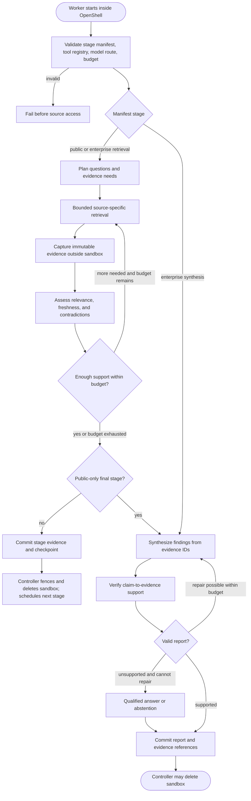
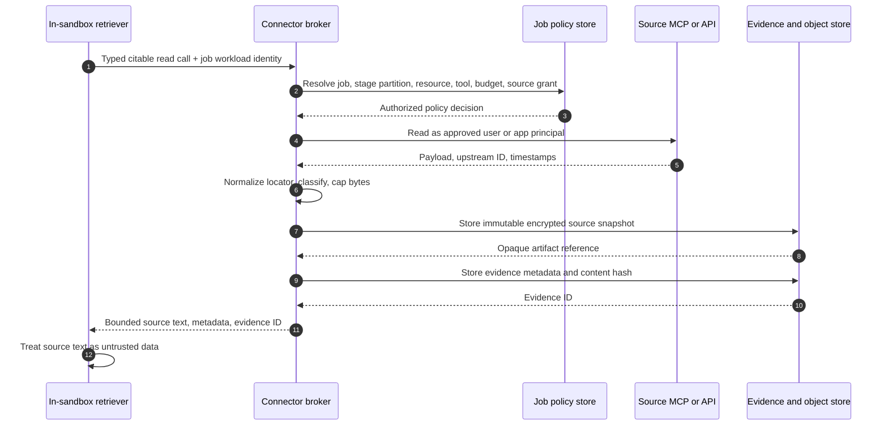
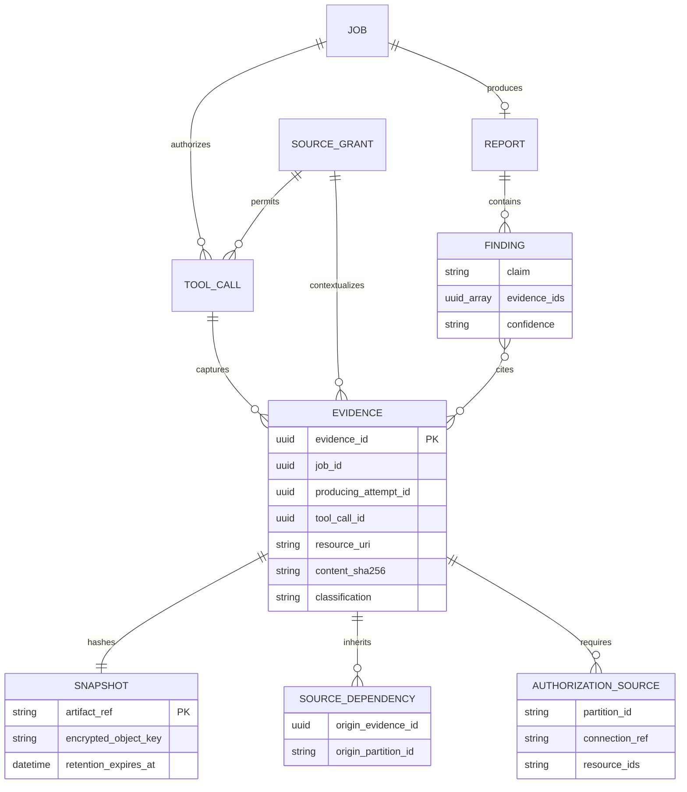
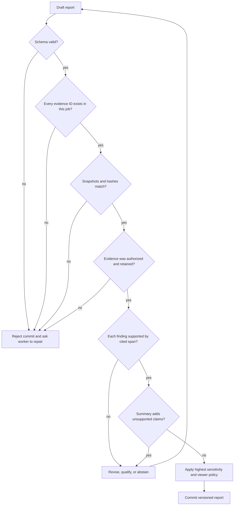
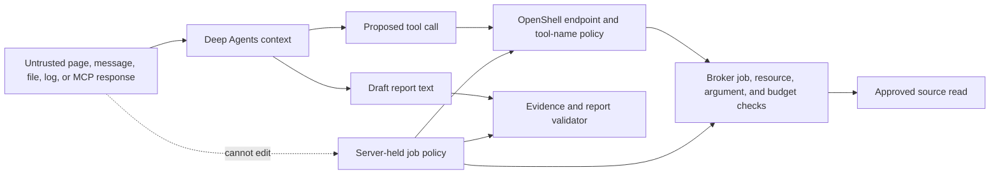
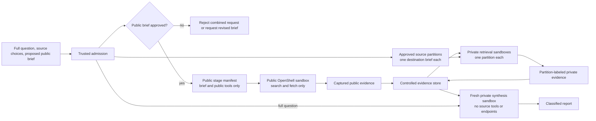
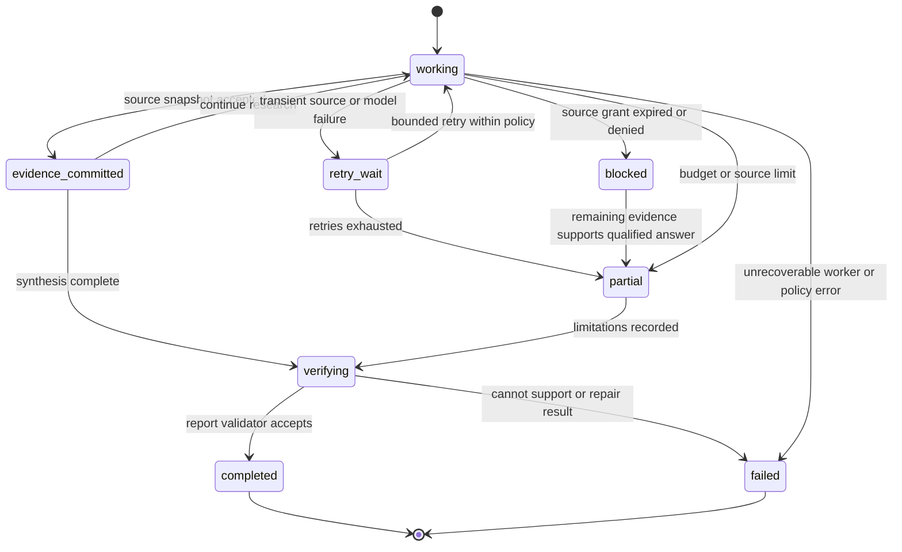

# Research execution and evidence design

**Status:** proposed design, 2026-10-23  
**Scope:** research worker behavior, evidence capture, citations, and research quality  
**Boundary requirements:** IAM-05, IAM-12, CON-11, CON-12, RES-01–09.
**Parent design:** [target architecture](../architecture.md)  
**Contracts:** [job policy](../../contracts/job-policy.schema.json), [stage manifest](../../contracts/stage-manifest.schema.json), [evidence](../../contracts/evidence.schema.json), [report](../../contracts/report.schema.json), [job events](../../contracts/job-event.schema.json)

The Python Deep Agents process runs **inside an OpenShell sandbox** for each job stage. The dashboard and controller admit the job and persist its results, but never run the planner, retrieval subagents, synthesis, or verifier. A private job uses a separate retrieval sandbox for each approved source security partition, then a fresh synthesis sandbox with no source access. Source access passes through a task-aware broker by default. The worker receives source material and opaque evidence IDs, not reusable source credentials. A completed report is a set of claims linked to retained source snapshots, with limits and gaps stated plainly.

This is an application design. Deep Agents supplies an agent harness with tools, subagents, context management, and a LangGraph runtime; it does not by itself supply this application's source authorization, evidence model, or citation policy. OpenShell supplies sandbox controls, but its MCP inspection cannot inspect tool arguments or server responses. [Deep Agents overview](https://docs.langchain.com/oss/python/deepagents/overview), [OpenShell network rules](https://docs.nvidia.com/openshell/how-it-works/policies/network-rules).

## 1. Research invariants

| Invariant | Enforcement point |
|---|---|
| Every model-driven graph node executes in its current job-stage sandbox. | Worker image and process attestation during acceptance tests; controller only schedules and observes stage sandboxes. |
| A job's question cannot widen its approved sources, resources, tools, model, data class, or budget. | Server-held job policy, broker authorization on every tool call, trusted model request gate for model ID/request shape and budget, and OpenShell endpoint policy. |
| Every factual finding references evidence captured before report completion. | Evidence service and report validator. |
| Search snippets and model recollection are leads, not report evidence. | Retrieval and verifier stages. |
| Source content and tool output are data, including when they contain imperative text. | Fixed tool catalog, broker argument checks, network policy, prompt-injection tests. |
| Private source data cannot be sent to public search or fetch services. | Separate public and private sandboxes for combined jobs; no public egress in the private lane. |
| Private source A content cannot become a source B query by default, even when B's resource selector is in scope. | One private source partition per retrieval sandbox; partition-scoped evidence API and checkpoints; no source endpoint in the later synthesis sandbox. The broker builds any reviewed typed-key transfer query. |
| A report is available only after structural and semantic verification pass. | Worker verifier and server-side commit gate. |
| The sandbox can disappear without losing a committed result or its citations. | Durable evidence, report, and stage records outside the sandbox. |

## 2. In-sandbox execution graph

The worker starts with a short job identifier and its own expiring workload identity. It fetches only its [stage manifest](../../contracts/stage-manifest.schema.json) from the job API, checks its stage, expiry, source partition when present, and policy version, and builds an explicit tool registry from its `allowed_tools`. The controller keeps the full job policy outside the sandbox and checks OpenShell's effective policy before dispatch; the worker fails startup if its tool registry differs from the admitted manifest. The manifest's `model_route` is an application policy **alias** for the reviewed model, data class, trace destination, and limits; worker preflight is useful for configuration but does not enforce model choice. The controller runs the worker from a pinned image and does not pass a Slack token, GitHub private key, Google service-account key, Okta client secret, or vendor model credential into the sandbox. [OpenShell security best practices](https://docs.nvidia.com/openshell/security/best-practices).



The graph has deterministic **stage boundaries** even though retrieval and synthesis use agent reasoning. A bounded plan names subquestions, expected evidence, and a stopping rule within the current source partition. The planner cannot create new source connections or edit the job policy. Retrieval may run subagents in parallel within that same partition and the allowed `max_subagents` count. For the initial release, the controller runs private retrieval partitions sequentially; a later parallel scheduler needs independent attempt fencing and the same partition isolation. Synthesis consumes a curated evidence set in a new sandbox with no source tools or source-broker endpoint. Verification checks support and contradictions before the worker asks the job API to commit. The server repeats structural checks and may reject the report. A synthesis request for more retrieval can start only a fresh partition-scoped stage under the **unchanged brief and exact resource selector frozen at initial admission**; mixed-source synthesis text cannot become a new brief, source query, or typed key. A reviewed transfer also requires clean source-attempt proof or explicit exact-value declassification.

| Stage | Model-visible tools | Durable output | Stop or failure condition |
|---|---|---|---|
| Preflight | None | Stage event, manifest ID, policy version, and image digest | Manifest expired, missing grant, unexpected tool or endpoint |
| Plan | Optional task list only | Bounded subquestions and intended source types | Plan requests an unavailable source or exceeds subquestion cap |
| Retrieve | Approved read tools for exactly one source partition; `correlation_only` permits only the typed-key wrapper and internal evidence reads | Evidence IDs and source-level errors | Tool budget, source cap, permission denial, rate limit, deadline |
| Assess | `read_evidence` for reviewed public and this partition's evidence only | Relevance and contradiction notes | No relevant evidence, contradictory sources, stale source |
| Synthesize | `read_evidence` for curated job evidence; no private source or public search tool | Draft claims with evidence IDs | Unsupported claim or output-size cap |
| Verify | `read_evidence` and validation functions only | Verdict per finding and report-level limitations | Citation mismatch, missing span, unsupported inference |
| Commit | Job API, with bound identity | Versioned report and terminal event | Server validation or authorization failure |

### Deep Agents configuration choices

1. **Pin the Python `deepagents` and MCP client versions.** Review the actual tool registry at startup and on upgrades. Current Deep Agents documentation says task planning has been opt-in since v0.7; add its planning middleware explicitly if the pinned version uses that behavior. [Deep Agents overview](https://docs.langchain.com/oss/python/deepagents/overview).
2. **Use named retrieval subagents with small tool sets.** A Slack retrieval sandbox gets only the approved Slack read wrapper; a GitHub retrieval sandbox gets only approved repository read wrappers. Deep Agents can create a general-purpose subagent automatically, so disable or replace it and verify its effective tools. Subagent context isolation helps focus; it is not a security boundary against code running in the same sandbox. The separate sandbox and broker stage binding enforce the partition boundary. [Deep Agents subagents](https://docs.langchain.com/oss/python/deepagents/subagents).
3. **Keep agent filesystem data job-local.** Scratch notes and large tool results may live in the sandbox, but durable evidence and checkpoints live outside it. Do not enable cross-job long-term memory containing enterprise material in the first release. If Deep Agents filesystem permissions are used, add explicit deny rules: their default is permissive and they apply only to built-in filesystem tools, not custom/MCP tools or arbitrary sandbox command execution. The OpenShell filesystem and network policies remain the actual runtime boundary. [Deep Agents permissions](https://docs.langchain.com/oss/python/deepagents/permissions), [Deep Agents backends](https://docs.langchain.com/oss/python/deepagents/backends).
4. **Do not expose a general `execute` tool for the initial read-only research workflow.** Use reviewed parsing, calculation, and evidence tools when needed. If a future workflow needs code execution, it requires a separate image, policy, budget, and test plan. Deep Agents backends can expose shell execution, so the effective registry must be checked rather than inferred from a prompt. [Deep Agents backends](https://docs.langchain.com/oss/python/deepagents/backends).
5. **Route model calls through a trusted application gate.** The policy's `model_route` alias resolves outside the sandbox to one approved upstream model ID, request shape, data class, trace sink, and budget. The worker may configure its client from the manifest, but the gate checks the actual request and current attempt before an upstream call. OpenShell v0.1.5 provider attachment protects the credential and native endpoint; it does **not** select or rewrite a model, and its earlier managed inference routes were removed. The sandbox permits only the internal model-gate endpoint, with no direct vendor model route. [OpenShell inference, v0.1.5](https://docs.nvidia.com/openshell/v0.1.5/how-it-works/inference).

### Trusted model request gate

The model gate is a logical service outside OpenShell; it may share a deployment with the connector broker, but it has a separate model-audience ingress and vendor credential. OpenShell attaches a reviewed **per-attempt provider for this internal gate**, not a broad vendor model provider. On every request, the gate validates its own audience and the authenticated sandbox sender, then checks tenant, job, stage, immutable sandbox ID, attempt, policy digest, fencing and external recovery generations, current nonterminal state, route alias, and the server-held stage classification. Private stages require the same live sender-origin proof as the Job API and broker; an unattested bearer alone is insufficient. It resolves that alias to a pinned upstream model ID, endpoint, approved request schema and options, maximum input and output, price version, data-processing and retention policy, and trace destination. It parses the body, rejects a different `model` on the **same allowed endpoint**, unreviewed tools/files/URLs/metadata/headers, unsupported streaming or request fields, and any request whose class or estimated maximum cost exceeds that route's approval. The gate constructs the upstream request with its own downstream credential and sends only the reviewed fields to the exact model; the worker cannot supply an upstream token, host, model ID, or tracing sink as authority. It returns bounded output and approved error metadata only. Source capture and synthesis admission still classify inputs **before** they reach the worker; the model gate repeats the stage-class and route decision rather than trusting a worker-supplied label.

The model-gate provider starts with a unique, authorization-inert sentinel. Its per-attempt credential may be activated only after the controller durably commits the immutable sandbox ID, current attempt and recovery generation, matching effective OpenShell policy and exact provider attachment/receipt, and readiness to release the stage manifest. The gate consults that authoritative ready record on **every** model call; a credential update, claimed manifest, or sandbox process start is not readiness. Before the commit it denies all model calls, including an early call from the canonical main process or a Workspace User's broad `exec`. An uncertain `CreateSandbox` result or unresolved provider receipt leaves the gate closed while reconciliation deletes or proves the single intended sandbox. Retry, cancellation, review pause, expiry, recovery-generation change, or effective-policy drift fences new calls **and** the gate's active per-attempt upstream-call registry. It aborts/closes each dispatched request and stream, stops worker-visible delivery immediately, and proves no gate-originated vendor traffic remains after the configured cancellation grace before releasing capacity. A crashed gate reconciles its active registry and upstream connection closure or keeps the attempt quarantined; a lease timeout alone does not prove termination. Ambiguous upstream usage retains the full conservative budget reservation. The vendor credential remains solely at the trusted gate.

```mermaid
sequenceDiagram
    autonumber
    participant W as In-sandbox Deep Agents worker
    participant S as OpenShell supervisor
    participant G as Trusted model request gate
    participant P as Current job and stage policy
    participant B as Atomic job and attempt budget
    participant M as Exact approved upstream model
    W->>S: Native-compatible model request with stage credential
    S->>G: Inspected internal endpoint; inject gate credential
    G->>P: Verify authoritative attempt readiness and sender origin
    G->>P: Verify sender, attempt, route alias, class and generations
    P-->>G: Exact model, request schema, trace route and limits
    G->>G: Deny wrong model or unreviewed request fields
    G->>B: Reserve maximum input, output and cost for this call
    B-->>G: Reservation or deny before upstream dispatch
    G->>M: Canonical request with gate-held vendor credential
    M-->>G: Bounded response or stream and usage evidence
    G->>B: Settle verifiable usage; retain uncertain reservation
    G-->>S: Approved bounded response or typed denial
    S-->>W: Model result
```

The gate owns authoritative model request, token, and cost accounting. Before dispatch it uses the pinned model tokenizer or a conservative input bound, caps `max_output_tokens` and bytes, and atomically reserves the worst allowed request count, input, output, and estimated cost against the **remaining job, stage, and attempt budgets**, including concurrent and streaming calls. It does not dispatch when it cannot establish a safe bound. During streaming it enforces the response cap and closes an over-limit stream; a timeout, interrupted stream, missing trustworthy vendor usage, or ambiguous dispatch keeps the full conservative reservation charged. Only verifiable upstream usage can release unused capacity; the gate records the pricing/version basis and never presents estimated cost as exact billing. Model request and trace payloads follow the admitted classification and retention policy; ordinary traces contain no raw private prompt or source passage. A provider-side alternative needs a live proof that its credential is truly restricted to the exact model **and** that equivalent per-attempt body, class, usage, budget, trace, and revocation controls are enforced upstream. Otherwise the internal gate remains required.

The gate stores reservations and settlements in a serializable ledger whose recovery is independent of application database PITR. A restore advances the external recovery generation and closes model spending while the authoritative ledger head, every in-flight or ambiguous reservation, and remaining limits are reconciled. An old job row or stage manifest cannot reset spend. Unknown upstream usage retains the full safe reservation; if that bound or the ledger head cannot be recovered, the affected job stays on recovery hold instead of automatically resuming. A new attempt inherits the reconciled cumulative charge. [Job lifecycle and restore](job-lifecycle.md#database-restore-is-a-separate-recovery-path).

## 3. Tool scope and source retrieval

The worker loads a **pinned, typed** catalog of read operations intersected with its stage manifest. It does not turn an upstream MCP `tools/list` response into unrestricted model tools. Each catalog entry has an input schema, source identity mode, resource selector rules, time-window limit, output cap, and a mapping to an upstream MCP tool or API call. The broker validates these after resolving the worker's job identity to the server-side policy and the current source partition. The job API applies the same stage partition to `read_evidence`: a retrieval sandbox cannot fetch another private partition's evidence by guessing an ID. OpenShell's `protocol: mcp` rule is configured with `enforcement: enforce` for the broker endpoint and named methods/tools; its tool-name checks are a second layer because OpenShell does not match tool arguments or parse the server response. [OpenShell MCP network rules](https://docs.nvidia.com/openshell/how-it-works/policies/network-rules).

| Example wrapper | Allowed input boundary | Research use |
|---|---|---|
| `search_public_web` | Public-safe query, approved search provider, result cap | Discover candidate pages |
| `fetch_public_page` | Public-stage URL sent to an isolated public fetch service with no enterprise source credentials; strict URL, address, redirect, time, type, and byte checks | Capture the actual page behind a search hit |
| `search_slack` | Selected workspace/channel set, bounded time range | Discover first-party conversations |
| `read_slack_thread` | Thread inside selected channel set | Capture context around a message |
| `search_github` | Selected installation/repository set, branch or commit scope | Locate code, issue, or documentation evidence |
| `read_github_file` | Selected repo and object, preferably immutable commit SHA | Capture exact repository content |
| `list_log_entries` | Selected GCP project/log view, filter grammar, bounded time range | Investigate operational evidence |
| `read_evidence` | Same-job evidence allowed by trusted producing attempt, retrieval mode, dependency closure, and current rights: independent same-partition in `standard`, own-attempt derived in `correlation_only`, curated authorized records in no-source synthesis | Verify captured material without rerunning source access |

The list is an intended application catalog, not a claim that every hosted MCP server offers those exact tool names. Each adapter maps a wrapper to capabilities the upstream service actually supports. Failed source authorization never falls back silently from a user grant to a broader app identity. A cross-partition correlation query, if approved, is broker-built from a typed key and a reviewed destination template; it is never an unrestricted agent-authored search string. See the [connector broker design](mcp-connector-broker.md) for upstream flows, argument validation, and public fetch isolation.

## 4. Evidence capture and provenance

**Capture before citing.** Discovery searches may return bounded identifiers and snippets as leads without issuing citable evidence IDs. The trusted broker classifies **every worker-visible field of every private response before release**, including uncitable discovery snippets, identifiers, locators, metadata, and error text; unknown or over-class content is quarantined without exposing its bytes or metadata to the worker, model, or ordinary traces. For a citable read or fetch, the broker obtains the underlying source payload, stores an immutable encrypted snapshot with a retention policy, computes the hash over the stored canonical bytes, writes evidence metadata, and only then returns a bounded excerpt and `evidence_id` to the worker. If storage fails, the payload is not usable as cited evidence. A direct MCP connector must provide an equivalent **inline pre-worker** classification/capture path or use a stage, model, and trace route approved for the maximum class its token can retrieve; otherwise it is not eligible for private use.



The versioned [evidence schema](../../contracts/evidence.schema.json) defines the **internal, trusted** record. Its fields have specific meanings:

| Field | Required meaning |
|---|---|
| `evidence_id`, `job_id`, `producing_attempt_id`, `tool_call_id` | One captured item, its owning job, trusted producing sandbox attempt, and broker or adapter call that fetched it. The Job API joins the attempt to its mode and taint before stage reads; repeated retrievals may create separate records. |
| `connector`, `upstream_tool` | The source family and actual upstream operation. A wrapper name alone does not prove which source was read. |
| `resource_uri`, `source_locator` | Stable source identifier or safe deep link, plus a human-readable location such as channel/message, repository/commit/path, or log entry ID. URLs must not contain bearer tokens. |
| `source_published_at`, `retrieved_at` | Source publication/event time when available and the time this system captured it. These times answer different questions. |
| `content_sha256`, `artifact_ref` | SHA-256 of the retained snapshot bytes and an opaque server-side reference to the encrypted object. `artifact_ref` is never a signed download URL. |
| `excerpt`, `source_span` | A bounded display excerpt or location within the retained object that supports citation review. A page title or search hit alone is insufficient. |
| `source_partition_id`, `authorization_sources` | The producing private partition and exact primary-plus-transitive source/resource authorization closure. Public evidence has no private partition and an empty closure. The broker derives the closure from the policy and captured origins. |
| `source_dependency_evidence_ids`, `correlation_derivation` | Internal transitive foreign-source evidence IDs and typed-key/attempt-taint provenance. These are never worker-asserted or included in the browser view. Independent captures use an empty dependency list. |
| `source_classification`, `dependency_classification_floor`, `classification` | Direct source class, highest inherited dependency class, and effective class. Trusted capture computes the effective class at least as high as both inputs and any stricter stage input floor, using `public < internal < confidential < restricted`. |
| `access_context_ref`, `retention_expires_at` | Opaque reference to the authorization-check context and optional retention deadline. The reference is neither a credential nor a substitute for the recorded closure and live checks. |

The trusted evidence index binds each private evidence ID, snapshot digest, producing attempt/mode, source connection, source partition, dependency closure, and authorization source/resource closure at capture time. The broker and evidence store commit these fields with the snapshot and digest; a worker may propose a citation ID but cannot claim, erase, or downgrade provenance. The stage `read_evidence` gate uses this index plus current grant/denial state. Retain minimal dependency authorization metadata for at least as long as any derived evidence, even if an origin snapshot expires; missing or inconsistent dependency records fail closed. The internal schema is a provenance record, not a substitute for the runtime authorization lookup. The [browser evidence view](../../contracts/evidence-view.schema.json) omits attempt/dependency IDs, source/resource closure, and internal context/key fields.

For a webpage, retain a normalized text snapshot and enough source metadata to establish the original URL, redirects, retrieval time, and content type. For GitHub, prefer repository, path, and immutable commit/object ID over a moving branch URL. For Slack, retain workspace/channel/message/thread identifiers and the acting user grant reference. For logs, retain project/log view, timestamp, insert ID or provider entry identifier, and the query window. Provider IDs and timestamps are context, not proof that a source's assertion is true.



The diagram is logical, not a required database schema. Immutable source snapshots make citations reviewable after the sandbox is deleted or an upstream page changes. Access to a snapshot remains subject to source-derived authorization and retention. W3C's provenance model distinguishes source entities, retrieval activities, and the agents responsible for them; this design records those relationships without requiring PROV serialization in v1. [W3C PROV primer](https://www.w3.org/TR/prov-primer/).

### Viewing and retention

The API checks the selected tenant and job audience on **every** report and evidence read. A job is visible to its submitter and, when the admission policy selected one, current members of that exact approved Okta group; later individual reader grants are explicit. For a full private-source report, every viewer also needs current independent entitlement to **every exact private source/resource selector in the monotonic job disclosure envelope across all approved policy revisions**, including uncited inputs that may have influenced the question, title, summary, findings, or limitations, or a separately approved shared-corpus policy covering those resources. The envelope also carries the highest applicable class; `job_source_scope_admitted` events in the independently recovered authorization ledger bind each revision's prior/new digest, and the application projection and report record must match the verified current envelope before `read_report` or `report_available`. A later policy that removes A from future tools cannot remove A from that read gate. The API withholds the **entire report** if any required source, class, or ledger check fails or cannot be performed; hiding only evidence links would leave sensitive claims in the report body. A later redacted report would need its own validated content projection and classification. Evidence metadata, excerpts, evidence events, and retained snapshot bytes require `read_evidence`, current entitlement to **every** primary and transitive source/resource in that evidence record's trusted `authorization_sources`, and clearance for its effective `classification` before any field or byte is returned. A B-only viewer cannot see an A-derived B evidence ID, even if the viewer can open ordinary B evidence; an A+B-authorized viewer with sufficient clearance may read it. If any dependency is missing or unverifiable, all views fail closed. Revoking a source grant stops future retrievals and denies subsequent protected reads, while legally retained snapshots remain stored under retention policy. Raw source snapshots and agent checkpoints use encryption, class-based retention, and deletion or legal-hold rules. Titles, excerpts, event messages, and source locations are potentially sensitive. See [research visibility](research-visibility.md#5-report-and-evidence-as-one-content-boundary).

## 5. Source quality and citation policy

The worker ranks sources by **fitness for the claim**, not by a single global trust score. A source can reliably show what a person wrote or what a log recorded while being weak evidence for the truth of the statement inside it. Search results only identify candidates; the worker fetches and captures the underlying page, repository object, message, or log entry before citing it.

| Claim type | Preferred evidence | Main caution |
|---|---|---|
| Product/API behavior | Versioned official documentation, source repository, reproducible integration result | Documentation may describe a different release; record version and retrieval date. |
| Repository behavior | File at immutable commit, release artifact, test output tied to that commit | A branch link can change; code alone may not prove deployed behavior. |
| Enterprise decision or discussion | Original Slack thread or approved document with surrounding context | A participant's assertion is not a verified operational fact. |
| Incident or performance observation | Original log entries, metrics, trace records with project and time window | Missing data and clock skew can change interpretation. |
| Public event or external claim | Original announcement or primary record, plus independent corroboration when consequential | Publication and event dates may differ; a secondary summary may omit context. |

Retrieval records freshness, version, authoring organization when known, source scope, and contradictions. For a time-sensitive question, the worker verifies the relevant date and does not present an older source as current. It separates observation (“this log entry exists”), interpretation (“this may indicate a timeout”), and conclusion (“the service was unavailable”). When evidence conflicts, the report shows the conflict and its effect on the answer. NIST's research on machine-generated reports treats completeness, accuracy, and claim-to-source citation quality as separate evaluation concerns. [NIST, *On the Evaluation of Machine-Generated Reports*](https://www.nist.gov/publications/evaluation-machine-generated-reports).

### Report validation

The [report schema](../../contracts/report.schema.json) requires the question, short answer in `summary`, findings, limitations, and classification. Every finding has one or more `evidence_ids`. The summary may restate findings but must not introduce a new material factual claim without a corresponding finding. `confidence` is a qualitative assessment, not a calibrated probability.



The **server validator** checks schema, job ownership, evidence existence, hash integrity, classification floor, and retention status. The **in-sandbox verifier** checks whether the captured passage actually supports each claim, whether the claim overstates causality or recency, and whether contrary evidence was ignored. A model's support verdict is useful but fallible; high-stakes findings can require human review. A report with insufficient evidence either narrows its conclusion, labels an inference, or abstains. It never fabricates a citation to satisfy the schema. The API stores the verifier outcome and any override decision with the report version.

## 6. Untrusted content and prompt injection

The worker will encounter instructions embedded in pages, Slack messages, repository files, logs, MCP tool descriptions, and MCP responses. These are untrusted source content even when they come from a first-party enterprise system. The job question is a request from an authenticated user, but it also cannot override server policy. OWASP describes prompt injection as an application risk when lower-trust inputs influence model behavior; the controls below rely on external authorization boundaries rather than a promise that the model will always ignore malicious text. [OWASP LLM01 prompt injection](https://genai.owasp.org/llmrisk/llm01-prompt-injection/).



Required controls:

1. The job policy and tool catalog are constructed by trusted code, not from retrieved text or live upstream tool descriptions. A newly added vendor write tool remains invisible until reviewed and explicitly mapped.
2. The broker validates the exact resource selector, source partition, and arguments on every call. A Slack message asking the agent to query a different channel, or a repository file asking it to upload data, cannot grant that access. Free-form source A text is never accepted as a source B search phrase.
3. OpenShell permits only the current stage's job endpoints and trusted **internal model-gate** endpoint. The gate checks the model ID and body against the current attempt; an OpenShell host/path allowance alone cannot prevent another model ID on that same host. Each allowed endpoint is a potential exfiltration path, so a private retrieval worker has no direct vendor-model, public-search, or other private-source endpoint, and the synthesis worker has no source endpoint at all. [OpenShell inference, v0.1.5](https://docs.nvidia.com/openshell/v0.1.5/how-it-works/inference), [OpenShell security best practices](https://docs.nvidia.com/openshell/security/best-practices).
4. Prompts clearly label source text and tool responses as quoted evidence. This helps model behavior but is not the enforcement mechanism.
5. The dashboard encodes or sanitizes source excerpts and report Markdown before rendering them. A source-controlled HTML fragment is never trusted browser code.
6. Logs, traces, and events redact credentials and follow data classification. The system does not send private prompt traces to an unapproved telemetry destination.

Injection tests should include a source document that orders the agent to ignore its plan, a malicious MCP tool description, a tool response containing a false evidence ID, a URL containing a bearer token, a source that asks for a public-web query containing private data, and a Slack fixture that instructs a GitHub or Logging search containing its private text. The expected result is a denied operation or a qualified report, with no policy expansion or cross-partition query leakage.

## 7. Public and private research stages

A combined job starts with a public sandbox that receives only the server-approved `public_research_brief`, public source/tool choices, and public-stage budget. It does not receive the full question, enterprise connector IDs, private resource selectors, or private evidence. A private-only job skips that stage. Each private `enterprise_retrieval` sandbox then receives **one** source partition, its destination-approved `research_brief`, reviewed public evidence, and only mode-permitted prior evidence. A `standard` retrieval attempt cannot receive a prior same-partition item with a foreign dependency or correlation taint; a `correlation_only` attempt starts with no earlier B private evidence and can later read only its own captures. It receives no other private partition's evidence or checkpoint. The initial scheduler runs these private stages one at a time. Finally, a fresh `enterprise_synthesis` sandbox receives the full question and curated evidence from all partitions, but no source connection, source tool, or source-broker endpoint. **Before projecting either the question or evidence**, the controller calculates the highest class of the full question and every curated record's effective classification, including inherited cross-source floors, and proves the model gate's pinned synthesis model and trace destinations admit it. Unknown or higher-class input is withheld pending a new approved stage/route or denied; report finalization cannot repair earlier model exposure. All stage sandboxes can reach only the internal model gate, which enforces the exact model per current attempt; they cannot directly call the vendor model endpoint. OpenShell warns that any allowed endpoint can carry data out; the separate stages make destination access correspond to the data visible in each sandbox. [OpenShell security best practices](https://docs.nvidia.com/openshell/security/best-practices).



The [job request](../../contracts/job-request.schema.json) requires a proposed `public_research_brief` for combined mode; admission must approve it and retain that decision in the [job policy](../../contracts/job-policy.schema.json) before a public sandbox starts. If the brief could reveal private information, reject the combined request or ask for a revised brief; the user can choose a separate private-only job. Automated rewriting of a private question into public search terms is a later feature with a separate declassification check. A lexical or DLP pass alone cannot prove the brief is safe for every source, so the approval process should allow human review for sensitive jobs. Public evidence is captured in the controlled store, classified, and selected for private retrieval and synthesis. The transfer is one-way; private evidence never feeds a public stage. The final report takes the highest sensitivity of the private inputs it uses, even when some citations are public. Source and model routing for each stage are specified in immutable policy and projected into separate manifests.

The public search and fetch adapters first check proposed search queries and fetch URLs for secrets or uncertain private values before any outbound request. They then hold **all** response fields outside the public worker until a trusted content/DLP gate classifies them: URL and redirect chain, titles, identifiers, snippets, metadata, body bytes, and errors. A reachable public URL or search hit can contain a secret in its URL or title even when the body is safe; such a response is quarantined for authorized review or discarded and cannot be labeled `public`, sent to the public model, returned to the public worker, or emitted to ordinary traces. The `public_web` evidence schema permits only accepted public content. An ambiguous classification fails closed; a public URL is not a declassification decision.

### Private source partitions and correlation

At admission, trusted code normalizes requested private resource sets into one approved selection per resource, then assigns each selection to exactly one `source_partition` in the job policy. The normal partition is one connector, one connection, and one resource ID. A resource set can remain one partition only when a source owner has approved it as a single authorization and data-flow domain; `shared_authorization_domain_ref` records that decision. Reject a request if normalization exceeds the policy's source/partition caps. The controller verifies unique partition IDs, complete and nonoverlapping coverage of `approved_sources`, source grants, approved per-partition briefs, and the source-to-tool mapping. **Freeze exact private partition IDs, connection/resource selectors, standard source tools, and destination brief bytes in the initial admitted policy.** Later revisions may narrow these or add a reviewed typed transfer into a fresh correlation-only attempt; they may not add a source/resource/partition or revise a brief in the same job. A model-generated partition label, brief, evidence ID, or tool description is never authority. A retrieval manifest names exactly one partition and one source selection; OpenShell admits only that partition's broker tools and the broker rechecks the binding on every call.

The full user question and `private_context` are **synthesis-only inputs** for a multi-source private job. Admission creates a neutral brief for each retrieval destination and records an approval for the exact bytes projected there **before any private retrieval**. It must not copy pasted source excerpts or another partition's findings into a brief. For the first multi-source release, a reviewer approves each destination brief; a later automated path is permitted only for a proven deterministic projection of explicitly public or destination-owned fields. If a safe brief cannot be produced or provenance is unclear, hold initial admission for review or reject the multi-source request. A brief that names a source A canary must be denied for source B before either sandbox starts, even if the user typed it into the original question. After admission, neither worker review requests nor a human approval can turn source A findings into a revised standard B brief; a requested expansion requires a new human-submitted job with fresh source-owner, classification, DLP, and destination-brief checks. Worker text and source excerpts never become that new job's default input or a review projection shown to someone without their source rights. The only in-job A→B query path remains the dual-approved typed-key template in a correlation-only B attempt.

The default `cross_partition_transfer_grants: []` denies private cross-source transfer. The Job API first checks the trusted evidence record's producing attempt, partition, dependency closure, taint, and requested stage mode, then current source connections, transfer-grant state where applicable, effective classification, and independent authorization-ledger head. In `standard` retrieval it allows reviewed public and **independent same-partition** evidence only; a derived B item is denied even when its `source_partition_id` is B and the worker guesses its ID. In `correlation_only` retrieval it allows reviewed public and only derived evidence captured by that **same attempt**; earlier B-only evidence is denied so the tainted worker cannot nominate it for another transfer. Synthesis can read curated evidence across partitions only after its current rights/class gate and while it has no source route. The controller applies identical mode and taint checks to manifest context IDs before release. Checkpoints, scratch files, source excerpts, model context, and worker-visible event details are scoped to the current stage; cross-partition progress exposes neutral counters only. A stage cannot ask the job API for the full private question, another partition's brief, raw source errors, or traces. After retrieval, the controller revokes the stage identity, deletes its sandbox, and starts the next partition from a fresh image. This prevents a Slack result from becoming an agent-authored GitHub or Logging query merely because those tools were selected for the job. Search-phrase syntax bounds alone do not provide this property.

Some tasks require a correlation key, such as an incident ID, commit SHA, trace ID, service ID, or bounded time window, to be used in another source. An explicit `cross_partition_transfer_grant` names the source and destination partitions, allowed key types, destination tool and reviewed query template, maximum key count and bytes, a trusted approval decision-set reference, and expiry. A-side export/declassification authority and B-side destination resource/template authority must both approve the exact scope; B ownership alone cannot approve transfer of A data. The broker may automatically extract a key only from a **provider-generated, non-user-authored structured value with bounded semantics** or an independently verified source object/resource within the selected partition. For example, it verifies a GitHub commit object in the selected repository before using its provider-generated SHA. Authentication of an API field does not establish that its value is provider-generated: a user-authored issue title, label, custom metadata value, incident ID, or prose candidate requires A-authorized human exact-value declassification review tied to the evidence digest/span and destination grant, even if it looks like a valid 40-hex SHA. A type parser or regex proves syntax only. A model may nominate a candidate span, but its label or value does not authorize transfer. The broker refuses key extraction from evidence with any foreign-source dependency, then records an opaque key ID, origin evidence/partition/resource, inherited dependency closure, type, effective classification, grant, provider proof or exact-value approval, and use count in a trusted registry. The destination manifest projects **only key IDs**. Before it is released, trusted control-plane code verifies the current grant/ledger head and establishes a monotonic destination-attempt taint containing every inbound key's origin evidence, source/resource closure, and classification floor. Before key ID issuance and on every destination call, including immediately before upstream dispatch, the broker requires a verified current independent-ledger head, no tombstone for that never-reused grant ID, and current source/destination rights. It also validates value format and size, stage binding, template, destination selector, and budget, then constructs the upstream query itself. The worker cannot append arbitrary source A text to the destination query or request a raw key value through the key API. If a transfer class or actual value needs new approval, the job pauses and resumes only under a new immutable policy revision and sandbox; the old stage never gains the grant. Denied transfers leave sources independent and can lead to a qualified final report.

The approval transaction first pins the complete declarative destination argument expression, its immutable renderer artifact, and the source extractor and independent object-verifier artifacts by **version and digest**. It verifies authenticated A export and B template/resource decisions binding those exact artifacts, selectors, limits, and expiry. Before committing or acknowledging the new immutable policy revision, it durably appends the internal [`transfer_grant_created` event](../../contracts/transfer-grant-created.schema.json) to the independent authorization ledger and verifies its advanced head. The event reserves a globally never-reused grant ID and binds the authorization-scope digest, two-decision-set digest, completed approval time, template digest, artifact digests, and approval transaction ID. The two decisions sign the scope fields known before approval; the event separately binds the resulting `approval_ref` and `approved_at`, avoiding a circular approval-time hash. If the recoverable policy commit then fails, the ledger reservation remains; only the same transaction with identical bindings may return the existing event idempotently. A changed scope or a new approval transaction needs a new grant ID, even after PITR of an approved but **unused and unrevoked** grant. Admission, key issuance, manifest projection, and destination dispatch require the matching creation event at the current head and no tombstone. The broker measures its running extractor/verifier before key issuance and renderer/template before dispatch; mixed versions deny instead of reinterpreting old approval.

`max_destination_calls` is a separate approved hard cap on source B dispatches across all key IDs under that grant. Before every dispatch, including retries, the broker atomically appends a per-grant `destination_call_reserved` event to the **independent authorization ledger**; that same ledger transaction checks the current head, matching creation binding, no tombstone, and used-call count below the cap across replicas. Failed or uncertain calls consume their slot. This history is outside recoverable broker state, survives PITR, and denies when unavailable or exhausted. A distributed grant dispatch fence remains held through dispatch completion or abort; grant-only revocation takes that fence, waits or stops older in-flight calls, appends its tombstone, then acknowledges. No post-ack destination request is permitted.

The same ledger records `correlation_key_reserved` events before issuing key IDs. Each atomic reservation checks the matching creation event for the never-reused grant ID, no tombstone, `max_keys`, `max_value_bytes`, and remaining `max_total_bytes` across all replicas and restores; it stores the opaque key ID and byte charge, never the raw key. A failed or lost issuance remains charged, so restoring an older key registry cannot silently regenerate spent key capacity. If the registered value is unavailable after restore, the old key ID denies and a separately approved new grant is needed.

A crashed broker's expired fence lease is not proof that an older upstream stream closed. Grant-only revocation stays pending until connection closure or upstream token denial is observed for that call; the route remains closed while uncertain.

The trusted key registry also binds each candidate to the evidence `producing_attempt_id`, its authoritative `retrieval_mode`, and its checkpoint/taint status. Automatic extraction and destination-key selection must follow deterministic trusted connector logic on an independently captured source object from an untainted `standard` attempt. The broker can replay that trusted record after the attempt ends under a newly approved grant, but the extraction and selection cannot originate from a worker or synthesis process that has seen another private source. A correlation-only B worker or mixed-source synthesis worker cannot obtain a new B→C key by nominating an earlier apparently B-only evidence ID; the nomination itself is tainted. A key independently issued in a clean B workflow retains its attempt proof, but its destination and selection must already be fixed by that workflow or receive exact-value origin-to-C review before later use. Missing provenance denies issuance.


The destination key ID is projected only into a **fresh `correlation_only` B attempt**. Its effective OpenShell tool policy and broker permit `search_by_correlation_key` plus internal `read_evidence`, and deny ordinary B search, read, path, filter, or fetch tools with worker-controlled arguments even when the job-wide policy lists them. `read_evidence` is further limited to reviewed public and captures produced in this correlation attempt; an older independent B evidence ID is denied even though B is the same partition. The broker builds each upstream B query from the pinned template. A response can echo the A key to the B worker, so that worker must have no general B query path through which to repeat it. Independent B research runs in a separate earlier `standard` attempt with no A key or A-derived context. A later B standard attempt, if authorized, starts in a fresh sandbox and cannot receive the correlation checkpoint, key IDs, derived evidence, or tainted model state. The attempt taint starts at key-ID projection, before any parallel B call, not when a result arrives; only the controller/broker can set it, and a worker or retry cannot clear it. Every correlation-only B capture inherits the trusted A dependency closure regardless of completion order. The internal record stores `producing_attempt_id`, `source_dependency_evidence_ids`, exact `authorization_sources` for B and all transitive origins, and an effective `classification` at least as high as the B source, inherited dependency, and stage input floors. A B-only viewer is denied the derived B evidence view, event ID, excerpt, and content bytes; a viewer with current A+B resource rights and sufficient classification can receive it. No derived B item can issue a B→C key in v1 even when a B→C grant exists. These checks use the trusted evidence index, not model-authored provenance.

Before projecting inbound IDs, admission computes the exact union of every key's trusted origin evidence ID, transitive dependencies, source/resource authorization entries, and transfer grant IDs. It checks the **worst-case complete taint for every result of the attempt** against the internal evidence schema: at most 40 inbound key IDs and 40 grant IDs, 100 dependency evidence IDs, and 100 exact source/resource entries. V1 auto-issued keys have independent source captures with empty foreign dependency lists, but the check uses actual registry records rather than assuming that property. If any closure cannot fit, deny or create separately reviewed fresh attempts; never truncate lineage, drop a key, or publish a partially authorized record. The same cap applies before retry or manifest revision.

A transfer grant can be revoked **without revoking either source connection**. Its denial tombstone is durably appended to the independent authorization ledger before the revocation is acknowledged; a broker replica with a stale or unavailable ledger head cannot issue a key or send a destination request. Restoring an older job policy or key registry cannot revive that grant. The independent `transfer_grant_created` reservation also prevents a restored pre-approval snapshot from reusing an unused, unrevoked grant ID with changed scope or another approval transaction. A new approval uses a new grant ID, key IDs, policy revision, and destination stage; no revision may reuse a tombstoned ID. The [broker revocation design](mcp-connector-broker.md#private-cross-source-query-control) defines the dispatch fence and exact checks, while [recovery](deployment-and-operations.md#7-backups-retention-and-restore) defines the ledger replay gate.

```mermaid
sequenceDiagram
    autonumber
    participant A as Source A retrieval sandbox
    participant B as Broker and key registry
    participant P as Trusted policy and approvals
    participant L as Independent authorization ledger
    participant C as Controller
    participant D as Source B retrieval sandbox
    participant S as Source B upstream
    A->>B: Capture source A evidence and candidate object
    Note over A,C: Source A sandbox is deleted after capture
    P->>L: Append creation event binding scope, decisions, artifacts
    L-->>P: Durable advanced head before policy approval ack
    B->>P: Check approved scope, object proof, and limits
    P-->>B: Immutable grant or denial
    B->>L: Verify matching creation and no tombstone; reserve key
    B-->>C: Opaque key ID only
    C->>L: Recheck matching creation and head before key projection
    C->>B: Persist monotonic A dependency taint for B attempt
    C-->>D: Release correlation-only key-ID manifest after class/route check
    D->>B: Correlation query by approved key ID
    D->>B: Attempt ordinary B query carrying echoed A value
    B-->>D: Deny ordinary query before upstream dispatch
    B->>L: Recheck matching creation, no tombstone, and call reservation
    B->>P: Check destination partition, template, current rights
    B->>S: Broker-built typed query within selected resource
    S-->>B: Bounded source B result
    B->>B: Classify all response fields before worker delivery
    B->>B: Capture B evidence with A source and class closure
    B-->>D: Bounded derived evidence and ID
```

The public fetch path is separate from every private source path. Only the public stage can call `fetch_public_page`; the broker forwards the URL to an isolated public fetch workload that has no enterprise source credentials or vault access. It validates the target and every redirect, connects only to validated public addresses, and applies strict byte, content, and time limits before returning material for evidence capture. Its own egress policy blocks private, loopback, link-local, metadata, and cluster addresses. The [broker design](mcp-connector-broker.md#9-public-fetch-isolation) specifies the exact checks and denial tests.

## 8. Budgets, checkpoints, and stopping rules

The [job policy](../../contracts/job-policy.schema.json) carries wall time, model token, tool call, source byte, output byte, source count, subagent, and estimated-cost limits. The worker keeps local counters for responsive stopping. The trusted control plane, broker, and model gate keep authoritative counters, because a prompt-influenced worker cannot be relied on to stop itself. The broker counts attempted calls against request/rate limits, and counts returned bytes and captured sources after successful retrieval. The model gate bounds and atomically reserves each request's maximum input, output, and estimated cost before upstream dispatch, including concurrent and streaming calls. It settles only verifiable usage and retains the conservative charge after missing usage or ambiguous dispatch; without reliable tokenization or a safe upper bound, it denies rather than claiming a hard token/cost guarantee. Recorded cost remains an estimate unless reconciled to vendor billing.

| Limit | Enforced by | Behavior at limit |
|---|---|---|
| Wall time/deadline | Controller and job API | Cancel worker, record timeout, retain committed evidence. |
| Model requests, tokens, and per-call output | Trusted model gate with atomic per-job/stage reservation; worker counters for responsive stopping only | Refuse a call whose maximum bounded input/output cannot fit, and close an over-limit stream; complete a qualified report if verification is possible. |
| Estimated model cost | Trusted model gate using pinned price table, worst-case reservations, and verifiable upstream usage for settlement | Refuse another call before the conservative estimated budget is exceeded; uncertain usage stays charged and exact billing is not claimed. |
| Tool calls and vendor rate | Broker | Return typed budget or rate-limit error; retries consume call quota. |
| Source bytes and source count | Broker/evidence service | Stop capture and return an explicit limit signal. |
| Subagent count and concurrency | Worker plus controller admission | Limit parallel retrieval and fan-out. |
| Report size and evidence retention | API and store | Reject oversize artifact or apply tenant retention rule. |

At each stage boundary, write a small checkpoint outside the sandbox: stage name, source partition ID when present, **retrieval mode, producing attempt/fence, taint and key closure**, manifest ID, plan version, completed evidence IDs, budget counters, and error codes. These are trusted control-plane fields, never worker assertions. A public-stage checkpoint must not contain the full private question or enterprise connection identifiers. A private retrieval checkpoint is readable only under the same partition **and mode** after taint/dependency checks; a tainted `correlation_only` checkpoint is never resumed or promoted into `standard`, including after retry or policy revision. V1 restarts a failed correlation attempt from a fresh sandbox under current grant/key approval rather than replaying its raw model or checkpoint state. A later standard B attempt uses a fresh clean checkpoint and cannot project a derived B evidence ID. Synthesis receives curated evidence through the evidence API after all source tools are absent; it does not resume a retrieval stage's raw LangGraph state. Avoid serializing raw private source content into a global LangGraph store. If a persistent LangGraph checkpointer is used, it must be tenant/job/stage/partition/mode scoped, encrypted, and retained under the same policy as evidence. An in-memory checkpointer does not survive worker restart. [LangGraph persistence](https://docs.langchain.com/oss/python/langgraph/persistence).

The normal stopping rules are: enough high-quality evidence to answer, a deadline or budget reached, all selected sources exhausted, or a blocking authorization failure. A repeated retrieval loop must require a new subquestion or a clear reason to revisit a source. The worker may commit a partial answer when the missing sources and effect on conclusions are explicit; a source failure cannot be silently represented as “no results.”

## 9. Failure and recovery behavior

The diagram below shows worker-internal research stages. Job-level status uses the canonical event contract and never leaves a terminal state; bounded retries happen as attempts while a job remains nonterminal.



| Condition | Immediate action | Result or recovery |
|---|---|---|
| Source OAuth grant revoked or expired | Broker fences dispatch and worker response before revocation acknowledgement; no broader identity substitution | Mark source blocked and seek exact-resource reauthorization outside the sandbox. Other-source work is internal salvage only: the cumulative full-report read gate denies publication to viewers until current entitlement to every admitted private source is restored. Otherwise fail/hold and require a new narrower job. |
| Source returns 429 or transient 5xx | Honor provider retry delay and bounded exponential backoff | Retry within wall time/tool budget; otherwise state limitation. |
| Source responds but evidence storage fails | Do not hand uncaptured payload to synthesis as citable evidence | Retry storage or fail that retrieval. |
| Source record disappears or changes later | Preserve authorized snapshot under retention; show retrieval date and version | Viewer access still checked; do not pretend live source still matches. |
| Model route unavailable | Pause/retry only within policy; preserve evidence IDs | Commit qualified report if verification succeeds, otherwise structured failure. |
| Worker or sandbox dies | Controller reconciles state with OpenShell; durable evidence remains | Restart from stage checkpoint or rerun an idempotent stage; never infer success from missing worker. |
| Verifier finds unsupported or conflicting claim | Remove, qualify, or add a limitation; optionally retrieve more within budget | Commit only after revalidation; otherwise abstain or fail. |
| Injection attempts disallowed call | OpenShell or broker denies and audits | Continue safely if possible; do not treat denial as approval request from source text. |
| Classification cannot be determined | Treat item as restricted pending review | No public export or downgrade. |

Events sent to the dashboard carry a **coarse phase** (`retrieval`, `synthesis`, or `verification`), bounded progress, evidence IDs only for authorized evidence events, and finite `issue_code` values for sanitized source, model, access, budget, or policy failures. The trusted API maps each code to its fixed neutral message; neither field contains connector names, resource IDs, raw source/model errors, worker prose, tokens, or private query strings. The [event schema](../../contracts/job-event.schema.json) is the versioned wire contract. Progress percentage is an estimate; an authorized event viewer can see the current coarse phase and whether a source or model failure needs attention without learning which resource failed. Retrying a stage may add a new evidence record, but it cannot mutate an earlier one or create a duplicate completed report. The [job lifecycle design](job-lifecycle.md) owns job-level terminal transitions and sandbox cleanup.

## 10. Acceptance tests and evaluation

The first release needs a small, reproducible evaluation set with public questions and synthetic enterprise fixtures. Tests must exercise the actual sandbox and broker path, rather than only a mocked agent prompt. The [matched pilot](../feasibility-and-market-assessment.md) compares a ready-made product, an ordinary restricted worker, and the full-graph OpenShell worker on the same representative questions and source entitlements. Pre-register the review rubric and decision thresholds; repeat with approved enterprise cases before Phase 1 promotion.

| Test | Passing evidence |
|---|---|
| In-sandbox graph | Planner, retrieval, synthesis, and verifier process IDs run inside the created OpenShell sandbox; controller only manages lifecycle. |
| Tool inventory | Effective tools match job policy; no general-purpose subagent or backend exposes an unintended write, shell, or source tool. |
| Citation integrity | Every finding's evidence ID resolves within its job; stored hash matches; cited span supports the claim; a forged ID is rejected. |
| Quality | Evaluation set measures answer coverage, source relevance, contradiction handling, appropriate abstention, and citation support separately. |
| Injection | Source text and MCP metadata that request new tools, cross-resource reads, or exfiltration do not change effective capabilities. |
| Public/private separation | Private fixture text cannot appear in a public search request, public-stage manifest, unapproved model route or trace sink, or public export. |
| Public content classification | A proposed public search query or fetch URL containing a synthetic private canary is denied before provider contact. A reachable public URL or search hit containing a synthetic credential or uncertain private text in its URL, redirect metadata, title, identifier, snippet, body, or error is quarantined before the public worker/model receives any field; no `public_web` evidence record is silently created for it. A classified safe page is released and captured as public evidence. |
| Private partition separation | Slack, GitHub, and Logging retrieval each run in a distinct sandbox with one source selection. A source A marker cannot appear in a source B request, manifest, checkpoint, worker-visible event, or retrieval-model context. A guessed same-job evidence ID from A is denied to B. Synthesis can read both only after all source routes are absent. |
| Typed correlation exception | Empty transfer grants deny every cross-partition key. A provider-generated commit SHA or independently verified commit object passes through the broker registry and pinned destination template after authenticated A-export and B-template decisions. A 40-hex encoded secret in A prose or user-authored structured field, forged model label, B-only approval, wrong partition, expired/revoked grant, oversize value, or unapproved template is denied before B receives a request; user-controlled values require A-authorized exact-value review. Revoke only G1 while both connections remain valid; new key issuance and the existing G1 key fail with no B request. PITR to a pre-revocation policy/key registry still denies G1 after ledger replay; stale/unavailable ledger fails closed. Reuse of G1 is rejected; separately approved G2 with new key IDs and destination stage succeeds. |
| Transfer call cap | With `max_destination_calls: 1`, the first approved B dispatch charges the grant and a retry or second call gets no upstream request. Race two broker replicas on the last slot; exactly one may dispatch. Restore broker DB to before the first call; the independent ledger's reservation still denies another dispatch. A stale or unavailable ledger fails closed. |
| Correlation-only destination | Ordinary B research runs in a separate `standard` attempt before an A key exists. The fresh `correlation_only` B attempt admits only the pinned key-query wrapper and internal evidence reads from reviewed public or its own attempt. After a result echoes A's key, an untemplated `search_slack`, `read_slack_thread`, worker-chosen path/filter, or other B source tool is denied before upstream dispatch, despite a job-wide allowance. A guessed earlier B-only evidence ID is denied to the tainted worker. |
| Same-partition replay and checkpoint | After A→B, start a fresh B `standard` attempt and guess the known derived B evidence ID. Its manifest projection and Job API `read_evidence` both deny the ID despite its B primary partition; no A key reaches the ordinary B search. Try to reuse a correlation-only checkpoint under a standard retry or new policy revision; mode/taint mismatch denies it before context release. |
| Derived evidence visibility | With an A key ID projected into the correlation-only B attempt, every templated B capture, including parallel calls completed out of order, records A's transitive evidence IDs, exact A+B resource closure, and an effective classification at least A's. A viewer with B rights only cannot receive B evidence metadata, event ID, excerpt, or snapshot bytes; a current A+B viewer with sufficient clearance can. Internal lineage fields never appear in the browser evidence view. |
| Frozen private briefs and scope | Admit A and B with safe exact briefs, then retrieve A containing a canary. An A-tainted worker requests review with that canary in a revised standard B brief or proposes a new B resource. The policy service rejects either change even with B-side reviewer approval, no B-standard manifest or source request receives it, and the review UI exposes no A text to a B-only reviewer. A dual-approved typed-key transfer can use only the fixed correlation-only B template; a source/brief expansion needs a fresh human-submitted job. |
| Full-report disclosure envelope | Admit A and B under v1, retrieve A, approve v2 that **narrows** future tools to B, and publish a report citing B alone. The current B-only group viewer cannot read the full report because the independent `job_source_scope_admitted` ledger still includes A; a current A+B viewer with sufficient class clearance can. An older application backup or mismatched report-envelope digest fails closed until the ledger head and projection are reconciled. Individual B-only evidence remains separately readable under its own trusted dependencies. |
| Source loss during multi-source job | Revoke A while a job admitted for A+B continues B retrieval internally. A B-only limitation does not make the complete report readable: `report_available` and full report deny until exact A+B current rights are proven; otherwise the job awaits review/fails and a new narrower job is required. |
| Chained transfer denial | Under approved A→B and B→C grants, attempt to issue a B→C key from any A-derived B result, or let the correlation B worker or mixed-source synthesis name an older B-only evidence ID after seeing A context. The trusted dependency plus producing-attempt/taint index denies automatic issuance or retargeting before C receives a request. A preissued B key with clean-attempt proof may be used only for a destination/selection fixed before A exposure or after explicit origin-to-C exact-value review. |
| Class before worker release | A restricted A key is denied before projection into an internal-only B stage/model/trace route. A confidential B discovery snippet, identifier, or error returned to an internal-only route is quarantined before any worker-visible field; an over-class citable response is likewise withheld. No later evidence label or final-report check can compensate for worker exposure. |
| Synthesis input class | Before a fresh source-free synthesis manifest receives the full question or curated evidence, the controller computes their maximum effective class, including inherited A→B floors, and checks the pinned stage/model/trace routes. A lower-class route gets no input bytes; a separately approved higher-class stage/route may resume. |
| Model bootstrap and sender binding | Before the immutable sandbox ID, current attempt/recovery generation, matching effective policy, exact provider receipt, and manifest readiness are committed, a model call from the canonical main process or a Workspace User's broad `exec` is denied; the upstream recorder sees no request. Repeat after an uncertain `CreateSandbox` result, wrong or superseded receipt, stale attempt, recovery fence, and copied credential from another origin. Private-stage calls require proven sender origin even with a valid bearer. |
| Model ID and request shape | On a live pinned OpenShell v0.1.5 sandbox, request a different model ID and unreviewed tool/file/URL, header, or request field on the **same allowed internal model-gate host/path**. The gate denies before upstream dispatch and its upstream recorder sees no request. A valid exact-model request succeeds; OpenShell's native provider attachment alone is not counted as this proof. |
| Model budget and streaming | Near budget exhaustion, race two same-attempt subagents against the model gate; only a call whose maximum request, input, output, and cost reservation fits may reach upstream. A too-large input or output cap, missing safe tokenizer bound, changed price/policy revision, stale attempt, or exhausted budget gets no upstream request. An interrupted stream or missing trustworthy usage retains the reservation, and a bounded valid stream records its verified usage without exceeding the job budget. Restore an older application snapshot and prove the independent model ledger still denies spend beyond prior reservations; if its head is unavailable, the upstream recorder sees no call. |
| Active model cancellation | Cancel, retry, expire, or recovery-fence a job while a long model stream is active. The gate stops returning worker-visible bytes, aborts/closes the upstream request within the configured grace, and permits no gate-originated vendor traffic after that grace. An orphaned/ambiguous call retains its conservative budget charge; old attempt credentials cannot restart it. |
| Public fetch SSRF | Public URLs fetch within byte/time/type bounds. Private, loopback, link-local, cloud metadata, cluster DNS, encoded or alternate IP forms, DNS rebinding, unsafe ports/schemes, and redirects to denied addresses fail before an outbound connection. The fetch workload has no enterprise source credentials or vault access. |
| Revocation | A grant revoked mid-job blocks the next relevant call; an already stored private snapshot remains governed by viewer authorization and retention. |
| Durability | Delete a successful sandbox and restart the API; authorized viewers can still open the report and evidence. |
| Failure accounting | Connector 429, model timeout, worker crash, and evidence-store failure produce distinct typed outcomes and bounded retries. |

Quality metrics require a human-reviewed sample because a syntactically valid evidence link does not prove a claim. Track citation precision, unsupported-claim rate, answer completeness, abstention quality, latency, source calls, model tokens, and estimated cost by model and connector version. Avoid optimizing citation count alone: many weak links do not make a finding stronger. [NIST report evaluation](https://www.nist.gov/publications/evaluation-machine-generated-reports).
