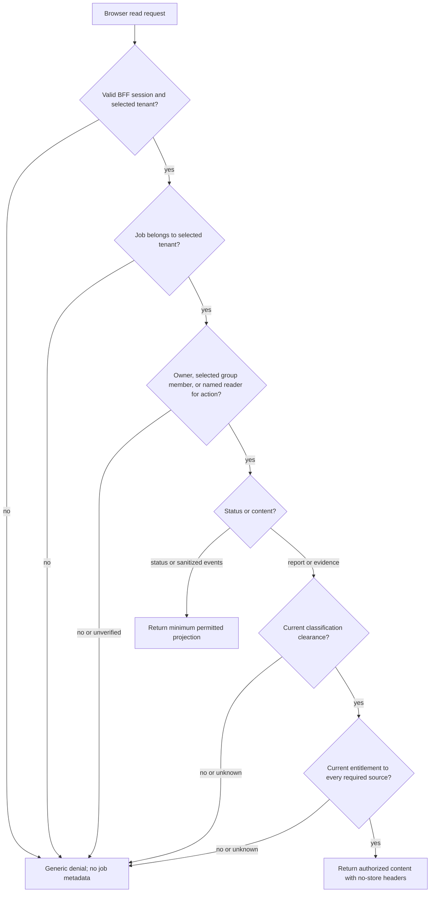
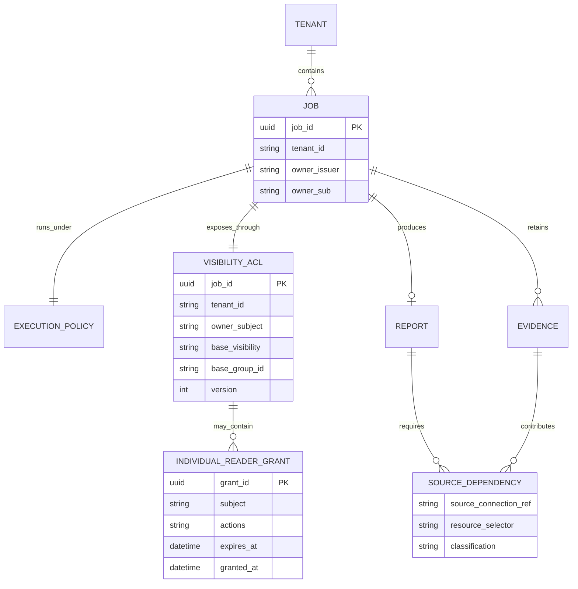

# Research job visibility and sharing design

**Status:** proposed application design, 2026-10-23; no API or authorization service is implemented here  
**Scope:** browser-facing job lists, detail, events, reports, evidence, sharing, and support access  
**Related:** [requirements](../requirements.md), [architecture](../architecture.md), [identity and access](identity-and-access.md), [job lifecycle](job-lifecycle.md), [research and evidence](research-and-evidence.md), [MCP connector broker](mcp-connector-broker.md), [Okta handoff](../okta/requirements-and-design.md), [OpenAPI sketch](../../contracts/openapi.yaml).

This design makes job **visibility** an application authorization decision. An Okta login proves who the user is; OpenShell workspace membership controls gateway resources. Neither grants permission to read a research job unless its application visibility ACL names the user or an exact group of which they are a current member. A job identifier, evidence identifier, artifact reference, source link, or pagination cursor is never a bearer capability. The API is the normal browser path to retained jobs and results.

## 1. Decisions and invariants

| Decision | P0 behavior | P1 extension |
|---|---|---|
| Visibility at creation | The request selects `submitter` or one approved `okta_group` via `visibility_selection`. The admitted ACL always includes `owner_subject`; group mode adds only the exact selected group ID. The owner and current members of that group can list and read sanitized status/events within the selected tenant, including for public-source jobs. | A versioned, time-limited `reader_subjects` grant can add a named same-tenant user with selected read actions. Additional base groups require a future contract change. |
| Report and evidence | Every viewer, including the owner or a selected-group member, also needs current classification and source authorization for private content. | A named reader needs the explicit grant plus their **own** current classification and source entitlement. |
| Job policy and access policy | The immutable job execution policy records what the worker was allowed to do. A separate server-held visibility ACL is created atomically on job admission. | Later changes to the visibility ACL never add worker tools, sources, or model routes. |
| Operators and administrators | No implicit job-content access from tenant membership, an Okta admin role, OpenShell Workspace User/Admin membership, or infrastructure access. | Support receives a separate, purpose-bound permission for sanitized operational detail. Content access still needs an explicit read grant and source checks. |
| Revocation | Local session, job, source-grant, or selected-group membership revocation denies subsequent protected reads once the authoritative change is observed. An audited owner or authorized steward can narrow the selected group to `submitter` for that job; the change closes group readers' streams and invalidates cursors. | Individual reader grant expiry/revocation has the same stream and cursor effects. |

The canonical human key is `(validated Okta issuer, immutable Okta sub)`. The active `tenant_id` comes from the BFF's verified, allowlisted tenant mapping; a user with more than one tenant must choose one explicitly. Email, display name, an arbitrary group prefix, and a client-supplied tenant or owner field are not authorization keys. The owner key and tenant are fixed when the job is admitted. [Identity mapping](../okta/requirements-and-design.md#3-token-and-authorization-contract).

The baseline rule is deliberately stronger than data classification: `public` describes a **source class**, not anonymous job visibility. A same-tenant employee outside the admitted owner or exact selected group cannot discover a P0 public-source job through list, direct URL, event stream, or citation ID. Group visibility is first-class at creation, and membership in another tenant, group, or administrator role is never a substitute. The same job ACL and source checks apply to every future front end, including optional ChatGPT plugin or MCP job tools; a different user interface cannot bypass them.

## 2. Permission model

Authorization first checks an active session, current selected-tenant membership, and exact job tenant. It then checks whether the caller is the `owner_subject`, a **current member of the exact `base_visibility` group under the job owner's `iss`**, or an active individual reader with the requested **read action**. A status or support permission does not imply report access, and a read grant does not imply cancellation or approval. An equal `sub` from another issuer cannot match the owner or selected-group route. If group membership cannot be confirmed, the group path denies; the owner path remains independently available while the owner still belongs to the tenant.

| Action | P0 owner | P0 selected-group member | P1 named reader | Approver | Cancel delegate | Support operator |
|---|---|---|---|---|---|---|
| `list_job`, `read_status` | Yes, in selected tenant | Yes, with current exact-group membership | Only if active grant includes the action | No implicit right | No implicit right | Purpose-bound support case, sanitized fields only |
| `read_events` | Yes, sanitized | Yes, sanitized | Only if active grant includes `read_events` | No implicit right | No implicit right | No raw events by default |
| `read_report` | After content checks | After independent content checks | Only if active grant includes `read_report` and content checks pass | No implicit right | No implicit right | Explicit read grant and content checks required |
| `read_evidence` or snapshot | After content checks | After independent content checks | Only if active grant includes `read_evidence` and content checks pass | No implicit right | No implicit right | Explicit read grant and content checks required |
| `cancel_job` | Yes while nonterminal | No | No | No | Only if separately granted for this tenant/job | Only if separately granted for operational containment |
| `approve_scope_change` | No implicit right | No | No | Only for the exact proposed revision and approved review scope | No | No implicit right |
| `manage_visibility` | May request a group-to-submitter emergency narrowing; other changes require a separate sharing permission and source policy | No | No | No | No | No |

The creation-time group choice is an admission decision, not a general permission to share other jobs. The P0 emergency narrowing action is limited to the job owner or an authorized tenant data steward and changes only `okta_group` to `submitter`; it never switches or adds a group. P1 `manage_visibility` is granted to a job owner **only when tenant policy permits sharing that job's data class and sources**, or to a designated data steward with the same checks. A grantor cannot give rights they do not hold or bypass the recipient's source entitlement. A source connection owned by the submitter is not a license to distribute its output. Review approval, cancellation, support diagnosis, and content viewing use separate policy decisions and audit events. The [job lifecycle design](job-lifecycle.md#6-review-cancellation-expiry-and-revocation) handles execution approval and cancellation; this document handles who can see results.



For a hidden job or evidence ID, use the same generic `404` response as an unknown ID. If a content entitlement check is denied or unavailable, the proposed API also returns a generic `404` for that content request; a separately authorized status view may still explain that content access is unavailable without naming hidden sources. Error bodies and timing should not reveal a hidden job, source name, or evidence locator.

## 3. Separate visibility ACL

The [job policy](../../contracts/job-policy.schema.json) is an immutable execution authorization snapshot. The untrusted [job request](../../contracts/job-request.schema.json) carries a [visibility selection](../../contracts/visibility-selection.schema.json) of `{ "mode": "submitter" }` or `{ "mode": "okta_group", "okta_group_id": "..." }`. P0 creates a distinct server-held [job access policy](../../contracts/job-access.schema.json) in the same admission transaction as the job. `base_visibility` is the approved selection; its single group ID is a stable Okta ID bound to `owner_subject.iss` and tenant, not a name or a cross-issuer identifier. P1 may update individual reader grants transactionally, without changing the worker's stage manifest. The request selection alone never authorizes a read.

At admission, the API verifies the selected tenant and current submitter membership, maps the exact selected group ID under the verified owner's issuer to that tenant's approved result-sharing catalog, confirms the submitter currently belongs to that group, and checks the group's publishing policy against the selected sources and classification. It **rejects group mode** for a private source unless the connector can check each recipient's exact resource entitlement at read time **or** tenant policy defines an approved group-shared corpus with a current viewer-access check. It also rejects unverifiable group membership or group IDs. The API derives `owner_subject` and `tenant_id` from the verified session, never from request fields. It commits the job, `base_visibility`, and ACL `version=1` atomically **before** queuing work. `submitter` mode includes only the owner. `okta_group` mode includes the owner plus current members authenticated under that same issuer in the one approved group. No wildcard, tenant-wide read, or additional group ID is inferred.

For a compromised or mistakenly selected group, `POST /v1/jobs/{job_id}/access/revoke-group` is a narrowly scoped P0 emergency action. It requires a current owner or authorized-steward session in the same tenant, CSRF protection, a strong `If-Match` ACL version, and a bounded free-text [reason](../../contracts/job-group-revocation.schema.json). The API first durably writes a group-denial tombstone to the independently recovered [revocation ledger](#revocation-durability-across-restore). One application-database transaction then changes only `base_visibility: okta_group → submitter`, increments `version`, and appends an audit record with the escaped reason; that untrusted text never enters status, SSE, or an API error. Success waits for the ledger write, database commit, and fence of old group-authorized delivery; affected list cursors are invalidated and streams whose only authorization was group membership are closed. If the database transaction fails after the tombstone, the group path remains denied until reconciliation completes. An independently granted reader is reauthorized under that separate grant. V1 forbids changing `submitter` back to group mode or replacing the group; a new job is required for a new group audience. Previously downloaded data cannot be erased. [Access API sketch](../../contracts/openapi.yaml).

| Server-held ACL field | Meaning |
|---|---|
| `job_id`, `tenant_id` | Exact job/tenant binding; cross-tenant changes and reads are rejected. |
| `owner_subject` | Canonical `(validated issuer, immutable sub)` submitter; retained as a reader even if the job uses group mode, subject to current tenant and content checks. |
| `base_visibility` | Validated `submitter` or one approved `okta_group` ID. V1 allows only a versioned emergency narrowing from group to submitter; it never widens or switches groups. Current exact-group membership is required for a non-owner group reader. |
| `version`, `created_at`, `updated_at` | Monotonic ACL revision and timestamps for optimistic updates, stream closure, cursor invalidation, and audit. |
| `reader_subjects` | P1 named same-tenant users as [grant objects](../../contracts/reader-grant.schema.json): server-assigned, never-reused `grant_id`, canonical `subject`, explicit read `actions`, bounded `expires_at`, `granted_at`, and `granted_by_subject`. No cancel, review, or ACL-management action is available. Revoked grants leave the active ACL and leave durable denial tombstones as well as audit records. |

P1 `PUT /v1/jobs/{job_id}/access` replaces only `reader_subjects`, using [untrusted grant requests](../../contracts/job-access-update.schema.json) that contain `subject`, `actions`, and `expires_at`. It requires an owner or authorized steward with `manage_visibility`, current same-tenant recipient eligibility, source and classification sharing policy, CSRF protection, a strong `If-Match` version, a tenant maximum grant lifetime, and an append-only add/change/revoke audit entry. The API computes grant IDs and grantor/time fields, rejects duplicate subjects, increments ACL `version`, and invalidates affected cursors and streams. Any removed or narrowed grant is tombstoned by its old `grant_id` before the ACL transaction; a replacement uses a new ID, so a restored older grant cannot regain its broader actions or expiry. Group members and reader grantees cannot call it merely by being readers. Cancellation, review approval, and support diagnosis are separate policies. A selected-group member must still be a **current member of that exact group** when each read occurs. A stale login-time group claim is insufficient. Group rename/removal and user departure revoke group-path access through the server-side entitlement directory. If current membership cannot be confirmed with the approved freshness, the group path denies status, events, and content until it can. Group visibility never crosses the selected tenant boundary. [Access API sketch](../../contracts/openapi.yaml), [Okta group claims](https://developer.okta.com/docs/guides/customize-tokens-groups-claim/).



The diagram shows logical relationships, not a database migration. A P1 reader grant can be revoked while the execution policy and report remain immutable. The report's source-dependency set supports provenance and audit; the v1 report read check uses the **monotonic job disclosure envelope** across every approved execution-policy revision, not only the latest policy or the cited evidence.

## 4. List, detail, and status

`GET /v1/jobs` filters by **selected tenant and current `list_job` permission before ordering and pagination**. P0 returns jobs owned by the current subject plus jobs whose `base_visibility` names the **exact** approved group of which the subject is currently a member. P1 adds only jobs covered by an unexpired, unrevoked named reader grant whose actions include `list_job`. No list endpoint returns all tenant jobs merely because a user belongs to a tenant or reviewer group. Use a stable keyset order such as `(created_at DESC, job_id DESC)` and a bounded `limit`; omit global totals that could reveal other users' activity.

The list filter and every direct-read authorizer consult the current [denial projection](#revocation-durability-across-restore) as well as the ACL row. A restored `base_visibility` value or reader grant is never sufficient if its group or `grant_id` has a durable tombstone. An unavailable or unverified ledger/projection denies the protected read, including a list page, before any job metadata is returned.

`next_cursor` is opaque, integrity protected, short-lived, and bound to the canonical subject, selected tenant, query filters, sort position, and a server-side visibility epoch. Revalidate current exact-group membership, job ACLs, and tenant on **every page**; a list spans multiple ACL versions, so one job's `version` is not enough to authorize the next page. Reusing another user's or tenant's cursor, or a cursor issued before a local grant changed, fails closed. Group membership change invalidates the subject's visible set at the next authoritative check. A cursor cannot override the selected tenant or act as proof of visibility. [OpenAPI list shape](../../contracts/openapi.yaml).

`GET /v1/jobs/{job_id}` returns the minimum status projection only after `read_status` authorization. The present [JobStatus contract](../../contracts/openapi.yaml) contains job ID, status, timestamps, sequence, optional sanitized reason code, and `report_available`; it does not itself contain the question or report. Status-only viewers receive no source names, private query, connection IDs, raw errors, report text, or evidence locators. If returned, `report_available` is computed **for this viewer** after `read_report` action, classification, and the full cumulative private-source envelope check below; omit it when those checks have not run. A P1 grant may allow `read_status` without `list_job`; the holder may open an authorized direct job URL, while that job remains absent from their list.

Every browser read uses a verified session and selected tenant. URL parameters are identifiers, never authority. The API loads job and evidence ownership server-side and returns `404` for unknown, wrong-tenant, or otherwise invisible IDs. Application and database queries must scope job, report, evidence, and audit records by tenant and job, even when OpenShell already separated tenant workspaces. [Identity design](identity-and-access.md#dashboard-sign-in-and-job-submission), [OpenAPI paths](../../contracts/openapi.yaml).

## 5. Report and evidence as one content boundary

For a private report, authorize the viewer against the **monotonic union of every approved private source and exact resource selector admitted to this job across all execution-policy revisions**, including revisions later narrowed or superseded, whether cited or uncited. The same job disclosure envelope includes the highest class of the original question, its frozen admitted briefs and attachments, trusted tool results, transferred dependencies, and completed report. The finalizer refuses to publish a report whose trusted class exceeds the admitted envelope class floor; it never silently raises that floor after the fact. A later B-only policy cannot remove source A from the read gate after A was admitted in an earlier revision. This is conservative because the report or a checkpoint can carry uncited A material into a later B-only stage. The API must have a concrete, enforceable resource scope for each admitted source; an unbounded or unresolved selector cannot be shared. A viewer needs current entitlement to **every** resource in this historical union and clearance at its highest class. A recorded citation/source-dependency set remains useful for provenance and audit but cannot narrow the v1 full-report read gate.

At initial admission and **before acknowledging each approved policy revision**, the policy service computes a canonical cumulative envelope from the prior trusted envelope and the newly admitted source/resource/class inputs. It writes an immutable `job_source_scope_admitted` binding with tenant, job, revision, prior-envelope digest, canonical exact selectors, class floor, and new-envelope digest to the independently recovered authorization ledger; the sensitive selectors are encrypted and access controlled in that domain, with no tokens or source content. It then commits the same envelope and digest in the application database with the policy revision. If the database commit fails, the ledger's more restrictive envelope still governs until an idempotent reconciliation; no later revision may subtract a selector or class floor. A server-held report record stores the envelope digest and highest policy revision at completion. The API checks the current verified ledger head and envelope digest before `read_report` or `report_available`; a missing revision, older database projection, mismatched report digest, or unavailable independent selector projection denies until recovered. Restore replays these bindings as a monotonic union before reads reopen. This makes a v1 A+B job safe when a later policy narrows future tool access to B, even if an application backup predates v2.

For a private evidence read, require the job's `read_evidence` action, the evidence's source/resource entitlement and classification clearance, and a server-side check that the evidence belongs to that job and selected tenant. When an approved A→B typed key ID is projected into a **correlation-only** B manifest, trusted broker/control-plane state **monotonically taints that destination attempt before any B source call** with the full transitive origin-evidence and source/resource dependency closure and a classification floor at least as restrictive as B, A, and the transferred key. Every B evidence record from that attempt inherits the closure, including another permitted typed-key wrapper call whose response arrives before the first; worker-reported timing or lineage cannot remove it. Ordinary B search/read/fetch with worker-controlled text, path, or filter is denied in that attempt and requires a fresh untainted B sandbox without A context. Trusted capture populates `source_dependency_evidence_ids`, `authorization_sources`, `dependency_classification_floor`, and effective `classification`; the API requires the viewer's **current rights to B and every transitive origin dependency**, plus clearance at that floor, before returning any such evidence ID, metadata, title, excerpt, citation locator, or raw snapshot bytes. A B-only viewer is denied even if their B grant is valid; an A+B viewer may read only after the same job and classification checks. Missing or untrusted lineage fails closed. The v1 broker cannot extract a new correlation key from derived or tainted B evidence for B→C transfer. A full snapshot uses the same decision as its metadata and excerpt. A citation visible in a report does not authorize a separate evidence fetch by itself. [Trusted evidence lineage](research-and-evidence.md#private-source-partitions-and-correlation).

| Source mode | Required current entitlement proof at read time |
|---|---|
| User-delegated Slack or GitHub | Viewer-specific source account/grant and current resource membership or provider-backed check for the referenced channel, repository, or object. The submitter's old token is not used as proof for a different viewer. |
| Approved GitHub App installation or GCP workload identity | Tenant policy authorizes the **viewer** to the exact shared corpus, repository, project/log view, or derived artifact; the app's broad source access is not automatically a viewer grant. |
| Custom OAuth MCP | Registered adapter supplies an auditable viewer-specific resource check, or tenant policy binds an approved group-shared corpus to a current viewer-access check. Otherwise group sharing remains disabled. Token validity alone is insufficient if the token reaches broader resources. |

If a source grant is revoked, a source membership changes, the source cannot answer the entitlement query, a classification is unknown, or an approved private policy source lacks a verifiable resource scope, private content **fails closed**. The owner or an authorized group reader can still see sanitized status explaining that content access needs reconnection or review, without naming hidden sources to a status-only viewer. Retention and legal hold may preserve the encrypted snapshot, but preservation does not grant dashboard access.

The whole report is the authorization unit for P0 and P1. **Do not return the full report while denying one of its evidence objects or any source in the cumulative envelope.** The current [report schema](../../contracts/report.schema.json) contains the full question, summary, and findings; a masked citation alone would still expose private conclusions. This design does not rely on an undefined redacted-report projection. If a future product needs partial disclosure, it requires a separate validated response schema and a verifier that rewrites all dependent question, summary, and claim text. [Research evidence design](research-and-evidence.md#viewing-and-retention), [OpenAPI report and evidence paths](../../contracts/openapi.yaml).

Evidence IDs are opaque lookup keys, not download credentials. `artifact_ref` and `access_context_ref` remain internal and never appear in a browser response. Do not expose a reusable direct object-store URL for private snapshots. The proposed `/v1/jobs/{job_id}/evidence/{evidence_id}/content` endpoint proxies bounded bytes through the API after the same live authorization check, rechecks during long streams, sets `Cache-Control: no-store` and `X-Content-Type-Options: nosniff`, uses a safe attachment filename, and records an access audit. Source `resource_uri`, `source_locator`, `title`, and excerpts may themselves be confidential, so they are not returned before source and classification checks. A vendor deep link remains subject to that vendor's own authorization and is never treated as this application's proof of access. [Evidence view contract](../../contracts/evidence-view.schema.json), [OpenAPI content endpoint](../../contracts/openapi.yaml).

## 6. Events, replay, and revocation

The [event contract](../../contracts/job-event.schema.json) limits `message` to trusted static templates, `stage` to coarse research phases, and warning/error `issue_code` to finite categories with fixed matching messages. Map untrusted worker output to those server-selected fields before persistence and delivery; never copy worker prose or user-entered revocation reasons into events. Do not store or stream prompts, source snippets, channel/repository/project names, token errors, or model reasoning as ordinary progress. A `read_events` viewer may receive sanitized status, progress, warning, and error events without source identity; an evidence event and ID require that viewer's current `read_evidence` permission plus rights and classification clearance for the evidence's full transitive dependency closure. Otherwise suppress the entire evidence event, including on SSE replay. Prefer a separate authorized evidence listing over putting private IDs into general progress events.

`GET /v1/jobs/{job_id}/events` authenticates and authorizes `read_events` at stream open and for replay from `Last-Event-ID`. It checks the current ACL and tenant before **each** event is written, plus exact current selected-group membership when the stream relies on the group path. A local group-to-submitter narrowing or individual-reader revocation increments ACL `version` and fences delivery under the old version before success; affected list cursors are invalidated and SSE connections close promptly. A missed push invalidation must still be caught by the per-event check; heartbeat checks close an idle stream. Reconnection rechecks full current permission and the source-sensitive event projection, then replays only events the viewer can currently see. The sequence number is scoped to one job and never grants replay rights.

```mermaid
sequenceDiagram
    autonumber
    actor Owner as Job owner or steward
    participant API as Dashboard API
    participant ACL as Tenant/job ACL store
    participant L as Independent authorization ledger
    participant SSE as Event stream gateway
    actor Viewer as Selected-group reader

    Viewer->>API: Open events with session and Last-Event-ID
    API->>ACL: Check tenant, ACL, and exact current group membership
    ACL-->>API: Allowed at ACL version 7
    API->>L: Verify no group tombstone at current head
    L-->>API: No denial through sequence 43
    API-->>Viewer: Replay sanitized permitted events
    Owner->>API: Revoke group with CSRF, reason, and If-Match 7
    API->>L: Durably append group tombstone at sequence 44
    L-->>API: Sequence 44 committed
    API->>ACL: Commit group to submitter, ACL version 8, audit, and sequence 44
    ACL->>SSE: Invalidate version 7 subscriptions and cursors
    SSE-->>Viewer: Close existing stream
    API-->>Owner: Revocation complete
    Viewer->>API: Reconnect with old Last-Event-ID
    API->>L: Check group path at current head
    L-->>API: Tombstoned at sequence 44
    API-->>Viewer: Generic 404; no replay
```

### Revocation durability across restore

An application database point-in-time restore can reintroduce an ACL or job-policy row from **before** an acknowledged revocation, forget a post-snapshot approved source scope, or forget a transfer grant that has not yet been used. The proposed authorization service therefore keeps an append-only **authorization ledger** in an independently recovered storage domain, outside the application, broker-connection, Vault, and gateway snapshots chosen for that restore. It records denial tombstones, immutable job-source-envelope advances, transfer-grant creation bindings, correlation-key reservations, and destination-call reservations, assigns contiguous monotonic sequence numbers per tenant, and retains a durable head/watermark. Records identify the exact tenant and capability, idempotency key, actor reference, and time; sensitive exact resource selectors in an envelope advance are encrypted and separately access controlled, and records contain no token, correlation value, or result content. The ledger and its own backups retain those records for at least the full lifetime of every recoverable application snapshot and associated result, including legal holds. An ordinary SIEM/audit export is insufficient unless it independently proves durable ordering, complete replay, and an authorization-readable current watermark. If the latest acknowledged head cannot be proved after a disaster, protected reads and tool calls stay closed. [PostgreSQL point-in-time recovery](https://www.postgresql.org/docs/current/continuous-archiving.html).

| Denial tombstone | Stable key and effect |
|---|---|
| Job group audience | `(tenant_id, job_id, exact group_id)` overrides a restored `okta_group` ACL row. Record prior and intended resulting ACL versions. |
| Named reader | `(tenant_id, job_id, never-reused reader grant_id)` overrides a restored grant, including its old actions and expiry. Record prior and intended resulting ACL versions. |
| Source connection | `(tenant_id, never-reused connection_ref)` blocks broker source calls even if its OAuth record or token is restored. |
| Cross-partition transfer | `(tenant_id, job_id, never-reused transfer grant_id)` overrides the grant in every restored immutable policy revision and any retained key-registry entry. Bind the tombstone to its source/destination partition IDs and policy lineage; record no key value. |

The writer serializes each job's ACL mutation, verifies actor, tenant, policy, and strong `If-Match` while holding that mutation lock, then appends the denial **before** changing the application ACL. A stale or unauthorized request never creates a tombstone. A multi-grant replacement appends all removed/narrowed grant tombstones as one idempotent ledger batch. For each list/detail/event/report/evidence decision, the API and SSE authorizer use either a linearizable ledger check or a denial projection synchronously caught up to the verified head; an eventually consistent cache cannot authorize. Thus a durable tombstone already denies the old group or grant even if the later ACL transaction fails. A definitely failed ledger append rejects the request without claiming success; an uncertain append outcome is resolved by idempotency key before retry. A failed ACL transaction after an append leaves the denial active and requires an idempotent retry or operator reconciliation. The API acknowledges a revocation only after the ledger append, local ACL and audit commit, cursor invalidation, and affected stream-delivery fence are complete. It cannot promise one atomic transaction spanning both stores; the ordering makes the partial state restrictive. If the ledger head or projection cannot be verified, protected reads and new sharing decisions fail closed. A newly approved reader after a prior revocation receives a **new** grant ID; the old tombstone never clears. V1 does not restore a narrowed group audience.

The `cross_partition_transfer_grants` array is part of the immutable execution policy. Before approval acknowledgement, the policy service durably registers each server-generated, never-reused grant ID as `transfer_grant_created` through a global unique-index compare-and-create in the independent authorization ledger, bound to tenant, job, policy version, canonical immutable scope (including the reviewed destination argument expression, renderer artifact, and source extractor/verification artifact digests), and the authenticated A/B decision-set digest. Only an exact idempotent retry of that original approval may reuse the ID; a changed scope, decision set, job, or policy version fails even if a restored application database has forgotten the grant. Approval needs both this append and the immutable policy commit. The broker, controller, and Job API check the current ledger head and exact creation binding at grant admission, key registration, key-ID release, and destination dispatch; a running extractor, verifier, renderer, or template digest mismatch denies use pending a new reviewed grant or a compatible rollout.

An authorized transfer-grant revocation does **not** edit that immutable policy. The policy service verifies the actor, job, policy lineage, exact grant ID, and source/destination partitions under a serialized grant-status change. It first establishes a per-grant dispatch and key-issuance fence across broker replicas, durably appends a `transfer_grant_revoked` tombstone **before** marking the local status inactive or acknowledging revocation, and waits for in-flight dispatches to finish or be denied before acknowledgement. The broker checks the current ledger head and grant denial before registering a typed key; the controller/Job API checks again before projecting an opaque key ID into a destination manifest; and the broker first reserves each issued key ID/byte charge against `max_keys` and `max_total_bytes` in the same independent ledger; it then atomically reserves one `max_destination_calls` use in that same independent, serializable grant ledger decision with its final tombstone check immediately before each destination `search_by_correlation_key` dispatch, including retries, then checks again before returning an in-flight response. Failed or ambiguous dispatches are not refunded. A restored key ID or destination manifest cannot authorize a call by itself. If the local status write fails, the tombstone still denies; an uncertain ledger outcome is resolved by idempotency key. New approval requires a new immutable policy revision, fresh stage attempt, and a **new transfer grant ID**; it never clears the old tombstone. Revoking a transfer grant blocks future transfers but does not by itself erase a previously completed report, whose reads still require current job, source, classification, and retention authorization. [Broker transfer gate](mcp-connector-broker.md#private-cross-source-query-control).

The application stores its last applied ledger sequence with the ACL, cumulative job disclosure envelope, and transfer-grant status projections. Following any database point-in-time restore or rollback, [recovery](deployment-and-operations.md#7-backups-retention-and-restore) blocks all job list/detail/event/report/evidence reads **and** worker Job API/broker ingress, including key issuance and destination calls, until it verifies an uninterrupted ledger through the latest durable head and idempotently applies every post-snapshot `job_source_scope_admitted` envelope advance, `transfer_grant_created` binding, tombstone, `correlation_key_reserved` key/byte charge, and destination-call reservation. A forgotten post-snapshot source scope remains in the report read gate; a forgotten grant ID cannot be reused under a different scope; and an exhausted grant cannot regain keys, key bytes, or calls. It rejects a snapshot watermark ahead of the durable head or a missing sequence. Recovery advances an externally monotonic generation, invalidating old `If-Match` tokens, cursors, sessions, streams, and all old-generation worker Job API/broker credential bindings before any traffic reopens. An OpenShell-injected **direct vendor token** does not necessarily carry this application generation; independently quarantine its real egress path and observe deletion of every old direct sandbox before release, unless the upstream grant and refresh path are revoked with a demonstrated denial or that upstream enforces current generation on each call. Reconcile actual sandboxes before issuing any new worker credential. It rechecks current Okta membership and source/classification rights before reads reopen. A restored expired grant remains expired under the current clock; a tombstoned reader or transfer grant stays denied even if the restored ACL/policy still lists it. If the ledger is unavailable, incomplete, or behind an acknowledged revocation, protected reads and tools remain closed rather than assuming the restored state or an audit log is current.

Revocation has two clocks. **Local** ACL, session, job, and broker-grant changes take effect for the next application decision and active streams as described above, with durable denials surviving recovery. **External** Okta group removals and vendor source-ACL changes are effective when an authoritative entitlement check observes them; production must establish and test a maximum propagation time with the IdP and each connector. A group-removal signal should invalidate affected streams immediately; even without it, the next event or heartbeat rechecks membership and closes a denied stream. Login-time claims alone cannot meet a current group-visibility or source-visibility guarantee. On uncertainty or entitlement-service outage, group-path status/events and private report/evidence reads deny. This resolves the gap between the [next-request result-access requirement](../requirements.md) and the [proposed Okta group-claim freshness window](../okta/requirements-and-design.md#4-session-refresh-rotation-and-revocation) by requiring a current server-side entitlement decision independently of the browser session's cached group display.

Response and proxy caches must not outlive revocation: set `Cache-Control: private, no-store` on job detail, events, report, and evidence; do not place private results behind a shared CDN or long-lived signed URL. The browser should clear in-memory report/evidence views when a revocation or tenant switch is observed. Previously downloaded data cannot be clawed back; the system governs future access and records the limitation.

## 7. Operator support and audit

An OpenShell workspace operator can inspect or delete sandboxes under gateway permissions, which are broader than a per-job report ACL. The dashboard does not infer `read_report` or `read_evidence` from that role. A support operator may receive a time-limited `support_diagnose` grant for a ticket and tenant, limited to sanitized job status, attempt IDs, policy digests, and operational logs that have been separately scrubbed and classified. A support need to cancel or contain work uses a separate `cancel_job` authorization. A support need to read a private report or evidence uses the same named read grant, current source entitlement, and classification check as any other viewer. Raw sandbox shell, download, scratch, or unredacted log access instead requires a separately approved incident/content proxy that rechecks current rights to the **entire cumulative job source/resource envelope and highest class** on every operation and stream checkpoint; `support_diagnose` and an ordinary report grant do not authorize that raw path. Direct CLI is reserved for synthetic/no-private-content diagnostics. Private incident CLI remains disabled unless a separately qualified, non-bypassable gateway edge binds the exact job, workspace, sandbox, and allowed RPCs, checks the full envelope/class and incident grant per RPC and stream checkpoint, and tears active sessions down on expiry or revocation. Exceptional legal evidence access follows a separate approved workflow outside this dashboard contract. [OpenShell workspace breadth](identity-and-access.md#trust-boundary-decisions).

Record allow and deny decisions for job list page, direct job detail, event subscription/replay, report, evidence metadata, raw snapshot, group selection and emergency narrowing, individual grant creation/revocation, cancel, approval, and support access. An audit entry carries canonical subject, selected tenant, job/evidence ID, requested action, decision, ACL version, matched authorization path and exact group ID when relevant, group-membership proof/freshness, classification result, source-entitlement decision identifiers, support ticket if any, timestamp, and correlation ID. Audit storage is tenant and role scoped; routine logs omit full prompts, source text, token values, and sensitive resource names. The user-facing denial remains generic, while a protected audit record identifies the exact failing check.

## 8. Acceptance and threat tests

| Test | Expected result |
|---|---|
| Submitter-only jobs (P0 public, P1 private) | User A cannot list, open by guessed ID, replay events, read report, or fetch evidence for user B's job in the same tenant, even if its sources are public. B can read content only after applicable classification/source checks. |
| P0 selected-group job | The owner and current members of exactly the selected approved Okta group can list and read sanitized status/events in the selected tenant; members of other same-tenant groups, reviewers, and administrators cannot. The owner retains access after leaving the selected group while still belonging to the job tenant. |
| Group admission | Reject an unknown/cross-tenant group ID, a submitter who is not a current group member, a disallowed classification, and a private connector with neither viewer-specific resource checks nor an approved group-shared corpus policy. |
| Cross-tenant and multi-tenant session | A user belonging to two tenants sees only the selected tenant; switching tenants changes list/detail results. Wrong-tenant IDs and grants return generic not-found. |
| Cursor tampering | A cursor from another subject, tenant, filter, or stale visibility epoch reveals no jobs; authorization runs before each page is formed. Removing a selected-group member prevents a stored cursor from listing later pages. |
| Status-only visibility | A selected-group reader's status projection and a P1 named reader with only `read_status` contain no source names, evidence IDs, report text, or cancellation/review controls. A status-only support view is equally sanitized. |
| Group removal and emergency narrowing | Removing a user from the exact selected Okta group denies their next authoritative group-path read and closes SSE within the measured external-removal SLA. `revoke-group` writes a durable tombstone, changes `okta_group` to `submitter` in one local versioned transaction, fences old-version delivery before success, promptly closes affected SSE, rejects stale `If-Match` **without writing a tombstone**, audits the bounded free-text reason, and cannot later widen or replace the group. |
| P1 individual reader grant | Only the exact same-tenant named subject receives the specified read actions before expiry. Revocation denies the next read and is audited; a reader never gains cancel, review, or ACL-management authority. |
| Access policy confidentiality | A selected-group member or P1 reader who is not the owner or authorized steward cannot call `GET /access`, `PUT /access`, or `revoke-group`; hidden ACL IDs and grant recipients are not disclosed. |
| Report source dependency | Remove access to one of several **approved private policy sources**, cited or uncited, after completion: the **entire** report read fails closed, including its question and summary. Evidence from that source also denies, while another evidence object checks its own exact source and transitive dependencies. An entitlement lookup outage has the same content-denial effect. |
| Policy-revision source union | Admit A and B in policy v1 and retrieve uncited A content; approve v2 that narrows future tools to B but omits A, then complete a report citing only B. A B-only viewer fails `report_available` and full-report read; a viewer with current A+B resource rights and sufficient clearance may pass. Restore an application snapshot predating v2 while retaining its report artifact: the independent `job_source_scope_admitted` sequence still requires A+B, and a missing envelope projection or digest denies rather than using v1 or v2 alone. |
| Derived or tainted A→B evidence | Project the approved A key ID into a correlation-only B manifest before B calls start; trusted attempt taint applies to every B evidence record, including another permitted typed-key wrapper call whose response arrives before the first. An ordinary B search/read/fetch call in that attempt is denied. A B-only viewer with `read_evidence` sees no such ID in events or replay and cannot read its metadata, excerpt, citation locator, or bytes. A viewer with current A **and** B resource rights and the combined classification clearance may read them under the job ACL. Missing origin lineage or entitlement denies; v1 cannot mint a B→C key from dependent evidence. |
| Evidence ID and object storage | Guessing another job's evidence ID or `artifact_ref` does not reveal metadata or bytes; no reusable direct object-store URL bypasses the API. |
| Event revocation and replay | Narrow a group ACL or revoke an individual grant while SSE is open: the stream closes before local revocation returns; old `Last-Event-ID` cannot replay after reconnect. Status-only viewers never receive private evidence IDs or messages. |
| Operator separation | OpenShell Workspace User/Admin or support role alone cannot read report/evidence; cancel and review require separate permissions and audit. |
| Pre-revocation backup: group audience | Back up a group-visible job, acknowledge `revoke-group`, then restore the older ACL snapshot. A former group member with no other read path cannot list, open status, reconnect SSE, replay an old cursor, read the report, or fetch evidence. The owner remains eligible only under current tenant and content checks; the group cannot be re-enabled by rollback. |
| Pre-revocation backup: named reader | Back up a P1 job, acknowledge a named grant's revocation or narrower replacement, then restore the older grant. Where that grant was the user's only read path, its old `grant_id` denies every action, replay, and evidence fetch. An explicitly approved new grant has a distinct ID; an expired grant remains expired under the current clock. |
| Pre-revocation backup: transfer grant only | Back up an active typed `cross_partition_transfer_grant` and key registry, then revoke **only that grant** while both source connections remain valid. After PITR or rollback, the old policy and key ID cannot register another key, release a destination key ID, or make a destination tool call; no source B request is sent. A new approved policy revision uses a different grant ID and fresh attempt. |
| Post-backup unused transfer grant | Back up the application and broker before a grant exists; approve a server-generated grant after the backup, acknowledge its immutable policy commit, and make no key, destination call, or revocation. Restore the older databases, then try to reuse that same grant ID with a different job, scope, cap, template, or A/B approval set: the independent `transfer_grant_created` binding rejects it. The exact approval idempotency retry may reconcile its original policy; a new approval uses a new ID. |
| Pre-exhaustion backup: destination-call limit | Back up a typed transfer grant before its last allowed destination dispatch, consume its `max_destination_calls` with durable reservations, then restore. The old policy/key remains exhausted, including its reviewed key count and total bytes as well as destination calls across concurrent broker replicas and retries; an ambiguous dispatch is not refunded and no extra source B request is sent. |
| Pre-restore direct attempt with cleanup pending | Restore a pre-cancel or pre-retry snapshot while an old direct MCP sandbox still has an OpenShell-injected vendor token. Old-generation Job API/broker requests fail, and the independent quarantine denies the vendor call even if the restored attempt says active. Direct-source egress stays closed until that sandbox is observed gone, or its upstream grant and refresh path are revoked and vendor denial proven, or the upstream enforces current generation. No old attempt is rescheduled from its restored row. |
| Incomplete ledger or projection | A ledger outage, sequence gap, snapshot watermark ahead of the durable head, or lagging authorization projection blocks protected reads, worker Job API/broker calls, and new sharing or transfer grants; no restored report/evidence byte or cross-partition key reaches a worker while the recovery gate is closed. |
| Source grant expiry and restore | Expired/revoked source grants and broker connections do not regain report access after API restart, backup restore, or release rollback. The broker-denial record and current vendor/IdP entitlement checks deny a restored source connection; retained evidence remains stored but unreadable through the dashboard until current entitlement is proven. |

P0 includes both submitter-only and creation-time selected-group jobs. P1 individual-reader sharing is gated on the complete named-grant contract, source-entitlement adapters, stream invalidation, and negative tests above. This document specifies application behavior and does not claim that Okta, OpenShell, LangChain, or an upstream MCP server implements these job-level visibility rules for this project.
