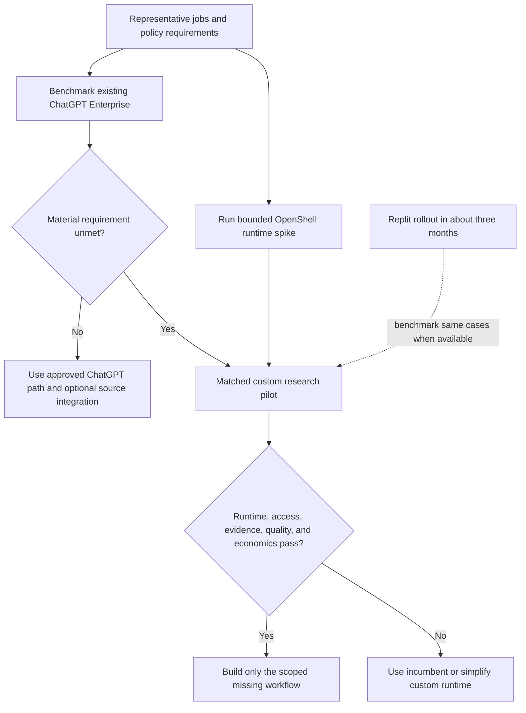
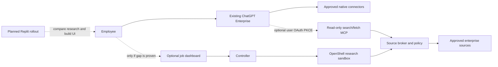
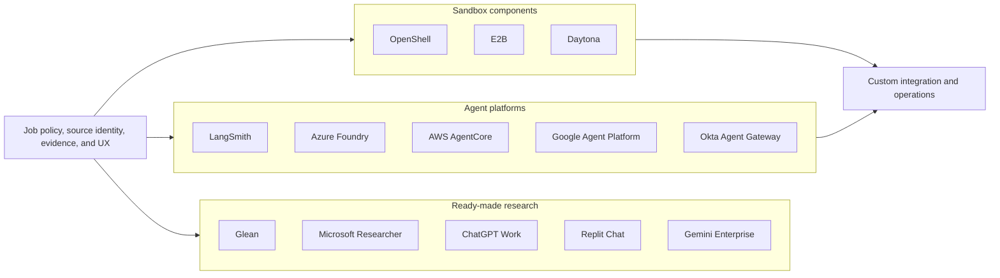
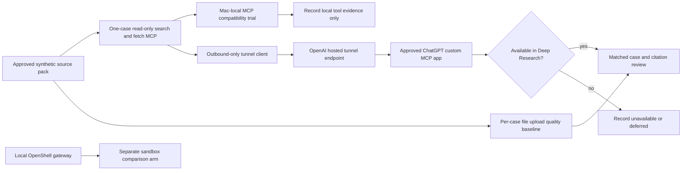
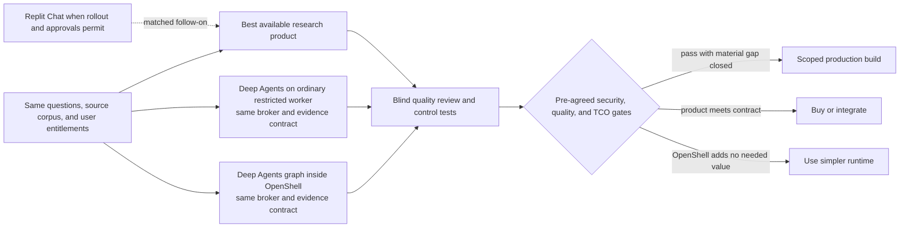

# Feasibility and market assessment

**Status:** Desk assessment; no runtime or vendor pilot completed  
**Reviewed:** 2026-10-23  
**Decision context:** This is an internal platform. All employees already have ChatGPT Enterprise; enterprise connectors are being enabled after review. A Replit rollout is planned in about three months, but its contracted deployment mode is not yet known.  
**Target design:** [requirements](requirements.md) and [architecture](architecture.md)

## 1. Decision summary

The proposed service is **technically plausible**, but the repository is a design scaffold and enterprise feasibility remains conditional on live OpenShell, Kubernetes, Okta, MCP, and source-permission tests. The first-party LangChain OpenShell backend does not prove the proposed placement of the entire Deep Agents graph inside OpenShell: its documented integration keeps the graph outside and delegates filesystem and command work into a sandbox. A worker image that runs the graph inside OpenShell is a custom integration to prove. [Deep Agents sandbox patterns](https://docs.langchain.com/oss/python/deepagents/sandboxes).

The first benchmark is the organization's **existing ChatGPT Enterprise** deployment. It already offers a deep research workflow with sources, while admins can govern connected apps and MCP access; the organization's source connectors are still under review, so their availability and exact permissions must be tested rather than assumed. Replit Chat is a second employee-facing research benchmark once the planned rollout occurs. These facts raise the bar for a new dashboard. A full custom build is justified only if a **measured combination** of customer-operated runtime, job-level authorization, source-specific evidence, and cross-system workflows meets a requirement that the approved platforms cannot meet at acceptable cost. Vendor gaps in that combination are hypotheses until tested. [ChatGPT Work research](https://learn.chatgpt.com/docs/web-search), [ChatGPT Enterprise plugin controls](https://learn.chatgpt.com/docs/enterprise/apps-and-connectors), [Replit research example](https://docs.replit.com/use-cases/prepare-for-a-customer-call).

Retain the four candidate design controls: a server-held job policy, a credential and connector broker, separate public and private research lanes, and durable claim-to-source evidence. Build only the controls that the comparison proves necessary. Test full-graph OpenShell placement against a simpler runtime using the **same** broker and evidence contract; otherwise an improvement caused by the broker could be mistaken for an OpenShell benefit.

### Installed-platform strategy

| Path | Near-term role | Decision boundary |
| --- | --- | --- |
| ChatGPT Enterprise with approved native connectors | First user experience and research-quality baseline; employees already have the workspace sign-in. | Deep research feature enablement, connector approval, source ACL behavior, report export, sensitive-data policy, and actual tenant entitlement remain gates. Existing seats do not establish zero usage or integration cost. |
| ChatGPT with a custom read-only MCP | A candidate way to expose an approved source broker as `search` and `fetch` without first creating another research UI. [OpenAI MCP guide](https://developers.openai.com/api/docs/mcp). | ChatGPT must obtain a **user** OAuth authorization-code + PKCE token for this MCP resource; it does not use client credentials to connect to a custom MCP server. The Okta `resource`/audience and tenant configuration need a live test. [OpenAI plugin authentication](https://developers.openai.com/plugins/build/auth). |
| OpenShell service and optional dashboard | Candidate for requirements that need customer-operated full-graph execution, server-held job policy, replayable evidence, or custom progress/review. | An OpenShell sandbox spike may proceed in parallel, but a general employee dashboard follows a measured product gap. |
| Replit Chat and Replit-built app | At rollout, compare Chat research on the same cases and consider Replit for UI construction. [Replit research example](https://docs.replit.com/use-cases/prepare-for-a-customer-call). | Contracted feature set, connector governance, app identity, data flow, and hosting mode must be confirmed. Replit BYOC modes are currently private preview or early access. [Replit BYOC](https://docs.replit.com/teams/bring-your-own-cloud). |

The custom MCP path exposes source material to ChatGPT's research workflow; it does not place that workflow inside OpenShell. A separate ChatGPT plugin might offer job submission, status, and report tools for an OpenShell service, but those broader tool calls are a **separate tenant pilot**. OpenAI's documented deep research MCP shape is read-only `search`/`fetch`. A private MCP tunnel keeps the broker endpoint private while still carrying tool data into the ChatGPT product boundary, and the OAuth authorization server must be reachable for user sign-in. [OpenAI MCP search/fetch](https://developers.openai.com/api/docs/mcp), [OpenAI plugin authentication](https://developers.openai.com/plugins/build/auth), [Secure MCP Tunnel](https://developers.openai.com/api/docs/guides/secure-mcp-tunnels).

## 2. Market comparison

### Ready-made research products

| Product | Documented overlap | Specific question for the pilot |
| --- | --- | --- |
| [Glean Deep Research](https://docs.glean.com/user-guide/assistant/deep-research) | Background reports from company sources and web with linked citations and source permissions. Glean's [remote MCP host](https://docs.glean.com/administration/actions/connect-remote-mcp-servers-to-glean) supports per-user OAuth, PKCE, client credentials, and customer-network endpoints. | Can the **Deep Research** workflow invoke the required live MCP tools with the desired per-job resource limits and report/evidence export? MCP support elsewhere in Glean does not establish that behavior for every Deep Research run. |
| [Microsoft 365 Copilot Researcher](https://learn.microsoft.com/en-us/microsoft-365/copilot/faq-researcher) | Multi-step cited research over Microsoft Graph, connectors, and Bing. [Federated connectors](https://learn.microsoft.com/en-us/microsoft-365/copilot/connectors/overview) fetch live through MCP and OAuth. | Does the existing Microsoft estate cover the selected Slack, GitHub, and log questions with acceptable source scoping? Microsoft's documented web control for Researcher is a tenant-wide toggle rather than a per-site allowlist. |
| [ChatGPT Enterprise / Work deep research](https://learn.chatgpt.com/docs/web-search) | Already available to every employee in this organization. Multi-source reports use files and connected app context. A custom read-only MCP [search/fetch](https://developers.openai.com/api/docs/mcp) and a [private MCP tunnel](https://developers.openai.com/api/docs/guides/secure-mcp-tunnels) may extend approved sources. | Which reviewed connectors and custom MCP functions are actually enabled in this tenant? Can source permissions, sensitive-data policy, and evidence export meet the workflow? Its separate [Agents API self-hosted environment](https://developers.openai.com/api/docs/guides/agents-api/environments/self-hosted) does not establish that ChatGPT deep research runs inside the customer's OpenShell sandbox. |
| [Replit Chat research](https://docs.replit.com/use-cases/prepare-for-a-customer-call) | Documented cross-tool research can use connected Salesforce, Slack, and Drive sources and show source material; [Agent MCP integration](https://docs.replit.com/build/connect-via-mcp) supports OAuth and custom HTTPS servers. | At the planned rollout, do the contracted connectors, identity controls, source permissions, result exports, and data boundary meet the selected cases? Agent/Chat connector credentials do not automatically authorize a published app or OpenShell worker. |
| [Gemini Enterprise Deep Research](https://docs.cloud.google.com/gemini/enterprise/docs/research-assistant) and [Cloud Assist investigations](https://docs.cloud.google.com/cloud-assist/investigations) | Cited enterprise/web research and GCP incident investigation already exist. Cloud Assist links observations to logs, configurations, and metrics. | Can the selected cross-system incident workflow be completed under the required access model? Cloud Assist investigations are Preview and currently access-limited. |

[Claude Research](https://support.claude.com/en/articles/11088861-use-research-on-claude) and [Perplexity Deep Research](https://www.perplexity.ai/hub/products/deep-research) are additional product benchmarks for research quality and usability. Connector availability, ACL behavior, exportability, and the exact research mode must be tested in an organization's plan and tenant; marketing-level connector support is insufficient evidence for a specific workflow.

### Agent, identity, and sandbox platforms

| Platform | Relevant capability | Fit to this design |
| --- | --- | --- |
| [LangSmith Managed Deep Agents](https://docs.langchain.com/langsmith/python/managed-deep-agents-overview) | Managed Deep Agents harness, Agent Server runs/threads/streaming, MCP connectors, and an auxiliary [LangSmith Sandbox](https://docs.langchain.com/langsmith/python/managed-deep-agents-sandboxes). [Connection management](https://docs.langchain.com/langsmith/python/managed-deep-agents-connections) covers OAuth and client credentials. | Closest framework benchmark. Managed Deep Agents is a LangSmith Cloud public beta, and its graph executes in Agent Server rather than in its auxiliary sandbox. Separately, [self-hosted LangSmith Sandboxes](https://docs.langchain.com/langsmith/enable-self-hosted-sandboxes) support GKE and OpenShift; that is not proof of a self-hosted Managed Deep Agents offering. |
| [Azure Foundry Hosted Agents](https://learn.microsoft.com/en-us/azure/foundry/agents/concepts/hosted-agents) | Custom Python/C# agent code, including LangGraph, runs in per-session VM-isolated sandboxes with managed identity, background work, persistence, and VNet access. [Hosted Agents GA migration](https://learn.microsoft.com/en-us/azure/foundry/agents/how-to/migrate-hosted-agent-preview) documents the current production path. | Strong managed **full-agent-in-sandbox** substitute if Azure hosting and Entra integration fit. It does not provide an OpenShift or GKE operated runtime. Validate third-party MCP grant and authorization behavior for each source. |
| [AWS Bedrock AgentCore](https://docs.aws.amazon.com/bedrock-agentcore/latest/devguide/what-is-bedrock-agentcore.html) | Runtime and Harness offer managed agent execution; [Gateway outbound authorization](https://docs.aws.amazon.com/bedrock-agentcore/latest/devguide/gateway-outbound-auth.html) includes MCP client credentials, authorization code, and token exchange; [Policy](https://docs.aws.amazon.com/bedrock-agentcore/latest/devguide/policy-authoring-guide.html) can check caller, action, and input values. | Strong managed identity and tool-policy benchmark. It is AWS operated, so the pilot must test whether its deployment and data boundaries satisfy the actual requirement. Do not assume job-level argument policy is absent from managed competitors. |
| [Google Agent Platform](https://docs.cloud.google.com/gemini-enterprise-agent-platform/overview) | Agent Runtime plus [Agent Identity client credentials](https://docs.cloud.google.com/iam/docs/auth-with-2lo-v2) and [delegated OAuth](https://docs.cloud.google.com/iam/docs/auth-with-3lo-v2) address managed access. The separate [Managed Agents API sandbox](https://docs.cloud.google.com/gemini-enterprise-agent-platform/build/managed-agents/sandbox-environment) places agent planning in a sandbox. | Strategic GCP benchmark. The Managed Agents API sandbox is currently Pre-GA and its published terms exclude proprietary, sensitive, confidential, commercial, and production workloads. Agent Runtime plus an auxiliary sandbox is a different boundary to evaluate. |
| [OpenAI Agents API self-hosted environments](https://developers.openai.com/api/docs/guides/agents-api/environments/self-hosted) | Customer compute runs the executor and local MCP/file operations; OpenAI runs the agent harness and session orchestration. | Reduces the novelty of a customer-owned sandbox alone, but differs from the proposed full graph inside OpenShell. Check its [data controls and residency limits](https://developers.openai.com/api/docs/guides/agents-api/overview) against the data class. |
| [Okta Agent Gateway](https://help.okta.com/OIE/en-us/content/topics/ai-agents/agent-gateway.htm) | Aggregates remote MCP tools behind an Okta-secured endpoint, checks identity/policy on tool calls, injects downstream credentials, and records activity. Its [AI agents API](https://developer.okta.com/docs/api/secures-ai) is beta and requires an Okta for AI Agents subscription. | Could this replace part of the proposed connector broker? Prove tenant entitlement, ChatGPT/OpenShell client compatibility, source grants, per-job argument constraints, evidence capture, and required retention. Tool-level control alone does not prove every job/resource rule in this design. |

[E2B](https://e2b.dev/enterprise) and [Daytona](https://www.daytona.io/docs/en/linux-sandboxes/) offer sandbox execution choices. They are infrastructure comparisons, not complete substitutes for the research, source-permission, and evidence workflow. Their exact customer-operated deployment and secret/proxy feature set require a vendor-specific review.

## 3. Feasibility of the proposed stack

| Area | Desk verdict | Required proof before enterprise data |
| --- | --- | --- |
| Full graph inside OpenShell | **Plausible custom integration.** LangChain documents `OpenShellSandbox` as a backend for filesystem/command execution while the agent graph remains outside; agent-in-sandbox is a separate pattern. [Deep Agents sandboxes](https://docs.langchain.com/oss/python/deepagents/sandboxes). | Pin a Python worker image, then demonstrate planner, tool client, verifier, and synthesis process IDs inside one job sandbox. Confirm the effective tool inventory and cancellation behavior. The [NVIDIA community recipe](https://github.com/NVIDIA/nemoclaw-community/tree/main/examples/recipes/community/deep-research-worker) is useful for lifecycle ideas but does not prove this placement. |
| OpenShift runtime | **Documented, conditional.** OpenShell v0.1.5 calls for OpenShift 4.19+, Landlock and nested seccomp probes, and a CNI that enforces both directions of `NetworkPolicy`. It does not require a privileged SCC in the documented deployment. [OpenShift guide](https://docs.nvidia.com/openshell/v0.1.5/kubernetes/openshift). | Run the exact gateway/chart/controller/worker versions on the intended node image and runtime. Prove supervisor-only paths and denied direct egress with live canaries. |
| GKE Standard runtime | **Alternative to qualify.** The proposed upstream OpenShell controller path is distinct from Google's managed Agent Sandbox add-on, which [requires gVisor](https://docs.cloud.google.com/kubernetes-engine/docs/how-to/how-install-agent-sandbox). | Repeat the kernel, seccomp, CNI, Pod, and PVC tests on the actual node pool. Begin with a fixed worker pool and bounded queue; decide on node autoscaling from measured unschedulable Pods, queue wait, and cost. [GKE cluster autoscaler](https://docs.cloud.google.com/kubernetes-engine/docs/concepts/cluster-autoscaler). |
| Okta and OpenShell gateway | **Supported in parts.** The dashboard implements its own Okta PKCE session. OpenShell SDK automation supports gateway OAuth client credentials; the controller needs a token from an appropriate Okta custom authorization server with the gateway audience, scopes, and role. Operator CLI PKCE needs a separate callback test. [Gateway authentication](https://docs.nvidia.com/openshell/v0.1.5/how-it-works/gateways/authentication), [Okta authorization servers](https://developer.okta.com/docs/concepts/auth-servers/). | Verify real controller token acquisition, refresh, role/workspace denial, and operator callback behavior. Keep dashboard, gateway, and source tokens separate. |
| ChatGPT custom MCP and Okta | **Conditional integration.** ChatGPT connects to an OAuth-protected custom MCP with a user's authorization code + S256 PKCE, protected-resource metadata, and a resource-bound access token. ChatGPT does **not** use machine-to-machine grants such as client credentials for this connection. Broker-to-source client credentials remains a separate server-side option. [OpenAI plugin authentication](https://developers.openai.com/plugins/build/auth). | Prove the exact ChatGPT redirect/client registration, Okta metadata and `resource` handling, token `aud`, scope and subject, negative audience tests, workspace approval, and read-only `search`/`fetch` calls. Do not infer Okta custom-AS resource-indicator behavior from its ordinary fixed audience setting. |
| OAuth-secured MCP and source identity | **Connector-specific.** OpenShell can hold/refresh some provider credentials and has SPIFFE assertion based dynamic grants, but it is not a universal downstream OAuth host. MCP audience/resource binding applies to the MCP server, and app-only client credentials do not preserve a user's Slack or GitHub permissions. [OpenShell provider profiles](https://docs.nvidia.com/openshell/v0.1.5/how-it-works/providers/profiles), [MCP authorization](https://modelcontextprotocol.io/specification/2026-07-28/basic/authorization), [Slack MCP](https://docs.slack.dev/ai/slack-mcp-server/), [GitHub App identity](https://docs.github.com/en/apps/creating-github-apps/authenticating-with-a-github-app/authenticating-as-a-github-app-installation). | For each server, prove registration, transport, token grant, `resource`/audience, refresh/revocation, available read tools, and exact source permissions. Broker arguments must be checked on every call because OpenShell MCP policy filters tool names, not resource IDs in arguments. [OpenShell network rules](https://docs.nvidia.com/openshell/v0.1.5/how-it-works/policies/network-rules). |
| Tenant and job isolation | **Application and live-gateway gate.** OpenShell documents workspace-scoped resources, while its Kubernetes access-control guide cautions that OIDC subjects do not individually own provider/sandbox records. A Workspace User may use providers throughout its workspace. [Workspaces](https://docs.nvidia.com/openshell/v0.1.5/how-it-works/workspaces), [access control](https://docs.nvidia.com/openshell/kubernetes/access-control). | Use two tenant gateway principals to test cross-workspace list, use, and attach denial. Use two dashboard users in one workspace to test cross-job API and broker denial. Keep researchers off the gateway; give mutually untrusted direct gateway users separate workspaces or gateways. |
| GCP Logs connector | **Read-only API wrapper is the safer first path.** Google's hosted [Cloud Logging MCP setup](https://docs.cloud.google.com/logging/docs/use-logging-mcp) currently lists `roles/logging.admin` and admin/write OAuth scopes; it says custom roles may be possible. | Prove the hosted MCP tool under a narrow custom role before using it for real data. Otherwise use the Cloud Logging API through a broker identity limited to approved log views and read methods. [Logging access control](https://docs.cloud.google.com/logging/docs/access-control). |
| Evidence and model route | **Buildable application behavior, not an OpenShell default.** The broker must capture a source snapshot before issuing a citable evidence ID. The approved model endpoint receives the private excerpts sent for inference, so its data-processing boundary is part of this design. [Research and evidence design](design/research-and-evidence.md), [OpenShell inference guidance](https://docs.nvidia.com/openshell/security/best-practices). | Demonstrate report-to-snapshot replay after sandbox deletion, reauthorization on reads, retention, unsupported-claim rejection, model-route policy, and safe trace/log handling. |
| Replit as research or app platform | **Relevant but not a proven OpenShell runtime.** Replit Chat researches connected enterprise sources, while published app hosting, BYOC, and Image Exports have separate deployment and identity contracts. Full BYOC is private preview; the other two customer-cloud paths are early access. [Replit research workflow](https://docs.replit.com/use-cases/prepare-for-a-customer-call), [Replit BYOC](https://docs.replit.com/teams/bring-your-own-cloud). | At rollout, verify contracted feature access, organization SSO versus published-app Okta SSO, private networking, secrets handling, model data flow, and whether a Replit-built UI can be exported and operated on the qualified GKE/OpenShift platform. |

The local CLI version recorded by this repository on the review date is **0.0.44**; the design targets documented **v0.1.5**. Upgrade and pin the CLI, gateway, chart, supervisor, and worker together before treating a local demonstration as evidence for enterprise feasibility. [OpenShell support matrix](https://docs.nvidia.com/openshell/v0.1.5/about/support-matrix).

### Why the sandbox decision needs an A/B test

The first release uses reviewed read tools and does not expose arbitrary shell execution to the agent. That lowers one source of runtime risk. OpenShell can still contain a compromised worker process and restrict its network path, but it adds gateway, supervisor, CNI, lifecycle, and debugging work. This is an architectural inference from the [current read-only tool design](design/research-and-evidence.md) and [Deep Agents sandbox patterns](https://docs.langchain.com/oss/python/deepagents/sandboxes). Measure that security and operating benefit against a conventional restricted Kubernetes worker with the **same** broker and evidence store. A model endpoint and any broker-approved destination remain deliberate paths out of either runtime.

## 4. What would make this worth building

The market evidence supports four testable hypotheses. None is an assertion that a named vendor lacks the feature.

1. **Operating boundary:** The full agent graph and transient job data must run on organization-operated OpenShift or GKE, with a runtime and egress policy the security team can inspect. Azure and AWS offer strong managed sandboxes; LangSmith and OpenAI offer other customer-compute paths, so the exact placement and operations contract matters more than the word “sandbox.”
2. **Source authorization:** A job's approved channel, repository, log view, time range, acting identity, and tool arguments must be enforced on every call, including when the source server advertises broader tools. A broker is valuable only if the organization actually needs these restrictions and a vendor pilot cannot express them adequately. AWS AgentCore Policy already documents input-value constraints. [AWS Policy](https://docs.aws.amazon.com/bedrock-agentcore/latest/devguide/policy-authoring-guide.html).
3. **Reviewable evidence:** A report needs retained, hashed source snapshots and claim-level evidence IDs, with classification, retention, and access rechecks. A linked citation in a vendor report may satisfy many use cases; measure whether immutable replay is a genuine audit or incident requirement.
4. **Cross-system investigation:** A narrow workflow such as “what code change, Slack decision, and log evidence explain this incident?” may create useful specialization. Glean already searches connected company systems; Google Cloud Assist already investigates logs and configuration. Measure the end-to-end task, including permission and evidence quality, rather than counting connectors. [Glean Deep Research](https://docs.glean.com/user-guide/assistant/deep-research), [Cloud Assist investigations](https://docs.cloud.google.com/cloud-assist/investigations).

Because this is an **internal platform**, the relevant decision is incremental organizational value over ChatGPT Enterprise, followed by Replit when its rollout provides access. A separate dashboard may still be valuable for durable job submission, progress, approvals, and replayable evidence, but should follow a demonstrated gap in the incumbent user experience and governance. This is an inference from the documented overlap and the organization's stated installed products, not a claim about vendor pricing.

## 5. Matched pilot and decision gates

The first executable selection slice is [CR-0011](change-requests/CR-0011-matched-feasibility-evaluation.md) with its [ToDo](todos/CR-0011-matched-feasibility-evaluation.md); the separate full-graph runtime proof is [CR-0012](change-requests/CR-0012-full-graph-runtime-spike.md) with its [ToDo](todos/CR-0012-full-graph-runtime-spike.md). Their current evidence and assignments are in the [progress report](progress-report.md). These pairs implement the existing gates; they do not change the decision thresholds below.

### ChatGPT baseline connectivity impact

The user will run the 24 ChatGPT Enterprise cases and has administrator control of the app on their Mac. They cannot configure the server-side Enterprise workspace or OpenAI Platform tunnel. Custom MCP apps and Secure MCP Tunnels were reported as organizational capabilities, but the required hosted role grants and workspace association are **unverified**, and **no connector is approved yet**. The OpenShell gateway stays local to its own comparison arm.

Impact **DR-FEAS-003**, [CR-0018](change-requests/CR-0018-chatgpt-synthetic-mcp-baseline.md) / [ToDo](todos/CR-0018-chatgpt-synthetic-mcp-baseline.md), prepares a separate, case-filtered synthetic `search`/`fetch` fixture under existing SEL-01/02/05 and RES-09. [OpenAI distinguishes local desktop MCP configuration from hosted ChatGPT plugin tools](https://learn.chatgpt.com/docs/extend/mcp). After exact-byte approval, actual Work Local entitlement, and effective enterprise/device MCP policy permitting the fixture, a Mac-local ChatGPT Work trial may test fixture compatibility if the Work-mode tool call is observed; a Codex-host-only call is a separate protocol observation. Neither establishes a hosted Deep Research source or source ACL parity. Hosted access needs a workspace-permitted plugin and a reachable MCP endpoint: an approved [Secure MCP Tunnel](https://developers.openai.com/api/docs/guides/secure-mcp-tunnels) can carry outbound HTTPS from beside the private fixture, or a separately approved public HTTPS endpoint can be considered. Per-case file uploads can compare research quality but cannot prove MCP or source-permission behavior. Until the actual connector and tenant path are approved and observed, those cases are deferred.

The threat-model delta is accidental benchmark overclaim or fixture disclosure. A tunnel is transport, not a source authorization decision. Before a one-case question/view packet is shared or a tunnel exposes its MCP projection, an independent approval record must bind the exact approved corpus, source pack, rubric, case ID, question, and projected allowed-source bytes. Under that **unchanged independently registered manifest pin**, the projector and server reject pending approval, changed inputs, wrong case, and a self-rehash that inserts a forbidden source; a caller-supplied new digest is not proof of independent approval. The local draft mode is for fixture tests only and is ineligible for tester distribution. [Initial independent review](evidence/CR-0018-tester-packet-independent-review-2026-10-26.md) reproduced missing approval-pin and safe-question-export gaps; [targeted correction re-review](evidence/CR-0018-packet-correction-re-review-2026-10-26.md) found no remaining local Blocker/Important under an operator-only packet parent with no concurrent writers. Approved mode now stages and verifies `question.txt` and `projection.json` together and publishes one fresh `--packet-dir`; its schema requires every one of the 24 case IDs exactly once and `make check` validates evaluation schemas. The MCP server must expose only the selected case's approved invented source IDs and deny forbidden/unknown IDs; a no-auth fixture cannot prove user or group source rights. For each case, the authorized tester starts a fresh ChatGPT conversation with no prior upload or case material and retains the exact selected app/source state plus raw tool/result transcript; otherwise connector or permission behavior is deferred. ChatGPT custom-app creation and Deep Research availability still require observed tenant permissions, tool discovery, and the user as named tester. A Mac-local MCP connection, if tested after input approval, is recorded under its own client/workflow/version and does not satisfy hosted app/tunnel permissions or Deep Research source eligibility. [OpenAI's current Deep Research guidance](https://help.openai.com/en/articles/10500283-deep-research-in-chatgpt) says not every app supports that surface. The tunnel runtime API key remains outside this repository, the worker, and the OpenShell gateway. A scored citation-link comparison also needs a real, reviewed, commit-pinned synthetic mirror; a fabricated URL is not evidence. Missing parity or availability makes the relevant case deferred, never a negative score for ChatGPT.

For the first dependency-free local fixture, pin legacy **MCP 2025-06-18 and 2025-11-25 stdio** with `initialize`, `notifications/initialized`, `tools/list`, and `tools/call`. The extra version is needed for a locally installed MCP SDK 1.22.0 client that requests only `2025-06-18`; it is supplemental compatibility evidence, not a new runtime dependency. One-case projection and server startup must enforce identical source-ID grammar, encoded 64 KiB projection bounds, and 32 KiB worst-case newline-delimited tool responses; malformed RPC Unicode must be rejected without terminating the process. The [current MCP 2026-07-28 versioning specification](https://modelcontextprotocol.io/specification/2026-07-28/basic/versioning) uses per-request version metadata and permits a stdio client to probe `server/discover` and fall back after a legacy method-not-found response; the [2025-11-25 lifecycle](https://modelcontextprotocol.io/specification/2025-11-25/basic/lifecycle) defines the shared legacy handshake. The [local v0.0.18 in-memory tunnel-client probe](evidence/CR-0018-local-tunnel-client-proxy-2026-10-26.md) negotiated legacy `2025-11-25` and passed bounded tool discovery, allowed fetch, forbidden fetch, and write denial; tool listing failed with HTTP 409 when its initialized-notification shim was disabled. Use the shim for `doctor` and `run`. The [vendor vulnerability preflight](evidence/CR-0018-tunnel-client-vulnerability-preflight-2026-10-26.md) has an unresolved high finding, so a credential-bearing test needs a patched exact client or a security-owner disposition and fresh scan. Hosted modern-discovery fallback, ChatGPT tool discovery, and Deep Research use remain live conformance gates; if the installed client requires a modern-only server, revise this same impact and re-qualify before a tenant claim.

| Surface | Disposition, revision, and pre-implementation gate | Impact |
|---|---|---|
| README and numbered requirements | **README affected:** [tracked obligation](../README.md#tracked-change-requests) shows the separate ChatGPT fixture/tunnel path, the Mac-local versus hosted distinction, and open tester-distribution gate. **Requirements not affected:** SEL-01/02/05 and RES-09 already require approved matched access and defer unsupported connectors. | DR-FEAS-003 |
| Architecture and affected design handoffs | **Affected:** this primary feasibility design, [implementation inputs](design/implementation-plan.md#9-chatgpt-baseline-connectivity-handoff), [ChatGPT integration option](design/chatgpt-enterprise-integration.md), [owner handoff](handoffs/chatgpt-mcp-admin-request.md), and [evaluator guide](../eval/README.md) distinguish Mac-local MCP compatibility, hosted Deep Research source access, the no-auth synthetic baseline, independently approved one-case packet, and optional authenticated production MCP broker. **Not affected:** application architecture, job/source/Okta designs, and OpenShell gateway topology do not change; the tunnel is only a benchmark transport. | DR-FEAS-003 |
| OpenAPI, JSON Schema, and other contracts | **Application contracts not affected:** no browser/job API change. **Fixture contracts affected:** CR-0018 [ToDo](todos/CR-0018-chatgpt-synthetic-mcp-baseline.md) pins local stdio MCP 2025-06-18/2025-11-25, read-only `search`/`fetch`, strict IDs/Unicode, exact bounds, an approval manifest with `case-01` through `case-24` exactly once, and a fresh atomic one-case `--packet-dir` under `eval/mcp_fixture/`. The generator and server enforce the unchanged independently registered pin before distribution; current tunnel-client legacy fallback must be observed. [OpenAI compatibility guidance](https://developers.openai.com/api/docs/mcp). | DR-FEAS-003 |
| Examples and fixtures | **Affected:** one-case questions/projections from the invented corpus/source pack, forbidden-ID probes, wrong-case and self-rehash denials, approved citation mirror configuration, and a separately labeled Mac-local tool transcript if that optional trial runs. Expected answers and denied source text cannot leak through a packet or tool; all 24 draft projections must pass the same bound checks. | DR-FEAS-003 |
| Component documentation, code, and configuration | **Affected:** `eval/mcp_fixture/` generator/server/tests and guide, `Makefile` test/typecheck targets, `scripts/validate_repo.py` evaluation-schema discovery, a tester runbook with independent approval pins and operator-only packet-parent custody, v0.0.18 initialized-notification shim, and fresh-conversation/source-state procedure, plus nonsecret tunnel/reference and Mac desktop-version inputs in [`.env.example`](../.env.example). No production dashboard, worker, broker, or gateway component is enabled. | DR-FEAS-003 |
| Deployment, operations, and security controls | **Affected:** independent approval-record and pin custody before packet/tunnel exposure, draft-mode disable rule, bounded outbound fixture and tunnel operation, separate runtime-key custody, workspace association, app-creator versus tester permissions, and role approval by server-side owners, observed Work Local entitlement and effective enterprise/device MCP permission for the Mac trial, separate local-Mac client custody, stop/revoke cleanup, and locked/scanned dependencies under [CR-0013](change-requests/CR-0013-build-security-pipeline.md) / [ToDo](todos/CR-0013-build-security-pipeline.md). The [v0.0.18 high finding](evidence/CR-0018-tunnel-client-vulnerability-preflight-2026-10-26.md) needs a patched artifact or security-owner disposition before credential-bearing use. A public HTTPS fallback needs its own approved ingress. | DR-FEAS-003 |
| Tests, evaluations, and release gates | **Affected:** pending-approval, changed-digest under an unchanged registered pin, wrong-case, duplicate-case manifest, interrupted second-file/no-final-path, and failure-without-output tests; `make check` evaluation-schema validation; local protocol allow/deny including malformed Unicode recovery and exact bounds; optional approved-input Mac-local MCP tool discovery/allow/deny with Work Local entitlement, effective policy, and observed Work-mode transcript labeled separately; tunnel doctor, hosted ChatGPT tool discovery, selected-source and raw tool transcripts in fresh conversations, actual Deep Research eligibility, raw candidate run IDs, citation/permission parity, and independent review. The product selection gate remains closed until approved matched results exist. | DR-FEAS-003 |

| Impact | Independently verifiable obligation | Change request | Paired ToDo |
|---|---|---|---|
| DR-FEAS-003 | Connect a case-filtered synthetic read-only MCP source to an approved ChatGPT baseline without exposing the local OpenShell gateway | [CR-0018](change-requests/CR-0018-chatgpt-synthetic-mcp-baseline.md) | [ToDo](todos/CR-0018-chatgpt-synthetic-mcp-baseline.md) |

Run a time-boxed **6–8 week** technical and internal-user pilot before building the full platform. In weeks 1–2, benchmark ChatGPT Enterprise on approved public/synthetic cases and any connectors already cleared for use, while independently proving OpenShell full-graph placement and basic egress denial with a public/synthetic worker on a GCP VM or disposable staging cluster. If a custom path remains justified, run the mandatory OpenShift 4.19+ runtime and ingress/egress canaries **before** any enterprise-source data enters a sandbox. Follow with a shared synthetic source fixture, one approved read-only connector, evidence replay, and representative enterprise jobs as source approvals allow. A connector still in review is a **deferred case**, not a product failure. Qualify GKE Standard only if portability or operating economics justify the second cluster. At the planned Replit rollout in about three months, rerun the same relevant cases under its actual entitlement and data policy. The schedule is an estimate, not a vendor commitment.

Use **20–30 human-reviewed cases** spanning: public research with contradictory sources; a Slack/GitHub decision timeline; a GCP Logs plus GitHub deployment incident; permission-denied and revocation cases; prompt-injection content; and one incomplete-source case where abstention is correct. Include at least three real employee workflows after synthetic isolation tests pass. Give all arms equivalent accessible source content where possible and record when a product cannot represent a required permission or source. Do not upload private fixtures to any product before its data-use approval. The proposed case count provides a useful first signal, not statistical proof of all task classes.

### Draft corpus fairness and coverage impact

**Decision and status.** [Independent draft-corpus review](evidence/CR-0011-corpus-readiness-review-2026-10-26.md) found ambiguity and cueing in the 24 synthetic cases. The independently deliverable correction **DR-FEAS-006** is [CR-0023](change-requests/CR-0023-corpus-fairness-and-coverage.md) / [paired ToDo](todos/CR-0023-corpus-fairness-and-coverage.md), `In progress`, under SEL-01/02/05 and RES-09. The [first correction review](evidence/CR-0023-corpus-correction-independent-review-2026-10-26.md) found attack-labeled IDs and origins in tester-visible tool metadata. A second red/green edit uses neutral IDs/origins; its [final local re-review](evidence/CR-0023-neutral-metadata-final-review-2026-10-26.md) found no remaining local correction finding across 24 projections and actual MCP responses for cases 21–23. This is ready for **product/security approval review**, not tester distribution or scored use. It revises evaluator input before corpus approval or any candidate run and does not claim a measured ChatGPT, restricted-worker, or OpenShell outcome. The user will run the ChatGPT baseline, but no connector is approved. The current 24-case/29-source pack remains pending product and security approval, and the three approved real employee workflows above remain a separate predecision gate.

**Accepted and denied behavior; threat delta.** A human reviewer should be able to code a qualified refusal to assert *sole* incident causation as abstention, distinguish a paused canary from a flag disablement that merged later, and see a citation anchor that covers the time the question requests. The three prompt-injection tasks should ask ordinary questions; source snapshots may contain their attack payloads, but no candidate-visible question, source ID, origin, title, text, or MCP search/fetch metadata may label them as injections or announce how to defend against them. Every snapshot should be used by a case, and the evaluator must check the **entire** projected and served view before approved distribution. The draft one-case projection must still expose only its case's allowed synthetic source records; expected behavior, citation anchors, forbidden IDs/text, and sentinels stay in evaluator custody. A stale approval pin, overtly cued attack, unused source record, unreviewed case change, or projection leak keeps distribution and selection scoring closed. The MCP server's generic initialization instructions and the worker prompt must also be captured as parity inputs; if they materially differ, qualify the injection comparison. This addresses benchmark bias and evaluator-to-candidate leakage; it does not alter job authorization or make a synthetic ACL probe equivalent to a live tenant/source denial. If human review rejects a case, revise the draft and new digest, then rerun affected arms after approval. No previously approved pack or observed run exists to migrate.

| Surface | Disposition and required synchronization | Impact |
|---|---|---|
| README and numbered requirements | **README affected:** expose the open corpus correction beside [CR-0023](change-requests/CR-0023-corpus-fairness-and-coverage.md) / [ToDo](todos/CR-0023-corpus-fairness-and-coverage.md) and avoid calling the pack approved. **Requirements not affected:** SEL-01/02/05 and RES-09 already require human-reviewed matched cases and source permissions. | DR-FEAS-006 |
| Architecture and affected design handoffs | **Affected:** this primary feasibility design and [evaluation guide](../eval/README.md) must describe revised draft bytes, uncued sentinel intent, evaluator versus tester packet custody, and three real-workflow gate. **Application architecture, Okta handoff, deployment topology, and worker research design not affected:** no runtime component or token/data route changes. | DR-FEAS-006 |
| OpenAPI, JSON Schema, and other contracts | **Affected:** the existing v1 corpus/source input **values and digests** and downstream one-case approval-manifest pin must be regenerated for any approval; [CR-0018's distribution path](change-requests/CR-0018-chatgpt-synthetic-mcp-baseline.md) remains closed until then. **Schema shape and browser/OpenAPI contracts not affected:** no new field or protocol is introduced. | DR-FEAS-006 |
| Examples and fixtures | **Affected:** [draft cases](../eval/corpus/v1/cases.json), [source pack](../eval/corpus/v1/sources.json), and [evaluator-only review outline](../eval/corpus/v1/approval-review-draft.md) change; the rubric's exact bytes must be included in the new approval packet even if its rules stay unchanged. | DR-FEAS-006 |
| Component documentation, code, and configuration | **Affected:** corpus tests and [evaluation guide](../eval/README.md) must prove every one-case draft projection is source-limited and make approval state explicit. **Scorer semantic citation and missing-metric/export code not affected by this impact:** those are separate correction pairs; dashboard, broker, worker, and identity code do not change. | DR-FEAS-006 |
| Deployment, operations, and security controls | **Affected:** product/security approval of exact revised bytes, independent manifest-pin registration, and evaluator-only packet custody before any ChatGPT distribution. **OpenShell/cluster/OAuth controls not affected:** this is a synthetic preapproval fixture correction. | DR-FEAS-006 |
| Tests, evaluations, and release gates | **Affected:** red/green ambiguity/cue/use checks of the whole one-case projection and MCP search/fetch metadata, independent read-only case review, prompt/tool-instruction parity record, approved data-use destination and thresholds, approved three real employee workflows, and later matched observed runs. Local tests are not human approval or live permission proof. | DR-FEAS-006 |

The [CR-0023 change request](change-requests/CR-0023-corpus-fairness-and-coverage.md) and [paired ToDo](todos/CR-0023-corpus-fairness-and-coverage.md) retain the exact initial/revised hashes and open proof. The evaluator-only outline must not be passed as the tester's one-case question/view packet. The separately verified projection/manifest rules remain in [CR-0018](change-requests/CR-0018-chatgpt-synthetic-mcp-baseline.md) / [ToDo](todos/CR-0018-chatgpt-synthetic-mcp-baseline.md).

### Matched-evaluation fairness and observation impact

**Decision and status.** The [independent draft-corpus review](evidence/CR-0011-corpus-readiness-review-2026-10-26.md) found two separate contract defects before any observed run. **DR-FEAS-004**, [CR-0021](change-requests/CR-0021-citation-support-fairness.md) / [ToDo](todos/CR-0021-citation-support-fairness.md), changes citation support from exact preregistered quote equality to a signed blind-review mapping from each required support target to an actual, source-exact citation span. **DR-FEAS-005**, [CR-0022](change-requests/CR-0022-observed-cost-and-report-export.md) / [ToDo](todos/CR-0022-observed-cost-and-report-export.md), represents unavailable cost honestly and measures actual report export. CR-0021 is `In progress` through an isolated, unused target-projection helper; CR-0022 remains `Open` under SEL-01/05 and RES-09. The [independent v3 design review](evidence/CR-0021-0022-v3-design-independent-review-2026-10-26.md) found target-projection, cost-coverage, export-truth, corroboration, and version-handoff details that the [proposed contract](design/matched-evaluation-contract-v3.md) must settle before code; its separate raw/packet integrity Blocker is [CR-0024](change-requests/CR-0024-blind-packet-answer-integrity.md) / [ToDo](todos/CR-0024-blind-packet-answer-integrity.md) below. The user is the ChatGPT tester, but the corpus and connector are unapproved; no candidate result exists. The current scorer still requires exact anchor equality and numeric cost, and it does not record export. Until these component corrections pass, no scored selection claim is permitted.

**Accepted and denied behavior; threat delta.** A candidate may cite a longer or alternative passage in the same approved source if an independent blind reviewer explicitly signs which required fact or abstention-support target that passage supports. The machine still checks the cited quote against the exact permitted source snapshot and carries the human decision through the signed witness and control binding. A wrong-source, absent, unrelated, missing-review, or post-freeze changed passage cannot acquire support merely from a matching source ID or numeric quality score. A completed answer whose cost is unavailable remains a completed quality observation with a bounded reason and evidence, distinct from an observed zero; a partial cost sum is labeled as a subtotal with coverage. A report export is recorded from an actual attempt and retained artifact/evidence, with explicit failed, unsupported, unavailable, or justified not-applicable states. Neither a file-upload quality result nor an unobserved export establishes connector parity. These changes prevent benchmark bias, false economic precision, and an invented export claim. They do not change production job/source authorization, Okta token flows, or OpenShell policy. Earlier signed evaluator artifacts must be rejected or migrated by a new versioned, witnessed run; no approved run exists to preserve.

| Surface | Disposition and pre-implementation gate | Impact |
|---|---|---|
| README and numbered requirements | **README affected:** expose [CR-0021](change-requests/CR-0021-citation-support-fairness.md) / [ToDo](todos/CR-0021-citation-support-fairness.md) and [CR-0022](change-requests/CR-0022-observed-cost-and-report-export.md) / [ToDo](todos/CR-0022-observed-cost-and-report-export.md) beside intended selection behavior. **Requirements not affected:** SEL-01/05 and RES-09 already require supported citations, honest measurements, and report export; their promise does not change. | DR-FEAS-004, DR-FEAS-005 |
| Architecture and affected design handoffs | **Affected:** this primary feasibility design, [evaluation guide](../eval/README.md), [blind custody guide](../eval/blind_review/README.md), and [implementation plan](design/implementation-plan.md#6-milestone-0-implementation-intake) must agree on reviewer support findings and cost/export observations before SEL. **Application architecture, research worker, Okta handoff, and deployment topology not affected:** no production component responsibility or token route changes. | DR-FEAS-004, DR-FEAS-005 |
| OpenAPI, JSON Schema, and other contracts | **Affected:** new deterministic reviewer-target projection, v2 per-entry reviewer-signed findings, independently pinned reviewer-key registry schema, and witness registry-digest binding; candidate-run, raw-observation, concealed-map, control-review, receipt/assembly, and scorecard versions/shapes change for support/cost/export. **Case/source/rubric and packet-manifest/scorer-binding catalog shapes not affected:** keep their current versions, revise rubric **values/digest** before approval, and require the verifier to reject any old referenced artifact or mixed version. **Browser and Job OpenAPI not affected:** evaluation data never enters those APIs in this design. | DR-FEAS-004, DR-FEAS-005 |
| Examples and fixtures | **Affected:** case-12 full-document accepted-span red test, unrelated same-source quote zero-score regression guard, unsupported/wrong-source, custodian-forged favorable finding before witness signing, wrong/expired/role-reused reviewer key, post-verification packet A→B delivery swap and label-leak at the reviewer edge, and changed signed-review examples for CR-0021; observed-zero versus unknown/partial cost, abstention export, wrong/empty artifact, unexpected denial, and private-denial export examples for CR-0022. Corpus/source/rubric approval pins must be recomputed after any byte change. | DR-FEAS-004, DR-FEAS-005 |
| Component documentation, code, and configuration | **Affected:** the isolated `eval/target_projection.py`/schema/tests and `Makefile` typecheck inclusion are in progress; `eval/scorecard.py`, `eval/blind_review/`, the remaining schemas, tests, and guides still need integration. CR-0022 also changes rubric measurement text and the [human decision template](../eval/decision-record-template.md), which must display proposed v5 fields without claiming they exist in v4. **Dashboard, controller, broker, worker, OpenShell, and identity code not affected:** this is a selection-evaluator correction. | DR-FEAS-004, DR-FEAS-005 |
| Deployment, operations, and security controls | **Affected:** independently pinned reviewer-key register, reviewer/control/witness role separation, bounded key validity, reviewer submission/delivery evidence with exact received-packet raw digest, blinded support-decision custody, controlled export artifacts, independent cost/export evidence, and a fail-closed SEL disable path. **Cluster/CNI, source-grant, and production secret custody controls not affected:** no live enterprise source is enabled. | DR-FEAS-004, DR-FEAS-005 |
| Tests, evaluations, and release gates | **Affected:** red/green supported alternative span, reviewer-target leak/stale digest, post-verification/pre-delivery packet swap and label leak, forged reviewer ID/finding before witness, wrong registry/key/algorithm/window/role, full-matrix cost counts/total-null rule, export truth table/content match, per-cell corroboration, mixed-version and changed-signature tests; retain unrelated same-source quote as a zero-score regression guard. Independent review, approved pack, reviewer delivery/semantic sample, and later observed matched runs remain required. `make check` or fixtures alone do not prove semantic support, actual cost, or product export. | DR-FEAS-004, DR-FEAS-005 |

The [CR-0021](change-requests/CR-0021-citation-support-fairness.md) / [ToDo](todos/CR-0021-citation-support-fairness.md) and [CR-0022](change-requests/CR-0022-observed-cost-and-report-export.md) / [ToDo](todos/CR-0022-observed-cost-and-report-export.md) remain unverified component obligations; the [proposed v3 contract](design/matched-evaluation-contract-v3.md) specifies their coordinated version migration and proof. Current v1 blind-review entries contain a reviewer ID but no reviewer-authenticated signature; a witness signature alone freezes bytes, not authorship. CR-0021 therefore requires an independently pinned reviewer-key register and per-entry signatures before the v3 support findings can be trusted. The paired records hold exact tests and evidence. The existing [CR-0011](change-requests/CR-0011-matched-feasibility-evaluation.md) / [ToDo](todos/CR-0011-matched-feasibility-evaluation.md) still owns the complete matched decision and witnessed run matrix.

Before quality reviewers see candidate outputs, freeze randomized **anonymous answer packets** for completed cells containing the question, answer, approved visible source snapshot, and citation spans but no candidate name, model/version, latency, cost, or delivery metadata. Under [CR-0024](change-requests/CR-0024-blind-packet-answer-integrity.md) / [ToDo](todos/CR-0024-blind-packet-answer-integrity.md), each packet answer must be the exact candidate raw answer; redaction or repair cannot turn a wrong raw answer into a better reviewed answer. Keep the packet-to-candidate/run identity map and deferred/failed dispositions restricted to a separate custodian. Record each reviewer score, packet digest, reviewer identity, and timestamp in an immutable or signed pre-unblinding artifact. After blind scores are submitted, the map custodian assembles candidate-labeled v2 runs in restricted custody; a separate control reviewer can inspect those runs and independently retained raw/source/tenant events without giving labels to blind quality reviewers. Freeze the signed control review v2, its signature, packet/map/review/raw bytes, and complete disposition matrix in a witness receipt v3 **before** public label release; then verify that no quality score, disposition, or run field changed. The current [CR-0011](change-requests/CR-0011-matched-feasibility-evaluation.md) / [ToDo](todos/CR-0011-matched-feasibility-evaluation.md) must finish independent code review and external witness/source proof before observed scorecards can claim blind review. The candidate-run schema's labeled review object alone does not provide blinding.

### Matched-evaluation packet-answer integrity impact

**Decision and status.** The [independent design review](evidence/CR-0021-0022-v3-design-independent-review-2026-10-26.md) found that the earlier v2 utility signed but permitted different candidate `raw_answer` and reviewer `packet_answer` strings. A repaired packet could be scored as if the candidate produced it. The independently deliverable correction **DR-FEAS-007** is [CR-0024](change-requests/CR-0024-blind-packet-answer-integrity.md) / [paired ToDo](todos/CR-0024-blind-packet-answer-integrity.md), `In progress` under SEL-01/05 and RES-09: the exact-byte correction passed local review, but an implementation PR and protected CI result remain unrecorded. Red/green code requires exact UTF-8 equality in packet preparation and independently verified signed bundles; the [independent code review](evidence/CR-0011-0024-final-custody-independent-review-2026-10-26.md) found no remaining scoped Blocker/Important after a fully re-signed mismatch denial. Separate CR-0011/0021/0025 external and distribution gates remain open before observed use. The control reviewer must still corroborate the raw answer against the retained candidate run. No observed run exists to migrate.

**Accepted and denied behavior; threat delta.** Accept a completed packet only when raw and reviewed answer bytes are identical, their screening/map/packet hashes agree, and source/identity screening passes. Deny a changed or consistently re-signed raw/map/packet/control bundle whose answers differ; hashes of both strings do not prove equality. A candidate identity leak is quarantined with a separately reviewed reason and rerun only under approved inputs. An unauthorized source disclosure is a control violation, not a deferral that erases a failure. This changes the candidate-to-evaluator data boundary, not production job authorization, Okta, OpenShell, or the source broker. The local red/green tests and independent review passed for equality; withhold packet distribution, unblinding for selection, and SEL readiness until the separate CR-0011/0021/0025 gates pass.

| Surface | Disposition and pre-implementation gate | Impact |
|---|---|---|
| README and numbered requirements | **README affected:** expose [CR-0024](change-requests/CR-0024-blind-packet-answer-integrity.md) / [ToDo](todos/CR-0024-blind-packet-answer-integrity.md) beside the intended blind review. **Requirements not affected:** SEL-01/05 and RES-09 already require truthful matched observations. | DR-FEAS-007 |
| Architecture and affected design handoffs | **Affected:** this primary selection design, [proposed v3 contract](design/matched-evaluation-contract-v3.md), [evaluation guide](../eval/README.md), [blind custody guide](../eval/blind_review/README.md), and [implementation plan](design/implementation-plan.md#6-milestone-0-implementation-intake). **Production architecture, Okta handoff, and deployment topology not affected:** no production token or source route changes. | DR-FEAS-007 |
| OpenAPI, JSON Schema, and other contracts | **Affected:** v2 raw/map/packet/control cross-field verification must require answer equality; the existing JSON field shapes and application OpenAPI do not change. The v3 migration inherits the invariant, rejects legacy referenced bundles for observed readiness, and needs no new equality field. | DR-FEAS-007 |
| Examples and fixtures | **Affected:** unchanged-answer allow fixture and wrong-raw/repaired-packet denied fixture, including a fully re-signed mismatched bundle. Existing corpus/source/rubric values are not affected by this invariant. | DR-FEAS-007 |
| Component documentation, code, and configuration | **Affected:** `eval/blind_review/tool.py`, signed unblind/binding validation, tests, and current guides. **Dashboard, controller, broker, worker, and identity code not affected:** no production component exists for this evaluator rule. | DR-FEAS-007 |
| Deployment, operations, and security controls | **Affected:** evaluator custody keeps original raw attempts and independent control evidence; quarantine/disable distribution and SEL on mismatch. **Cluster, OAuth, and production secret controls not affected:** synthetic/public evaluation only. | DR-FEAS-007 |
| Tests, evaluations, and release gates | **Affected:** prepare and signed-bundle negative tests must deny an edited answer even with recomputed hashes/signatures; independent read-only review and external raw-run corroboration remain gates. Local equality alone is not a live ChatGPT or source truth check. | DR-FEAS-007 |

### Matched-evaluation candidate citation provenance impact

**Decision and status.** Independent v3 contract re-review found that raw/packet **answer** equality does not establish the candidate's **citations**. Current v2 packet preparation checks a custodian-supplied citation against an approved source snapshot, while control review binds the raw-answer hash and original artifact reference without an extraction/digest decision for the complete native citation list. A custodian could add a true quote the candidate never cited, producing internally consistent signed artifacts and a false quality advantage. The independently deliverable correction **DR-FEAS-008** is [CR-0025](change-requests/CR-0025-candidate-citation-provenance.md) / [paired ToDo](todos/CR-0025-candidate-citation-provenance.md), `In progress` with 23 local synthetic preliminary-attestation tests green and [independent code review](evidence/CR-0025-isolated-attestation-code-independent-review-2026-10-26.md) finding no scoped Blocker/Important under SEL-01/05 and RES-09. The [proposed v3 contract](design/matched-evaluation-contract-v3.md#candidate-citation-provenance-precondition) adds original product-citation extraction and an independently signed per-cell control decision. The current v2 path stays ineligible for observed citation scoring until that proof is implemented; no observed result exists to migrate.

**Accepted and denied behavior; threat delta.** A retained original candidate run and versioned product-specific extraction account for **every** native reference as faithfully mapped to an approved visible source span, explicitly unmappable/unsupported within allowed context, or a forbidden/out-of-view control violation. Only mapped spans enter the packet citation array. An uncheckable allowed link stays in a completed run and earns no support; a forbidden link, omission, invented pinpoint quote, or post-answer discretionary deferral blocks. Normalized offsets are zero-based/end-exclusive Python string indices in exact decoded approved source text without Unicode normalization; a profile converts native byte/UTF-16 offsets. Before any packet or target delivery, independently retained raw observations, concealed assignments, and reviewed noncompleted dispositions must match the **full** approved candidate×case manifest packet set. The control reviewer signs a preliminary attestation with original artifact/extraction hashes, exact packet/manifest raw hashes and canonical corpus/source/rubric digests, and citation **count plus canonical digest**; the full array remains in the packet and extraction record. The distributor verifies a separately governed qualified control key, approved raw pins, held-FD bytes, one active decision per cell with retained supersession history, and append-only acceptance-before-delivery evidence binding exact attestation/signature and reviewer-edge received hashes. Later control review v3 embeds the exact preliminary bytes/signature and witness v4 freezes them; later signatures cannot repair early or selective release. This is evaluator evidence provenance, not a production Okta, OpenShell, broker, or source-token change. Original product artifacts remain in restricted custody and SEL stays closed until observed proof.

| Surface | Disposition and pre-implementation gate | Impact |
|---|---|---|
| README and numbered requirements | **README affected:** expose [CR-0025](change-requests/CR-0025-candidate-citation-provenance.md) / [ToDo](todos/CR-0025-candidate-citation-provenance.md) beside the intended citation support proof. **Requirements not affected:** SEL-01/05 and RES-09 already require authentic, supported citation evidence. | DR-FEAS-008 |
| Architecture and affected design handoffs | **Affected:** this primary feasibility design, [proposed v3 contract](design/matched-evaluation-contract-v3.md), [implementation plan](design/implementation-plan.md#6-milestone-0-implementation-intake), [evaluation guide](../eval/README.md), and blind custody/control-review guide must agree on native-reference dispositions, digest-only preliminary attestation, complete-matrix/key/time authority, and exact final freeze. **Production architecture, Okta handoff, and deployment topology not affected:** no runtime token/data route changes. | DR-FEAS-008 |
| OpenAPI, JSON Schema, and other contracts | **Affected:** strict preliminary v1 schema/verifier with citation count and canonical ordered-array digest, no full array, at most 32 packet citations/32 KiB attestation/8 KiB signature, domain-separated exact-byte signature, exact approved case/question/ordered source view, unique manifest IDs and target hash. Before distributor code, specify planned `eval/schemas/native-citation-extraction.schema.json`, `control-key-register.schema.json`, `pre-distribution-decision-ledger.schema.json`, and `pre-distribution-delivery-record.schema.json`. Control-review v3, witness v4, and scorecard v5 must bind the same exact preliminary bytes; older/mixed artifacts deny observed use. **Browser/Job OpenAPI not affected:** evaluator control only. | DR-FEAS-008 |
| Examples and fixtures | **Affected:** valid native mapping and whole-document view; no native citation with an **added packet citation** denial; truly empty native/packet lists remaining completed, with any required citation target lacking a mapped span receiving no support; allowed unmappable link unsupported; forbidden/out-of-view link blocked; byte/UTF-16 to Python-offset non-BMP conversion; added/dropped/edited/wrong-run reference; wrong case/question/ordered view; changed packet/manifest; duplicate non-target packet ID; weak/revoked/wrong-role control key; silent blocked-decision replacement; early target/packet delivery; reviewer-edge A→B/label leak; fully re-signed bundle without independent native evidence. Corpus/source values need not change until an approved extraction profile is selected. | DR-FEAS-008 |
| Component documentation, code, and configuration | **Affected:** `eval/pre_distribution_attestation.py` and new schema/tests first; planned native extractor, `eval/pre_distribution_distributor.py`, reviewer edge, `eval/blind_review/`, `eval/binding.py`, `eval/scorecard.py`, guides, and [human decision template](../eval/decision-record-template.md) before observed use. **Dashboard, controller, broker, worker, and identity code not affected:** preselection evaluator proof. | DR-FEAS-008 |
| Deployment, operations, and security controls | **Affected:** restricted original-run custody and numeric bounded artifact/extraction ingress by product profile, separately governed control-key qualification/role/revocation and trusted time, independently retained complete-matrix/decision ledger and append-only delivery record, immutable held-FD packet buffer for projection/delivery, reviewer-edge received-byte hash, final control/witness freeze, and fail-closed selection disable path. **Cluster/CNI and production secret controls not affected:** no private connector. | DR-FEAS-008 |
| Tests, evaluations, and release gates | **Affected:** red/green strict v1 signature, JSON Schema versus exact-runtime integer-spelling denial, raw/canonical pins, full citation digest/bounds, approved case/view, complete/unique manifest, and out-of-view denial; product-specific mapped/unsupported/control-violation fixtures; complete-matrix and decision-supersession denial; weak/revoked control-key and untrusted-time denial; packet/target ordering and reviewer-edge byte/label denial; final exact-byte freeze, independent review, observed product extraction, and human semantic support. A source-exact local quote or isolated signature check is not upstream provenance or distributor authority. | DR-FEAS-008 |

The [CR-0025 change request](change-requests/CR-0025-candidate-citation-provenance.md) and [paired ToDo](todos/CR-0025-candidate-citation-provenance.md) are in progress but remain unverified before matched citation scoring. [CR-0011](change-requests/CR-0011-matched-feasibility-evaluation.md) / [ToDo](todos/CR-0011-matched-feasibility-evaluation.md) still owns the witnessed full matrix, while [CR-0021](change-requests/CR-0021-citation-support-fairness.md) / [ToDo](todos/CR-0021-citation-support-fairness.md) owns the later blind human support judgment. Neither substitutes for proving what the candidate actually cited.

### Matched-evaluation proof implementation impact

**Decision and status.** The intended SEL-01/02/05 and RES-09 selection behavior is unchanged. The existing implementation impact **DR-FEAS-001**, [CR-0011](change-requests/CR-0011-matched-feasibility-evaluation.md) / [ToDo](todos/CR-0011-matched-feasibility-evaluation.md), remains `In progress`. The local v2-input scorer and signed-partial pipeline have focused synthetic tests and a scorecard v4 contract. The [first binding review](evidence/CR-0011-scorer-binding-independent-review-2026-10-26.md) found an output-overwrite Blocker and four Important integrity gaps; a TDD correction addressed them. The [signed-partial re-review](evidence/CR-0011-signed-partial-re-review-2026-10-26.md) found a mutable-catalog output race; its correction passed focused tests, but a [later review](evidence/CR-0011-catalog-race-final-review-2026-10-26.md) reproduced an intermediate-symlink output escape. Its local FD correction denies that attack, but the [output-FD independent review](evidence/CR-0011-output-parent-fd-independent-review-2026-10-26.md) found a signed packet-directory A→B→A split view. The verifier-FD correction denies that route locally. A later nested FD audit reproduced a lexical private directory resolving through a symlink to a public writable physical output parent; the red-first physical-route correction now denies it in local tests. Full local gates passed, but separate final code review reproduced a signed candidate report on stdout when no output file was requested; its red-first correction now passes local tests; the [final reviewer](evidence/CR-0011-0024-final-custody-independent-review-2026-10-26.md) found no remaining scoped Blocker/Important in the corrected local path. The reviewer also reproduced post-exit substitution of the lexical output route after a valid private write both through a symlink and by renaming a private 0700 child under a writable nonsticky parent. It additionally observed untrusted candidate field names echoed to stderr. Output-route symlinks, replaceable ancestor entries, and data-bearing error logs now deny in local tests and [separate final review](evidence/CR-0011-0024-final-custody-independent-review-2026-10-26.md). No scorecard can support selection yet. Neither an approved case pack nor an observed candidate run exists. A local signature check is not independent witness custody. A result may count as locally bound only after the scorer re-verifies the **signed packet, concealed map, exact review/control bytes, witness receipt, approved input digests, and full cell dispositions**, binds one frozen quality review to each completed candidate/case/run, and denies changed or uncorroborated cells. The v2 labeled run has one review object per completed case, so the first binding requires exactly one signed quality reviewer per completed packet; additional reviewers need a preregistered aggregation rule and a contract revision before scoring.

**Threat and behavior.** Candidate-supplied JSON could otherwise claim perfect quality, false permission denials, or a blind review that never happened. A single freeze must cover the predeclared candidate×case matrix before any label reveal; a partial early unblind could reveal candidate style to reviewers of later cases. Accept only case behavior and citation spans tied to the approved source view, an independently retained raw-answer artifact and screening record matching the packet/map hashes, frozen quality scores, and separately corroborated source/tenant permission and prompt-injection control observations. The signed control-review v2 binds the complete canonical v2 run objects, including metadata, quality, probes, flags, cost, and results, before witness freeze. Deny a missing or fake witness, changed packet/review/map/control signature, an older receipt, repinned invalid corpus, incomplete matrix, multiple quality reviews for one completed packet, missing or extra score dimension, cross-candidate/run substitution, changed metadata/score/control flag, unexplained source-view difference, or an output path inside any verified packet directory. The binding catalog and consumed paths must be one immutable verification snapshot; the opened output-directory FD must also be proven outside the **actual verifier-read packet tree** and held through atomic publication; verifier listing and reads must use that same pinned packet FD. The scorer must require a scorer-UID-owned exact mode-0700 ancestor on the resolved physical output route at open and every output recheck; a private lexical ancestor alone cannot protect a publicly writable canonical parent. The output route must reject all symlink components and require each ancestor entry to resist replacement by another UID: root/scorer-owned components beneath nonwritable parents, or a trusted sticky parent with protected root/scorer-owned child. A private 0700 directory beneath a writable nonsticky parent remains replaceable after success. The CLI must require a fresh private output file for every supplied candidate or binding-catalog run; full scorecard bytes and attacker-controlled error fields/paths must not enter stdout/stderr or ordinary logs; only a fixed content-free zero-run/no-binding status summary may use stdout. A late `os.open(path.parent)` after path validation is insufficient when an intermediate ancestor can change. A blind answer packet cannot prove that a source denied a request or that a prompt-injection payload was delivered. Control violation flags and event references need a distinct independently corroborated control review; an unverified flag cannot make the SEL decision ready. The raw-run, witness-key custody, trusted-time, tenant-event, and human semantic-support checks remain external gates even when local binding code passes.

| Surface | Disposition and pre-implementation gate | Impact |
|---|---|---|
| README and numbered requirements | **README affected:** show the local scorer and blind utility as partial proof with [CR-0011](change-requests/CR-0011-matched-feasibility-evaluation.md) / [ToDo](todos/CR-0011-matched-feasibility-evaluation.md). **Requirements not affected:** SEL-01/02/05 and RES-09 already require matched, reviewed results; the acceptance promise does not change. | DR-FEAS-001 |
| Architecture and design handoffs | **Affected:** this primary selection design, [implementation plan](design/implementation-plan.md#6-milestone-0-implementation-intake), [evaluation guide](../eval/README.md), and [blind custody guide](../eval/blind_review/README.md) must agree on signed quality scores, separate control corroboration, and the pre-SEL gate. **Application architecture, Okta handoff, and deployment topology not affected:** this local synthetic evaluation does not alter their runtime or token flows. | DR-FEAS-001 |
| OpenAPI, JSON Schema, and other contracts | **Affected:** candidate-run v2 input, scorecard v4 output, raw/packet/map/scorer-binding v2, witness receipt v3, unblinded assembly v3, and separately signed control-review v2 contracts must keep exact case, score, reviewer, run, disposition, and digest binding. Before observed scoring, bind the verifier packet-directory reads to the same held FD used for output-tree exclusion, deny the signed A→B→A split view, require private resolved physical output ancestry, no output-route symlinks or cross-UID replaceable ancestor entries, and a candidate-run private output file with content-free error stderr, and reject older artifact versions; no browser or Job API contract changes. | DR-FEAS-001 |
| Examples and fixtures | **Affected:** the 24 draft synthetic cases, source pack, rubric, signed review doubles, and denied fixtures must include missing/extra dimensions, invalid signature, invalid repinned corpus, changed labels/scores, missing control evidence, route/inode switches, a lexical-private/canonical-public output escape, post-exit symlink or writable-nonsticky-parent output substitution, a signed/provisional run with missing --output, and malformed candidate field-name/duplicate-key stderr leakage. Approved input digests are frozen only after human review. | DR-FEAS-001 |
| Component documentation, code, and configuration | **Affected:** `eval/scorecard.py`, `eval/blind_review/`, their tests and guides, and `Makefile` checks. The scorer must fail closed for observed readiness without independently verified bindings; no production dashboard, worker, broker, or IdP component is changed by this intake. | DR-FEAS-001 |
| Deployment, operations, and security controls | **Affected:** separate packet/map/witness custody, root-owned pinned verifier, raw-artifact screening, independently pinned private output custody with stable rename-resistant consumer path and no labeled stdout/log or data-bearing error path, independent timestamp and key register, tenant/source-event corroboration, and a disable path that withholds packet distribution, unblinding, and SEL. No live enterprise source may be inferred from the synthetic suite. | DR-FEAS-001 |
| Tests, evaluations, and release gates | **Affected:** red/green allow and deny tests for corpus preflight, complete candidate×case freeze, signed review, exact score binding, control evidence, resolved physical output ancestry, missing-output stdout denial, malformed-input stderr denial, post-exit symlink and no-symlink ancestor-substitution denial, a hook-fired post-open packet-directory rename with sentinel preservation, route/inode swaps, and safe cleanup; separate independent review; approved matched ChatGPT/restricted/OpenShell runs and a human SEL record. `make check` or synthetic unit tests do not pass the external gates. | DR-FEAS-001 |

| Gate | Measurement | Decision rule |
| --- | --- | --- |
| Runtime | Exact OpenShell and cluster versions; Landlock/seccomp startup; CNI ingress/egress canaries; worker graph process location; sandbox create/cancel/delete. | Any mandatory runtime or network control failure blocks enterprise data. |
| Authorization | Cross-tenant and same-tenant job-list/detail/report/evidence attempts; current-member access to the exact selected Okta group; per-job group-audience revocation, Okta group-member removal, application reader-grant revocation, event-stream replay, out-of-scope tool arguments, revoked source grants, and secret canaries. | No observed unauthorized read, credential exposure, or unapproved destination. Application group-audience revocation denies the next request; Okta membership and source revocation meet approved propagation limits. A clean pilot is necessary, not a proof that all attacks are impossible. |
| Research quality | Blind human scoring for factual accuracy, answer completeness, supported-citation precision, contradiction handling, and justified abstention. Review a sample of each arm's source snapshots or citations. | Agree thresholds **before** running the benchmark; require the custom path to match or beat the best deployable comparator on the organization's priority tasks. |
| Reliability and speed | Time to first evidence, completed-job latency, sandbox cold start, failure/retry behavior, queue age, and cancellation delay at target concurrency. | Meet the organization's documented SLO and user tolerance, including long-tail jobs. |
| Adoption and governance | Employee access, admin approval time, source-connector review, support burden, needed result-sharing controls, and duplicate interface cost. | A new dashboard has a specific, documented user or governance benefit over the installed product. |
| Unit economics | Existing ChatGPT contract and usage limits, Replit entitlement when available, connector review, engineering and operations time, model tokens, worker/supervisor/PVC time, source API calls, evidence storage and retention, telemetry. | Approve a total-cost case at the target volume. Already licensed does not mean every research run or integration is free. |

**Go:** the target cluster and source grants pass, a real requirement remains unmet by the approved incumbent, and the OpenShell arm meets pre-agreed quality, security, and total-cost criteria. **Simplify:** the broker and evidence layer help but OpenShell adds no required marginal control over a restricted worker. **Use or extend the incumbent:** ChatGPT Enterprise, and later Replit where appropriate, meets the contract at acceptable quality and cost. **Stop or redesign:** a required source needs broad administrative access, tenant isolation fails, or the approved model/data destination cannot meet the organization's policy.

## 6. Immediate design changes

1. Make ChatGPT Enterprise Deep Research the first employee and quality baseline. Evaluate approved native connectors first; test a read-only broker MCP only when it fills a source gap. Keep the external dashboard/BFF as a **candidate** if job control or evidence requirements cannot be met through the incumbent. [ChatGPT plugin controls](https://learn.chatgpt.com/docs/enterprise/apps-and-connectors), [OpenAI MCP search/fetch](https://developers.openai.com/api/docs/mcp).
2. Retain the server-held job policy, broker, public/private lanes, and evidence contracts as the candidate controls to validate. Promote [RES-09](requirements.md) quality evaluation to the first release gate and compare the same cases across product and runtime arms. A citation-shaped report alone does not establish research quality.
3. Treat OpenShell workspace isolation, same-workspace provider visibility, and SPIFFE/job binding as live conformance tests. The issuer of a job credential must bind the exact attested sandbox identity to the controller's job and tenant record, not just accept a shared trust domain. [OpenShell access control](https://docs.nvidia.com/openshell/kubernetes/access-control).
4. Start the custom enterprise connector pilot with a GitHub App read path or a narrow Cloud Logging API wrapper. Add hosted MCP paths only after their grant, scope, audience, and least-privilege tests pass. [GitHub App installation auth](https://docs.github.com/en/apps/creating-github-apps/authenticating-with-a-github-app/authenticating-as-a-github-app-installation), [Cloud Logging MCP](https://docs.cloud.google.com/logging/docs/use-logging-mcp).
5. Ask the Okta team whether its beta Agent Gateway is included in the organization's entitlement and can enforce the required job/source policy; compare it with the custom broker on the same calls. Do not assume it solves argument-level policy or evidence capture. [Okta Agent Gateway](https://help.okta.com/OIE/en-us/content/topics/ai-agents/agent-gateway.htm), [Okta beta entitlement](https://developer.okta.com/docs/api/secures-ai).
6. Keep a fixed, qualified worker pool and a bounded queue for the pilot. Enable GKE or OpenShift node autoscaling after measuring queue and unschedulable-Pod behavior; the research workload does not require autoscaling by definition. [GKE cluster autoscaler](https://docs.cloud.google.com/kubernetes-engine/docs/concepts/cluster-autoscaler).
7. At Replit rollout, benchmark its Chat research and qualify its actual app export/hosting mode. Do not treat Replit Agent MCP access or Replit workspace SSO as automatic authorization for a published app or an OpenShell job. [Replit research example](https://docs.replit.com/use-cases/prepare-for-a-customer-call), [Replit app SSO](https://docs.replit.com/features/auth-and-identity/single-sign-on).

The [ChatGPT Enterprise integration option](design/chatgpt-enterprise-integration.md), [Replit rollout fit](design/replit-rollout-fit.md), [deployment topology](design/deployment-topology.md), and [Okta handoff](okta/requirements-and-design.md) are the next design references. Revisit this assessment after a tenant trial and the first live OpenShell qualification.
