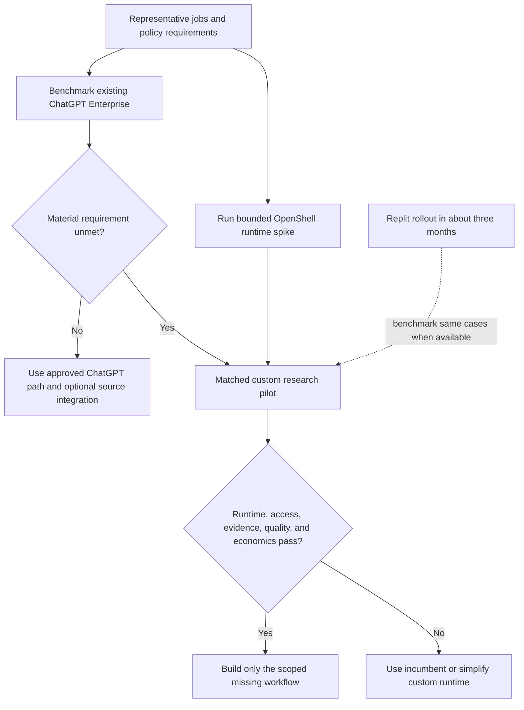
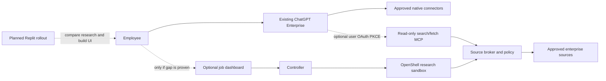
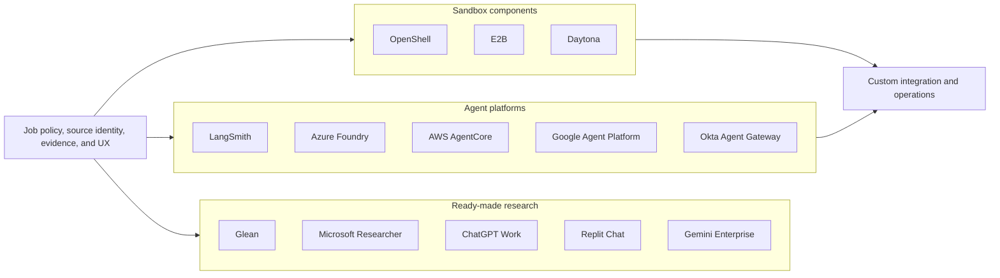
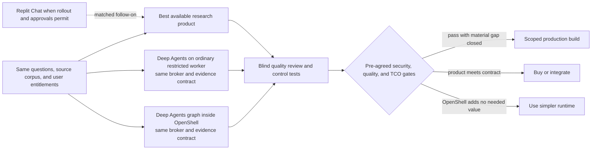

# Feasibility and market assessment

**Status:** Desk assessment; no runtime or vendor pilot completed  
**Reviewed:** 2026-10-23  
**Decision context:** This is an internal platform. All employees already have ChatGPT Enterprise; enterprise connectors are being enabled after review. A Replit rollout is planned in about three months, but its contracted deployment mode is not yet known.  
**Target design:** [requirements](requirements.md) and [architecture](architecture.md)

## 1. Decision summary

The proposed service is **technically plausible**, but the repository is a design scaffold and enterprise feasibility remains conditional on live OpenShell, Kubernetes, Okta, MCP, and source-permission tests. The first-party LangChain OpenShell backend does not prove the proposed placement of the entire Deep Agents graph inside OpenShell: its documented integration keeps the graph outside and delegates filesystem and command work into a sandbox. A worker image that runs the graph inside OpenShell is a custom integration to prove. [Deep Agents sandbox patterns](https://docs.langchain.com/oss/python/deepagents/sandboxes).

The first benchmark is the organization's **existing ChatGPT Enterprise** deployment. It already offers a deep research workflow with sources, while admins can govern connected apps and MCP access; the organization's source connectors are still under review, so their availability and exact permissions must be tested rather than assumed. Replit Chat is a second employee-facing research benchmark once the planned rollout occurs. These facts raise the bar for a new dashboard. A full custom build is justified only if a **measured combination** of customer-operated runtime, job-level authorization, source-specific evidence, and cross-system workflows meets a requirement that the approved platforms cannot meet at acceptable cost. Vendor gaps in that combination are hypotheses until tested. [ChatGPT Work research](https://learn.chatgpt.com/docs/web-search), [ChatGPT Enterprise plugin controls](https://learn.chatgpt.com/docs/enterprise/apps-and-connectors), [Replit research example](https://docs.replit.com/use-cases/prepare-for-a-customer-call).

Retain the four candidate design controls: a server-held job policy, a credential and connector broker, separate public and private research lanes, and durable claim-to-source evidence. Build only the controls that the comparison proves necessary. Test full-graph OpenShell placement against a simpler runtime using the **same** broker and evidence contract; otherwise an improvement caused by the broker could be mistaken for an OpenShell benefit.

### Installed-platform strategy

| Path | Near-term role | Decision boundary |
| --- | --- | --- |
| ChatGPT Enterprise with approved native connectors | First user experience and research-quality baseline; employees already have the workspace sign-in. | Deep research feature enablement, connector approval, source ACL behavior, report export, sensitive-data policy, and actual tenant entitlement remain gates. Existing seats do not establish zero usage or integration cost. |
| ChatGPT with a custom read-only MCP | A candidate way to expose an approved source broker as `search` and `fetch` without first creating another research UI. [OpenAI MCP guide](https://developers.openai.com/api/docs/mcp). | ChatGPT must obtain a **user** OAuth authorization-code + PKCE token for this MCP resource; it does not use client credentials to connect to a custom MCP server. The Okta `resource`/audience and tenant configuration need a live test. [OpenAI plugin authentication](https://developers.openai.com/plugins/build/auth). |
| OpenShell service and optional dashboard | Candidate for requirements that need customer-operated full-graph execution, server-held job policy, replayable evidence, or custom progress/review. | An OpenShell sandbox spike may proceed in parallel, but a general employee dashboard follows a measured product gap. |
| Replit Chat and Replit-built app | At rollout, compare Chat research on the same cases and consider Replit for UI construction. [Replit research example](https://docs.replit.com/use-cases/prepare-for-a-customer-call). | Contracted feature set, connector governance, app identity, data flow, and hosting mode must be confirmed. Replit BYOC modes are currently private preview or early access. [Replit BYOC](https://docs.replit.com/teams/bring-your-own-cloud). |

The custom MCP path exposes source material to ChatGPT's research workflow; it does not place that workflow inside OpenShell. A separate ChatGPT plugin might offer job submission, status, and report tools for an OpenShell service, but those broader tool calls are a **separate tenant pilot**. OpenAI's documented deep research MCP shape is read-only `search`/`fetch`. A private MCP tunnel keeps the broker endpoint private while still carrying tool data into the ChatGPT product boundary, and the OAuth authorization server must be reachable for user sign-in. [OpenAI MCP search/fetch](https://developers.openai.com/api/docs/mcp), [OpenAI plugin authentication](https://developers.openai.com/plugins/build/auth), [Secure MCP Tunnel](https://developers.openai.com/api/docs/guides/secure-mcp-tunnels).

## 2. Market comparison

### Ready-made research products

| Product | Documented overlap | Specific question for the pilot |
| --- | --- | --- |
| [Glean Deep Research](https://docs.glean.com/user-guide/assistant/deep-research) | Background reports from company sources and web with linked citations and source permissions. Glean's [remote MCP host](https://docs.glean.com/administration/actions/connect-remote-mcp-servers-to-glean) supports per-user OAuth, PKCE, client credentials, and customer-network endpoints. | Can the **Deep Research** workflow invoke the required live MCP tools with the desired per-job resource limits and report/evidence export? MCP support elsewhere in Glean does not establish that behavior for every Deep Research run. |
| [Microsoft 365 Copilot Researcher](https://learn.microsoft.com/en-us/microsoft-365/copilot/faq-researcher) | Multi-step cited research over Microsoft Graph, connectors, and Bing. [Federated connectors](https://learn.microsoft.com/en-us/microsoft-365/copilot/connectors/overview) fetch live through MCP and OAuth. | Does the existing Microsoft estate cover the selected Slack, GitHub, and log questions with acceptable source scoping? Microsoft's documented web control for Researcher is a tenant-wide toggle rather than a per-site allowlist. |
| [ChatGPT Enterprise / Work deep research](https://learn.chatgpt.com/docs/web-search) | Already available to every employee in this organization. Multi-source reports use files and connected app context. A custom read-only MCP [search/fetch](https://developers.openai.com/api/docs/mcp) and a [private MCP tunnel](https://developers.openai.com/api/docs/guides/secure-mcp-tunnels) may extend approved sources. | Which reviewed connectors and custom MCP functions are actually enabled in this tenant? Can source permissions, sensitive-data policy, and evidence export meet the workflow? Its separate [Agents API self-hosted environment](https://developers.openai.com/api/docs/guides/agents-api/environments/self-hosted) does not establish that ChatGPT deep research runs inside the customer's OpenShell sandbox. |
| [Replit Chat research](https://docs.replit.com/use-cases/prepare-for-a-customer-call) | Documented cross-tool research can use connected Salesforce, Slack, and Drive sources and show source material; [Agent MCP integration](https://docs.replit.com/build/connect-via-mcp) supports OAuth and custom HTTPS servers. | At the planned rollout, do the contracted connectors, identity controls, source permissions, result exports, and data boundary meet the selected cases? Agent/Chat connector credentials do not automatically authorize a published app or OpenShell worker. |
| [Gemini Enterprise Deep Research](https://docs.cloud.google.com/gemini/enterprise/docs/research-assistant) and [Cloud Assist investigations](https://docs.cloud.google.com/cloud-assist/investigations) | Cited enterprise/web research and GCP incident investigation already exist. Cloud Assist links observations to logs, configurations, and metrics. | Can the selected cross-system incident workflow be completed under the required access model? Cloud Assist investigations are Preview and currently access-limited. |

[Claude Research](https://support.claude.com/en/articles/11088861-use-research-on-claude) and [Perplexity Deep Research](https://www.perplexity.ai/hub/products/deep-research) are additional product benchmarks for research quality and usability. Connector availability, ACL behavior, exportability, and the exact research mode must be tested in an organization's plan and tenant; marketing-level connector support is insufficient evidence for a specific workflow.

### Agent, identity, and sandbox platforms

| Platform | Relevant capability | Fit to this design |
| --- | --- | --- |
| [LangSmith Managed Deep Agents](https://docs.langchain.com/langsmith/python/managed-deep-agents-overview) | Managed Deep Agents harness, Agent Server runs/threads/streaming, MCP connectors, and an auxiliary [LangSmith Sandbox](https://docs.langchain.com/langsmith/python/managed-deep-agents-sandboxes). [Connection management](https://docs.langchain.com/langsmith/python/managed-deep-agents-connections) covers OAuth and client credentials. | Closest framework benchmark. Managed Deep Agents is a LangSmith Cloud public beta, and its graph executes in Agent Server rather than in its auxiliary sandbox. Separately, [self-hosted LangSmith Sandboxes](https://docs.langchain.com/langsmith/enable-self-hosted-sandboxes) support GKE and OpenShift; that is not proof of a self-hosted Managed Deep Agents offering. |
| [Azure Foundry Hosted Agents](https://learn.microsoft.com/en-us/azure/foundry/agents/concepts/hosted-agents) | Custom Python/C# agent code, including LangGraph, runs in per-session VM-isolated sandboxes with managed identity, background work, persistence, and VNet access. [Hosted Agents GA migration](https://learn.microsoft.com/en-us/azure/foundry/agents/how-to/migrate-hosted-agent-preview) documents the current production path. | Strong managed **full-agent-in-sandbox** substitute if Azure hosting and Entra integration fit. It does not provide an OpenShift or GKE operated runtime. Validate third-party MCP grant and authorization behavior for each source. |
| [AWS Bedrock AgentCore](https://docs.aws.amazon.com/bedrock-agentcore/latest/devguide/what-is-bedrock-agentcore.html) | Runtime and Harness offer managed agent execution; [Gateway outbound authorization](https://docs.aws.amazon.com/bedrock-agentcore/latest/devguide/gateway-outbound-auth.html) includes MCP client credentials, authorization code, and token exchange; [Policy](https://docs.aws.amazon.com/bedrock-agentcore/latest/devguide/policy-authoring-guide.html) can check caller, action, and input values. | Strong managed identity and tool-policy benchmark. It is AWS operated, so the pilot must test whether its deployment and data boundaries satisfy the actual requirement. Do not assume job-level argument policy is absent from managed competitors. |
| [Google Agent Platform](https://docs.cloud.google.com/gemini-enterprise-agent-platform/overview) | Agent Runtime plus [Agent Identity client credentials](https://docs.cloud.google.com/iam/docs/auth-with-2lo-v2) and [delegated OAuth](https://docs.cloud.google.com/iam/docs/auth-with-3lo-v2) address managed access. The separate [Managed Agents API sandbox](https://docs.cloud.google.com/gemini-enterprise-agent-platform/build/managed-agents/sandbox-environment) places agent planning in a sandbox. | Strategic GCP benchmark. The Managed Agents API sandbox is currently Pre-GA and its published terms exclude proprietary, sensitive, confidential, commercial, and production workloads. Agent Runtime plus an auxiliary sandbox is a different boundary to evaluate. |
| [OpenAI Agents API self-hosted environments](https://developers.openai.com/api/docs/guides/agents-api/environments/self-hosted) | Customer compute runs the executor and local MCP/file operations; OpenAI runs the agent harness and session orchestration. | Reduces the novelty of a customer-owned sandbox alone, but differs from the proposed full graph inside OpenShell. Check its [data controls and residency limits](https://developers.openai.com/api/docs/guides/agents-api/overview) against the data class. |
| [Okta Agent Gateway](https://help.okta.com/OIE/en-us/content/topics/ai-agents/agent-gateway.htm) | Aggregates remote MCP tools behind an Okta-secured endpoint, checks identity/policy on tool calls, injects downstream credentials, and records activity. Its [AI agents API](https://developer.okta.com/docs/api/secures-ai) is beta and requires an Okta for AI Agents subscription. | Could this replace part of the proposed connector broker? Prove tenant entitlement, ChatGPT/OpenShell client compatibility, source grants, per-job argument constraints, evidence capture, and required retention. Tool-level control alone does not prove every job/resource rule in this design. |

[E2B](https://e2b.dev/enterprise) and [Daytona](https://www.daytona.io/docs/en/linux-sandboxes/) offer sandbox execution choices. They are infrastructure comparisons, not complete substitutes for the research, source-permission, and evidence workflow. Their exact customer-operated deployment and secret/proxy feature set require a vendor-specific review.

## 3. Feasibility of the proposed stack

| Area | Desk verdict | Required proof before enterprise data |
| --- | --- | --- |
| Full graph inside OpenShell | **Plausible custom integration.** LangChain documents `OpenShellSandbox` as a backend for filesystem/command execution while the agent graph remains outside; agent-in-sandbox is a separate pattern. [Deep Agents sandboxes](https://docs.langchain.com/oss/python/deepagents/sandboxes). | Pin a Python worker image, then demonstrate planner, tool client, verifier, and synthesis process IDs inside one job sandbox. Confirm the effective tool inventory and cancellation behavior. The [NVIDIA community recipe](https://github.com/NVIDIA/nemoclaw-community/tree/main/examples/recipes/community/deep-research-worker) is useful for lifecycle ideas but does not prove this placement. |
| OpenShift runtime | **Documented, conditional.** OpenShell v0.1.5 calls for OpenShift 4.19+, Landlock and nested seccomp probes, and a CNI that enforces both directions of `NetworkPolicy`. It does not require a privileged SCC in the documented deployment. [OpenShift guide](https://docs.nvidia.com/openshell/v0.1.5/kubernetes/openshift). | Run the exact gateway/chart/controller/worker versions on the intended node image and runtime. Prove supervisor-only paths and denied direct egress with live canaries. |
| GKE Standard runtime | **Alternative to qualify.** The proposed upstream OpenShell controller path is distinct from Google's managed Agent Sandbox add-on, which [requires gVisor](https://docs.cloud.google.com/kubernetes-engine/docs/how-to/how-install-agent-sandbox). | Repeat the kernel, seccomp, CNI, Pod, and PVC tests on the actual node pool. Begin with a fixed worker pool and bounded queue; decide on node autoscaling from measured unschedulable Pods, queue wait, and cost. [GKE cluster autoscaler](https://docs.cloud.google.com/kubernetes-engine/docs/concepts/cluster-autoscaler). |
| Okta and OpenShell gateway | **Supported in parts.** The dashboard implements its own Okta PKCE session. OpenShell SDK automation supports gateway OAuth client credentials; the controller needs a token from an appropriate Okta custom authorization server with the gateway audience, scopes, and role. Operator CLI PKCE needs a separate callback test. [Gateway authentication](https://docs.nvidia.com/openshell/v0.1.5/how-it-works/gateways/authentication), [Okta authorization servers](https://developer.okta.com/docs/concepts/auth-servers/). | Verify real controller token acquisition, refresh, role/workspace denial, and operator callback behavior. Keep dashboard, gateway, and source tokens separate. |
| ChatGPT custom MCP and Okta | **Conditional integration.** ChatGPT connects to an OAuth-protected custom MCP with a user's authorization code + S256 PKCE, protected-resource metadata, and a resource-bound access token. ChatGPT does **not** use machine-to-machine grants such as client credentials for this connection. Broker-to-source client credentials remains a separate server-side option. [OpenAI plugin authentication](https://developers.openai.com/plugins/build/auth). | Prove the exact ChatGPT redirect/client registration, Okta metadata and `resource` handling, token `aud`, scope and subject, negative audience tests, workspace approval, and read-only `search`/`fetch` calls. Do not infer Okta custom-AS resource-indicator behavior from its ordinary fixed audience setting. |
| OAuth-secured MCP and source identity | **Connector-specific.** OpenShell can hold/refresh some provider credentials and has SPIFFE assertion based dynamic grants, but it is not a universal downstream OAuth host. MCP audience/resource binding applies to the MCP server, and app-only client credentials do not preserve a user's Slack or GitHub permissions. [OpenShell provider profiles](https://docs.nvidia.com/openshell/v0.1.5/how-it-works/providers/profiles), [MCP authorization](https://modelcontextprotocol.io/specification/2026-07-28/basic/authorization), [Slack MCP](https://docs.slack.dev/ai/slack-mcp-server/), [GitHub App identity](https://docs.github.com/en/apps/creating-github-apps/authenticating-with-a-github-app/authenticating-as-a-github-app-installation). | For each server, prove registration, transport, token grant, `resource`/audience, refresh/revocation, available read tools, and exact source permissions. Broker arguments must be checked on every call because OpenShell MCP policy filters tool names, not resource IDs in arguments. [OpenShell network rules](https://docs.nvidia.com/openshell/v0.1.5/how-it-works/policies/network-rules). |
| Tenant and job isolation | **Application and live-gateway gate.** OpenShell documents workspace-scoped resources, while its Kubernetes access-control guide cautions that OIDC subjects do not individually own provider/sandbox records. A Workspace User may use providers throughout its workspace. [Workspaces](https://docs.nvidia.com/openshell/v0.1.5/how-it-works/workspaces), [access control](https://docs.nvidia.com/openshell/kubernetes/access-control). | Use two tenant gateway principals to test cross-workspace list, use, and attach denial. Use two dashboard users in one workspace to test cross-job API and broker denial. Keep researchers off the gateway; give mutually untrusted direct gateway users separate workspaces or gateways. |
| GCP Logs connector | **Read-only API wrapper is the safer first path.** Google's hosted [Cloud Logging MCP setup](https://docs.cloud.google.com/logging/docs/use-logging-mcp) currently lists `roles/logging.admin` and admin/write OAuth scopes; it says custom roles may be possible. | Prove the hosted MCP tool under a narrow custom role before using it for real data. Otherwise use the Cloud Logging API through a broker identity limited to approved log views and read methods. [Logging access control](https://docs.cloud.google.com/logging/docs/access-control). |
| Evidence and model route | **Buildable application behavior, not an OpenShell default.** The broker must capture a source snapshot before issuing a citable evidence ID. The approved model endpoint receives the private excerpts sent for inference, so its data-processing boundary is part of this design. [Research and evidence design](design/research-and-evidence.md), [OpenShell inference guidance](https://docs.nvidia.com/openshell/security/best-practices). | Demonstrate report-to-snapshot replay after sandbox deletion, reauthorization on reads, retention, unsupported-claim rejection, model-route policy, and safe trace/log handling. |
| Replit as research or app platform | **Relevant but not a proven OpenShell runtime.** Replit Chat researches connected enterprise sources, while published app hosting, BYOC, and Image Exports have separate deployment and identity contracts. Full BYOC is private preview; the other two customer-cloud paths are early access. [Replit research workflow](https://docs.replit.com/use-cases/prepare-for-a-customer-call), [Replit BYOC](https://docs.replit.com/teams/bring-your-own-cloud). | At rollout, verify contracted feature access, organization SSO versus published-app Okta SSO, private networking, secrets handling, model data flow, and whether a Replit-built UI can be exported and operated on the qualified GKE/OpenShift platform. |

The local CLI version recorded by this repository on the review date is **0.0.44**; the design targets documented **v0.1.5**. Upgrade and pin the CLI, gateway, chart, supervisor, and worker together before treating a local demonstration as evidence for enterprise feasibility. [OpenShell support matrix](https://docs.nvidia.com/openshell/v0.1.5/about/support-matrix).

### Why the sandbox decision needs an A/B test

The first release uses reviewed read tools and does not expose arbitrary shell execution to the agent. That lowers one source of runtime risk. OpenShell can still contain a compromised worker process and restrict its network path, but it adds gateway, supervisor, CNI, lifecycle, and debugging work. This is an architectural inference from the [current read-only tool design](design/research-and-evidence.md) and [Deep Agents sandbox patterns](https://docs.langchain.com/oss/python/deepagents/sandboxes). Measure that security and operating benefit against a conventional restricted Kubernetes worker with the **same** broker and evidence store. A model endpoint and any broker-approved destination remain deliberate paths out of either runtime.

## 4. What would make this worth building

The market evidence supports four testable hypotheses. None is an assertion that a named vendor lacks the feature.

1. **Operating boundary:** The full agent graph and transient job data must run on organization-operated OpenShift or GKE, with a runtime and egress policy the security team can inspect. Azure and AWS offer strong managed sandboxes; LangSmith and OpenAI offer other customer-compute paths, so the exact placement and operations contract matters more than the word “sandbox.”
2. **Source authorization:** A job's approved channel, repository, log view, time range, acting identity, and tool arguments must be enforced on every call, including when the source server advertises broader tools. A broker is valuable only if the organization actually needs these restrictions and a vendor pilot cannot express them adequately. AWS AgentCore Policy already documents input-value constraints. [AWS Policy](https://docs.aws.amazon.com/bedrock-agentcore/latest/devguide/policy-authoring-guide.html).
3. **Reviewable evidence:** A report needs retained, hashed source snapshots and claim-level evidence IDs, with classification, retention, and access rechecks. A linked citation in a vendor report may satisfy many use cases; measure whether immutable replay is a genuine audit or incident requirement.
4. **Cross-system investigation:** A narrow workflow such as “what code change, Slack decision, and log evidence explain this incident?” may create useful specialization. Glean already searches connected company systems; Google Cloud Assist already investigates logs and configuration. Measure the end-to-end task, including permission and evidence quality, rather than counting connectors. [Glean Deep Research](https://docs.glean.com/user-guide/assistant/deep-research), [Cloud Assist investigations](https://docs.cloud.google.com/cloud-assist/investigations).

Because this is an **internal platform**, the relevant decision is incremental organizational value over ChatGPT Enterprise, followed by Replit when its rollout provides access. A separate dashboard may still be valuable for durable job submission, progress, approvals, and replayable evidence, but should follow a demonstrated gap in the incumbent user experience and governance. This is an inference from the documented overlap and the organization's stated installed products, not a claim about vendor pricing.

## 5. Matched pilot and decision gates

Run a time-boxed **6–8 week** technical and internal-user pilot before building the full platform. In weeks 1–2, benchmark ChatGPT Enterprise on approved public/synthetic cases and any connectors already cleared for use, while independently proving OpenShell full-graph placement and basic egress denial with a public/synthetic worker on a GCP VM or disposable staging cluster. If a custom path remains justified, run the mandatory OpenShift 4.19+ runtime and ingress/egress canaries **before** any enterprise-source data enters a sandbox. Follow with a shared synthetic source fixture, one approved read-only connector, evidence replay, and representative enterprise jobs as source approvals allow. A connector still in review is a **deferred case**, not a product failure. Qualify GKE Standard only if portability or operating economics justify the second cluster. At the planned Replit rollout in about three months, rerun the same relevant cases under its actual entitlement and data policy. The schedule is an estimate, not a vendor commitment.

Use **20–30 human-reviewed cases** spanning: public research with contradictory sources; a Slack/GitHub decision timeline; a GCP Logs plus GitHub deployment incident; permission-denied and revocation cases; prompt-injection content; and one incomplete-source case where abstention is correct. Include at least three real employee workflows after synthetic isolation tests pass. Give all arms equivalent accessible source content where possible and record when a product cannot represent a required permission or source. Do not upload private fixtures to any product before its data-use approval. The proposed case count provides a useful first signal, not statistical proof of all task classes.

| Gate | Measurement | Decision rule |
| --- | --- | --- |
| Runtime | Exact OpenShell and cluster versions; Landlock/seccomp startup; CNI ingress/egress canaries; worker graph process location; sandbox create/cancel/delete. | Any mandatory runtime or network control failure blocks enterprise data. |
| Authorization | Cross-tenant and cross-job list/use/attach attempts; out-of-scope tool arguments; revoked grants; secret canaries in worker files, environment, traces, and output. | No observed unauthorized read, credential exposure, or unapproved destination. A clean pilot is necessary, not a proof that all attacks are impossible. |
| Research quality | Blind human scoring for factual accuracy, answer completeness, supported-citation precision, contradiction handling, and justified abstention. Review a sample of each arm's source snapshots or citations. | Agree thresholds **before** running the benchmark; require the custom path to match or beat the best deployable comparator on the organization's priority tasks. |
| Reliability and speed | Time to first evidence, completed-job latency, sandbox cold start, failure/retry behavior, queue age, and cancellation delay at target concurrency. | Meet the organization's documented SLO and user tolerance, including long-tail jobs. |
| Adoption and governance | Employee access, admin approval time, source-connector review, support burden, needed result-sharing controls, and duplicate interface cost. | A new dashboard has a specific, documented user or governance benefit over the installed product. |
| Unit economics | Existing ChatGPT contract and usage limits, Replit entitlement when available, connector review, engineering and operations time, model tokens, worker/supervisor/PVC time, source API calls, evidence storage and retention, telemetry. | Approve a total-cost case at the target volume. Already licensed does not mean every research run or integration is free. |

**Go:** the target cluster and source grants pass, a real requirement remains unmet by the approved incumbent, and the OpenShell arm meets pre-agreed quality, security, and total-cost criteria. **Simplify:** the broker and evidence layer help but OpenShell adds no required marginal control over a restricted worker. **Use or extend the incumbent:** ChatGPT Enterprise, and later Replit where appropriate, meets the contract at acceptable quality and cost. **Stop or redesign:** a required source needs broad administrative access, tenant isolation fails, or the approved model/data destination cannot meet the organization's policy.

## 6. Immediate design changes

1. Make ChatGPT Enterprise Deep Research the first employee and quality baseline. Evaluate approved native connectors first; test a read-only broker MCP only when it fills a source gap. Keep the external dashboard/BFF as a **candidate** if job control or evidence requirements cannot be met through the incumbent. [ChatGPT plugin controls](https://learn.chatgpt.com/docs/enterprise/apps-and-connectors), [OpenAI MCP search/fetch](https://developers.openai.com/api/docs/mcp).
2. Retain the server-held job policy, broker, public/private lanes, and evidence contracts as the candidate controls to validate. Promote [RES-09](requirements.md) quality evaluation to the first release gate and compare the same cases across product and runtime arms. A citation-shaped report alone does not establish research quality.
3. Treat OpenShell workspace isolation, same-workspace provider visibility, and SPIFFE/job binding as live conformance tests. The issuer of a job credential must bind the exact attested sandbox identity to the controller's job and tenant record, not just accept a shared trust domain. [OpenShell access control](https://docs.nvidia.com/openshell/kubernetes/access-control).
4. Start the custom enterprise connector pilot with a GitHub App read path or a narrow Cloud Logging API wrapper. Add hosted MCP paths only after their grant, scope, audience, and least-privilege tests pass. [GitHub App installation auth](https://docs.github.com/en/apps/creating-github-apps/authenticating-with-a-github-app/authenticating-as-a-github-app-installation), [Cloud Logging MCP](https://docs.cloud.google.com/logging/docs/use-logging-mcp).
5. Ask the Okta team whether its beta Agent Gateway is included in the organization's entitlement and can enforce the required job/source policy; compare it with the custom broker on the same calls. Do not assume it solves argument-level policy or evidence capture. [Okta Agent Gateway](https://help.okta.com/OIE/en-us/content/topics/ai-agents/agent-gateway.htm), [Okta beta entitlement](https://developer.okta.com/docs/api/secures-ai).
6. Keep a fixed, qualified worker pool and a bounded queue for the pilot. Enable GKE or OpenShift node autoscaling after measuring queue and unschedulable-Pod behavior; the research workload does not require autoscaling by definition. [GKE cluster autoscaler](https://docs.cloud.google.com/kubernetes-engine/docs/concepts/cluster-autoscaler).
7. At Replit rollout, benchmark its Chat research and qualify its actual app export/hosting mode. Do not treat Replit Agent MCP access or Replit workspace SSO as automatic authorization for a published app or an OpenShell job. [Replit research example](https://docs.replit.com/use-cases/prepare-for-a-customer-call), [Replit app SSO](https://docs.replit.com/features/auth-and-identity/single-sign-on).

The [ChatGPT Enterprise integration option](design/chatgpt-enterprise-integration.md), [Replit rollout fit](design/replit-rollout-fit.md), [deployment topology](design/deployment-topology.md), and [Okta handoff](okta/requirements-and-design.md) are the next design references. Revisit this assessment after a tenant trial and the first live OpenShell qualification.
