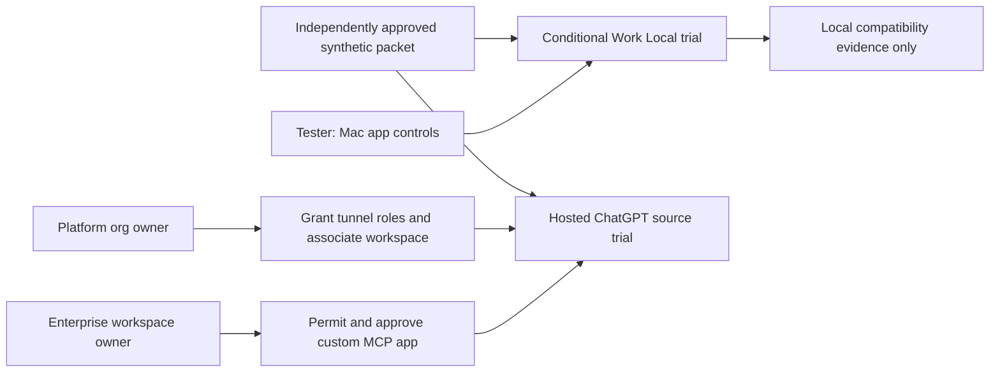

# ChatGPT Enterprise synthetic MCP benchmark: owner handoff

**Status:** request for configuration and evidence; no app, connector, tunnel, or candidate run is approved or live. **Data:** invented public/synthetic evaluation material only, after exact-byte product/security approval. **Requirement IDs:** SEL-01, SEL-02, SEL-05, RES-09. **Tracked impact:** [CR-0018](../change-requests/CR-0018-chatgpt-synthetic-mcp-baseline.md) / [ToDo](../todos/CR-0018-chatgpt-synthetic-mcp-baseline.md), [DR-FEAS-003](../feasibility-and-market-assessment.md#chatgpt-baseline-connectivity-impact). The [tester runbook](../../eval/mcp_fixture/README.md#authorized-tunnel-and-tenant-handoff) owns commands and evidence capture.

The [independent handoff review](../evidence/CR-0018-admin-handoff-independent-review-2026-10-26.md) found no remaining scoped wording blocker after the creator/tester and tunnel-role corrections. It did not perform a tenant call or grant any permission.

## Boundary and requested outcome

The tester administers the ChatGPT app on their Mac, **not** the Enterprise workspace or OpenAI Platform organization. Local desktop MCP settings configure a local Codex host. They do not install a hosted ChatGPT plugin, grant an Enterprise role, or create a Secure MCP Tunnel. A local Work test is possible only if this account has Work Local, the effective enterprise/device MCP policy permits this specific server, and an actual Work-mode tool call is observed. A Codex-only tool call is recorded separately. [OpenAI desktop MCP](https://learn.chatgpt.com/docs/extend/mcp), [Work Local availability](https://learn.chatgpt.com/docs/use-chatgpt).

The requested hosted benchmark is a **read-only custom MCP app** exposing the approved one-case synthetic `search`/`fetch` fixture to the tester's Enterprise workspace. A private fixture needs a reachable endpoint; Secure MCP Tunnel is the proposed outbound-only transport. Workspace custom-app permission, Platform tunnel roles, and tunnel association are distinct controls. [Custom MCP access](https://developers.openai.com/api/docs/guides/custom-mcp-server), [tunnel roles and association](https://developers.openai.com/api/docs/guides/secure-mcp-tunnels).

## Actions for each owner

| Owner | Requested action | Return only nonsecret evidence |
|---|---|---|
| Enterprise workspace owner/admin | Grant the designated app creator effective custom-MCP creation access (including developer mode if this workspace requires it), **or** have an authorized workspace admin create the reviewed app; separately permit the tester to install and use it in the target workspace. Authorize the exact synthetic fixture and confirm whether the app can be selected in the intended **Deep Research** workflow. Apply the workspace's normal app/security review. | Workspace identifier, designated creator, effective creation/developer-mode grant or admin creation, tester install/use permission, app identifier after creation, and observed Deep Research source eligibility or an explicit unavailable decision. |
| OpenAI Platform organization owner/RBAC admin | For the private transport option, grant the designated setup operator **Tunnels Read + Manage** to create/edit, the **workspace app creator Tunnels Read + Use** to select the tunnel while creating the app, and the tunnel-client runtime operator **Tunnels Read + Use** to run it if that is a different person. Associate the tunnel with the target Platform organization **and** ChatGPT workspace. An approved HTTPS MCP endpoint is an alternative that needs its own ingress review. | Platform organization identifier, tunnel ID, target-workspace association, role grants, and a secret-manager **reference** for the tunnel runtime API key. Never send the key value. |
| Product/security approvers | Approve the exact synthetic corpus/source/rubric bytes, data-use destination, case question, and allowed source projection in a versioned manifest; register its SHA-256 independently of the local packet generator. Approve any ChatGPT Work Local use separately if that is the intended destination. | Approved manifest identifier and independently held SHA-256, permitted data-use mode, source/citation-link decision, and owner names. |
| Build/security owner | Qualify the exact tunnel-client artifact before it handles a runtime key. The [inspected v0.0.18 client has an unresolved high finding](../evidence/CR-0018-tunnel-client-vulnerability-preflight-2026-10-26.md). | Patched digest and current scan evidence, or a scoped security-owner disposition under the build policy. |
| Tester | After the gates above, use a fresh conversation per approved case and retain selected source settings, raw allowed/denied tool calls, returned evidence IDs, citations, and run ID. For the optional Mac trial, record app version, selected workspace, Work Local entitlement, effective MCP policy, and whether the call came from Work or Codex. | An observed transcript for one allowed `search`/`fetch` and one forbidden `fetch`, plus actual Deep Research source selection for any hosted score. |

## Acceptance and fallback

The hosted path is ready to **attempt** a matched MCP case only after the exact synthetic packet is approved, the app and route are authorized, the qualified tunnel or endpoint is reachable, and the tester actually sees and selects the app in the intended Deep Research workflow. A tunnel connection or desktop setting alone does not establish Deep Research compatibility, user OAuth, source ACLs, or citation parity. The no-auth synthetic fixture measures protocol and research behavior only.

If hosted access is unavailable, retain the Mac trial as a separate local compatibility observation when its conditions pass. Approved per-case file upload or approved native connectors may support a **quality-only** ChatGPT comparison; MCP, permission, and linked-citation cases remain deferred where their actual path is unobserved. Do not mark an unavailable connector as a ChatGPT failure. No draft packet is sent to a model.

To disable a trial, stop the fixture and tunnel client, revoke the tunnel runtime key, remove the local MCP entry, and disable or delete the draft custom app. The OpenShell gateway and worker/model credentials are never MCP targets or inputs for this benchmark.
