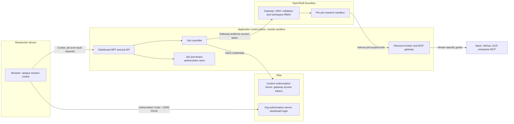
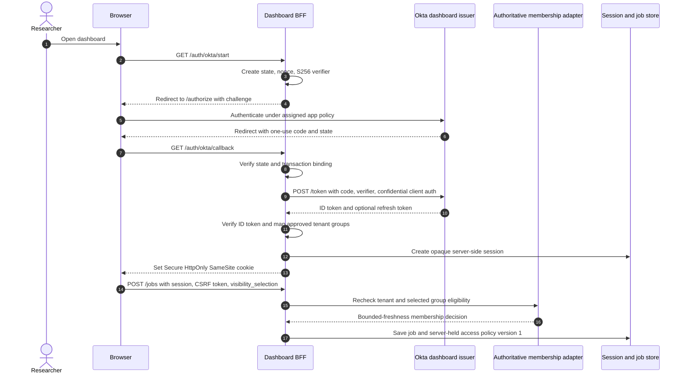
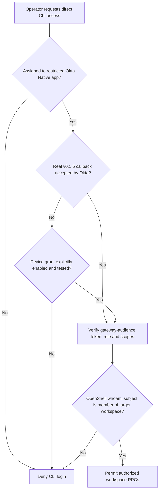
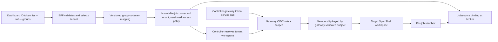
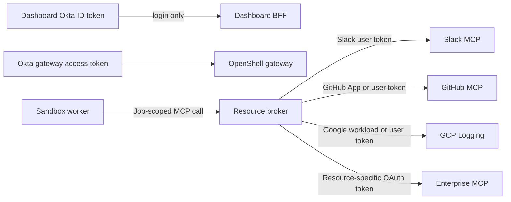
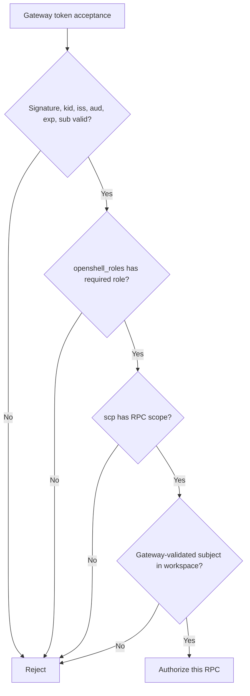
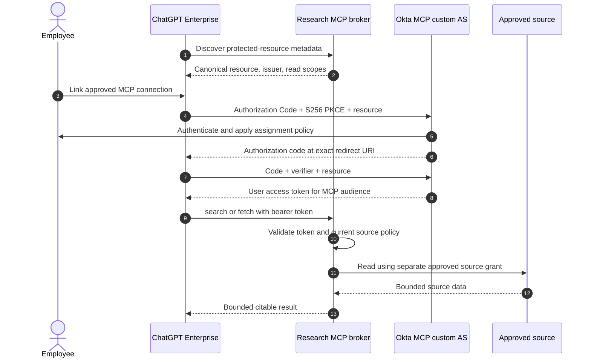

# Okta requirements and design handoff

**Project:** Candidate Deep Research dashboard with workers inside NVIDIA OpenShell; optional ChatGPT custom MCP path  
**Audience:** Enterprise Okta, identity security, and platform teams  
**Status:** Implementation contract and acceptance plan; no Okta tenant has been configured by this repository  
**Product baseline:** NVIDIA OpenShell v0.1.5, reviewed 2026-10-23  
**Notation:** `{like-this}` values and `example.com` domains are placeholders. Configuration examples are target state, not tenant exports or deployed settings.

All employees already have ChatGPT Enterprise, and its connectors are moving through review. The dashboard and OpenShell objects marked **Required** below are required **if the custom service is selected after the platform evaluation**, not a request to provision them immediately. The optional ChatGPT custom MCP path has a separate user OAuth design in [Section 9](#9-conditional-chatgpt-enterprise-mcp-handoff) and may be evaluated independently. Replit's planned rollout has no automatic authority over these Okta clients or research-source grants.

## 1. Decision and trust boundaries

Researchers sign in to a dashboard that runs **outside** OpenShell. The dashboard backend for frontend (BFF) is a confidential Okta OIDC **Web Application**. It uses Authorization Code with S256 PKCE, exchanges the code on the server, and gives the browser an opaque application session cookie. A controller service, also outside the sandbox, uses a separate Okta **API Services** client and client credentials to call the OpenShell gateway. Only approved operators may use a separate public Okta **Native Application** with the OpenShell CLI; that path is conditional on a real localhost redirect test. Research workers do not receive Okta browser sessions, controller secrets, or vendor OAuth tokens. [Okta web application and PKCE](https://developer.okta.com/docs/guides/set-up-oauth-api/main/), [Okta client credentials](https://developer.okta.com/docs/guides/implement-grant-type/clientcreds/main/), [OpenShell gateway authentication](https://docs.nvidia.com/openshell/v0.1.5/how-it-works/gateways/authentication).



The dashboard's Okta ID token proves a human login to its **own client ID**. The gateway accepts an access token issued for its **own resource audience**. The broker validates a separate workload token, and each source validates its own token. No token crosses an audience boundary by default. Okta's org authorization server is suitable for OIDC sign-in, but its access tokens are for Okta and cannot be configured as this gateway's API tokens. The gateway needs an Okta **custom authorization server**, which requires the API Access Management entitlement in a production Okta org. [Okta authorization servers](https://developer.okta.com/docs/concepts/auth-servers/).

Sandbox-to-broker arrows in this document show **logical requests through the OpenShell supervisor and its inspected egress policy**. They do not imply unrestricted direct Pod egress. [OpenShell network rules](https://docs.nvidia.com/openshell/v0.1.5/how-it-works/policies/network-rules).

### Integration inventory

| Integration | Okta app type and grant | Issuer | Token use and holder | Release gate |
|---|---|---|---|---|
| Dashboard BFF | Confidential **Web Application**; Authorization Code + S256 PKCE; optional Refresh Token | Org authorization server by default, `https://{oktaDomain}` | BFF validates ID token, creates its own session; browser holds only session cookie | Required |
| OpenShell operator CLI | Separate public **Native Application**; Authorization Code + S256 PKCE; device grant only if tested and enabled | Gateway custom authorization server | CLI stores a gateway-audience token locally; never used for ordinary researcher jobs | Conditional |
| Job controller | **API Services** confidential client; Client Credentials | Gateway custom authorization server | Controller SDK holds short-lived gateway token in memory; secret in enterprise secret manager | Required |
| Membership lookup, if the BFF queries Okta directly | Separate **API Services** client; Client Credentials with `private_key_jwt` | Okta org authorization server | BFF-side directory adapter reads only approved group membership; the key stays in enterprise key management | Conditional on chosen freshness mechanism |
| Gateway resource | Custom authorization server with audience `api://openshell-gateway` | `https://{oktaDomain}/oauth2/{gatewayAsId}` | Gateway validates the access token JWT and its role/scope claims | Required |
| Optional ChatGPT-to-broker MCP | Separate OIDC client registration; user Authorization Code + S256 PKCE; exact client type/authentication method to be proven | Separate MCP-resource custom authorization server if Okta passes the `resource`/audience conformance test | ChatGPT holds a **user** MCP-resource token; the broker validates it on every call. ChatGPT does not use client credentials for this connection. [OpenAI plugin authentication](https://developers.openai.com/plugins/build/auth). | Conditional before custom MCP is enabled |
| Optional Slack EMA | Separate future IdP token-exchange configuration if tenant and Slack support it | To be determined by Okta and Slack teams | Broker alone performs exchange to Slack user MCP token | Future spike |

The BFF uses the org authorization server only if its ID token or `/userinfo` provides the approved group claims needed for dashboard authorization. If enterprise policy requires a custom authorization server for the BFF, create a **separate** dashboard authorization server and audience; do not reuse the gateway audience. Okta gives each custom authorization server a distinct issuer and signing keys. [Okta authorization servers](https://developer.okta.com/docs/concepts/auth-servers/), [Okta groups claim](https://developer.okta.com/docs/guides/customize-tokens-groups-claim/).

## 2. Required Okta objects and claims

### 2.1 Dashboard Web Application

Create one OIDC **Web Application** per environment, named for example `Deep Research Dashboard - prod`. Use a confidential client authentication method supported by the BFF library, initially `client_secret_basic`, with the secret held only server-side. Enable `authorization_code` and S256 PKCE. Enable `refresh_token` only if the BFF actually needs a renewable Okta session; long-running jobs do not need a browser refresh token. Register only the exact HTTPS callback and logout URLs for that environment:

```text
Issuer:               https://{oktaDomain}
Client ID:            {dashboardWebClientId}
Client auth:          client_secret_basic
Sign-in redirect URI: https://research.example.com/auth/okta/callback
Sign-out redirect URI: https://research.example.com/
Requested scopes:     openid profile email groups
```

The BFF must create `state`, `nonce`, and an S256 PKCE verifier/challenge per login attempt; retain the verifier and nonce in a short-lived server-side transaction; validate `state` and the ID token's signature, `iss`, `aud`, `exp`, `nonce`, and subject. The browser receives no ID, access, or refresh token. Okta requires the redirect URI to match a registered value; do not register wildcard production callbacks. [Okta PKCE flow](https://developer.okta.com/docs/guides/implement-grant-type/authcodepkce/main/), [Okta app integration](https://developer.okta.com/docs/guides/create-an-app-integration/openidconnect/main/).

Configure a limited `groups` claim in the dashboard ID token for approved dashboard, tenant, and result-sharing groups. Use stable Okta **group IDs** as authorization keys; names such as `DR-Research-Users`, `DR-Tenant-Acme`, and `DR-Tenant-Acme-Research` are display labels only. Okta documents a static allowlist with `getFilteredGroups(..., "group.id", ...)` for ID-token claims. The Okta team must prove the exact ID-valued claim in a live code-flow token and return a tenant-scoped catalog of allowed result-sharing group IDs. These groups establish app assignment and tenant membership, but a group's members may read a job only when that job's **application access policy** explicitly binds its ID. Do not include every enterprise group or infer result access from a group name or dashboard role. [Okta static group allowlist](https://developer.okta.com/docs/guides/customize-tokens-static/main/), [Okta groups claim](https://developer.okta.com/docs/guides/customize-tokens-groups-claim/).



### 2.2 Gateway custom authorization server

Create a dedicated custom authorization server, for example `Deep Research OpenShell Gateway - prod`, with exactly one configured gateway audience `api://openshell-gateway`. Its issuer is `https://{oktaDomain}/oauth2/{gatewayAsId}`. Okta assigns the audience at the authorization-server level; the OpenShell gateway must receive the same value in its `audience` setting. Define custom OpenShell scopes required by the controller, with operator scopes added if direct CLI access is approved. Assign policies only to specifically approved controller service clients and, conditionally, the CLI Native client. Do not use an `All Clients` policy. Okta evaluates policies and rules in priority order, and a no-match request fails. [Okta custom server setup](https://developer.okta.com/docs/guides/customize-authz-server/main/), [Okta API Access Management](https://developer.okta.com/docs/concepts/api-access-management/).

| Scope | Proposed baseline use | Must be absent from controller unless justified |
|---|---|---|
| `workspace:read` | Resolve assigned workspace | No |
| `sandbox:read` | Observe sandbox state and logs | No |
| `sandbox:write` | Create, run, and delete job sandboxes | No |
| `provider:read` | Only if controller must inspect approved provider attachments | Yes, until required by an integration test |
| `provider:write`, `workspace:write`, `config:write`, `openshell:all` | Provisioning or platform administration | Yes |

OpenShell scope enforcement is optional in the product but **required in this design**: configure `scopes_claim: scp`, register the custom scopes in Okta, and verify they appear as an array in live access tokens. OpenShell accepts JSON `scp` arrays and combines scopes with its role and workspace checks. The exact minimal scope set shall be confirmed against the RPCs the controller uses; do not silently replace a denied call with `openshell:all`. [OpenShell gateway authentication](https://docs.nvidia.com/openshell/v0.1.5/how-it-works/gateways/authentication), [OpenShell workspaces](https://docs.nvidia.com/openshell/v0.1.5/how-it-works/workspaces).

The gateway reads one roles claim path. Define a custom **access-token** claim `openshell_roles` containing an array such as `["openshell-operator"]`. `app.profile.openshellRoles` is a proposed Okta Expression Language source, because app profile values can be used in custom claims. For the core release, the Okta team must prove the claim through Token Preview **and a live No user client-credentials token**. A live Native CLI token is required only before direct operator access is enabled. If the expression cannot produce the array for a required grant, use an Okta-supported claim expression or token inline hook approved by the identity team; do not relax gateway role enforcement or assume a user `groups` claim appears in a client-credentials token. [Okta custom claims and app profile](https://developer.okta.com/docs/guides/customize-tokens-returned-from-okta/main/), [Okta No user policy](https://developer.okta.com/docs/guides/customize-authz-server/main/).

This is the proposed object specification for the Okta team. It is **declarative handoff syntax**, not an importable Okta API payload:

```yaml
gateway_authorization_server:
  issuer: "https://{oktaDomain}/oauth2/{gatewayAsId}"
  audience: "api://openshell-gateway"
  access_token_claim:
    name: openshell_roles
    value_type: expression
    expression: "app.profile.openshellRoles" # proposed; prove for each enabled grant
    include_in: any_scope
  custom_scopes:
    - workspace:read
    - sandbox:read
    - sandbox:write
  policies:
    - clients: ["{controllerServiceClientId}"]
      grant: client_credentials
      user: "No user"
      allowed_scopes: [workspace:read, sandbox:read, sandbox:write]
    # Add only when direct operator CLI access is approved:
    - clients: ["{cliNativeClientId}"]
      grant: authorization_code
      user: assigned_operators_only
      allowed_scopes: [openid, profile, offline_access, workspace:read, sandbox:read, sandbox:write]
app_profiles:
  controller_api_services:
    openshellRoles: ["openshell-operator"]
  # Add only when direct operator CLI access is approved:
  cli_native:
    openshellRoles: ["openshell-operator"]
```

The production Okta team owns the precise policy and expression implementation, token lifetimes, app assignment, and client authentication method. The acceptance contract is the **JWT that Okta actually issues**, not this illustrative syntax. Client-credentials requests have no user and cannot request OpenID scopes; their policy rule must select `No user`. [Okta client credentials](https://developer.okta.com/docs/guides/implement-grant-type/clientcreds/main/), [Okta access-policy rules](https://developer.okta.com/docs/guides/customize-authz-server/main/).

### 2.3 Separate operator CLI Native Application

If direct operator access is approved, register a separate **public Native Application** for the OpenShell CLI. Assign it only to a narrowly managed `DR-OpenShell-Operators` group; require the enterprise's operator sign-on and MFA policy. The gateway access token must have `aud=api://openshell-gateway`, `openshell_roles=["openshell-operator"]`, the approved `scp` array, and a stable `sub`. A regular dashboard user's group assignment gives no OpenShell access. OpenShell also requires an explicit workspace membership record for that subject. A Workspace User can create and use all sandboxes and provider attachments within that workspace, so operator membership should be granted only where that breadth is acceptable. [OpenShell gateway authentication](https://docs.nvidia.com/openshell/v0.1.5/how-it-works/gateways/authentication), [OpenShell workspaces](https://docs.nvidia.com/openshell/v0.1.5/how-it-works/workspaces).

**Hard gate before enabling browser CLI login:** OpenShell v0.1.5 binds the CLI callback to an OS-assigned ephemeral `127.0.0.1` port. Okta redirect registration must accept the exact redirect URI the CLI sends. NVIDIA's open [callback-port issue #3300](https://github.com/NVIDIA/OpenShell/issues/3300) documents the dynamic-port problem for exact-redirect providers; it does **not** prove that Okta fails. If this optional path is pursued, Okta and platform teams must run the real deployed CLI against a test Native Application, record the actual redirect URI and Okta result, and repeat after upgrading OpenShell. Do not whitelist every possible localhost port in production. If the test fails, keep browser CLI login disabled; investigate an upstream fixed-port release or separately test an Okta device authorization flow. OpenShell can use Device Authorization Grant with S256 PKCE under `OPENSHELL_NO_BROWSER=1` when the IdP enables that grant. [OpenShell gateway authentication](https://docs.nvidia.com/openshell/v0.1.5/how-it-works/gateways/authentication).



Do not register this public CLI app with a client secret. Do not put `OPENSHELL_OIDC_CLIENT_SECRET` on an operator workstation, because OpenShell then selects its client-credentials path instead of browser PKCE. CLI tokens and refresh material are stored in the operator's local OpenShell credential directory with owner-only permissions; Okta policies should permit refresh only if the actual CLI registration and security policy require it. [OpenShell gateway authentication](https://docs.nvidia.com/openshell/v0.1.5/how-it-works/gateways/authentication).

### 2.4 Controller API Services app

Create one **API Services** app per environment, and preferably one per tenant or workspace if operationally feasible. This is a confidential machine principal. Restrict each approved service client's custom-AS policy to `client_credentials`, `No user`, the gateway audience, and only `workspace:read sandbox:read sandbox:write` initially. The proposed role claim value is `["openshell-operator"]`, never `openshell-platform-admin`. The SDK must acquire a new access token before expiry; client credentials has no refresh-token grant. Keep the client secret in the controller's secret manager, never in the sandbox, dashboard browser, job payload, or source connector. A separate approved platform-admin or provisioner path must create workspaces and membership; the controller cannot bootstrap its own access. [Okta client credentials](https://developer.okta.com/docs/guides/implement-grant-type/clientcreds/main/), [OpenShell SDK client credentials](https://docs.nvidia.com/openshell/v0.1.5/how-it-works/gateways/authentication), [OpenShell workspaces](https://docs.nvidia.com/openshell/v0.1.5/how-it-works/workspaces).

```mermaid
sequenceDiagram
    autonumber
    participant Controller as Job controller
    participant Vault as Secret manager
    participant Okta as Okta gateway custom AS
    participant Gateway as OpenShell gateway
    participant Workspace as Workspace membership store
    Controller->>Vault: Read current client secret
    Vault-->>Controller: Secret in process memory
    Controller->>Okta: Client credentials; allowed sandbox scopes
    Okta->>Okta: Match client-specific No user rule
    Okta-->>Controller: Access token with gateway aud, sub, scp, openshell_roles
    Controller->>Gateway: TLS gRPC; Authorization Bearer token
    Gateway->>Gateway: Verify JWKS signature, iss, aud, exp, sub, role, scopes
    Gateway->>Workspace: Check validated service subject in target workspace
    Workspace-->>Gateway: Workspace User membership
    Gateway-->>Controller: Permit sandbox RPC
    Note over Controller,Gateway: Refresh by repeating client-credentials grant before expiry
```

The Okta team must provide a **sanitized real access-token claim sample** for the No user grant. The platform team must use `openshell whoami --output json` or an equivalent authenticated gateway request to capture the gateway-validated `subject`, then add exactly that subject as a `user` member of the approved workspace. Do not derive workspace membership from email, app display name, or a guessed client ID. OpenShell's OIDC role and workspace membership are separate checks; a Platform Admin role bypasses membership, so it is excluded from the controller. [OpenShell workspaces](https://docs.nvidia.com/openshell/v0.1.5/how-it-works/workspaces).

## 3. Token and authorization contract

| Credential | Expected issuer / audience | Required claims or state | Authorized use |
|---|---|---|---|
| Dashboard ID token | Dashboard issuer / `{dashboardWebClientId}` | Valid `iss`, `aud`, `exp`, `nonce`, immutable `sub`, approved tenant group claim | Establish BFF login only |
| BFF session | Application session store / dashboard origin | Opaque random ID, canonical `(iss, sub)`, selected tenant, expiry, CSRF binding | Submit jobs and request results subject to a fresh per-read authorization check |
| Optional CLI gateway access token | Gateway custom issuer / `api://openshell-gateway` | `iss`, `aud`, `exp`, `sub`, `scp`, `openshell_roles` | Approved operator gateway RPCs and workspaces, only after the CLI gate passes |
| Controller gateway access token | Same gateway custom issuer / same gateway audience | Same claims; `sub` is service identity; no user context | Sandbox lifecycle in assigned workspace |
| Broker workload token | Internal issuer / broker audience | Sandbox and job binding | Approved broker MCP calls |
| Optional ChatGPT MCP user access token | Separate MCP custom issuer / exact canonical MCP resource URI | Verified user `sub`, expiry, allowed `scp`, resource-bound `aud`; distinct from dashboard and gateway tokens | Read-only broker MCP calls made through the approved ChatGPT connection |
| Vendor or remote MCP token | Vendor issuer / that resource's audience | Vendor scopes, consent or installation, expiry | One source integration |

Example **shape** of an accepted controller JWT payload. The Okta team must return actual sanitized values and prove the gateway accepts them:

```json
{
  "iss": "https://{oktaDomain}/oauth2/{gatewayAsId}",
  "aud": "api://openshell-gateway",
  "sub": "{actualStableServiceSubject}",
  "cid": "{controllerServiceClientId}",
  "exp": 1800000000,
  "scp": ["workspace:read", "sandbox:read", "sandbox:write"],
  "openshell_roles": ["openshell-operator"]
}
```

OpenShell v0.1.5 validates JWT signature and `kid` against JWKS, issuer, audience, expiration, and subject. It reads the configured roles and scopes paths. The gateway caches JWKS for a configured TTL, 3600 seconds by default, and refreshes on an unknown `kid`. The Okta team should announce signing-key rotation and preserve overlap long enough for already issued tokens; the platform team tests rotation under traffic. A revoked user assignment or rotated client secret does not retroactively change an already issued self-contained gateway token; use short access-token lifetime plus workspace membership removal and session invalidation for urgent access removal. [OpenShell gateway JWT validation](https://docs.nvidia.com/openshell/v0.1.5/how-it-works/gateways/authentication), [Okta API Access Management guidance](https://developer.okta.com/docs/concepts/api-access-management/).

The BFF keys human identity by the canonical `(dashboard issuer, ID-token sub)` pair. It maps a **verified, allowlisted** Okta tenant group ID to one internal `tenant_id` and then to one OpenShell workspace. Do not infer tenant from email domain or arbitrary group prefix. If a user belongs to more than one approved tenant, the BFF requires an explicit tenant choice and checks it on every job creation, private result read, and source connection. Each job stores its immutable owner `(iss, sub)`, `tenant_id`, and execution/source policy at creation. The Okta team supplies exact group IDs, current names, group-claim format, assignment owners, and a rename/removal process. The platform team owns the tenant-to-workspace table; the BFF owns result authorization. The CLI and controller workspace subjects are independently captured from the gateway; they are not automatically the dashboard subject. [OpenShell workspaces](https://docs.nvidia.com/openshell/v0.1.5/how-it-works/workspaces).

**P0 visibility is selected at job creation.** The dashboard presents `visibility_selection: {mode: submitter}` as the default and `visibility_selection: {mode: okta_group, okta_group_id: <approved ID>}` as an explicit alternative. For group visibility, the BFF accepts exactly one stable group ID from a configured, tenant-scoped allowlist; it checks that the submitter is currently eligible to publish to that group and records the chosen group's ID, not its mutable display name. The job's server-held **access policy version 1** stores `owner_subject`, `tenant_id`, and `base_visibility` separately from the immutable execution/source policy. Group visibility grants read access to the owner **and** current members of that exact selected group while they remain eligible for the selected tenant. The group choice is an application grant for this job; other same-tenant groups, reviewers, dashboard administrators, and OpenShell operators have no implicit report access.

**P0 group visibility can be revoked per job.** `POST /v1/jobs/{job_id}/access/revoke-group` requires a valid session, CSRF token, current selected-tenant eligibility, a strong `If-Match` against the access-policy version, a required 10–500-character `reason` body, and the job owner or an explicitly authorized job-specific data steward. It atomically narrows `base_visibility` from `okta_group` to `submitter`, increments the access-policy version, and audits the actor, job, old group ID, and escaped reason. The reason is restricted to the audit store and never appears in job status, SSE, or API errors. The BFF invalidates affected list cursors and closes open SSE event streams before acknowledging success; former group readers without another explicit grant are denied on the next read even with a valid session and fresh Okta group claim. The owner remains eligible through the owner route. This local application revocation does not wait for Okta group removal or its propagation SLA. Version 1 has no operation to widen visibility, switch to another group, or restore a revoked group grant; the immutable execution/source policy stays unchanged. [Group revocation request contract](../../contracts/job-group-revocation.schema.json).

**Every protected job read reauthorizes the caller.** The BFF checks the valid session, selected tenant, current tenant membership, authoritative job access-policy version, and either owner `(iss, sub)` or current membership in the job's exact selected group ID. The owner retains access to a group-visible job while still eligible for the tenant, even if removed from that selected group; a nonowner loses the group route when membership is removed under the approved propagation SLA. Apply this rule to job lists and previews, status/events, report text, citations, attachments, downloads, exports, and API retrieval. A valid session or Okta group claim alone is insufficient without the per-job policy binding. A report or evidence read also requires the viewer's current classification and source-resource entitlement; the visibility grant alone only permits discovery and sanitized status. Result authorization must use a current membership decision from a server-side Okta lookup or a bounded, event-invalidated membership cache; the login ID token is only an initial snapshot. [Research visibility design](../design/research-visibility.md).

**P1 sharing changes only the access policy.** If post-creation sharing is approved, `PUT /v1/jobs/{job_id}/access` lets a grantor with `manage_visibility` permission submit a replacement `reader_subjects` list under CSRF protection and a strong `If-Match`. Each named individual grant supplies a canonical `subject` `(iss, sub)`, an explicit subset of `list_job`, `read_status`, `read_events`, `read_report`, and `read_evidence`, and a future `expires_at` within the tenant's maximum lifetime. The BFF checks grantor sharing authority, the recipient's current tenant eligibility, allowed actions, and source/classification policy; it assigns grant IDs, grantor and creation fields server-side and records each addition, change, or removal in append-only audit. At read time, only an unexpired, unrevoked grant for the **requested action** can authorize the named reader, who still needs current tenant membership and, for private content, their own source/classification entitlement. The initial group ID cannot be replaced; its grant may only be withdrawn by the P0 revoke-group operation. Adding, restoring, or switching groups later requires a separately designed contract and gate. The execution/source policy does not change when individual reader grants change. A committed application grant revocation denies the next private read; positive result access must not survive in a session or stale authorization cache. Emergency administrator access requires a separate, explicitly approved and audited app grant. [Reader grant request contract](../../contracts/reader-grant-request.schema.json), [access update contract](../../contracts/job-access-update.schema.json).



## 4. Session, refresh, rotation, and revocation

| Material | Required handling | Owner |
|---|---|---|
| Login transaction | Single-use state, nonce, PKCE verifier; server-side store; short expiration; exact callback validation | BFF team |
| Browser session | Opaque `__Host-dr_session` cookie with `Secure`, `HttpOnly`, `SameSite=Lax`, `Path=/`, no `Domain`; CSRF token for state-changing calls; server-side idle and absolute expiry | BFF team |
| Dashboard ID/access/refresh tokens | Server-side only; no browser storage; request `offline_access` only if refresh is approved and needed | BFF and Okta teams |
| Optional CLI token bundle | If direct CLI access is enabled: local operator credential directory; refresh per OpenShell behavior; logout removes local bundle | Operator and platform teams |
| Controller client secret | Secret manager reference; overlap-based rotation with audit; no secret in repo or sandbox | Okta and platform teams |
| Controller access token | In memory; reacquire with client credentials before expiry; no refresh token | Controller team |
| Gateway signing keys | HTTPS OIDC discovery/JWKS; planned rotation and unknown-`kid` exercise | Okta and platform teams |

**Proposed session policy for review:** BFF idle expiry 30 minutes and absolute expiry 8 hours. A proposed 15-minute maximum age for an Okta group claim is an upper bound on an identity snapshot, **not** proof of current membership or an application access-policy grace period. Every protected job read checks the latest server-held access-policy version and a membership decision within the approved freshness bound. A committed application grant revocation, including per-job group revocation, denies the next read without waiting for Okta token expiry or group refresh; any result authorization cache must be synchronously invalidated or bypassed, and affected open streams must close before the revocation response succeeds.

Enterprise security must approve an **end-to-end Okta membership-removal SLA** before production, measured from effective Okta removal of a tenant or selected result-group membership to denial of the next affected job admission and protected job read, including list, status, and events. A proposed target is **no more than 15 minutes**, subject to a timed nonproduction test and a stricter enterprise requirement if one applies. The BFF must use a server-side Okta membership lookup or a membership cache periodically refreshed from an authoritative source with a TTL short enough to leave room for measured Okta propagation; a 15-minute-old login ID token by itself cannot meet this requirement. Okta's `group.user_membership.remove` event is hook-eligible, but event hooks are asynchronous and have no guaranteed maximum delivery delay, so an event can invalidate the cache early but cannot be the only refresh mechanism. If the membership decision is older than the approved bound, has been invalidated by a group-change signal, or cannot be refreshed when required, the BFF fails closed for protected reads and new jobs. The exact Okta sign-on policy, token lifetimes, cache bound, change mechanism, and measured SLA must be approved and returned in the handoff. [Okta event types](https://developer.okta.com/docs/reference/api/event-types/), [Okta event-hook delivery](https://developer.okta.com/docs/concepts/event-hooks/).

If direct Okta Management API lookup is the chosen mechanism, provision a **separate read-only service app** for the directory adapter, distinct from the dashboard login and OpenShell controller clients. Okta requires `private_key_jwt` for service apps that request Okta API scopes; grant only the read scope needed by the selected membership endpoint (typically `okta.groups.read`), assign a resource-limited read-only admin role, and define rate limits, key rotation, and outage behavior. The BFF must not use a broad SSWS API token or the gateway-audience controller token for this lookup. An approved enterprise directory feed may replace this client if it proves the same membership freshness and removal SLA. [Okta OAuth service app](https://developer.okta.com/docs/guides/implement-oauth-for-okta-serviceapp/), [Okta group-read permission](https://developer.okta.com/docs/api/openapi/okta-management/guides/permissions), [Okta Management API authentication](https://developer.okta.com/docs/api/openapi/okta-management/guides/overview).

Logout or local session invalidation denies the next request immediately and clears the browser cookie; revoke any retained Okta refresh token where one exists. Removing tenant membership must invalidate affected BFF sessions or otherwise block their protected operations within the approved SLA. Removing a controller's OpenShell workspace membership should block new workspace RPCs; active jobs must be stopped through the controller when access is revoked. These are application controls, not claims of automatic Okta-to-OpenShell session propagation.

If dashboard or CLI refresh tokens are enabled, configure rotation and reuse detection; store refresh material only in the BFF or operator credential store, respectively. Okta supports refresh-token rotation for web apps and documents reuse detection and a configurable grace period. Test concurrent refresh, lost response, reuse alert, and logout. The controller's client-credentials flow requests a new access token and must never depend on `offline_access` or a refresh token. [Okta refresh token rotation](https://developer.okta.com/docs/guides/refresh-tokens/main/), [Okta client credentials](https://developer.okta.com/docs/guides/implement-grant-type/clientcreds/main/), [OpenShell CLI refresh](https://docs.nvidia.com/openshell/v0.1.5/how-it-works/gateways/authentication).

## 5. Configuration contract handed to platform team

The platform team will substitute the **Okta-returned** values into OpenShell v0.1.5 Helm values. `openshell_roles` is a custom Okta access-token claim; the OpenShell default `realm_access.roles` is a Keycloak-style claim path and is not appropriate for this design. This exact `gatewayConfig` form is documented by NVIDIA. [OpenShell gateway configuration](https://docs.nvidia.com/openshell/v0.1.5/how-it-works/gateways/authentication).

```yaml
gatewayConfig:
  openshell.gateway.oidc:
    issuer: "https://{oktaDomain}/oauth2/{gatewayAsId}"
    audience: "api://openshell-gateway"
    roles_claim: "openshell_roles"
    admin_role: "openshell-platform-admin"
    user_role: "openshell-operator"
    scopes_claim: "scp"
```

Proposed BFF configuration names below describe the application contract. They are **not** current code environment variables. The client secret value is supplied through the enterprise secret manager, never this file:

```dotenv
OKTA_DASHBOARD_ISSUER=https://{oktaDomain}
OKTA_DASHBOARD_CLIENT_ID={dashboardWebClientId}
OKTA_DASHBOARD_CLIENT_AUTH=client_secret_basic
OKTA_DASHBOARD_CLIENT_SECRET_REF={secretManagerReference}
OKTA_DASHBOARD_REDIRECT_URI=https://research.example.com/auth/okta/callback
OKTA_DASHBOARD_SCOPES=openid profile email groups
```

If the operator CLI pilot is approved, an operator registers the OpenShell gateway using Okta's **public CLI client ID** and the gateway custom issuer and audience. This command is an example for the callback compatibility test, not proof that the login is usable with Okta:

```sh
openshell gateway add https://gateway.example.com \
  --name production \
  --oidc-issuer https://{oktaDomain}/oauth2/{gatewayAsId} \
  --oidc-client-id {cliNativeClientId} \
  --oidc-audience api://openshell-gateway
openshell gateway login production
openshell whoami --output json
```

The platform team must configure the CLI to request the custom scopes and verify the available `--oidc-scopes` option and its exact argument format with `openshell gateway add --help` from the deployed binary. If that binary cannot request the required scopes, direct CLI access remains gated. The Okta team must enable those scopes in the Native app policy. A gateway can authenticate a token yet deny the RPC if the custom `scp` array omits a required scope. [OpenShell gateway authentication](https://docs.nvidia.com/openshell/v0.1.5/how-it-works/gateways/authentication).

## 6. What Okta does not grant to research sources

The gateway audience is only for OpenShell gateway RPCs. The dashboard ID token identifies a researcher to the BFF. Neither token authorizes Slack, GitHub, Google Cloud Logging, or an OAuth-protected enterprise MCP server. The **resource broker** owns per-source OAuth registration, user consent or approved service identity, token vaulting and refresh, target-resource audience, and per-job source authorization. A client-credentials flow is suitable only where that source's authorization server explicitly supports app-only access and its permissions match the job. No Okta client secret should be placed in a sandbox worker. OpenShell's SPIFFE JWT-SVID token grant requires an issuer that accepts that assertion; direct Okta acceptance is **unproven** and is not part of this Okta handoff. [OpenShell provider token grants](https://docs.nvidia.com/openshell/v0.1.5/how-it-works/providers/profiles), [Okta client credentials](https://developer.okta.com/docs/guides/implement-grant-type/clientcreds/main/).



**Optional Slack Enterprise-managed authorization (EMA):** Slack documents exchanging a user identity credential through an ID-JAG for a short-lived **Slack user MCP token**. Okta currently documents ID-JAG and agent token exchange for its Okta for AI Agents offering, which is a separate entitlement. Okta and Slack teams should jointly assess tenant entitlement, exact subject-token client binding, Slack enterprise installation, audience `https://mcp.slack.com/`, scopes, user revocation, and audit before a broker proof of concept. The dashboard's ordinary ID token must not simply be forwarded to Slack or the sandbox. This is not a P0 dependency. [Slack EMA](https://docs.slack.dev/authentication/enterprise-managed-authorization/), [Okta AI agent token exchange](https://developer.okta.com/docs/guides/ai-agent-token-exchange/service-account/main/).

## 7. Numbered requirements and acceptance criteria

| ID | Priority | Requirement | Evidence required to accept |
|---|---|---|---|
| OKTA-01 | P0 | Provision a confidential Web app for the dashboard with exact production callback, Code + S256 PKCE, and restricted app assignment. | Real browser code-flow capture shows S256 challenge and BFF code/verifier exchange; mismatched state or verifier fails. |
| OKTA-02 | P0 | Issue an ID token with stable `sub` and an approved, limited claim of tenant and result-group **IDs**. | Sanitized real code-flow ID token contains expected `iss`, client `aud`, `nonce`, and only allowlisted group IDs; unassigned user fails login. A display-name change does not change the authorization key. |
| OKTA-03 | P0 | Configure a dedicated gateway custom authorization server and document production API Access Management entitlement. | Okta configuration evidence identifies issuer, audience, discovery URL, JWKS URL, and policy IDs; the Okta team separately confirms the production entitlement; an org-AS access token is rejected by the gateway. |
| OKTA-04 | P0 | Create custom gateway access-token `openshell_roles` claim and `scp` scopes. | A sanitized **live** service JWT contains correctly typed claims and `aud=api://openshell-gateway`; OpenShell accepts it. A live Native JWT is required before enabling direct CLI access. |
| OKTA-05 | P0 | Create client-specific access policies; service rule is `No user` and only client credentials. | Controller obtains token with no user; wrong grant/client/scope gets Okta denial; no broad `All Clients` policy grants gateway access. |
| OKTA-06 | P0 | Limit controller to non-admin role and necessary sandbox scopes. | Controller creates/deletes a sandbox in its workspace; provider/platform write and another workspace deny. |
| OKTA-07 | P1, conditional | If direct operator access is approved, provision a separate restricted public Native app before enabling the CLI. | Assigned operator obtains the intended live token after the browser-callback or approved device-grant gate; nonoperator cannot; no client secret is deployed to a workstation. |
| OKTA-08 | P1, conditional | Test the v0.1.5 ephemeral localhost callback with Okta before enabling browser CLI login; gate any fallback separately. | Record the actual authorize redirect and outcome. If incompatible, browser CLI login stays disabled; enable a device-grant or fixed-port path only after its own successful live test. |
| OKTA-09 | P0 | Preserve audience and subject boundaries. | Gateway rejects a dashboard ID token or org-server access token; sanitized token claims demonstrate distinct dashboard and gateway audiences; BFF uses `(iss,sub)` and gateway membership uses `whoami.subject`. Broker and source audience tests belong to the connector release gate. |
| OKTA-10 | P0 | Define session, token lifetime, refresh, rotation, and revocation policy, including an enterprise-approved end-to-end Okta membership-removal SLA. | Approved values and runbook; timed group-removal-to-denial test meets the SLA across list, status/events, report, and evidence; stale membership fails closed for protected reads; session invalidation, client-secret rotation, token expiry, and refresh reuse where enabled all pass. |
| OKTA-11 | P0 | Define signing-key rotation and reliable HTTPS discovery/JWKS. | Return the Okta rotation procedure and key-overlap expectations; run a staging rotation where available or a controlled-issuer gateway test for unknown `kid` refresh and invalid-key denial; schedule a joint live rehearsal before enterprise scale. |
| OKTA-12 | P0 | Return managed tenant and result-sharing group catalogs and a change process. | Stable group IDs, display names, tenant binding, which groups can be selected at job creation, app assignments, owners, claim format, and removal SLA delivered; cross-tenant and unapproved-group selection tests fail closed. |
| OKTA-13 | P1 | Investigate Slack EMA only with explicit entitlement and Slack enterprise support. | Documented compatibility result and separate broker-only proof of concept; no Okta gateway token is used as a Slack token. |
| OKTA-14 | P0, conditional | If the authoritative membership check uses Okta Management API, provision a distinct, least-privilege read-only service app with scoped OAuth and `private_key_jwt`; otherwise identify the approved directory feed. | Group add/removal lookup, read-only denial of writes, key rotation, rate-limit behavior, stale-cache failure, and measured removal-to-denial latency pass in the selected path. |
| APP-01 | P0 | At job creation require `visibility_selection` of `submitter` (default) or `okta_group` with exactly one approved, stable `okta_group_id`; persist server-held access policy version 1 separately from immutable execution/source policy. | BFF validates submitter, selected tenant, selected group allowlist and publisher eligibility; job records immutable owner and tenant plus exact `base_visibility`; unapproved, cross-tenant, or arbitrary group IDs deny. |
| APP-02 | P0 | Authorize every protected job read from the latest job access policy and current tenant/group membership: owner or member of the job's exact selected group within its tenant; private content also requires viewer-specific source/classification checks. Allow only one-way, owner/steward-authorized group revocation through `POST /v1/jobs/{job_id}/access/revoke-group` with CSRF, strong `If-Match`, and a bounded reason body. | Submitter-only job denies other users; group-visible job admits current selected-group members to sanitized status but denies unselected groups; private report/evidence denies without source entitlement. Okta group removal denies affected nonowners within the approved SLA; app-side revoke-group immediately denies their next read and closes streams before success. Tenant removal and stale membership fail closed. |
| APP-03 | P1, conditional | Add audited, versioned post-creation `reader_subjects` grants to named same-tenant users with explicit allowed actions and bounded expiry, without widening or switching the P0 group choice or changing execution/source policy. | Only explicit eligible individuals can perform the actions in their unexpired grants; wrong action or expired grant denies; revoking an app grant denies the next read with the existing session and membership snapshot. Additional or restored group grants require a separate future contract. |

### Negative conformance tests

Run the **core** cases against a nonproduction tenant and the approved OpenShell version before the dashboard/controller production release. Run CLI cases only before enabling direct operator access, and the source-audience case when the broker connector is introduced. Capture redacted request IDs, token **claims** rather than token strings, gateway decisions, and Okta System Log events where available.

| Gate | Case | Expected result |
|---|---|---|
| Core | Callback URI differs from registered dashboard URI; wrong PKCE verifier, `state`, or ID-token `nonce` | Login fails; no BFF session. |
| Core | User lacks assigned dashboard app or approved tenant group | Login or job admission fails; no default tenant. |
| Core | User changes selected tenant to one not present in verified mapping | Job creation and report read fail, including with a valid session. |
| Core | A different same-tenant user, shared-group member, reviewer, or dashboard administrator requests a `submitter`-visible job | Job list, previews, report, citations, attachments, download, export, and API retrieval deny; identity, tenant, or role alone grants no report access. |
| Core | Submitter selects an unapproved group ID, a group from another tenant, or a group to which the submitter lacks current publishing eligibility | Job creation denies; client-supplied display names, prefixes, and forged membership claims do not override the server allowlist or membership decision. |
| Core | Submitter selects approved group ID `G` at job creation | The owner and a current member of `G` in the selected tenant can list and fetch sanitized status; report and evidence still require each viewer's source/classification entitlement. A same-tenant member of another group, reviewer, administrator, or workspace operator cannot discover the job unless separately authorized by the app policy. |
| Core | Owner or authorized job-specific steward revokes selected group `G` on one job with valid CSRF, strong `If-Match`, and a 10–500-character reason | An atomic, audited access-policy revision changes `base_visibility` to `submitter`; the escaped reason appears only in restricted audit. Former group readers without separate individual grants are denied the next list, detail, event, report, and evidence read even with fresh Okta membership; affected SSE streams close before success and the owner retains access while tenant-eligible. Missing or invalid reason, missing CSRF, stale `If-Match`, unauthorized caller, group switch, re-add, or widening through this endpoint fails. Execution/source policy is unchanged. |
| Core | Nonowner member of selected result group `G` is removed from `G` while the BFF session remains valid | Access to the group-visible job denies within the enterprise-approved end-to-end SLA; record effective removal and denial times. The owner remains allowed only while current tenant membership holds. |
| Core | Okta tenant group is removed while the BFF session remains valid | New job admission and all protected reads, including list, status/events, report, and evidence through owner or selected-group routes, deny within the enterprise-approved end-to-end SLA; record removal and denial times. The affected active jobs follow the controller revocation runbook. |
| Core | Tenant/group snapshot is stale or required revalidation is unavailable | Private result read and new job admission fail closed until a fresh membership decision is available. |
| Core | User logs out or the BFF invalidates the session, then reuses the old cookie | The next protected request denies immediately, even if an Okta token or prior group claim is still valid. |
| Core | Dashboard ID token or org-server access token sent to gateway | Gateway rejects wrong audience or issuer. |
| Core | Gateway token with wrong `aud`, `iss`, invalid signature, expired `exp`, or absent `sub` | Gateway rejects before workspace operation. |
| Core | Service token missing `openshell_roles`, missing `openshell-operator`, or missing `sandbox:write` | Gateway denies sandbox create. |
| Core | Controller token contains platform-admin role or `openshell:all` | Release gate fails even if the call succeeds; fix Okta policy/claim. |
| Core | Controller subject absent from workspace or targets another tenant's workspace | Gateway denies; BFF/controller cross-tenant guard also denies. |
| Core | Client-credentials grant sent under wrong app, without a matching `No user` rule, or with an OpenID-only scope | Okta denies issuance. |
| Core | Controller client secret is rotated | Old secret cannot mint a new token after retirement; already issued tokens expire under the approved lifetime. |
| Core | Controller workspace membership is removed | New workspace RPCs deny; active jobs are handled by the controller runbook. |
| Core | Dashboard refresh token is reused, if dashboard refresh is enabled | Okta reuse detection fires and BFF invalidates the affected session. |
| Core | Signing key changes or JWKS is temporarily unavailable in a staged/controlled test | Gateway behavior and alerts match the documented cache and rotation runbook; invalid key denies. |
| Optional CLI | Native token lacks required role or scope; operator group is removed; or callback is unsupported | Missing claims deny the RPC. Group removal blocks new token issuance; existing tokens expire under policy or workspace membership is removed for urgent revocation. An unsupported callback keeps the feature disabled. |
| Optional CLI | CLI refresh token is reused, if CLI refresh is enabled | Okta reuse detection fires; operator reauthenticates and stale local credentials are cleared. |
| P1 sharing | A named individual grant with `read_status` but no `read_report` is created, expires or is revoked while the recipient's session remains valid | Status is allowed before expiry; report, evidence, and unlisted actions deny. Expiry or revocation denies the next covered read without waiting for Okta membership refresh. Missing/overlong expiry, unsupported action, duplicate subject, missing CSRF, stale `If-Match`, or unauthorized grantor denies update; each addition, change, and removal has an app access-policy version and append-only audit event. Execution/source policy and original P0 group are unchanged. |
| Connector release | Gateway token is sent to Slack, GitHub, GCP, or enterprise MCP | Broker or source rejects wrong resource audience; no implicit token passthrough. |



## 8. Responsibilities and delivery packet

| Team | Required work |
|---|---|
| **Okta team** | Create and assign the dashboard Web and controller API Services apps plus the gateway custom server; add a read-only membership lookup service app if the BFF queries Okta directly, and the Native CLI app if direct operator access is approved. Implement groups, role claim, scopes, policy rules, MFA/sign-on policy, token lifetime and key/secret rotation; execute the required token tests and any enabled CLI redirect test; return values and redacted evidence. |
| **Platform/OpenShell team** | Deploy v0.1.5 or approved later version; configure gateway OIDC/TLS and, if enabled, the operator CLI; test scope/role/workspace decisions; register validated subjects as workspace members; manage tenant workspaces, logging, and operator access. |
| **Dashboard/BFF team** | Implement server-side PKCE, ID-token validation, session/CSRF, membership freshness and fail-closed revalidation, tenant mapping, immutable job ownership, P0 submitter-or-approved-group visibility choice, a separate versioned server-held result access policy, per-read authorization, owner/steward-authorized one-way group revocation with CSRF and strong `If-Match`, immediate app grant revocation with stream closure, and logout. Keep P1 post-creation sharing disabled until its separate acceptance gate passes. |
| **Controller/broker team** | Store service secret in secret manager, renew gateway tokens, bind job/tenant to sandbox, control source OAuth separately, cancel work on revocation, and prevent token leaks. |
| **Enterprise security** | Approve access levels, tenant boundaries, allowed result-sharing group IDs and publisher eligibility, lifetimes, MFA, the measured Okta membership-removal SLA, any P1 post-creation sharing workflow, incident response, and production release evidence. |

The Okta team should return a versioned packet for **each environment**:

1. Okta domain, dashboard issuer, gateway custom-server ID/issuer, gateway audience, OIDC discovery and JWKS URLs, and proof of API Access Management entitlement.
2. Dashboard Web app client ID, confidential client authentication method, exact sign-in/sign-out URLs, requested scopes, assigned groups, ID-valued group-claim configuration, tenant-to-group catalog, approved result-sharing group IDs, and secret-manager delivery reference.
3. If direct operator CLI access is enabled: Native app client ID, assigned operator group, enabled grants, exact callback test evidence, refresh/device-grant settings, and sign-on/MFA policy.
4. Controller API Services app client ID, secret delivery and rotation procedure, gateway policy ID and priority, `No user` rule, custom scopes, and role-claim expression or hook.
5. Sanitized **real** dashboard ID token and controller No user access token claim sets, plus a CLI gateway access token claim set if direct operator access is enabled; token preview screenshots alone are insufficient.
6. Approved access-token lifetimes; refresh-token lifetime and rotation/reuse settings if enabled (otherwise an explicit disabled decision); signing-key rotation schedule, proposed 15-minute maximum group-claim age or a stricter value, authoritative membership lookup/cache mechanism and freshness bound, enterprise-approved end-to-end group-removal SLA and measured test result, System Log/event-hook routing, and incident contacts. If using Okta Management API lookup, include the separate read-only client ID, allowed scopes, resource-limited role, registered public keys, rate-limit budget, and key-rotation procedure.
7. A joint Okta/platform/app acceptance record for required `OKTA-01` through `OKTA-06`, `OKTA-09` through `OKTA-12`, `APP-01`, and `APP-02`, plus the applicable negative tests. Record `OKTA-14` for the selected membership source, `APP-03` as a separate P1 post-creation sharing gate, and `OKTA-07` and `OKTA-08` as conditional operator-access gates; a CLI compatibility failure must not weaken the gateway or block the dashboard/controller paths.

## 9. Conditional ChatGPT Enterprise MCP handoff

This section is activated **only if** the organization's ChatGPT Enterprise admins approve a custom research MCP connection. It is a separate integration from dashboard sign-in and the OpenShell gateway. For ChatGPT to call an OAuth-protected custom MCP server, ChatGPT is the OAuth client acting for a signed-in **user**. It uses Authorization Code + S256 PKCE and does **not** support machine-to-machine grants such as client credentials for that connection. Broker-to-source and controller-to-gateway client credentials are different flows and remain possible where their resources support them. [OpenAI plugin authentication](https://developers.openai.com/plugins/build/auth), [OpenAI MCP search/fetch contract](https://developers.openai.com/api/docs/mcp).

### 9.1 Proposed identity objects and discovery

| Object | Proposed configuration | Acceptance gate |
| --- | --- | --- |
| MCP resource | Read-only `search` and `fetch` at one canonical HTTPS resource URI, for example `https://research-mcp.example.com`; publish `/.well-known/oauth-protected-resource` with that exact `resource`, trusted `authorization_servers`, and supported scopes. | ChatGPT retrieves the metadata and makes an authenticated read tool call; the broker rejects a token for another audience. The URI used through any private tunnel must match the actual protected-resource contract. [OpenAI MCP authentication](https://developers.openai.com/plugins/build/auth). |
| MCP authorization server | Prefer a **separate** Okta custom authorization server with audience equal to the canonical MCP resource, distinct from `api://openshell-gateway`; publish issuer, authorization/token endpoints, S256 metadata, and compatible client authentication methods. | A live ChatGPT authorization request and token request preserve the `resource` parameter, and the resulting access token has the exact MCP audience. Okta's ordinary fixed custom-AS audience setting alone does not prove this resource-indicator behavior. [OpenAI resource requirement](https://developers.openai.com/plugins/build/auth), [Okta custom authorization servers](https://developer.okta.com/docs/concepts/auth-servers/). |
| ChatGPT OAuth client | Register a **separate** Okta OIDC client for the ChatGPT MCP connection. Start with a predefined client if supported by the tenant; use CIMD or DCR only after Okta entitlement and exact-mode testing. Configure Authorization Code + S256 PKCE, allowed read scopes, group assignment, and the **exact redirect URI shown in ChatGPT management**. | Okta and ChatGPT metadata agree on `client_id`, redirect, `token_endpoint_auth_method`, and scopes; an unassigned employee fails. Okta's [CIMD app registration](https://developer.okta.com/docs/guides/app-cimd-registration/main/) requires an org with CIMD enabled, so its availability is conditional. [OpenAI client registration and redirects](https://developers.openai.com/plugins/build/auth). |
| Broker authorization | Validate JWT signature, `iss`, `aud`, expiry, user `sub`, allowed `scp`, and current tenant/source permission on **every** MCP request. Use a verified group claim or a server-side lookup for tenant membership. | A valid token from another app, user, tenant, or source scope fails. The anonymized `_meta["openai/subject"]` hint may support rate limiting but is not source ACL identity. [OpenAI plugin reference](https://developers.openai.com/plugins/reference). |



The broker's source grant is a **second authorization decision**. It may be a delegated user token, installation credential, workload identity, or client-credentials token **only where the source explicitly supports that mode and its permission model fits the job**. ChatGPT's MCP user token shall never be forwarded to Slack, GitHub, GCP, or the OpenShell gateway. Its access token identifies the employee to the broker; the broker still checks each requested repository, channel, log view, or document. A generic `search`/`fetch` call does not inherently carry the OpenShell design's immutable per-job manifest, so exact job policy semantics must be added server-side and tested if required. [OpenAI MCP tools](https://developers.openai.com/api/docs/mcp), [OpenAI plugin authentication](https://developers.openai.com/plugins/build/auth).

If a private [Secure MCP Tunnel](https://developers.openai.com/api/docs/guides/secure-mcp-tunnels) is selected, validate organization/workspace sharing rights, tunnel operation, and reachability of the **authorization server** during browser sign-in; the tunnel transports private MCP traffic but does not automatically expose a private authorization server. The ChatGPT research process and any source excerpts supplied to it remain in the ChatGPT product data boundary. A broader `submit_job`/`status`/`report` plugin is a separate experiment; the documented Deep Research MCP integration is read-only `search`/`fetch`. [ChatGPT Work research](https://learn.chatgpt.com/docs/web-search), [OpenAI MCP guide](https://developers.openai.com/api/docs/mcp).

### 9.2 Conditional requirements and negative tests

| ID | Required result before enabling ChatGPT custom MCP for enterprise data |
| --- | --- |
| OKTA-14 | Confirm the separate MCP custom authorization server, audience/resource exact match, API Access Management entitlement, access policy, and permitted user groups. Return sanitized live user access-token claims. |
| OKTA-15 | Prove ChatGPT's actual OAuth client registration method, redirect URI, S256 challenge, authorization/token `resource` handling, and advertised metadata. If Okta cannot satisfy the MCP resource contract, use an approved compatible authorization layer or keep the custom connection disabled; do not weaken token audience checks. |
| OKTA-16 | Demonstrate denied calls for wrong `iss`/`aud`, missing or widened scopes, expired token, unassigned user, changed tenant/source permission, gateway token reuse, and a request for an unapproved resource. Verify logout/assignment removal propagation under the agreed token lifetime. |
| OKTA-17 | If corporate-workspace-only linking is required, verify the enterprise domain and the required OIDC `openid`/`email` and verified-email UserInfo behavior with the real tenant; do not assume the workspace restriction from an email address alone. [OpenAI workspace domain restrictions](https://developers.openai.com/plugins/build/auth). |

The Okta delivery packet gains, **only for this option**, the canonical MCP resource URI, Okta issuer and audience, access-policy and scope IDs, chosen ChatGPT client registration method, exact redirect URI, authentication method, group assignment, metadata URLs, a sanitized real user token claim set, and positive/negative test results. The security review records whether ChatGPT may receive the selected data class and whether a private MCP tunnel is available in the tenant. [ChatGPT Enterprise plugin controls](https://learn.chatgpt.com/docs/enterprise/apps-and-connectors).

Okta's [Agent Gateway](https://help.okta.com/OIE/en-us/content/topics/ai-agents/agent-gateway.htm) is an optional broker comparison because it aggregates MCP tools, checks identity/policy, and injects downstream credentials. Its [Okta for AI Agents API](https://developer.okta.com/docs/api/secures-ai) is beta and subscription-dependent. Evaluate ChatGPT client compatibility, per-job argument limits, evidence capture, retention, and organizational entitlement before replacing any project broker function with it.

## Primary sources

- [NVIDIA OpenShell v0.1.5 gateway authentication](https://docs.nvidia.com/openshell/v0.1.5/how-it-works/gateways/authentication), [workspaces](https://docs.nvidia.com/openshell/v0.1.5/how-it-works/workspaces), [provider profiles](https://docs.nvidia.com/openshell/v0.1.5/how-it-works/providers/profiles), and [CLI callback issue #3300](https://github.com/NVIDIA/OpenShell/issues/3300).
- [Okta authorization servers](https://developer.okta.com/docs/concepts/auth-servers/), [custom server policies](https://developer.okta.com/docs/guides/customize-authz-server/main/), [custom claims](https://developer.okta.com/docs/guides/customize-tokens-returned-from-okta/main/), and [group claims](https://developer.okta.com/docs/guides/customize-tokens-groups-claim/).
- [Okta Authorization Code + PKCE](https://developer.okta.com/docs/guides/implement-grant-type/authcodepkce/main/), [client credentials](https://developer.okta.com/docs/guides/implement-grant-type/clientcreds/main/), [refresh-token rotation](https://developer.okta.com/docs/guides/refresh-tokens/main/), and [AI agent token exchange](https://developer.okta.com/docs/guides/ai-agent-token-exchange/service-account/main/).
- [Slack Enterprise-managed authorization](https://docs.slack.dev/authentication/enterprise-managed-authorization/).
- [OpenAI MCP authentication](https://developers.openai.com/plugins/build/auth), [search/fetch integration](https://developers.openai.com/api/docs/mcp), [plugin reference](https://developers.openai.com/plugins/reference), and [Secure MCP Tunnel](https://developers.openai.com/api/docs/guides/secure-mcp-tunnels).
- [Okta CIMD app registration](https://developer.okta.com/docs/guides/app-cimd-registration/main/), [Agent Gateway](https://help.okta.com/OIE/en-us/content/topics/ai-agents/agent-gateway.htm), and [Okta for AI Agents API](https://developer.okta.com/docs/api/secures-ai).
