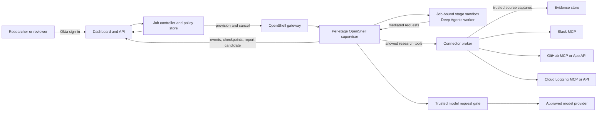
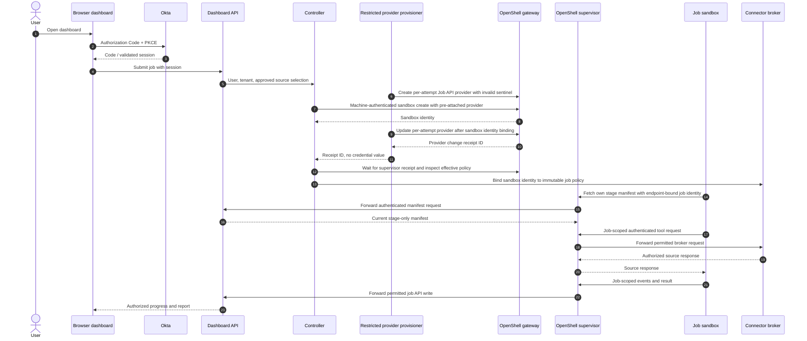
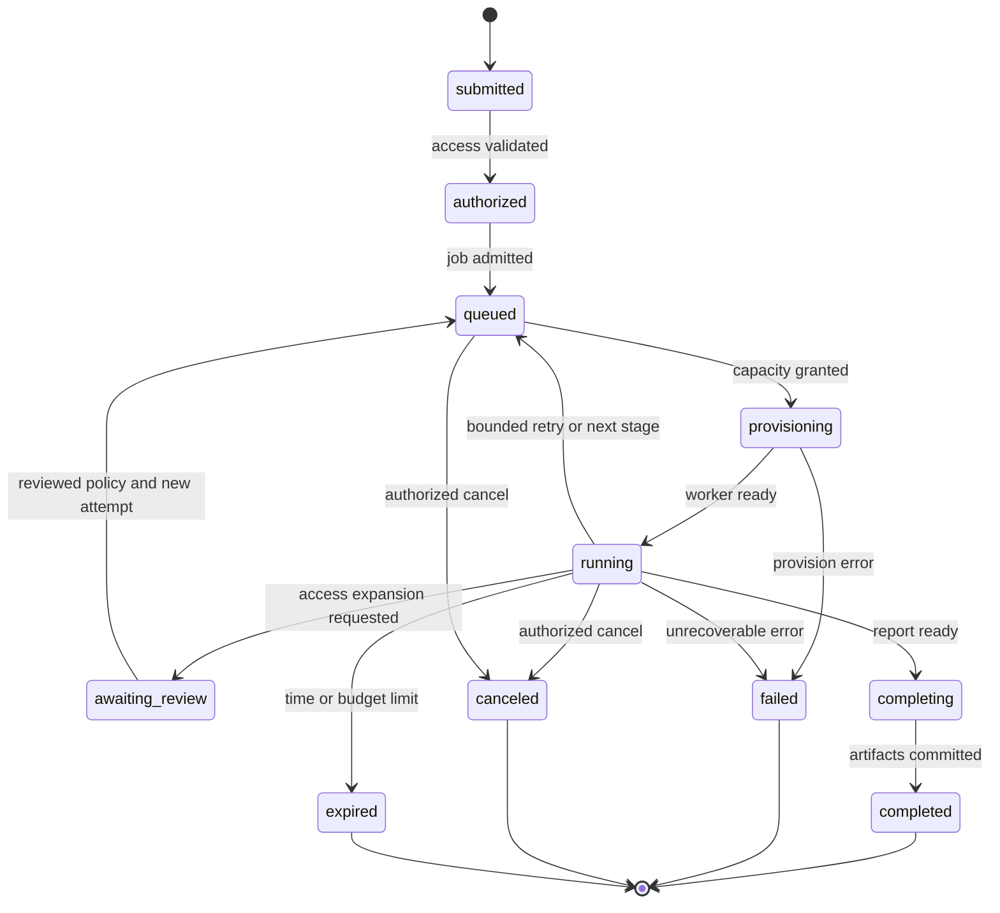
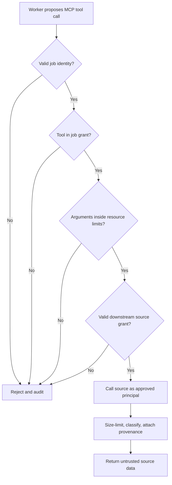
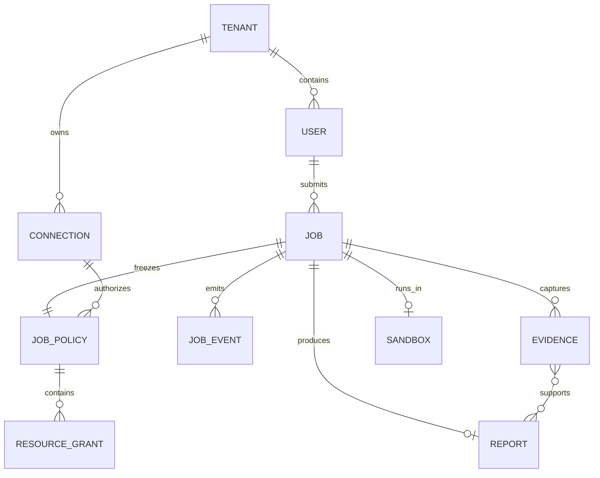
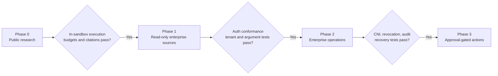

# Requirements: OpenShell Deep Research

**Status:** Proposed  
**Date:** 2026-10-23  
**Owner:** Project team  
**Scope:** Requirements for a candidate external dashboard and control plane that runs LangChain Deep Agents research jobs inside NVIDIA OpenShell, subject to an internal platform selection gate.

This document defines **target behavior if the custom path is selected**. All employees already have ChatGPT Enterprise, with connectors under review, and a Replit rollout is planned in about three months. The selection requirements below guide the build decision; SEL-03 is a follow-on comparison at Replit rollout and does not delay a scoped response to a previously proven mandatory gap. The remaining P0/P1/P2 requirements apply to the custom service. A requirement does not imply that OpenShell, LangChain, Okta, or a hosted MCP server already provides it. Platform capabilities and gaps are called out explicitly below. “Shall” denotes a behavior that must be demonstrable in an acceptance test.

## Platform selection gate

| ID | Timing | Requirement | Acceptance evidence |
| --- | --- | --- | --- |
| SEL-01 | Before full build | Benchmark the organization's ChatGPT Enterprise deep research workflow on representative approved cases; test native connectors only after their source review. | A scored 20–30 case corpus records factual accuracy, citations, permission behavior, latency, user experience, and report export. Connector cases awaiting approval are marked deferred, not failed. [ChatGPT deep research](https://learn.chatgpt.com/docs/web-search). |
| SEL-02 | Before choosing a second UI | Determine whether a read-only `search`/`fetch` MCP or approved ChatGPT plugin tools can expose the missing source or job workflow. | Record the tenant-admin availability and security decision. If selecting an MCP or plugin path, its live user OAuth authorization-code + S256 PKCE flow passes with validated `resource`, `aud`, scopes, and subject. If that path is unavailable or irrelevant, document the gap; a general job tool is not assumed available inside Deep Research. [OpenAI MCP guide](https://developers.openai.com/api/docs/mcp), [plugin authentication](https://developers.openai.com/plugins/build/auth). |
| SEL-03 | At Replit rollout | Benchmark Replit Chat on the same approved cases and confirm whether its contracted app build/export/hosting features are suitable. | A tenant-specific record names deployment entitlement, app-level Okta SSO behavior, connector identity, data flows, source restrictions, and score. This follow-on gate does not delay an earlier scoped build for a proven mandatory gap. [Replit research example](https://docs.replit.com/use-cases/prepare-for-a-customer-call), [BYOC availability](https://docs.replit.com/teams/bring-your-own-cloud). |
| SEL-04 | Before full build | Prove full-graph OpenShell execution and compare a restricted worker on the same broker, evidence contract, sources, and cases. | Instrumented process placement, denied egress, identity tests, quality score, and total operating cost identify the specific marginal benefit of OpenShell. [Deep Agents sandbox patterns](https://docs.langchain.com/oss/python/deepagents/sandboxes). |
| SEL-05 | Before full build | Record which of the four controls require custom implementation: server-held job policy, source credential broker, separate public/private lanes, and durable claim-to-source evidence. | A written decision record links each unmet requirement to a failed or insufficient incumbent test and names the narrowest approved custom scope. [Feasibility assessment](feasibility-and-market-assessment.md). |

## 1. Outcome and boundaries

Users submit a research question, choose the sources and resources the job may read, watch progress, and receive a report with verifiable citations. The Deep Agents process runs in a short-lived OpenShell sandbox. An external control plane owns interactive login, job admission, source authorization, durable state, and result access. An external connector broker, when needed, performs narrow authenticated calls to enterprise sources; it does not run the agent loop.

### Goals

1. Run agent planning, tool choice, and synthesis inside OpenShell for every research job.
2. Authenticate dashboard users with Okta Authorization Code with PKCE. Gate any direct OpenShell operator login on a separate Okta/CLI compatibility test.
3. Grant each job only its approved source, resource, tool, identity, model, and budget capabilities.
4. Support OAuth-protected MCP servers and provider-specific delegated or application identities without placing long-lived source credentials in the sandbox.
5. Produce reports whose claims can be traced to captured evidence and whose access follows enterprise policy.
6. Establish a path from local proof of concept to multi-tenant enterprise deployment.
7. Show each user only the research jobs and artifacts that the application explicitly authorizes for that user.

### Non-goals for the initial release

- Autonomous writes to Slack, GitHub, Google Cloud, or other enterprise systems.
- General browser or desktop automation by research workers.
- Granting every dashboard user an interactive shell in every sandbox.
- A universal OAuth flow that works with every hosted MCP server without provider-specific setup.
- A permanent cross-job memory containing unreviewed enterprise source material.
- Reusing the NVIDIA community recipe as the production authorization or tenancy layer. Its Deep Agents worker is host-side, and its task API uses a shared bearer secret. [Recipe README](https://github.com/NVIDIA/nemoclaw-community/tree/main/examples/recipes/community/deep-research-worker), [recipe service](https://github.com/NVIDIA/nemoclaw-community/blob/main/examples/recipes/community/deep-research-worker/src/service.py).

## 2. Personas and permissions

| Persona | Intended capability | Boundary |
|---|---|---|
| Researcher | Sign in, connect authorized sources, submit scoped jobs, list and view own or explicitly group-visible permitted jobs, cancel own jobs | No direct OpenShell gateway access or tenant-wide result visibility |
| Reviewer | View a job only through submitter, selected-group, or explicit reader entitlement and current source rights; separately review requested policy expansions or future write actions when assigned | Reviewer designation alone gives no tenant-wide result access and cannot expand a job’s grants by editing its report |
| Workspace operator | Use a sanitized job diagnostic proxy; raw private operations require a separate content-authorized proxy with current full-envelope checks. Direct CLI is synthetic-only or approved incident break-glass | Okta OIDC role and OpenShell workspace membership authenticate direct CLI access but do not enforce per-job source/class rights even in an isolated private-job workspace; no normal direct private-job membership |
| Connector administrator | Register Slack/GitHub/Google integrations, manage broker policy and source credentials | Cannot read arbitrary job results merely by managing a connector |
| Platform administrator | Configure gateway, policies, workspace mapping, models, quotas, audit, and retention | Privileged operations audited |
| Job controller | Create/stop sandboxes and attach approved providers | Machine identity limited to required gateway/workspaces |
| Provider provisioner | Create/rotate/delete per-attempt Job API providers from a reviewed profile | Separate Workspace Admin service subject with provider scopes only; its application restricts workspace-wide provider permission to approved requests |
| Sandbox worker | Read its own stage manifest, invoke approved tools, submit bounded progress, checkpoints, and a candidate report with evidence IDs | Cannot create authoritative source-evidence provenance or read another stage's data |

OpenShell’s workspace model currently lets a Workspace User create, use, and delete sandboxes and use provider attachments throughout that workspace; the dashboard’s per-job access checks therefore must be implemented in the control plane and broker, and tenant workspaces must be mapped deliberately. Ordinary direct CLI membership in any private-job workspace is disabled; workspace isolation alone cannot enforce current source/class rights during shell or download. A public-source job is visible to its submitter and only the exact approved Okta group, if selected at admission; public data classification does not publish the job to the tenant. [OpenShell workspaces](https://docs.nvidia.com/openshell/v0.1.5/how-it-works/workspaces). The [research visibility design](design/research-visibility.md) defines the application policy.

## 3. Authentication and authorization assumptions

The interactive dashboard will use a separate Okta OIDC application with Authorization Code and PKCE. The OpenShell CLI supports browser Authorization Code with PKCE for an OIDC gateway, and its SDKs support renewable client-credentials login for automation. **OpenShell CLI login with Okta is conditional:** its browser callback currently binds an ephemeral localhost port, which may conflict with Okta's exact redirect URI registration. Test the browser flow before enabling a synthetic/no-private-content diagnostic or separately approved incident break-glass path; a device-grant fallback needs its own Okta and CLI test. These are different clients and tokens; dashboard login shall not be treated as an automatic credential for the gateway or any MCP source. OpenShell can natively mint or refresh endpoint-bound tokens for a qualified direct worker-to-source path, while the external broker owns the downstream token for broker-to-source calls. [Okta PKCE guide](https://developer.okta.com/docs/guides/implement-grant-type/authcodepkce/main/), [OpenShell gateway authentication](https://docs.nvidia.com/openshell/v0.1.5/how-it-works/gateways/authentication), [OpenShell provider profiles](https://docs.nvidia.com/openshell/v0.1.5/how-it-works/providers/profiles), [OpenShell callback-port issue](https://github.com/NVIDIA/OpenShell/issues/3300).

For HTTP MCP, the current specification requires tokens requested for the specific MCP resource and validation of the token’s intended audience. Client credentials identifies an application, not the dashboard user. The [MCP client-credentials extension](https://github.com/modelcontextprotocol/ext-auth/blob/main/specification/draft/oauth-client-credentials.mdx) is draft and optional; provider compatibility will be tested. [MCP authorization specification](https://modelcontextprotocol.io/specification/2026-07-28/basic/authorization).

## 4. User journeys

### J1. Public research

The researcher signs in, submits a question, selects public web sources, and chooses an approved budget preset. The job runs inside one sandbox, emits status and evidence, and returns a report with links, retrieval times, and cited excerpts. The user can cancel the job. No enterprise source grant is required.

### J2. Enterprise research

The researcher selects Slack, GitHub, and/or GCP resources that the organization has enabled. The dashboard shows the acting identity for each source and verifies available grants. The controller records a server-side resource allowlist before the job starts. The worker can invoke only the resulting read tools. A request for more access pauses for a new user or administrator decision; the agent cannot grant it to itself.

### J3. Direct sandbox diagnosis

Ordinary private jobs have **no direct operator CLI path**, including in an isolated per-job workspace: native Workspace User shell/download authority bypasses current job source and classification checks. Routine `support_diagnose` uses an audited proxy that returns only sanitized operational fields. A separate incident/content proxy may allow raw shell or transfer only when it rechecks the actor's current entitlement to the **entire cumulative job source/resource envelope and highest class** before every operation and during streams, filters output, and closes active streams on revocation. Direct CLI is limited to synthetic/no-private-content diagnostics. A separately approved, time-bounded private incident CLI path remains disabled unless an independently qualified mediating gateway edge binds the named job, exact workspace/sandbox and allowed RPCs, checks the current full job envelope/class and incident grant on each RPC and stream checkpoint, audits, and closes active CLI/exec streams on expiry or revocation. Native OpenShell workspace membership is not job-scoped. If any direct CLI path is enabled, its Okta-backed browser PKCE flow first has to pass the localhost callback compatibility test, or a separately approved device-grant test. Okta assignment, gateway roles/scopes, and workspace membership authenticate and constrain the gateway principal but do **not** enforce a job-specific support decision even in an isolated private-job workspace. [OpenShell gateway authentication](https://docs.nvidia.com/openshell/v0.1.5/how-it-works/gateways/authentication), [OpenShell workspaces](https://docs.nvidia.com/openshell/v0.1.5/how-it-works/workspaces), [OpenShell callback-port issue](https://github.com/NVIDIA/OpenShell/issues/3300).

### J4. Review and retrieval

At creation, the submitter selects an individual audience or one approved Okta group. The submitter retains access to the job; group members gain access only while they remain in that exact group and tenant. Later individual reader grants require an explicit policy change. The dashboard checks job visibility for lists, status, and events. Before serving a full report, the API also checks classification and current rights to **every approved private source and resource in the job**, including uncited material that may have influenced the question or summary. An evidence read checks its exact source **and every trusted transitive origin dependency**; an A-derived B record requires current rights to both A and B. If any required check fails, the API withholds the **whole report**; hiding only evidence links would still expose the question, summary, and findings. A viewer who loses source access can still see sanitized job status while the report and restricted excerpts remain unavailable. Sharing, revocation, and support access follow the [research visibility design](design/research-visibility.md).

## 5. Functional requirements

Priority: **P0** is required for a useful public-source proof of concept; **P1** enables read-only enterprise research; **P2** is a later enterprise enhancement. Requirement IDs remain stable as implementation details change.

### 5.1 Identity and tenancy

| ID | Priority | Requirement | Acceptance criterion |
|---|---|---|---|
| IAM-01 | P0 | The dashboard shall authenticate interactive users with Okta OIDC Authorization Code + PKCE and keep tokens in a backend-for-frontend session protected by `Secure`, `HttpOnly`, and `SameSite` cookies plus CSRF checks on state-changing requests. | Unauthenticated API calls are rejected; valid sign-in establishes a session; PKCE/state/nonce and token issuer/audience/expiry validation pass tests; a cross-site or missing-CSRF mutation is denied and browser JavaScript cannot read session tokens. |
| IAM-02 | P0 | The API shall derive user and tenant from a verified session, never from job payload fields. | A client-supplied different `user_id` or `tenant_id` cannot change ownership. |
| IAM-03 | P0 | Every job, including a public-source job, shall have an explicit server-held visibility audience: the submitter and, if chosen at creation, one approved Okta group bound to the owner's exact issuer and tenant. The API shall authorize each list, status, event, report, evidence, and artifact request; a job or evidence UUID is never a bearer capability. | An unrelated user in the same tenant and a user in another tenant see no job in list results and receive a non-enumerating denial for guessed IDs. A current member under the owner's issuer of the exact selected group can see the permitted job, while an equal `sub` or group ID under another issuer cannot, but cannot cancel or reshare it. |
| IAM-04 | P0 | The controller shall use its own machine identity for OpenShell gateway calls. | Revoking the controller’s gateway role prevents new sandbox creation without affecting user dashboard sessions. |
| IAM-05 | P0 | Each worker shall authenticate to the job API with an expiring identity bound server-side to one job, stage, sandbox, attempt, and independently held recovery generation; the same binding applies at the connector broker when that P1 service is enabled. The job ID and stage manifest are not credentials. | A worker can fetch only its own stage manifest and submit only its own bounded events, checkpoints, evidence references, and candidate report. Canonical source evidence and its provenance are accepted only from a trusted broker or capture path. A copied OpenShell placeholder from another sandbox, cross-job or cross-stage identity, stale attempt/fencing or recovery generation, expired, and revoked credentials are denied before a read or write. The P0 static bearer fallback's raw-token replay limit is documented; the broker repeats these checks in Phase 1. |
| IAM-06 | P1 | Source OAuth grants and refresh material shall remain in the control plane, broker, or OpenShell credential store. | A sandbox file, environment, trace, and report inspection finds no reusable Slack/GitHub/GCP refresh token, client secret, or service-account private key. |
| IAM-07 | P1 | If operator diagnosis is enabled, optional Okta-backed OpenShell CLI login shall be tested and ordinary direct access to every private-job workspace shall stay disabled. `support_diagnose` permits only sanitized status/log projections through a mediating proxy; it never permits raw `ExecSandbox`, file download, private scratch, or unredacted worker logs. A separate incident/content proxy may allow raw shell or transfer only after per-operation and stream-checkpoint authorization against the entire cumulative job source/resource envelope and highest class, with filtered output, audit, and active-stream teardown on revocation. Direct CLI is limited to synthetic/no-private-content diagnostics. A private incident CLI path requires a separately approved time-bounded grant and a separately deployed, default-deny gateway edge binding the exact job/workspace/sandbox and allowed RPCs, checking the current full envelope/class and incident grant at each RPC and stream checkpoint, auditing, and tearing down active CLI/exec streams. The incident principal has no alternate gateway route and cannot reuse its token to bypass the edge; otherwise it stays disabled. An isolated workspace alone does not enforce current content rights. | Browser-PKCE localhost callback or an approved device-grant test passes. A support-only operator cannot read a private scratch marker through the proxy, CLI exec, download, or isolated-workspace membership; a content-authorized principal can use the mediated proxy for only the named job while full-envelope source/class checks pass at each operation and during streams. A direct private CLI path is unavailable without the qualified mediating edge and incident grant; changed source rights, grant revocation, or expiry tears down the active CLI/exec path, not just future logins. A valid native Workspace User token sent to a direct gateway route is denied. The edge default-denies unapproved RPCs, including `CreateSshSession`, `ForwardTcp`, `ExposeService`, raw `GetSandboxLogs`, and file-transfer paths; the qualified `ExecSandbox` and `ExecSandboxInteractive` streams close on revocation. Okta-assigned Workspace User authority is proven broad rather than misrepresented as job-scoped. [OpenShell gateway authentication](https://docs.nvidia.com/openshell/v0.1.5/how-it-works/gateways/authentication), [workspaces](https://docs.nvidia.com/openshell/v0.1.5/how-it-works/workspaces). |
| IAM-08 | P1 | Revocation of a user, source connection, connector, job grant, or typed cross-partition transfer grant shall stop protected tool dispatch and response delivery after acknowledgement, with a durable independent denial tombstone before acknowledgement for application-controlled grants. The broker shall fence both ordinary and typed source calls across replicas: close admission, wait for or abort in-flight upstream dispatches and worker-visible responses, then acknowledge; a crashed replica or orphaned stream requires observed closure or upstream token denial, not lease expiry alone. If an optional direct connector is enabled, source-connection revocation shall also fence its live direct sandbox's source egress **including established connections**, revoke its upstream token and refresh path, or rely on proven upstream per-request rejection; Job API/broker denial alone is insufficient. | Race tests pause an ordinary call immediately before upstream dispatch and before worker response, acknowledge connection revocation, then prove no post-ack source request or worker-visible byte; include an established stream and crashed broker replica. A crash after tombstone write but before local grant update remains denied and reconciles safely. A revoked transfer-grant ID is never reused. For direct mode, an open keep-alive or stream and cached OpenShell-injected token cannot dispatch or return a source result after acknowledgement; if this cannot be proven, direct mode stays disabled. |
| IAM-09 | P2 | Enterprise administrators may configure Slack Enterprise-Managed Authorization where supported. | A job can obtain short-lived user-scoped Slack MCP access without individual app consent, and logout/revocation is honored. [Slack EMA](https://docs.slack.dev/authentication/enterprise-managed-authorization/). |
| IAM-10 | P0 | Admission shall treat `visibility_selection` as an untrusted request: `submitter` or one allowlisted `okta_group` ID. It shall verify the submitter's current group membership under the exact validated owner issuer, selected tenant, and permission to publish to that group before storing `base_visibility` in a separate access policy. The owner or authorized data steward may later **narrow** that job's group audience to submitter-only through an audited, versioned revocation with a write-ahead denial tombstone outside the application DB recovery domain; widening or switching groups requires a future contract. | A forged, renamed, cross-tenant, or unapproved group selection is rejected. Current members under the owner's issuer of the exact selected group can list the job; membership or an equal `sub` under another issuer, tenant, or group cannot. Removing a member denies new reads within the approved Okta propagation limit. Revoking the job's group audience denies its former group readers on the next application request, including after a crash between journal and local ACL updates. |
| IAM-11 | P1 | Later individual sharing shall use a separate, versioned, server-held `reader_subjects` grant with expiry and audit. Revoking one writes a durable denial tombstone before the local grant update. A reader grant never expands the execution policy or upstream source rights; connector and platform administration gives no implicit result access. | Owner-authorized grant/revoke actions are race-safe and CSRF-protected. A granted same-tenant reader sees only the named job, cannot cancel or reshare it, and loses access on the next request after application grant revocation or a crash during that revocation. |
| IAM-12 | P1 | Before live enterprise source data, worker-to-job-API and worker-to-broker calls shall carry a sender-constrained workload proof or an equivalent authenticated origin in addition to the job/stage/attempt binding. | A raw bearer copied from the approved sandbox to an unrelated client or sandbox cannot fetch a manifest, submit an evidence reference or report candidate, or call a source tool; loss or rotation of the sender proof denies the next call. The chosen SPIFFE/mTLS or equivalent path is proven on the deployed runtime. |
| IAM-13 | P0 | The per-attempt Job API provider shall be created, updated, and deleted by a distinct machine provisioner with gateway provider permissions in its assigned workspace; the sandbox controller retains only its sandbox permissions. The provisioner application permits only reviewed Job API provider instances and refuses profile mutation. OpenShell's workspace-wide `provider:write` also authorizes provider-profile import/update RPCs, so the gateway token has a broader residual authority than this application API exposes. | Provisioner can create/update the reviewed per-attempt provider and cannot create/delete a sandbox, call separate workspace-policy RPCs, or touch another workspace; a request to use another profile is denied by provisioner policy and audited. In a disposable workspace, a **direct** provider-profile RPC with that token demonstrates the residual gateway authority rather than being falsely expected to fail. Controller can create/delete its assigned sandbox but cannot write providers. Both use separate Okta clients and verified workspace subjects. |

### 5.2 Job admission and lifecycle

| ID | Priority | Requirement | Acceptance criterion |
|---|---|---|---|
| JOB-01 | P0 | A user shall submit a question, optional context, source choices, a budget preset, and an individual or approved Okta-group visibility selection through the dashboard API. | An accepted request returns a unique job ID; malformed or unauthorized source or group choices are rejected before provisioning. |
| JOB-02 | P0 | The controller shall create a fresh OpenShell sandbox from a reviewed, version-pinned worker image for each authorized job stage. Private source partitions and source-free synthesis use distinct sandboxes when those stages are enabled. | Two public jobs have distinct sandbox IDs and writable scratch spaces; deleting one cannot delete the other's artifacts. Phase 1 additionally proves distinct retrieval sandboxes and a synthesis sandbox without source tools. |
| JOB-03 | P0 | The Deep Agents graph and its tool calls shall execute inside the sandbox assigned to each stage. | Instrumented process checks show each stage's planner, tool client, and synthesis process, where applicable, belong to that stage's worker sandbox. |
| JOB-04 | P0 | Each job shall have a server-held immutable execution-policy snapshot covering sources, exact resource IDs, public/private retrieval-brief bytes, tools, model-route alias, budget, data class, and expiry, plus a separate versioned visibility policy. Initial admission freezes private partitions/selectors, all retrieval briefs, and standard source tools for that job. Later revisions may narrow access or add an independently reviewed typed transfer into a correlation-only attempt; they cannot expand sources or rewrite a standard destination brief. Expansion requires a new human-submitted job with fresh source-owner and data-release checks. | Editing the browser request after admission or asking the model/reviewer to add a source does not change effective scope. After A retrieval, a worker-proposed A canary in a revised standard B brief is denied even with B-only approval; the review UI exposes no A text to an unauthorized reviewer. Reader grants never expand source access. |
| JOB-05 | P0 | The job shall use the versioned state vocabulary `submitted`, `authorized`, `queued`, `provisioning`, `running`, `awaiting_review`, `completing`, `completed`, `failed`, `canceled`, and `expired`, with monotonic terminal transitions. | Status events validate against [the event contract](../contracts/job-event.schema.json); duplicate events and worker retries cannot transition a terminal job back to `running`. |
| JOB-06 | P0 | The user shall receive bounded progress events, a coarse current research phase, and a final result or structured failure reason. | Reloading the dashboard reconstructs current state from durable storage and authorized event replay; browser events use trusted, finite stage and issue-code values with fixed neutral messages, and contain no raw source text, findings, resource or connector names, worker errors, or credentials. A source or model failure is distinguishable without naming the failed resource. |
| JOB-07 | P0 | The owner or a separately authorized job-specific administrator shall be able to cancel a job. Cancellation, retry, expiry, and recovery fencing shall stop new worker, source, and model calls and abort or close already dispatched model requests/streams through a trusted active-call registry before capacity is released. Ambiguous model usage keeps its conservative charge. | Cancellation reaches one terminal state within a configured grace period. During an active model stream, no worker-visible byte is delivered after the fence and no gate-originated vendor request/stream traffic continues after grace; a delayed vendor internal charge is recorded conservatively. Sandbox removal and model/source flow closure are observed before capacity is marked free. A reader grant cannot cancel. |
| JOB-08 | P0 | Administrators shall configure hard cumulative limits for wall time, model request count/spend/tokens, ordinary tool calls, source count/bytes, output bytes, and concurrent jobs. Trusted gates reserve potentially ambiguous work before dispatch and retain charges across stage retry and application restore. | Exceeding a limit stops new work and records which limit fired; failed or ambiguous calls consume their reserved call/rate capacity. A pre-budget-spend backup restore cannot reset ordinary source/tool/output or model quotas for a resumed job; unknown usage keeps the old job held or fails it safely. |
| JOB-09 | P1 | The controller shall persist checkpoints or stage artifacts outside the sandbox for recoverable jobs. | A worker crash can resume or explicitly restart according to the documented retry policy without duplicating externally visible actions. |
| JOB-10 | P1 | Requested access expansion shall require a new policy decision and a clear dashboard approval flow. | The worker receives no new tool or resource access until the controller records approval and applies the updated policy. |
| JOB-11 | P1 | Tenant and user quotas shall be enforced before sandbox provisioning and while jobs run. | One tenant cannot exhaust all configured worker slots or bypass per-user limits by repeated submissions. |
| JOB-12 | P0 | Job lists and event streams shall enforce the current visibility decision through pagination, replay, and access revocation. | Every list page filters by selected tenant and submitter, exact active group membership, or active individual reader grant before pagination; cursors are bound to the viewer and tenant. An open or replayed event stream rechecks access before sending each event and closes when the session, job group audience, or individual entitlement is revoked. |

### 5.3 Research quality and evidence

| ID | Priority | Requirement | Acceptance criterion |
|---|---|---|---|
| RES-01 | P0 | The worker shall use a bounded plan, retrieval, synthesis, and verification sequence. | A run emits stage transitions and stops when its budget is consumed; the verifier runs before completion. |
| RES-02 | P0 | Every reported factual claim from a tool source shall link to captured evidence. | The report validator rejects an unsupported citation ID and flags claims lacking evidence. |
| RES-03 | P0 | A trusted broker or capture path shall create source evidence with source type, stable authenticated resource identifier or URL, retrieval time, content hash, excerpt/span, tool call ID, job ID, and trusted upstream evidence dependencies that influenced the source query. For private sources, it shall verify each returned item's authenticated tenant and exact resource identity against the server-held selected partition **before** worker release or evidence capture; missing, ambiguous, or mixed out-of-scope items fail closed. | Replaying an evidence ID locates its stored artifact and metadata without rerunning the agent; a worker cannot mint canonical source evidence or erase a typed-transfer dependency. An in-scope search that returns an out-of-scope channel/repository/log item, or one without a trustworthy resource ID, releases no unauthorized field or evidence record. |
| RES-04 | P0 | The worker shall treat source text, MCP tool descriptions, and tool responses as untrusted input. | Prompt-injection fixtures cannot alter job policy, enable write tools, or send content to unapproved endpoints. |
| RES-05 | P0 | A final report shall include question, answer, citations, limitations, and completion metadata. | API response validates against a versioned report schema; unsupported claims and missing source metadata are surfaced. |
| RES-06 | P0 | The API shall reauthorize the complete report, evidence metadata/excerpt, and stored snapshot at read time against job visibility, classification, retention, and source-derived permissions. The full-report read gate uses a **monotonic cumulative union** of every approved private source and exact resource selector admitted across all job-policy revisions, plus the highest class of questions, attachments, source results, and report; it does not shrink when a later revision omits an uncited source. Each envelope advance shall survive application PITR in the independent authorization ledger and be replayed or deny reads on mismatch. Evidence produced after an approved typed transfer also requires current rights to its origin evidence and every transitive source dependency at the highest classification. | Admit A and B in v1 and retrieve uncited A content, then approve v2 that narrows future tools to B and complete a B-citing report: a B-only viewer is denied even after restore; an A+B viewer with clearance can pass. Application grant revocation or stale source entitlement denies the next read; a hidden evidence ID cannot be dereferenced through another job or object-store URL. A B-only viewer cannot see A-derived B evidence ID, event, excerpt, or bytes. A redacted report requires a separate validated projection in a later release. |
| RES-07 | P1 | Enterprise evidence shall carry source classification and retention information. | Sensitive Slack/log excerpts are excluded from public exports and expire according to tenant policy. |
| RES-08 | P1 | Jobs combining public web and private sources shall use separate capability zones. Before public dispatch, admission shall approve a `public_research_brief` after showing the exact public-bound text to the submitter, recording approval, and applying the tenant's data-classification and DLP checks. | Public workers receive only the approved brief and public sources, never the full private question, private resource IDs, or private evidence; the private worker has no public-web egress; missing approval or a sensitive brief blocks dispatch, and an exfiltration fixture is denied. |
| RES-09 | P0 | Research quality and comparative value shall be measured with a reproducible evaluation set covering factual accuracy, citation support, answer completeness, abstention, latency, and total cost. | Before the first release gate, a human-reviewed report compares representative jobs with the organization's ChatGPT Enterprise baseline and a simpler restricted worker using the same broker/evidence contract. Replit Chat joins the comparison when its rollout and source approvals permit. The rubric and decision thresholds are recorded before runs; enterprise-source cases are repeated before Phase 1 promotion. See the [feasibility and market assessment](feasibility-and-market-assessment.md). |
| RES-10 | P0 | Trusted source handling and stage admission shall enforce **classification before worker or model release**. A public fetch response classified above public or uncertain under tenant policy is quarantined before the public worker sees bytes. For private retrieval, an inbound typed key's inherited class is checked before destination-manifest projection, and **all** tool response content, including noncitable discovery snippets, metadata, and errors, is classified with its dependency floor against the pinned stage model and trace route before delivery. Synthesis admission computes the highest class of the full question and all curated evidence, including transitive dependency floors, before releasing inputs. A qualified direct connector needs inline trusted classification before worker delivery or a model/trace route approved for the highest class its upstream token can return. | A synthetic sensitive public page, restricted-A/internal-B key and response, over-class discovery snippet, and over-class synthesis input are withheld before reaching a lower-clearance worker model or trace. A job can continue only through a newly approved policy and fresh appropriately cleared attempt; stored evidence labels or report-only checks do not count. Direct mode stays disabled if neither of its class-before-model paths can be proven. |
| RES-11 | P0 | `model_route` shall be a server-held policy alias enforced by a trusted model request gate outside the sandbox; OpenShell v0.1.5 does not select a model. The worker's inspected egress reaches only that gate, which denies calls until immutable sandbox/attempt binding, current recovery generation, effective policy/provider receipt, and manifest readiness are committed. The gate authenticates the current attempt, pins the exact upstream model ID and native body shape, enforces stage data-class/retention/trace policy, and atomically reserves and meters request, token, and cost budgets across parallel and streaming calls. Usage reservations survive application PITR in an independently recovered domain; a nonterminal job whose cumulative usage cannot be reconstructed does not resume. An uncertain or unmetered call consumes its conservative reservation. A direct model-provider path requires separate upstream proof of equivalent exact-model, request-shape, class, and hard job, stage, and attempt budget enforcement with independently recoverable usage. | A bootstrap or uncertain-create call, wrong model ID on the **same allowed host**, unapproved tool/function/upload/request field, copied or stale attempt credential, and concurrent budget exhaustion are denied before upstream sees them. A valid call reaches only its approved model and stays within the reserved input/output token and cost cap. After a pre-usage backup restore, spent or ambiguous model usage cannot reset; without a verified current meter the held job fails safely. Native provider attachment alone does not pass. [OpenShell v0.1.5 inference](https://docs.nvidia.com/openshell/v0.1.5/how-it-works/inference). |

### 5.4 Connectors, MCP, and source grants

| ID | Priority | Requirement | Acceptance criterion |
|---|---|---|---|
| CON-01 | P0 | A worker shall see only the named tools approved in its job policy. | Tool discovery exposes no write or unrelated tools, including when an upstream MCP server adds a tool. |
| CON-02 | P1 | A trusted broker shall validate tool arguments **and every returned private item** against the exact server-held tenant, source connection, channel/repository/project/log-view selection, time range, classification, and response-size limits before worker release or evidence capture. An in-scope query is not proof that all returned items are in scope. | An allowed tool name with changed resource IDs or widened filters is rejected before upstream dispatch. A broad source token or buggy MCP server returning an out-of-scope or identity-ambiguous item to an in-scope query yields no worker-visible result/evidence. OpenShell matches MCP method/tool name but not arguments or responses. [OpenShell MCP rules](https://docs.nvidia.com/openshell/v0.1.5/how-it-works/policies/network-rules). |
| CON-03 | P1 | Each connector shall declare its upstream token flow, token audience/resource, scopes, refresh/revocation behavior, and user-versus-app identity semantics. | A connector cannot be enabled without a reviewed contract and passing auth conformance tests. |
| CON-04 | P1 | Slack research shall support an approved user-scoped OAuth connection to Slack’s hosted MCP server, initially with read scopes only. | A job can search only resources allowed by its user grant and task policy; no send/upload/create tool is callable. [Slack MCP](https://docs.slack.dev/ai/slack-mcp-server/). |
| CON-05 | P1 | GitHub research shall support user access tokens for user-scoped jobs and repository-scoped GitHub App installation tokens for approved shared jobs. | A selected-repository job cannot access a repository outside the app installation/token and job policy. [GitHub App installation auth](https://docs.github.com/en/apps/creating-github-apps/authenticating-with-a-github-app/authenticating-as-a-github-app-installation). |
| CON-06 | P1 | GCP Logging research shall use a dedicated read-only identity and approved projects/log views. | `list_log_entries` succeeds under a reviewed least-privilege role or a read-only API wrapper; write/admin operations fail. Google’s remote MCP setup example asks for a broad Logging Admin role, so this is a validation gate. [Logging MCP](https://docs.cloud.google.com/logging/docs/use-logging-mcp). |
| CON-07 | P1 | An OAuth-protected MCP connector shall request/accept tokens for the intended MCP resource and reject token passthrough from unrelated audiences. | A dashboard or another MCP server’s token is rejected; a correct resource-scoped token is accepted. [MCP authorization](https://modelcontextprotocol.io/specification/2026-07-28/basic/authorization). |
| CON-08 | P1 | The connector layer shall support app-only client credentials **only** for issuers and servers that explicitly support it and a source-owner-approved shared corpus whose native app permissions match the job. The service principal shall not inherit the submitting employee's private source ACL. | Compatibility tests exercise token acquisition, expected resource/audience/scope, expiry and reacquisition, and denial; unsupported grants, employee-private resources, or excessive app permissions fail connector admission. |
| CON-09 | P1 | The implementation shall pin MCP client/protocol versions and test each hosted server’s registration and transport behavior. | Integration tests cover Slack, GitHub, and Google endpoints; no worker-initiated browser login is required. These providers do not all support Dynamic Client Registration. [Slack](https://docs.slack.dev/ai/slack-mcp-server/), [GitHub](https://github.com/github/github-mcp-server/blob/main/docs/host-integration.md), [Google](https://docs.cloud.google.com/mcp/authenticate-mcp). |
| CON-10 | P2 | Future write actions shall use separate capabilities and human approval per operation. | A research-only job cannot execute a write regardless of prompt; an approved action records approver, exact arguments, target, and outcome. |
| CON-11 | P1 | Multi-source private jobs shall isolate retrieval by approved source security partition. Private partition IDs, exact resource selectors, standard source tools, and destination brief bytes are frozen at initial admission; a post-retrieval review cannot add a source or use A text to rewrite a standard B brief. A source result may influence another source's query only through a server-held, explicitly approved transfer rule for a typed correlation key; the synthesis stage has no source-call capability. The transfer approval must include authenticated A-side export/declassification and B-side destination-template acceptance; a B-only owner cannot authorize A export. Automatic key issuance requires a provider-generated, non-user-authored structured value with bounded semantics or independent source-object verification; user-authored titles, labels, IDs, custom metadata, and free-text values need authenticated A-side exact-value declassification review even if syntax-valid. A destination attempt receiving any inbound key ID is **correlation-only**: it has no ordinary free-form B search/fetch tool, and the broker permits only fixed-template typed-key calls within an atomically reserved, reviewed `max_destination_calls` limit across replicas, charging upstream dispatches and retries. It also reserves each issued key ID and byte charge in the independent ledger against reviewed `max_keys` and `max_total_bytes`, so restore cannot reset either issuance cap. Independent B search runs in a fresh untainted attempt without A-derived context. A transfer grant is acknowledged only after an independent durable `transfer_grant_created` record binds its never-reused ID to the exact scope and two approval decisions, including the reviewed declarative destination argument expression and renderer artifact digest and the source extractor/verification artifact digests; later reuse with changed scope is denied across restore. Key issuance and destination dispatch compare the running adapter/template digests with that binding and deny a mixed-version mismatch. Transfer-grant revocation is independently durable across restore. All evidence and checkpoints in the correlation-only attempt carry the origin dependency. V1 forbids another key issuance or nomination from a correlation-only or otherwise tainted worker/checkpoint, even when it points to a preexisting same-partition record; mixed-source synthesis suggestions confer no key authority. Automatic issuance uses trusted source-specific extraction from an independently captured, untainted source object and records its source attempt, or requires explicit origin-to-destination exact-value review. | A malicious Slack, GitHub, or log result containing a canary or valid-looking encoded key cannot place its text in another source's query, including an allowed tool name and resource selector. An approved, bounded incident ID or commit hash from verified provenance can pass through the trusted transfer path, with source, destination, value provenance, both approval decisions, and audit recorded. Missing, unregistered, scope-mismatched, expired, tombstoned, exhausted, or extractor/renderer-version-mismatched approval fails closed at key issue and destination call; concurrent requests cannot exceed the reviewed call, key-count, or total-key-byte limits, including after PITR. A changed renderer expression or extractor adapter under the same template/grant ID cannot widen a running grant. After an approved A→B join returns, an ordinary or repeated untemplated B search containing the A value is denied, even from a parallel subagent. A backup-before-grant-only-revocation restore leaves both source connections active but still denies the old grant. An A→B result, a tainted worker nomination of a prior B-only record, or a synthesis-selected B value cannot be laundered through a B→C grant. A later ordinary B attempt cannot receive, guess-read, or checkpoint-resume A-derived B evidence, despite matching partition IDs. |
| CON-12 | P0 | Public search/fetch shall use a service without enterprise source, Okta, gateway, or vault credentials, with restricted egress and a URL fetch policy that rejects internal destinations at every resolution and redirect hop. A narrow short-lived service identity may authenticate its own broker traffic. | Tests deny cloud metadata, loopback, link-local, private/internal address ranges, unsupported schemes/ports, redirect-to-private, and DNS rebinding; approved public HTTPS fetches obey byte, time, and content-type limits. The fetch service has no enterprise source or control-plane authority. |
| CON-13 | P2, conditional | A direct OpenShell-to-source connector shall remain disabled until it proves the same job/partition authorization, trusted response capture, pre-worker classification, live grant revocation, and restore fencing as the brokered path. From sandbox creation until immutable ID/attempt registration, effective-policy/provider receipt, and manifest readiness are committed, an independent source-egress and token-mint activation barrier shall deny direct calls, including through broad workspace exec; an uncertain create remains closed. The issuer/upstream must sender-bind the **raw vendor token** to the original immutable sandbox and attempt; a gateway attachment interceptor alone cannot prevent external replay of a copied bearer. Separately, issuer grant policy or the qualified fail-closed gateway interceptor must prevent a controller with ordinary `sandbox:write` from reusing or minting that source grant for another sandbox/attempt. Attachment control binds the exact provider instance ID/name, immutable profile digest, and approved credential/grant generation; an equal profile digest is insufficient. All external `UpdateProvider` and `ConfigureProviderRefresh` calls on an attached direct source provider shall be denied; the interceptor cannot inspect secret credential values or infer token scope. A pinned automatic gateway-managed short-lived refresh is allowed only with issuer/upstream proof of unchanged sandbox/attempt grant lineage and source scope. Any scope change deletes the old sandbox and requires fresh admission. Per-job workspace isolation alone does not prove attempt binding. | In a disposable workspace, a direct vendor call during bootstrap or uncertain post-create binding is denied with no upstream request; a copied raw vendor token from another origin is denied by the upstream; a controller principal cannot attach the original direct source provider to a second sandbox in the **same job** or an unrelated job, or substitute a different provider instance with the same profile. A valid provisioner `provider:write` token cannot use `UpdateProvider` or `ConfigureProviderRefresh` on an attached direct provider at all; a broader same-profile vendor grant is specifically rejected, while a pinned automatic refresh proves unchanged grant lineage and scope upstream. An over-class response, open keep-alive/stream during live source revocation, and old direct token and established flow after restore fail their respective gates. If any case cannot be proven, direct mode stays disabled and the brokered path remains the enterprise mode. |
| CON-14 | P1 | Before storing or using a user-delegated source grant, the connection service shall validate a stable source-authenticated user ID through a grant-bound identity claim or approved authenticated identity endpoint and bind it to the verified dashboard `(iss, sub)` and tenant through an approved immutable, issuer-qualified account mapping. On the default brokered path, the BFF Connection API may receive the authorization callback code but shall not receive source tokens; only the broker exchanges the code and vaults the grant. A future direct OpenShell user grant needs equivalent identity proof before provider material is created. OAuth `state` and PKCE alone shall not count as same-person proof. | Dashboard user A connecting as source user A succeeds. A dashboard session for A followed by a valid source authorization for B, even in the same tenant, is rejected before vaulting or source dispatch; an app/bot token on a user path, email-only, bare cross-issuer `sub`, unknown mapping, and replayed callback also deny. [Source-token decision](decisions/0001-outbound-mcp-source-tokens.md). |
| CON-15 | P1, conditional | Standard Okta OBO may be used for an Okta-protected MCP only with a separate broker service client, eligible custom-AS **user access-token** subject from a verified source connection, same/trusted target AS policy, target MCP `resource`/audience/read scopes, source-owner-approved actor attribution, and renewable original subject grant or fail-closed reauthorization. The exchange itself does not supply a refresh token; the dashboard ID/org-AS access token and OpenShell SPIFFE exchange shall not substitute. | A real nonproduction issuer/MCP accepts the correct user and exact MCP target. Wrong user, subject type/issuer, actor client, scope, or resource denies; an expired or unrenewable subject pauses/denies a long job before source I/O. If the tenant cannot issue the required resource-bound token or the source cannot authorize without an unavailable actor claim, this mode stays disabled. [Okta handoff](okta/requirements-and-design.md#6-outbound-source-token-choices-and-oktas-conditional-role). |
| CON-16 | P1, conditional | Okta for AI Agents STS/XAA is a separate source-specific option requiring approved subscription, registered agent/resource connection, correct agent-client subject or machine delegation, consent handling, MCP target binding, and full underlying source-grant disconnect. It shall not silently replace standard OBO or the broker's job-level policy. | A live test proves correct subject/agent/target and handles `interaction_required`; wrong dashboard-client ID token, another user, or wrong resource denies. Revoking only one STS token does not count as disconnect; Okta-held refresh and external source authority are revoked under the source owner's procedure. [Okta handoff](okta/requirements-and-design.md#6-outbound-source-token-choices-and-oktas-conditional-role). |

### 5.5 Operations and governance

| ID | Priority | Requirement | Acceptance criterion |
|---|---|---|---|
| OPS-01 | P0 | Policies, worker images, model choices, and connector definitions shall be versioned and reviewable. | Every job records the effective versions/digests used. |
| OPS-02 | P0 | Structured audit events shall cover login, job admission, policy decisions, sandbox create/delete, tool calls, source identity, report access, cancellation, and failure. | An auditor can follow a job by correlation ID without reading secrets. |
| OPS-03 | P0 | Raw secrets and bearer tokens shall be removed from progress events, exception text, reports, application logs, and tracing. | Secret canary tests find no canary in those outputs. |
| OPS-04 | P1 | Enterprise deployment shall use a CNI that enforces Kubernetes ingress and egress NetworkPolicy for sandbox namespaces. | Independent ingress and egress canaries prove the CNI enforces both directions, and a sandbox worker cannot reach an unapproved destination directly. The Kubernetes API accepting a policy object is insufficient. [OpenShell Kubernetes setup](https://docs.nvidia.com/openshell/v0.1.5/kubernetes/setup). |
| OPS-05 | P1 | Tenant workspaces and Kubernetes namespaces shall be mapped according to the chosen isolation policy; per-job access shall be enforced outside workspace membership. | Two tenant gateway principals cannot list, use, or attach the other tenant's providers or sandboxes. Two dashboard users sharing a workspace cannot read, cancel, or authorize the other's jobs through the application or broker. Researchers receive no direct gateway membership; mutually untrusted direct gateway users require separate workspaces or gateways because a Workspace User may use resources throughout its workspace. [OpenShell workspaces](https://docs.nvidia.com/openshell/v0.1.5/how-it-works/workspaces), [Kubernetes access control](https://docs.nvidia.com/openshell/kubernetes/access-control). |
| OPS-06 | P1 | A retention policy shall delete terminal job scratch state, evidence, reports, checkpoints, and connection metadata according to classification and legal hold. For each OpenShell sandbox, the controller shall inventory its exact workspace PVC and backing volume, prevent reuse, and observe deletion/reclaim or an approved cryptographic erase before declaring scratch cleanup complete; failed or orphaned deletion alerts and remains quarantined. | Expiry, failure, cancellation, and restore drills place a private marker on a sandbox PVC, delete the sandbox, observe PVC and backing-volume disposition, and prove a later sandbox cannot mount/read that marker. Legal hold preserves the intended artifact in a controlled store and does not silently leave an ordinary reusable scratch volume. |
| OPS-07 | P1 | Connector and gateway health shall be observable without broadening worker egress. | Operators can distinguish issuer failure, permission denial, MCP protocol mismatch, model failure, sandbox failure, and source rate limit. |
| OPS-08 | P1 | Restore or rollback of authorization state shall preserve every acknowledged group, named-reader, source-connection, and typed-transfer denial; every admitted job-source-envelope revision; every registered transfer-grant creation; and reserved correlation-key and destination-call usage after its snapshot. An externally monotonic recovery generation fences all pre-restore Job API and broker credentials and attempts. Completed jobs retain authorized artifacts; pre-restore nonterminal jobs enter recovery hold and cannot resume from a stale row. Resume also requires independently recovered or conservatively reconciled cumulative **ordinary source tool-count, source-byte, source-count, output-byte, and model request/token/cost** usage; any uncertain counter keeps the old job held or fails it for new submission. An optional direct source connector remains disabled unless recovery fences its upstream token or quarantines source egress until old direct sandboxes are deleted or their tokens revoked upstream. | An independent authorization ledger replays denials, source-envelope advances, grant-creation bindings, key reservations, and destination-call reservations before protected reads or source tools reopen; missing history denies. A post-snapshot v2 policy that narrows future tools to B cannot erase v1 A from a full-report read gate. Exhausted transfer limits and ordinary job/model budgets remain exhausted after PITR; concurrent or retried dispatch cannot exceed caps. Sessions, cursors, ETags, worker credentials, and broker tokens from an older generation deny. A nonterminal job resumes only with independent latest-intent proof, reconciled cumulative usage, and observed old-sandbox cleanup; otherwise it fails safely. Drills cover revocations, an unused post-backup grant, post-backup ordinary source spend and model spend, and an old canceled/retried direct attempt with pending cleanup. A stopped old sandbox restarted after restore cannot reach source or model traffic. |
| OPS-09 | P1 | A production or enterprise-data sandbox node image and container runtime shall satisfy OpenShell's mandatory kernel and runtime probes. | A real sandbox starts with Landlock ABI 3 or newer and nested seccomp user-notification available under the selected runtime profile; a failing node pool is excluded from scheduling. [OpenShell v0.1.5 support matrix](https://docs.nvidia.com/openshell/v0.1.5/about/support-matrix). |
| OPS-10 | P0 | The build and release pipeline shall scan locked direct/transitive dependencies and every final application and OpenShell image digest for known vulnerabilities, produce a digest-linked SBOM, and enforce a documented finding and exception policy before promotion. Released digests shall be rescanned at least daily and promptly after urgent advisories. | A candidate with a missing/stale scan or an applicable unmitigated policy-blocking CVE cannot be promoted. The release record identifies scanner/database versions, covered artifacts, SBOM and scan evidence, finding disposition, and any scoped, expiring security-owner exception. A newly disclosed CVE against a deployed digest creates a tracked remediation decision. See the [build security gate](design/deployment-and-operations.md#build-security-and-cve-gate). |
| OPS-11 | P1 | Attached private-stage provider profiles shall be immutable by version, and controlled widening shall fence and observe deletion of every affected sandbox, including stopped ones, first. The preferred boundary is an operator-owned fail-closed gateway interceptor with an authoritative trusted profile catalog and signed one-time intent for the **entire canonical effective `CreateSandboxRequest`** after patches: workspace/name/request ID, metadata, all `spec` fields, exact provider instances/profile digests/credential generations, image/policy, environment, command, runtime/restart/resources, and empty `workload_template`, `driver_config`, and `service_exposures`. The selected driver independently denies caller driver config/external mounts. After commit, re-read by workspace/name, verify returned immutable sandbox ID and full persisted spec against intent, then verify actual Pod/PVC/service inventory before Job API, model, broker, or direct-source readiness. Later `ExposeService` must be denied by a qualified control or service-route block; empty create-time exposures alone are insufficient. Exact inspected supervisor host/path/tool rules and outer CNI remain required. A separately governed fail-closed supervisor middleware request gate is a conditional fallback for worker routes, not a substitute for full-create or service controls. | With valid Workspace User credentials, mutate a supposedly matching create to mount another job's PVC through `driver_config`, expose a service, add env, alter command/restart/runtime/resources/labels, or refer to a template: deny before sandbox creation, with no foreign mount or service. A correct create succeeds only after immutable ID, full persisted spec, actual Pod/PVC/service inventory, effective policy, and provider receipt match; an uncertain create keeps model/source mint and egress closed. A later `ExposeService` is denied on the pinned gateway or the service route is independently blocked. Direct profile import/update and attached direct-provider value/refresh mutation are denied or inert as specified in the design; broader same-profile token mutation is denied, while automatic refresh requires issuer/upstream same-scope proof. Widening deletes all affected running/stopped sandboxes first; a later restart cannot restore old source/model access. New hosts and unapproved paths on supervisor-reachable hosts deny, as does direct Pod bypass. If the full composition fails, private stages stay disabled. [OpenShell v0.1.5 proto](https://github.com/NVIDIA/OpenShell/blob/v0.1.5/proto/openshell.proto), [gateway interceptors](https://docs.nvidia.com/openshell/v0.1.5/extensibility/gateway-interceptors), [service routes](https://docs.nvidia.com/openshell/v0.1.5/how-it-works/sandboxes/overview). |
| OPS-12 | P0 | Every design change shall record an impact analysis across affected and unaffected surfaces. Each identified impact shall have one linked CR and paired ToDo, with direct links from the primary design, README, and index. Implementation shall reconcile the as-built behavior and evidence before a pair is verified. | Review finds no affected surface without a mapped impact or impact without a pair. Local checks reject orphaned, mismatched, or unlinked pairs; the protected build runs the same check when CI exists. An implementation pair cannot close on documentation alone. See [ADR 0002](decisions/0002-design-impact-traceability.md). |

## 6. Nonfunctional requirements

These are proposed targets; the load profile and numerical SLOs will be finalized after the first benchmark.

| ID | Quality | Requirement and acceptance method |
|---|---|---|
| NFR-01 | Security | Default deny for worker egress, exact destination rules, explicit `enforcement: enforce`, and reviewed provider attachments. An unauthorized endpoint and an unauthorized MCP tool both fail in a live sandbox test. [OpenShell network rules](https://docs.nvidia.com/openshell/how-it-works/policies/network-rules). |
| NFR-02 | Isolation | One job's process, scratch files, workspace PVC/backing volume, identity, policy, and results cannot be read by another job or tenant; verify with adversarial cross-job and post-teardown remount tests. |
| NFR-03 | Availability | The dashboard and job API remain usable when a connector is unavailable; affected jobs receive a bounded, source-specific error and can be retried under policy. |
| NFR-04 | Durability | Accepted jobs and emitted evidence survive a dashboard/controller restart; a worker restart follows the documented checkpoint/retry behavior. |
| NFR-05 | Responsiveness | Job admission and status requests meet a configurable API latency SLO; long-running research never holds a browser request open. |
| NFR-06 | Scalability | Queue admission and worker provisioning honor tenant concurrency quotas under burst load; no tenant starves all others. |
| NFR-07 | Cost | The trusted model gate durably reserves model requests, tokens, and cost against job/stage hard caps across concurrent and streaming calls; broker and Job API durably account for ordinary tool count, source bytes/count, and output bytes. Counters used to resume a job after PITR must be independently recoverable or conservatively reconstructed from trusted durable usage records; uncertainty fails the old job closed. Missing or uncertain vendor usage retains the conservative reservation. |
| NFR-08 | Data handling | Model, search, tracing, and artifact destinations are approved for the job’s data class; private content is not sent to public search. |
| NFR-09 | Auditability | Correlation IDs connect dashboard action, sandbox, OpenShell policy decision, broker call, vendor principal, and evidence artifact. |
| NFR-10 | Portability | Local and Kubernetes deployments use the same job policy and report schemas; environment-specific provider wiring is documented. |
| NFR-11 | Maintainability | All public API/report/event schemas are versioned; connector contracts have conformance tests and an owner. |
| NFR-12 | Usability | The dashboard names the acting identity and selected resources before submission; denial messages identify missing access without leaking unauthorized resource names. |

## 7. Information model

The durable store is authoritative for job ownership, policy, events, and result access. Sandbox scratch state is disposable. Connector credentials are referenced by opaque connection IDs; they are never serialized into a job manifest, report, or evidence record.

## 8. Delivery phases and acceptance gates

These phases apply after the platform selection gate authorizes the custom service. A small public/synthetic OpenShell runtime spike can run earlier to inform that decision without standing up the full dashboard.

### Phase 0: Public-source proof of concept

- Deliver Okta PKCE dashboard session, job API/queue, a job-bound OpenShell worker for each authorized stage, approved inference, public search/fetch, hard budgets, cancellation, structured evidence, and report viewer.
- Gate: **IAM-01–05, IAM-10, IAM-13, JOB-01–08, JOB-12, RES-01–06, RES-09–11, CON-01, CON-12, OPS-01–03, NFR-01** pass end-to-end in a live OpenShell sandbox. **OPS-10** passes separately in the CI/build and promotion pipeline for the candidate artifacts; **OPS-12** gates design-to-implementation traceability in every pull request. Exercise submitter-only and approved-group visibility, per-job group revocation, list/event replay denial, job/stage/sandbox/attempt identity denial, provisioner/controller privilege separation, public-response classification quarantine, and the report/evidence authorization shape with public and synthetic private fixtures; repeat **RES-06** and the private cases of **RES-10–11** against real source entitlements in Phase 1. Validate that the Deep Agents graph is in the sandbox rather than only shell tools. Run the matched public/synthetic benchmark described in the [market assessment](feasibility-and-market-assessment.md).

### Phase 1: Read-only enterprise connectors

- Deliver broker-bound use of the P0 job identity, Slack user OAuth, GitHub user/App modes, GCP Logging read-only mode, MCP compatibility matrix, tenant quotas, public/private separation, and source-isolated private retrieval with reviewed correlation-key transfers.
- Gate: the broker portion of **IAM-05**, **IAM-06–08, IAM-12, CON-01–09, CON-11, CON-14, RES-06–08, RES-10–11, JOB-09–11** pass; **CON-15** or **CON-16** passes only when its optional Okta source flow is selected, and **IAM-11** passes before optional named-reader sharing is enabled. Repeat the quality comparison on approved representative enterprise jobs. Before live enterprise data enters a Kubernetes sandbox, **OPS-04–06, OPS-08, OPS-09, and OPS-11** pass too. Required negative tests: dashboard-A/source-B connection mix-up before vaulting, wrong MCP resource/audience and unsupported grant, long-job source renewal failure, cross-tenant read, raw bearer replay from another origin, out-of-scope channel/repo/project, write-tool invocation, expired token, source and transfer-grant revocation, backup-before-grant-revocation restore, post-backup unused transfer-grant ID reuse after restore, changed extractor/renderer under an old approval, stale attempt after restore, direct profile mutation to an already reachable supervisor telemetry/control host, another source's prose or valid-looking encoded canary in a destination query, untemplated B search or read after an approved A→B join, standard B guess-read and checkpoint replay of A-derived B evidence, B-only access to A-derived B evidence, tainted-worker or synthesis nomination of an old B-only key for B→C, concurrent exhaustion of the reviewed typed-transfer key/byte and destination-call limits, wrong-model-on-same-host and pre-ready model-call denial, model budget exhaustion, and over-class source/synthesis data reaching a lower-clearance model. A legitimate explicitly approved typed join from a verified source key with A-side/B-side approvals and authorized A+B evidence read must also succeed.

### Phase 2: Enterprise operations

- Deliver workspace/namespace strategy, enforced Kubernetes NetworkPolicy, retention, recovery, alerting, and formal audit export. Consider Slack EMA where the organization’s IdP and Slack configuration support it.
- Gate: **OPS-04–10, NFR-02–12** pass against the agreed SLOs and deployment environment.

### Phase 3: Optional actions

- Introduce write-capable connectors only with distinct grants and per-operation review. Research remains read-only by default.
- Gate: **CON-10** and source-specific idempotency, approval, and audit tests pass.

## 9. Risks, assumptions, and decisions to settle

| Item | Type | Proposed handling |
|---|---|---|
| Direct researcher shell access | Decision | Keep dashboard-only for researchers. Private-job workspaces have no ordinary direct operator CLI membership, even when isolated. Routine support uses a sanitized proxy; raw private operations use a separate content-authorized proxy with current full-envelope checks. Direct CLI is synthetic-only; private incident CLI requires a separately qualified mediating gateway edge for exact job/sandbox/RPC scope, current full-envelope checks and active stream teardown, or stays disabled. Test Okta browser callback or approved device grant before any CLI path. [OpenShell gateway authentication](https://docs.nvidia.com/openshell/v0.1.5/how-it-works/gateways/authentication), [OpenShell workspaces](https://docs.nvidia.com/openshell/v0.1.5/how-it-works/workspaces). |
| Acting identity for a job | Decision | Default Slack and user-private GitHub research to the submitting user; use a dedicated application identity only for an admin-approved shared corpus. |
| Broker versus direct hosted MCP | Decision | Use a broker where task-level argument controls, delegated consent, cross-source transfer, or tenancy require it. Allow direct OpenShell token injection only after issuer/MCP resource compatibility, exact upstream RBAC for the full job partition, partition isolation, and equivalent evidence capture pass. |
| Hosted GCP Logging MCP read-only permissions | Risk | Validate `list_log_entries` with narrow IAM and OAuth scope; use a read-only REST wrapper if the hosted endpoint requires broad admin permissions. |
| OAuth compatibility | Risk | Slack, GitHub, and Google hosted MCP servers do not all support Dynamic Client Registration; pre-register clients or provide broker-managed tokens. [Slack](https://docs.slack.dev/ai/slack-mcp-server/), [GitHub](https://github.com/github/github-mcp-server/blob/main/docs/host-integration.md), [Google](https://docs.cloud.google.com/mcp/authenticate-mcp). |
| Okta-protected outbound MCP | Conditional decision | Use a source-specific user or approved app grant by default. Standard Okta OBO and Okta for AI Agents STS/XAA are separate options requiring the live source, tenant, subject, target, renewal, and revocation gates in **CON-14–16**. The [impact register](decisions/0001-outbound-mcp-source-tokens.md#actionable-impact-register) and [CR/ToDo index](TODO.md) link each unimplemented obligation. |
| Mixed public/private and multi-source research | Risk | Separate public, each private source-partition, and source-free synthesis capability zones. A trusted broker may transfer only approved typed correlation keys into another source's fixed query template. Deny canary text crossing partitions. [OpenShell security guidance](https://docs.nvidia.com/openshell/security/best-practices). |
| Model and trace destination | Decision | Select an enterprise-approved endpoint and trace policy per data class before enabling private source jobs. |
| OpenShell version | Assumption | Target the documented v0.1.5 capability set; pin and test the actual installed gateway, CLI, and supervisor versions together. |
| SLO and budgets | Decision | Define numerical defaults and load profile after Phase 0 measurement; retain hard configurable ceilings from the first release. |
| Build-versus-buy value | Decision | Start with the organization's ChatGPT Enterprise deployment, add Replit Chat at rollout, and require a matched pilot against a simpler restricted worker. Record which specific control or workflow gap justifies operating OpenShell and a custom broker/evidence service. [Feasibility and market assessment](feasibility-and-market-assessment.md). |

## 10. Traceability rule

Every design change follows the [design-change impact gate](../AGENTS.md#design-change-impact-gate) and [ADR 0002](decisions/0002-design-impact-traceability.md): analyze affected and unaffected surfaces, map each affected surface to an impact ID, create one CR and paired ToDo for every identified impact, revise every affected existing normative document in the same change, and link each pair directly from the affected primary design and README. A new source-dependent contract or fixture may be tracked as pending only with a named pair and pre-implementation gate. The [CR/ToDo index](TODO.md) is a register, not evidence of implementation. Every pull request that changes authentication, sandbox policy, a connector, job state, or report access must cite the affected requirement IDs and add or update a positive and negative acceptance test. An implementation pair becomes Verified only after the component/configuration change and its acceptance and denial evidence pass and the as-built design is reconciled. A release checklist records each phase gate's result and the exact OpenShell, Deep Agents, LangChain MCP client, and upstream MCP server versions used.
