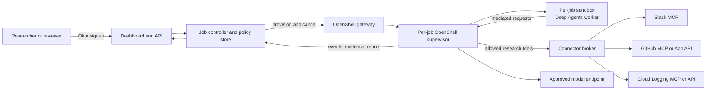
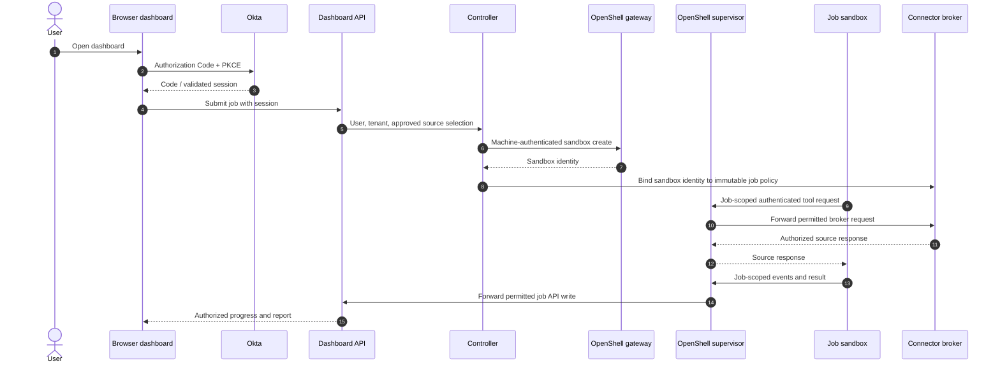
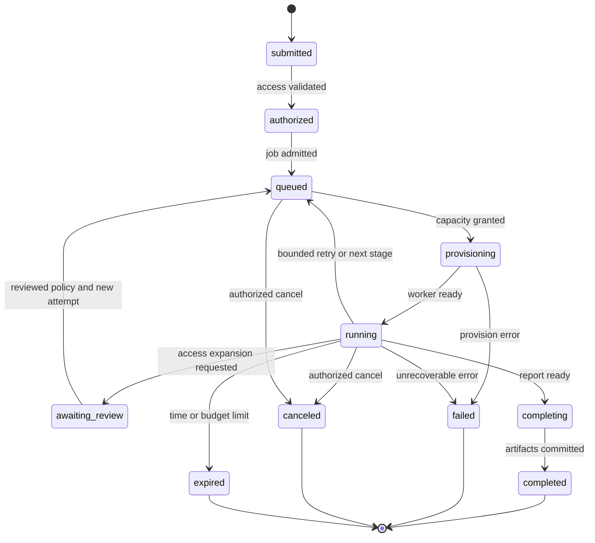
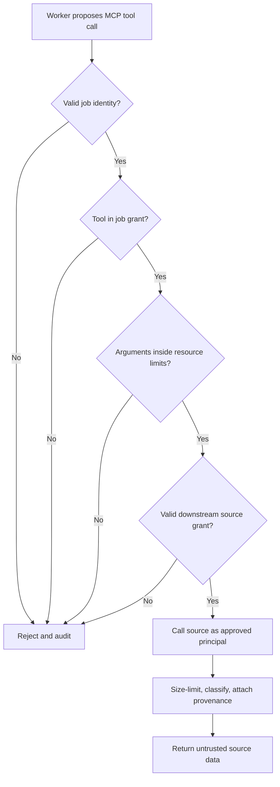
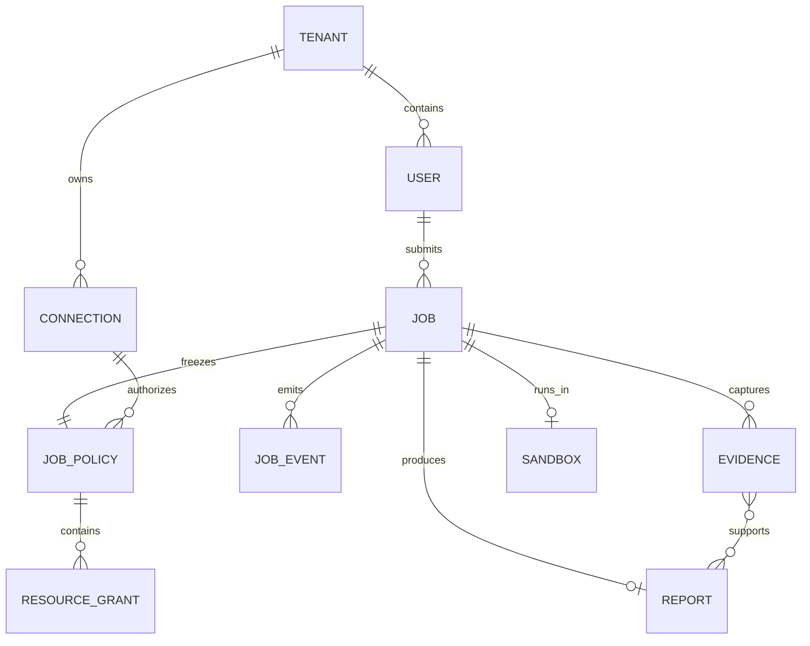
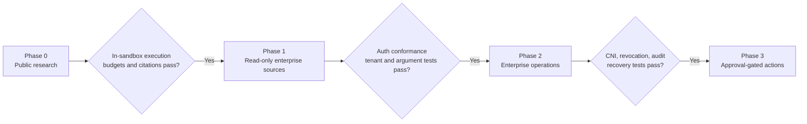

# Requirements: OpenShell Deep Research

**Status:** Proposed  
**Date:** 2026-10-23  
**Owner:** Project team  
**Scope:** Requirements for a candidate external dashboard and control plane that runs LangChain Deep Agents research jobs inside NVIDIA OpenShell, subject to an internal platform selection gate.

This document defines **target behavior if the custom path is selected**. All employees already have ChatGPT Enterprise, with connectors under review, and a Replit rollout is planned in about three months. The selection requirements below guide the build decision; SEL-03 is a follow-on comparison at Replit rollout and does not delay a scoped response to a previously proven mandatory gap. The remaining P0/P1/P2 requirements apply to the custom service. A requirement does not imply that OpenShell, LangChain, Okta, or a hosted MCP server already provides it. Platform capabilities and gaps are called out explicitly below. “Shall” denotes a behavior that must be demonstrable in an acceptance test.

## Platform selection gate

| ID | Timing | Requirement | Acceptance evidence |
| --- | --- | --- | --- |
| SEL-01 | Before full build | Benchmark the organization's ChatGPT Enterprise deep research workflow on representative approved cases; test native connectors only after their source review. | A scored 20–30 case corpus records factual accuracy, citations, permission behavior, latency, user experience, and report export. Connector cases awaiting approval are marked deferred, not failed. [ChatGPT deep research](https://learn.chatgpt.com/docs/web-search). |
| SEL-02 | Before choosing a second UI | Determine whether a read-only `search`/`fetch` MCP or approved ChatGPT plugin tools can expose the missing source or job workflow. | Record the tenant-admin availability and security decision. If selecting an MCP or plugin path, its live user OAuth authorization-code + S256 PKCE flow passes with validated `resource`, `aud`, scopes, and subject. If that path is unavailable or irrelevant, document the gap; a general job tool is not assumed available inside Deep Research. [OpenAI MCP guide](https://developers.openai.com/api/docs/mcp), [plugin authentication](https://developers.openai.com/plugins/build/auth). |
| SEL-03 | At Replit rollout | Benchmark Replit Chat on the same approved cases and confirm whether its contracted app build/export/hosting features are suitable. | A tenant-specific record names deployment entitlement, app-level Okta SSO behavior, connector identity, data flows, source restrictions, and score. This follow-on gate does not delay an earlier scoped build for a proven mandatory gap. [Replit research example](https://docs.replit.com/use-cases/prepare-for-a-customer-call), [BYOC availability](https://docs.replit.com/teams/bring-your-own-cloud). |
| SEL-04 | Before full build | Prove full-graph OpenShell execution and compare a restricted worker on the same broker, evidence contract, sources, and cases. | Instrumented process placement, denied egress, identity tests, quality score, and total operating cost identify the specific marginal benefit of OpenShell. [Deep Agents sandbox patterns](https://docs.langchain.com/oss/python/deepagents/sandboxes). |
| SEL-05 | Before full build | Record which of the four controls require custom implementation: server-held job policy, source credential broker, separate public/private lanes, and durable claim-to-source evidence. | A written decision record links each unmet requirement to a failed or insufficient incumbent test and names the narrowest approved custom scope. [Feasibility assessment](feasibility-and-market-assessment.md). |

## 1. Outcome and boundaries

Users submit a research question, choose the sources and resources the job may read, watch progress, and receive a report with verifiable citations. The Deep Agents process runs in a short-lived OpenShell sandbox. An external control plane owns interactive login, job admission, source authorization, durable state, and result access. An external connector broker, when needed, performs narrow authenticated calls to enterprise sources; it does not run the agent loop.

### Goals

1. Run agent planning, tool choice, and synthesis inside OpenShell for every research job.
2. Authenticate dashboard users with Okta Authorization Code with PKCE. Gate any direct OpenShell operator login on a separate Okta/CLI compatibility test.
3. Grant each job only its approved source, resource, tool, identity, model, and budget capabilities.
4. Support OAuth-protected MCP servers and provider-specific delegated or application identities without placing long-lived source credentials in the sandbox.
5. Produce reports whose claims can be traced to captured evidence and whose access follows enterprise policy.
6. Establish a path from local proof of concept to multi-tenant enterprise deployment.

### Non-goals for the initial release

- Autonomous writes to Slack, GitHub, Google Cloud, or other enterprise systems.
- General browser or desktop automation by research workers.
- Granting every dashboard user an interactive shell in every sandbox.
- A universal OAuth flow that works with every hosted MCP server without provider-specific setup.
- A permanent cross-job memory containing unreviewed enterprise source material.
- Reusing the NVIDIA community recipe as the production authorization or tenancy layer. Its Deep Agents worker is host-side, and its task API uses a shared bearer secret. [Recipe README](https://github.com/NVIDIA/nemoclaw-community/tree/main/examples/recipes/community/deep-research-worker), [recipe service](https://github.com/NVIDIA/nemoclaw-community/blob/main/examples/recipes/community/deep-research-worker/src/service.py).

## 2. Personas and permissions

| Persona | Intended capability | Boundary |
|---|---|---|
| Researcher | Sign in, connect authorized sources, submit scoped jobs, view own permitted results, cancel own jobs | No direct OpenShell gateway access by default |
| Reviewer | View permitted reports and evidence; review requested policy expansions or future write actions | Cannot expand a job’s grants by editing its report |
| Workspace operator | Diagnose and, when explicitly authorized, connect to a sandbox through the OpenShell gateway | Okta OIDC role **and** OpenShell workspace membership required |
| Connector administrator | Register Slack/GitHub/Google integrations, manage broker policy and source credentials | Cannot read arbitrary job results merely by managing a connector |
| Platform administrator | Configure gateway, policies, workspace mapping, models, quotas, audit, and retention | Privileged operations audited |
| Job controller | Create/stop sandboxes and attach approved providers | Machine identity limited to required gateway/workspaces |
| Sandbox worker | Read its own job policy, invoke approved tools, write its own evidence and result | No control-plane admin credential or cross-job data |

OpenShell’s workspace model currently lets a Workspace User create/use sandboxes and use provider attachments throughout that workspace; the dashboard’s per-job access checks therefore must be implemented in the control plane and broker, and tenant workspaces must be mapped deliberately. [OpenShell workspaces](https://docs.nvidia.com/openshell/how-it-works/workspaces).

## 3. Authentication and authorization assumptions

The interactive dashboard will use a separate Okta OIDC application with Authorization Code and PKCE. The OpenShell CLI supports browser Authorization Code with PKCE for an OIDC gateway, and its SDKs support renewable client-credentials login for automation. **OpenShell CLI login with Okta is conditional:** its browser callback currently binds an ephemeral localhost port, which may conflict with Okta's exact redirect URI registration. Test the browser flow before enabling it; a device-grant fallback needs its own Okta and CLI test. These are different clients and tokens; dashboard login shall not be treated as an automatic credential for the gateway or any MCP source. [Okta PKCE guide](https://developer.okta.com/docs/guides/implement-grant-type/authcodepkce/main/), [OpenShell gateway authentication](https://docs.nvidia.com/openshell/how-it-works/gateways/authentication), [OpenShell callback-port issue](https://github.com/NVIDIA/OpenShell/issues/3300).

For HTTP MCP, the current specification requires tokens requested for the specific MCP resource and validation of the token’s intended audience. Client credentials identifies an application, not the dashboard user. The [MCP client-credentials extension](https://github.com/modelcontextprotocol/ext-auth/blob/main/specification/draft/oauth-client-credentials.mdx) is draft and optional; provider compatibility will be tested. [MCP authorization specification](https://modelcontextprotocol.io/specification/2026-07-28/basic/authorization).

## 4. User journeys

### J1. Public research

The researcher signs in, submits a question, selects public web sources, and chooses an approved budget preset. The job runs inside one sandbox, emits status and evidence, and returns a report with links, retrieval times, and cited excerpts. The user can cancel the job. No enterprise source grant is required.

### J2. Enterprise research

The researcher selects Slack, GitHub, and/or GCP resources that the organization has enabled. The dashboard shows the acting identity for each source and verifies available grants. The controller records a server-side resource allowlist before the job starts. The worker can invoke only the resulting read tools. A request for more access pauses for a new user or administrator decision; the agent cannot grant it to itself.

### J3. Direct sandbox diagnosis

An operator with an explicit support need may sign in to the OpenShell gateway through its Okta-backed browser CLI PKCE flow **after the localhost callback is proven compatible with Okta**. A separately tested Okta device grant may serve as a fallback. Gateway roles, scopes, workspace membership, and job support authorization are checked before shell/exec access. All access is audited. Until one approved CLI login path passes its compatibility gate, direct operator login remains disabled; the dashboard path is unaffected. [OpenShell gateway authentication](https://docs.nvidia.com/openshell/how-it-works/gateways/authentication), [OpenShell callback-port issue](https://github.com/NVIDIA/OpenShell/issues/3300).

### J4. Review and retrieval

An authorized viewer opens a completed report. The dashboard rechecks report and evidence authorization at read time and displays the source identity, retrieval time, and accessible deep link. Restricted excerpts remain restricted even if the original job submitter later loses source access.

## 5. Functional requirements

Priority: **P0** is required for a useful public-source proof of concept; **P1** enables read-only enterprise research; **P2** is a later enterprise enhancement. Requirement IDs remain stable as implementation details change.

### 5.1 Identity and tenancy

| ID | Priority | Requirement | Acceptance criterion |
|---|---|---|---|
| IAM-01 | P0 | The dashboard shall authenticate interactive users with Okta OIDC Authorization Code + PKCE and keep tokens in a backend-for-frontend session protected by `Secure`, `HttpOnly`, and `SameSite` cookies plus CSRF checks on state-changing requests. | Unauthenticated API calls are rejected; valid sign-in establishes a session; PKCE/state/nonce and token issuer/audience/expiry validation pass tests; a cross-site or missing-CSRF mutation is denied and browser JavaScript cannot read session tokens. |
| IAM-02 | P0 | The API shall derive user and tenant from a verified session, never from job payload fields. | A client-supplied different `user_id` or `tenant_id` cannot change ownership. |
| IAM-03 | P0 | Each job and artifact shall have a server-held owner, tenant, sensitivity label, and access policy. | Cross-user and cross-tenant list/get/cancel/artifact attempts are denied and logged. |
| IAM-04 | P0 | The controller shall use its own machine identity for OpenShell gateway calls. | Revoking the controller’s gateway role prevents new sandbox creation without affecting user dashboard sessions. |
| IAM-05 | P1 | Workers shall authenticate to the job API and connector broker with an expiring job identity bound to one sandbox and job. | A token or identity from job A cannot read job B or invoke job B’s tools; expired/revoked identity fails closed. |
| IAM-06 | P1 | Source OAuth grants and refresh material shall remain in the control plane, broker, or OpenShell credential store. | A sandbox file, environment, trace, and report inspection finds no reusable Slack/GitHub/GCP refresh token, client secret, or service-account private key. |
| IAM-07 | P1 | If direct diagnostic access is enabled, authorized operators shall use a tested Okta-backed OpenShell CLI login. | A browser-PKCE integration test proves the localhost callback works, or a separately approved device-grant test passes; a mapped operator reaches only approved workspaces, and a dashboard researcher without OpenShell membership is denied. [OpenShell gateway authentication](https://docs.nvidia.com/openshell/how-it-works/gateways/authentication), [OpenShell callback-port issue](https://github.com/NVIDIA/OpenShell/issues/3300). |
| IAM-08 | P1 | Revocation of a user, connection, connector, or job grant shall stop subsequent protected tool calls. | Tests revoke each grant during a job and verify the next call is denied without relying on agent cooperation. |
| IAM-09 | P2 | Enterprise administrators may configure Slack Enterprise-Managed Authorization where supported. | A job can obtain short-lived user-scoped Slack MCP access without individual app consent, and logout/revocation is honored. [Slack EMA](https://docs.slack.dev/authentication/enterprise-managed-authorization/). |

### 5.2 Job admission and lifecycle

| ID | Priority | Requirement | Acceptance criterion |
|---|---|---|---|
| JOB-01 | P0 | A user shall submit a question, optional context, source choices, and a budget preset through the dashboard API. | An accepted request returns a unique job ID; malformed or unauthorized source choices are rejected before provisioning. |
| JOB-02 | P0 | The controller shall create a fresh OpenShell sandbox from a reviewed, version-pinned worker image for each job. | Two jobs have distinct sandbox IDs and writable scratch spaces; deletion of one cannot delete the other’s artifacts. |
| JOB-03 | P0 | The Deep Agents graph and its tool calls shall execute inside that sandbox. | Instrumented process checks show planner, synthesis, and tool-client PID/container belong to the worker sandbox. |
| JOB-04 | P0 | Each job shall have a server-side immutable policy snapshot covering sources, resource IDs, tools, model, budget, data class, and expiry. | Editing the browser request after admission or asking the model to expand scope does not change effective policy. |
| JOB-05 | P0 | The job shall use the versioned state vocabulary `submitted`, `authorized`, `queued`, `provisioning`, `running`, `awaiting_review`, `completing`, `completed`, `failed`, `canceled`, and `expired`, with monotonic terminal transitions. | Status events validate against [the event contract](../contracts/job-event.schema.json); duplicate events and worker retries cannot transition a terminal job back to `running`. |
| JOB-06 | P0 | The user shall receive bounded progress events and a final result or structured failure reason. | Reloading the dashboard reconstructs current state from durable storage; progress contains no raw credentials. |
| JOB-07 | P0 | Authorized users shall be able to cancel a job; the controller shall stop its sandbox and release capacity. | Cancellation terminates work within a configured grace period and results in one terminal state. |
| JOB-08 | P0 | Administrators shall configure hard limits for wall time, model spend/tokens, tool calls, output size, and concurrent jobs. | Exceeding a limit stops new work and records which limit fired; failed calls also count toward relevant call/rate limits. |
| JOB-09 | P1 | The controller shall persist checkpoints or stage artifacts outside the sandbox for recoverable jobs. | A worker crash can resume or explicitly restart according to the documented retry policy without duplicating externally visible actions. |
| JOB-10 | P1 | Requested access expansion shall require a new policy decision and a clear dashboard approval flow. | The worker receives no new tool or resource access until the controller records approval and applies the updated policy. |
| JOB-11 | P1 | Tenant and user quotas shall be enforced before sandbox provisioning and while jobs run. | One tenant cannot exhaust all configured worker slots or bypass per-user limits by repeated submissions. |

### 5.3 Research quality and evidence

| ID | Priority | Requirement | Acceptance criterion |
|---|---|---|---|
| RES-01 | P0 | The worker shall use a bounded plan, retrieval, synthesis, and verification sequence. | A run emits stage transitions and stops when its budget is consumed; the verifier runs before completion. |
| RES-02 | P0 | Every reported factual claim from a tool source shall link to captured evidence. | The report validator rejects an unsupported citation ID and flags claims lacking evidence. |
| RES-03 | P0 | Evidence shall record source type, stable resource identifier or URL, retrieval time, content hash, excerpt/span, tool call ID, and job ID. | Replaying an evidence ID locates the stored artifact and its metadata without rerunning the agent. |
| RES-04 | P0 | The worker shall treat source text, MCP tool descriptions, and tool responses as untrusted input. | Prompt-injection fixtures cannot alter job policy, enable write tools, or send content to unapproved endpoints. |
| RES-05 | P0 | A final report shall include question, answer, citations, limitations, and completion metadata. | API response validates against a versioned report schema; unsupported claims and missing source metadata are surfaced. |
| RES-06 | P1 | The dashboard shall authorize access to reports and evidence when they are viewed, not only when created. | A removed viewer loses access to existing artifacts on the next request. |
| RES-07 | P1 | Enterprise evidence shall carry source classification and retention information. | Sensitive Slack/log excerpts are excluded from public exports and expire according to tenant policy. |
| RES-08 | P1 | Jobs combining public web and private sources shall use separate capability zones. Before public dispatch, admission shall approve a `public_research_brief` after showing the exact public-bound text to the submitter, recording approval, and applying the tenant's data-classification and DLP checks. | Public workers receive only the approved brief and public sources, never the full private question, private resource IDs, or private evidence; the private worker has no public-web egress; missing approval or a sensitive brief blocks dispatch, and an exfiltration fixture is denied. |
| RES-09 | P0 | Research quality and comparative value shall be measured with a reproducible evaluation set covering factual accuracy, citation support, answer completeness, abstention, latency, and total cost. | Before the first release gate, a human-reviewed report compares representative jobs with the organization's ChatGPT Enterprise baseline and a simpler restricted worker using the same broker/evidence contract. Replit Chat joins the comparison when its rollout and source approvals permit. The rubric and decision thresholds are recorded before runs; enterprise-source cases are repeated before Phase 1 promotion. See the [feasibility and market assessment](feasibility-and-market-assessment.md). |

### 5.4 Connectors, MCP, and source grants

| ID | Priority | Requirement | Acceptance criterion |
|---|---|---|---|
| CON-01 | P0 | A worker shall see only the named tools approved in its job policy. | Tool discovery exposes no write or unrelated tools, including when an upstream MCP server adds a tool. |
| CON-02 | P1 | A trusted enforcement point shall validate tool arguments against allowed tenant, channel, repository, project/log view, time range, and response-size limits. | Calls that keep an allowed tool name but change resource IDs or widen filters are rejected. OpenShell itself matches MCP method/tool name but not arguments. [OpenShell MCP rules](https://docs.nvidia.com/openshell/how-it-works/policies/network-rules). |
| CON-03 | P1 | Each connector shall declare its upstream token flow, token audience/resource, scopes, refresh/revocation behavior, and user-versus-app identity semantics. | A connector cannot be enabled without a reviewed contract and passing auth conformance tests. |
| CON-04 | P1 | Slack research shall support an approved user-scoped OAuth connection to Slack’s hosted MCP server, initially with read scopes only. | A job can search only resources allowed by its user grant and task policy; no send/upload/create tool is callable. [Slack MCP](https://docs.slack.dev/ai/slack-mcp-server/). |
| CON-05 | P1 | GitHub research shall support user access tokens for user-scoped jobs and repository-scoped GitHub App installation tokens for approved shared jobs. | A selected-repository job cannot access a repository outside the app installation/token and job policy. [GitHub App installation auth](https://docs.github.com/en/apps/creating-github-apps/authenticating-with-a-github-app/authenticating-as-a-github-app-installation). |
| CON-06 | P1 | GCP Logging research shall use a dedicated read-only identity and approved projects/log views. | `list_log_entries` succeeds under a reviewed least-privilege role or a read-only API wrapper; write/admin operations fail. Google’s remote MCP setup example asks for a broad Logging Admin role, so this is a validation gate. [Logging MCP](https://docs.cloud.google.com/logging/docs/use-logging-mcp). |
| CON-07 | P1 | An OAuth-protected MCP connector shall request/accept tokens for the intended MCP resource and reject token passthrough from unrelated audiences. | A dashboard or another MCP server’s token is rejected; a correct resource-scoped token is accepted. [MCP authorization](https://modelcontextprotocol.io/specification/2026-07-28/basic/authorization). |
| CON-08 | P1 | The connector layer shall support app-only client credentials **only** for issuers and servers that explicitly support it. | Compatibility tests exercise token acquisition, expected resource/audience/scope, refresh, expiry, and denial; unsupported grants produce a clear error. |
| CON-09 | P1 | The implementation shall pin MCP client/protocol versions and test each hosted server’s registration and transport behavior. | Integration tests cover Slack, GitHub, and Google endpoints; no worker-initiated browser login is required. These providers do not all support Dynamic Client Registration. [Slack](https://docs.slack.dev/ai/slack-mcp-server/), [GitHub](https://github.com/github/github-mcp-server/blob/main/docs/host-integration.md), [Google](https://docs.cloud.google.com/mcp/authenticate-mcp). |
| CON-10 | P2 | Future write actions shall use separate capabilities and human approval per operation. | A research-only job cannot execute a write regardless of prompt; an approved action records approver, exact arguments, target, and outcome. |

### 5.5 Operations and governance

| ID | Priority | Requirement | Acceptance criterion |
|---|---|---|---|
| OPS-01 | P0 | Policies, worker images, model choices, and connector definitions shall be versioned and reviewable. | Every job records the effective versions/digests used. |
| OPS-02 | P0 | Structured audit events shall cover login, job admission, policy decisions, sandbox create/delete, tool calls, source identity, report access, cancellation, and failure. | An auditor can follow a job by correlation ID without reading secrets. |
| OPS-03 | P0 | Raw secrets and bearer tokens shall be removed from progress events, exception text, reports, application logs, and tracing. | Secret canary tests find no canary in those outputs. |
| OPS-04 | P1 | Enterprise deployment shall use a CNI that enforces Kubernetes ingress and egress NetworkPolicy for sandbox namespaces. | Independent ingress and egress canaries prove the CNI enforces both directions, and a sandbox worker cannot reach an unapproved destination directly. The Kubernetes API accepting a policy object is insufficient. [OpenShell Kubernetes setup](https://docs.nvidia.com/openshell/v0.1.5/kubernetes/setup). |
| OPS-05 | P1 | Tenant workspaces and Kubernetes namespaces shall be mapped according to the chosen isolation policy; per-job access shall be enforced outside workspace membership. | Two tenant gateway principals cannot list, use, or attach the other tenant's providers or sandboxes. Two dashboard users sharing a workspace cannot read, cancel, or authorize the other's jobs through the application or broker. Researchers receive no direct gateway membership; mutually untrusted direct gateway users require separate workspaces or gateways because a Workspace User may use resources throughout its workspace. [OpenShell workspaces](https://docs.nvidia.com/openshell/v0.1.5/how-it-works/workspaces), [Kubernetes access control](https://docs.nvidia.com/openshell/kubernetes/access-control). |
| OPS-06 | P1 | A retention policy shall delete terminal job scratch state, evidence, reports, checkpoints, and connection metadata according to classification and legal hold. | Expiry tests verify deletion or hold, and completed sandboxes are reclaimed. |
| OPS-07 | P1 | Connector and gateway health shall be observable without broadening worker egress. | Operators can distinguish issuer failure, permission denial, MCP protocol mismatch, model failure, sandbox failure, and source rate limit. |
| OPS-08 | P2 | Disaster recovery shall restore queued and completed jobs with tenant isolation intact. | A documented restore exercise succeeds and does not revive expired source grants or completed sandboxes. |
| OPS-09 | P1 | A production or enterprise-data sandbox node image and container runtime shall satisfy OpenShell's mandatory kernel and runtime probes. | A real sandbox starts with Landlock ABI 3 or newer and nested seccomp user-notification available under the selected runtime profile; a failing node pool is excluded from scheduling. [OpenShell v0.1.5 support matrix](https://docs.nvidia.com/openshell/v0.1.5/about/support-matrix). |

## 6. Nonfunctional requirements

These are proposed targets; the load profile and numerical SLOs will be finalized after the first benchmark.

| ID | Quality | Requirement and acceptance method |
|---|---|---|
| NFR-01 | Security | Default deny for worker egress, exact destination rules, explicit `enforcement: enforce`, and reviewed provider attachments. An unauthorized endpoint and an unauthorized MCP tool both fail in a live sandbox test. [OpenShell network rules](https://docs.nvidia.com/openshell/how-it-works/policies/network-rules). |
| NFR-02 | Isolation | One job’s process, scratch files, identity, policy, and results cannot be read by another job or tenant; verify with adversarial cross-job tests. |
| NFR-03 | Availability | The dashboard and job API remain usable when a connector is unavailable; affected jobs receive a bounded, source-specific error and can be retried under policy. |
| NFR-04 | Durability | Accepted jobs and emitted evidence survive a dashboard/controller restart; a worker restart follows the documented checkpoint/retry behavior. |
| NFR-05 | Responsiveness | Job admission and status requests meet a configurable API latency SLO; long-running research never holds a browser request open. |
| NFR-06 | Scalability | Queue admission and worker provisioning honor tenant concurrency quotas under burst load; no tenant starves all others. |
| NFR-07 | Cost | Every job records model tokens/cost, tool counts, elapsed time, and source rate-limit consumption, and stops at hard limits. |
| NFR-08 | Data handling | Model, search, tracing, and artifact destinations are approved for the job’s data class; private content is not sent to public search. |
| NFR-09 | Auditability | Correlation IDs connect dashboard action, sandbox, OpenShell policy decision, broker call, vendor principal, and evidence artifact. |
| NFR-10 | Portability | Local and Kubernetes deployments use the same job policy and report schemas; environment-specific provider wiring is documented. |
| NFR-11 | Maintainability | All public API/report/event schemas are versioned; connector contracts have conformance tests and an owner. |
| NFR-12 | Usability | The dashboard names the acting identity and selected resources before submission; denial messages identify missing access without leaking unauthorized resource names. |

## 7. Information model

The durable store is authoritative for job ownership, policy, events, and result access. Sandbox scratch state is disposable. Connector credentials are referenced by opaque connection IDs; they are never serialized into a job manifest, report, or evidence record.

## 8. Delivery phases and acceptance gates

These phases apply after the platform selection gate authorizes the custom service. A small public/synthetic OpenShell runtime spike can run earlier to inform that decision without standing up the full dashboard.

### Phase 0: Public-source proof of concept

- Deliver Okta PKCE dashboard session, job API/queue, one per-job OpenShell worker, approved inference, public search/fetch, hard budgets, cancellation, structured evidence, and report viewer.
- Gate: **IAM-01–04, JOB-01–08, RES-01–05, RES-09, OPS-01–03, NFR-01** pass end-to-end in a live OpenShell sandbox. Validate that the Deep Agents graph is in the sandbox rather than only shell tools. Run the matched public/synthetic benchmark described in the [market assessment](feasibility-and-market-assessment.md).

### Phase 1: Read-only enterprise connectors

- Deliver job-scoped worker identity, broker, Slack user OAuth, GitHub user/App modes, GCP Logging read-only mode, MCP compatibility matrix, tenant quotas, and public/private source separation.
- Gate: **IAM-05–08, CON-01–09, RES-06–09, JOB-09–11** pass. Repeat the quality comparison on approved representative enterprise jobs. Before live enterprise data enters a Kubernetes sandbox, **OPS-04, OPS-05, and OPS-09** pass too. Required negative tests: cross-tenant read, out-of-scope channel/repo/project, write-tool invocation, expired token, revoked grant, and prompt-injection exfiltration.

### Phase 2: Enterprise operations

- Deliver workspace/namespace strategy, enforced Kubernetes NetworkPolicy, retention, recovery, alerting, and formal audit export. Consider Slack EMA where the organization’s IdP and Slack configuration support it.
- Gate: **OPS-04–09, NFR-02–12** pass against the agreed SLOs and deployment environment.

### Phase 3: Optional actions

- Introduce write-capable connectors only with distinct grants and per-operation review. Research remains read-only by default.
- Gate: **CON-10** and source-specific idempotency, approval, and audit tests pass.

## 9. Risks, assumptions, and decisions to settle

| Item | Type | Proposed handling |
|---|---|---|
| Direct researcher shell access | Decision | Keep dashboard-only for researchers initially. Enable Okta-backed OpenShell CLI access for operators only after a real browser callback or separately approved device-grant test; then review workspace/provider access separately. [OpenShell gateway authentication](https://docs.nvidia.com/openshell/how-it-works/gateways/authentication), [OpenShell callback-port issue](https://github.com/NVIDIA/OpenShell/issues/3300). |
| Acting identity for a job | Decision | Default Slack and user-private GitHub research to the submitting user; use a dedicated application identity only for an admin-approved shared corpus. |
| Broker versus direct hosted MCP | Decision | Use a broker where task-level argument controls, user token refresh, or tenancy require it. Allow a direct connection only after source authorization and token-flow tests establish equivalent controls. |
| Hosted GCP Logging MCP read-only permissions | Risk | Validate `list_log_entries` with narrow IAM and OAuth scope; use a read-only REST wrapper if the hosted endpoint requires broad admin permissions. |
| OAuth compatibility | Risk | Slack, GitHub, and Google hosted MCP servers do not all support Dynamic Client Registration; pre-register clients or provide broker-managed tokens. [Slack](https://docs.slack.dev/ai/slack-mcp-server/), [GitHub](https://github.com/github/github-mcp-server/blob/main/docs/host-integration.md), [Google](https://docs.cloud.google.com/mcp/authenticate-mcp). |
| Mixed public/private research | Risk | Separate capability zones so allowed public-web endpoints cannot become an exfiltration route for private data. [OpenShell security guidance](https://docs.nvidia.com/openshell/security/best-practices). |
| Model and trace destination | Decision | Select an enterprise-approved endpoint and trace policy per data class before enabling private source jobs. |
| OpenShell version | Assumption | Target the documented v0.1.5 capability set; pin and test the actual installed gateway, CLI, and supervisor versions together. |
| SLO and budgets | Decision | Define numerical defaults and load profile after Phase 0 measurement; retain hard configurable ceilings from the first release. |
| Build-versus-buy value | Decision | Start with the organization's ChatGPT Enterprise deployment, add Replit Chat at rollout, and require a matched pilot against a simpler restricted worker. Record which specific control or workflow gap justifies operating OpenShell and a custom broker/evidence service. [Feasibility and market assessment](feasibility-and-market-assessment.md). |

## 10. Traceability rule

Every pull request that changes authentication, sandbox policy, a connector, job state, or report access must cite the affected requirement IDs and add or update a positive and negative acceptance test. A release checklist records each phase gate’s result and the exact OpenShell, Deep Agents, LangChain MCP client, and upstream MCP server versions used.
