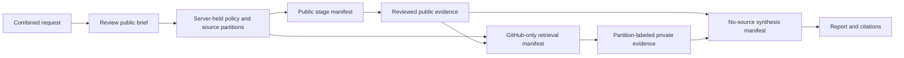
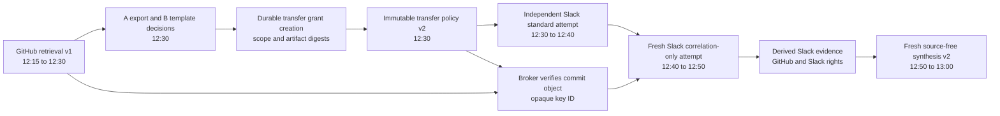

# Contract examples

These payloads use invented identities, connections, source paths, and content. They do not connect to Okta, OpenShell, Slack, GitHub, or Google Cloud. Human owners, readers, grantors, and transfer-approval actors use the exact issuer-qualified `{iss, sub}` shape in the [human-subject contract](../contracts/human-subject.schema.json); the same `sub` under another `iss` is a different identity. OpenShell gateway service and CLI subjects belong to a separate namespace.

Private-stage route governance examples are **not yet present**. After a positive SEL decision and before gateway route-governor code, [CR-0019](../docs/change-requests/CR-0019-private-stage-route-governance.md) / [ToDo](../docs/todos/CR-0019-private-stage-route-governance.md) require planned `private-stage-route-intent-allow.json` and `private-stage-route-intent-deny.json` plus identical uncertain-response retry, changed/stale/expired or changed-controller-IdP replay denial, second-create denial, provider-name reuse, same-profile/different-ID, mutation, and receipt fixtures under this directory, bound to the exact selected OpenShell protobuf descriptor. The conditional middleware allow/deny examples belong to [deferred CR-0020](../docs/change-requests/CR-0020-supervisor-middleware-route-gate.md) / [ToDo](../docs/todos/CR-0020-supervisor-middleware-route-gate.md) only if that fallback is selected. Existing job/stage examples do not prove a signed create or direct profile-RPC denial. [Impact matrix](../docs/design/deployment-and-operations.md#private-stage-route-governance-implementation-impact).

The combined [request](job-request.json) becomes a server-held [policy](job-policy.json) with three private source partitions and no cross-partition transfer grants. Its public worker receives only [stage-public.json](stage-public.json) and the approved public brief. [stage-enterprise.json](stage-enterprise.json) illustrates a GitHub-only retrieval sandbox with that partition's approved brief and reviewed public evidence. The Slack and Logging partitions would use separate retrieval manifests and sandboxes. [stage-enterprise-synthesis.json](stage-enterprise-synthesis.json) shows the later sandbox with the full question and curated evidence, but no source connection or source tool. The [event](job-event.json) uses a coarse `retrieval` phase without naming the source; the base GitHub [evidence](evidence.json) and [report](report.json) show the expected provenance links.

An **alternative reviewed branch** resumes after the public and GitHub retrieval stages, **without launching** the version 1 synthesis stage. At 12:30, [job-policy-typed-transfer.json](job-policy-typed-transfer.json) becomes a newly approved immutable policy revision with a grant naming the authenticated A-side export/declassification and B-side template/resource decision set. [stage-enterprise-slack-standard.json](stage-enterprise-slack-standard.json) performs independent Slack research from 12:30 to 12:40 with no inbound GitHub key or derived context. A fresh [stage-enterprise-correlation.json](stage-enterprise-correlation.json) runs from 12:40 to 12:50 with only the broker-built `search_by_correlation_key` wrapper and internal `read_evidence`; it cannot issue a free-form Slack search or read after the response echoes the key. The subsequent [stage-enterprise-synthesis-typed.json](stage-enterprise-synthesis-typed.json) starts at 12:50 with the full question, curated public/GitHub/derived evidence, and no source endpoint. Attempt IDs are distinct, and fencing generations increase within each alternative branch.

Before that v2 policy is committed or approval acknowledged, the independent ledger durably records the synthetic [transfer grant creation event](transfer-grant-created.json). It reserves the grant ID even if the recoverable policy store is later restored to a pre-approval snapshot. The event binds the [two-decision set](approvals/transfer-grant-decisions.json), exact [Slack query template](approvals/slack_commit_sha_v1.json), source/destination selectors, limits, and three pinned synthetic [artifact fixtures](approvals/artifacts/). The template includes the complete declarative `search_slack` argument expression and renderer version/digest; the event also pins source extractor and independent commit verifier versions/digests. Template and artifact digests are SHA-256 of the exact local UTF-8 file bytes. Scope and decision digests are SHA-256 of canonical UTF-8 JSON (`sort_keys=True`, compact `,`/`:` separators, unescaped Unicode); the scope includes grant authorization fields (grant ID, partitions, tool, limits, and expiry), source/destination partition records, template digest, and all three artifact bindings. It excludes post-decision `approval_ref` and `approved_at`; the creation event separately binds them to the decision-set hash and completion time. These files illustrate binding only: production must hash the running immutable release artifacts, verify approval proofs and current ledger head, and deny a changed renderer, extractor, verifier, or approval transaction under the old grant ID. An exact retry returns the same ledger event without another append.

The transfer grant permits one broker-validated `commit_sha` key from the selected GitHub repository to a pinned Slack search template and **one** destination dispatch (`max_destination_calls: 1`, including retries). The example SHA appears in the trusted GitHub evidence URI/immutable ref, not its prose snapshot. Live integration must independently read and verify the commit object in that selected repository and bind its **provider-generated** SHA to the key ID; parsing the fixture text, a 40-hex string in arbitrary prose, or a user-authored structured API field cannot issue it without A-authorized exact-value review. The correlation-only Slack stage carries only the broker-issued key ID; it has no GitHub evidence ID or raw key value in its manifest.

The synthetic [derived Slack evidence](derived-evidence.json) shows the result of that approved key query at 12:41. Its trusted `producing_attempt_id` is the correlation-only Slack attempt; `source_dependency_evidence_ids` include the GitHub evidence, `authorization_sources` names the exact Slack and GitHub source/resource closure, and `classification` stays at least as high as GitHub's confidential input even though the directly captured Slack item is marked internal. The [derived snapshot fixture](artifacts/derived-evidence.txt) is deliberately synthetic. In a real destination attempt, the trusted controller/broker establishes this taint when projecting the inbound key ID, before any Slack calls; every templated Slack result in that correlation-only attempt inherits it regardless of completion order. A viewer with only Slack rights cannot receive the derived evidence view, evidence event, excerpt, or bytes; a viewer with current GitHub **and** Slack rights and confidential clearance can. The browser [evidence view](evidence-view.json) omits the internal attempt, dependency, and authorization closure. A later standard Slack attempt cannot read this same-partition derived item or reuse its checkpoint, while the correlation attempt cannot read earlier independent Slack evidence. No evidence with a nonempty dependency list, and no key nomination from a tainted worker or synthesis context, can auto-issue a new Slack-to-Logging key in v1.

These examples prove JSON shape, file digest binding, and local projection coherence only. The broker/API must prove commit-object verification, source rights, both approvals, independent-ledger uniqueness and restore behavior, running-artifact digest checks, trusted lineage, viewer decisions, query construction, and upstream denial in live integration tests.

The fake evidence snapshots in [artifacts](artifacts/) are local fixtures. Their SHA-256 hashes match the base, public, and derived example evidence records; production snapshots live in an encrypted, tenant-aware store and are accessed through the API after authorization.

