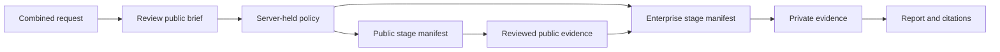

# Contract examples

These payloads use invented identities, connections, source paths, and content. They do not connect to Okta, OpenShell, Slack, GitHub, or Google Cloud.

The combined [request](job-request.json) becomes a server-held [policy](job-policy.json). Its public worker receives only [stage-public.json](stage-public.json) and the approved public brief. A separate sandbox receives [stage-enterprise.json](stage-enterprise.json), the enterprise question, and one reviewed public evidence ID. The [event](job-event.json), [evidence](evidence.json), and [report](report.json) show the expected provenance links.

The fake evidence snapshots in [artifacts](artifacts/) are local fixtures. Their SHA-256 hashes match the example evidence records; production snapshots live in an encrypted, tenant-aware store and are accessed through the API after authorization.

