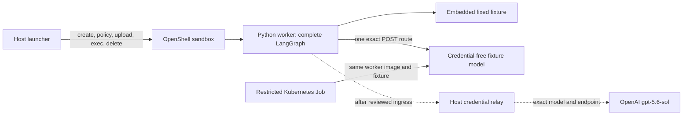

# CR-0012: disposable full-graph runtime spike

This is a public/synthetic proof harness for [CR-0012](../../docs/change-requests/CR-0012-full-graph-runtime-spike.md) and its [ToDo](../../docs/todos/CR-0012-full-graph-runtime-spike.md). The four-node LangGraph (`plan → retrieve → synthesize → verify`), each Deep Agents invocation, fixed fixture retrieval, citation checks, and result serialization run in `spike.worker` **inside the worker image**. The host launcher only provisions, inspects, probes, copies a stage manifest, collects the result, and deletes the sandbox. `claimed_mode` in a result is diagnostic text, not proof of confinement.



## Current evidence and limits

| Gate | Current state |
|---|---|
| Contract, graph order, exact fixture/evidence bounds, wrong stage, observed fixture reads, unadmitted-ID denial, HTTP request cap, relay route/budget, exact structured policy check, uncertain-create cleanup, and comparator manifest shape | Deterministic unit tests pass. The graph test injects a fake agent; the fixture model tests its real Chat Completions tool-call sequence. The new relay tests use a recording fake upstream and no network or real credential. |
| First OpenShell manual full-graph run | [Partial evidence](../../docs/evidence/CR-0012-manual-full-graph-2026-10-26.md): an earlier image completed four stages inside a v0.1.5 sandbox with an initial `/opt` grant, explicit `PYTHONPATH`, and a corrected unfiltered upload. GET and wrong-path POST on its allowed relay host returned policy-denied 403. That image's stub did not call `read_fixture`. |
| First rebuilt launcher attempt | Image `sha256:c2dc55e0…` passed exact policy/admission/provider inspection, baked import/read-only check, stage SHA-256, direct and relay method/path denials, unadmitted source denial, and observed deletion. It failed closed at the first model request because Deep Agents 0.7.32 still exposed the built-in `delete` tool. The profile now excludes it. |
| Historical corrected OpenShell run | Local v0.1.5 sandbox `spike-aurora-4` on worker digest `sha256:101057cb…` completed all four graph steps. Parsed admission/effective policy matched with zero providers; the baked code was readable but not writable; exact stage-file SHA, direct egress denial, GET/wrong-path POST denial, and unadmitted `decoy` denial passed. Result recorded two admitted `read_fixture` calls, six actual model requests under cap eight, two evidence items and cited claims, and observed sandbox deletion. The fixture-model audit showed no tools on plan/synthesis/verify and only `read_fixture` on retrieval. The [independent re-review](../../docs/evidence/CR-0012-0014-re-review-2026-10-26.md) corroborated this historical local run. |
| Corrected-image complete OpenShell run | [Fresh attempt](../../docs/evidence/CR-0012-corrected-image-graph-and-cancel-2026-10-26.md) requested digest `sha256:8548ebaf…`, denied a wrong stage **before model contact**, then completed four stages in one sandbox process, six fixture-model calls, two approved reads, cited claims, exact policy/provider and structured route denials, and deletion with observed absence. Independent read-only review found no remaining Blocker or Important runtime-code issue in this synthetic slice; gateway-resolved image-ID receipt remains a stronger future gate. |
| Corrected-image active cancellation | [Same-digest v0.1.5 synthetic attempt](../../docs/evidence/CR-0012-corrected-image-graph-and-cancel-2026-10-26.md) observed a delayed first plan request, accepted deletion, stopped worker exec, and absent sandbox. The host audit held exactly one total plan request after the wait and no retrieval request; `model_requests_total_after_cancel_wait: 1` and `new_model_requests_after_cancel: 0`. A prior [attempt](../../docs/evidence/CR-0012-active-cancellation-attempt-3-2026-10-26.md) used `sha256:bbf9907a…`. This is local synthetic proof only. |
| Current CR-0012 work | Matched restricted-worker/CNI results and final-image CVE disposition remain open. The credential-free stub is a compatibility fixture, not a quality or cost benchmark. |
| Optional OpenAI route under CR-0014 | Local tests check text-only canonical payloads, host-key isolation, exact data class and credential mode, and a minimal CLI child environment. A [new network-disabled corrected-image check](../../docs/evidence/CR-0014-corrected-image-network-disabled-body-2026-10-26.md) ran the real pinned graph through the relay validator with a fake fixture response: six valid bodies, two fixture reads, and 58,852 microUSD conservatively reserved under the example's 60,000 microUSD cap. Its sanitized output hash matches the earlier image's run. Authenticated sandbox-to-relay ingress, real model usage, and price verification remain open; no real key or call was used. |
| Application and enterprise identity | A same-stage header is copyable and gives no sender proof. [CR-0015](../../docs/change-requests/CR-0015-phase0-attempt-identity-readiness.md) and its [ToDo](../../docs/todos/CR-0015-phase0-attempt-identity-readiness.md) own Phase 0 attempt binding; [CR-0016](../../docs/change-requests/CR-0016-phase1-sender-origin-proof.md) and its [ToDo](../../docs/todos/CR-0016-phase1-sender-origin-proof.md) own Phase 1 copied-bearer denial. |

The `model_stub.py` fixture server contains no upstream credential. It forces `read_fixture` calls for the two admitted IDs, rejects extra effective tools, and can write a host-only audit with request numbers and tool names. It can hold the first plan response so the launcher can test deletion during an active model call. `DeepAgentClient` counts each outbound Chat Completions HTTP request before send, including a tool-call round trip; `max_model_calls` is the actual request cap for this spike. The optional host `relay.py` permits only OpenAI `gpt-5.6-sol` at `https://api.openai.com/v1/chat/completions`. It validates a text-only, role-specific message and tool schema, constructs a fresh canonical body, strips all worker-supplied headers, and sends a host-held key only as upstream Authorization. Its route pins `data_class` and `credential_mode`; the worker's data-class header must match exactly, but this copyable header is **not** trusted classification or sender proof. The launcher passes only fixed nonsecret `PATH` and `LANG` to every OpenShell CLI child. GCP ADC code remains disabled until a GCP adapter has a reviewed endpoint contract. Reservation depends on reviewed rates and the upstream honoring the output-token limit; reconcile actual usage before a spend claim. This harness has no enterprise source, Okta session, broker, or source grant.

## Pinned inputs

The [version manifest](version-manifest.json) retains historical graph and cancellation attempts on prior digests and pins the latest local complete graph, active cancellation, and network-disabled strict relay-body check to caller-requested `sha256:8548ebaf…`. The local OpenShell v0.1.5 CLI/gateway binary hashes, supervisor/runtime and worker digests, Python base and dependency lock, fixture SHA-256 (`2cf506a2ac23cdd8504b1579bba4b39f4a10584305abd256b8efb93e236d36cb`), prompt version `spike-prompts-v2`, Deep Agents `0.7.32`, LangChain `1.4.7`/Core `1.7.0`, LangGraph `1.2.17`, and `langchain-openai` `1.7.2` are recorded. The combination matches [Deep Agents' tagged dependency metadata](https://raw.githubusercontent.com/langchain-ai/deepagents/deepagents%3D%3D0.7.32/libs/deepagents/pyproject.toml), [Deep Agents graph/profile API](https://raw.githubusercontent.com/langchain-ai/deepagents/deepagents%3D%3D0.7.32/libs/deepagents/deepagents/graph.py), [OpenShell v0.1.5 sandbox commands](https://docs.nvidia.com/openshell/v0.1.5/how-it-works/sandboxes/overview), and [OpenShell policy schema](https://docs.nvidia.com/openshell/v0.1.5/how-it-works/policies/schema). None of this pins a production gateway image or qualifies a real model route.

`requirements-worker.txt` has **direct** version pins. `requirements-worker.lock` is the resolved hash lock for Linux ARM64/Python 3.13 and must be regenerated for any target architecture or changed pin. The Dockerfile intentionally requires a reviewed `PYTHON_BASE_IMAGE` digest; it has no mutable default. Install dependencies with `--require-hashes`. Scan the selected base and final worker digest, along with the qualified OpenShell images, before promotion. A tested local sandbox is not a release scan.

The Dockerfile now removes build-only `pip` and `ensurepip` after the hash-locked install. [Independent review of an initial candidate](../../docs/evidence/CR-0013-pip-removal-candidate-2026-10-26.md) exposed a missed bundled wheel; a [corrected exact-digest probe and scan](../../docs/evidence/CR-0013-pip-ensurepip-removal-candidate-2026-10-26.md) on `sha256:8548ebaf…` finds no runtime build tools or wheel archives in the effective filesystem, with all 60 locked packages and graph imports intact. Targeted independent image re-review found no remaining local Blocker/Important issue in that build-tool-removal scope; inherited OCI layers retain bytes hidden by whiteouts. A later [v2 rootfs inventory](../../docs/evidence/CR-0013-final-rootfs-archive-inventory-v2-2026-10-26.json) detects **21 retained vendored files** in installed SDKs and correctly blocks the image until their exact contents are removed or independently scanned and dispositioned. A [same-digest local synthetic graph and active cancellation](../../docs/evidence/CR-0012-corrected-image-graph-and-cancel-2026-10-26.md) passed, and independent runtime review found no local runtime-code Blocker/Important after document reconciliation. There is no retained gateway-resolved image-ID receipt. The corrected candidate still has 44 Debian high findings and fails promotion.

## Deterministic test and image build

The local [red/green TDD record](TDD-EVIDENCE.md) retains the failing checks written before each component and the final passing evidence.

```bash
PYTHONPATH=spikes/full_graph python3 -m unittest discover -s spikes/full_graph/tests -v
python3 -m compileall -q spikes/full_graph/spike
docker build \
  --build-arg PYTHON_BASE_IMAGE='python:3.13.x-slim-trixie@sha256:<reviewed-digest>' \
  -t localhost/openshell-research-spike:cr0012 \
  spikes/full_graph
```

Replace the base placeholder with a real immutable digest that passes the current CVE gate. The launcher requires a worker `image@sha256:` reference visible to the gateway; build/tag is insufficient for that gate. Push to a disposable registry visible to the gateway and use its resolved manifest digest. The interpreter in the worker image must resolve to `/usr/local/bin/python3.13`; inspect the actual image path before applying the policy.

## Network-disabled pinned-client body check

The separate [conformance runner](relay_conformance.py) executes the real Deep Agents graph and `ChatOpenAI` client from the worker image. Each generated request goes through `RelayGate.reserve` and receives a credential-free fixture reply through `httpx.MockTransport`. The runner lives outside the image, mounts read-only, and Docker has no network. This checks client/body compatibility and the example's cumulative conservative reservation without contacting OpenAI:

```bash
docker run --rm --network none \
  --mount type=bind,src="$(pwd)/spikes/full_graph/relay_conformance.py",dst=/work/relay_conformance.py,readonly \
  --mount type=bind,src="$(pwd)/spikes/full_graph/relay-route.example.json",dst=/work/route.json,readonly \
  --mount type=bind,src="$(pwd)/spikes/full_graph/stage.example.json",dst=/work/stage.json,readonly \
  'localhost/openshell-research-spike@sha256:8548ebaf60475d442eb8dae16b1b414a66283f68ec369af2ed4f2e7f49be1292' \
  /usr/local/bin/python3.13 /work/relay_conformance.py \
  --manifest /work/stage.json --route /work/route.json
```

On the pinned image, the first run with the example's old 50,000-microUSD cap failed closed before completing six requests. A diagnostic copy of the route showed 58,852 microUSD required for the fixed six-call fixture, so the **example** cap is now 60,000 microUSD. The rerun passed all four stages and two tool reads; it reports only body byte counts, roles, field names, tool names, and reservation amounts. This is a synthetic estimate, not actual vendor billing or route approval.

## Disposable OpenShell run with no real model credential

Use only a local, isolated OpenShell 0.1.5 gateway and a disposable host interface. `host.docker.internal` is an example for Docker gateways; use the exact DNS name actually reachable by the sandbox and inspect its resolved address. The model stub is external to the sandbox, credential-free, and returns fixed replies to the four stage prompts.

In one terminal, start the stub:

```bash
PYTHONPATH=spikes/full_graph python3 -m spike.model_stub \
  --stage-id stage-aurora-1 --model-id fixture-model-v1 \
  --bind 0.0.0.0 --port 8765 \
  --audit-file /private/tmp/aurora-model-audit.jsonl
```

In another terminal, launch one attempt after substituting the worker's real immutable image reference:

```bash
PYTHONPATH=spikes/full_graph python3 -m spike.launcher \
  --manifest spikes/full_graph/stage.example.json \
  --sandbox-name spike-aurora-1 \
  --image 'localhost/openshell-research-spike@sha256:<worker-manifest-digest>' \
  --relay-host host.docker.internal --relay-port 8765 \
  --model-id fixture-model-v1 \
  --openshell-cli /private/tmp/openshell-v0.1.5/openshell \
  --gateway-endpoint http://127.0.0.1:17671 \
  --output-dir /private/tmp/research-spike-aurora-run-1 \
  --synthetic-model-audit /private/tmp/aurora-model-audit.jsonl \
  --execute
```

Omit `--execute` to print the exact command plan and generated policy without creating a sandbox. The launcher requires an absolute CLI path and an explicit loopback gateway URL; it will not fall back to the machine's `openshell` PATH command or stored gateway profile. Every CLI child receives only fixed nonsecret `PATH` and `LANG`, even if the launcher parent has an exported model key. It first proves the disposable sandbox name is absent. At creation, its static policy grants read-only `/opt` and `/opt/spike` plus system paths and requires Landlock. It parses `sandbox get --output json`, `policy get --full --output json`, and `sandbox provider list --output json` to check the exact effective route, accepted and loaded revision, filesystem grants, and zero providers. It injects only nonsecret `PYTHONPATH=/opt/spike` into worker exec, checks the baked import and read-only code, uploads the stage file with v0.1.5's `--no-git-ignore`, verifies the file and SHA-256 inside the sandbox, and checks one unadmitted fixture ID. It then checks direct egress plus GET and wrong-path POST on the allowed host, runs the full graph, checks the two observed tool reads and actual HTTP request count, downloads the result, and deletes and observes absence even when create returned an uncertain failure. Review `effective-policy.json`, `providers.json`, `observations.json`, the sanitized fixture-model audit, process markers, and OpenShell logs independently before marking live conformance passed. No OpenShell provider should be attached to this credential-free route. A same-stage header can be copied; this spike establishes wrong-stage/manifest denial and leaves application sender binding to CR-0015/0016.

## Active synthetic cancellation probe

Start a **fresh** credential-free stub with an unused host audit path and a delayed first plan response. Use a separate terminal from the normal run:

```bash
PYTHONPATH=spikes/full_graph python3 -m spike.model_stub \
  --stage-id stage-aurora-1 --model-id fixture-model-v1 \
  --bind 0.0.0.0 --port 8766 \
  --audit-file /private/tmp/aurora-cancel-audit-1.jsonl \
  --delay-first-response-seconds 20
```

Launch a fresh sandbox with the same pinned worker image and a matching relay port:

```bash
PYTHONPATH=spikes/full_graph python3 -m spike.launcher \
  --manifest spikes/full_graph/stage.example.json \
  --sandbox-name spike-cancel-1 \
  --image 'localhost/openshell-research-spike@sha256:<rebuilt-worker-manifest-digest>' \
  --relay-host host.docker.internal --relay-port 8766 \
  --model-id fixture-model-v1 \
  --openshell-cli /private/tmp/openshell-v0.1.5/openshell \
  --gateway-endpoint http://127.0.0.1:17671 \
  --output-dir /private/tmp/research-spike-cancel-1 \
  --cancel-model-audit /private/tmp/aurora-cancel-audit-1.jsonl \
  --execute
```

The launcher waits for the stub's audited first plan call while its response is held, deletes the sandbox, observes its absence and the CLI exec stopping, then waits beyond the hold and requires the audit to contain exactly that one plan request. The fixed graph cannot call `read_fixture` without a later retrieval model request, so an unchanged one-request audit supports the no-later-fixture-call observation for this fixture. The audit path must be empty when the worker starts; the stub refuses an existing path. This is a local synthetic cancellation probe, not a production model-gate cancellation or authenticated ingress test.

## Optional host model relay (disabled pending approval)

Copy [the route example](relay-route.example.json) to a local **nonsecret** route file and review its stage ID, `data_class`, `credential_mode`, request and token limits, price rates, and spend cap. The adapter permits only provider `openai`, model `gpt-5.6-sol`, and the exact OpenAI Chat Completions endpoint shown in [the official model page](https://developers.openai.com/api/docs/models/gpt-5.6-sol). The example pins `data_class: synthetic` and `credential_mode: host_env`; a missing or different worker class header is denied, though the header itself is copyable. After route and ingress approval, an approved secret mechanism must inject `RESEARCH_OPENAI_API_KEY` into the **relay process only**. Do not export it into the launcher shell. Pass the variable **name**, never its value:

```bash
PYTHONPATH=spikes/full_graph python3 -m spike.relay \
  --route /private/tmp/approved-relay-route.json \
  --port 8765 \
  --credential-env RESEARCH_OPENAI_API_KEY
```

Alternatively, set the nonsecret route's `credential_mode` to `host_file`, keep the key in a separate host file owned by the relay user with mode `0600`, and use `--credential-file /approved/host-only/model-key`. The mode and selected argument must match; GCP ADC fails closed because a GCP adapter and route have not been qualified. The credential-bearing relay binds loopback only and rejects wildcard or other non-loopback binds. It therefore cannot yet serve a sandbox directly: a separately reviewed authenticated ingress/firewall path is required before a real-model comparison. The relay accepts only plain string message content, an exact bounded `read_fixture` tool schema and history, and the reviewed top-level options; it rejects images, file/URL parts, unknown nested fields, malformed `tool_calls`, duplicate JSON keys, and wrong class before resolving the host key. A recording fake upstream test confirms that only the rebuilt canonical body and the host key in Authorization are forwarded. Pricing in the example matches the model page as checked 2026-10-26; OpenAI states its promotional price is guaranteed only through 2026-11-21, so review rates again before any real spend claim. The relay's advertised model and `/v1/chat/completions` path must match the worker's `--model-id` and OpenShell policy. No real API call has been made by this harness.

## Restricted-worker comparator

`spike.restricted` generates a ConfigMap with the **same** `stage.example.json`, a one-shot Kubernetes Job using the **same immutable worker image**, and a NetworkPolicy that selects the relay namespace plus one exact `research-spike.org/relay-instance` Pod label and TCP port. It sends the same `spike.result.v1` JSON to Job logs. Render it after creating dedicated worker and relay namespaces, labeling the intended relay Pod with a unique instance ID, and locating its Pod IP:

```bash
PYTHONPATH=spikes/full_graph python3 -m spike.restricted \
  --manifest spikes/full_graph/stage.example.json \
  --image 'registry.example/research-worker@sha256:<worker-manifest-digest>' \
  --worker-namespace research-spike-workers \
  --relay-namespace research-spike-relay \
  --relay-pod-ip 10.20.30.40 --relay-pod-id relay-a1 --relay-port 8765 \
  --model-id fixture-model-v1 \
  --output /private/tmp/restricted-comparator.json
kubectl apply -f /private/tmp/restricted-comparator.json
```

Before using it for SEL-04, prove that exactly one Pod has the instance label and that its current IP matches the URL. Prove that the installed CNI actually denies direct public and cross-namespace egress while allowing that Pod, then inspect the target Pod identity and result logs. A rendered `NetworkPolicy` alone proves nothing. Use the same approved real model and evaluation cases in both modes for the matched quality/cost comparison.

## Disable and cleanup

Stop the host stub/relay, delete the disposable OpenShell sandbox, and delete the comparator Job, ConfigMap, and NetworkPolicy in their dedicated namespace. The launcher attempts deletion by the preflight-absent name after any create attempt, including a timeout or nonzero create response, and records whether `sandbox get` returned the observed v0.1.5 `sandbox not found` response. If absence was not observed, remove the sandbox with the isolated CLI and explicit gateway endpoint, then inspect `sandbox get` until absent. No production route or enterprise credential is enabled by these files.
